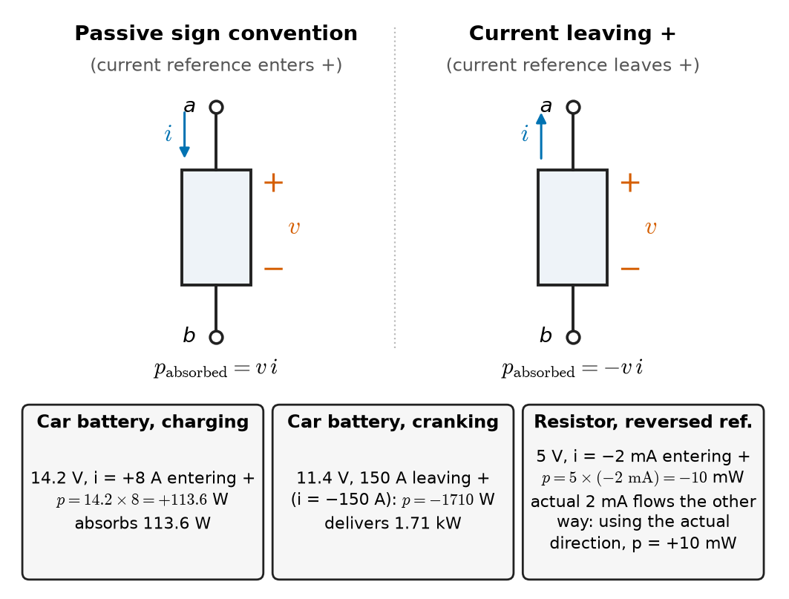
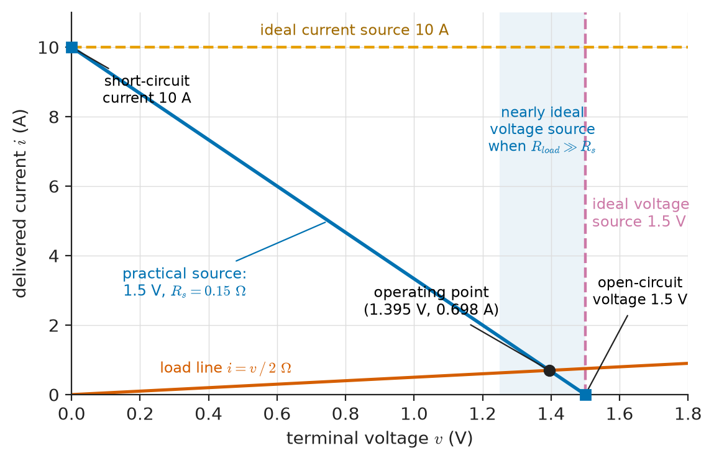
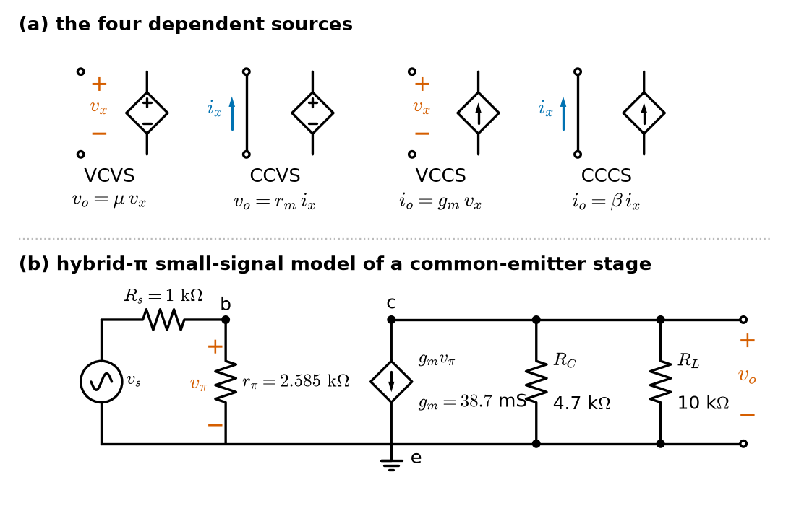
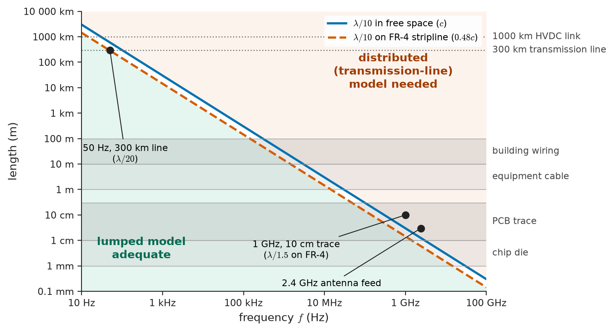
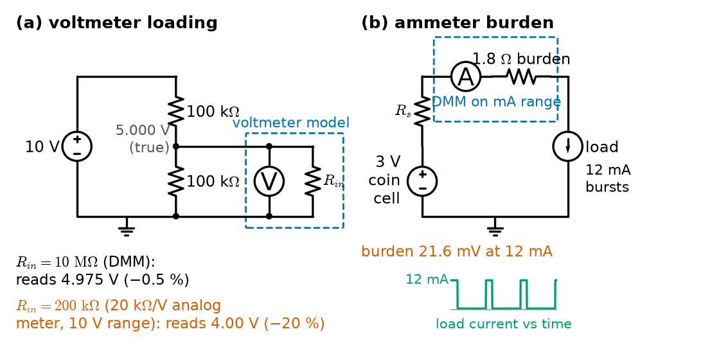

# Chapter 1 — Electrical Quantities and Circuit Models

*Part I · Circuit Fundamentals*

A wearable ECG patch is specified to record a patient's heart for seven days on a single CR2032 coin cell. In the field it shuts down after three. On the bench nothing looks wrong: a handheld multimeter in series with the cell reads an average current of about 0.9 mA, which against the cell's 225 mAh rating predicts more than ten days. The trouble lies in what the meter did not show. Every 100 ms the patch's radio wakes for 5 ms and draws 12 mA; the meter averages those bursts into a steady-looking number. The cell is not an ideal 3 V source either. It has an internal resistance that grows as it discharges, and once that resistance is large enough, each 12 mA burst pulls the terminal voltage below the microcontroller's 2.2 V brown-out threshold. The processor resets, the patch logs a fault, and two-thirds of the cell's charge is never used.

Every quantity in that story — charge, current, voltage, power, energy, the internal resistance of a source, the averaging of a meter — is a basic electrical quantity or a basic circuit model. This chapter defines them carefully, fixes the sign conventions that keep the bookkeeping honest, and states the assumptions under which a physical gadget can be replaced by a drawing of idealised elements joined by wires. Those assumptions, and their limits, carry through every later chapter of the book.

> **What exactly do current, voltage, power and energy measure, and how do we keep their signs straight?**
> **When may a real device be replaced by an ideal element or source, and when does that replacement fail?**

| Concept | Engineering destination |
|---|---|
| Charge, current, voltage, power | Battery sizing, fuse and cable ratings, sensor signal levels |
| Reference directions, passive sign convention | Every circuit equation; deciding which elements supply and which absorb power |
| Energy | Battery life, electricity bills, defibrillator and pulsed-power design |
| Circuit elements | Resistive, capacitive and inductive models of components, cables and loads |
| Ideal and practical sources | Batteries, bench supplies, signal generators, solar cells, 4–20 mA transmitters |
| Independent and dependent sources | Transistor and op-amp small-signal models, current sensors, controlled converters |
| Lumped-element assumptions | Knowing when circuit theory holds and when a transmission-line or field model is needed |
| Circuit diagrams and notation | Reading and drawing schematics, IEC/IEEE symbols, ground conventions |
| Basic measurement concepts | Voltmeter and ammeter connection, loading error, burden voltage, accuracy and resolution |

**Roadmap.** Charge, current, voltage and power (1.1) → reference directions (1.2) → the passive sign convention (1.3) → energy (1.4) → circuit elements (1.5) → ideal and practical sources (1.6) → independent and dependent sources (1.7) → the lumped-element assumptions that make all of this valid (1.8) → how circuits are drawn (1.9) → how their quantities are measured (1.10).

---

## 1.1 Charge, current, voltage and power

### Charge

Electric charge is the property of matter that makes particles exert electric forces on each other. It comes in two signs and in integer multiples of the elementary charge

$$
e = 1.602\,176\,634\times10^{-19}\ \mathrm{C}
$$

(exact, since the 2019 redefinition of the SI). An electron carries $-e$, a proton $+e$. The coulomb is a large unit: one coulomb is the charge of $6.24\times10^{18}$ electrons. Because charge is quantised in such small steps, circuit theory treats it as a continuous quantity $q$; the graininess becomes visible only as *shot noise* in very small currents (Chapter 29).

Charge is conserved: it can move, and positive and negative charges can be separated (as in a battery), but the net charge inside a closed surface changes only by charge crossing that surface.

> **Status of the principle: Conservation of charge**
> *Fundamental.* No experiment has ever observed net charge being created or destroyed; it is built into Maxwell's equations through the continuity equation. Kirchhoff's current law (Chapter 2) is its circuit form.

### Current

Current is the rate at which charge passes through a chosen cross-section:

$$
i(t) = \frac{dq}{dt}
$$

measured in amperes (1 A = 1 C/s). Inverting, the charge transferred between $t_0$ and $t$ is

$$
q(t) - q(t_0) = \int_{t_0}^{t} i(\tau)\,d\tau .
$$

A battery's capacity in ampere-hours is exactly this integral: 1 Ah = 3600 C.

By convention, current is counted as the flow of *positive* charge. In a metal the electrons drift opposite to the conventional current, which makes no difference to any circuit calculation.

It is worth knowing how slowly carriers actually move. The drift velocity is $v_d = I/(nqA)$, with $n$ the carrier density. For copper, $n\approx8.5\times10^{28}\ \mathrm{m^{-3}}$; a 16 A current in a 2.5 mm² conductor gives

$$
v_d = \frac{16}{(8.5\times10^{28})(1.602\times10^{-19})(2.5\times10^{-6})}\approx 4.7\times10^{-4}\ \mathrm{m/s},
$$

about half a millimetre per second. What travels quickly along a wire is not the electrons but the electromagnetic field that pushes them, at a large fraction of the speed of light. That distinction is the root of the lumped-element assumption (Section 1.8).

Currents may be **direct** (DC, constant), **alternating** (AC, periodically reversing, as at 50 or 60 Hz in power systems) or **pulsed**, like the radio bursts of the ECG patch. Table 1.1 shows the range of magnitudes an engineer meets.

**Table 1.1 — Representative current magnitudes.**

| Situation | Typical current |
|---|---|
| Input bias current of a CMOS op-amp | 1 pA – 1 nA |
| Photodiode in an optical receiver | 10 nA – 1 mA |
| Low-power microcontroller in sleep mode | 0.5 – 5 µA |
| Indicator LED | 1 – 20 mA |
| Industrial 4–20 mA current loop | 4 – 20 mA (3.6–21 mA fault signalling) |
| Smartphone under load | 0.1 – 3 A |
| Domestic socket circuit | 13–16 A (Europe), 15–20 A (North America) |
| Electric-vehicle AC charging | 16 – 32 A per phase |
| Car starter motor while cranking | 100 – 300 A |
| Overhead transmission conductor | 0.5 – 3 kA |
| Lightning return stroke (median) | about 30 kA |

### Voltage

The **voltage** (potential difference) between points $a$ and $b$ is the energy per unit charge gained by a positive test charge moved from $b$ to $a$:

$$
v_{ab} = \frac{dw}{dq},
$$

measured in volts (1 V = 1 J/C). The double subscript is read "the voltage of $a$ with respect to $b$", and $v_{ba}=-v_{ab}$. If $v_{ab}=5$ V, then every coulomb carried from $b$ to $a$ gains 5 J of potential energy, and every coulomb that falls from $a$ to $b$ through a load gives up 5 J to that load.

Voltage is defined between *two* points. "The voltage at node 3" means with respect to a chosen reference node, called **ground** or **common**; the choice is arbitrary for calculation.

For the voltage between two points to be well defined, the energy per charge must not depend on the path taken between them. This holds when the electric field is conservative, which is true for static fields and, to excellent approximation, in circuits where no significant time-varying magnetic flux threads the paths of interest. Chapter 2 makes this the basis of Kirchhoff's voltage law and shows where it breaks.

> **Status of the principle: Path-independent voltage**
> *Approximate.* Exact for electrostatic fields; in time-varying circuits it holds when the magnetic flux linking the region between the conductors changes negligibly — the quasi-static, lumped regime of Section 1.8.

Table 1.2 collects typical voltage levels across EEE.

**Table 1.2 — Representative voltage levels.**

| Signal or system | Typical voltage |
|---|---|
| EEG at the scalp | 10 – 100 µV |
| ECG at the skin (R-wave) | 0.5 – 3 mV |
| Type K thermocouple sensitivity | about 41 µV/°C |
| Dynamic microphone output | 1 – 10 mV |
| Consumer line-level audio (−10 dBV) | 0.316 V rms |
| Professional line level (+4 dBu) | 1.228 V rms |
| Digital logic supply | 0.8 – 5 V (1.8, 3.3 and 5 V common) |
| Lithium-ion cell | 3.0 – 4.2 V (3.6–3.7 V nominal) |
| Automotive system | 12.6 V at rest, 13.8–14.4 V charging; 48 V in mild hybrids |
| Mains (single-phase) | 230 V rms at 50 Hz; 120 V rms at 60 Hz |
| Medium-voltage distribution | 11, 13.8, 22, 33 kV |
| Transmission | 132 – 765 kV ac; ±500 – ±800 kV HVDC |

### Power

Power is the rate at which energy is transferred. Combining the definitions of voltage and current,

$$
p = \frac{dw}{dt} = \frac{dw}{dq}\cdot\frac{dq}{dt} = v\,i ,
$$

in watts (1 W = 1 J/s = 1 V·A). It holds instant by instant for any waveform. In AC circuits $p(t)$ oscillates, and its average, reactive and apparent parts are the subject of Chapter 9.

> **Status of the principle: Power as the product of voltage and current**
> *Derived.* It follows directly from the definitions of voltage (energy per charge) and current (charge per time); it is exact at any instant for a two-terminal element in the lumped regime.

---

## 1.2 Reference directions

A circuit is analysed before its currents and voltages are known, and they may be positive or negative, constant or reversing. We therefore attach to every element an **assumed** direction for its current (an arrow) and an **assumed** polarity for its voltage (a + and a − mark). These are *reference directions*: bookkeeping labels, not predictions.

The rule that makes this work is simple. Write every equation consistently with the chosen references; solve; and interpret the sign of the answer:

- If $i = +2$ A, two amperes of positive charge flow in the direction of the arrow.
- If $i = -2$ A, two amperes flow against the arrow.
- If $v = -5$ V for an element marked + on the left, the right-hand terminal is actually 5 V more positive.

Nothing is gained by trying to guess the "true" direction before solving, and nothing is lost by guessing wrong. A negative result is not an error; it is information. What *is* an error is changing a reference halfway through, for instance writing one equation with a current arrow pointing left and another with the same current pointing right.

For time-varying quantities the reference matters even more, because the true direction changes every half-cycle. The current through a mains load is $i(t)=I_m\cos\omega t$ with respect to its arrow; it flows with the arrow for half of each cycle and against it for the other half. The reference arrow is what makes "$\cos\omega t$" mean something.

Double subscripts carry a reference with them: $v_{ab}=-v_{ba}$ and $i_{ab}=-i_{ba}$. With a ground node chosen, $v_a$ alone means $v_{a0}$, and any element voltage is a difference of node voltages, $v_{ab}=v_a-v_b$ — the basis of nodal analysis (Chapter 3).

Instruments have reference directions too. A multimeter's red lead is its + reference, so a reading of −3.30 V means the red probe is at the lower potential. A clamp-on current probe carries an arrow on its jaws, and clamping one of three phase probes backwards is a classic cause of "negative power" in power-quality surveys.

---

## 1.3 Passive sign convention

### The convention

Once each element has a voltage polarity and a current arrow, there are two ways the arrow can relate to the polarity: current can be referenced to enter the + terminal, or to leave it. The **passive sign convention** is the choice to always reference the current *into* the terminal marked +. With that choice,

$$
p = v\,i \quad\text{is the power absorbed by the element.}
$$

If $p>0$ the element absorbs energy from the rest of the circuit (dissipating it as heat, storing it in a field, or converting it to light, sound or motion). If $p<0$ it delivers energy to the rest of the circuit.

If the current reference instead leaves the + terminal, the same product $vi$ is the power *delivered*, and the power absorbed is $-vi$. Figure 1.1 shows both cases.

<!-- FIGURE 1.1 | figures/ch01/fig-1-1-passive-sign-convention.png | schematic | The passive sign convention: with the current reference entering the + terminal, the product vi is the power absorbed by the element. | Content: two side-by-side panels each showing a generic two-terminal element drawn as a rectangle with terminals a (top) and b (bottom). Left panel labelled "passive sign convention": + at a, − at b, current arrow i entering terminal a, caption text "p_absorbed = v i". Right panel labelled "current leaving +": same polarity, arrow i leaving terminal a, caption text "p_absorbed = −v i". Below, a third strip with three numeric cases: car battery 14.2 V with 8 A entering + (absorbs 113.6 W, charging); car battery 11.4 V with 150 A leaving + (absorbs −1710 W, i.e. delivers 1.71 kW); resistor 5 V with −2 mA entering + (absorbs −10 mW, so the reference was simply reversed, actual current 2 mA flows the other way and absorbs +10 mW using the actual direction). -->

*Figure 1.1 — The passive sign convention: with the current reference entering the + terminal, the product vi is the power absorbed by the element.*

Every element can be labelled with the passive convention, including sources; the convention does not decide which elements are sources and which are loads — the arithmetic does. It is a convention, not a law, chosen because element laws then take their most familiar form: Ohm's law is $v=Ri$ (not $v=-Ri$), the capacitor law is $i=C\,dv/dt$, and the inductor law is $v=L\,di/dt$, all with positive coefficients. Using it everywhere means that the element equations of Chapters 2–5 can be copied without sign adjustments.

> **Boundary.** Electrical machines and power-system engineers often use a *generator convention* for sources and machines (current referenced out of the + terminal, so positive power means delivered). Both conventions are correct; mixing them inside a single calculation is the error. Machine conventions are treated in *Electrical Energy & Machines*.

**Worked example — Who supplies and who absorbs in a car electrical system.** With the engine running, a car's alternator holds the system at 14.2 V. The battery, labelled passively (+ at its positive post, current arrow entering the positive post), carries $i_B=+8.0$ A; the headlamps, ignition and electronics, labelled passively as one load, carry $i_L=+42.0$ A; the alternator, also labelled passively, carries $i_A$.

All three are connected between the same two conductors, so they share $v=14.2$ V. Charge conservation at the positive bus (Chapter 2) requires the three currents entering their + terminals to sum to zero: $i_A+i_B+i_L=0$, so $i_A=-50.0$ A.

Powers absorbed: battery $14.2\times8.0=113.6$ W (it is charging); load $14.2\times42.0=596.4$ W; alternator $14.2\times(-50.0)=-710.0$ W. The sum is $113.6+596.4-710.0=0$: energy is conserved, and the negative sign identifies the alternator as the only element delivering power.

Now the engine is stopped and the starter cranks. The battery terminal falls to 11.4 V and 150 A leaves its positive post. Labelled passively, $i_B=-150$ A, so the battery absorbs $11.4\times(-150)=-1710$ W; it delivers 1.71 kW to the starter. The same element, the same convention, and the sign of the result tells the story.

---

## 1.4 Energy

Energy is the integral of power over time:

$$
w(t_0,t) = \int_{t_0}^{t} p(\tau)\,d\tau = \int_{t_0}^{t} v(\tau)\,i(\tau)\,d\tau ,
$$

in joules. With the passive convention, $w$ is the energy absorbed by the element over the interval. For a constant power $P$ over a time $T$, $w=PT$.

Electricity is billed in kilowatt-hours ($1\ \mathrm{kWh}=3.6$ MJ) and batteries are rated in watt-hours ($1\ \mathrm{Wh}=3600$ J). An ampere-hour rating is a charge, not an energy; multiplied by the average discharge voltage it gives watt-hours.

**Table 1.3 — Representative energies.**

| Store or event | Typical energy |
|---|---|
| One radio burst of the ECG patch (2.85 V, 12 mA, 5 ms) | 0.17 mJ |
| CR2032 coin cell | about 0.65 Wh (2.3 kJ) |
| Alkaline AA cell (low drain) | 2.5 – 3.5 Wh |
| Smartphone battery | 12 – 20 Wh |
| External defibrillator shock | 120 – 360 J delivered |
| Electric kettle, 2 kW for 3 min | 0.1 kWh (360 kJ) |
| Laptop battery | 40 – 100 Wh |
| Daily household consumption | roughly 5 – 30 kWh, strongly country-dependent |
| Electric-vehicle battery | 40 – 100 kWh |

### Conservation of energy in circuits

In any circuit the total power absorbed by all elements, counted with the passive convention, is zero at every instant: what the sources deliver, the other elements absorb. This was visible in the alternator example above. In Chapter 2 it appears as *power balance*, a check on every analysis, and in Chapter 3 it is proved from Kirchhoff's laws alone as Tellegen's theorem.

**Worked example — Energy budget of the ECG patch.** The CR2032 coin cell in the opening story is rated 225 mAh at a nominal 3.0 V.

Charge available: $Q=0.225\ \mathrm{Ah}\times3600\ \mathrm{s/h}=810$ C. Energy available: $W\approx QV=810\times3.0=2430$ J $=0.675$ Wh.

For a seven-day (168 h) life, the average current must not exceed $225/168=1.34$ mA.

The current profile is a sleep current of 0.30 mA, plus a radio burst of 12 mA lasting 5 ms every 100 ms (duty cycle $D=0.05$). The average current is

$$
\bar{i} = 0.30 + (12-0.30)\times0.05 = 0.885\ \mathrm{mA},
$$

so the charge budget predicts $225/0.885=254$ h, or 10.6 days. On charge alone the design has a margin of about 50 %.

Each burst consumes about $2.85\ \mathrm{V}\times12\ \mathrm{mA}\times5\ \mathrm{ms}=0.17$ mJ. Energy is not the problem. The failure is a *power* problem: the cell cannot deliver 12 mA at a high enough voltage once its internal resistance rises. Section 1.6 completes the calculation.

---

## 1.5 Circuit elements

### What an element is

A **circuit element** is an idealised two-terminal (or multi-terminal) object defined by a mathematical relation between its terminal voltage and current. It is a model, not a component. A real resistor is approximately a resistor element, but at high frequency it is better modelled as a resistor in series with a small inductance and in parallel with a small capacitance; a real cable may need resistors, inductors and capacitors per metre (Chapter 14). Modelling is the art of choosing the fewest elements that reproduce the behaviour that matters.

The basic two-terminal elements of this book are:

**Table 1.4 — Basic circuit elements and their defining relations (passive sign convention).**

| Element | Symbol parameter | Defining relation | Energy behaviour |
|---|---|---|---|
| Resistor | $R$ (Ω) or $G=1/R$ (S) | $v = R\,i$ | Dissipates; $p=i^2R\ge0$ |
| Capacitor | $C$ (F) | $i = C\,dv/dt$ | Stores $\tfrac12Cv^2$ in the electric field |
| Inductor | $L$ (H) | $v = L\,di/dt$ | Stores $\tfrac12Li^2$ in the magnetic field |
| Ideal voltage source | $v_s(t)$ | $v = v_s(t)$ for any $i$ | Supplies or absorbs any power |
| Ideal current source | $i_s(t)$ | $i = i_s(t)$ for any $v$ | Supplies or absorbs any power |
| Short circuit | — | $v=0$ for any $i$ | No power |
| Open circuit | — | $i=0$ for any $v$ | No power |
| Ideal switch | state | Short when closed, open when open | No power (ideal) |

Multi-terminal elements include coupled inductors and the ideal transformer (Chapter 5), the four dependent sources of Section 1.7, and the two-port networks of Chapter 12.

### Classifying elements

**Linear or nonlinear.** An element is linear if its defining relation is linear in $v$ and $i$ (and their derivatives and integrals). Resistors, capacitors and inductors with constant parameters are linear; a diode, whose current rises exponentially with voltage, is not. Linearity is what makes superposition, Thévenin equivalents, phasors and transfer functions possible (Chapters 4, 8, 11).

**Time-invariant or time-varying.** An element whose parameters do not change with time is time-invariant. A switch, a varactor tuned by a control voltage and a condenser microphone are time-varying. Linear time-invariant (LTI) circuits are the subject of Parts II–IV.

**Passive or active.** An element is **passive** if the total energy it has absorbed from the start, plus whatever energy it initially held, can never become negative:

$$
w(t) = w(t_0) + \int_{t_0}^{t} v\,i\,d\tau \;\ge\;0\quad\text{for all }t\text{ and all excitations.}
$$

Resistors with $R\ge0$, capacitors and inductors with positive values, and ideal transformers are passive. An element that can deliver net energy indefinitely — an independent source, a dependent source, a negative resistance — is **active**. A circuit made only of passive elements cannot produce growing oscillations, a fact that becomes a stability result in Chapters 13 and 34.

**Lumped or distributed.** A lumped element is concentrated at a point: its current is the same at both terminals and its voltage is well defined. A distributed element, such as a long cable, has voltage and current that vary along its length. Section 1.8 states when the lumped description is allowed.

### Representative component values

**Table 1.5 — Typical ranges and tolerances of passive components.**

| Component | Typical range | Typical tolerance | Notes |
|---|---|---|---|
| Thick-film chip resistor | 1 Ω – 10 MΩ | ±1 % or ±5 % | Temperature coefficient 100–200 ppm/K |
| Thin-film / metal-film resistor | 10 Ω – 1 MΩ | ±0.1 % – ±1 % | 5–50 ppm/K; used in precision dividers |
| Current-sense (shunt) resistor | 0.1 mΩ – 1 Ω | ±0.5 % – ±1 % | Kelvin (four-terminal) versions for accuracy |
| Ceramic capacitor (C0G/NP0) | 0.5 pF – 0.1 µF | ±1 % – ±5 % | Stable with voltage and temperature |
| Ceramic capacitor (X7R/X5R) | 100 pF – 100 µF | ±10 % – ±20 % | Capacitance falls with DC bias |
| Aluminium electrolytic | 0.1 µF – 1 F | ±20 % | ESR of mΩ to Ω; polarised |
| Power inductor | 0.1 µH – 1 mH | ±20 % – ±30 % | Saturates above rated current |
| RF inductor (air-core, thin-film) | 1 nH – 1 µH | ±2 % – ±5 % | Self-resonant frequency limits use |

---

## 1.6 Ideal and practical sources

### Ideal sources

An **ideal voltage source** maintains a specified voltage $v_s(t)$ across its terminals regardless of the current through it. Its current is whatever the rest of the circuit demands, positive, negative or zero. Its $i$–$v$ characteristic is a vertical line at $v=v_s$ on a plot of current against voltage (Figure 1.2).

An **ideal current source** maintains a specified current $i_s(t)$ through itself regardless of the voltage across it. Its characteristic is a horizontal line at $i=i_s$.

Ideal sources admit inconsistent connections that diagrams must avoid: a shorted voltage source or two unequal voltage sources in parallel; dually, an open-circuited current source or two unequal current sources in series. Chapter 3 states these as solvability conditions.

### Practical sources

Real sources lose voltage as they deliver current. The simplest model that captures this is an ideal voltage source $V_s$ in series with an internal (source) resistance $R_s$:

$$
v = V_s - R_s\,i ,
$$

where $i$ is the current delivered out of the + terminal. Its characteristic is a straight line through the open-circuit voltage $v=V_s$ (at $i=0$) and the short-circuit current $i_{sc}=V_s/R_s$ (at $v=0$). An equivalent model is an ideal current source $I_s=V_s/R_s$ in parallel with the same $R_s$; the two describe the same terminal line and are interchangeable (source transformation, Chapter 2). A source whose $R_s$ is small compared with its load behaves almost like an ideal voltage source; one whose $R_s$ is large behaves almost like an ideal current source.

<!-- FIGURE 1.2 | figures/ch01/fig-1-2-source-iv-characteristics.png | plot | Terminal characteristics of ideal and practical sources, with the load line of a 2 ohm resistor. | Content: x-axis terminal voltage v from 0 to 1.8 V, y-axis delivered current i from 0 to 11 A. Vertical line at v = 1.5 V labelled "ideal voltage source 1.5 V". Horizontal line at i = 10 A labelled "ideal current source 10 A". Straight line from (1.5 V, 0 A) to (0 V, 10 A) labelled "practical source: 1.5 V, Rs = 0.15 ohm" with intercepts marked "open-circuit voltage" and "short-circuit current". Load line i = v/2 for a 2 ohm resistor, intersection marked at (1.395 V, 0.698 A) labelled "operating point". Light shading of the region near the open-circuit point labelled "nearly ideal voltage source when R_load >> Rs". -->

*Figure 1.2 — Terminal characteristics of ideal and practical sources, with the load line of a 2 ohm resistor.*

Figure 1.2 shows these lines for an alkaline AA cell. Where the source line crosses the load line $i=v/R_L$ the circuit operates; this graphical construction works for nonlinear loads too and is used for diodes and transistors in *Electronics & Computing*.

The linear model is itself an approximation. A battery's internal resistance depends on its state of charge, temperature, age and the duration of the load pulse; a solar cell's characteristic is strongly curved; a laboratory power supply is nearly ideal up to its current limit and then switches to behaving as a current source. Table 1.6 lists typical values.

**Table 1.6 — Typical source parameters.**

| Source | Open-circuit or set value | Typical internal resistance |
|---|---|---|
| Alkaline AA cell (fresh) | 1.5–1.6 V | 0.1 – 0.3 Ω |
| CR2032 lithium coin cell | 3.0–3.2 V | 10 – 30 Ω fresh, rising to 100 Ω or more near end of life and at low temperature |
| 18650 Li-ion cell | 3.0–4.2 V | 15 – 50 mΩ |
| 12 V lead-acid car battery | 12.6–12.8 V at rest | 5 – 10 mΩ (healthy) |
| Bench power supply (CV mode) | 0–30 V | a few mΩ up to its current limit |
| Function generator | up to 10–20 V peak-to-peak | 50 Ω (by design, to match coaxial cable) |
| Audio power-amplifier output | — | under 0.1 Ω (damping factor above 80 into 8 Ω) |
| Mains socket outlet (source impedance) | 230 V / 120 V rms | 0.1 – 1 Ω, depending on distance from transformer |
| Industrial 4–20 mA transmitter | 4–20 mA | very large: behaves as a current source over its compliance range |
| Silicon solar cell (near short circuit) | 30–40 mA/cm² | large shunt resistance: behaves as a current source below its knee |

> **Status of the principle: Linear (Thévenin) model of a practical source**
> *Approximate.* A first-order straight-line fit to a real source's terminal characteristic near its operating point; it ignores the dependence of internal resistance on state of charge, temperature and pulse duration, and the curvature of photovoltaic and current-limited characteristics.

**Worked example — An AA cell driving a load.** An alkaline cell with $V_s=1.50$ V and $R_s=0.15\ \Omega$ drives a 2.0 Ω load (a small motor in its running condition, approximated as a resistor).

Current: $i=V_s/(R_s+R_L)=1.50/2.15=0.698$ A. Terminal voltage: $v=iR_L=1.395$ V, a drop of 0.105 V from open circuit.

Power to the load: $i^2R_L=0.973$ W. Power lost inside the cell: $i^2R_s=0.073$ W. Efficiency $R_L/(R_L+R_s)=93.0$ %.

The short-circuit current is $V_s/R_s=10$ A — which is why AA cells can melt a stray paper clip across their terminals. The maximum power the cell could deliver to any load occurs for $R_L=R_s$ and is $V_s^2/(4R_s)=3.75$ W, but at only 50 % efficiency (Chapter 4 proves this maximum-power-transfer result).

**Worked example — Why the ECG patch dies early.** Return to the CR2032. On its voltage plateau the cell's open-circuit voltage is about 2.85 V. When fresh, its internal resistance is about 15 Ω, so during a 12 mA radio burst the terminal voltage is

$$
v = 2.85 - 0.012\times15 = 2.67\ \mathrm{V},
$$

comfortably above the 2.2 V brown-out threshold. The burst pulls the terminal below threshold once

$$
R_s > \frac{2.85-2.20}{0.012} = 54\ \Omega .
$$

A coin cell's internal resistance climbs through this range well before its rated charge is exhausted, and climbs faster in a cold environment or when pulses are frequent. The patch fails because its designer budgeted *charge* (Section 1.4) but not *source resistance*. The engineering fixes follow from the model: a reservoir capacitor across the cell supplies the burst current and is recharged slowly between bursts, a lower brown-out threshold widens the margin, or a cell chemistry with lower internal resistance is chosen. Chapters 5 and 6 supply the tools to size the reservoir capacitor.

---

## 1.7 Independent and dependent sources

### Independent sources

The sources of Section 1.6 are **independent**: their value $v_s(t)$ or $i_s(t)$ is specified from outside the circuit and does not depend on any voltage or current inside it. Independent sources represent the inputs to a circuit — batteries, mains, signal generators, microphones, antennas, sensors — and are drawn as circles (with + and − for voltage, an arrow for current).

### Dependent (controlled) sources

A **dependent source** produces a voltage or current that is set by a voltage or current *elsewhere in the circuit*. There are four kinds, determined by what is controlled (voltage or current output) and what controls it (a voltage or a current):

**Table 1.7 — The four dependent sources.**

| Name | Output | Control | Relation | Gain unit | Typical device it models |
|---|---|---|---|---|---|
| VCVS (voltage-controlled voltage source) | voltage | voltage | $v_o = \mu\,v_x$ | V/V | Op-amp open-loop gain, ideal amplifier stage |
| CCVS (current-controlled voltage source) | voltage | current | $v_o = r_m\,i_x$ | Ω (transresistance) | Transimpedance amplifier, Hall-effect or shunt current sensor |
| VCCS (voltage-controlled current source) | current | voltage | $i_o = g_m\,v_x$ | S (transconductance) | MOSFET and BJT small-signal model, OTA |
| CCCS (current-controlled current source) | current | current | $i_o = \beta\,i_x$ | A/A | BJT current gain, ideal current transformer, current mirror |

They are drawn as diamonds, with + and − for a controlled voltage source or an arrow for a controlled current source, and the controlling variable must be labelled clearly on the diagram (Figure 1.3).

<!-- FIGURE 1.3 | figures/ch01/fig-1-3-dependent-sources.png | schematic | The four dependent sources and a common use: the hybrid-pi small-signal model of a bipolar transistor. | Content: top row of four diamond symbols with labels "VCVS: vo = mu vx", "CCVS: vo = rm ix", "VCCS: io = gm vx", "CCCS: io = beta ix", each with a small controlling branch drawn to its left showing vx with + and − or ix with an arrow. Bottom: small-signal amplifier model: source vs with Rs = 1 kOhm feeding base node b, r_pi = 2.585 kOhm from b to emitter (ground), VCCS gm v_pi = 38.7 mS times v_pi from collector c to emitter, RC = 4.7 kOhm and RL = 10 kOhm in parallel from c to ground; output vo labelled across RL. -->

*Figure 1.3 — The four dependent sources and a common use: the hybrid-pi small-signal model of a bipolar transistor.*

A dependent source is **not** a source of energy in its own right. It models a device that steers power drawn from a supply left out of the diagram (an op-amp's rails, a transistor's collector supply); it is active because the signal power it delivers can exceed the power its control terminals absorb, which is what amplification means.

Dependent sources usually arise from **linearisation**. A bipolar transistor's collector current depends exponentially on its base–emitter voltage; for small variations about a bias point the slope is the transconductance $g_m=I_C/V_T$, with $V_T=kT/q\approx25.9$ mV at 300 K. The VCCS $g_mv_{be}$ holds only while the signal is small compared with $V_T$.

> **Status of the principle: Linear dependent-source models of active devices**
> *Approximate.* First-order Taylor expansions of nonlinear device characteristics about a fixed operating point; accurate for small signal amplitudes and frequencies below the device's internal capacitive limits, and invalid for switching or large-signal operation.

> **Boundary.** How transistors and op-amps produce these characteristics, and how their bias points are set, belongs to *Electronics & Computing*. This book uses the resulting dependent-source models as network elements; Chapter 3 analyses circuits that contain them.

**Worked example — Voltage gain of a transistor stage from its dependent-source model.** A bipolar transistor biased at $I_C=1.0$ mA has $g_m=I_C/V_T=1.0\ \mathrm{mA}/25.85\ \mathrm{mV}=38.7$ mS. With current gain $\beta=100$, its input resistance is $r_\pi=\beta/g_m=2.585\ \mathrm{k\Omega}$. In the circuit of Figure 1.3, a signal source $v_s$ with $R_s=1\ \mathrm{k\Omega}$ drives the base; the collector load is $R_C=4.7\ \mathrm{k\Omega}$ in parallel with an external load $R_L=10\ \mathrm{k\Omega}$.

Input side: $r_\pi$ and $R_s$ form a divider, so $v_\pi = v_s\,r_\pi/(r_\pi+R_s)=0.721\,v_s$.

Output side: the VCCS drives $g_mv_\pi$ into $R_C\parallel R_L=4.7\times10/14.7=3.197\ \mathrm{k\Omega}$; with the current arrow pointing from collector to emitter, $v_o=-g_mv_\pi(R_C\parallel R_L)$.

Gain from the base: $v_o/v_\pi=-38.7\ \mathrm{mS}\times3.197\ \mathrm{k\Omega}=-123.7$. Gain from the source: $v_o/v_s=-123.7\times0.721=-89.2$.

A 1 mV signal at the source therefore becomes an 89 mV inverted signal at the load. For a 1 mV-peak sinusoid the source delivers only $v_s^2/[2(R_s+r_\pi)]\approx0.14$ nW, while the load receives $(89.2\ \mathrm{mV})^2/(2\cdot10\ \mathrm{k\Omega})\approx0.40$ µW of signal power (peak values, sinusoidal signal): a power gain of more than a thousand, supplied by the collector power supply that the model does not show.

---

## 1.8 Lumped-element assumptions

### From fields to circuits

Electromagnetism is governed by Maxwell's equations, which describe fields that vary continuously in space and propagate at a finite speed. Circuit theory replaces those fields by a handful of numbers — one voltage per node pair, one current per branch — and replaces partial differential equations by algebraic and ordinary differential equations. This is an enormous simplification. It is justified only when the following assumptions hold:

1. **Small size compared with wavelength.** The physical dimensions of the circuit are small compared with the wavelength $\lambda=v_p/f$ of the highest significant frequency, where $v_p$ is the propagation speed in the medium. Then an electromagnetic disturbance crosses the circuit in a time much shorter than any time scale of interest, and every point of a connecting wire can be treated as responding simultaneously.
2. **Confined fields.** Electric fields are confined inside capacitors and magnetic fields inside inductors (or at least their coupling to other parts of the circuit is either negligible or modelled explicitly as mutual inductance or stray capacitance).
3. **Charge neutrality of elements.** The net charge on every element is zero: whatever current enters one terminal leaves the other at the same instant. (A capacitor holds $+q$ on one plate and $-q$ on the other, net zero.)
4. **Ideal interconnects.** Wires joining elements have negligible resistance, inductance and capacitance, or these are included as explicit lumped elements.

Under these assumptions element currents and node voltages are well defined, and the laws of Chapter 2 follow.

> **Status of the principle: Lumped-element approximation**
> *Approximate.* A quasi-static limit of Maxwell's equations, valid when circuit dimensions are much smaller than the shortest relevant wavelength (a common working rule is below $\lambda/10$, or below about one-sixth of the distance a signal edge travels in its rise time) and when radiation and stray coupling are negligible; it fails for long power lines, high-speed digital interconnects, RF and microwave circuits.

### How small is small?

Table 1.8 gives wavelengths at familiar frequencies, both in free space and on a typical FR-4 printed circuit board, where a signal on a stripline travels at about $c/\sqrt{4.3}\approx0.48c$, a delay of about 6.9 ns per metre.

**Table 1.8 — Wavelength and the lumped limit at representative frequencies.**

| Frequency | Application | Free-space $\lambda$ | $\lambda$ on FR-4 stripline | $\lambda/10$ on FR-4 |
|---|---|---|---|---|
| 50 Hz | European mains | 6000 km | 2890 km | 289 km |
| 60 Hz | North American mains | 5000 km | 2410 km | 241 km |
| 20 kHz | Top of the audio band | 15 km | 7.2 km | 720 m |
| 1 MHz | AM radio, switching converters | 300 m | 145 m | 14.5 m |
| 100 MHz | FM radio, fast logic harmonics | 3.0 m | 1.45 m | 14.5 cm |
| 1 GHz | Cellular, DDR memory | 30 cm | 14.5 cm | 1.45 cm |
| 2.4 GHz | Wi-Fi, Bluetooth | 12.5 cm | 6.0 cm | 6.0 mm |
| 10 GHz | X-band radar, satellite | 3.0 cm | 1.45 cm | 1.45 mm |

(For power cables and overhead lines the propagation speed is close to $c$, so the free-space column applies; the FR-4 column is shown for board-level electronics.)

<!-- FIGURE 1.4 | figures/ch01/fig-1-4-lumped-validity-map.png | plot | Where the lumped model holds: one-tenth of a wavelength versus frequency, compared with typical circuit dimensions. | Content: log-log axes, x-axis frequency from 10 Hz to 100 GHz, y-axis length from 0.1 mm to 10 000 km. Two descending straight lines: lambda/10 in free space (c = 3e8 m/s) and lambda/10 on FR-4 stripline (v = 0.48c). Region below the lines shaded and labelled "lumped model adequate", region above labelled "distributed (transmission-line) model needed". Horizontal bands marking typical sizes: chip die 1–10 mm, PCB trace 1–30 cm, equipment cable 1–10 m, building wiring 10–100 m, 300 km transmission line, 1000 km HVDC link. Points marked: "50 Hz, 300 km line (lambda/20)", "1 GHz, 10 cm trace (lambda/1.5 on FR-4)", "2.4 GHz antenna feed". -->

*Figure 1.4 — Where the lumped model holds: one-tenth of a wavelength versus frequency, compared with typical circuit dimensions.*

Figure 1.4 places typical circuit sizes against the $\lambda/10$ boundary. The conclusions are worth stating plainly:

- **Power systems.** Building wiring at 50 or 60 Hz is lumped by a factor of thousands. A 300 km transmission line at 50 Hz is about $\lambda/20$ long: lumped models with series impedance and shunt capacitance (the "nominal-π" model) are used up to roughly 250 km, but longer lines need distributed treatment (Chapter 14). Harmonics and switching transients reach far higher frequencies, so the same line can be lumped for the fundamental and distributed for a lightning surge.
- **Digital electronics.** For digital signals what matters is not the clock frequency but the edge rate: a signal edge with rise time $t_r$ contains significant energy up to about $0.35/t_r$. A trace is commonly treated as lumped if its one-way delay is below about one-sixth of $t_r$.
- **RF and microwave.** Interconnects are almost always distributed; circuits are designed in terms of transmission lines and scattering parameters (Chapters 14 and 32).

**Worked example — Is a PCB trace lumped?** A microcontroller drives a clock line with a 1.0 ns rise time on an FR-4 stripline, delay $t_{pd}=\sqrt{4.3}/c=6.92$ ns/m.

The significant bandwidth is about $0.35/t_r=350$ MHz. Critical length, using the one-sixth rule: $\ell_c=t_r/(6t_{pd})=1.0\ \mathrm{ns}/(6\times6.92\ \mathrm{ns/m})=0.024$ m, about 2.4 cm.

A 2 cm trace may be treated as a lumped capacitance on the driver; a 15 cm trace across the board is six times the critical length and will ring and reflect unless terminated, the "ringing bus" that Chapter 14 explains with the telegrapher's equations. The same clock with a 10 ns edge would have a 24 cm critical length: slowing edges is a legitimate way to stay in the lumped regime.

### What fails, and why

When the lumped assumptions fail, the failure is not arbitrary; specific physics is missing.

- **Propagation delay.** The current entering one end of a wire no longer equals, at that instant, the current leaving the other; the distributed model of Chapter 14 is needed.
- **Radiation.** A conductor that is a significant fraction of a wavelength long radiates (an antenna, Chapter 32); energy leaves without passing through any element.
- **Induced voltage around loops.** Changing magnetic flux makes voltage path-dependent; a probe with a long ground lead "sees" voltages that are not in the circuit (Chapter 2).
- **Stray coupling.** Crosstalk and parasitic oscillation, sometimes recoverable by adding stray capacitances and mutual inductances explicitly.

> **Boundary.** Maxwell's equations, wave propagation and radiation are developed in *Engineering Physics*. This book uses their quasi-static limit (lumped circuits) and, from Chapter 14 on, their one-dimensional transmission-line limit.

---

## 1.9 Circuit diagrams and notation

A **circuit diagram** (schematic) records which element terminals are connected to which, nothing more. It is a topological statement: lengths and positions of the lines carry no meaning, and two drawings that connect the same terminals in the same way are the same circuit.

### Nodes, branches and connections

- A **node** is a point where two or more element terminals are connected; all the wire drawn between them, however long, is one node and, under the lumped assumptions, one equipotential.
- A **branch** is a single two-terminal element (some texts use the word for a series string carrying one current).
- A **junction dot** marks a connection; lines crossing without a dot are not connected, and careful drawings avoid four-way junctions altogether.
- **Net labels** (VCC, CLK) connect every point carrying the same name, across sheets.

### Reference and ground symbols

Three reference symbols are in common use: **earth (protective) ground**, three lines of decreasing length, bonded to the physical earth for safety; **chassis ground**, a hatched line, bonded to the enclosure; and **signal ground or common**, a triangle or bar, the 0 V reference of the circuit, which in a battery instrument connects to nothing outside. Analysing a circuit, all three are simply "the reference node". Designing one, the distinction matters for safety and noise: a circuit whose signal ground is joined to earth in two places forms a ground loop, in which a changing magnetic field induces currents that appear as mains hum in audio or as baseline wander in an ECG.

### Element symbols

Two symbol families coexist. **IEC 60617** (used in Europe, Asia and most of the world) draws a resistor as a rectangle; **IEEE Std 315 / ANSI Y32.2** (North America) draws it as a zigzag. Independent sources are circles; dependent sources are diamonds (Section 1.7). Both families are used in this book's figures, and engineers must read both.

### Variable conventions

This book follows the widely used conventions below; later chapters add to them.

**Table 1.9 — Notation conventions.**

| Symbol style | Meaning | Example |
|---|---|---|
| Lowercase, time argument | Instantaneous, possibly time-varying quantity | $v(t)$, $i_L(t)$, $p(t)$ |
| Uppercase | DC (constant) value, or an amplitude or rms value | $V_{CC}=5$ V, $I_m$, $V_{\mathrm{rms}}$ |
| Bold uppercase | Phasor (complex amplitude), from Chapter 8 | $\mathbf{V}=230\angle0^\circ$ V |
| Uppercase with $s$ argument | Laplace transform, from Chapter 11 | $V(s)$, $H(s)$ |
| Double subscript | Voltage from first to second node; current from first to second | $v_{ab}$, $i_{ab}$ |
| Single subscript | Node voltage with respect to ground; branch or element current | $v_3$, $i_R$ |

Values use SI prefixes (p, n, µ, m, k, M, G); on schematics the prefix often replaces the decimal point, so "4k7" means 4.7 kΩ and "2R2" means 2.2 Ω, a habit that survives smudged printing.

Resistors and capacitors are manufactured in preferred-number series defined in **IEC 60063**, in which successive values form a geometric sequence. The number of values per decade sets the series, and the tolerance is chosen so that adjacent values roughly touch:

**Table 1.10 — Preferred-number (E) series.**

| Series | Values per decade | Typical tolerance | Example values in one decade |
|---|---|---|---|
| E6 | 6 | ±20 % | 1.0, 1.5, 2.2, 3.3, 4.7, 6.8 |
| E12 | 12 | ±10 % | E6 plus 1.2, 1.8, 2.7, 3.9, 5.6, 8.2 |
| E24 | 24 | ±5 % | E12 plus 1.1, 1.3, 1.6, 2.0, 2.4, 3.0, ... |
| E96 | 96 | ±1 % | 1.00, 1.02, 1.05, 1.07, ... |
| E192 | 192 | ±0.5 % and tighter | 1.00, 1.01, 1.02, 1.04, ... |

A calculated 300 Ω becomes 330 Ω (E12) or 300 Ω (E24); Chapter 2 checks such a choice for an LED resistor.

---

## 1.10 Basic measurement concepts

The quantities of this chapter are measured with voltmeters, ammeters, oscilloscopes and their combination in the digital multimeter (DMM). Measurement is itself a circuit problem: the instrument becomes part of the circuit, and it changes what it measures.

### Connecting instruments

- A **voltmeter** goes *in parallel* with the element; an ideal one draws no current (infinite input resistance).
- An **ammeter** goes *in series*, so the circuit must be broken; an ideal one has no voltage across it (zero resistance).
- A **wattmeter** combines a series current sensor and a parallel voltage sensor and reports the average of $vi$ (Chapter 9).
- A **clamp meter** senses the magnetic field around a conductor and measures current without breaking the circuit.

Figure 1.5 shows the models of real instruments: an ideal voltmeter in parallel with its input resistance $R_{in}$, and an ideal ammeter in series with its shunt and wiring resistance.

<!-- FIGURE 1.5 | figures/ch01/fig-1-5-meter-loading.png | circuit | Instruments are circuit elements: a voltmeter with finite input resistance loads a high-impedance divider, and an ammeter inserts a burden resistance in series. | Content: left panel: 10 V DC source feeding a divider of two 100 kOhm resistors; a voltmeter drawn as an ideal meter in parallel with R_in across the lower resistor; annotations "R_in = 10 MOhm: reads 4.975 V (−0.5 %)", "R_in = 200 kOhm (20 kOhm/V analog meter, 10 V range): reads 4.00 V (−20 %)". Right panel: 3 V coin cell with internal resistance Rs in series with a DMM on its mA range modelled as ideal ammeter plus burden resistance 1.8 Ohm, feeding a load drawn as a current sink with bursts of 12 mA; annotation "burden 21.6 mV at 12 mA". -->

*Figure 1.5 — Instruments are circuit elements: a voltmeter with finite input resistance loads a high-impedance divider, and an ammeter inserts a burden resistance in series.*

### Loading error

A voltmeter across a high-resistance circuit draws current that the circuit would not otherwise supply, lowering the voltage it reads.

**Worked example — Voltmeter loading on a resistive divider.** A 10.0 V supply drives a divider of two 100 kΩ resistors; the true midpoint voltage is 5.000 V. The lower resistor is measured with three instruments.

A DMM with $R_{in}=10\ \mathrm{M\Omega}$: the lower branch becomes $100\ \mathrm{k\Omega}\parallel10\ \mathrm{M\Omega}=99.01\ \mathrm{k\Omega}$, and the reading is $10\times99.01/(100+99.01)=4.975$ V, an error of −0.50 %.

An analogue meter rated 20 kΩ/V on its 10 V range has $R_{in}=200\ \mathrm{k\Omega}$: the lower branch becomes 66.67 kΩ and the reading is $10\times66.67/166.67=4.000$ V, an error of −20 %.

An oscilloscope with a 1× probe, $R_{in}=1\ \mathrm{M\Omega}$: lower branch 90.91 kΩ, reading 4.762 V, error −4.8 %. A 10× probe raises $R_{in}$ to 10 MΩ and restores the DMM result, at the price of a tenfold reduction in signal.

The rule of thumb that follows — the instrument's input resistance should exceed the Thévenin resistance of the point being measured by at least a factor of 100 for 1 % accuracy — is made precise in Chapter 4. Here the Thévenin resistance of the divider midpoint is 50 kΩ, and the 10 MΩ DMM exceeds it by 200.

### Burden voltage

An ammeter's series resistance develops a **burden voltage** that the circuit loses. Handheld DMMs specify it as so many millivolts per milliamp on each range; about 1–2 mV/mA on a milliamp range is typical, more on microamp ranges. In the ECG patch, a 12 mA burst through a 1.8 Ω burden drops about 22 mV — small, but enough to move a marginal brown-out event. Worse, the meter's averaging hides the bursts; a pulsed current needs a sense resistor and an oscilloscope, or an instrument that samples fast enough to resolve the pulses (Chapter 19).

### Four-terminal (Kelvin) measurement

When a small resistance is measured, the resistance of the test leads and contacts adds directly to the reading: 0.1 Ω of lead resistance swamps a 10 mΩ busbar joint. The **four-terminal** or **Kelvin** method passes a known current through one pair of leads and measures the voltage with a second pair attached inside the current contacts. The sense leads carry negligible current, so $V/I$ is the resistance between the sense points alone. Battery testers, four-terminal shunts and micro-ohmmeters all use it.

### Accuracy, precision and resolution

Three terms are often confused:

- **Resolution** is the smallest change an instrument can display: one count of the least significant digit. A "6000-count" DMM on its 6 V range resolves 1 mV.
- **Accuracy** is how close the reading is to the true value. DMM specifications state it as ±(percentage of reading + number of counts), for example ±(0.5 % + 2 counts). On the 6 V range a 5.000 V reading is then uncertain by ±(25 mV + 2 mV) = ±27 mV.
- **Precision** (repeatability) is how closely repeated readings agree with each other, irrespective of whether they are correct.

A meter can be precise but inaccurate (a consistent offset), or show many digits of which none is trustworthy.

**Table 1.11 — Typical instrument characteristics.**

| Instrument | Key parameter | Typical value |
|---|---|---|
| Handheld DMM, DC voltage | Input resistance; basic accuracy | 10 MΩ; ±0.05 % to ±0.5 % of reading |
| Bench DMM (6½ digit), DC voltage | Input resistance (low ranges); accuracy | 10 MΩ or above 10 GΩ selectable; about ±0.0035 % |
| Handheld DMM, current | Burden voltage | 1–2 mV/mA (mA range), up to 100 µV/µA (µA range) |
| Oscilloscope input | Resistance and capacitance | 1 MΩ in parallel with 10–20 pF; or 50 Ω |
| 10:1 passive probe | Resistance and capacitance at the tip | 10 MΩ in parallel with about 10 pF |
| Clamp meter, AC current | Accuracy | ±1 % to ±3 % of reading |

### What a reading means for AC and pulsed signals

Average-responding meters are calibrated to read correctly only for sinusoids; **true-rms** meters compute $\sqrt{\overline{v^2}}$ and read correctly for any waveform within their bandwidth (Chapter 8). And any meter that averages reports an average: a design that fails on *peak* current or *minimum* voltage needs an instrument that resolves the waveform in time.

> **Boundary.** The design of instruments themselves — analogue front ends, ADCs, probe compensation networks — belongs to *Electronics & Computing*. This chapter treats an instrument as a circuit element with known input resistance, burden and bandwidth.

---

## What remains open

| Open question | Where it is answered |
|---|---|
| How are currents and voltages constrained when elements are joined into a network? | Chapter 2 (Kirchhoff's laws, Ohm's law, power balance) |
| How is a network with many nodes and loops solved systematically? | Chapter 3 (nodal, mesh and matrix analysis) |
| Why does an instrument need input resistance far above the source's internal resistance, in general? | Chapter 4 (Thévenin's theorem, maximum power transfer) |
| How much energy do capacitors and inductors store, and how is a reservoir capacitor sized? | Chapter 5 (capacitors and inductors), Chapter 6 (first-order transients) |
| How do power and rms values work for sinusoidal and non-sinusoidal waveforms? | Chapters 8 and 9 |
| What replaces the lumped model when a wire is a significant fraction of a wavelength? | Chapter 14 (transmission lines) |
| How do the device physics of transistors and op-amps give rise to dependent-source models? | *Electronics & Computing* |
| How does a meter that samples a pulsed signal avoid missing or misrepresenting it? | Chapter 19 (sampling and reconstruction) |
| What is the origin of shot noise from discrete charge carriers? | Chapter 29 (random signals and noise) |

**Next:** Chapter 2 joins the elements of this chapter into networks and derives the two laws — Kirchhoff's current and voltage laws — that, together with Ohm's law, determine every current and voltage in a resistive circuit.
