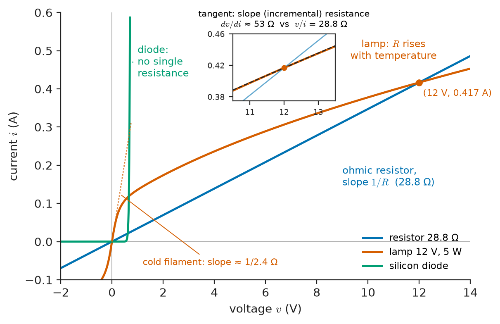
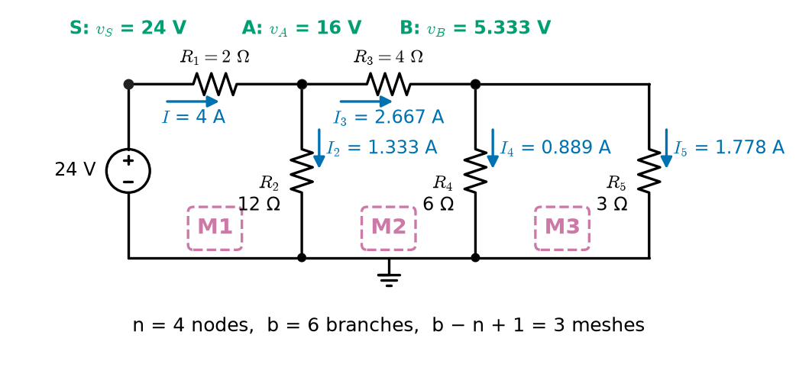
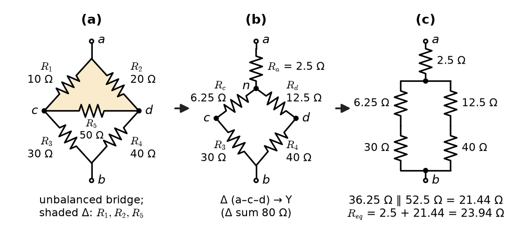
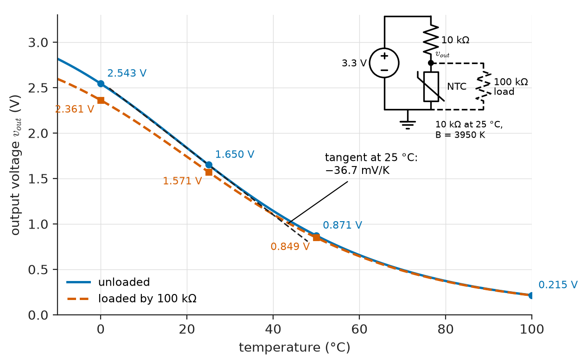
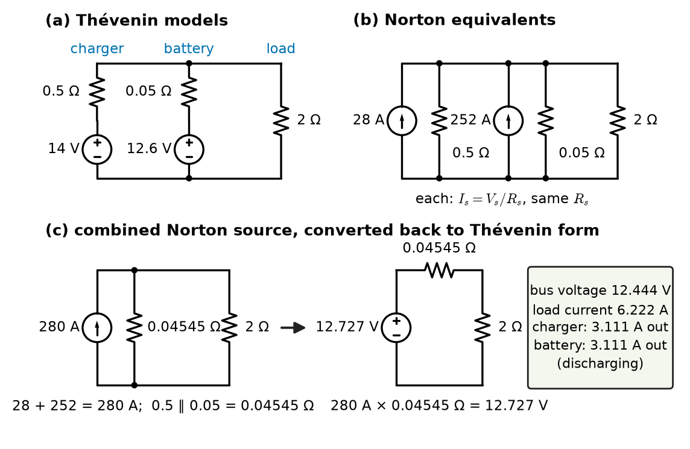
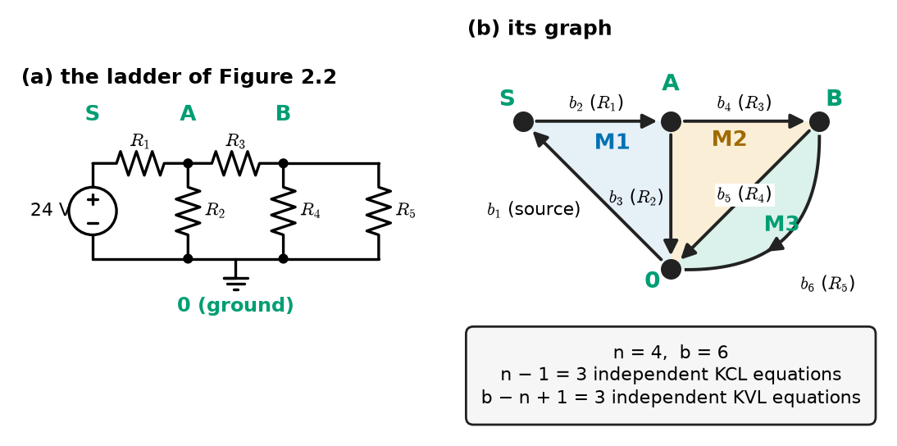

# Chapter 2 — Fundamental Circuit Laws

*Part I · Circuit Fundamentals*

An electrician is called to a detached garage where a 3.7 kW fan heater trips nothing but "feels weak". At the consumer unit the supply reads 230 V. At the garage socket, with the heater running, it reads about 223 V; half an hour later, about 222 V. Nothing is faulty. The socket is fed by 30 m of 2.5 mm² copper cable, the heater draws about 16 A, and 60 m of copper (out and back) has a resistance of roughly 0.41 Ω, rising as the cable warms. The 7–8 V that never reach the heater are dissipated as more than 100 W of heat spread along the cable run. Three laws explain every number in that story: Ohm's law fixes the drop across each conductor, Kirchhoff's current law says the same 16 A flows in the outgoing and returning conductors, and Kirchhoff's voltage law says the drops around the loop must add up to the supply.

This chapter states those three laws, derives from them the rules that engineers use every day — series and parallel combination, voltage and current division, source transformation, network reduction — and checks every result against conservation of energy. Chapter 3 then turns the same laws into systematic methods for networks too tangled for reduction by hand.

> **Which physical principles fix the currents and voltages in a network of elements?**
> **How can a network be simplified, and how can an answer be checked, without losing any information at the terminals of interest?**

| Concept | Engineering destination |
|---|---|
| Ohm's law, resistivity | Cable sizing and voltage drop, sense resistors, heater and fuse design |
| Circuit topology | Counting the equations a network needs; recognising series and parallel |
| Kirchhoff's current law | Busbar and node current checks, earth-leakage detection, current sensing |
| Kirchhoff's voltage law | Supply-rail budgets, loop drops in wiring, ground-loop pickup |
| Series and parallel combinations | Resistor networks, battery packs, parallel feeders |
| Voltage and current division | Sensor dividers, ADC scaling, ammeter shunts, attenuators |
| Equivalent resistance, Δ–Y | Input resistance of networks, bridges, R-2R converters |
| Power balance | Checking every analysis; efficiency and loss budgets |
| Source transformations | Battery-plus-charger systems, sensor front ends, Norton models |
| Network reduction | Hand analysis of ladders and distribution feeders |

**Roadmap.** Ohm's law (2.1) → the topology vocabulary needed to state Kirchhoff's laws (2.2) → KCL (2.3) and KVL (2.4) → series and parallel combinations (2.5) and equivalent resistance, including Δ–Y conversion (2.6) → voltage and current division (2.7) → power balance as a check (2.8) → source transformations (2.9) → network reduction, which assembles all of these (2.10).

---

## 2.1 Ohm's law

### Statement

For many conductors at constant temperature, the current is proportional to the applied voltage. With the passive sign convention (Chapter 1),

$$
v = R\,i, \qquad i = G\,v, \qquad G = \frac{1}{R},
$$

where $R$ is the **resistance** in ohms (Ω) and $G$ the **conductance** in siemens (S). A resistor obeying Ohm's law has a straight-line $i$–$v$ characteristic through the origin (Figure 2.1). Its power absorption is

$$
p = v\,i = i^2R = \frac{v^2}{R} \ \ge 0 ,
$$

so a positive resistor always absorbs power and turns it into heat.

### Resistivity and geometry

For a uniform conductor of length $\ell$ and cross-section $A$,

$$
R = \rho\,\frac{\ell}{A},
$$

where $\rho$ is the material's resistivity (Ω·m). The resistance grows with length and falls with area — the reason distribution cables are thick and heating elements are long thin coils. The resistivity of metals rises roughly linearly with temperature,

$$
R(T) \approx R(T_0)\,[1+\alpha\,(T-T_0)],
$$

with temperature coefficient $\alpha$. Table 2.1 lists values.

**Table 2.1 — Resistivity and temperature coefficient at 20 °C (typical values).**

| Material | $\rho$ (Ω·m) | $\alpha$ (1/K) | Where it is used |
|---|---|---|---|
| Silver | $1.59\times10^{-8}$ | 0.0038 | Contacts, RF plating |
| Copper (annealed) | $1.72\times10^{-8}$ | 0.0039 | Wiring, PCB traces, windings |
| Aluminium | $2.82\times10^{-8}$ | 0.0040 | Overhead lines, busbars |
| Tungsten | $5.6\times10^{-8}$ | 0.0045 | Lamp filaments, contacts |
| Constantan (Cu–Ni) | $4.9\times10^{-7}$ | about ±0.00002 | Precision resistors, strain gauges |
| Nichrome (Ni–Cr) | $1.10\times10^{-6}$ | 0.0004 | Heating elements |
| Seawater | about 0.2 | negative | Earthing, marine sensing |
| Intrinsic silicon | about $2.3\times10^{3}$ | strongly negative | Semiconductor substrates |
| PTFE, polyethylene | above $10^{14}$ | — | Cable insulation |

Cable resistance is standardised per kilometre; IEC 60228 limits for plain copper conductors at 20 °C are, for example, 12.1 Ω/km (1.5 mm²), 7.41 Ω/km (2.5 mm²), 4.61 Ω/km (4 mm²) and 1.83 Ω/km (10 mm²). These maxima are a little above $\rho\ell/A$ for pure copper because stranded conductors are slightly longer than the cable and the standard allows for manufacturing tolerance.

### Where Ohm's law holds and where it does not

Ohm's law is not a law of nature in the sense that charge conservation is. It is an observed property of many materials — metals, carbon, metal oxides, electrolytes — within a range of conditions, and it fails in three common ways.

- **Temperature.** An incandescent lamp's tungsten filament heats from room temperature to about 2500 °C, and its resistance rises tenfold or more. A 12 V, 5 W lamp has a hot resistance of $12^2/5=28.8\ \Omega$ but a cold resistance of only 2–3 Ω, so it draws a large inrush current when switched on. Its $i$–$v$ curve bends over (Figure 2.1). The resistor is still ohmic at each instant; its resistance simply depends on its own power history.
- **Nonlinear conduction.** A semiconductor diode conducts almost nothing below about 0.6 V and then rises exponentially; a metal-oxide varistor is nearly an open circuit until its clamping voltage. These devices have no resistance in the Ohm's-law sense, although a slope resistance $dv/di$ can be defined at an operating point.
- **Extreme fields and frequencies.** Very high current densities (electromigration), very high fields (breakdown of insulators) and high frequencies (skin effect, which raises the AC resistance of a conductor because current crowds to its surface) all change the effective resistance.

<!-- FIGURE 2.1 | figures/ch02/fig-2-1-ohmic-and-nonohmic.png | plot | Current–voltage characteristics: an ohmic resistor, an incandescent lamp, and a silicon diode. | Content: x-axis voltage from −2 to 14 V, y-axis current from −0.1 to 0.6 A. Straight line through the origin for a 28.8 ohm resistor labelled "ohmic resistor, slope 1/R". Curve for a 12 V 5 W tungsten lamp starting with slope about 1/2.4 ohm near the origin and bending over to pass through (12 V, 0.417 A), labelled "lamp: R rises with temperature". Silicon diode curve near zero for negative and small positive voltage, rising steeply after about 0.6 V, clipped at 0.6 A, labelled "diode: no single resistance". Inset: tangent at the lamp's operating point labelled "slope (incremental) resistance". -->

*Figure 2.1 — Current–voltage characteristics: an ohmic resistor, an incandescent lamp, and a silicon diode.*

> **Status of the principle: Ohm's law**
> *Empirical.* A material property observed for metals, alloys, carbon and many other conductors at fixed temperature and moderate fields and frequencies; it does not hold for semiconductor junctions, gas discharges, varistors or for conductors whose temperature changes with load.

### Resistor ratings

A real resistor has a nominal value, a tolerance (Table 1.10), a temperature coefficient, a maximum working voltage and a power rating. Typical power ratings at 70 °C ambient are 0.063 W (0402 chip), 0.1 W (0603), 0.125 W (0805), 0.25 W (1206) and 0.25–1 W for leaded film resistors; wirewound and metal-clad power resistors reach hundreds of watts on a heat sink. Above the rated ambient, the permitted power is derated linearly to zero at the maximum element temperature.

**Worked example — Voltage drop in a final circuit.** The garage of the opening story is fed by a twin-and-earth cable with 2.5 mm² copper conductors, 30 m long. Take $\rho=1.72\times10^{-8}\ \Omega\,\mathrm{m}$ at 20 °C and $\alpha=0.00393$ /K. The heater current is 16 A.

Loop length (live out, neutral back): $\ell=60$ m. Loop resistance at 20 °C: $R=\rho\ell/A=1.72\times10^{-8}\times60/(2.5\times10^{-6})=0.413\ \Omega$.

Voltage drop: $\Delta v=iR=16\times0.413=6.60$ V, which is 2.87 % of 230 V. The socket sees about 223.4 V. Power lost in the cable: $i^2R=16^2\times0.413=106$ W.

With the conductors at 70 °C (the rated maximum for PVC insulation), $R=0.413\times(1+0.00393\times50)=0.494\ \Omega$, giving $\Delta v=7.90$ V (3.44 %) and a loss of 126 W. The socket sees about 222.1 V.

Wiring rules commonly limit the drop from origin to load to 3–5 %, depending on country and load type. This run is within a 5 % limit but over a 3 % one at full temperature; a 4 mm² cable would cut the drop by a factor 2.5/4 to about 4.9 V. (Holding the current at exactly 16 A slightly overstates the drop: a resistive heater draws a little less current at reduced voltage. Chapter 3 solves such circuits exactly.)

---

## 2.2 Circuit topology

Kirchhoff's laws are statements about how elements are connected, so they need a vocabulary for connection. The full graph-theoretic treatment is in Chapter 3; this section introduces only what Chapter 2 uses.

- A **node** is a point at which two or more elements are joined. All the wire between element terminals that is drawn as connected is one node.
- A **branch** is a single two-terminal element (a resistor, a source).
- A **loop** is any closed path through branches that visits no node twice.
- A **mesh** is a loop that encloses no other branch when the circuit is drawn on a plane without crossings. Only **planar** circuits — those that can be drawn without crossings — have meshes.
- Two elements are in **series** if they share exactly one node and no other element connects to that node; they then carry the same current.
- Two elements are in **parallel** if they are connected between the same pair of nodes; they then have the same voltage.

If a connected circuit has $b$ branches and $n$ nodes, it has exactly $n-1$ independent KCL equations and $b-n+1$ independent KVL equations, and a planar circuit has exactly $b-n+1$ meshes. The sum is $b$ equations, which together with the $b$ element laws determine the $2b$ unknown branch voltages and currents. Chapter 3 proves these counts.

<!-- FIGURE 2.2 | figures/ch02/fig-2-2-ladder-network.png | circuit | A resistive ladder used throughout the chapter, with node names, branch currents and node voltages from the full solution. | Content: 24 V DC source on the left, positive terminal to node S, negative to ground. R1 = 2 ohm from S to node A. R2 = 12 ohm from A to ground. R3 = 4 ohm from A to node B. R4 = 6 ohm and R5 = 3 ohm both from B to ground. Labels of the solution: I = 4 A in R1, I2 = 1.333 A down through R2, I3 = 2.667 A in R3, I4 = 0.889 A in R4, I5 = 1.778 A in R5; node voltages vS = 24 V, vA = 16 V, vB = 5.333 V. Dashed outlines marking the three meshes M1 (source, R1, R2), M2 (R2, R3, R4), M3 (R4, R5). Small annotation "n = 4 nodes, b = 6 branches, b − n + 1 = 3 meshes". -->

*Figure 2.2 — A resistive ladder used throughout the chapter, with node names, branch currents and node voltages from the full solution.*

The ladder of Figure 2.2 has $n=4$ nodes (S, A, B and ground) and $b=6$ branches (the source and five resistors), so it has 3 independent KCL equations and $6-4+1=3$ independent KVL equations, matching its three meshes. The source and $R_1$ are in series (node S joins only those two); $R_4$ and $R_5$ are in parallel (both run from B to ground). $R_2$ and $R_3$ are neither: node A joins three elements.

A circuit diagram can be redrawn freely without changing its topology. A common error is to see two resistors drawn side by side and assume they are in parallel; the test is not their position on the page but whether they connect the same two nodes.

---

## 2.3 Kirchhoff's current law

### Statement

**Kirchhoff's current law (KCL):** the algebraic sum of the currents leaving any node is zero at every instant,

$$
\sum_{k} i_k(t) = 0 ,
$$

with currents entering counted negative (or, equivalently, the sum of currents entering equals the sum leaving).

KCL is charge conservation applied to a node. A node in a lumped circuit is an ideal conductor with negligible capacitance to its surroundings: it cannot accumulate charge. Whatever charge flows in per second must flow out per second.

> **Status of the principle: Kirchhoff's current law**
> *Fundamental.* It is conservation of charge applied to a region that stores no net charge; in a lumped circuit every node satisfies this exactly. It fails only when a node's own capacitance to its surroundings carries significant displacement current — at high frequency or in distributed structures.

### Generalisation to closed surfaces

KCL applies not only to a node but to any closed surface drawn around part of a circuit: the net current crossing the surface is zero, because the elements inside, being lumped, hold no net charge either. The surface may cut through several wires, or enclose an entire subsystem. This is called a **cut-set** form of KCL, and Chapter 3 uses it systematically.

Two engineering consequences follow directly.

- **Residual-current devices.** A residual-current device (RCD, or GFCI in North America) passes the live and neutral conductors of a circuit together through a toroidal current transformer. If all the load current returns through the neutral, KCL for a surface around the load says the live and neutral currents sum to zero, and the transformer sees nothing. If 30 mA leaks to earth through a person or damaged insulation, the sum is 30 mA and the device trips, typically within 40 ms at five times its rated residual current. The device is a hardware implementation of KCL.
- **Current returns.** Every current must return to its source. On a printed circuit board, the return current of a fast signal flows in the ground plane directly under the trace; a gap in the plane forces it to detour, enlarging the loop and creating radiated emission. KCL guarantees there is a return path; KVL and Faraday's law (Section 2.4) decide how much trouble its shape causes.

### Applying KCL

At node A of the ladder, with the currents of Figure 2.2, the current entering from $R_1$ is 4 A and the currents leaving through $R_2$ and $R_3$ are 1.333 A and 2.667 A: $-4+1.333+2.667=0$. At node B: $-2.667+0.889+1.778=0$. Applying KCL at the ground node gives an equation that is the negative sum of the others; that is why only $n-1$ of the $n$ node equations are independent.

### Where KCL fails

At high frequency, a "node" — a pad, a via, a length of trace — has capacitance to nearby conductors. A stray capacitance of 1 pF at 100 MHz has a reactance of $1/(2\pi\times10^8\times10^{-12})=1.59\ \mathrm{k\Omega}$, so a node at 1 V sends about 0.6 mA into its surroundings through the field. KCL still holds if that stray capacitance is drawn in as a circuit element; it fails only if the displacement current is ignored. At still higher frequencies, where the "node" is a significant fraction of a wavelength, no single lumped capacitance captures the behaviour and the distributed models of Chapter 14 take over.

---

## 2.4 Kirchhoff's voltage law

### Statement

**Kirchhoff's voltage law (KVL):** the algebraic sum of the voltages around any closed loop is zero at every instant,

$$
\sum_{k} v_k(t) = 0 ,
$$

where each voltage is counted positive if the loop traversal goes from its + to its − mark (a drop) and negative otherwise (a rise).

KVL expresses the fact that voltage is a difference of potentials (Section 1.1). If every node has a well-defined potential, then going around any loop and returning to the starting node must bring the total change of potential back to zero. In energy terms: a charge carried around a closed loop returns to the same potential and so has gained no net energy.

> **Status of the principle: Kirchhoff's voltage law**
> *Fundamental* in the lumped regime. It follows from energy conservation for a conservative (curl-free) electric field; by Faraday's law it holds exactly when no time-varying magnetic flux links the loop and approximately when that linkage is negligible, which is part of the lumped-element assumption.

### Applying KVL

Around mesh M1 of the ladder (source, $R_1$, $R_2$), traversed clockwise: a rise of 24 V through the source, a drop of $2\times4=8$ V across $R_1$, a drop of 16 V across $R_2$. Sum: $-24+8+16=0$. Around M2 ($R_2$ upward, $R_3$, $R_4$): $-16+4\times2.667+5.333=0$. Around M3 ($R_4$ upward, $R_5$ downward): $-5.333+5.333=0$, which is just the statement that parallel elements share a voltage.

KVL along an *open* path gives the voltage between its ends: $v_{SB}$ equals the sum of drops from S to B along any path, $8+10.667=18.667$ V, which is also $v_S-v_B=24-5.333$. This "walk the path" use of KVL is how a node voltage is read from a set of element voltages.

### Where KVL fails: induced voltages

Faraday's law says that around a loop linked by a changing magnetic flux $\Phi$,

$$
\oint \mathbf{E}\cdot d\boldsymbol{\ell} = -\frac{d\Phi}{dt} .
$$

The voltage between two points then depends on the path between them, and KVL in its simple form is wrong. Circuit theory recovers by two devices. Where the flux is deliberate — inside an inductor or transformer — it is assigned to an element whose voltage $L\,di/dt$ or $M\,di/dt$ appears in the KVL sum (Chapter 5). Where it is not deliberate, it appears as interference.

A biomedical example shows the scale. ECG leads from the left arm and right arm to an amplifier enclose a loop area that can easily reach 0.1 m². In a magnetic field of 1 µT peak at 50 Hz, typical near mains wiring and transformers, the induced voltage is $A\,\omega B=0.1\times2\pi\cdot50\times10^{-6}=31$ µV peak; at 10 µT, near a transformer, it is 0.31 mV — a third of an ECG R-wave. Twisting the lead wires together collapses the loop area and the pickup with it. The same physics explains why oscilloscope probes should be used with the shortest possible ground connection, and why ground loops in audio systems produce hum.

---

## 2.5 Series and parallel combinations

### Resistors in series

Resistors $R_1,\dots,R_N$ in series carry the same current $i$. By KVL their voltages add, and by Ohm's law each is $R_ki$, so

$$
v = (R_1+R_2+\dots+R_N)\,i, \qquad R_{\mathrm{s}} = \sum_{k=1}^N R_k .
$$

The series resistance is larger than any of its parts.

### Resistors in parallel

Resistors in parallel share a voltage $v$. By KCL their currents add, and each is $v/R_k=G_kv$, so

$$
i = (G_1+G_2+\dots+G_N)\,v, \qquad G_{\mathrm{p}}=\sum_{k=1}^N G_k, \qquad \frac{1}{R_{\mathrm{p}}}=\sum_{k=1}^N\frac{1}{R_k}.
$$

The parallel resistance is smaller than any of its parts. For two resistors,

$$
R_1\parallel R_2 = \frac{R_1R_2}{R_1+R_2},
$$

and $N$ equal resistors $R$ in parallel give $R/N$. The rule of thumb "parallel combinations are dominated by the smallest resistor, series by the largest" is a fast check on any hand calculation.

> **Status of the principle: Series and parallel combination rules**
> *Derived.* Direct consequences of KCL, KVL and the element laws; exact for linear resistors, and extended to impedances in Chapter 8 and to capacitors and inductors in Chapter 5.

### Sources in series and parallel

Ideal voltage sources in series add algebraically: battery packs stack cells in series to raise voltage, 12 V lead-acid batteries contain six 2.1 V cells, and an electric-vehicle pack may contain 96 lithium-ion cells in series for a nominal 350 V. Ideal current sources in parallel add likewise; solar cells in parallel strings add their currents.

The forbidden cases are the duals noted in Chapter 1: unequal ideal voltage sources may not be paralleled, and unequal ideal current sources may not be placed in series. Real sources can be paralleled because their internal resistances absorb the difference — but the circulating current that results can be large. Two 12 V batteries at 12.6 V and 12.2 V with 10 mΩ internal resistance each, connected in parallel with no load, drive $(12.6-12.2)/0.02=20$ A from one to the other. Battery packs therefore match the state of charge of parallel strings before connecting them, and paralleled power supplies use current-sharing control.

---

## 2.6 Equivalent resistance

### The idea

Any two-terminal network of resistors behaves, at its terminals, exactly like a single resistor $R_{eq}$: apply a voltage $v$, and the current drawn is $v/R_{eq}$. The **equivalent resistance** (or input resistance) captures everything an external circuit can learn about the network. Finding it by repeated series and parallel combination is the core skill of network reduction (Section 2.10). For the ladder of Figure 2.2, seen from the source:

$$
R_{eq} = R_1 + R_2\parallel\big(R_3 + R_4\parallel R_5\big)
= 2 + 12\parallel\big(4 + 6\parallel3\big) = 2 + 12\parallel6 = 2+4 = 6\ \Omega .
$$

The source therefore delivers $24/6=4$ A, which is the current already shown in the figure.

### Networks that are neither series nor parallel

Not every network reduces by series and parallel steps. The **bridge** — four resistors in a diamond with a fifth across the middle — is the classic example: no two of its resistors are in series and no two are in parallel. Three tools handle it.

1. **Symmetry and balance.** If the bridge is balanced ($R_1/R_3=R_2/R_4$ in the labelling of Figure 2.3), the two midpoints sit at the same potential, no current flows in the middle resistor, and it can be removed (or replaced by a short) without changing anything. This is the principle of the Wheatstone bridge used in strain-gauge and resistance-thermometer measurements (Chapter 3 analyses an unbalanced one).
2. **Δ–Y conversion.** Three resistors connected in a triangle (Δ, also called π) between three nodes can be replaced by three resistors connected in a star (Y, also called T) from the same nodes to a new internal node, without changing anything measurable at the three nodes.
3. **Systematic analysis.** Any network can be solved by nodal analysis (Chapter 3) with a test source at its terminals.

### Δ–Y (π–T) transformation

Let a Δ have resistors $R_{ab}$, $R_{bc}$, $R_{ca}$ between nodes $a$, $b$, $c$, and let the equivalent Y have resistors $R_a$, $R_b$, $R_c$ from those nodes to a centre. Requiring that the resistance between every pair of nodes, with the third left open, be the same in both networks gives

$$
R_a = \frac{R_{ab}R_{ca}}{R_{ab}+R_{bc}+R_{ca}},\qquad
R_b = \frac{R_{ab}R_{bc}}{R_{ab}+R_{bc}+R_{ca}},\qquad
R_c = \frac{R_{bc}R_{ca}}{R_{ab}+R_{bc}+R_{ca}} .
$$

Each Y resistor is the product of the two Δ resistors touching its node, divided by the sum of all three. The inverse (Y–Δ) transformation is

$$
R_{ab} = \frac{R_aR_b+R_bR_c+R_cR_a}{R_c},
$$

and cyclically: each Δ resistor is the sum of the pairwise products of the Y resistors, divided by the Y resistor *opposite* it. For equal resistors, $R_Y=R_\Delta/3$. The same transformation, with impedances in place of resistances, converts star- and delta-connected three-phase loads (Chapter 10).

> **Status of the principle: Δ–Y transformation**
> *Derived.* An exact terminal equivalence for linear resistive (and, with impedances, linear AC) three-terminal networks, following from KCL, KVL and Ohm's law; it says nothing about the internal node of the Y, which does not exist in the Δ.

<!-- FIGURE 2.3 | figures/ch02/fig-2-3-bridge-delta-wye.png | circuit | Reducing an unbalanced bridge by a delta–wye transformation. | Content: three panels. Left: bridge between input node a (top) and output node b (bottom): R1 = 10 ohm a–c, R2 = 20 ohm a–d, R3 = 30 ohm c–b, R4 = 40 ohm d–b, R5 = 50 ohm c–d. The delta a–c–d (R1, R2, R5) is shaded. Middle: delta replaced by a wye with centre node n: Ra = 2.5 ohm (a–n), Rc = 6.25 ohm (n–c), Rd = 12.5 ohm (n–d); R3 and R4 unchanged. Right: series–parallel reduction: (6.25 + 30) = 36.25 ohm parallel (12.5 + 40) = 52.5 ohm gives 21.44 ohm, plus 2.5 ohm gives Req = 23.94 ohm. -->

*Figure 2.3 — Reducing an unbalanced bridge by a delta–wye transformation.*

**Worked example — Equivalent resistance of an unbalanced bridge.** In Figure 2.3, $R_1=10\ \Omega$ (a–c), $R_2=20\ \Omega$ (a–d), $R_3=30\ \Omega$ (c–b), $R_4=40\ \Omega$ (d–b) and $R_5=50\ \Omega$ (c–d). The bridge is unbalanced: $R_1/R_3=0.333$ but $R_2/R_4=0.5$.

Convert the Δ formed by $R_1$, $R_2$, $R_5$ (between a, c, d) to a Y. The sum is $10+20+50=80\ \Omega$:

$$
R_a=\frac{10\times20}{80}=2.5\ \Omega,\quad R_c=\frac{10\times50}{80}=6.25\ \Omega,\quad R_d=\frac{20\times50}{80}=12.5\ \Omega .
$$

Now $R_c$ is in series with $R_3$ ($36.25\ \Omega$), $R_d$ is in series with $R_4$ ($52.5\ \Omega$), and these two paths are in parallel: $36.25\times52.5/88.75=21.44\ \Omega$. Adding $R_a$ in series:

$$
R_{eq}=2.5+21.44=23.94\ \Omega .
$$

A nodal analysis with a 1 A test current injected at a (Chapter 3 method) gives $v_a=23.94$ V, confirming the result. Had the bridge been balanced, removing $R_5$ would have given the answer in one line; unbalanced, the Δ–Y step was essential.

### The R-2R ladder

A ladder of series resistors $R$ and shunt resistors $2R$, terminated in $2R$, has a remarkable property: looking into any node toward the termination, the equivalent resistance is $2R\parallel2R=R$, and adding the next series $R$ gives $2R$ again. The structure is self-similar. As a result, a current injected at the input halves at every node — exactly the binary weighting needed by a digital-to-analogue converter, built from only two resistor values that can be matched closely on a chip. The R-2R DAC is designed in *Electronics & Computing*; its resistive core is a series–parallel network.

---

## 2.7 Voltage and current division

### The voltage divider

Two resistors in series across a voltage $v_s$ share it in proportion to their resistances. The current is $i=v_s/(R_1+R_2)$, so the voltage across $R_2$ is

$$
v_2 = v_s\,\frac{R_2}{R_1+R_2} .
$$

More generally, in a series string, each resistor receives the fraction $R_k/R_{\mathrm{s}}$ of the total voltage. The divider is everywhere: setting a reference voltage, scaling a 400 V DC bus down to a 3.3 V ADC input, biasing a transistor, reading a resistive sensor.

The formula holds only if nothing draws current from the junction. A load $R_L$ across $R_2$ replaces $R_2$ by $R_2\parallel R_L$ and lowers the output; the voltmeter-loading example of Chapter 1 was exactly this. Chapter 4 generalises the result: the unloaded divider looks to its load like a source $v_sR_2/(R_1+R_2)$ in series with $R_1\parallel R_2$.

### The current divider

Two resistors in parallel fed by a current $i_s$ share it in proportion to their *conductances*, that is, in inverse proportion to their resistances:

$$
i_1 = i_s\,\frac{G_1}{G_1+G_2} = i_s\,\frac{R_2}{R_1+R_2} .
$$

Note the crossed subscript: the current through $R_1$ involves $R_2$ in the numerator. The larger share takes the lower-resistance path. For $N$ parallel branches, $i_k=i_s\,G_k/\sum G$.

> **Status of the principle: Voltage- and current-division rules**
> *Derived.* Exact consequences of KCL, KVL and Ohm's law for an unloaded series string or a set of parallel branches; any current drawn from a divider tap, or any extra branch, must be included before the rule is applied.

### Sensor dividers

<!-- FIGURE 2.4 | figures/ch02/fig-2-4-ntc-divider.png | plot | An NTC thermistor in a voltage divider: output voltage against temperature, unloaded and loaded by a 100 kOhm input. | Content: inset circuit: 3.3 V reference, fixed resistor 10 kOhm from 3.3 V to output node, NTC thermistor (10 kOhm at 25 C, B = 3950 K) from output node to ground, optional load 100 kOhm from output to ground drawn dashed. Main plot: x-axis temperature from −10 to 100 C, y-axis output voltage 0 to 3.3 V. Solid curve unloaded passing through 2.543 V at 0 C, 1.650 V at 25 C, 0.871 V at 50 C, 0.215 V at 100 C. Dashed curve loaded by 100 kOhm lying below: 2.361 V at 0 C, 1.571 V at 25 C, 0.849 V at 50 C. Tangent at 25 C labelled "−36.7 mV/K". -->

*Figure 2.4 — An NTC thermistor in a voltage divider: output voltage against temperature, unloaded and loaded by a 100 kOhm input.*

**Worked example — An NTC thermistor divider.** A temperature sensor in a battery pack uses a negative-temperature-coefficient (NTC) thermistor with $R_{25}=10\ \mathrm{k\Omega}$ at 25 °C and the common "B-parameter" model

$$
R(T)=R_{25}\exp\!\left[B\left(\frac{1}{T}-\frac{1}{298.15\ \mathrm{K}}\right)\right],\qquad B=3950\ \mathrm{K}.
$$

It sits at the bottom of a divider with a fixed 10 kΩ resistor to a 3.3 V reference (Figure 2.4).

At 0 °C ($T=273.15$ K): $R=10\times\exp[3950\,(1/273.15-1/298.15)]=33.62\ \mathrm{k\Omega}$, and $v_{out}=3.3\times33.62/43.62=2.543$ V.

At 25 °C: $R=10\ \mathrm{k\Omega}$ and $v_{out}=1.650$ V. At 50 °C: $R=3.588\ \mathrm{k\Omega}$ and $v_{out}=0.871$ V. At 100 °C: $R=0.698\ \mathrm{k\Omega}$ and $v_{out}=0.215$ V.

Near 25 °C the sensitivity is about −36.7 mV/K, so a 12-bit ADC with a 3.3 V range (0.81 mV per step) resolves about 0.02 K there; resolution is much coarser at the extremes where the curve flattens. Choosing the fixed resistor equal to $R_{25}$ places the steepest part of the curve at 25 °C.

Now connect the divider to an amplifier with a 100 kΩ input resistance. At 25 °C the bottom leg becomes $10\parallel100=9.09\ \mathrm{k\Omega}$ and $v_{out}=3.3\times9.09/19.09=1.571$ V, an error of −79 mV, equivalent to more than 2 K. At 0 °C the error is −182 mV. The divider must feed a high-impedance input or a buffer, or the loading must be included in the calibration.

### Shunts and current division

A moving-coil meter, an ADC current-sense input or a protection circuit often needs only a small, known fraction of a large current. A low-value **shunt** resistor in parallel with the sensing element diverts the rest.

**Worked example — Extending an ammeter range with a shunt.** A moving-coil movement reads full scale at 1.0 mA and has a coil resistance of 100 Ω. It must read 1.0 A full scale.

At full scale the movement carries 1.0 mA, so the shunt must carry 999 mA. The two are in parallel and share the movement's full-scale voltage $1.0\ \mathrm{mA}\times100\ \Omega=0.100$ V. Hence

$$
R_{sh}=\frac{0.100\ \mathrm{V}}{0.999\ \mathrm{A}}=0.1001\ \Omega .
$$

The current-division rule confirms it: the movement's share is $R_{sh}/(R_{sh}+100)=0.1001/100.1001=0.00100$ of the total. The shunt dissipates $0.999^2\times0.1001\approx0.10$ W at full scale. Its value is so small that the resistance of connecting leads and contacts would cause serious error; this is why precision shunts have four terminals (Chapter 1). Note also the burden: the meter drops 0.1 V at full scale, the same burden-voltage issue as in Chapter 1.

A three-branch example shows the conductance form. A current of 50 mA divides among parallel resistors of 100 Ω, 220 Ω and 470 Ω, with conductances 10, 4.545 and 2.128 mS (total 16.67 mS). The branch currents are $50\times10/16.67=29.99$ mA, $50\times4.545/16.67=13.63$ mA and $50\times2.128/16.67=6.38$ mA, which sum to 50.00 mA.

**Worked example — An LED current-limiting resistor.** A red indicator LED with forward voltage about 2.0 V at 10 mA is driven from a 5.0 V logic rail. KVL around the loop gives the resistor voltage $5.0-2.0=3.0$ V, and Ohm's law gives $R=3.0/0.010=300\ \Omega$. Choosing the E12 value 330 Ω, the current becomes $3.0/330=9.09$ mA, a change in brightness the eye barely notices. The resistor dissipates $3.0\times9.09\ \mathrm{mA}=27$ mW, comfortably inside the 0.1 W rating of an 0603 chip. (The LED is nonlinear; treating its voltage as constant is an approximation that works because its voltage changes only slightly with current.)

---

## 2.8 Power balance

### The principle

In any circuit, at every instant, the sum of the powers absorbed by all elements — each computed with the passive sign convention — is zero:

$$
\sum_{k=1}^{b} v_k\,i_k = 0 .
$$

Equivalently, the power delivered by the sources equals the power absorbed by everything else. This is energy conservation, but it can also be proved from KCL and KVL alone, without reference to what the elements are; that proof, known as **Tellegen's theorem**, is given in Chapter 3.

> **Status of the principle: Power balance (Tellegen's theorem)**
> *Derived.* A mathematical consequence of KCL and KVL for any lumped network, linear or not; it holds instant by instant, and with complex power in AC steady state (Chapter 9).

Power balance is the single most useful check on an analysis. A sign error in a current, a wrong reference direction or an arithmetic slip almost always breaks it.

**Worked example — Power balance in the ladder.** For the ladder of Figure 2.2, with all elements labelled passively:

**Table 2.2 — Power balance of the ladder network.**

| Element | Voltage (V) | Current (A) | Power absorbed (W) |
|---|---|---|---|
| 24 V source | 24.000 | −4.000 | −96.000 |
| $R_1=2\ \Omega$ | 8.000 | 4.000 | 32.000 |
| $R_2=12\ \Omega$ | 16.000 | 1.333 | 21.333 |
| $R_3=4\ \Omega$ | 10.667 | 2.667 | 28.444 |
| $R_4=6\ \Omega$ | 5.333 | 0.889 | 4.741 |
| $R_5=3\ \Omega$ | 5.333 | 1.778 | 9.481 |
| **Sum** | | | **0.000** |

The resistors absorb $32.000+21.333+28.444+4.741+9.481=96.000$ W and the source delivers 96 W. Note where the power goes: one-third is lost in $R_1$, the "feeder" resistance next to the source, even though it is the smallest resistor in the circuit — because it carries the full current.

### Efficiency and losses

In power delivery, power balance becomes an efficiency calculation: $\eta=P_{load}/P_{source}$. In the garage example the heater receives about $16\times223.4=3.57$ kW while the cable dissipates 106 W, so 97 % of the power leaving the consumer unit reaches the heater. The same arithmetic, scaled to megawatts and kilometres, is why transmission is done at high voltage: for a fixed power $P=VI$, the line loss $I^2R$ falls as $1/V^2$. Doubling the transmission voltage quarters the loss.

---

## 2.9 Source transformations

### Equivalent practical sources

Chapter 1 modelled a practical source as an ideal voltage source $V_s$ in series with $R_s$. Its terminal law is $v=V_s-R_si$. The same law is produced by an ideal current source $I_s$ in parallel with $R_s$, for which KCL at the terminal gives $i=I_s-v/R_s$, that is, $v=R_sI_s-R_si$. The two are identical at the terminals if

$$
V_s = R_s\,I_s, \qquad I_s = \frac{V_s}{R_s},
$$

with the *same* resistance $R_s$ in both. The current source arrow points toward the terminal that the voltage source's + mark identifies. This interchange is a **source transformation**; the series form is a Thévenin source and the parallel form a Norton source (Chapter 4).

<!-- FIGURE 2.5 | figures/ch02/fig-2-5-source-transformation.png | circuit | Source transformation applied to a battery and a charger feeding a common load. | Content: three panels. Left: charger modelled as 14 V source with 0.5 ohm series resistance and battery as 12.6 V source with 0.05 ohm series resistance, both connected between a positive bus and ground, with a 2 ohm load across the bus. Middle: each converted to a Norton source: 28 A in parallel with 0.5 ohm, 252 A in parallel with 0.05 ohm. Right: combined into a single 280 A source in parallel with 0.04545 ohm, and then converted back to a 12.727 V source with 0.04545 ohm in series, feeding the 2 ohm load; bus voltage 12.444 V, load current 6.222 A, charger current 3.111 A out, battery current 3.111 A out (discharging). -->

*Figure 2.5 — Source transformation applied to a battery and a charger feeding a common load.*

> **Status of the principle: Source transformation**
> *Derived.* Exact terminal equivalence of the series voltage-source and parallel current-source models of a linear source, from Ohm's law and KCL. It holds only at the terminals: the internal power dissipation of the two forms differs, and it does not apply to an ideal source with $R_s=0$ or $R_s\to\infty$.

The last point deserves emphasis. Open-circuited, the Thévenin form dissipates nothing internally, while the Norton form dissipates $I_s^2R_s$ in its parallel resistor. The two models agree about the outside world, not about what happens inside the box.

### Using transformations

Source transformations are used to put sources in the form that makes the next step easiest: voltage sources in series combine by adding, current sources in parallel combine by adding. A network with several practical sources feeding a common pair of nodes reduces quickly by converting them all to Norton form, adding currents and conductances, and converting back.

**Worked example — A battery and a charger in parallel.** A 12 V system has a lead-acid battery (12.6 V open-circuit, internal resistance 0.05 Ω) and a small charger modelled as a 14.0 V source with 0.5 Ω output resistance. Both are connected across a 2.0 Ω load (Figure 2.5). Does the charger keep up?

Convert both to Norton form: charger $14.0/0.5=28$ A in parallel with 0.5 Ω; battery $12.6/0.05=252$ A in parallel with 0.05 Ω. The two current sources are in parallel and add to 280 A; the two resistors are in parallel, $0.5\parallel0.05=0.04545\ \Omega$. Converting back: a 12.727 V source in series with 0.04545 Ω.

With the 2.0 Ω load, the bus voltage is $12.727\times2.0/(2.0+0.04545)=12.444$ V and the load current is 6.222 A. Returning to the original circuit: the charger delivers $(14.0-12.444)/0.5=3.111$ A and the battery delivers $(12.6-12.444)/0.05=3.111$ A. The battery is *discharging*: the charger cannot supply the load alone.

Power balance: the charger's ideal source delivers $14.0\times3.111=43.56$ W and the battery's $12.6\times3.111=39.20$ W, a total of 82.76 W. The load absorbs $12.444^2/2.0=77.43$ W and the two internal resistances absorb $3.111^2\times0.5+3.111^2\times0.05=5.32$ W. Total absorbed: 82.76 W. With the load disconnected, the bus rises to 12.727 V and the battery charges at $(12.727-12.6)/0.05=2.5$ A.

---

## 2.10 Network reduction

### The procedure

Network reduction finds a desired voltage or current by repeatedly replacing parts of a network with simpler equivalents, then working back out. The standard steps are:

1. **Identify the terminals of interest** and leave them intact.
2. **Combine series and parallel resistors**, working from the end of the network farthest from the source.
3. **Transform sources** where that brings sources into series (voltage form) or parallel (current form) with each other, so they can be combined.
4. **Apply Δ–Y conversion** where a bridge or triangle blocks further series–parallel steps.
5. **Solve the reduced circuit** — usually a single loop or single node pair.
6. **Expand back**, using voltage and current division (and KCL and KVL) to recover the quantities that the reduction hid.
7. **Check** with power balance or with KCL and KVL at a few points.

Step 6 is where most errors occur, because each reduction step hides internal currents and voltages. Keeping a sketch of every intermediate circuit avoids the error.

### Worked example in full

**Worked example — Reducing the ladder network.** Find every current and voltage in the ladder of Figure 2.2 (source 24 V; $R_1=2$, $R_2=12$, $R_3=4$, $R_4=6$, $R_5=3\ \Omega$).

*Reduce.* $R_4\parallel R_5=6\times3/9=2\ \Omega$. In series with $R_3$: $4+2=6\ \Omega$. In parallel with $R_2$: $12\times6/18=4\ \Omega$. In series with $R_1$: $2+4=6\ \Omega$.

*Solve.* Source current $I=24/6=4.0$ A.

*Expand.* By voltage division across $R_1$ and the 4 Ω equivalent: $v_A=24\times4/6=16.0$ V. By Ohm's law, $I_2=16/12=1.333$ A and the current into the $R_3$ branch is $I_3=16/6=2.667$ A (check KCL at A: $1.333+2.667=4.0$). By voltage division in that branch, $v_B=16\times2/6=5.333$ V. Then $I_4=5.333/6=0.889$ A and $I_5=5.333/3=1.778$ A; or by current division, $I_4=2.667\times3/9=0.889$ A.

*Check.* KVL around M2: $-16+4\times2.667+5.333=0$. Power balance (Table 2.2): 96 W delivered, 96 W absorbed.

### A distribution feeder

The same procedure models a radial power-distribution feeder: a substation bus (the source), a series of cable sections (series resistances) and loads tapped off along the way (shunt resistances). Reducing from the far end gives the current drawn at the substation; expanding back gives the voltage at each tap, and the drop is largest at the far end. When loads are better described as drawing constant power than constant resistance (as many modern electronic loads do), the circuit becomes nonlinear and reduction gives only a first estimate, refined iteratively in load-flow programs.

### Where reduction stops

Network reduction is fast and builds intuition, but it has limits:

- **Bridges and non-planar networks** require Δ–Y steps that quickly become tedious.
- **Multiple sources at different points** require repeated transformations or superposition (Chapter 4).
- **Dependent sources** cannot be combined with resistors in series or parallel, because their value depends on a variable that the reduction may hide. Their control variable must be kept visible, or the circuit must be solved by nodal or mesh analysis.
- **Many unknowns at once** — every node voltage in a 50-node network — are better found by a single matrix solution than by any sequence of reductions.

These limits motivate Chapter 3, which replaces ingenuity with a systematic procedure that works for every linear network and is the basis of circuit-simulation programs.

<!-- FIGURE 2.6 | figures/ch02/fig-2-6-circuit-graph.png | schematic | From circuit to graph: the ladder network drawn as nodes and branches, with its three meshes. | Content: left: the ladder of Figure 2.2 drawn compactly. Right: its graph, four dots labelled S, A, B, 0 (ground) and six directed line segments labelled b1 (source, 0 to S), b2 (R1, S to A), b3 (R2, A to 0), b4 (R3, A to B), b5 (R4, B to 0), b6 (R5, B to 0). Three shaded mesh regions labelled M1, M2, M3. Text box: "n = 4, b = 6: n − 1 = 3 independent KCL equations, b − n + 1 = 3 independent KVL equations". -->

*Figure 2.6 — From circuit to graph: the ladder network drawn as nodes and branches, with its three meshes.*

Figure 2.6 shows the step that makes the systematic approach possible: stripping the ladder down to its **graph**, the pattern of nodes and branches with the element types forgotten. Kirchhoff's laws depend only on the graph; Ohm's law depends only on the elements. Chapter 3 exploits this separation.

---

## What remains open

| Open question | Where it is answered |
|---|---|
| How is a network with many nodes, several sources or a bridge solved systematically? | Chapter 3 (nodal and mesh analysis, matrix formulation) |
| Why are there exactly $n-1$ independent KCL and $b-n+1$ independent KVL equations, and how is Tellegen's theorem proved? | Chapter 3 (network topology, branch–node–loop relationships) |
| How are circuits with dependent sources reduced or solved? | Chapter 3 (dependent-source circuits), Chapter 4 (Thévenin with dependent sources) |
| How is any linear network reduced to a single source and resistance at a port, and what load takes maximum power? | Chapter 4 (Thévenin, Norton, maximum power transfer) |
| How do series, parallel and division rules extend to capacitors, inductors and impedances? | Chapters 5 and 8 |
| How does KVL account for the voltage of inductors and coupled coils? | Chapter 5 (mutual inductance) |
| How do Δ–Y conversions apply to three-phase loads? | Chapter 10 |
| What replaces KCL when a node is a significant fraction of a wavelength? | Chapter 14 (transmission lines) |
| How do electromagnetic fields give rise to Faraday induction and stray coupling? | *Engineering Physics* |

**Next:** Chapter 3 turns Kirchhoff's laws and the element equations into nodal and mesh analysis and their matrix form, giving a procedure that solves any linear resistive network, with or without dependent sources.
