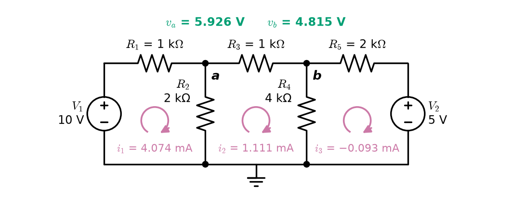
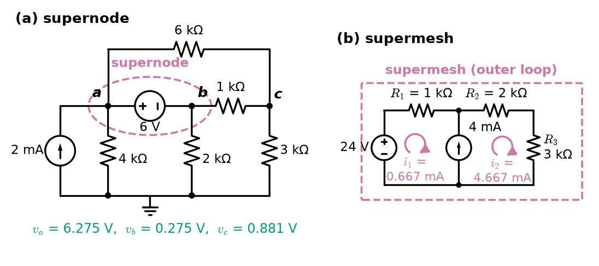
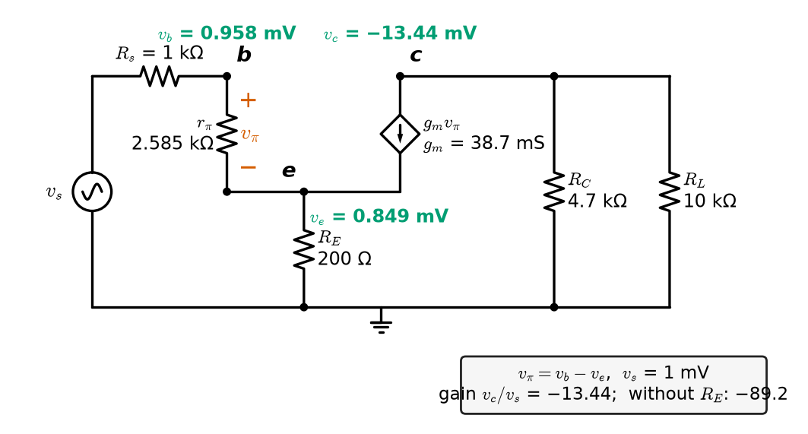
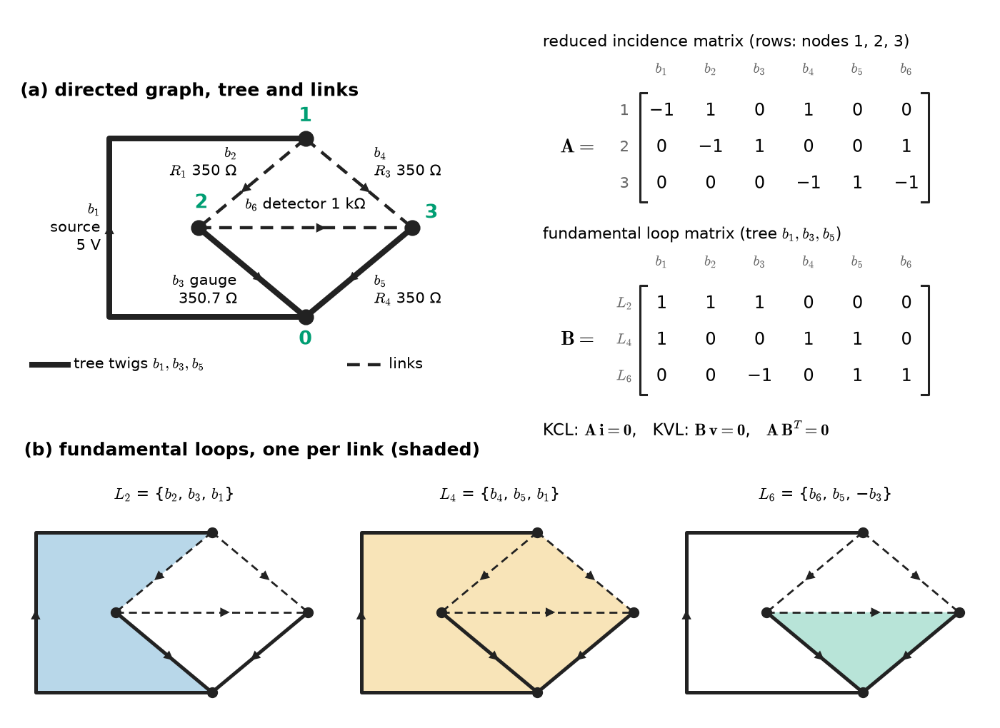
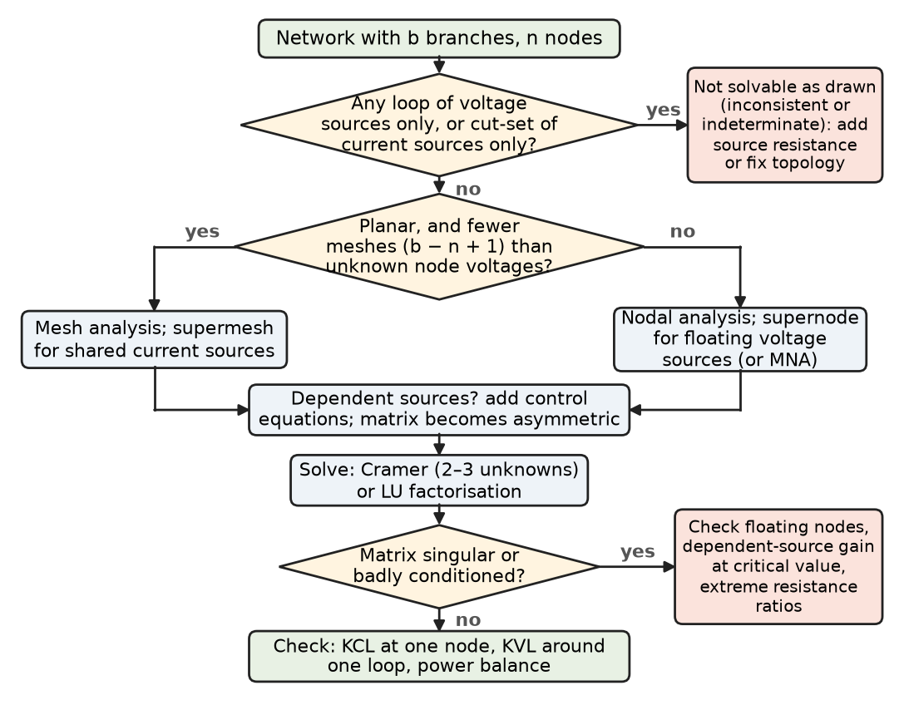

# Chapter 3 — Network Analysis

*Part I · Circuit Fundamentals*

An instrumentation engineer commissioning a weighing system expects a strain-gauge bridge to deliver 2.50 mV at full load: the textbook formula for a quarter bridge with 350 Ω gauges, 5 V excitation and a 0.2 % resistance change gives exactly that. The legacy panel meter reads 1.85 mV. The gauges are fine and the wiring is correct; what is wrong is the formula. It assumes the meter draws no current, but this meter has a 1 kΩ input, and it forms a fifth branch across the middle of the bridge. With that branch present, no two of the bridge's resistors are in series or in parallel, and the reduction tricks of Chapter 2 run out. What does not run out is Kirchhoff's laws. Written systematically — one equation per node, or one per mesh — they give the 1.85 mV reading exactly, and the same procedure scales from this five-resistor bridge to the hundred-thousand-node netlists that circuit simulators solve every day.

This chapter develops that procedure. It starts by counting how many equations a network needs, builds nodal and mesh analysis and their extensions to voltage and current sources in awkward places, adds dependent sources, and then recasts everything in matrix form with the tools of network topology. It ends with the question every simulator must answer before it solves anything: does this network have a unique solution at all?

> **How can the currents and voltages of any linear network be found by a procedure that never depends on spotting a clever simplification?**
> **When does a network have exactly one solution, and what does it mean when it does not?**

| Concept | Engineering destination |
|---|---|
| Network equations | Knowing how many unknowns a problem has before solving it |
| Nodal analysis | Hand analysis of multi-source circuits; the core of SPICE |
| Mesh analysis | Planar circuits with many series sources; loop currents in power and magnetic circuits |
| Supernodes and supermeshes | Floating voltage sources, shared current sources, sensor excitation circuits |
| Dependent-source circuits | Small-signal amplifier gain, finite-gain op-amp error, feedback models |
| Network topology | Trees, loops and cut-sets for systematic equation writing |
| Branch, node and loop relationships | Incidence and loop matrices, Tellegen's theorem |
| Matrix formulation | Circuit simulators, power-flow programs, sensitivity analysis |
| Circuit solvability | "Singular matrix" errors, oscillation thresholds, ill-conditioned measurements |

**Roadmap.** Counting the network equations (3.1) → nodal analysis (3.2) and mesh analysis (3.3) → supernodes and supermeshes for awkward sources (3.4) → dependent-source circuits (3.5) → network topology: graphs, trees and loops (3.6) → branch, node and loop relationships and Tellegen's theorem (3.7) → the matrix formulation used by simulators (3.8) → solvability: when the equations have one solution, none or infinitely many (3.9).

---

## 3.1 Network equations

### Counting unknowns and equations

A network with $b$ branches has $2b$ unknowns: one voltage and one current per branch. Three kinds of equation are available:

- **$b$ element equations**, one per branch: Ohm's law $v_k=R_ki_k$ for a resistor, $v_k=V_s$ for a voltage source, $i_k=I_s$ for a current source, and the defining relations of dependent sources.
- **$n-1$ independent KCL equations**, one for each node except one (the last is the sum of the others).
- **$b-n+1$ independent KVL equations**, one per independent loop.

The total, $b+(n-1)+(b-n+1)=2b$, matches the number of unknowns. Section 3.6 proves that the KCL and KVL counts are right for any connected network; Section 3.9 asks when the $2b$ equations are also independent, so that they have exactly one solution.

Writing all $2b$ equations at once — the **sparse tableau** formulation — is wasteful by hand. The two classical methods each use one set of Kirchhoff equations to eliminate most unknowns before writing anything down:

- **Nodal analysis** takes the $n-1$ node voltages as unknowns. Every branch voltage is a difference of node voltages, so KVL is satisfied automatically; only the $n-1$ KCL equations remain.
- **Mesh analysis** takes $b-n+1$ loop currents as unknowns. Every branch current is a combination of loop currents, so KCL is satisfied automatically; only the $b-n+1$ KVL equations remain.

The method with fewer equations is usually the better choice by hand. Table 3.1 compares some networks.

**Table 3.1 — Equation counts for representative networks.**

| Network | Branches $b$ | Nodes $n$ | Nodal equations $n-1$ | Mesh/loop equations $b-n+1$ |
|---|---|---|---|---|
| Ladder of Figure 2.2 | 6 | 4 | 3 | 3 |
| Wheatstone bridge with detector and source | 6 | 4 | 3 | 3 |
| Two-source bias network (Figure 3.1) | 7 | 5 | 4 (2 after using the sources) | 3 |
| Cube of 12 resistors | 12 | 8 | 7 | 5 |
| Small-signal amplifier, 10 transistors | about 60 | about 25 | about 24 | about 36 |
| Transmission network, 100 buses, 150 lines | 150 | 100 | 99 | 51 |

Two cautions apply to the counts. Voltage sources reduce the number of nodal unknowns (a node attached to ground through a voltage source has a known voltage), and current sources reduce the number of mesh unknowns; the "after using the sources" count is what matters. And mesh analysis applies only to planar networks, whereas nodal analysis applies to all — one reason circuit simulators are built on nodal methods.

---

## 3.2 Nodal analysis

### The method

1. **Choose a reference node** (ground). Any node will do; the one with the most connections, or the one the circuit diagram already marks as ground, keeps the equations simplest.
2. **Label the remaining $n-1$ node voltages** $v_1,\dots,v_{n-1}$, each measured with respect to the reference.
3. **Write KCL at each non-reference node**, expressing every resistor current in terms of node voltages: the current leaving node $j$ through a resistor $R$ to node $k$ is $(v_j-v_k)/R$.
4. **Solve** the $n-1$ linear equations.
5. **Recover** branch voltages (differences of node voltages) and currents (Ohm's law).

For a network of resistors and independent current sources, the equations take a pattern that can be written by inspection:

$$
\mathbf{G}\,\mathbf{v} = \mathbf{i}_s ,
$$

where

- the diagonal entry $G_{jj}$ is the **sum of conductances connected to node $j$**;
- the off-diagonal entry $G_{jk}$ is **minus the sum of conductances connecting nodes $j$ and $k$**;
- the right-hand entry $i_{s,j}$ is the **sum of source currents flowing into node $j$**.

$\mathbf{G}$ is the **nodal conductance matrix**. For networks of resistors it is symmetric, because the conductance between $j$ and $k$ appears identically in both rows. A practical voltage source is first converted to its Norton form (Chapter 2) to fit this pattern.

> **Status of the principle: Nodal analysis**
> *Derived.* KCL at $n-1$ nodes with branch currents expressed through node voltages, so that KVL holds identically; it applies to every lumped network, planar or not, and becomes the modified nodal analysis of Section 3.8 when ideal voltage sources are present.

### Worked example

<!-- FIGURE 3.1 | figures/ch03/fig-3-1-two-source-network.png | circuit | A two-source resistive network solved by nodal and by mesh analysis. | Content: left vertical branch: V1 = 10 V source, + at top; top wire from V1+ through R1 = 1 kOhm to node a. R2 = 2 kOhm from a down to the bottom ground rail. R3 = 1 kOhm horizontal from a to node b. R4 = 4 kOhm from b down to ground. Top wire from b through R5 = 2 kOhm to the + terminal of V2 = 5 V on the right vertical branch, − at the ground rail. Ground symbol on bottom rail. Node voltages labelled va = 5.926 V, vb = 4.815 V. Three clockwise mesh currents drawn as circular arrows: i1 = 4.074 mA (left), i2 = 1.111 mA (middle), i3 = −0.093 mA (right). -->

*Figure 3.1 — A two-source resistive network solved by nodal and by mesh analysis.*

**Worked example — Nodal analysis of a two-source network.** In Figure 3.1, two supplies $V_1=10$ V and $V_2=5$ V, each with a series resistor, feed a resistive network: $R_1=1\ \mathrm{k\Omega}$, $R_2=2\ \mathrm{k\Omega}$, $R_3=1\ \mathrm{k\Omega}$, $R_4=4\ \mathrm{k\Omega}$, $R_5=2\ \mathrm{k\Omega}$. Find all node voltages and branch currents.

Working in kΩ, mA and V (so conductances are in mS), the network has two unknown node voltages, $v_a$ and $v_b$. (The nodes at the + terminals of the sources have known voltages, 10 V and 5 V.)

KCL at $a$, currents leaving: $\dfrac{v_a-10}{1}+\dfrac{v_a}{2}+\dfrac{v_a-v_b}{1}=0$.

KCL at $b$, currents leaving: $\dfrac{v_b-v_a}{1}+\dfrac{v_b}{4}+\dfrac{v_b-5}{2}=0$.

Collected in matrix form (equivalently, by inspection after converting each source and its series resistor to a Norton source of $10/1=10$ mA and $5/2=2.5$ mA):

$$
\begin{bmatrix} 2.5 & -1 \\ -1 & 1.75 \end{bmatrix}
\begin{bmatrix} v_a \\ v_b \end{bmatrix}
=
\begin{bmatrix} 10 \\ 2.5 \end{bmatrix} .
$$

The determinant is $2.5\times1.75-1=3.375$. By Cramer's rule,

$$
v_a=\frac{10\times1.75+2.5}{3.375}=5.926\ \mathrm{V},\qquad
v_b=\frac{2.5\times2.5+10}{3.375}=4.815\ \mathrm{V}.
$$

Branch currents: through $R_1$ from $V_1$ to $a$, $(10-5.926)/1=4.074$ mA; $R_2$, $5.926/2=2.963$ mA; $R_3$ from $a$ to $b$, $1.111$ mA; $R_4$, $4.815/4=1.204$ mA; $R_5$ from $V_2$ to $b$, $(5-4.815)/2=0.093$ mA.

Check KCL at $b$: in from $R_3$ (1.111) and $R_5$ (0.093), out through $R_4$ (1.204). Power: $V_1$ delivers $10\times4.074=40.74$ mW, $V_2$ delivers $5\times0.093=0.46$ mW, total 41.20 mW; the resistors absorb $16.60+17.56+1.23+5.80+0.02=41.20$ mW. Both supplies deliver power, but $V_2$ only barely: it is close to the voltage that node $b$ would reach without it.

### Practical points

- **Units.** Working in kΩ, mA and V (or Ω, A, V) keeps numbers near unity. Since $1\ \mathrm{V}/1\ \mathrm{k\Omega}=1$ mA, no conversion is needed.
- **Sign discipline.** Writing every resistor current as "leaving the node" — $(v_\text{this}-v_\text{other})/R$ — produces the symmetric pattern automatically and avoids most sign errors.
- **Choice of ground.** In electronic circuits the negative supply rail or the signal common is the natural reference; in power networks the reference is the earth or a slack bus. Changing the reference shifts all node voltages by a constant and changes no element voltage or current.

---

## 3.3 Mesh analysis

### The method

Mesh analysis applies to **planar** networks (Chapter 2). Each mesh — a window of the planar drawing — is assigned a **mesh current**, conventionally clockwise. A branch on the boundary of the outer region carries one mesh current; a branch shared by two meshes carries the difference of their two mesh currents. Because every branch current is constructed this way, KCL is satisfied at every node automatically: each mesh current enters and leaves every node it touches.

1. **Check the network is planar** and identify its $b-n+1$ meshes.
2. **Assign clockwise mesh currents** $i_1,\dots,i_m$.
3. **Write KVL around each mesh**, expressing each resistor voltage as $R$ times the net current through it in the direction of traversal.
4. **Solve** and recover branch currents as mesh currents or their differences.

For resistors and independent voltage sources the equations again follow a pattern:

$$
\mathbf{R}\,\mathbf{i} = \mathbf{v}_s ,
$$

where $R_{jj}$ is the **sum of resistances around mesh $j$**, $R_{jk}$ is **minus the resistance shared by meshes $j$ and $k$** (with all mesh currents clockwise), and $v_{s,j}$ is the **sum of source voltage rises around mesh $j$** in the clockwise direction. $\mathbf{R}$ is the **mesh resistance matrix**, symmetric for resistor networks.

> **Status of the principle: Mesh analysis**
> *Derived.* KVL around the $b-n+1$ meshes of a planar network with branch currents expressed through mesh currents, so that KCL holds identically; for non-planar networks the same idea works with the fundamental loops of Section 3.6 in place of meshes.

**Worked example — Mesh analysis of the same network.** The network of Figure 3.1 has $b=7$ branches (two sources and five resistors) and $n=5$ nodes, hence $7-5+1=3$ meshes: left ($V_1$, $R_1$, $R_2$), middle ($R_2$, $R_3$, $R_4$) and right ($R_4$, $R_5$, $V_2$). With clockwise currents $i_1,i_2,i_3$ (in mA):

Mesh 1: rise of 10 V through $V_1$; drops $1\cdot i_1$ and $2(i_1-i_2)$: $\;3i_1-2i_2=10$.

Mesh 2: $2(i_2-i_1)+1\cdot i_2+4(i_2-i_3)=0$: $\;-2i_1+7i_2-4i_3=0$.

Mesh 3: drop $2i_3$ across $R_5$, then traversing $V_2$ from + to −, a drop of 5 V, then $4(i_3-i_2)$: $\;-4i_2+6i_3=-5$.

$$
\begin{bmatrix} 3 & -2 & 0 \\ -2 & 7 & -4 \\ 0 & -4 & 6 \end{bmatrix}
\begin{bmatrix} i_1 \\ i_2 \\ i_3 \end{bmatrix}
=
\begin{bmatrix} 10 \\ 0 \\ -5 \end{bmatrix}
\quad\Rightarrow\quad
i_1=4.074,\; i_2=1.111,\; i_3=-0.093\ \mathrm{mA}.
$$

Then $v_a=R_2(i_1-i_2)=2\times2.963=5.926$ V and $v_b=R_4(i_2-i_3)=4\times1.204=4.815$ V, agreeing with the nodal result. The negative $i_3$ means the right mesh current actually circulates counter-clockwise: 0.093 mA flows out of the + terminal of $V_2$ into node $b$, as the nodal analysis found.

Here nodal analysis needed two equations and mesh analysis three. The general guidance: nodal analysis suits networks with many parallel branches and current sources; mesh analysis suits networks with many series elements and voltage sources, such as ladder filters driven from a voltage source and the loop equations of magnetic and electromechanical models.

---

## 3.4 Supernodes and supermeshes

### Voltage sources in nodal analysis

A voltage source between a non-reference node and ground simply fixes that node's voltage and removes one unknown. A voltage source between *two non-reference nodes* — a **floating** voltage source — causes a difficulty: its current is not determined by its voltage, so KCL at either node contains an unknown current that cannot be written in terms of node voltages.

The remedy is the **supernode**. Enclose the floating source and its two nodes in a closed surface. By the generalised KCL of Chapter 2, the net current leaving that surface is zero, and the source current, which is internal to the surface, does not appear. The supernode provides one KCL equation, and the source itself provides a constraint, $v_j-v_k=V_s$; together they replace the two KCL equations that could not be written.

<!-- FIGURE 3.2 | figures/ch03/fig-3-2-supernode-supermesh.png | circuit | A supernode enclosing a floating voltage source, and a supermesh around a shared current source. | Content: left panel (supernode): 2 mA current source from ground into node a; R = 4 kOhm a to ground; 6 V source between a (+) and b (−) enclosed by a dashed ellipse labelled "supernode"; R = 2 kOhm b to ground; R = 1 kOhm b to c; R = 3 kOhm c to ground; R = 6 kOhm a to c. Solution labels va = 6.275 V, vb = 0.275 V, vc = 0.881 V. Right panel (supermesh): two-mesh planar circuit, left mesh with 24 V source and R1 = 1 kOhm, shared middle branch containing a 4 mA current source pointing upward, right mesh with R2 = 2 kOhm and R3 = 3 kOhm; dashed outline around the outer loop labelled "supermesh"; mesh currents i1 = 0.667 mA and i2 = 4.667 mA clockwise. -->

*Figure 3.2 — A supernode enclosing a floating voltage source, and a supermesh around a shared current source.*

**Worked example — A floating voltage source.** In the left panel of Figure 3.2 (values in kΩ, mA, V), a 2 mA source drives node $a$; $a$ connects to ground through 4 kΩ and to node $c$ through 6 kΩ; a 6 V source sits between $a$ (+) and $b$ (−); $b$ connects to ground through 2 kΩ and to $c$ through 1 kΩ; $c$ connects to ground through 3 kΩ.

Constraint from the source: $v_a-v_b=6$.

KCL for the supernode $\{a,b\}$, currents leaving through the resistors and the 2 mA entering:

$$
\frac{v_a}{4}+\frac{v_a-v_c}{6}+\frac{v_b}{2}+\frac{v_b-v_c}{1}=2 .
$$

KCL at $c$: $\dfrac{v_c-v_b}{1}+\dfrac{v_c}{3}+\dfrac{v_c-v_a}{6}=0$.

Solving the three equations: $v_a=6.275$ V, $v_b=0.275$ V, $v_c=0.881$ V.

The current through the floating source follows from KCL at $b$ alone: the current leaving $b$ through its resistors is $0.275/2+(0.275-0.881)/1=-0.468$ mA, so 0.468 mA flows *into* $b$ from the resistors and out of $b$ through the source toward $a$. Current therefore leaves the source's + terminal: the 6 V source delivers $6\times0.468=2.81$ mW. The 2 mA source delivers $2\times6.275=12.55$ mW, and the resistors absorb $9.844+4.850+0.038+0.367+0.259=15.36$ mW, matching the 15.36 mW supplied.

A floating voltage source is common in practice: the drop across a conducting diode modelled as a fixed voltage, the bias voltage generator between the bases of a push-pull output stage, the excitation source of a bridge whose negative side is not grounded, and in power systems the voltage-regulating transformer tap modelled as a series source.

### Current sources in mesh analysis

The dual difficulty arises in mesh analysis. A current source on the outer boundary of a planar network simply fixes one mesh current. A current source in a branch *shared* by two meshes fixes the difference of those mesh currents, but its voltage is unknown, so neither mesh's KVL equation can be written.

The remedy is the **supermesh**: write KVL around the loop formed by the two meshes with the shared branch removed (a path that avoids the current source), and add the constraint that the difference of the two mesh currents equals the source current.

**Worked example — A shared current source.** In the right panel of Figure 3.2, the left mesh contains a 24 V source and $R_1=1\ \mathrm{k\Omega}$; the shared branch is a 4 mA current source pointing upward; the right mesh contains $R_2=2\ \mathrm{k\Omega}$ and $R_3=3\ \mathrm{k\Omega}$. With clockwise mesh currents, the shared branch carries $i_1$ downward and $i_2$ upward, so

$$
i_2-i_1=4 .
$$

KVL around the supermesh (the outer loop, which avoids the current source): $24=1\cdot i_1+(2+3)\,i_2$.

Solving: $i_1=0.667$ mA and $i_2=4.667$ mA. The voltage across the current source equals the drop across $R_2+R_3$, $5\times4.667=23.33$ V, so the source delivers $23.33\times4=93.3$ mW; the 24 V source delivers $24\times0.667=16.0$ mW; the resistors absorb $1\times0.667^2+5\times4.667^2=109.3$ mW. The balance holds. The voltage across the current source — 23.3 V — is something the mesh method did not need in order to find the currents, but which a real current source must be able to supply. A 4–20 mA loop transmitter, for example, has a stated *compliance* voltage range; outside it, the current-source model fails.

> **Status of the principle: Supernode and supermesh constructions**
> *Derived.* The supernode is KCL applied to a closed surface (a cut-set) instead of a single node; the supermesh is KVL around a loop that avoids the current source. Both are exact consequences of Kirchhoff's laws.

---

## 3.5 Dependent-source circuits

### Procedure

Dependent sources (Chapter 1) enter nodal and mesh analysis in two steps:

1. **Treat the dependent source as if it were independent** while writing the KCL or KVL equations, using supernodes or supermeshes as needed.
2. **Add one equation expressing the source's value in terms of the circuit unknowns**: a controlling voltage as a difference of node voltages, or a controlling current as a mesh current or an Ohm's-law expression. Then substitute and collect terms.

The resulting matrix is no longer symmetric. The controlled source couples node $k$ to node $j$ without the reverse coupling — that one-way influence is exactly what amplification and feedback are — and the coefficient matrix can even become singular (Section 3.9). Thévenin equivalents of such circuits need a test-source method rather than resistance combination (Chapter 4).

<!-- FIGURE 3.3 | figures/ch03/fig-3-3-degenerated-amplifier-model.png | circuit | Small-signal model of a common-emitter amplifier with emitter degeneration, prepared for nodal analysis. | Content: source vs with Rs = 1 kOhm in series to node b (base). r_pi = 2.585 kOhm from b to node e (emitter). VCCS diamond from node c (collector) to node e with arrow pointing c to e, labelled gm v_pi, gm = 38.7 mS, v_pi = vb − ve. RE = 200 Ohm from e to ground. RC = 4.7 kOhm and RL = 10 kOhm in parallel from c to ground. Node voltages for vs = 1 mV labelled vb = 0.958 mV, ve = 0.849 mV, vc = −13.44 mV. Note box: "gain vc/vs = −13.44; without RE: −89.2". -->

*Figure 3.3 — Small-signal model of a common-emitter amplifier with emitter degeneration, prepared for nodal analysis.*

**Worked example — Gain of a degenerated common-emitter stage.** Chapter 1 found a gain of −89.2 for a common-emitter stage ($g_m=38.7$ mS, $r_\pi=2.585\ \mathrm{k\Omega}$, $R_s=1\ \mathrm{k\Omega}$, $R_C\parallel R_L=3.197\ \mathrm{k\Omega}$). Such a high gain depends directly on $g_m$, which varies with temperature and from transistor to transistor. Designers add an unbypassed emitter resistor $R_E=200\ \Omega$ (Figure 3.3) to trade gain for predictability. The emitter is no longer grounded, the circuit no longer reduces to two independent halves, and nodal analysis is the tool.

Unknowns: $v_b$, $v_e$, $v_c$. Controlling variable: $v_\pi=v_b-v_e$. The VCCS carries $g_mv_\pi$ from collector to emitter. KCL, currents leaving each node:

Node $b$: $\dfrac{v_b-v_s}{R_s}+\dfrac{v_b-v_e}{r_\pi}=0$.

Node $e$: $\dfrac{v_e-v_b}{r_\pi}+\dfrac{v_e}{R_E}-g_m(v_b-v_e)=0$ (the source current *enters* $e$).

Node $c$: $\dfrac{v_c}{R_C}+\dfrac{v_c}{R_L}+g_m(v_b-v_e)=0$ (the source current *leaves* $c$).

In matrix form, with conductances in mS ($1/R_s=1$, $1/r_\pi=0.3868$, $1/R_E=5$, $1/R_C+1/R_L=0.3128$, $g_m=38.68$):

$$
\begin{bmatrix}
1.3868 & -0.3868 & 0\\
-39.07 & 44.07 & 0\\
38.68 & -38.68 & 0.3128
\end{bmatrix}
\begin{bmatrix} v_b\\ v_e\\ v_c\end{bmatrix}
=
\begin{bmatrix} v_s/R_s\\ 0\\ 0\end{bmatrix}.
$$

The asymmetry is plain: $g_m$ couples the base and emitter voltages into the collector row (row 3), but nothing couples the collector back into rows 1 and 2.

For $v_s=1$ mV the solution is $v_b=0.958$ mV, $v_e=0.849$ mV, $v_c=-13.44$ mV: a voltage gain of $-13.44$.

The familiar design formula comes from eliminating variables symbolically: the input resistance looking into the base is $r_\pi+(\beta+1)R_E=2.585+101\times0.2=22.79\ \mathrm{k\Omega}$, and

$$
\frac{v_c}{v_s}=-\frac{\beta\,(R_C\parallel R_L)}{R_s+r_\pi+(\beta+1)R_E}=-\frac{100\times3.197}{1+22.79}=-13.44,
$$

matching the numerical solution exactly. The cruder estimate $-(R_C\parallel R_L)/R_E=-16.0$ ignores $r_\pi$, $1/g_m$ and $R_s$. The gain fell from −89 to −13, but now depends mainly on the resistor ratio rather than on $g_m$. That trade is the essence of negative feedback, analysed in Chapter 34.

### A finite-gain op-amp

**Worked example — How close is an inverting amplifier to −10?** An inverting amplifier uses $R_1=10\ \mathrm{k\Omega}$ and $R_2=100\ \mathrm{k\Omega}$, so ideally its gain is $-R_2/R_1=-10$. Model the op-amp as a VCVS: input resistance $R_i=2\ \mathrm{M\Omega}$ between its inputs, open-loop gain $A=2\times10^5$, and output resistance $R_o=75\ \Omega$ in series with a source $A(v_+-v_-)$. The non-inverting input is grounded; a 2 kΩ load is connected to the output.

Unknowns: the inverting-input node $v_n$ and the output $v_o$. With $v_s=1$ V,

Node $n$: $\dfrac{v_n-1}{R_1}+\dfrac{v_n-v_o}{R_2}+\dfrac{v_n}{R_i}=0$.

Node $o$: $\dfrac{v_o-v_n}{R_2}+\dfrac{v_o}{R_L}+\dfrac{v_o-A(0-v_n)}{R_o}=0$.

The second equation contains the term $Av_n/R_o$ — a coefficient of $2\times10^5/75\approx2667$ S in a matrix whose other entries are of order $10^{-4}$ to $10^{-2}$ S. Solving gives $v_n=52\ \mathrm{\mu V}$ and $v_o=-9.99943$ V: a gain error of 57 parts per million, close to the estimate $(1+R_2/R_1)/A=55$ ppm. The inverting input sits at a "virtual ground" not because it is connected to ground but because the enormous gain needs only 52 µV there.

> **Boundary.** Why op-amps and transistors have these parameters, and how practical amplifiers are designed around them, is the subject of *Electronics & Computing*. Here they are network elements, and the methods of this chapter apply to them unchanged.

### Dependent sources in mesh analysis

The same procedure works with mesh currents. A CCVS controlled by a branch current, for example $v=r_m i_x$, contributes $r_m$ times the appropriate mesh-current combination to a KVL equation; a dependent current source shared between meshes creates a supermesh whose constraint involves the controlling variable. Because the result is again an asymmetric matrix, the choice between nodal and mesh methods rests on the same equation-count criterion as before.

---

## 3.6 Network topology

The analyses above relied on facts asserted in Chapter 2: that a network has $n-1$ independent KCL equations and $b-n+1$ independent KVL equations. Network topology — the graph theory of circuits — proves those facts and gives a systematic way to choose the equations for any network, planar or not.

### Graphs

The **graph** of a network replaces every element by a line segment (an **edge**, or branch) joining two **vertices** (nodes), keeping only the pattern of connection. Assigning each branch a reference direction — normally the direction of its current reference — makes it a **directed graph**. A graph is **connected** if every node can be reached from every other along branches. Magnetically coupled but electrically separate circuits (the two windings of a transformer) form separate connected parts; they can be joined at one node each without changing any current, and this is normally done.

### Trees and cotrees

A **tree** is a subset of branches that connects all $n$ nodes without forming any loop. Every tree of a connected graph has exactly $n-1$ branches, called **twigs**. (Start from one node; each twig adds exactly one new node; after $n-1$ twigs every node is reached, and one more branch would close a loop.) The remaining $b-n+1$ branches form the **cotree**; they are called **links**. A network generally has many trees: the Wheatstone bridge with source and detector (Figure 3.4) has 16.

### Fundamental loops and cut-sets

Adding any single link to a tree creates exactly one loop, consisting of that link and the unique tree path between its ends. These $b-n+1$ **fundamental loops** are independent, because each contains a link that no other contains. Hence there are at least $b-n+1$ independent KVL equations, and Section 3.7 shows there are no more.

Removing any single twig splits the tree into two parts. The set of branches joining those two parts — the twig itself and every link that crosses the gap — is a **fundamental cut-set**. There are $n-1$ of them, one per twig, and KCL applied to the surface separating the two parts gives $n-1$ independent cut-set equations. Node equations are a special case: the cut-set that isolates a single node.

> **Status of the principle: Independence counts ($n-1$ KCL, $b-n+1$ KVL)**
> *Derived.* Graph-theoretic results for any connected network: every tree has $n-1$ twigs, each fundamental loop contains its own link and each fundamental cut-set its own twig, so these sets are independent and, by the rank argument of Section 3.7, complete.

<!-- FIGURE 3.4 | figures/ch03/fig-3-4-bridge-graph-tree.png | schematic | Directed graph of the excited Wheatstone bridge, with a tree, its links and the fundamental loops. | Content: four vertices: 0 (ground, bottom), 1 (top, excitation), 2 (left middle), 3 (right middle). Six directed edges: b1 0 to 1 (source), b2 1 to 2 (R1 = 350 ohm), b3 2 to 0 (gauge 350.7 ohm), b4 1 to 3 (R3 = 350 ohm), b5 3 to 0 (R4 = 350 ohm), b6 2 to 3 (detector 1 kOhm). Tree twigs b1, b3, b5 drawn thick; links b2, b4, b6 dashed. Three shaded fundamental loops: L2 = {b2, b3, b1}, L4 = {b4, b5, b1}, L6 = {b6, b5, −b3}. Side panel: the reduced incidence matrix A (rows nodes 1, 2, 3; columns b1 to b6) and fundamental loop matrix B as given in Section 3.7. -->

*Figure 3.4 — Directed graph of the excited Wheatstone bridge, with a tree, its links and the fundamental loops.*

### Choosing the tree

The choice of tree is free, and a good choice simplifies analysis. Placing voltage sources in the tree (as twigs) and current sources in the cotree (as links) means each voltage source fixes one twig voltage and each current source fixes one loop current. This is possible only if the voltage sources contain no loop among themselves and the current sources contain no cut-set — the solvability conditions of Section 3.9.

---

## 3.7 Branch, node and loop relationships

### The incidence matrix and KCL

Number the non-reference nodes $1,\dots,n-1$ and the branches $1,\dots,b$. The **reduced incidence matrix** $\mathbf{A}$, of size $(n-1)\times b$, has

$$
a_{jk}=\begin{cases}+1 & \text{if branch } k \text{ leaves node } j,\\ -1 & \text{if branch } k \text{ enters node } j,\\ 0 & \text{otherwise.}\end{cases}
$$

With $\mathbf{i}$ the vector of branch currents, KCL at all non-reference nodes is

$$
\mathbf{A}\,\mathbf{i}=\mathbf{0}.
$$

With $\mathbf{e}$ the vector of node voltages (relative to the reference) and $\mathbf{v}$ the vector of branch voltages (+ at the tail of each branch arrow), every branch voltage is the tail node voltage minus the head node voltage, which is

$$
\mathbf{v}=\mathbf{A}^{T}\mathbf{e}.
$$

This is KVL in node-voltage form: any $\mathbf{v}$ that can be written this way automatically sums to zero around every loop.

For the bridge of Figure 3.4, with branches $b_1$ (source, 0→1), $b_2$ ($R_1$, 1→2), $b_3$ (gauge, 2→0), $b_4$ ($R_3$, 1→3), $b_5$ ($R_4$, 3→0) and $b_6$ (detector, 2→3):

$$
\mathbf{A}=\begin{bmatrix}
-1 & 1 & 0 & 1 & 0 & 0\\
0 & -1 & 1 & 0 & 0 & 1\\
0 & 0 & 0 & -1 & 1 & -1
\end{bmatrix}.
$$

Its rank is $n-1=3$ for any connected graph: the columns of the twigs of any tree form an invertible square submatrix. That is why there are exactly $n-1$ independent KCL equations — no more, no fewer.

### The loop matrix and KVL

The **fundamental loop matrix** $\mathbf{B}$, of size $(b-n+1)\times b$, has one row per fundamental loop, with $+1$ where a branch's direction agrees with the loop direction (taken as the direction of its defining link), $-1$ where it opposes, and 0 for branches not in the loop. KVL is

$$
\mathbf{B}\,\mathbf{v}=\mathbf{0},
$$

and, with $\mathbf{i}_\ell$ the vector of loop (link) currents, every branch current is a superposition of loop currents:

$$
\mathbf{i}=\mathbf{B}^{T}\mathbf{i}_\ell .
$$

This is KCL in loop-current form; mesh analysis is the special case in which the loops are the meshes of a planar drawing. For the tree $\{b_1,b_3,b_5\}$ of Figure 3.4:

$$
\mathbf{B}=\begin{bmatrix}
1 & 1 & 1 & 0 & 0 & 0\\
1 & 0 & 0 & 1 & 1 & 0\\
0 & 0 & -1 & 0 & 1 & 1
\end{bmatrix}.
$$

### Orthogonality and Tellegen's theorem

Every loop crosses every cut-set, and in particular every node, an even number of times, entering as often as it leaves. In matrix form this is the orthogonality relation

$$
\mathbf{A}\,\mathbf{B}^{T}=\mathbf{0},
$$

which can be checked directly for the matrices above. It has a short but far-reaching consequence. Let $\mathbf{v}$ be *any* set of branch voltages satisfying KVL and $\mathbf{i}$ *any* set of branch currents satisfying KCL in the same graph — not necessarily from the same circuit, nor even at the same instant. Then $\mathbf{v}=\mathbf{A}^T\mathbf{e}$ for some $\mathbf{e}$, and

$$
\mathbf{v}^{T}\mathbf{i}=\mathbf{e}^{T}\mathbf{A}\,\mathbf{i}=\mathbf{e}^{T}\mathbf{0}=0 .
$$

This is **Tellegen's theorem**: $\sum_k v_ki_k=0$. When $\mathbf{v}$ and $\mathbf{i}$ belong to the same circuit at the same instant, it is the power balance of Chapter 2. When they come from different circuits on the same graph, it underlies the reciprocity theorem (Chapter 4) and the adjoint-network method that simulators use to compute the sensitivity of an output to every component at once.

> **Status of the principle: Tellegen's theorem**
> *Derived.* It follows from KCL and KVL alone, through the orthogonality of the incidence and loop matrices; it holds for any lumped network whatever its elements — linear or nonlinear, time-invariant or not.

Because $\mathbf{A}$ has rank $n-1$ and $\mathbf{A}\mathbf{B}^T=\mathbf{0}$, the rows of $\mathbf{B}$ span the whole space of vectors orthogonal to the rows of $\mathbf{A}$, whose dimension is $b-(n-1)$. So no KVL equation exists beyond the $b-n+1$ fundamental ones: the counts of Section 3.1 are exact.

---

## 3.8 Matrix formulation

### Nodal equations from the branch matrices

Collect the branch conductances of a resistive network in a diagonal matrix $\mathbf{G}_b$, and let independent current sources in parallel with the branches be collected in $\mathbf{i}_s$ (Norton form). Each branch obeys $\mathbf{i}=\mathbf{G}_b\mathbf{v}-\mathbf{i}_s$. Substituting into KCL and using $\mathbf{v}=\mathbf{A}^T\mathbf{e}$:

$$
\mathbf{A}\mathbf{G}_b\mathbf{A}^{T}\,\mathbf{e}=\mathbf{A}\,\mathbf{i}_s
\quad\Longrightarrow\quad
\mathbf{Y}_n\,\mathbf{e}=\mathbf{j}_s,\qquad \mathbf{Y}_n=\mathbf{A}\mathbf{G}_b\mathbf{A}^{T}.
$$

$\mathbf{Y}_n$ is the nodal matrix that Section 3.2 wrote by inspection; the matrix product formalises the inspection rules and is how a program assembles it. In practice simulators do not multiply matrices: they "stamp" each element directly into $\mathbf{Y}_n$, adding $G$ to two diagonal entries and $-G$ to two off-diagonal entries for a resistor between two nodes.

The mesh counterpart is $\mathbf{B}\mathbf{R}_b\mathbf{B}^{T}\,\mathbf{i}_\ell=\mathbf{B}\,\mathbf{v}_s$, with $\mathbf{R}_b$ the diagonal matrix of branch resistances.

### Modified nodal analysis

Ideal voltage sources have no conductance and cannot be stamped into $\mathbf{Y}_n$. **Modified nodal analysis** (MNA), introduced in the 1970s and used in SPICE and its descendants, adds the current of each ideal voltage source as an extra unknown and the source's constraint as an extra equation:

$$
\begin{bmatrix} \mathbf{Y}_n & \mathbf{B}_V \\ \mathbf{C}_V & \mathbf{0} \end{bmatrix}
\begin{bmatrix} \mathbf{e} \\ \mathbf{i}_V \end{bmatrix}
=
\begin{bmatrix} \mathbf{j}_s \\ \mathbf{v}_s \end{bmatrix},
$$

where $\mathbf{B}_V$ (and $\mathbf{C}_V=\mathbf{B}_V^T$ for independent sources) contains $\pm1$ entries locating each source's terminals. Inductors, VCVSs and CCVSs, and any element whose current is needed as an output, are handled the same way. MNA is in effect the supernode method made automatic: the extra rows and columns carry the information that supernodes encode by hand.

> **Status of the principle: Modified nodal analysis**
> *Derived.* Nodal analysis augmented by branch currents of voltage-defined elements; it is an exact reformulation of KCL, KVL and the element laws, and the standard formulation of general-purpose circuit simulators.

**Worked example — The loaded strain-gauge bridge.** Return to the opening problem (Figure 3.4). Four 350 Ω arms, one of which is a strain gauge at 350.7 Ω (a 0.2 % change, corresponding to 1000 microstrain with a gauge factor of 2); excitation 5.00 V; detector resistance 1 kΩ between the midpoints.

Using the incidence matrix of Section 3.7, restricted to the resistor branches $b_2,\dots,b_6$, and $\mathbf{G}_b=\mathrm{diag}(1/350,\,1/350.7,\,1/350,\,1/350,\,1/1000)$ S, the nodal matrix is (in mS)

$$
\mathbf{Y}_n=\begin{bmatrix}
5.7143 & -2.8571 & -2.8571\\
-2.8571 & 6.7086 & -1.0000\\
-2.8571 & -1.0000 & 6.7143
\end{bmatrix}.
$$

The excitation is an ideal voltage source from ground to node 1, so MNA adds its current $i_V$ (leaving node 1 into the source) and the constraint $e_1=5$:

$$
\begin{bmatrix}
5.7143 & -2.8571 & -2.8571 & 1\\
-2.8571 & 6.7086 & -1.0000 & 0\\
-2.8571 & -1.0000 & 6.7143 & 0\\
1 & 0 & 0 & 0
\end{bmatrix}
\begin{bmatrix} e_1\\ e_2\\ e_3\\ i_V\end{bmatrix}
=
\begin{bmatrix} 0\\0\\0\\5\end{bmatrix}
$$

(with $e$ in V, $i_V$ in mA). Solved with unrounded entries, the solution is $e_2=2.502173$ V, $e_3=2.500324$ V and $i_V=-14.28$ mA (so the source delivers 14.28 mA). The detector voltage is

$$
e_2-e_3=1.850\ \mathrm{mV}.
$$

The textbook formula gives the *open-circuit* output, $5\times(350.7/700.7-0.5)=2.4975$ mV, valid for an infinite detector resistance. Chapter 4 will show that the bridge looks to its detector like a 2.4975 mV source with an internal resistance of $350\parallel350.7+350\parallel350=350.17\ \Omega$; with a 1 kΩ detector, $2.4975\times1000/1350.17=1.850$ mV, confirming the matrix solution. The cure is an instrumentation amplifier with an input resistance of gigaohms, for which the loaded and open-circuit outputs agree to better than one part in a million.

### Sparsity and scale

In a large circuit each node connects to only a few others, so $\mathbf{Y}_n$ is **sparse**: a 100 000-node integrated-circuit netlist might have only five or six non-zero entries per row. Simulators store only the non-zero entries and solve by sparse LU factorisation, choosing the elimination order to limit "fill-in". Nonlinear devices are handled by repeatedly linearising them about the current estimate (Newton's method), replacing each with a conductance and a current source — exactly a dependent-source model — and re-solving the linear system; transient analysis repeats that at every time step (Chapters 6 and 11). Power-system load-flow programs use the same nodal admittance matrix, called $\mathbf{Y}_{bus}$, at the scale of thousands of buses.

<!-- FIGURE 3.5 | figures/ch03/fig-3-5-analysis-flowchart.png | flowchart | Choosing and checking a systematic analysis method. | Content: start box "Network with b branches, n nodes". Decision "Any loop of voltage sources only, or cut-set of current sources only?" yes to box "Not solvable as drawn: inconsistent or indeterminate; add source resistance or fix topology". No to decision "Planar and fewer meshes (b − n + 1) than unknown node voltages?" yes to "Mesh analysis; supermesh for shared current sources". No to "Nodal analysis; supernode for floating voltage sources (or MNA)". Both feed "Dependent sources? add control equations; matrix becomes asymmetric". Then "Solve: Cramer (2–3 unknowns) or LU factorisation". Then decision "Matrix singular or badly conditioned?" yes to "Check floating nodes, dependent-source gain at critical value, extreme resistance ratios". No to "Check: KCL at one node, KVL around one loop, power balance". -->

*Figure 3.5 — Choosing and checking a systematic analysis method.*

---

## 3.9 Circuit solvability

### What can go wrong

Writing equations is mechanical; whether they have a solution is not. A linear network has exactly one solution if and only if its coefficient matrix (nodal, mesh or MNA) is non-singular. Three kinds of failure are common, and each has a physical meaning (Figure 3.5).

**Inconsistent sources.** A loop made only of ideal voltage sources (possibly with ideal shorts) has a KVL equation with no unknowns: either the source voltages happen to sum to zero, in which case the loop current is undetermined, or they do not, in which case there is no solution. Dually, a cut-set made only of ideal current sources (possibly with ideal opens) either over-determines or leaves undetermined the voltages across it. A charger modelled as an ideal 14 V source paralleled with a battery modelled as an ideal 12.6 V source is the textbook example; including the internal resistances, as in Chapter 2, restores a unique solution. These **topological conditions** can be checked before any arithmetic: a network of ideal sources and positive resistors is uniquely solvable exactly when it contains no loop of voltage sources and no cut-set of current sources.

**Floating sub-networks.** A node or group of nodes connected to the rest of the circuit only through capacitors or current sources has no DC path to the reference. In a DC analysis its potential is undetermined: the nodal matrix has a zero eigenvalue. SPICE reports this as a "singular matrix" or "no DC path to ground" error, and the conventional remedy is a very large resistor (gigaohms) to ground. Physically, such a node really is undetermined in the ideal model; in reality leakage currents decide it, which is why an unconnected CMOS gate input drifts and must never be left floating.

**Dependent sources at a critical gain.** With dependent sources the matrix can become singular for particular parameter values even when the topology is fine.

**Worked example — A negative conductance cancelling a resistor.** A node with a 1 kΩ resistor to ground also connects to a VCCS that *injects* a current $g_mv$ proportional to the node's own voltage — the small-signal model of a cross-coupled transistor pair in an LC oscillator, which behaves as a negative conductance $-g_m$. A small test current $i_t$ is injected into the node. KCL gives

$$
\left(\frac{1}{R}-g_m\right)v=i_t,\qquad v=\frac{i_t}{1/R-g_m}.
$$

With $R=1\ \mathrm{k\Omega}$ and $i_t=1\ \mathrm{\mu A}$: for $g_m=0.5$ mS, $v=2$ mV; for $g_m=0.9$ mS, $v=10$ mV; for $g_m=0.99$ mS, $v=100$ mV; at $g_m=1.0$ mS the 1×1 nodal "matrix" is zero and no finite solution exists. The resistive network is telling the truth: at that point the circuit can sustain a voltage with no input at all. With the oscillator's LC tank added, this is precisely the start-up condition for oscillation, and for $g_m>1/R$ the oscillation grows until device nonlinearity limits it. A singular network matrix is therefore not always a modelling error; it can mark the boundary of stability, a theme developed with characteristic equations in Chapters 7, 11 and 34.

### Guaranteed solvability

For one important class the answer is always yes.

> **Status of the principle: Unique solvability of passive resistive networks**
> *Derived.* A connected network of positive resistors and independent current sources has a symmetric, positive-definite nodal matrix ($\mathbf{e}^T\mathbf{Y}_n\mathbf{e}$ equals the power the resistors would absorb at node voltages $\mathbf{e}$, which is positive for any non-zero $\mathbf{e}$), so its solution exists and is unique; adding ideal voltage sources preserves this provided they form no loop. Dependent sources and negative resistances void the guarantee.

### Numerical conditioning

A non-singular matrix may still be hard to solve accurately. The **condition number** $\kappa$ measures how much relative errors in the data (component tolerances, or rounding in the arithmetic) can be magnified in the solution. The bridge MNA matrix above, in the units shown, has $\kappa\approx32$ (the value depends on how the unknowns are scaled), harmless in double-precision arithmetic, which carries about 16 significant digits. Circuits that mix very small and very large resistances are worse: a 1 mΩ current shunt and a 1 GΩ leakage path in the same network span twelve orders of magnitude, $\kappa$ can approach $10^{12}$, and only about four significant digits survive. Simulators mitigate this with pivoting and scaling, but the engineer should recognise the symptom: results that change in the third or fourth digit when a tolerance or solver option is changed.

Ill-conditioning also has a measurement meaning. The bridge output (1.85 mV) is the small difference of two large node voltages (2.502173 V and 2.500324 V). A 0.01 % error in one arm resistor shifts a midpoint voltage by about $5\times0.0001/4=0.125$ mV, 5 % of the 2.5 mV open-circuit signal. That is why bridge arms are matched, temperature-tracked resistors, and why the same difference-of-large-numbers problem reappears in differential signalling, in power-system state estimation and in the finite-precision arithmetic of digital filters (Chapter 23).

### Checking an answer

Whatever the method, three checks catch nearly every error:

1. **KCL at a node not used in writing the equations** (for mesh analysis) or **KVL around a loop** (for nodal analysis).
2. **Power balance**: total delivered equals total absorbed (Tellegen's theorem).
3. **Limiting cases**: set a resistor to zero or infinity, or a gain to zero, and check that the answer reduces to something known. The degenerated amplifier with $R_E\to0$ must return the −89.2 of Chapter 1; the bridge with $R_d\to\infty$ must return 2.4975 mV.

---

## What remains open

| Open question | Where it is answered |
|---|---|
| How is a whole network reduced to a single source and resistance at a pair of terminals, and how is that used for loading and maximum power? | Chapter 4 (Thévenin, Norton, maximum power transfer) |
| How is the reciprocity of passive networks proved and used? | Chapter 4 (reciprocity), building on Tellegen's theorem |
| How do nodal and mesh analysis handle capacitors, inductors and switching? | Chapters 5 and 6 |
| How do the same matrices work with complex impedances in AC steady state? | Chapter 8 (AC nodal and mesh analysis) |
| How does the nodal method extend to the s-domain, and what do singular network matrices mean there? | Chapter 11 (Laplace-domain circuit analysis, poles and zeros) |
| How are networks described by their terminal behaviour only? | Chapter 12 (two-port networks) |
| Why does a singular characteristic equation mark the onset of oscillation or instability? | Chapters 7 and 34 |
| How do finite-precision effects degrade numerical solutions and digital filters? | Chapters 21 and 23 |
| How are transistor and op-amp parameters set by device physics and bias design? | *Electronics & Computing* |

**Next:** Chapter 4 uses linearity to derive the network theorems — superposition, Thévenin, Norton, maximum power transfer and reciprocity — that turn the solutions of this chapter into compact models of how a network looks from its terminals.
