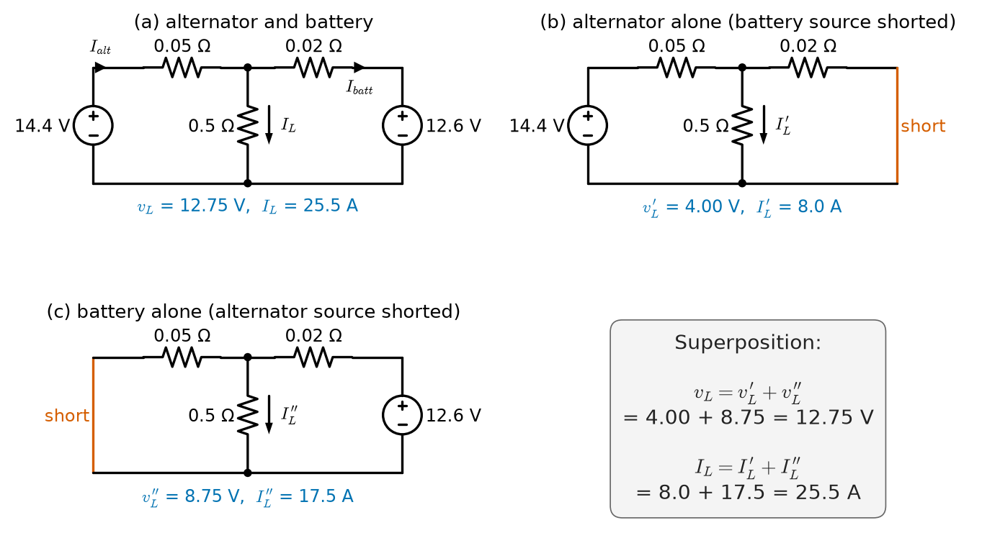
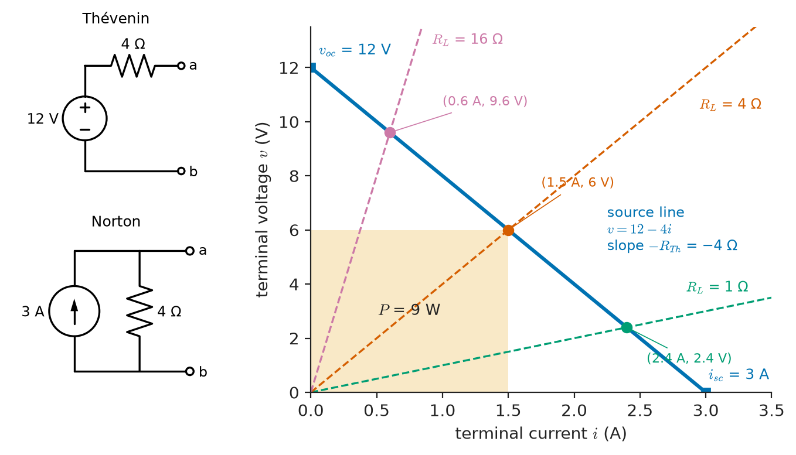
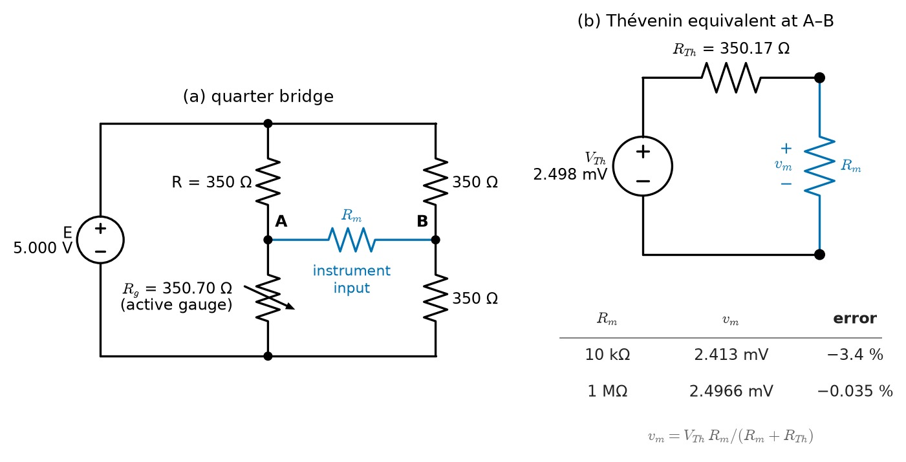
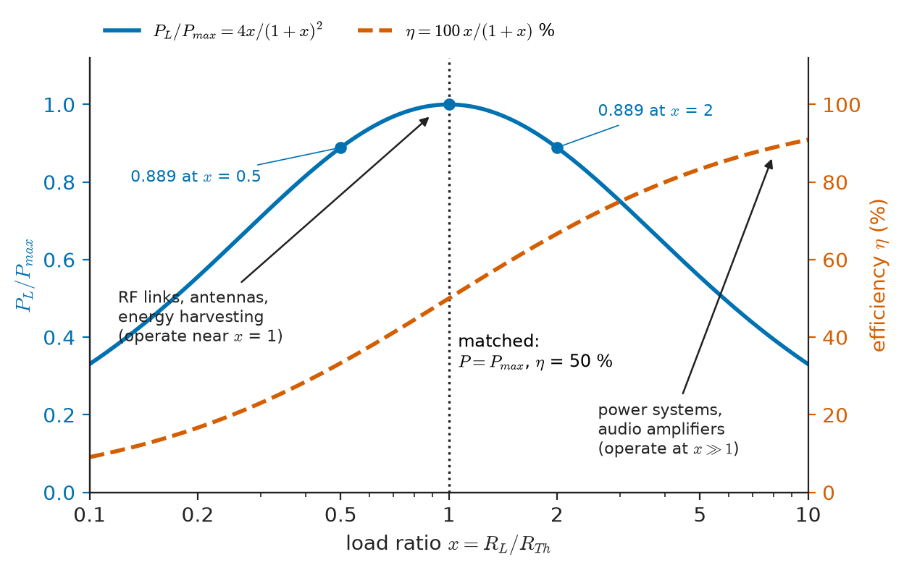
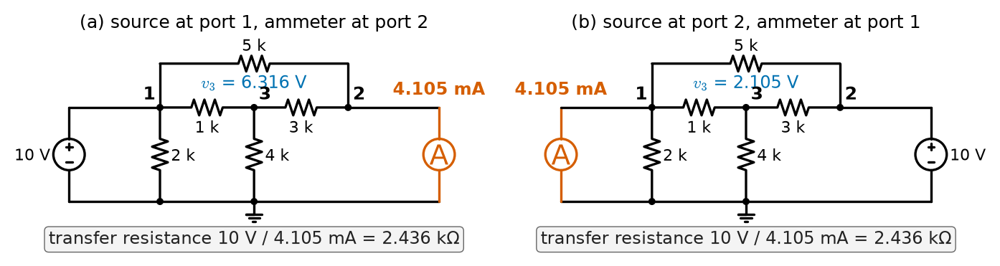
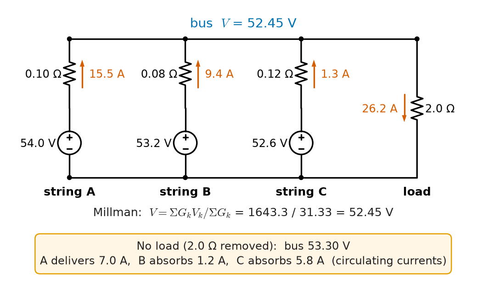

# Chapter 4 — Network Theorems

*Part I · Circuit Fundamentals*

A car will not start on a cold morning. The battery reads 12.6 V on a multimeter, which looks healthy, yet the starter motor barely turns. A technician clips a load tester across the terminals, draws 150 A for ten seconds, and watches the voltage collapse to 8 V. The open-circuit reading said almost nothing about the battery; the voltage *under load* said everything. What the technician measured, without naming it, was the battery's Thévenin equivalent: an ideal 12.6 V source in series with an internal resistance that had grown from about 5 mΩ when new to more than 25 mΩ after five winters. The same two numbers decide whether a USB port can charge a phone, whether a strain-gauge bridge reads correctly into a data logger, and how much fault current a substation must interrupt.

Chapter 3 gave systematic methods — nodal and mesh analysis — that solve any linear circuit completely. Completeness is not always what an engineer wants. Usually only one port matters: the terminals where a load, a sensor input or a fault is connected. The network theorems of this chapter compress everything behind that port into two or three numbers, separate the effect of each source, and expose structural properties (reciprocity, maximum power transfer) that full solutions hide.

> **How can a network of any complexity be replaced, at one pair of terminals, by a single source and a single resistance — and when does that replacement fail?**
> **Which properties of a circuit follow from linearity alone, and which need more?**

| Concept | Engineering destination |
|---|---|
| Superposition | Separating DC bias from signal, noise budgets, multi-source power systems, interference analysis |
| Thévenin equivalent | Battery and source modelling, sensor and amplifier interfacing, fault-level calculation, loading error |
| Norton equivalent | Current-output sensors (photodiodes, 4–20 mA loops), transistor output models, short-circuit current |
| Maximum power transfer | RF and antenna matching, energy harvesting, solar maximum-power-point tracking, audio and probe design |
| Reciprocity | Antenna transmit/receive patterns, two-port measurements, sensitivity calculations, passive filter testing |
| Millman's theorem | Paralleled battery strings and rectifiers, star-point voltage of unbalanced loads, resistive summing networks |
| Source equivalence | Simplifying ladder networks, converting between voltage and current drive |
| Equivalent networks (Δ–Y, substitution) | Bridge circuits, three-phase load conversion, attenuators, reduction of meshed grids |
| Applications and limitations | Knowing when a linear model of a battery, diode, transformer or amplifier may be trusted |

**Roadmap.** Linearity and superposition (4.1) → Thévenin's theorem (4.2) → Norton's theorem (4.3) → source equivalence (4.4) → maximum power transfer (4.5) → reciprocity (4.6) → Millman's theorem (4.7) → equivalent networks (4.8) → applications and limitations (4.9).

---

## 4.1 Superposition

### Linearity is the root of every theorem here

A circuit is **linear** when every element obeys a linear relation between its voltage and current: resistors ($v=Ri$), the capacitors and inductors of Chapter 5 ($i=C\,dv/dt$, $v=L\,di/dt$), and linear dependent sources ($v=\mu v_x$, $i=\beta i_x$, $i=g_m v_x$, $v=r_m i_x$). Independent sources are the *inputs*; they are not themselves required to be linear functions of anything. Chapter 3 showed that the nodal equations of such a circuit take the form

$$
\mathbf{G}\,\mathbf{v}=\mathbf{i}_s
$$

where $\mathbf{G}$ depends only on the elements and $\mathbf{i}_s$ collects the independent sources. If $\mathbf{G}$ is invertible (the circuit is solvable, Chapter 3), then $\mathbf{v}=\mathbf{G}^{-1}\mathbf{i}_s$. Every node voltage — and therefore every branch voltage and current — is a weighted sum of the independent sources:

$$
x = a_1 s_1 + a_2 s_2 + \dots + a_N s_N
$$

where $x$ is any response, $s_k$ are the independent sources and the coefficients $a_k$ depend only on the network. Two properties follow directly. **Homogeneity**: scaling every source by $\alpha$ scales every response by $\alpha$. **Additivity**: the response to several sources acting together equals the sum of the responses to each acting alone. Together they are the **superposition principle**.

### The procedure

To find a response by superposition:

1. Keep one independent source; **deactivate** all the others. A deactivated voltage source is replaced by a short circuit (0 V regardless of current); a deactivated current source by an open circuit (0 A regardless of voltage).
2. Solve the simpler circuit for the response of interest.
3. Repeat for each independent source and add the partial responses, respecting reference directions.

**Dependent sources are never deactivated.** They are part of the network, not inputs: a current-controlled source whose controlling current happens to be zero in one sub-circuit simply produces zero there, but it must remain in place. Removing it changes $\mathbf{G}$ itself.

Sources may also be grouped: all DC sources in one sub-problem, all signal sources in another. This is exactly how a transistor amplifier is analysed — a DC bias solution plus a small-signal solution — although there the circuit is only linear about the bias point (Section 4.9).

> **Status of the principle: Superposition**
> *Derived.* A direct consequence of the linearity of the element equations and of KCL/KVL; it holds exactly for any circuit of linear elements and independent sources, and fails as soon as any element is nonlinear.

### Power does not superpose

Power is a quadratic function of voltage or current. In a resistor carrying $i=i_1+i_2$,

$$
p=R(i_1+i_2)^2=Ri_1^2+Ri_2^2+2Ri_1i_2
$$

The cross term $2Ri_1i_2$ is missing from the sum of the individual powers. It vanishes only when the partial responses are *orthogonal* in an averaging sense — for instance, sinusoids of different frequencies averaged over a common period, or uncorrelated random noise sources averaged over time. That special case is why the average power of a signal with several harmonics is the sum of the harmonic powers (Chapter 9) and why independent noise powers add (Chapter 29). For DC sources, or for signals at the same frequency, power must be computed from the total response.

<!-- FIGURE 4.1 | figures/ch04/fig-4-1-superposition-alternator-battery.png | circuit | Superposition applied to an automotive charging circuit: the full circuit and the two single-source sub-circuits. | Content: three side-by-side panels. Panel (a): alternator modelled as 14.4 V source with 0.05 ohm series resistance on the left, battery as 12.6 V source with 0.02 ohm on the right, both connected to a common top node feeding a 0.5 ohm load to the bottom rail; label currents I_alt (downward through the alternator branch toward the node, i.e. delivered), I_batt (battery charging current, into battery positive) and I_L. Panel (b): battery source replaced by a short, alternator active; annotate v_L' = 4.00 V, I_L' = 8.0 A. Panel (c): alternator source replaced by a short, battery active; annotate v_L'' = 8.75 V, I_L'' = 17.5 A. Below: sum v_L = 12.75 V, I_L = 25.5 A. -->

*Figure 4.1 — Superposition applied to an automotive charging circuit: the full circuit and the two single-source sub-circuits.*

**Worked example — Alternator and battery sharing a load.** A car's charging system is modelled (Figure 4.1a) as an alternator, 14.4 V behind 0.05 Ω, in parallel with a battery, 12.6 V behind 0.02 Ω, both feeding the vehicle's electrical load of 0.5 Ω (about 25 A, a typical night-time load with lights and blower).

*Alternator alone* (battery source shorted, Figure 4.1b). The alternator sees 0.05 Ω in series with $0.02\parallel0.5=0.019\,23$ Ω. Its current is $14.4/0.069\,23=208.0$ A, and the load-node voltage is $208.0\times0.019\,23=4.00$ V. The load carries $4.00/0.5=8.0$ A; the shorted battery branch carries $4.00/0.02=200$ A *into* the battery.

*Battery alone* (alternator source shorted, Figure 4.1c). The battery sees 0.02 Ω in series with $0.05\parallel0.5=0.045\,45$ Ω. Its current is $12.6/0.065\,45=192.5$ A, the node voltage is $192.5\times0.045\,45=8.75$ V, and the load carries 17.5 A while 175 A flows back into the alternator branch.

*Together.* Node voltage $4.00+8.75=12.75$ V; load current $8.0+17.5=25.5$ A. Alternator output current $(14.4-12.75)/0.05=33.0$ A, of which 25.5 A goes to the load and 7.5 A charges the battery: $(12.6-12.75)/0.02=-7.5$ A of discharge. The partial currents in the sub-circuits are large (hundreds of amperes) because each source sees the other source's tiny internal resistance as a short; they cancel almost entirely in the sum. That is normal and harmless — sub-circuits are mathematical constructs, not operating states.

*Power check.* The load power is $12.75^2/0.5=325.1$ W. The sum of the "partial powers" would be $4.00^2/0.5+8.75^2/0.5=32.0+153.1=185.1$ W — wrong by 140 W, the cross term $2\times4.00\times8.75/0.5$. Superpose voltages and currents; compute power last.

### Superposition as a design tool

Superposition is most useful not as a hand-calculation shortcut but as a way of thinking about *which source causes what*:

- **Bias and signal.** A sensor bridge excited from 5 V DC with a 1 mV, 50 Hz interference coupled in can be analysed for the DC operating point and the interference separately; the interference rejection of the instrument is a property of the second sub-circuit only.
- **Ground-loop and interference budgets.** In an audio system, each hum source (magnetic coupling, ground-potential difference, capacitive pickup) produces its own contribution at the amplifier input; superposition justifies analysing them one at a time and the linearity of the rest of the chain justifies adding them.
- **Power-system faults.** The current during a fault equals the pre-fault load current plus the current produced by a single source inserted at the fault point equal and opposite to the pre-fault voltage. This "superposition of the fault" is the basis of standard short-circuit calculation (Section 4.9).
- **Sensitivity.** Homogeneity alone tells you that doubling a bridge's excitation doubles its output, and that the output per volt of excitation (mV/V, the standard load-cell specification) is a property of the network.

---

## 4.2 Thévenin's theorem

### Statement

Consider a network $N$ of linear elements and independent sources connected at two terminals $a$–$b$ to an arbitrary load (which may be nonlinear). **Thévenin's theorem** states that, as far as the load is concerned, $N$ may be replaced by an ideal voltage source $V_{Th}$ in series with a resistance $R_{Th}$, where

- $V_{Th}$ is the **open-circuit voltage** $v_{oc}$ at $a$–$b$ (load removed);
- $R_{Th}$ is the resistance seen looking into $a$–$b$ with every *independent* source of $N$ deactivated.

Equivalently, the terminal relation of $N$ is the straight line

$$
v = V_{Th} - R_{Th}\, i
$$

where $i$ is the current leaving terminal $a$ into the load.

### Why it is true

Drive the terminals with a test current source $i$ (drawing current out of $N$) and ask for the terminal voltage $v$. By superposition, $v$ is the sum of two parts: the voltage produced by the internal sources of $N$ with the test source open — which is $v_{oc}$ — and the voltage produced by the test source with the internal sources deactivated, which is linear in $i$ and can be written $-R_{Th}\,i$. Hence $v=v_{oc}-R_{Th}i$ for *any* current, and therefore for whatever current the actual load draws. No assumption about the load was used; only $N$ must be linear. The load may be a diode, a motor, a lamp or another network.

> **Status of the principle: Thévenin's theorem**
> *Derived.* Follows from superposition applied to the network seen through one port; exact for linear networks with independent and linear dependent sources, regardless of the load, provided the dependent sources are not controlled by quantities inside the load.

The proviso matters. If a dependent source inside $N$ is controlled by a voltage or current in the load (or vice versa), the network and load are coupled by more than the two terminals and the one-port view does not apply.

### Three ways to find $R_{Th}$

1. **Source deactivation and series–parallel reduction.** When $N$ contains only independent sources and resistors, deactivate the sources and reduce the resistances seen from $a$–$b$ (Chapter 2).
2. **Open-circuit voltage over short-circuit current.** Compute or measure $v_{oc}$ and the short-circuit current $i_{sc}$ (terminals shorted); then $R_{Th}=v_{oc}/i_{sc}$. This works with dependent sources and is the natural laboratory method when shorting the terminals is safe.
3. **Test source.** Deactivate the independent sources, apply a test voltage $v_t$ (or current $i_t$) at the terminals, compute the resulting current (or voltage), and take $R_{Th}=v_t/i_t$. This is the only general method when dependent sources are present and $v_{oc}=0$.

With dependent sources, $R_{Th}$ can be smaller than any resistor in the network, larger than all of them, or even negative. Negative resistance at a port signals an active network that can deliver power into a passive load at the "wrong" sign; it is the basis of oscillator analysis (Chapter 7 shows how a negative resistance cancels circuit loss).

<!-- FIGURE 4.2 | figures/ch04/fig-4-2-thevenin-norton-iv-line.png | plot | The terminal characteristic of any linear one-port is a straight line fixed by the open-circuit voltage and the short-circuit current; Thévenin and Norton equivalents reproduce it exactly. | Content: left inset: Thévenin equivalent (V_Th = 12 V, R_Th = 4 ohm) and Norton equivalent (I_N = 3 A, R_N = 4 ohm) side by side with terminals a, b. Main plot: x-axis terminal current i from 0 to 3.5 A, y-axis terminal voltage v from 0 to 13 V. Source line v = 12 - 4i from (0, 12) to (3, 0); intercepts labelled v_oc = 12 V and i_sc = 3 A; slope labelled -R_Th. Overlay load lines (v = R_L i) for R_L = 1, 4 and 16 ohm through the origin; mark operating points (2.4 A, 2.4 V), (1.5 A, 6 V) and (0.6 A, 9.6 V). Light shaded rectangle under the R_L = 4 ohm operating point labelled P = 9 W. -->

*Figure 4.2 — The terminal characteristic of any linear one-port is a straight line fixed by the open-circuit voltage and the short-circuit current; Thévenin and Norton equivalents reproduce it exactly.*

### The terminal line and the load line

Figure 4.2 shows the geometry. A linear one-port is a straight line in the $v$–$i$ plane, crossing the voltage axis at $v_{oc}$ and the current axis at $i_{sc}$. A resistive load is a straight line through the origin with slope $R_L$. The operating point is the intersection. If the load is a nonlinear device — a diode, a lamp, a battery being charged — its characteristic is a curve, and the intersection with the Thévenin line gives the operating point graphically. This **load-line** construction is how diode and transistor bias points are found in *Electronics & Computing*; Thévenin's theorem is what reduces the rest of the circuit to a single line.

### Measuring a Thévenin equivalent

Any source with accessible terminals — a battery, a bench supply, a USB port, a microphone, a sensor — can be characterised by two measurements. Measure the open-circuit voltage $v_1$ with a high-impedance meter; apply a known load $R_L$ and measure $v_2$. Then $V_{Th}=v_1$ and

$$
R_{Th}=R_L\left(\frac{v_1}{v_2}-1\right)
$$

A USB port that reads 5.08 V open-circuit and 4.83 V while delivering 1.00 A into a 4.83 Ω load has $R_{Th}=0.25/1.00=0.25$ Ω, most of it in the cable and connectors. The car battery of the opening reads 12.6 V open-circuit and 8.0 V at 150 A, so $R_{Th}=4.6/150\approx31$ mΩ. Real sources are linear only over a range: the battery's internal resistance rises with discharge and falls with temperature, and a regulated supply has nearly zero $R_{Th}$ until it reaches its current limit, where it abruptly becomes a current source. Two-point measurements should therefore be made around the intended operating point.

**Worked example — A strain-gauge bridge driving a data logger.** A quarter-bridge strain-gauge circuit (Figure 4.3) has four arms of nominally 350 Ω and is excited from $E=5.000$ V. Under load the active gauge rises by 0.20 % to 350.70 Ω (with a gauge factor of 2.0, this is a strain of 1000 µε). The bridge output is read by an instrument whose differential input resistance is $R_m$. Find the reading for $R_m=10$ kΩ and for $R_m=1$ MΩ.

Label the left divider as a fixed 350 Ω on top and the gauge $R_g$ on the bottom, so the left midpoint sits at $E\,R_g/(R+R_g)$; the right divider is two fixed 350 Ω arms, so its midpoint sits at $E/2$.

*Open-circuit voltage.*

$$
V_{Th}=E\left(\frac{R_g}{R+R_g}-\frac12\right)=5.000\left(\frac{350.70}{700.70}-0.5\right)=2.498\ \mathrm{mV}
$$

The familiar small-strain approximation $E\,\Delta R/(4R)=5\times0.70/1400=2.500$ mV is 0.1 % high; the bridge is slightly nonlinear in $\Delta R$ even before loading.

*Thévenin resistance.* With the excitation source shorted, the top and bottom of both dividers are tied together, so each midpoint sees its two arms in parallel, and the two midpoints are in series through the meter terminals:

$$
R_{Th}=(350\parallel350.70)+(350\parallel350)=175.17+175.00=350.17\ \Omega
$$

*Loaded reading.*

$$
v_m=V_{Th}\frac{R_m}{R_m+R_{Th}}
$$

For $R_m=10$ kΩ: $v_m=2.498\times10\,000/10\,350.17=2.413$ mV, a **3.4 % loading error**, equivalent to reading 966 µε instead of 1000 µε. For $R_m=1$ MΩ: $v_m=2.4966$ mV, an error of 0.035 %. This is why strain-gauge amplifiers specify input resistances of at least 1 MΩ, and why the specification sheet of a bridge transducer always quotes its output resistance: the Thévenin resistance is the number that couples the sensor to the instrument.

<!-- FIGURE 4.3 | figures/ch04/fig-4-3-strain-bridge-thevenin.png | circuit | A quarter-bridge strain-gauge circuit and its Thévenin equivalent seen by the measuring instrument. | Content: left: Wheatstone bridge excited by E = 5.000 V; left arm top R = 350 ohm, bottom active gauge R_g = 350.70 ohm (drawn with strain-gauge arrow); right arm two 350 ohm resistors; output terminals at the two midpoints connected to an instrument input resistance R_m. Right: Thévenin equivalent V_Th = 2.498 mV in series with R_Th = 350.17 ohm feeding R_m; table beside it: R_m = 10 kohm gives 2.413 mV (-3.4 percent), R_m = 1 Mohm gives 2.4966 mV (-0.035 percent). -->

*Figure 4.3 — A quarter-bridge strain-gauge circuit and its Thévenin equivalent seen by the measuring instrument.*

**Worked example — Thévenin equivalent of a network with a dependent source.** A current-amplifying stage is modelled as follows: an independent source $V_s=10$ V drives a resistor $R_1=2$ kΩ into node $a$; a resistor $R_2=8$ kΩ connects $a$ to ground; and a current-controlled current source injects $k\,i_1$ into node $a$, where $i_1$ is the current in $R_1$ (flowing toward $a$) and $k=3$. Find the Thévenin equivalent at node $a$ with respect to ground.

*Open-circuit voltage.* KCL at $a$: $i_1+k\,i_1=v_a/R_2$, with $i_1=(V_s-v_a)/R_1$. Substituting,

$$
(1+k)\frac{V_s-v_a}{R_1}=\frac{v_a}{R_2}\ \Rightarrow\ v_a=\frac{(1+k)V_s/R_1}{1/R_2+(1+k)/R_1}=\frac{4\times10/2000}{0.125\ \mathrm{mS}+2\ \mathrm{mS}}=9.412\ \mathrm{V}
$$

*Short-circuit current.* With $a$ shorted to ground, $i_1=V_s/R_1=5$ mA, $R_2$ carries nothing, and the short carries $(1+k)i_1=20$ mA.

*Thévenin resistance.* $R_{Th}=v_{oc}/i_{sc}=9.412/0.020=470.6$ Ω.

*Check with a test source.* Deactivate $V_s$ (short it) — the dependent source stays — and apply $v_t$ at $a$. Then $i_1=-v_t/R_1$, and the test source must supply $i_t=v_t/R_2-(1+k)i_1=v_t\,[1/R_2+(1+k)/R_1]$, so $R_{Th}=1/(0.125+2.0)\ \mathrm{mS}=470.6$ Ω. Note that $R_{Th}$ is much smaller than either resistor: the dependent source multiplies the effective conductance of $R_1$ by $1+k=4$. Wrongly deactivating the dependent source would give $R_1\parallel R_2=1.6$ kΩ, more than three times too large.

> **Boundary.** Dependent sources here stand for the linearised (small-signal) models of transistors and amplifiers. How those models are derived from device physics and bias conditions belongs to *Electronics & Computing*; this book uses them only as linear circuit elements.

---

## 4.3 Norton's theorem

### Statement

**Norton's theorem** is the current-source dual of Thévenin's: the same linear network $N$ may be replaced at terminals $a$–$b$ by an ideal current source $I_N$ in parallel with a resistance $R_N$, where

- $I_N$ is the **short-circuit current** $i_{sc}$ flowing from $a$ to $b$ through a short;
- $R_N=R_{Th}$, found exactly as in Section 4.2.

The terminal relation is the same straight line written the other way round:

$$
i = I_N - \frac{v}{R_N}
$$

Comparing with $v=V_{Th}-R_{Th}i$ gives the conversion between the two forms:

$$
V_{Th}=I_N R_N,\qquad I_N=\frac{V_{Th}}{R_{Th}},\qquad R_N=R_{Th}
$$

> **Status of the principle: Norton's theorem**
> *Derived.* The same superposition argument as Thévenin's theorem with a test voltage instead of a test current; exact for linear networks, and equivalent to Thévenin's form whenever $R_{Th}$ is finite and nonzero.

### When the Norton form is the natural one

Mathematically the two forms are interchangeable; physically one is often more natural.

- **Photodiodes** generate a photocurrent proportional to optical power (about 0.5–0.9 A/W in silicon at its peak wavelength) in parallel with a large shunt resistance (tens of MΩ to GΩ). Their natural model is a Norton source, and a transimpedance amplifier is designed to hold their terminal voltage near zero so that the full short-circuit current is collected.
- **4–20 mA current loops** in process instrumentation use transmitters that behave as Norton sources with output resistance of megohms. The loop current is then insensitive to cable resistance and receiver resistance up to the transmitter's compliance voltage — a property easy to see in Norton form and awkward in Thévenin form, where it appears as a huge voltage behind a huge resistance.
- **Transistor output models** are Norton sources: a controlled current $g_m v_{be}$ in parallel with an output resistance $r_o$.
- **Power-system fault levels** are quoted as short-circuit currents (or short-circuit MVA) at a busbar — a direct statement of the Norton current of the grid behind that bus.

In Figure 4.2 the Norton equivalent of the 12 V, 4 Ω source is a 3 A source in parallel with 4 Ω. In the alternator example of Section 4.1, the alternator's Norton equivalent is $14.4/0.05=288$ A in parallel with 0.05 Ω, and the battery's is 630 A in parallel with 0.02 Ω; these large currents are not real fault currents (internal resistance rises and protection operates long before), but they show at once that the battery is the "stiffer" source.

### Degenerate cases

If $R_{Th}=0$, the network is an ideal voltage source at its terminals and has no Norton equivalent (the short-circuit current is infinite). If $R_{Th}\to\infty$, it is an ideal current source and has no Thévenin equivalent. Real sources always have some finite internal resistance, but *regulated* sources approximate these limits deliberately: a laboratory supply in constant-voltage mode has an output resistance of milliohms, a precision current source one of gigohms. When modelling them, use the form that remains finite.

---

## 4.4 Source equivalence

### Practical sources as two-element networks

Chapter 2 introduced **source transformation**: a voltage source $v_s$ in series with $R$ may be exchanged for a current source $v_s/R$ in parallel with the same $R$. Section 4.3 shows that this is simply the conversion between the Thévenin and Norton forms of a two-element network. Two sources are **equivalent** when they have the same terminal $v$–$i$ line: the same open-circuit voltage and the same short-circuit current. Nothing more is promised.

> **Status of the principle: Source equivalence**
> *Derived.* Two linear one-ports with equal $v_{oc}$ and $i_{sc}$ have identical terminal characteristics; the equivalence is exact at the terminals and carries no information about what happens inside.

### Equivalence is external only

The internal behaviour of equivalent sources can be completely different. With the terminals open, the Thévenin form of the 12 V, 4 Ω source dissipates nothing (no current flows), while the Norton form dissipates $3^2\times4=36$ W in its internal resistor. With the terminals shorted the situation reverses: the Thévenin resistor dissipates 36 W and the Norton resistor nothing. Neither model says anything trustworthy about the real source's internal heating; the battery's internal loss under short circuit is the Thévenin value only because the Thévenin form happens to put the resistance where the real loss mechanism is. Internal efficiency, temperature rise and component stress must be computed from a model of the actual internal structure.

### Ideal sources and the rules for moving them

Some manipulations look like transformations but are not:

- An ideal voltage source with *no* series resistance has no Norton equivalent. A resistor connected *in parallel* with an ideal voltage source is irrelevant to the rest of the circuit (it changes only the source's own current) and may be removed for the external analysis.
- An ideal current source with no parallel resistance has no Thévenin equivalent. A resistor in *series* with an ideal current source is likewise irrelevant to the external circuit.
- Ideal voltage sources of different values may not be placed in parallel, and ideal current sources of different values may not be placed in series; such circuits violate KVL or KCL and have no solution (Chapter 3).
- A voltage source may be "pushed" through a node into every branch connected to that node (each branch gets a copy in series), and a current source may be split into a chain of equal sources across the elements of a loop. These **source-shifting** moves preserve all KCL and KVL equations and can turn an awkward source into one that can be transformed.

### Dependent-source transformation

A dependent voltage source in series with a resistor may be transformed to a dependent current source in parallel with it, and vice versa, provided the controlling variable is *not* eliminated by the transformation. If the controlling voltage was the voltage across the very resistor being moved, it must first be re-expressed in terms of variables that survive. Losing the controlling variable is the most common error in hand analysis of amplifier models.

### Source equivalence as a reduction engine

Repeated source transformation and series–parallel combination reduce ladder networks one rung at a time. Starting from the source end, each step converts a series source–resistor pair to a Norton pair, combines parallel resistors and current sources, converts back, and adds the next series resistor. The end result is the Thévenin equivalent at the far end of the ladder. This is the operation that a resistive attenuator, an R–2R digital-to-analogue converter ladder (where every node sees the same Thévenin resistance $R$, so each bit contributes a binary-weighted voltage) and a distribution feeder with tapped loads all invite.

---

## 4.5 Maximum power transfer

### The theorem

A source with Thévenin equivalent $V_{Th}$, $R_{Th}$ delivers to a resistive load $R_L$ the power

$$
P_L=\frac{V_{Th}^2R_L}{(R_{Th}+R_L)^2}
$$

Setting $dP_L/dR_L=0$:

$$
\frac{dP_L}{dR_L}=V_{Th}^2\frac{(R_{Th}+R_L)-2R_L}{(R_{Th}+R_L)^3}=0\ \Rightarrow\ R_L=R_{Th}
$$

and the maximum is

$$
P_{\max}=\frac{V_{Th}^2}{4R_{Th}}=\frac{V_{Th}\,I_N}{4}
$$

The maximum available power is one quarter of the product of open-circuit voltage and short-circuit current — the area of the largest rectangle that fits under the source line of Figure 4.2.

> **Status of the principle: Maximum power transfer**
> *Derived.* Follows from optimising the load power of a fixed Thévenin source; it answers "which load extracts the most power from this source", not "which source delivers the most power to this load" — if $R_{Th}$ is adjustable, the load power is maximised by making $R_{Th}$ zero.

### Efficiency at the matched point

The efficiency of transfer — load power divided by total power taken from the ideal source — is

$$
\eta=\frac{R_L}{R_{Th}+R_L}
$$

At $R_L=R_{Th}$ it is exactly 50 %: half of the source's power is dissipated inside. Table 4.1 shows the trade-off for $V_{Th}=12$ V, $R_{Th}=4$ Ω, and Figure 4.4 plots it.

**Table 4.1 — Load power and efficiency for a 12 V, 4 Ω source.**

| $R_L$ (Ω) | $R_L/R_{Th}$ | $I$ (A) | $P_L$ (W) | $\eta$ (%) |
|---|---|---|---|---|
| 1 | 0.25 | 2.40 | 5.76 | 20.0 |
| 2 | 0.5 | 2.00 | 8.00 | 33.3 |
| 4 | 1 | 1.50 | 9.00 | 50.0 |
| 8 | 2 | 1.00 | 8.00 | 66.7 |
| 16 | 4 | 0.60 | 5.76 | 80.0 |

The power curve is flat near its maximum: a load mismatched by a factor of two in either direction still receives 89 % of the maximum (8.00 W of 9.00 W). The efficiency curve has no such plateau; it rises steadily with $R_L$.

<!-- FIGURE 4.4 | figures/ch04/fig-4-4-max-power-efficiency.png | plot | Load power and transfer efficiency versus load resistance: power peaks at the matched load where efficiency is only 50 percent. | Content: x-axis R_L/R_Th on a logarithmic scale from 0.1 to 10. Left y-axis P_L/P_max from 0 to 1.0 (solid curve 4x/(1+x)^2, peak 1.0 at x = 1, value 0.889 at x = 0.5 and 2). Right y-axis efficiency eta from 0 to 100 percent (dashed curve 100x/(1+x)). Vertical dotted line at x = 1 labelled "matched: P = P_max, eta = 50 percent". Shaded region x > 10 not shown; annotate arrows: "RF links, antennas, energy harvesting (operate near x = 1)" and "power systems, audio amplifiers (operate at x >> 1)". -->

*Figure 4.4 — Load power and transfer efficiency versus load resistance: power peaks at the matched load where efficiency is only 50 percent.*

### Two engineering regimes

Whether to match depends on what is scarce.

**When the source is weak and its energy is free or already spent, match.** An antenna delivers microwatts or less to a receiver; its "internal resistance" is its radiation resistance, the power dissipated there is re-radiated, not wasted heat in a battery. Extracting the maximum signal power is everything, so RF systems are built around a standard 50 Ω (or 75 Ω for video and cable television) and every source, line and load is matched to it. Energy harvesters (thermoelectric generators, piezoelectric vibration harvesters) and solar cells are run at their maximum-power point, because the energy available is fixed and limited. A photovoltaic module is nonlinear, so its maximum-power point is not simply "load = internal resistance", but the same idea — operate where $v\cdot i$ is largest on the source curve — is what an MPPT controller tracks.

**When the source is strong and efficiency matters, do not match.** A power system that operated at matched load would waste half its generation in its own lines and generators. A 230 V supply point with a source resistance of 0.2 Ω could in principle deliver $230^2/(4\times0.2)=66$ kW to a matched load — at 50 % efficiency and with 575 A flowing. In reality loads are tens to hundreds of times the source impedance, voltage stays within a few percent of nominal, and efficiency is high. The same holds for audio amplifiers.

**Worked example — Why a loudspeaker is not matched to its amplifier.** A power amplifier with open-circuit output 20 V rms and output resistance 0.05 Ω drives an 8 Ω loudspeaker (treated as resistive). The current is $20/8.05=2.484$ A rms, the speaker power $2.484^2\times8=49.4$ W, and the efficiency of transfer $8/8.05=99.4$ %. A matched 0.05 Ω load would in principle receive $20^2/(4\times0.05)=2000$ W — but the amplifier would dissipate the same 2000 W internally and would be destroyed long before. Audio amplifiers are designed as near-ideal voltage sources; their figure of merit is the **damping factor** $R_L/R_{out}$, here $8/0.05=160$. A high damping factor lets the amplifier's low source resistance damp the loudspeaker cone's mechanical resonance electrically (the back-EMF of the moving coil sees almost a short circuit), giving a tighter bass response. Maximum power transfer would be the wrong design goal.

### Matching with reactive sources

When the source is a sinusoidal source with an internal impedance $Z_{Th}=R_{Th}+jX_{Th}$, the load that maximises average power is the **complex conjugate** $Z_L=R_{Th}-jX_{Th}$: the reactances cancel and the resistive part is matched. Chapter 8 introduces the impedances needed to state this; Chapter 9 proves it from complex power; and Chapter 14 shows how transmission-line sections and stubs realise the match at radio frequencies. The DC result of this section is the special case $X_{Th}=0$.

---

## 4.6 Reciprocity

### The theorem

Take a linear network containing only resistors (and, later, capacitors, inductors and coupled coils), with no dependent sources and no independent sources other than the one we insert. Choose two branches, call them port 1 and port 2.

**Reciprocity theorem.** If an ideal voltage source $V$ inserted in branch 1 produces a current $I$ in branch 2 (with branch 2 short-circuited or containing its normal passive element), then the same source moved to branch 2 produces the same current $I$ in branch 1.

The dual statement holds for current sources and open-circuit voltages: a current source $I$ injected at port 1 producing open-circuit voltage $V$ at port 2 will, when moved to port 2, produce the same $V$ at port 1. In both forms, the **transfer resistance** (or transfer conductance) between the two ports is the same in both directions.

### Why it is true

For a network of resistors, the nodal conductance matrix $\mathbf{G}$ is symmetric: the conductance between nodes $j$ and $k$ appears as $-G_{jk}$ in both row $j$ and row $k$. The inverse of a symmetric matrix is symmetric, so the voltage at node $k$ due to a unit current injected at node $j$, $(\mathbf{G}^{-1})_{kj}$, equals the voltage at node $j$ due to a unit current at node $k$, $(\mathbf{G}^{-1})_{jk}$. That is the current-source form of reciprocity. A more general proof, valid for any network whose branches obey symmetric constitutive relations, uses Tellegen's theorem — the statement that the sum of branch voltage–current products vanishes for any pair of voltage and current distributions satisfying KVL and KCL on the same graph.

> **Status of the principle: Reciprocity**
> *Derived.* Follows from the symmetry of the network matrices for bilateral linear elements (R, L, C, mutual inductance); it fails for networks with dependent sources, ferrites under static magnetic bias, and any nonlinear element.

<!-- FIGURE 4.5 | figures/ch04/fig-4-5-reciprocity-swap.png | circuit | Reciprocity: moving the source and the ammeter between two ports of a passive resistive network leaves the measured current unchanged. | Content: two copies of the same network side by side. Nodes 1, 2, 3 and ground. Resistors: 1-3 = 1 kohm, 1-ground = 2 kohm, 3-ground = 4 kohm, 3-2 = 3 kohm, 1-2 = 5 kohm. Left copy: 10 V source from ground to node 1, ammeter short from node 2 to ground reading 4.105 mA, node 3 annotated 6.316 V. Right copy: 10 V source from ground to node 2, ammeter short from node 1 to ground reading 4.105 mA, node 3 annotated 2.105 V. Caption tag under each: "transfer resistance 2.436 kohm". -->

*Figure 4.5 — Reciprocity: moving the source and the ammeter between two ports of a passive resistive network leaves the measured current unchanged.*

**Worked example — Checking reciprocity numerically.** The network of Figure 4.5 has nodes 1, 2, 3 and ground, with resistors $R_{13}=1$ kΩ, $R_{1g}=2$ kΩ, $R_{3g}=4$ kΩ, $R_{32}=3$ kΩ and $R_{12}=5$ kΩ.

*Source at port 1, short at port 2.* Node 1 is held at 10 V and node 2 at 0 V. Node 3 is the only unknown:

$$
v_3=\frac{10/1000+0/4000+0/3000}{1/1000+1/4000+1/3000}=\frac{10\ \mathrm{mA}}{1.5833\ \mathrm{mS}}=6.316\ \mathrm{V}
$$

The current into the short at node 2 is $10/5000+6.316/3000=2.000+2.105=4.105$ mA.

*Source at port 2, short at port 1.* Now node 2 is at 10 V and node 1 at 0 V:

$$
v_3=\frac{10/3000}{1.5833\ \mathrm{mS}}=2.105\ \mathrm{V}
$$

and the short at node 1 carries $10/5000+2.105/1000=2.000+2.105=4.105$ mA.

The internal state is completely different (node 3 sits at 6.316 V in one case and 2.105 V in the other; the 2 kΩ resistor carries current in one case and none in the other), but the transfer resistance $10\ \mathrm{V}/4.105\ \mathrm{mA}=2.436$ kΩ is the same in both directions.

### Where reciprocity is used

- **Antennas.** An antenna's receiving pattern equals its transmitting pattern, and its gain is the same in both modes. This follows from reciprocity of Maxwell's equations in linear isotropic media, of which the circuit theorem is a special case. Radar and communication link budgets rely on it (Chapters 30 and 32).
- **Two-port parameters.** For a reciprocal two-port, $z_{12}=z_{21}$, $y_{12}=y_{21}$ and $AD-BC=1$ (Chapter 12). This halves the measurements needed to characterise passive filters, attenuators and transmission lines.
- **Measurement convenience.** If driving port 2 is easier or safer than driving port 1 — for example, injecting a test signal at a sensor end of a cable network rather than at a high-voltage end — reciprocity guarantees the same transfer ratio.
- **Sensitivity analysis.** The adjoint-network method for computing how every component affects one output in a single extra simulation is a direct application of reciprocity-type symmetry.

### Where it fails

Amplifiers are deliberately non-reciprocal: a voltage amplifier with gain 100 in one direction has a reverse transmission near zero. Any network with dependent sources is generally non-reciprocal, because the controlled-source entries break the symmetry of $\mathbf{G}$. Non-reciprocal *passive* devices exist too — circulators and isolators use magnetised ferrites to route microwave power one way only, protecting transmitters from reflected power. Nonlinear networks (mixers, diode detectors) are not reciprocal in any useful sense.

---

## 4.7 Millman's theorem

### Statement

When several branches, each consisting of a voltage source $V_k$ in series with a resistance $R_k$ (or simply a resistor, $V_k=0$), are connected in parallel between two nodes, the voltage between those nodes is

$$
V=\frac{\displaystyle\sum_k V_k/R_k}{\displaystyle\sum_k 1/R_k}=\frac{\sum_k G_kV_k}{\sum_k G_k}
$$

It is the conductance-weighted average of the branch source voltages. Current-source branches can be included by adding their currents to the numerator (and nothing to the denominator).

### Why it is true

Convert every branch to its Norton form: a current $G_kV_k$ in parallel with $G_k$. All the current sources are now in parallel and add; all the conductances are in parallel and add. The node voltage is total current over total conductance. Equivalently, Millman's theorem is single-node nodal analysis written in closed form.

> **Status of the principle: Millman's theorem**
> *Derived.* A one-line consequence of source transformation and KCL at a single node; exact for linear branches connected between exactly two nodes.

The result is both a shortcut and a piece of physical insight. The common voltage is pulled toward the sources with the *largest conductance* — the stiffest sources dominate. In the alternator example of Section 4.1, Millman's theorem gives the bus voltage at once:

$$
V=\frac{14.4/0.05+12.6/0.02+0}{1/0.05+1/0.02+1/0.5}=\frac{288+630}{20+50+2}=\frac{918}{72}=12.75\ \mathrm{V}
$$

agreeing with the superposition result.

<!-- FIGURE 4.6 | figures/ch04/fig-4-6-millman-battery-strings.png | circuit | Millman's theorem applied to three paralleled battery strings feeding a common DC bus. | Content: three vertical branches between a top bus and a bottom return: string A 54.0 V with 0.10 ohm, string B 53.2 V with 0.08 ohm, string C 52.6 V with 0.12 ohm, and a 2.0 ohm load branch. Bus voltage labelled 52.45 V. Branch currents marked with arrows: A 15.5 A, B 9.4 A, C 1.3 A, load 26.2 A. Inset box "no load": bus 53.30 V, A delivers 7.0 A, B absorbs 1.2 A, C absorbs 5.8 A (circulating currents). -->

*Figure 4.6 — Millman's theorem applied to three paralleled battery strings feeding a common DC bus.*

**Worked example — Paralleled battery strings in a telecom DC plant.** A 48 V telecom power system has three valve-regulated lead-acid strings in parallel on its DC bus (Figure 4.6). Because of ageing and temperature differences, their open-circuit voltages and internal resistances differ: string A 54.0 V and 0.10 Ω, string B 53.2 V and 0.08 Ω, string C 52.6 V and 0.12 Ω (resistances include cabling and fusing). During a mains outage the strings feed a load modelled as 2.0 Ω.

*Bus voltage.*

$$
V=\frac{54.0/0.10+53.2/0.08+52.6/0.12}{1/0.10+1/0.08+1/0.12+1/2.0}=\frac{540+665+438.33}{10+12.5+8.333+0.5}=\frac{1643.33}{31.333}=52.45\ \mathrm{V}
$$

*Branch currents.* String A delivers $(54.0-52.45)/0.10=15.5$ A, string B $(53.2-52.45)/0.08=9.4$ A, string C $(52.6-52.45)/0.12=1.3$ A; the load draws $52.45/2.0=26.2$ A. The strings share the load very unequally: string C, which has the lowest open-circuit voltage, does almost nothing.

*No load.* Removing the 2.0 Ω branch, the bus floats to $1643.33/30.833=53.30$ V. String A then delivers 7.0 A, while B absorbs 1.2 A and C absorbs 5.8 A. These **circulating currents** flow with no external load at all. They are why paralleled strings must be matched in age and type, why each string has its own fuse, and why battery monitoring systems track string currents individually.

### Millman's theorem in three-phase and signal circuits

The same formula gives the voltage of the star point of an unbalanced three-phase load relative to the supply neutral: with phase voltages $V_a,V_b,V_c$ and load admittances $Y_a,Y_b,Y_c$ (no neutral wire), the star-point displacement is $(Y_aV_a+Y_bV_b+Y_cV_c)/(Y_a+Y_b+Y_c)$, a phasor version of Millman (Chapter 10). In signal circuits, a passive resistive summer — several signals each through a resistor into a common node loaded by a resistor — is a Millman network, which is why its output is a weighted average rather than a sum and why audio mixers use an active virtual-ground summing node instead.

---

## 4.8 Equivalent networks

### What "equivalent" means

Two networks are **equivalent with respect to a set of terminals** when every possible set of terminal voltages produces the same set of terminal currents in both. For a two-terminal network (one-port) this reduces to the single $v$–$i$ line of Section 4.2. For three or more terminals, equivalence requires the full matrix of terminal relations to agree. As with sources (Section 4.4), equivalence says nothing about internal voltages, currents or dissipation.

The theorems already met are all equivalence statements: Thévenin and Norton for one-ports with sources; series–parallel reduction for passive one-ports. Three more tools complete the set.

### Delta–wye (Π–T) transformation

Some resistor arrangements are neither series nor parallel — the Wheatstone bridge with a non-zero galvanometer resistance is the classic case. Three resistors connected in a triangle between terminals $a$, $b$, $c$ (a **delta**, Δ, or Π) are equivalent to three resistors connected from a common centre to the same terminals (a **wye**, Y, or T) when the resistance between every pair of terminals, with the third open, is the same in both. Solving the three resulting equations gives:

**Δ → Y:**

$$
R_a=\frac{R_{ab}R_{ca}}{R_{ab}+R_{bc}+R_{ca}},\quad
R_b=\frac{R_{ab}R_{bc}}{R_{ab}+R_{bc}+R_{ca}},\quad
R_c=\frac{R_{bc}R_{ca}}{R_{ab}+R_{bc}+R_{ca}}
$$

Each Y resistor is the product of the two Δ resistors adjacent to its terminal, divided by the sum of all three.

**Y → Δ:**

$$
R_{ab}=\frac{R_aR_b+R_bR_c+R_cR_a}{R_c},\quad
R_{bc}=\frac{R_aR_b+R_bR_c+R_cR_a}{R_a},\quad
R_{ca}=\frac{R_aR_b+R_bR_c+R_cR_a}{R_b}
$$

Each Δ resistor is the sum of pairwise products divided by the Y resistor *opposite* it. For a balanced network ($R_\Delta$ in every arm), $R_Y=R_\Delta/3$.

> **Status of the principle: Δ–Y transformation**
> *Derived.* Exact equivalence of two three-terminal resistive networks, obtained by matching their terminal resistances; extends to impedances in the sinusoidal steady state (Chapter 8) but not to networks containing sources inside the delta or star.

**Worked example — An unbalanced bridge.** A bridge network has a top node $a$ and bottom node $d$, with two middle nodes $b$ and $c$. The arms are $R_{ab}=100$ Ω, $R_{ac}=200$ Ω, $R_{bd}=300$ Ω, $R_{cd}=400$ Ω, and the bridging resistor $R_{bc}=500$ Ω. Find the resistance between $a$ and $d$, and the current drawn from a 10 V source.

No two resistors are in series or in parallel. Convert the upper delta $a$–$b$–$c$ ($R_{ab}=100$, $R_{bc}=500$, $R_{ca}=200$; sum 800 Ω) to a wye:

$$
R_a=\frac{100\times200}{800}=25\ \Omega,\quad R_b=\frac{100\times500}{800}=62.5\ \Omega,\quad R_c=\frac{200\times500}{800}=125\ \Omega
$$

Now $R_a$ leads from $a$ to the star centre, from which two paths reach $d$: $R_b+R_{bd}=362.5$ Ω and $R_c+R_{cd}=525$ Ω, in parallel:

$$
R_{ad}=25+\frac{362.5\times525}{362.5+525}=25+214.44=239.44\ \Omega
$$

A 10 V source draws $10/239.44=41.76$ mA. (A nodal solution with 1 A injected at $a$ gives the same 239.44 Ω, which is a useful check.) The result lies, as it must, between 240.00 Ω (bridging resistor removed) and 238.10 Ω (bridging resistor shorted); because the bridge is unbalanced ($100/300\neq200/400$), the 500 Ω resistor carries current and fixes where in that range the answer falls.

The Δ–Y transformation reappears in three-phase circuits, where loads connected in delta are converted to an equivalent star to compute line currents per phase (Chapter 10), and in attenuator design, where T and Π pads are two realisations of the same terminal behaviour (Chapter 12).

### Substitution theorem

If the voltage across (or current through) a branch of a network is known, that branch may be replaced by an independent voltage source of that value (or an independent current source of that current) without changing any other voltage or current in the network — provided the network with the substitution still has a unique solution. The theorem is almost trivial, yet it justifies two practical moves. It lets a nonlinear element whose operating point is known (a diode conducting at 0.65 V, a Zener at 5.1 V) be replaced by a source while the rest of the circuit is analysed linearly. And it is the step in the proof of Thévenin's theorem that allows the load — whatever it is — to be replaced by a current source equal to its actual current.

### Equivalence beyond resistors

All the equivalences of this chapter carry over to the sinusoidal steady state with resistances replaced by complex impedances and DC sources by phasors (Chapter 8), and to the Laplace domain with impedances $Z(s)$ and initial-condition sources (Chapter 11). There, the Thévenin impedance is a function of frequency, which is why a source can be "matched" at one frequency and badly mismatched at another, and why an oscilloscope probe loads a circuit more at high frequency than at DC.

---

## 4.9 Applications and limitations

### A catalogue of applications

The theorems are used continuously, often without being named.

**Table 4.2 — Typical Thévenin (source) resistances seen at practical ports.**

| Port | Typical open-circuit voltage | Typical source resistance | What it decides |
|---|---|---|---|
| Fresh AA alkaline cell | 1.5–1.6 V | 0.1–0.3 Ω | Usable current for motors and flashes |
| Car starter battery (new) | 12.6–12.8 V | 3–8 mΩ | Cranking current of several hundred amperes |
| USB 2.0 port plus cable | 5.0–5.25 V | 0.2–0.5 Ω | Voltage at the device under charging load |
| Laboratory supply (CV mode) | set value | 1–10 mΩ | Load regulation |
| Domestic mains socket (230 V) | 230 V | 0.2–0.8 Ω (loop impedance) | Fault current, voltage drop under heavy loads |
| Moving-coil microphone | 1–3 mV (speech) | 150–600 Ω | Preamplifier input resistance (≥ 5–10× source) |
| Quarter-bridge strain gauge | mV range | 120 or 350 Ω | Amplifier input resistance, cable effects |
| Thermocouple (type K) | about 41 µV/°C | 1–100 Ω (wire length) | Usually negligible versus instrument input |
| Function generator output | set value | 50 Ω | Output doubles into high-Z loads |
| Glass pH electrode | about 59 mV/pH at 25 °C | 10–1000 MΩ | Requires electrometer-grade (> 10¹² Ω) input |
| Surface ECG electrode pair | 0.5–4 mV signal | 1 kΩ–1 MΩ (frequency- and skin-dependent) | Amplifier input impedance and common-mode rejection |

Two observations from the table recur throughout instrumentation. A measuring instrument should have an input resistance much larger than the source's Thévenin resistance — typically by a factor of 100 to 1000 for 1 % to 0.1 % loading error — and the required input resistance therefore spans from kilohms (thermocouple) to teraohms (pH electrode). And a 50 Ω function generator set to "1 V" assumes a 50 Ω load: into an oscilloscope's 1 MΩ input its open-circuit voltage is doubled, a direct consequence of $v=V_{Th}R_L/(R_{Th}+R_L)$.

Other applications follow the same pattern:

- **Fault-level calculation.** The prospective short-circuit current at a busbar is $V_{Th}/Z_{Th}$ of the grid behind it, using the pre-fault voltage as $V_{Th}$ (Thévenin plus superposition, Section 4.1). It sets the breaking capacity of circuit breakers and the withstand rating of busbars. A domestic socket with 0.35 Ω loop impedance has a prospective fault current of about 660 A; a large industrial switchboard may see 50 kA.
- **Voltage regulation and drop.** The voltage at the end of a feeder under load is $V_{Th}-R_{Th}I$; regulations limit the drop (typically 3–5 % for lighting circuits).
- **Interfacing logic and sensors.** Pull-up resistor sizing, the drive capability of microcontroller pins, and the input-current error of an ADC driven from a resistive divider are all Thévenin calculations.
- **Simulation.** Circuit simulators exploit superposition in small-signal (AC) analysis and Norton companion models in transient analysis: each capacitor and inductor is replaced at each time step by a resistor and a current source (Chapter 6 and Chapter 11 show where these come from).

### Limitation 1 — nonlinearity

Every theorem in this chapter rests on linearity. A diode, a transistor in saturation, an iron-cored inductor near saturation, a lamp filament whose resistance rises tenfold as it heats, a battery whose internal resistance depends on state of charge: none of these is linear, and a network containing them has no Thévenin equivalent in general.

Two partial remedies are standard. If the nonlinear element is the *load*, the theorems apply to the linear rest of the network and the load-line construction (Figure 4.2) finds the operating point. If the signals are small, the nonlinear element can be **linearised** about its operating point: replaced by its incremental resistance $r=dv/di$ there. Superposition then holds for the small-signal part only, with an error that grows with signal amplitude — the origin of harmonic distortion in amplifiers. A small-signal Thévenin equivalent is valid for small deviations about one bias point and must be recomputed if the bias changes.

> **Status of the principle: Small-signal linearisation**
> *Approximate.* A first-order Taylor expansion of a nonlinear element about its operating point; accurate when signal excursions are small compared with the scale on which the element's characteristic curves, and wrong for large signals, switching and clipping.

### Limitation 2 — power and energy

Superposition applies to voltages and currents, not to power or energy (Section 4.1). Thévenin and Norton equivalents reproduce terminal power exactly but internal power not at all (Section 4.4). The 50 % efficiency of maximum power transfer refers to the Thévenin model; the efficiency of a real source at matched load depends on where its internal losses actually occur.

### Limitation 3 — time variation and switching

The theorems apply to linear *time-invariant* networks in the form stated, and to each interval of a switched network separately. When a switch operates, the network changes and its Thévenin equivalent changes with it; Chapter 6 handles this by solving interval by interval with continuity conditions on capacitor voltages and inductor currents. Superposition remains valid for linear time-varying networks, but the convenient "one Thévenin equivalent for all time" does not.

### Limitation 4 — the lumped-element assumption

All of the above assumes lumped elements connected by ideal wires, so that KCL and KVL hold (Chapter 1). When interconnections become a significant fraction of a wavelength, the "terminals" of a network are no longer well defined: the voltage between two points depends on the path, and the Thévenin impedance seen at the end of a cable depends on the cable's length and termination. At that point the port description moves to transmission-line theory and scattering parameters (Chapters 14 and 32), which are the high-frequency generalisation of the same idea — characterise a network only by what it does at its ports.

### Limitation 5 — what the equivalent hides

An equivalent is a black box by design. It cannot say which internal component is overheating, how close an internal node is to breakdown, or what happens if the internal structure changes (a fuse blowing, a cell failing). Equivalents are tools for interfacing; internal design and protection need the full model.

---

## What remains open

| Open question | Where it is answered |
|---|---|
| How do capacitors and inductors, whose equations involve derivatives, fit into these linear theorems? | Chapter 5 (element equations, initial conditions); Chapter 6 (first-order circuits solved via Thévenin equivalents) |
| How do Thévenin equivalents and superposition handle switching transients? | Chapters 6 and 7 |
| What becomes of Thévenin, Norton, Millman and maximum power transfer with sinusoidal sources and complex impedances? | Chapter 8 (phasor equivalents); Chapter 9 (conjugate matching from complex power) |
| How does Millman's theorem give the neutral shift of an unbalanced three-phase load? | Chapter 10 |
| How are equivalents with initial conditions written in the $s$-domain? | Chapter 11 |
| How are networks with two ports characterised, and what does reciprocity imply for their parameters? | Chapter 12 |
| What replaces the port idea when interconnects are electrically long? | Chapter 14 (transmission lines); Chapter 32 (S-parameters) |
| Why do independent noise powers add even though power does not superpose in general? | Chapter 29 |
| How are transistor and op-amp small-signal models derived? | *Electronics & Computing* |

**Next:** Chapter 5 introduces the two energy-storing elements, the capacitor and the inductor, whose memory of past voltage and current turns the algebraic circuits of Part I into the differential equations of Part II.
