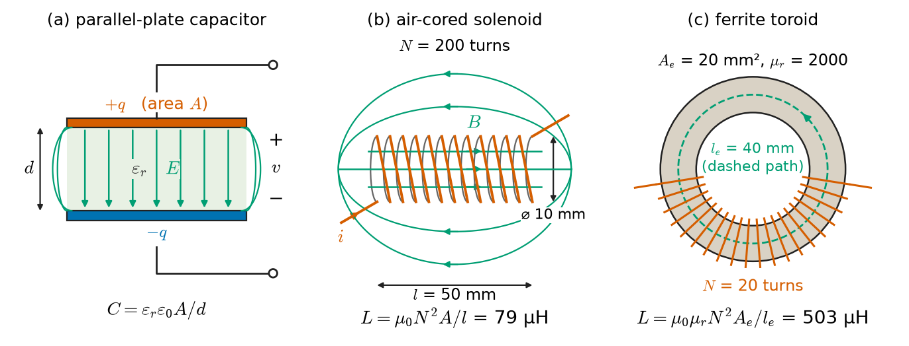
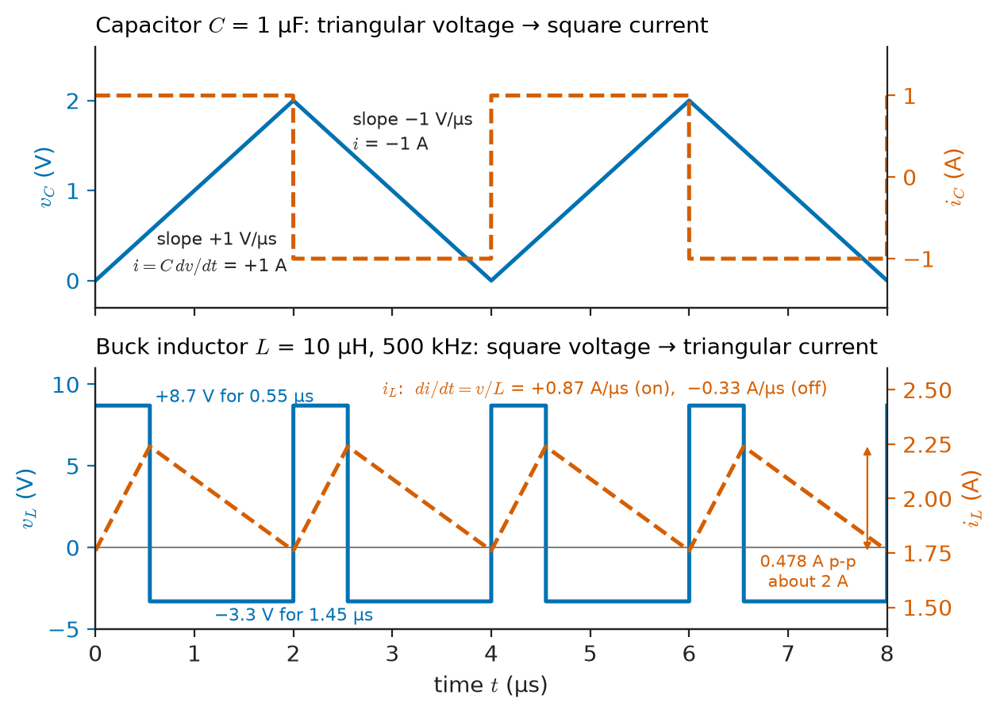
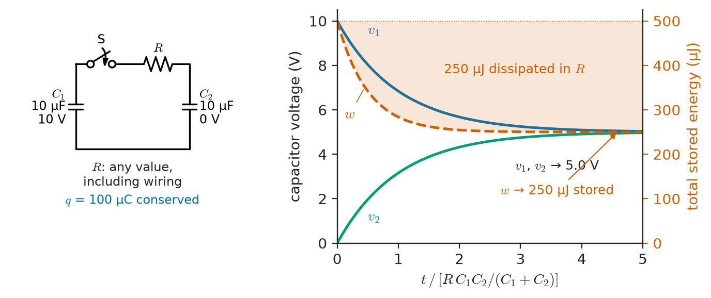
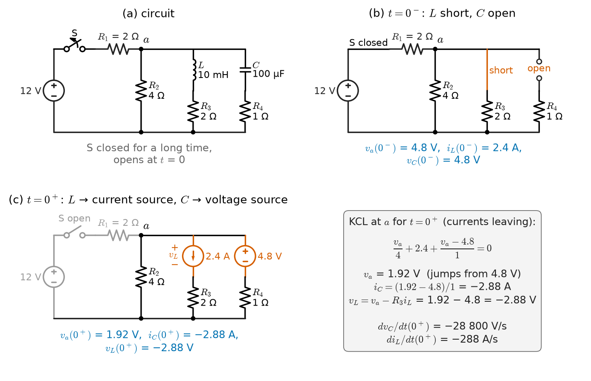
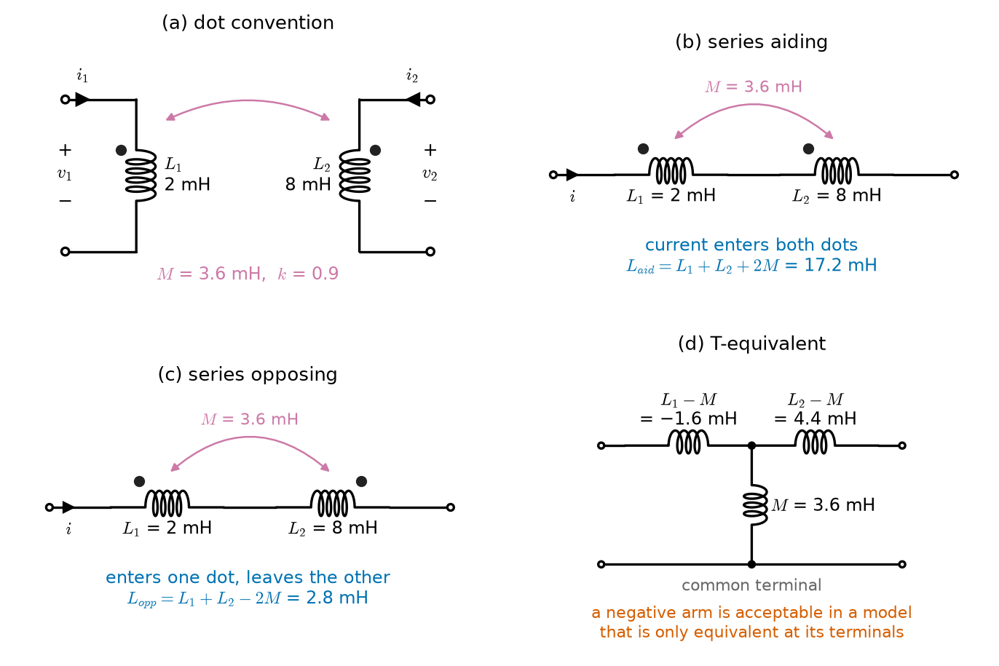
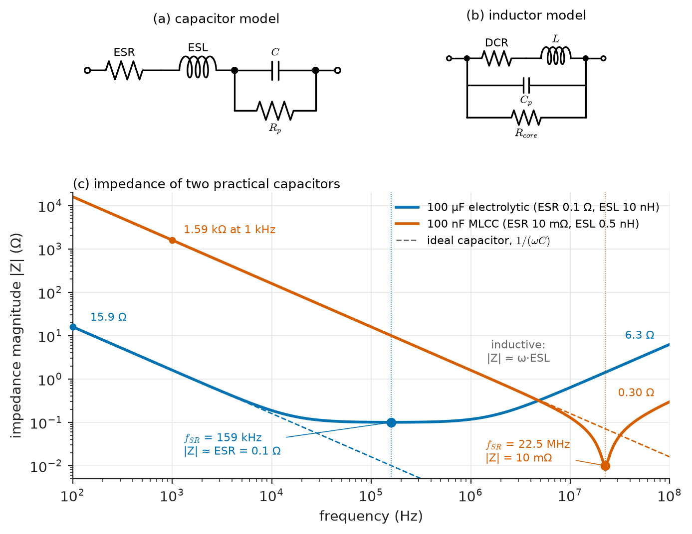

# Chapter 5 — Capacitors and Inductors

*Part I · Circuit Fundamentals*

A technician switches off a variable-speed drive, waits for the display to go dark, opens the cabinet — and receives a painful shock from the DC bus. The mains has been disconnected for thirty seconds, yet the 470 µF bus capacitors still hold several hundred volts. A few metres away, a maintenance engineer opens a contactor feeding a large solenoid valve; the contact draws a bright arc, and over months the contact surfaces erode until the contactor welds shut. Neither event can be explained by the resistive circuits of Chapters 2–4, in which every voltage and current is fixed instantly by the present values of the sources. The capacitor remembers its voltage after the source has gone; the inductor insists on keeping its current flowing after the switch has opened. Both store energy, and both release it on their own terms.

This chapter introduces the two energy-storage elements. Their defining equations involve time derivatives, so circuits containing them obey differential rather than algebraic equations — the subject of all of Part II. Before solving those equations we need the elements themselves: where capacitance and inductance come from, how they combine, how much energy they hold, what they force on a circuit at the instant of switching, how two inductors couple through a shared magnetic field, and how far real components depart from the ideal.

> **Why does a capacitor hold its voltage and an inductor its current, and what does that imply at the instant a switch operates?**
> **How much energy do they store, and what do real capacitors and inductors look like once their parasitic resistance, inductance and capacitance are included?**

| Concept | Engineering destination |
|---|---|
| Capacitance | Decoupling, filtering, timing, sensors (touch, humidity, level), memory cells, cable and PCB parasitics |
| Inductance | Switching converters, filters and chokes, relays and solenoids, current sensing, wiring parasitics |
| Constitutive equations | Ripple calculation, slew-rate limits, inductive kick, numerical simulation |
| Energy storage | Defibrillators, flash units, hold-up time, supercapacitor buffers, ignition coils, safety discharge |
| Series and parallel combinations | Voltage rating of capacitor banks, inductor arrays, charge sharing and inrush |
| Initial conditions | Every switching transient of Chapters 6 and 7 |
| Mutual inductance and coupled coils | Transformers, current transformers, Rogowski coils, wireless charging, crosstalk |
| Ideal versus practical components | ESR heating, self-resonance, component selection, EMC |

**Roadmap.** Capacitance (5.1) → inductance (5.2) → constitutive equations and the duality between the two (5.3) → energy storage (5.4) → series and parallel combinations (5.5) → initial conditions at switching instants (5.6) → mutual inductance (5.7) → coupled coils and the transformer limit (5.8) → ideal versus practical components (5.9).

---

## 5.1 Capacitance

### Charge and voltage on two conductors

Any two conductors separated by an insulator form a capacitor. When a charge $+q$ is moved onto one conductor and $-q$ onto the other, an electric field appears in the insulator and a voltage $v$ appears between the conductors. For linear insulating materials the field, and therefore the voltage, is proportional to the charge. The constant of proportionality is the **capacitance**:

$$
C=\frac{q}{v}
$$

measured in farads (F = C/V). One farad is an enormous capacitance for a conventional component; practical values run from picofarads (pF) to millifarads (mF), while electrochemical supercapacitors reach thousands of farads.

Capacitance depends only on geometry and on the **permittivity** $\varepsilon=\varepsilon_r\varepsilon_0$ of the insulator (the **dielectric**), where $\varepsilon_0=8.854\times10^{-12}$ F/m. The simplest case is two parallel plates of area $A$ separated by $d$, with $d$ small compared with the plate dimensions so that fringing at the edges can be neglected:

$$
C=\frac{\varepsilon_r\varepsilon_0A}{d}
$$

Two plates of 10 cm × 10 cm, 1 mm apart in air, give only $8.854\times10^{-12}\times0.01/0.001=88.5$ pF. To make large capacitances in small volumes, manufacturers increase $A$ (rolling or stacking long electrodes), reduce $d$ (films of a few micrometres or less) and raise $\varepsilon_r$ (ceramics with $\varepsilon_r$ of thousands).

> **Status of the principle: Linear capacitance $q=Cv$**
> *Approximate.* Follows from electrostatics for a linear dielectric; holds well for air, glass, polymer films and C0G ceramics, but high-permittivity ceramics (X7R, X5R) lose a large fraction of their capacitance under DC bias and with temperature, and electrolytic capacitors depend on frequency and age.

> **Boundary.** How permittivity arises from atomic and molecular polarisation, and why ferroelectric ceramics have such large and nonlinear $\varepsilon_r$, belongs to *The Materials Core*; the field theory of capacitance for arbitrary geometries belongs to *Engineering Physics*. This chapter uses $C$ as a circuit parameter.

<!-- FIGURE 5.1 | figures/ch05/fig-5-1-capacitor-inductor-geometry.png | schematic | Geometry of the two storage elements: a parallel-plate capacitor stores energy in its electric field, a solenoid and a toroid store energy in their magnetic fields. | Content: three panels. (a) Parallel-plate capacitor, plates of area A separated by d, charges +q and -q, uniform E-field arrows between plates, slight fringing at edges, dielectric eps_r shaded, terminal voltage v. (b) Air-cored solenoid, N = 200 turns, length l = 50 mm, diameter 10 mm, current i entering one end, B-field lines uniform inside and closing outside. (c) Ferrite toroid, N = 20 turns, magnetic path length l_e = 40 mm, cross-section A_e = 20 mm^2, mu_r = 2000, field confined to the core. Each panel labelled with its formula: C = eps_r eps_0 A/d, L = mu_0 N^2 A/l, L = mu_0 mu_r N^2 A_e/l_e. -->

*Figure 5.1 — Geometry of the two storage elements: a parallel-plate capacitor stores energy in its electric field, a solenoid and a toroid store energy in their magnetic fields.*

### Capacitor technologies

**Table 5.1 — Capacitor families (typical values).**

| Family | Dielectric $\varepsilon_r$ | Typical range | Typical voltage | Characteristics and uses |
|---|---|---|---|---|
| C0G/NP0 ceramic (MLCC) | 20–100 | 0.1 pF–0.1 µF | 16–1000 V | Stable (±30 ppm/°C), low loss; RF, timing, filters |
| X7R/X5R ceramic (MLCC) | 2000–4000 | 100 pF–100 µF | 4–100 V | High density; lose 30–80 % of $C$ at rated DC bias; decoupling |
| Polypropylene film | 2.2 | 1 nF–100 µF | 63 V–2 kV | Very low loss, self-healing; snubbers, PFC, audio, pulse |
| Polyester (PET) film | 3.3 | 1 nF–10 µF | 50–630 V | General purpose coupling and bypass |
| Aluminium electrolytic | about 8–10 (Al₂O₃) | 1 µF–1 F | 6.3–550 V | Polarised, high $C$, high ESR, limited life; bulk storage |
| Tantalum / polymer | about 27 (Ta₂O₅) | 0.1 µF–1 mF | 2.5–50 V | Compact, low ESR (polymer); polarised |
| Electric double-layer (supercapacitor) | — | 0.1–3000 F | 2.5–3.0 V per cell | Very high $C$, low voltage; hold-up and buffering |

**Worked example — Capacitance of a multilayer ceramic chip.** A small MLCC has $n=200$ active dielectric layers, each $d=1.0$ µm thick, with electrode overlap of 0.8 mm × 0.4 mm and $\varepsilon_r=3000$ (X5R). The layers are electrically in parallel, so

$$
C=n\frac{\varepsilon_r\varepsilon_0A}{d}=200\times\frac{3000\times8.854\times10^{-12}\times(0.8\times10^{-3})(0.4\times10^{-3})}{1.0\times10^{-6}}=1.70\ \mu\mathrm{F}
$$

in a package roughly 1.0 mm × 0.5 mm. At its 6.3 V rating, the field in each layer is $6.3/1.0\times10^{-6}=6.3$ MV/m. That strong field is precisely what drives the X5R ceramic toward saturation of its polarisation: such parts commonly deliver only 40–60 % of their nominal capacitance at rated voltage. A designer who needs 1 µF at 5 V across such a part may need a nominal 2.2 µF or a larger case size.

### Capacitance is everywhere

Capacitance is not only a component. Every pair of conductors has it: a PCB trace over a ground plane (typically 0.5–1.5 pF/cm), a coaxial cable (about 100 pF/m for 50 Ω cable, 67 pF/m for 75 Ω), a transistor's junctions, a person's finger near a touch-screen electrode, the windings of a transformer. This **stray** or **parasitic** capacitance limits the speed of logic, couples interference between circuits, and sets the bandwidth of sensors. Capacitive sensors exploit the same physics deliberately: a change in $d$ (pressure diaphragms, MEMS accelerometers), in $A$ (rotary encoders, liquid-level probes) or in $\varepsilon_r$ (humidity sensors, proximity detectors) changes $C$ and is read out electronically.

---

## 5.2 Inductance

### Flux linkage and current

A current $i$ in a coil produces a magnetic field; the magnetic flux $\phi$ through each turn, summed over all $N$ turns, is the **flux linkage** $\lambda=N\phi$. For coils in linear magnetic media, $\lambda$ is proportional to $i$, and the constant is the **self-inductance**:

$$
L=\frac{\lambda}{i}=\frac{N\phi}{i}
$$

measured in henries (H = Wb/A = V·s/A). Practical inductors range from nanohenries (RF coils, bond wires, PCB vias) through microhenries (switching converters) and millihenries (audio crossovers, line filters) to henries (relay coils, old-style chokes, large reactors).

Inductance depends on geometry and on the **permeability** $\mu=\mu_r\mu_0$ of the medium, with $\mu_0=4\pi\times10^{-7}$ H/m. The flux in a magnetic path of length $l$ and cross-section $A$ driven by $Ni$ ampere-turns is $\phi=Ni/\mathcal{R}$, where $\mathcal{R}=l/(\mu A)$ is the path's **reluctance**. Hence

$$
L=\frac{N^2}{\mathcal{R}}=\frac{\mu_r\mu_0N^2A}{l}
$$

The $N^2$ dependence is essential: one factor of $N$ comes from the ampere-turns that produce the flux, and the second from the turns that link it. For a long air-cored solenoid the same formula applies with $\mu_r=1$, approximately (it overestimates $L$ when the coil is not much longer than its diameter). Manufacturers of cores quote the **inductance factor** $A_L=L/N^2$ (nH per turn squared), which contains all the geometry and material information.

> **Status of the principle: Linear inductance $\lambda=Li$**
> *Approximate.* Holds exactly for air-cored coils and well for gapped cores and ferrites below saturation; iron and ferrite cores saturate above a material-dependent flux density (about 0.3–0.5 T for ferrites, 1.5–2.0 T for silicon steel), beyond which $L$ falls sharply, and they also show hysteresis.

**Worked example — Two inductors from first principles.** (a) An air-cored solenoid of $N=200$ turns, length 50 mm and diameter 10 mm (Figure 5.1b) has $A=\pi(5\times10^{-3})^2=7.854\times10^{-5}$ m² and

$$
L=\frac{4\pi\times10^{-7}\times200^2\times7.854\times10^{-5}}{0.050}=79.0\ \mu\mathrm{H}
$$

(The long-solenoid formula is a few percent high for a coil only five diameters long.) (b) A ferrite toroid with $\mu_r=2000$, magnetic path length $l_e=40$ mm and cross-section $A_e=20$ mm² (Figure 5.1c) has

$$
A_L=\frac{\mu_r\mu_0A_e}{l_e}=\frac{2000\times4\pi\times10^{-7}\times20\times10^{-6}}{0.040}=1257\ \mathrm{nH/turn^2}
$$

so just 20 turns give $L=1257\times400$ nH $=503$ µH — six times the solenoid's inductance with one tenth of the turns. The price is saturation. The flux density in the core is $B=\mu_r\mu_0Ni/l_e$; with a ferrite limit of about 0.4 T, the current at which this core saturates is

$$
I_{sat}=\frac{B_{sat}\,l_e}{\mu_r\mu_0N}=\frac{0.4\times0.040}{2000\times4\pi\times10^{-7}\times20}=0.32\ \mathrm{A}
$$

Power inductors that must carry amperes therefore use cores with a small **air gap**, which adds reluctance, lowers $A_L$ and raises $I_{sat}$; most of the energy is then stored in the gap (Section 5.4).

> **Boundary.** Magnetic materials, hysteresis loops and core losses belong to *The Materials Core*; magnetic circuits of machines and transformers in depth belong to *Electrical Energy & Machines*. Here $L$ is a circuit parameter.

### Inductance is everywhere too

Every current loop has inductance. A straight wire or PCB trace has roughly 0.5–1 nH per millimetre (depending on how far away its return path is), a surface-mount capacitor's mounting adds 0.3–2 nH, and a power cable a few hundred nanohenries per metre. In fast digital and power circuits, this **parasitic inductance** produces voltage spikes $L\,di/dt$ whenever current changes rapidly: 10 nH carrying a current that changes by 10 A in 10 ns generates 10 V. Layout for switching converters is largely the art of minimising the area of loops that carry fast-changing current.

---

## 5.3 Constitutive equations

### The capacitor

Differentiate $q=Cv$ with respect to time, using $i=dq/dt$ (Chapter 1), with the passive sign convention (current entering the positive terminal):

$$
i=C\frac{dv}{dt}
$$

Integrating from a reference time $t_0$:

$$
v(t)=v(t_0)+\frac1C\int_{t_0}^{t}i(\tau)\,d\tau
$$

The voltage at any time depends on the *entire history* of the current, summarised by the initial value $v(t_0)$. The capacitor is an element with **memory**.

### The inductor

Differentiate $\lambda=Li$ and use Faraday's law $v=d\lambda/dt$:

$$
v=L\frac{di}{dt}
$$

$$
i(t)=i(t_0)+\frac1L\int_{t_0}^{t}v(\tau)\,d\tau
$$

The inductor's current is the running integral of its voltage; the initial current $i(t_0)$ carries its memory.

> **Status of the principle: Capacitor and inductor laws $i=C\,dv/dt$, $v=L\,di/dt$**
> *Derived.* From charge conservation and Faraday's law applied to linear, time-invariant elements under the lumped assumption; if $C$ or $L$ varies with time (a capacitive microphone, a moving relay armature) the correct forms are $i=d(Cv)/dt$ and $v=d(Li)/dt$, which contain extra terms.

### Four consequences

1. **DC behaviour.** If the voltage across a capacitor is constant, its current is zero: in DC steady state **a capacitor is an open circuit**. If the current through an inductor is constant, its voltage is zero: in DC steady state **an inductor is a short circuit**. These two rules give the "before" and "after" states of every switching problem in Chapter 6.
2. **Continuity.** A finite current can change a capacitor's voltage only at a finite rate, $dv/dt=i/C$. Unless an infinite (impulsive) current flows, **capacitor voltage cannot jump**. Dually, unless an impulsive voltage is applied, **inductor current cannot jump**. Section 5.6 turns this into the rules for initial conditions.
3. **Waveform transformation.** A capacitor converts a voltage ramp into a constant current; an inductor converts a constant voltage into a current ramp. A triangular voltage applied to a capacitor produces a square-wave current (Figure 5.2), and a square voltage applied to an inductor produces a triangular current — the exact operating waveform of every switching power converter.
4. **Sinusoids stay sinusoids.** If $v=V_m\sin\omega t$ across a capacitor, $i=\omega CV_m\cos\omega t$: the current has the same frequency, amplitude multiplied by $\omega C$, and leads the voltage by 90°. For an inductor, the current lags the voltage by 90°, and the amplitude ratio is $\omega L$. These ratios, $1/(\omega C)$ and $\omega L$, are the **reactances** that Chapter 8 turns into complex impedances. A 10 µF capacitor across 230 V, 50 Hz mains has reactance $1/(2\pi\times50\times10\times10^{-6})=318$ Ω and draws 0.72 A rms while dissipating (ideally) nothing.

<!-- FIGURE 5.2 | figures/ch05/fig-5-2-vi-waveforms-c-and-l.png | plot | Constitutive equations at work: a triangular voltage across a capacitor gives a square current, and a square voltage across an inductor gives a triangular current. | Content: two stacked panels with shared time axis 0 to 8 microseconds. Top: capacitor C = 1 uF, voltage triangle between 0 and 2 V with 4 us period (rising 1 V/us for 2 us, falling for 2 us), current square wave +1 A / -1 A. Bottom: buck-converter inductor L = 10 uH at 500 kHz (period 2 us), voltage square wave +8.7 V for 0.55 us and -3.3 V for 1.45 us, current triangle with peak-to-peak ripple 0.478 A about a 2 A average. Annotate slopes i = C dv/dt and di/dt = v/L. -->

*Figure 5.2 — Constitutive equations at work: a triangular voltage across a capacitor gives a square current, and a square voltage across an inductor gives a triangular current.*

**Worked example — Inductor ripple in a buck converter.** A buck converter steps 12 V down to 3.3 V, switching at 500 kHz through a 10 µH inductor (Figure 5.2, bottom). While the switch is on, the inductor sees $12-3.3=8.7$ V and its current rises at

$$
\frac{di}{dt}=\frac{v}{L}=\frac{8.7}{10\times10^{-6}}=8.7\times10^{5}\ \mathrm{A/s}
$$

The switch is on for a fraction $D=3.3/12=0.275$ of the 2 µs period, i.e. 0.55 µs, so the current rises by $8.7\times10^5\times0.55\times10^{-6}=0.478$ A. While the switch is off, the inductor sees $-3.3$ V for 1.45 µs and falls by $3.3/10^{-5}\times1.45\times10^{-6}=0.478$ A — the same amount, as it must be in steady state (zero average inductor voltage, or **volt-second balance**). The ripple current, 0.48 A peak-to-peak, flows into the output capacitor; its size sets the output voltage ripple and the inductor's RMS current, both design constraints met in *Electronics & Computing*.

### Duality

The capacitor and inductor equations are identical under the exchange

$$
v\leftrightarrow i,\qquad C\leftrightarrow L,\qquad q\leftrightarrow\lambda,\qquad \text{series}\leftrightarrow\text{parallel},\qquad \text{open}\leftrightarrow\text{short}
$$

Every statement about one element has a dual statement about the other. This **duality** halves the work of Chapters 6 and 7: an RC circuit and its dual RL circuit have the same equations with the variables swapped, and a series RLC circuit is the dual of a parallel RLC circuit. Duality extends to whole planar networks (meshes ↔ nodes, KVL ↔ KCL), a correspondence first noticed in Chapter 3.

**Table 5.2 — Summary of element relations.**

| Property | Resistor | Capacitor | Inductor |
|---|---|---|---|
| Defining relation | $v=Ri$ | $q=Cv$ | $\lambda=Li$ |
| $v$–$i$ law | $v=Ri$ | $i=C\,dv/dt$ | $v=L\,di/dt$ |
| Continuous variable | — | voltage | current |
| DC steady state | resistor | open circuit | short circuit |
| Energy | dissipated, $\int Ri^2dt$ | stored, $\tfrac12Cv^2$ | stored, $\tfrac12Li^2$ |
| Series combination | $R_1+R_2$ | $C_1C_2/(C_1+C_2)$ | $L_1+L_2$ |
| Parallel combination | $R_1R_2/(R_1+R_2)$ | $C_1+C_2$ | $L_1L_2/(L_1+L_2)$ |
| Sinusoidal amplitude ratio $V_m/I_m$ | $R$ | $1/(\omega C)$ | $\omega L$ |

---

## 5.4 Energy storage

### Energy in a capacitor

The power into a capacitor is $p=vi=Cv\,dv/dt$. Integrating from an uncharged state ($v=0$) to voltage $v$:

$$
w_C=\int_0^t p\,d\tau=\int_0^{v}Cv'\,dv'=\tfrac12Cv^2=\frac{q^2}{2C}
$$

The energy depends only on the present voltage, not on how it was reached. It is stored in the electric field of the dielectric, with energy density $\tfrac12\varepsilon E^2$ (J/m³).

### Energy in an inductor

Similarly, $p=vi=Li\,di/dt$, so

$$
w_L=\tfrac12Li^2=\frac{\lambda^2}{2L}
$$

stored in the magnetic field with energy density $B^2/(2\mu)$. In a gapped core, $\mu$ in the gap is $\mu_0$, thousands of times smaller than in the ferrite, so for the same $B$ the gap stores thousands of times more energy per unit volume. That is why the gap, not the ferrite, is where a power inductor keeps its energy.

> **Status of the principle: Stored energy $\tfrac12Cv^2$, $\tfrac12Li^2$**
> *Derived.* From integrating the power $vi$ into a linear lossless element; for nonlinear elements (saturating cores, ferroelectric ceramics) the stored energy must be computed as $\int v\,dq$ or $\int i\,d\lambda$ along the actual characteristic.

Both stored energies are non-negative, and both are **state functions**: an ideal capacitor or inductor returns exactly the energy it received. An ideal capacitor in a circuit can absorb energy for a while and deliver it later, but over a full cycle of periodic operation its net energy intake is zero. This is the circuit statement of the fact that reactive elements exchange but do not consume energy — the origin of reactive power (Chapter 9).

### Energy and continuity

Energy gives a physical reason for the continuity rules of Section 5.3. If a capacitor's voltage jumped instantaneously from $v_1$ to $v_2$, its stored energy would change by a finite amount in zero time, which requires infinite power. Real sources cannot supply infinite power; real circuits therefore round off any attempted jump over a time set by their resistance and stray inductance. When a circuit is *forced* to approximate a jump — a charged capacitor connected abruptly to another, or an inductor's current interrupted by an opening switch — the energy has to go somewhere, and it goes into heat, arcs, radiation or breakdown.

**Table 5.3 — Representative stored energies.**

| Application | Element | Values | Stored energy |
|---|---|---|---|
| MCU decoupling capacitor | 100 nF at 3.3 V | — | 0.54 µJ |
| Camera flash capacitor | 120 µF at 330 V | — | 6.5 J |
| Drive DC-link bank | 470 µF at 560 V | — | 74 J |
| External defibrillator | 32 µF at 5.0 kV | monophasic design | 400 J |
| Supercapacitor cell | 3000 F at 2.7 V | — | 10.9 kJ (3.0 Wh) |
| Relay coil | 0.5 H at 50 mA | — | 0.63 mJ |
| Automotive ignition coil (primary) | 4 mH at 8 A | — | 0.13 J |
| Buck-converter inductor | 10 µH at 2.2 A peak | — | 24 µJ |
| Superconducting magnetic energy storage | multi-H at kA | research and utility units | MJ range |

**Worked example — Defibrillator energy and the inductive kick of a relay.** (a) A monophasic external defibrillator stores energy in a 32 µF capacitor. Charged to 5.0 kV it holds $\tfrac12\times32\times10^{-6}\times5000^2=400$ J; to store a 360 J setting it must be charged to $\sqrt{2\times360/32\times10^{-6}}=4.74$ kV. Delivered to a thorax of roughly 50 Ω, this energy drives currents of tens of amperes for a few milliseconds; the waveform-shaping inductor and the patient resistance form exactly the second-order circuits of Chapter 7.

(b) A relay coil of 0.5 H carries 50 mA. Its stored energy is only $\tfrac12\times0.5\times0.05^2=0.625$ mJ. But if a transistor switching the coil turns off in 1 µs, the coil tries to maintain its current by producing $v=L\,di/dt\approx0.5\times0.05/10^{-6}=25$ kV. Long before that, the transistor breaks down or an arc forms, and the 0.625 mJ is dumped into it — on every operation. The universal remedy is a **freewheeling diode** across the coil, which gives the current a path and limits the voltage to about 0.7 V above the supply; Chapter 6 analyses the decay that follows and why it slows the relay's release.

### Safety: stored energy outlives the source

The drive cabinet of the opening holds $\tfrac12\times470\times10^{-6}\times560^2=74$ J at 560 V — enough to be dangerous. Standards for electrical equipment therefore require stored voltages to fall below a safe level (for machinery, typically 60 V within 5 s) after disconnection, achieved with **bleeder resistors** whose design is a first-order discharge problem (Chapter 6). The rule for maintenance is to measure, not to assume, that capacitors are discharged.

---

## 5.5 Series and parallel combinations

### Capacitors

Capacitors in **parallel** share the same voltage; their charges add, $q=(C_1+C_2+\dots)v$, so

$$
C_{par}=C_1+C_2+\dots+C_n
$$

Capacitors in **series** carry the same current, so (starting uncharged) they acquire the same charge; their voltages add, $v=q(1/C_1+1/C_2+\dots)$, so

$$
\frac{1}{C_{ser}}=\frac1{C_1}+\frac1{C_2}+\dots+\frac1{C_n}
$$

Capacitors combine like conductances, the opposite of resistors. Two equal capacitors in series give half the capacitance at twice the voltage rating.

### Inductors

Uncoupled inductors in **series** carry the same current and their voltages add: $L_{ser}=L_1+L_2+\dots$. In **parallel** they share the same voltage and their currents add: $1/L_{par}=1/L_1+1/L_2+\dots$. Inductors combine like resistors. These rules hold only if the inductors' magnetic fields do not link each other; when they do, mutual inductance adds or subtracts (Section 5.8).

> **Status of the principle: Series and parallel combination of C and L**
> *Derived.* From KCL, KVL and the element laws; exact for ideal elements, with the proviso that the initial voltages (for capacitors) or currents (for inductors) of the individual elements must also be combined, and that inductors must be magnetically uncoupled.

### Initial conditions in combinations

A series string of capacitors with different initial voltages behaves externally as $C_{ser}$ with an initial voltage equal to the sum of the individual initial voltages — but the individual voltages are no longer determined by the external behaviour alone. Parallel inductors with initial currents behave as $L_{par}$ with the sum of the currents, while a current may circulate around the loop they form without appearing outside. The equivalent captures the terminal behaviour; the internal distribution must be tracked separately when it matters (for voltage ratings, for example).

### Voltage sharing in series capacitor banks

Series capacitors share voltage according to their capacitances only for fast transients. Over seconds and longer, the DC voltage divides according to their **leakage resistances**, which can differ by factors of several between nominally identical electrolytic capacitors. Series banks on DC buses therefore include **balancing resistors**, chosen so that the current through them is large compared with the leakage current mismatch.

**Worked example — Balancing two electrolytics on a 400 V bus.** Two 100 µF, 250 V aluminium electrolytic capacitors are placed in series on a 400 V DC link, giving 50 µF rated for 500 V. Their leakage currents at operating voltage are 20 µA and 60 µA. Without balancing, the capacitor with lower leakage would charge toward a higher share of the voltage until the leakages equalise, and could exceed its 250 V rating. With a 47 kΩ resistor across each capacitor, KCL at the midpoint (top-capacitor leakage $I_1=20$ µA, bottom $I_2=60$ µA) gives

$$
\frac{400-v_m}{R}+I_1=\frac{v_m}{R}+I_2\ \Rightarrow\ v_m=\frac{400}{2}-\frac{R(I_2-I_1)}{2}=200-\frac{47\times10^3\times40\times10^{-6}}{2}=199.06\ \mathrm{V}
$$

so the bottom capacitor sees 199.1 V and the top one 200.9 V — well balanced. The price is $400^2/94\ \mathrm{k\Omega}=1.7$ W of continuous dissipation; the resistors double as bleeders.

<!-- FIGURE 5.3 | figures/ch05/fig-5-3-charge-sharing.png | circuit | Charge sharing between two capacitors: closing the switch conserves charge but loses half the energy, whatever the resistance in the loop. | Content: left: circuit with C1 = 10 uF charged to 10 V, switch S, series resistor R (labelled "any value, including wiring"), and C2 = 10 uF initially at 0 V. Right: plot of v1(t) and v2(t) versus t/(R C1C2/(C1+C2)) from 0 to 5, v1 falling from 10 V to 5 V and v2 rising from 0 to 5 V, and a second y-axis showing total stored energy falling from 500 uJ to 250 uJ; shaded area labelled "250 uJ dissipated in R". -->

*Figure 5.3 — Charge sharing between two capacitors: closing the switch conserves charge but loses half the energy, whatever the resistance in the loop.*

### Charge sharing and the "lost" energy

**Worked example — Connecting a charged capacitor to an uncharged one.** A 10 µF capacitor charged to 10 V is connected through a switch to an identical uncharged capacitor (Figure 5.3). Charge is conserved: the initial charge $q=10\times10^{-6}\times10=100$ µC spreads over 20 µF, so both end at

$$
V_f=\frac{C_1V_1}{C_1+C_2}=5.0\ \mathrm{V}
$$

The stored energy before is $\tfrac12\times10\times10^{-6}\times10^2=500$ µJ; after it is $\tfrac12\times20\times10^{-6}\times5^2=250$ µJ. Half the energy has disappeared. It was dissipated in the resistance of the connecting path — and remarkably, the amount, 250 µJ, does not depend on that resistance. A large resistance gives a small current for a long time, a small one a large current for a short time; $\int i^2R\,dt$ comes out the same (Chapter 6 confirms this by integrating the exponential current). With an ideal zero-resistance wire the circuit has no consistent solution; in practice the energy goes into wiring resistance, the capacitors' ESR, a spark, and radiation from the loop inductance.

The same physics appears in **hot-plugging**: inserting a board with 1000 µF of uncharged bulk capacitance onto a live 12 V backplane through 20 mΩ of connector and trace resistance would draw a peak of $12/0.020=600$ A and dissipate $\tfrac12\times1000\times10^{-6}\times12^2=72$ mJ in the contacts, enough to pit them. Hot-swap controllers limit the inrush by charging the capacitance slowly. Switched-capacitor circuits — sample-and-hold stages, charge pumps, switched-capacitor filters — pay a related energy price on every clock cycle, which sets their power consumption.

---

## 5.6 Initial conditions

### The continuity rules

From Section 5.3, in the absence of impulsive currents or voltages:

$$
v_C(0^+)=v_C(0^-),\qquad i_L(0^+)=i_L(0^-)
$$

where $0^-$ is the instant just before a switching event at $t=0$ and $0^+$ the instant just after. Capacitor voltages and inductor currents are the **state variables** of a circuit: together with the sources, they determine everything else. All other quantities — capacitor currents, inductor voltages, resistor voltages and currents — may jump.

> **Status of the principle: Continuity of capacitor voltage and inductor current**
> *Derived.* From the integral forms of the element laws, provided all currents into capacitors and all voltages across inductors remain finite; violated in idealised circuits that connect capacitors directly to voltage sources or other capacitors, or that interrupt inductor currents abruptly.

### The procedure at a switching instant

1. **Before switching** ($t=0^-$): the circuit is usually in DC steady state. Replace capacitors by open circuits and inductors by short circuits; solve the resistive circuit for every $v_C(0^-)$ and $i_L(0^-)$.
2. **At $t=0^+$**: in the post-switching circuit, replace each capacitor by a voltage source of value $v_C(0^+)=v_C(0^-)$ and each inductor by a current source of value $i_L(0^+)=i_L(0^-)$. This is a purely resistive circuit — solve it for every other quantity at $0^+$.
3. **Initial derivatives**: from the $0^+$ solution, $dv_C/dt(0^+)=i_C(0^+)/C$ and $di_L/dt(0^+)=v_L(0^+)/L$. These derivatives are the second initial condition needed by second-order circuits (Chapter 7).
4. **Final values** ($t\to\infty$): if the sources are DC, the circuit settles to a new DC steady state; again treat capacitors as open and inductors as short.

The substitution in step 2 is an application of the substitution theorem of Chapter 4: at $0^+$ the capacitor voltage is known, so the capacitor may be replaced by a source of that voltage.

<!-- FIGURE 5.4 | figures/ch05/fig-5-4-initial-conditions-circuit.png | circuit | Finding initial conditions: the circuit before switching (DC steady state), and the equivalent resistive circuit at t = 0+ with the capacitor and inductor replaced by sources. | Content: three panels. (a) Full circuit: 12 V source and switch S (opens at t = 0) with R1 = 2 ohm feeding node a; from a to ground: R2 = 4 ohm; L = 10 mH in series with R3 = 2 ohm; C = 100 uF in series with R4 = 1 ohm. (b) t = 0-: L shorted, C open; annotate v_a = 4.8 V, i_L = 2.4 A, v_C = 4.8 V. (c) t = 0+: switch open, L replaced by 2.4 A current source, C replaced by 4.8 V voltage source; annotate v_a = 1.92 V, i_C = -2.88 A, v_L = -2.88 V. -->

*Figure 5.4 — Finding initial conditions: the circuit before switching (DC steady state), and the equivalent resistive circuit at t = 0+ with the capacitor and inductor replaced by sources.*

**Worked example — Initial values and initial slopes.** In Figure 5.4a, a 12 V source feeds node $a$ through $R_1=2$ Ω and a switch. From $a$ to ground are three branches: $R_2=4$ Ω; $L=10$ mH in series with $R_3=2$ Ω; and $C=100$ µF in series with $R_4=1$ Ω. The switch has been closed for a long time and opens at $t=0$.

*At $0^-$.* The capacitor is open, the inductor shorted. Node $a$ sees $R_2\parallel R_3=1.333$ Ω, so $v_a=12\times1.333/(2+1.333)=4.80$ V. Then $i_L(0^-)=4.80/2=2.40$ A, and since no current flows in $R_4$, $v_C(0^-)=4.80$ V.

*At $0^+$.* With the switch open, KCL at $a$ (currents leaving):

$$
\frac{v_a}{R_2}+i_L+\frac{v_a-v_C}{R_4}=0\ \Rightarrow\ v_a\left(\frac14+1\right)=-2.40+4.80\ \Rightarrow\ v_a(0^+)=1.92\ \mathrm{V}
$$

So $v_a$ jumps from 4.80 V to 1.92 V — allowed, because it is not a state variable. The capacitor current is $i_C=(1.92-4.80)/1=-2.88$ A (the capacitor discharges), $R_2$ carries 0.48 A, and the inductor's 2.40 A continues; check: $0.48+2.40-2.88=0$. The inductor voltage is $v_L=v_a-R_3i_L=1.92-4.80=-2.88$ V.

*Initial slopes.*

$$
\frac{dv_C}{dt}(0^+)=\frac{-2.88}{100\times10^{-6}}=-28\,800\ \mathrm{V/s},\qquad \frac{di_L}{dt}(0^+)=\frac{-2.88}{10\times10^{-3}}=-288\ \mathrm{A/s}
$$

*Final values.* With no source, everything decays to zero: $v_C(\infty)=0$, $i_L(\infty)=0$. Chapter 7 shows that this circuit, with one capacitor and one inductor, is second order, and that $v_C(0^+)$, $i_L(0^+)$ and these slopes are exactly the data its solution needs.

### When continuity is violated

Two circuit configurations force jumps and therefore impulses:

- A **loop consisting only of capacitors and ideal voltage sources** (a "capacitor loop"). KVL around the loop may demand that capacitor voltages change instantly — as in the charge-sharing example with zero resistance — and an impulse of current flows. The charge, not the voltage, is conserved across the event.
- A **cut-set consisting only of inductors and ideal current sources** (an "inductor cut-set"), such as two inductors carrying different currents suddenly placed in series. KCL demands the currents become equal instantly; an impulse of voltage appears, and flux linkage, not current, is conserved.

Real circuits contain resistance and stray inductance or capacitance, so the "impulse" becomes a short, large pulse, which can be destructive (arcing contacts, inrush currents). The ideal impulse model, made precise with the unit impulse $\delta(t)$ of Chapter 6 and Chapter 15, predicts the total charge or flux transferred correctly even though it hides the detail.

---

## 5.7 Mutual inductance

### Flux shared between two coils

Place two coils close together. Current $i_1$ in coil 1 produces flux, part of which links coil 2. The flux linkage of coil 2 due to $i_1$ is proportional to $i_1$; the constant is the **mutual inductance** $M_{21}$. With both coils carrying current, and linear media,

$$
\lambda_1=L_1i_1+M_{12}i_2,\qquad \lambda_2=M_{21}i_1+L_2i_2
$$

Energy considerations (below) show that $M_{12}=M_{21}=M$ for any linear magnetic medium — a form of reciprocity (Chapter 4). Differentiating with Faraday's law:

$$
v_1=L_1\frac{di_1}{dt}\pm M\frac{di_2}{dt},\qquad v_2=\pm M\frac{di_1}{dt}+L_2\frac{di_2}{dt}
$$

The sign of the mutual term depends on how the coils are wound relative to each other — whether their fluxes aid or oppose.

### The dot convention

Circuit diagrams cannot show winding directions, so a dot is placed at one end of each coupled coil. The rule:

> If both currents enter (or both leave) the dotted terminals, the mutual voltage terms have the same sign as the self-inductance terms (+M). If one current enters a dotted terminal and the other leaves one, the mutual terms are negative (−M).

Equivalently: a current entering a dotted terminal of one coil induces, in the other coil, a voltage that is positive at that coil's dotted terminal. Dots are found experimentally by applying a step of current to one coil and observing the polarity of the voltage spike on the other, or by series aiding and opposing measurements (Section 5.8).

### Coupling coefficient

The fraction of flux shared is expressed by the **coupling coefficient**

$$
k=\frac{M}{\sqrt{L_1L_2}},\qquad 0\le k\le1
$$

The upper bound follows from energy. The total energy stored in two coupled coils is

$$
w=\tfrac12L_1i_1^2+\tfrac12L_2i_2^2\pm Mi_1i_2
$$

This must be non-negative for every pair of currents, since a passive magnetic field cannot store negative energy. The worst case is $i_2/i_1=\mp M/L_2$, which gives $w=\tfrac12i_1^2(L_1-M^2/L_2)$; non-negativity requires $M^2\le L_1L_2$, i.e. $k\le1$.

> **Status of the principle: Mutual inductance and $k\le1$**
> *Derived.* The coupled-coil equations follow from Faraday's law and linear flux superposition; $M_{12}=M_{21}$ and $k\le1$ follow from energy conservation and the non-negativity of magnetic energy. Valid for linear, non-saturating media.

**Table 5.4 — Typical coupling coefficients.**

| Arrangement | Typical $k$ |
|---|---|
| Two coils on a closed ferrite or laminated core (power transformer) | 0.98–0.999 |
| Bifilar-wound pulse transformer | above 0.99 |
| Gapped-core flyback transformer | 0.95–0.99 |
| Wireless (inductive) charging pads, aligned, few mm gap | 0.3–0.7 |
| Near-field RFID / NFC reader and card | 0.01–0.3 |
| Adjacent PCB traces (crosstalk) | 0.05–0.5 |
| Air-cored coils, coaxial, separated by one diameter | below 0.1 |

### Where mutual inductance matters

Mutual inductance is the operating principle of transformers, current transformers and Rogowski coils, of resonant wireless power and of near-field communication. It is also the mechanism of **inductive crosstalk**: a fast-changing current in one PCB trace induces a voltage $M\,di/dt$ in its neighbour. And it is a hazard in power systems, where a transmission line running parallel to a telephone line or a pipeline induces voltages in it during earth faults.

**Worked example — A Rogowski coil measuring a 1 kA current.** A Rogowski coil is an air-cored toroidal winding placed around a conductor; it has no magnetic core to saturate, so its mutual inductance $M$ with the conductor is constant and its output is $v=M\,di/dt$. A coil with $M=200$ nH encircles a busbar carrying a 50 Hz current of 1000 A rms, i.e. $i=1414\sin(2\pi\cdot50\,t)$ A. The output is

$$
v=M\frac{di}{dt}=200\times10^{-9}\times2\pi\times50\times1414\cos(2\pi\cdot50\,t)=88.9\cos(2\pi\cdot50\,t)\ \mathrm{mV}
$$

— 88.9 mV peak, 62.8 mV rms. The output is proportional to the *derivative* of the current, so an integrator (analog or digital) follows the coil to recover $i$. Because there is no iron, the same coil measures 100 kA fault currents or kiloampere pulses in pulsed-power and welding equipment without saturating — the advantage over a conventional current transformer.

---

## 5.8 Coupled coils

### Series connection: aiding and opposing

Two coupled coils in series carry the same current. If it enters both dotted terminals (series **aiding**), the mutual flux adds; if it enters one dotted terminal and leaves the other (series **opposing**), it subtracts:

$$
L_{aid}=L_1+L_2+2M,\qquad L_{opp}=L_1+L_2-2M
$$

Measuring both gives $M=(L_{aid}-L_{opp})/4$, the standard bench method for mutual inductance and dot polarity: the connection that gives the larger inductance is the aiding one.

**Worked example — Two coupled coils.** Coils with $L_1=2$ mH and $L_2=8$ mH are wound on a common former with $k=0.9$. Then $M=0.9\sqrt{2\times8}$ mH $=3.6$ mH, and

$$
L_{aid}=2+8+7.2=17.2\ \mathrm{mH},\qquad L_{opp}=2+8-7.2=2.8\ \mathrm{mH}
$$

Recovering $M$ from the measurements: $(17.2-2.8)/4=3.6$ mH. The ratio $\sqrt{L_2/L_1}=2$ is the effective turns ratio (inductance scales as $N^2$), so these coils approximate a 1:2 transformer with 10 % of the flux not shared.

### Parallel connection

Two coupled coils in parallel (both dotted terminals joined) have equivalent inductance

$$
L_{par}=\frac{L_1L_2-M^2}{L_1+L_2-2M}
$$

and with the opposite polarity the sign of $2M$ in the denominator reverses. For $k=1$ the numerator vanishes, so if $L_1\neq L_2$ (unequal turns) the parallel pair is a short circuit: the two coils try to impose different voltages on each other, and large circulating currents flow. Paralleled transformer windings must therefore have equal turns and correct polarity.

<!-- FIGURE 5.5 | figures/ch05/fig-5-5-coupled-coils-dot-t-equivalent.png | circuit | Coupled coils: dot convention, series aiding and opposing connections, and the T-equivalent circuit. | Content: four panels. (a) Two coupled coils L1 = 2 mH and L2 = 8 mH with dots on top terminals, M = 3.6 mH, k = 0.9, currents i1 and i2 entering dotted terminals, voltages v1 and v2. (b) Series aiding: current enters both dots, L_aid = 17.2 mH. (c) Series opposing: current enters one dot and leaves the other, L_opp = 2.8 mH. (d) T-equivalent with common terminal: series arms L1 - M = -1.6 mH and L2 - M = 4.4 mH, shunt arm M = 3.6 mH; note that the negative arm is acceptable as a model element. -->

*Figure 5.5 — Coupled coils: dot convention, series aiding and opposing connections, and the T-equivalent circuit.*

### The T-equivalent

When two coupled coils share a common terminal (or can be given one without changing the circuit — the bottom terminals of a transformer connected to a common ground), they can be replaced by three uncoupled inductors in a T (Figure 5.5d): $L_1-M$ and $L_2-M$ in the series arms and $M$ in the shunt arm. This uses the equivalent-network idea of Chapter 4 and turns a coupled-coil problem into an ordinary circuit problem. One series arm can be negative — here $L_1-M=-1.6$ mH — which is unphysical for a single component but perfectly valid in a model that is only claimed to be equivalent at its terminals.

### Analysing circuits with coupled coils

In mesh analysis, coupled coils add mutual-voltage terms to each mesh equation: the voltage across coil 1 in mesh 1 contains $L_1\,di_1/dt$ plus or minus $M\,di_2/dt$, with the sign from the dot rule. Nodal analysis is awkward because the coupled-coil equations give voltages in terms of current derivatives; either use the T-equivalent or invert the inductance matrix. In the sinusoidal steady state (Chapter 8) the mutual terms become $\pm j\omega MI$, and a load $Z_L$ on coil 2 appears in coil 1 as a **reflected impedance** $(\omega M)^2/(j\omega L_2+Z_L)$, the basis of wireless-power and transformer analysis.

### The ideal-transformer limit

Let $k\to1$ (no leakage flux) and let $L_1,L_2\to\infty$ with the ratio $L_2/L_1=n^2$ fixed (infinite core permeability, so no magnetising current is needed). The coupled coils then become an **ideal transformer**:

$$
\frac{v_2}{v_1}=n=\frac{N_2}{N_1},\qquad \frac{i_2}{i_1}=-\frac1n
$$

with the currents defined entering both dotted terminals. The ideal transformer stores no energy and dissipates none; it simply scales voltage up and current down (or vice versa) and transforms a load resistance $R_L$ on the secondary into $R_L/n^2$ seen at the primary. A real transformer is modelled as an ideal transformer plus a magnetising inductance (finite $L_1$), leakage inductances (from $k<1$), winding resistances and a core-loss resistance.

> **Status of the principle: Ideal transformer**
> *Approximate.* The limit of coupled coils with $k\to1$ and infinite self-inductances; accurate for well-designed iron- or ferrite-cored transformers within their rated frequency band and flux, and it fails at DC (no transformer action, since $v=d\lambda/dt$ requires changing flux), at low frequency (magnetising current), at high frequency (leakage and winding capacitance) and in saturation.

> **Boundary.** Transformer construction, equivalent circuits with core loss, efficiency, regulation and three-phase transformer connections belong to *Electrical Energy & Machines*. This book uses the coupled-coil model and the ideal transformer as circuit elements, and returns to them in two-port form in Chapter 12.

---

## 5.9 Ideal versus practical components

### Why a capacitor is not a capacitor

Every real capacitor has resistance in its electrodes, leads and (for electrolytics) electrolyte; inductance in its current path; and a dielectric that leaks a little. Its simplest useful model (Figure 5.6a) is

- **ESR** (equivalent series resistance) in series: from milliohms for MLCCs to ohms for small electrolytics; it dissipates $I_{rms}^2\,\mathrm{ESR}$ when ripple current flows, and it limits how well the capacitor can filter;
- **ESL** (equivalent series inductance) in series: 0.2–1 nH for MLCCs, 5–20 nH for leaded electrolytics, set mainly by package geometry and mounting;
- **leakage resistance** $R_p$ in parallel: gigohms to teraohms for film and C0G parts, much less for electrolytics (whose leakage is specified as a current, e.g. $0.01CV$ or 3 µA, whichever is greater).

Above its **self-resonant frequency** $f_{SR}=1/(2\pi\sqrt{\mathrm{ESL}\cdot C})$, a capacitor behaves as an inductor. Its impedance magnitude falls as $1/(\omega C)$ below $f_{SR}$, bottoms out at ESR near $f_{SR}$, and rises as $\omega\,\mathrm{ESL}$ above it (Figure 5.6c).

Other non-idealities matter in specific applications: **dielectric absorption** (a capacitor discharged briefly recovers part of its voltage, up to a few percent for some dielectrics — a hazard in high-voltage capacitors and an error source in sample-and-hold circuits), **voltage and temperature coefficients** (Table 5.1), **piezoelectric noise** (class-2 ceramics "sing" audibly under ripple voltage and generate microphonic noise in audio circuits), and **ageing** (electrolytic capacitors lose electrolyte; their life roughly halves for every 10 °C rise in temperature).

### Why an inductor is not an inductor

A real inductor (Figure 5.6b) has

- **DCR**, the DC resistance of its winding, in series: milliohms for power inductors, ohms for small chokes; at high frequency, skin and proximity effects raise the effective resistance well above DCR;
- **core loss**, modelled as a resistance in parallel or folded into a frequency-dependent series resistance;
- **interwinding capacitance** $C_p$ in parallel, typically a few pF, which resonates with $L$ at the inductor's self-resonant frequency, above which it behaves as a capacitor;
- **saturation** (Section 5.2): the inductance falls as the current approaches $I_{sat}$; datasheets give the current at which $L$ has dropped by 10–30 %;
- **stray field**: unshielded inductors radiate magnetic field and couple to nearby circuits.

The **quality factor** $Q=\omega L/R$ measures how close to ideal an inductor is at a given frequency. A 10 µH inductor with 50 mΩ effective series resistance has $Q=2\pi\times10^5\times10\times10^{-6}/0.05=126$ at 100 kHz; a good capacitor has a much larger $Q$, which is why resonant-circuit losses are usually dominated by the inductor (Chapter 13).

<!-- FIGURE 5.6 | figures/ch05/fig-5-6-practical-models-impedance.png | plot | Practical capacitor and inductor models, and the impedance of real capacitors versus frequency showing self-resonance. | Content: (a) small schematic: capacitor model ESR - ESL - C in series with R_p across C. (b) inductor model: DCR in series with L, C_p and R_core in parallel with the series pair. (c) main log-log plot, x-axis frequency 100 Hz to 100 MHz, y-axis impedance magnitude 0.01 ohm to 20 kohm. Curve 1: 100 uF electrolytic, ESR 0.1 ohm, ESL 10 nH: 15.9 ohm at 100 Hz, minimum about 0.10 ohm near 159 kHz, 6.3 ohm at 100 MHz. Curve 2: 100 nF MLCC, ESR 10 mohm, ESL 0.5 nH: 1.59 kohm at 1 kHz, minimum 10 mohm at 22.5 MHz, 0.30 ohm at 100 MHz. Dashed ideal-capacitor lines continuing as 1/(omega C) for comparison; mark both self-resonant frequencies. -->

*Figure 5.6 — Practical capacitor and inductor models, and the impedance of real capacitors versus frequency showing self-resonance.*

**Worked example — Self-resonance and ripple heating of decoupling capacitors.** A 100 µF aluminium electrolytic (ESR 0.1 Ω, ESL 10 nH) and a 100 nF MLCC (ESR 10 mΩ, ESL 0.5 nH) sit on the same supply rail.

*Self-resonant frequencies.*

$$
f_{SR,el}=\frac{1}{2\pi\sqrt{10\times10^{-9}\times100\times10^{-6}}}=159\ \mathrm{kHz},\qquad f_{SR,MLCC}=\frac{1}{2\pi\sqrt{0.5\times10^{-9}\times100\times10^{-9}}}=22.5\ \mathrm{MHz}
$$

*Impedance at selected frequencies* (Table 5.5, computed from $\lvert\mathrm{ESR}+j\omega\,\mathrm{ESL}+1/(j\omega C)\rvert$):

**Table 5.5 — Impedance magnitude of two practical capacitors.**

| Frequency | 100 µF electrolytic | 100 nF MLCC |
|---|---|---|
| 1 kHz | 1.59 Ω | 1.59 kΩ |
| 100 kHz | 0.100 Ω | 15.9 Ω |
| 1 MHz | 0.117 Ω | 1.59 Ω |
| 10 MHz | 0.636 Ω | 0.128 Ω |
| 100 MHz | 6.28 Ω | 0.298 Ω |

The electrolytic is the better capacitor below about 5 MHz, the small MLCC above. At 100 MHz the "100 µF" part behaves as a 10 nH inductor with impedance 6.3 Ω; no amount of extra electrolytic capacitance will filter noise at that frequency. This is why decoupling networks combine bulk electrolytics, mid-value ceramics and small ceramics placed as close as possible to IC pins, and why ESL — mostly mounting inductance — is the decisive parameter at high frequency.

*Ripple heating.* If the electrolytic carries 2 A rms of ripple current at 100 kHz (where its impedance is essentially its ESR), it dissipates $2^2\times0.1=0.4$ W. Its datasheet ripple-current rating exists to keep the resulting core temperature rise, and so the electrolyte loss rate, within limits.

**Table 5.6 — Typical parasitics and tolerances of practical components.**

| Component | Tolerance | ESR or DCR | ESL or $C_p$ | Self-resonance (typical) |
|---|---|---|---|---|
| 100 nF X7R MLCC, 0603 | ±10 % (plus DC-bias loss) | 10–30 mΩ | 0.5–0.8 nH | 15–25 MHz |
| 1 µF X7R MLCC, 0805 | ±10 % | 5–10 mΩ | 0.5–1 nH | 5–8 MHz |
| 10 pF C0G MLCC, 0402 | ±0.25–0.5 pF | low (high $Q$) | 0.3–0.5 nH | 1.5–3 GHz |
| 100 µF / 25 V aluminium electrolytic | ±20 % | 0.05–0.5 Ω | 5–20 nH | 100–500 kHz |
| 1 µF polypropylene film | ±5 % | 5–20 mΩ | 5–15 nH | 1–2 MHz |
| 10 µH shielded power inductor | ±20 % | 20–60 mΩ DCR | 2–10 pF | 15–40 MHz |
| 100 nH wire-wound RF inductor | ±2–5 % | 0.1–0.5 Ω | 0.1–0.3 pF | 1–1.5 GHz |
| 0.2–1 H relay coil | ±10 % | 50–2000 Ω | tens of pF | kHz range |

### Choosing the model

How much of the practical model to keep depends on the frequency range and the question. At mains frequency a 100 µF electrolytic is a capacitor with a little ESR; at 100 kHz it is mostly ESR; at 10 MHz it is an inductor. A relay coil is an inductor with large series resistance — in fact, at DC it is just a resistor that sets the holding current, and its inductance appears only during switching. A component model is good when every element that affects the answer at the frequencies and amplitudes of interest is present, and no more; adding all parasitics everywhere hides the physics without improving the answer.

> **Status of the principle: Lumped RLC models of practical components**
> *Approximate.* Valid when the component is small compared with the wavelength at the frequencies of interest and when the element values (ESR, ESL, core loss) are taken at those frequencies; ESR and core loss vary strongly with frequency and temperature, and at microwave frequencies the components themselves become distributed structures (Chapters 14 and 32).

---

## What remains open

| Open question | Where it is answered |
|---|---|
| How do voltages and currents evolve after switching in circuits with one capacitor or one inductor? | Chapter 6 |
| What happens when a capacitor and an inductor exchange energy — ringing, damping, resonance? | Chapter 7 |
| How do the reactances $1/(\omega C)$ and $\omega L$ become complex impedances in AC analysis? | Chapter 8 |
| Why do reactive elements give rise to reactive power and power-factor correction? | Chapter 9 |
| How are initial conditions written as sources in the $s$-domain? | Chapter 11 |
| How are transformers and coupled coils described as two-ports? | Chapter 12 |
| How do resonant circuits and the $Q$ of real inductors set filter bandwidth? | Chapter 13 |
| What happens when the "lumped" capacitance and inductance are distributed along a line? | Chapter 14 |
| How are dielectrics, magnetic cores and their losses engineered? | *The Materials Core* |
| How are power transformers designed and rated? | *Electrical Energy & Machines* |

**Next:** Chapter 6 opens Part II by solving the simplest circuits with memory — one resistor network and one capacitor or one inductor — and shows that every such circuit relaxes exponentially with a single time constant.
