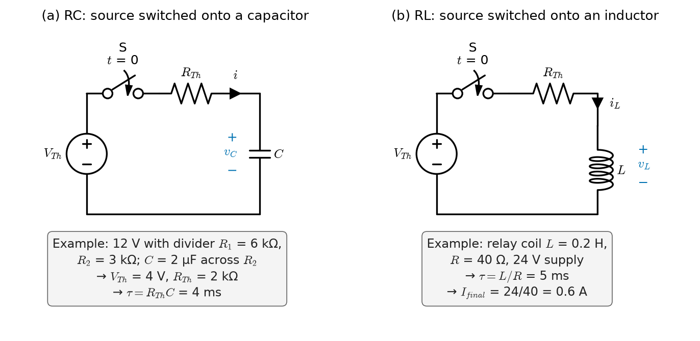
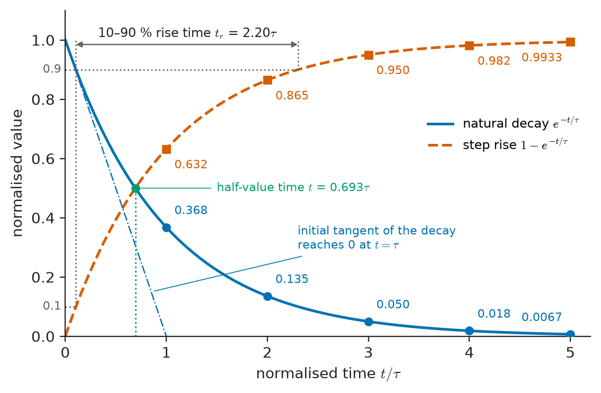
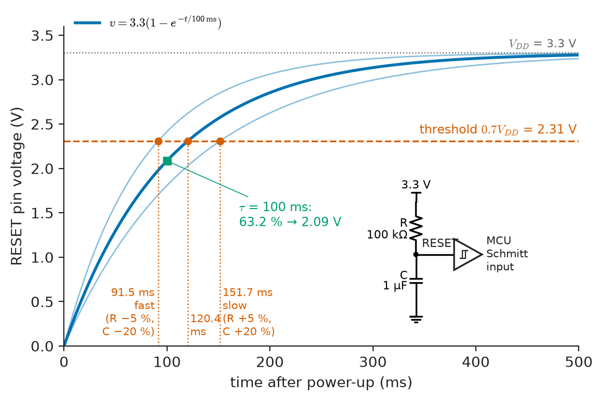
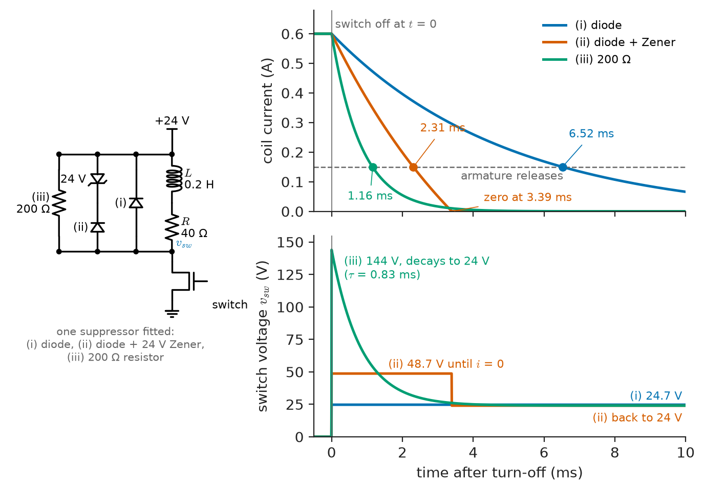
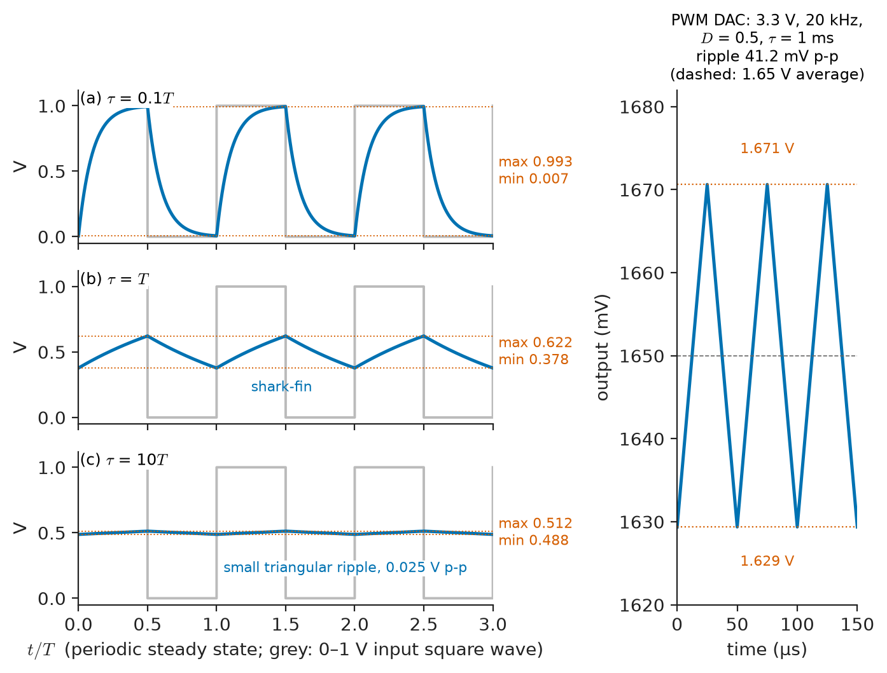
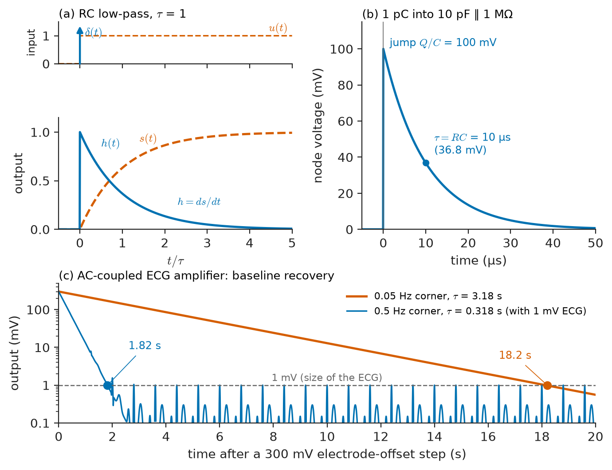

# Chapter 6 — First-Order Circuits

*Part II · Transient and AC Analysis*

A microcontroller board works perfectly on the bench supply but fails to start one time in twenty when powered from a cheap wall adapter. The adapter's output rises slowly, over tens of milliseconds, and the processor's reset line — held low by a resistor and a capacitor — releases before the supply has settled. Elsewhere, an ECG monitor in an ambulance shows a flat line for several seconds every time a patient is moved, then the trace slowly drifts back to the centre of the screen. And in a factory a 24 V solenoid valve is driven by a transistor that fails within weeks, while an identical transistor driving a resistive heater lasts for years. Three unrelated failures, one piece of mathematics: each involves a single energy-storage element, a resistance network and a switching event, and each is governed by an exponential with one time constant.

Chapter 5 gave the element laws $i=C\,dv/dt$ and $v=L\,di/dt$ and the rules for initial conditions. This chapter puts them to work in the simplest dynamic circuits: those whose behaviour is described by a single first-order differential equation. Despite their simplicity, first-order circuits account for a large share of everyday engineering — timing, filtering, debouncing, power-on reset, relay and solenoid drive, sensor response, bleeder discharge and the settling of every measurement front end.

> **How does a circuit with one capacitor or one inductor move from one state to another after a switch operates, and how long does it take?**
> **How do steps, pulses, ramps, sinusoids and impulses each shape the response, and why do all the answers share one exponential?**

| Concept | Engineering destination |
|---|---|
| RC circuits | Timing and reset circuits, low-pass and high-pass filters, ADC input settling, sensor front ends |
| RL circuits | Relays, solenoids, contactors, motor windings, current ramp in converters, fault-current asymmetry |
| Natural response | Capacitor discharge, bleeder resistors, inductive kick and snubbing |
| Forced response | Tracking of ramps and sinusoids by sensors and filters, steady-state ripple |
| Time constants | Settling-time specifications, rise time and bandwidth, thermal and sensor lag |
| Switching behavior | Contact arcing, freewheeling diodes, sequential switching, debouncing |
| Initial and final values | The three-number method for any first-order step problem |
| Piecewise excitation | PWM filtering, square-wave testing, pulse trains |
| Step and impulse inputs | System characterisation, ECG baseline recovery, charge-sensitive detectors |

**Roadmap.** RC circuits (6.1) → RL circuits (6.2) → natural response (6.3) → forced response and the complete response (6.4) → time constants (6.5) → initial and final values (6.6) → switching behavior (6.7) → piecewise excitation (6.8) → step and impulse inputs (6.9).

---

## 6.1 RC circuits

### Reducing any first-order circuit to one loop

A **first-order circuit** contains resistors, sources and exactly one energy-storage element (or several that can be combined into one, Chapter 5). The key simplification comes from Chapter 4: everything connected to the capacitor, however complicated, is a linear one-port and can be replaced by its Thévenin equivalent $V_{Th}$, $R_{Th}$. The circuit then becomes a single loop: a source $V_{Th}$, a resistor $R_{Th}$ and the capacitor $C$ (Figure 6.1a).

KVL around the loop, with capacitor current $i=C\,dv/dt$:

$$
V_{Th}=R_{Th}C\frac{dv}{dt}+v
$$

or, defining the **time constant** $\tau=R_{Th}C$,

$$
\tau\frac{dv}{dt}+v=V_{Th}(t)
$$

This is a linear, first-order ordinary differential equation with constant coefficients. Its state variable is the capacitor voltage $v$ — the quantity that cannot jump (Chapter 5). Once $v(t)$ is known, every other voltage and current in the original circuit follows from the resistive network by ordinary analysis, with the capacitor replaced by a voltage source of value $v(t)$ (substitution theorem, Chapter 4).

The resistance that matters is the **Thévenin resistance seen by the capacitor**: deactivate all independent sources and find the resistance between the capacitor's terminals. It is not, in general, any single resistor in the circuit, and it must be recomputed whenever a switch changes the network.

<!-- FIGURE 6.1 | figures/ch06/fig-6-1-rc-rl-switched-circuits.png | circuit | The generic first-order circuits: a Thévenin source switched onto a capacitor, and onto an inductor. | Content: two panels. (a) RC circuit: source V_Th, switch S closing at t = 0, series resistor R_Th, capacitor C with voltage v_C (plus at top) and current i. Example values printed beside it: original network 12 V with R1 = 6 kohm and R2 = 3 kohm divider, C = 2 uF across R2, reduced to V_Th = 4 V, R_Th = 2 kohm, tau = 4 ms. (b) RL circuit: source V_Th, switch S closing at t = 0, R_Th, inductor L with current i_L and voltage v_L; example values: relay coil L = 0.2 H, R = 40 ohm, 24 V supply, tau = 5 ms, I_final = 0.6 A. -->

*Figure 6.1 — The generic first-order circuits: a Thévenin source switched onto a capacitor, and onto an inductor.*

**Worked example — Reducing a circuit to its Thévenin form.** A 12 V source feeds a divider of $R_1=6$ kΩ (top) and $R_2=3$ kΩ (bottom); a 2 µF capacitor, initially uncharged, is connected across $R_2$ by a switch closing at $t=0$ (Figure 6.1a). Seen from the capacitor, the divider has

$$
V_{Th}=12\times\frac{3}{6+3}=4.0\ \mathrm{V},\qquad R_{Th}=6\parallel3=2.0\ \mathrm{k\Omega}
$$

so $\tau=2\times10^3\times2\times10^{-6}=4.0$ ms. The capacitor charges toward 4.0 V, not 12 V, and does so with a 4 ms time constant, not $R_1C=12$ ms or $R_2C=6$ ms. As Section 6.4 shows, $v(t)=4.0(1-e^{-t/4\,\mathrm{ms}})$ V; it reaches 3.0 V at $t=4\ln4=5.55$ ms.

### RC circuits as filters

The same equation, read with an arbitrary input $V_{Th}(t)=v_{in}(t)$, describes an **RC low-pass filter**: the output $v_C$ follows slow input changes and smooths fast ones. Taking the output across the resistor instead, $v_R=v_{in}-v_C$, gives an **RC high-pass filter** (also called a coupling or AC-coupling network), which passes changes and blocks steady levels. Both are first-order systems governed by the same $\tau$; Sections 6.8 and 6.9 show their time-domain behaviour, and Chapters 8 and 13 their frequency response.

---

## 6.2 RL circuits

### The dual equation

Replace the capacitor by an inductor. The rest of the circuit is now best represented by its **Norton** equivalent ($I_N$, $R_N$), the dual of the Thévenin form, because the inductor current is the state variable. KCL at the inductor node, with inductor voltage $v=L\,di/dt$ appearing across $R_N$:

$$
I_N=\frac{L}{R_N}\frac{di}{dt}+i
\quad\Rightarrow\quad
\tau\frac{di}{dt}+i=I_N(t),\qquad \tau=\frac{L}{R_N}
$$

Equivalently, with a Thévenin source and series resistance (Figure 6.1b), KVL gives $V_{Th}=R_{Th}i+L\,di/dt$, the same equation with $I_N=V_{Th}/R_{Th}$. The RL time constant is $L/R$: a *larger* resistance gives a *faster* response, the opposite of the RC case. This is duality (Chapter 5) at work: $C\leftrightarrow L$, $R\leftrightarrow G=1/R$.

> **Status of the principle: The first-order circuit equation $\tau\,dx/dt+x=x_{in}(t)$**
> *Derived.* KCL/KVL plus the linear element laws, after Thévenin or Norton reduction of the resistive network; exact for linear time-invariant circuits with one storage element, and approximate for circuits with several storage elements when one time constant dominates.

### Where RL circuits appear

Every electromagnetic actuator is an RL circuit: relays, contactors, solenoid valves, fuel injectors, loudspeaker voice coils at low frequency, the windings of DC motors with the rotor stalled. A coil of inductance $L$ and winding resistance $R$ driven from a voltage $V$ cannot reach its final current $V/R$ instantly; the current rises with time constant $L/R$. That delay is the pull-in time of a relay and the opening delay of a fuel injector. Power systems are RL circuits on a large scale: a feeder and transformer have $X/R$ ratios from about 2 (distribution) to 30 or more (near large generators), and the time constant $L/R$ governs how fault currents behave (Section 6.4).

**Worked example — Pull-in time of a relay.** A 24 V relay coil has $L=0.2$ H and $R=40$ Ω (Figure 6.1b). Its time constant is $\tau=0.2/40=5$ ms and its final current $24/40=0.6$ A. The armature pulls in when the coil current reaches 0.40 A. The current is $i(t)=0.6(1-e^{-t/5\,\mathrm{ms}})$ A, so pull-in occurs at

$$
t=-\tau\ln\left(1-\frac{0.40}{0.60}\right)=5\ln3=5.49\ \mathrm{ms}
$$

(In reality the armature's motion changes the magnetic gap and therefore $L$ while it moves, which adds a characteristic dip in the current waveform; the linear model gives the time to the start of motion.) Driving the coil from 48 V through an extra 40 Ω series resistor keeps the final current at 0.6 A but halves the time constant to 2.5 ms and halves the pull-in time to 2.75 ms — the classic **forcing** technique for fast actuators, later replaced by current-controlled drivers.

---

## 6.3 Natural response

### Source-free decay

The **natural response** (also called the source-free or zero-input response) is what a circuit does when the sources are removed and only the stored energy drives it. With $V_{Th}=0$:

$$
\tau\frac{dv}{dt}+v=0
$$

Try $v=Ae^{st}$: substitution gives $(\tau s+1)Ae^{st}=0$, so the **characteristic equation** is $\tau s+1=0$ with root $s=-1/\tau$. The initial condition $v(0^+)=V_0$ fixes $A=V_0$:

$$
v(t)=V_0\,e^{-t/\tau},\qquad t\ge0
$$

For the inductor, identically, $i(t)=I_0\,e^{-t/\tau}$ with $\tau=L/R$. All other quantities decay with the same exponential: in the RC case the discharge current is $i=-v/R=-(V_0/R)e^{-t/\tau}$, jumping from zero to $-V_0/R$ at the switching instant and then decaying.

The root $s=-1/\tau$ is the circuit's **natural frequency** — a single, real, negative number. It does not depend on what started the decay or on which variable is observed; it is a property of the circuit alone. Chapter 7 shows that second-order circuits have two natural frequencies, which may be complex, and Chapter 11 identifies them as the poles of the circuit's transfer function.

### Energy in the natural response

All of the stored energy ends up in the resistance. For the RC discharge,

$$
w_R=\int_0^\infty\frac{v^2}{R}\,dt=\frac{V_0^2}{R}\int_0^\infty e^{-2t/\tau}dt=\frac{V_0^2}{R}\cdot\frac{\tau}{2}=\tfrac12CV_0^2
$$

The value of $R$ cancels: a large resistance dissipates slowly, a small one quickly, but the total is the stored energy. This confirms the charge-sharing result of Chapter 5. When a 10 µF capacitor at 10 V is connected to an uncharged 10 µF capacitor through any resistance, the loop behaves as a single capacitor $C_1C_2/(C_1+C_2)=5$ µF holding the initial voltage difference of 10 V, and its natural response dissipates $\tfrac12\times5\times10^{-6}\times10^2=250$ µJ in the resistance — independent of $R$, exactly as found there.

<!-- FIGURE 6.2 | figures/ch06/fig-6-2-normalised-exponentials.png | plot | Normalised first-order responses: the natural decay and the step rise, with the initial tangent and the values at one to five time constants. | Content: x-axis t/tau from 0 to 5, y-axis normalised value 0 to 1. Solid curve e^(-t/tau) (decay) and dashed curve 1 - e^(-t/tau) (rise). Tangent to the decay at t = 0 drawn as a straight line reaching zero at t/tau = 1. Markers at t/tau = 1, 2, 3, 4, 5 on both curves labelled with values 0.368/0.632, 0.135/0.865, 0.050/0.950, 0.018/0.982, 0.0067/0.9933. Horizontal dotted lines at 0.1 and 0.9 on the rise curve showing the 10-90 percent rise time 2.20 tau; a dotted marker at t/tau = 0.693 labelled "half-value time". -->

*Figure 6.2 — Normalised first-order responses: the natural decay and the step rise, with the initial tangent and the values at one to five time constants.*

**Worked example — Sizing a bleeder resistor for a drive DC link.** A motor drive's DC link has 470 µF charged to 400 V. Machinery safety standards commonly require stored voltage to fall below 60 V within 5 s of disconnection. With a bleeder resistor $R$ across the capacitor,

$$
60=400\,e^{-5/(RC)}\ \Rightarrow\ RC=\frac{5}{\ln(400/60)}=\frac{5}{1.897}=2.636\ \mathrm{s}\ \Rightarrow\ R\le\frac{2.636}{470\times10^{-6}}=5.61\ \mathrm{k\Omega}
$$

But a 5.61 kΩ resistor across 400 V dissipates $400^2/5610=28.5$ W *continuously* while the drive runs. That is why drives either accept longer discharge times with warning labels, use several resistors in series to share voltage and heat, or switch in a discharge resistor only when the mains is removed. The stored energy, $\tfrac12\times470\times10^{-6}\times400^2=37.6$ J, is the same whichever resistor dissipates it.

### The inductive kick

The natural response of an RL circuit hides a hazard. When the switch feeding an inductor opens, the inductor current must continue at its initial value $I_0$ (Chapter 5). If the only path left is through a resistance $R_s$, the inductor voltage jumps to $I_0R_s$; if no path is provided, $R_s$ is effectively the open switch — megohms or more — and the voltage rises until something breaks down. Section 6.7 analyses the practical suppression circuits.

---

## 6.4 Forced response

### The complete response as natural plus forced

With a source present, the differential equation $\tau\,dx/dt+x=x_{in}(t)$ is inhomogeneous. Its general solution is the sum of

- a **forced response** (particular solution) $x_f(t)$ — any one function that satisfies the equation with the actual input; for the common inputs it has the same form as the input;
- a **natural response** $Ae^{-t/\tau}$ (homogeneous solution) — the same exponential as in Section 6.3, with a constant $A$ now fixed by the initial condition of the *complete* response.

$$
x(t)=x_f(t)+\left[x(0^+)-x_f(0^+)\right]e^{-t/\tau}
$$

The natural part is a correction that bridges the gap between where the circuit actually starts and where the forced solution "would like" it to be. Since $\tau>0$, the natural part decays, and after a few time constants only the forced response remains. In this sense the forced response is the **steady-state** response and the natural response is the **transient**. Superposition (Chapter 4) offers a second decomposition of the same answer: the **zero-input response** (initial energy, no source) plus the **zero-state response** (source, no initial energy). Both decompositions are correct; they divide the same total differently.

> **Status of the principle: Complete response = natural + forced**
> *Derived.* A theorem of linear ordinary differential equations: the general solution of a linear inhomogeneous equation is any particular solution plus the general homogeneous solution. It relies on linearity and fails for circuits containing nonlinear elements.

### Forced responses for standard inputs

**Table 6.1 — Forced response of $\tau\,dx/dt+x=x_{in}(t)$ for standard inputs.**

| Input $x_{in}(t)$ | Forced response $x_f(t)$ | Interpretation |
|---|---|---|
| Constant $X$ | $X$ | Settles to the input level |
| Ramp $\alpha t$ | $\alpha(t-\tau)$ | Follows the ramp with a delay of $\tau$, error $\alpha\tau$ |
| Exponential $Xe^{-at}$, $a\neq1/\tau$ | $\dfrac{X}{1-a\tau}e^{-at}$ | Same exponential, rescaled |
| Sinusoid $X_m\sin\omega t$ | $\dfrac{X_m}{\sqrt{1+(\omega\tau)^2}}\sin(\omega t-\arctan\omega\tau)$ | Attenuated and phase-lagged sinusoid |

Each entry can be verified by substitution. The ramp row says something useful about sensors: a first-order sensor tracking a steadily changing quantity reads it with a constant lag of one time constant. A sheathed thermocouple with $\tau=8$ s, measuring a furnace whose temperature ramps at 3 °C/s, reads $3\times8=24$ °C low for as long as the ramp continues — not a calibration error but a dynamic one, which disappears when the ramp stops (after a few further time constants).

The sinusoid row is the time-domain origin of everything in Chapter 8. For $\omega\tau\ll1$ the output follows the input; at $\omega\tau=1$ the amplitude is $1/\sqrt2$ (−3 dB) and the lag is 45°; for $\omega\tau\gg1$ the amplitude falls as $1/(\omega\tau)$ and the lag approaches 90°. The frequency $\omega=1/\tau$ is the **corner** or **cutoff** frequency of the RC or RL filter.

**Worked example — Switching a sinusoid onto an RC filter.** A sinusoid $v_{in}=V_m\sin\omega t$ is switched at $t=0$ onto an RC low-pass with $R=1$ kΩ, $C=1$ µF ($\tau=1$ ms) at $\omega=1000$ rad/s (159.2 Hz), so $\omega\tau=1$. The capacitor is initially uncharged. From Table 6.1 the forced response is

$$
v_f(t)=\frac{V_m}{\sqrt2}\sin\left(\omega t-45^\circ\right)
$$

whose value at $t=0$ is $\frac{V_m}{\sqrt2}\sin(-45^\circ)=-0.5V_m$. The capacitor starts at zero, so the natural part must supply $0-(-0.5V_m)=+0.5V_m$:

$$
v_C(t)=\frac{V_m}{\sqrt2}\sin(\omega t-45^\circ)+0.5V_m\,e^{-t/1\,\mathrm{ms}}
$$

The transient raises the first peak to $0.756V_m$ (at $t=2.28$ ms), about 7 % above the steady-state amplitude $0.707V_m$, and has died to below 1 % of $V_m$ after 5 ms. Switching at a different point of the sine changes the size and sign of the transient; switching at the instant when $v_f(0)=0$ produces no transient at all.

### Fault-current asymmetry: the RL version

The same analysis applied to an RL circuit explains one of the central facts of power-system protection. A short circuit on a feeder makes the network an RL circuit driven by the sinusoidal source voltage. The forced current is a sinusoid lagging the voltage by $\varphi=\arctan(X/R)$, but the inductor current must start from its pre-fault value (approximately zero for this purpose). The natural response therefore contains a decaying **DC offset**, whose size depends on the instant in the voltage cycle at which the fault occurs. In the worst case the forced current is at its negative peak $-I_m$ at $t=0$, the offset starts at $+I_m$, and

$$
i(t)=I_m\left[e^{-t/\tau}-\cos\omega t\right],\qquad \tau=\frac{L}{R}=\frac{X/R}{\omega}
$$

For $X/R=10$ at 50 Hz, $\tau=31.8$ ms and the first peak, at $t=9.77$ ms, is $1.73I_m$. Circuit breakers must withstand and interrupt this **asymmetrical** current, not just the symmetrical value; the "peak factor" $\kappa$ used in fault-current standards is exactly this ratio, tabulated against $X/R$.

---

## 6.5 Time constants

### Reading the exponential

The time constant is the single number that characterises a first-order circuit's speed. Its meanings, all equivalent:

1. The time for the natural response to fall to $1/e=36.8\ \%$ of its initial value (or for a step response to cover 63.2 % of the change).
2. The time at which the **initial tangent** of the response reaches the final value (Figure 6.2) — if the circuit kept changing at its initial rate, it would finish in exactly one time constant.
3. The ratio of stored energy capacity to the rate at which the resistance can move it: $\tau=RC$ or $L/R$.
4. The reciprocal of the magnitude of the natural frequency, $\tau=1/\lvert s\rvert$.

**Table 6.2 — Remaining fraction of the transient after $n$ time constants.**

| Elapsed time | Remaining $e^{-n}$ | Completed $1-e^{-n}$ | Typical use |
|---|---|---|---|
| $0.693\tau$ | 50.0 % | 50.0 % | Half-life of decay |
| $1\tau$ | 36.8 % | 63.2 % | Definition |
| $2\tau$ | 13.5 % | 86.5 % | — |
| $2.303\tau$ | 10.0 % | 90.0 % | — |
| $3\tau$ | 4.98 % | 95.0 % | "Settled" for rough work |
| $4\tau$ | 1.83 % | 98.2 % | — |
| $4.6\tau$ | 1.0 % | 99.0 % | 1 % settling |
| $5\tau$ | 0.67 % | 99.3 % | "Settled" in common practice |
| $6.9\tau$ | 0.1 % | 99.9 % | 0.1 % settling (about 10 bits) |
| $(N+1)\ln2\cdot\tau$ | $2^{-(N+1)}$ | — | Settling to ½ LSB of an $N$-bit converter |

The last row matters for data acquisition: an ADC input or a sample-and-hold capacitor must settle to within half a least-significant bit, which for a 16-bit converter takes $17\ln2=11.8$ time constants. Fast, high-resolution converters therefore need very low source resistance, which is why they are driven by dedicated amplifiers.

### Rise time and bandwidth

The **10–90 % rise time** of a first-order step response is $t_r=\tau\ln9=2.20\tau$. Since the −3 dB bandwidth of the same circuit is $f_{3dB}=1/(2\pi\tau)$,

$$
t_r=\frac{2.2}{2\pi f_{3dB}}\approx\frac{0.35}{f_{3dB}}
$$

This rule links the time and frequency domains for any system that behaves approximately as first order. An oscilloscope with 100 MHz bandwidth has an intrinsic rise time of about 3.5 ns and cannot faithfully display edges much faster than that. Chapter 18 generalises the relation (time–bandwidth product) to other systems.

> **Status of the principle: $t_r\approx0.35/f_{3dB}$**
> *Approximate.* Exact for a first-order system; a good estimate (within about 10 %) for many well-damped amplifiers and instruments, but not for systems with overshoot or sharp-cutoff filters, where the constant ranges from about 0.35 to 0.45.

### Representative time constants

**Table 6.3 — Time constants across EEE (typical values).**

| System | Elements | Typical $\tau$ |
|---|---|---|
| On-chip logic gate driving local wire | 1 kΩ, 10 fF | 10 ps |
| 50 Ω line driving 10 pF probe | 50 Ω, 10 pF | 0.5 ns |
| 10× oscilloscope probe tip | 9 MΩ, about 1.1 pF (compensated) | about 10 µs |
| Switch debounce filter | 10 kΩ, 100 nF | 1 ms |
| Power-on reset | 100 kΩ, 1 µF | 100 ms |
| Relay or solenoid coil | 0.2 H, 40 Ω | 5 ms |
| Distribution feeder fault offset ($X/R\approx3$–10) | — | 10–30 ms at 50 Hz |
| Generator-near fault offset ($X/R\approx30$–50) | — | 100–160 ms at 50 Hz |
| ECG amplifier AC coupling (0.05 Hz corner) | — | 3.2 s |
| Sheathed thermocouple in air | thermal RC | 1–30 s |
| Large power transformer thermal | thermal RC | 1–3 h |

The last entries are not electrical circuits at all: heat flow through a thermal resistance into a heat capacity obeys the same first-order equation, which is why "thermal time constant" appears on every power-semiconductor and transformer datasheet.

### Measuring a time constant

On an oscilloscope, a single exponential is recognised by its constant ratio over equal time intervals: each interval of $\tau$ divides the remaining distance to the final value by $e$. To measure $\tau$, read the final value, find the time at which 63.2 % (or 36.8 %) of the change has occurred, or fit a straight line to the logarithm of the remaining distance — its slope is $-1/\tau$. The log plot is also the best test of first-order behaviour: a second time constant appears as a bend in the line.

---

## 6.6 Initial and final values

### The three-number method

When all sources are constant after the switching event, the forced response is a constant — the final value $x(\infty)$ — and the complete response of *any* voltage or current in a first-order circuit is

$$
x(t)=x(\infty)+\left[x(0^+)-x(\infty)\right]e^{-(t-t_0)/\tau},\qquad t\ge t_0
$$

Three numbers determine everything: the initial value $x(0^+)$, the final value $x(\infty)$ and the time constant $\tau$. Each is found from a resistive circuit:

1. **Initial value.** Find $v_C(0^-)$ or $i_L(0^-)$ from the circuit before switching (usually in DC steady state: capacitor open, inductor short). Continuity gives $v_C(0^+)$ or $i_L(0^+)$. For any *other* variable $x$, solve the post-switching circuit with the capacitor replaced by a voltage source $v_C(0^+)$ or the inductor by a current source $i_L(0^+)$ (Chapter 5).
2. **Final value.** Solve the post-switching circuit with the capacitor open or the inductor shorted.
3. **Time constant.** Deactivate the independent sources of the post-switching circuit and find the Thévenin resistance seen by the storage element; $\tau=R_{Th}C$ or $L/R_{Th}$.

The method works for any variable, not just the state variable, because every voltage and current in a linear first-order circuit is a linear combination of the source and the state variable, and so shares its exponential.

> **Status of the principle: Three-number formula $x(t)=x(\infty)+[x(0^+)-x(\infty)]e^{-t/\tau}$**
> *Derived.* The complete response of a linear first-order circuit with constant sources after the switching instant; it fails for time-varying sources (use Section 6.4), for circuits with more than one independent storage element (Chapter 7), and if $R_{Th}\le0$, in which case the circuit does not settle.

<!-- FIGURE 6.3 | figures/ch06/fig-6-3-power-on-reset.png | plot | Power-on reset: the RC voltage rises toward the supply and releases the processor when it crosses the logic threshold; component tolerances spread the release time. | Content: inset circuit: 3.3 V supply, R = 100 kohm to node RESET, C = 1 uF to ground, Schmitt-trigger input. Main plot: x-axis time 0 to 500 ms, y-axis 0 to 3.5 V. Nominal curve v = 3.3(1 - e^(-t/100 ms)). Horizontal dashed line at 2.31 V (0.7 V_DD threshold). Vertical markers at 91.5 ms (fast corner: R -5 percent, C -20 percent), 120.4 ms (nominal), 151.7 ms (slow corner: R +5 percent, C +20 percent), with two light curves for the corners. Annotate the 100 ms time constant and the 63.2 percent point at 2.09 V. -->

*Figure 6.3 — Power-on reset: the RC voltage rises toward the supply and releases the processor when it crosses the logic threshold; component tolerances spread the release time.*

**Worked example — Power-on reset timing.** A microcontroller's reset input is held low by a capacitor $C=1$ µF charged through $R=100$ kΩ from the 3.3 V supply (Figure 6.3). The reset is released when the input crosses $0.7V_{DD}=2.31$ V. Assume the supply rises instantly.

Initial value $v(0^+)=0$; final value $v(\infty)=3.3$ V; time constant $\tau=100\times10^3\times1\times10^{-6}=0.1$ s. Then $v(t)=3.3(1-e^{-t/0.1})$, and the threshold is crossed when $e^{-t/\tau}=0.3$:

$$
t=\tau\ln\frac{1}{0.3}=0.1\times1.204=120.4\ \mathrm{ms}
$$

With a ±5 % resistor and a ±20 % capacitor, the release time spans $0.95\times0.80\times120.4=91.5$ ms to $1.05\times1.20\times120.4=151.7$ ms. The reset is useful only if the supply has settled before the shortest of these. The opening's failure — a slowly rising adapter — breaks the "supply rises instantly" assumption: the capacitor's final value is itself moving, the RC voltage can cross the threshold while $V_{DD}$ is still low, and the processor starts with an unstable supply. Dedicated supervisor ICs, which compare $V_{DD}$ against a reference and only then start a timer, exist because the simple RC reset depends on how the supply ramps.

**Worked example — Any variable, not only the state.** Return to the circuit of Section 6.1 (12 V, $R_1=6$ kΩ, $R_2=3$ kΩ, $C=2$ µF switched across $R_2$ at $t=0$). What is the current in $R_1$? Before switching, $R_1$ and $R_2$ form a simple divider: $i_{R1}(0^-)=12/9=1.333$ mA. At $0^+$, the capacitor (still at 0 V) shorts $R_2$, so $i_{R1}(0^+)=12/6=2.0$ mA — a jump, allowed because $i_{R1}$ is not a state variable. Finally $i_{R1}(\infty)=1.333$ mA again (capacitor open). The time constant is the same 4 ms. Hence

$$
i_{R1}(t)=1.333+(2.0-1.333)e^{-t/4\,\mathrm{ms}}\ \mathrm{mA}=1.333+0.667\,e^{-t/4\,\mathrm{ms}}\ \mathrm{mA}
$$

No differential equation was solved; three resistive circuits gave the answer.

---

## 6.7 Switching behavior

### Real switches and the ideal model

The analysis so far treats a switch as ideal: zero resistance when closed, infinite when open, transition in zero time. Real switches differ in ways that matter precisely in first-order circuits:

- **Mechanical contacts bounce.** A pushbutton or relay contact makes and breaks several times over 0.1–10 ms before settling. A logic input sees a burst of pulses; an RC filter followed by a Schmitt trigger (a **debounce** circuit, $\tau$ of a few milliseconds) turns the burst into one clean edge.
- **Opening contacts arc.** If the circuit is inductive, the current continues across the opening gap as an arc until the stored energy is dissipated or the voltage across the gap can no longer sustain it. DC arcs are hard to extinguish because the current never passes through zero; AC arcs usually extinguish at the next current zero.
- **Semiconductor switches have finite speed and voltage ratings.** A transistor turns off in nanoseconds to microseconds, so $L\,di/dt$ can be enormous, and the device fails if the resulting voltage exceeds its breakdown rating.

### Turning off an inductive load

The opening example — a transistor that fails driving a solenoid but not a heater — is an RL switching problem. When the transistor turns off, the coil current $I_0$ must continue. Four common arrangements decide where it goes (Figure 6.4).

<!-- FIGURE 6.4 | figures/ch06/fig-6-4-relay-turn-off-suppression.png | plot | Turning off a 0.2 H, 40 ohm relay coil from 0.6 A: coil current and switch voltage for three suppression circuits. | Content: inset schematic: 24 V supply, coil (L = 0.2 H, R = 40 ohm), low-side transistor switch, with three alternative suppressors across the coil: diode, diode plus 24 V Zener, 200 ohm resistor. Top plot: coil current versus time 0 to 10 ms, starting at 0.6 A; curves for diode only (reaches 0.15 A drop-out at 6.52 ms), diode plus Zener (0.15 A at 2.31 ms, reaches zero at 3.39 ms), resistor 200 ohm (0.15 A at 1.16 ms); dashed horizontal line at 0.15 A labelled "armature releases". Bottom plot: switch voltage versus time: diode case 24.7 V, Zener case 48.7 V flat until current reaches zero then back to 24 V, resistor case jumping to 144 V and decaying toward 24 V with tau = 0.83 ms. -->

*Figure 6.4 — Turning off a 0.2 H, 40 ohm relay coil from 0.6 A: coil current and switch voltage for three suppression circuits.*

**Worked example — Suppressing the turn-off of a relay coil.** The relay of Section 6.2 ($L=0.2$ H, $R=40$ Ω, 24 V, $I_0=0.6$ A) is switched off by a transistor at $t=0$. The armature releases when the current falls to 0.15 A.

*No suppression.* The coil's stored energy, $\tfrac12\times0.2\times0.6^2=36$ mJ, has no path. The voltage rises until the transistor breaks down (avalanche) and absorbs the energy — 36 mJ per operation, repeated every time. That is the transistor that fails within weeks.

*Freewheeling diode across the coil.* The current circulates through the diode (forward drop $V_D\approx0.7$ V). The coil equation is $L\,di/dt=-(Ri+V_D)$, a first-order equation with constant input whose final value would be $-V_D/R=-17.5$ mA (it stops at zero, when the diode turns off):

$$
i(t)=\left(I_0+\frac{V_D}{R}\right)e^{-t/\tau}-\frac{V_D}{R},\qquad \tau=\frac{L}{R}=5\ \mathrm{ms}
$$

The current reaches 0.15 A at $t=-\tau\ln[(0.15+0.0175)/(0.6+0.0175)]=6.52$ ms. The transistor sees only $24+0.7=24.7$ V. Safe, but the release is slow: the diode lets the coil keep its current, so the relay lingers closed.

*Diode plus 24 V Zener in series.* Now $L\,di/dt=-(Ri+V_D+V_Z)$, and the effective final value is $-(0.7+24)/40=-0.6175$ A. The current reaches 0.15 A at

$$
t=-\tau\ln\frac{0.15+0.6175}{0.6+0.6175}=2.31\ \mathrm{ms}
$$

almost three times faster. The transistor sees $24+0.7+24=48.7$ V, which must be within its rating. The Zener absorbs most of the energy at a high voltage, speeding the decay.

*Resistor $R_s=200$ Ω across the coil.* The current transfers into $R_s$, so the coil voltage jumps to $0.6\times200=120$ V and the transistor sees $24+120=144$ V at the instant of turn-off. The time constant becomes $L/(R+R_s)=0.2/240=0.833$ ms and the release occurs at $0.833\ln4=1.16$ ms. Fast, but with a high peak voltage, and the resistor wastes $24^2/200=2.9$ W whenever the relay is energised.

The trade-off — release speed against switch voltage — is general: the faster the stored energy is removed, the higher the voltage at which it must be removed, because the energy $\tfrac12LI_0^2$ is fixed and the time to remove it scales roughly as $LI_0/V$. RC **snubbers** across contacts and transistors, varistors across mains-connected coils, and the active clamp circuits of integrated low-side drivers are all variations on these four arrangements.

### Turning off a capacitive circuit, turning on into a capacitor

The dual problem arises when a switch *closes* onto a capacitor: the capacitor's voltage cannot jump, so the switch carries a current limited only by the circuit resistance — the inrush current of Chapter 5. A rectifier charging a large reservoir capacitor at switch-on, a hot-plugged board and a power-factor-correction capacitor bank switched onto a live bus all exhibit it. The remedies are dual to those for inductors: add series resistance temporarily (an **NTC thermistor** or a precharge resistor bypassed by a relay after a few time constants), or ramp the voltage slowly with a controlled transistor.

### Sequential switching

When switches operate at several instants, the circuit is solved interval by interval. At each switching instant, the state variable carries over continuously; the time constant and final value are recomputed for the new circuit; and time is measured from the new instant.

**Worked example — Charge then discharge.** A 10 µF capacitor, initially uncharged, is charged from 10 V through $R_1=1$ kΩ for 5 ms; at $t=5$ ms the switch transfers the capacitor to a discharge resistor $R_2=4$ kΩ.

*Interval 1* ($0\le t\le5$ ms): $\tau_1=10$ ms, final value 10 V: $v(t)=10(1-e^{-t/10\,\mathrm{ms}})$, so $v(5\ \mathrm{ms})=10(1-e^{-0.5})=3.935$ V. The capacitor is far from fully charged.

*Interval 2* ($t\ge5$ ms): $\tau_2=40$ ms, final value 0: $v(t)=3.935\,e^{-(t-5\,\mathrm{ms})/40\,\mathrm{ms}}$. At $t=25$ ms, $v=3.935\,e^{-0.5}=2.387$ V.

The same bookkeeping, repeated periodically, gives the response to pulse trains (Section 6.8).

---

## 6.8 Piecewise excitation

### Inputs built from steps

Many practical inputs are **piecewise constant**: pulses, square waves, PWM signals, staircases from a DAC. Two equivalent methods handle them.

1. **Interval by interval.** As in Section 6.7: in each interval the input is constant, the three-number formula applies, and the state variable at the end of one interval is the initial value for the next.
2. **Superposition of shifted steps.** Write the input as a sum of steps, e.g. a rectangular pulse of height $V$ and width $T$ as $V[u(t)-u(t-T)]$, where $u(t)$ is the unit step. If $s(t)$ is the response to $u(t)$, linearity and time invariance give the response $V[s(t)-s(t-T)]$.

For a pulse into an RC low-pass from rest, both methods give

$$
v(t)=\begin{cases}V\left(1-e^{-t/\tau}\right), & 0\le t\le T\\ V\left(1-e^{-T/\tau}\right)e^{-(t-T)/\tau}, & t\ge T\end{cases}
$$

If $T\gg\tau$ the output is a faithful pulse with rounded edges; if $T\ll\tau$, it barely rises — to about $V\,T/\tau$ — before decaying. The second regime, in which the output is proportional to the *area* $VT$ of the pulse, leads to the impulse idea of Section 6.9.

### Periodic steady state under a square wave

When a square wave of period $T$ and duty cycle $D$ drives a first-order circuit, the response settles after a few time constants into a periodic waveform, rising toward the high level during the high interval and falling toward the low level during the low interval. In steady state the waveform must repeat, so the voltage at the start of each period equals that at its end. For a 0-to-$V$ square wave into an RC low-pass, with $a=e^{-DT/\tau}$ and $b=e^{-(1-D)T/\tau}$:

$$
v_{\max}=V\frac{1-a}{1-ab},\qquad v_{\min}=v_{\max}\,b
$$

For a 50 % duty cycle, the shape depends on $\tau/T$ (Figure 6.5): for $\tau\ll T$ the output reproduces the square wave with exponential edges; for $\tau\approx T$ it becomes a "shark-fin"; for $\tau\gg T$ it is a small triangular ripple around the average value $DV$. The high-pass output (across the resistor) shows the complementary picture: for $\tau\ll T$, narrow spikes at each edge (a differentiator); for $\tau\gg T$, a square wave with slight **tilt** (sag), which is how AC-coupled oscilloscope inputs and audio coupling capacitors distort low-frequency square waves.

<!-- FIGURE 6.5 | figures/ch06/fig-6-5-square-wave-response.png | plot | Periodic steady-state response of an RC low-pass filter to a 0 to 1 V square wave of 50 percent duty cycle for three ratios of time constant to period. | Content: three stacked panels sharing x-axis t/T from 0 to 3 (three periods shown in steady state), y-axis 0 to 1 V, input square wave in light grey in each. Panel (a) tau = 0.1 T: nearly square output with exponential edges, max 0.993, min 0.007. Panel (b) tau = T: shark-fin, max 0.622, min 0.378. Panel (c) tau = 10 T: small triangular ripple, max 0.512, min 0.488 around the 0.5 V average. Right margin: small panel showing PWM DAC example: 3.3 V, 20 kHz, D = 0.5, tau = 1 ms, ripple 41.2 mV peak-to-peak between 1.629 V and 1.671 V. -->

*Figure 6.5 — Periodic steady-state response of an RC low-pass filter to a 0 to 1 V square wave of 50 percent duty cycle for three ratios of time constant to period.*

**Table 6.4 — Steady-state extremes for a 0–1 V, 50 % duty square wave into an RC low-pass.**

| $\tau/T$ | $v_{\max}$ (V) | $v_{\min}$ (V) | Peak-to-peak ripple (V) |
|---|---|---|---|
| 0.1 | 0.993 | 0.007 | 0.987 |
| 1 | 0.622 | 0.378 | 0.245 |
| 10 | 0.512 | 0.488 | 0.025 |

**Worked example — A PWM digital-to-analogue converter.** A microcontroller produces an analogue voltage by driving a 3.3 V PWM signal at 20 kHz ($T=50$ µs) into an RC low-pass with $R=10$ kΩ and $C=100$ nF ($\tau=1$ ms, so $\tau/T=20$). At $D=0.5$:

*Exact steady-state ripple.* $a=b=e^{-25\,\mu\mathrm{s}/1\,\mathrm{ms}}=0.9753$, giving $v_{\max}=3.3\times(1-0.9753)/(1-0.9753^2)=1.6706$ V and $v_{\min}=1.6294$ V: ripple 41.2 mV peak-to-peak about the average 1.65 V.

*Approximation for $\tau\gg T$.* The capacitor voltage hardly changes over a period, so the capacitor current is nearly constant in each interval: $(V-DV)/R$ while high, $-DV/R$ while low. The ripple is then

$$
\Delta v\approx\frac{V\,D(1-D)\,T}{\tau}=\frac{3.3\times0.25\times50\times10^{-6}}{10^{-3}}=41.25\ \mathrm{mV}
$$

in excellent agreement. The ripple is largest at $D=0.5$.

*Settling.* When the duty cycle changes, the average output moves with the circuit's time constant. To settle within half an LSB of an 8-bit output ($2^{-9}$ of full scale) takes $\tau\ln512=6.24$ ms. Reducing the ripple below ½ LSB (6.4 mV at 3.3 V) needs a larger $\tau$ — and makes settling slower still. This ripple–speed conflict of a single pole is why practical PWM DACs use second-order or higher filters (Chapter 13) or a higher PWM frequency.

---

## 6.9 Step and impulse inputs

### The unit step and the step response

The **unit step** $u(t)$ is 0 for $t<0$ and 1 for $t>0$; it models a switch closing onto a 1 V source at $t=0$. The **step response** $s(t)$ is the zero-state response (all initial conditions zero) to $u(t)$. For the RC low-pass with output across $C$:

$$
s(t)=\left(1-e^{-t/\tau}\right)u(t)
$$

and for the high-pass with output across $R$:

$$
s_{HP}(t)=e^{-t/\tau}u(t)
$$

The step response is the most widely used characterisation of a dynamic system in the time domain: rise time, settling time, overshoot (absent in first order) and steady-state error are all read from it (Chapter 35 uses the same quantities as control specifications). It is also directly measurable: apply a fast edge and observe the output.

### The unit impulse

Consider a rectangular pulse of width $\epsilon$ and height $1/\epsilon$, so that its area is 1. As $\epsilon\to0$ the pulse becomes infinitely tall and narrow with unit area: the **unit impulse** or Dirac delta $\delta(t)$, defined by its effect under an integral,

$$
\int_{-\infty}^{\infty}\delta(t)\,dt=1,\qquad \int_{-\infty}^{\infty}f(t)\,\delta(t-t_0)\,dt=f(t_0)
$$

and related to the step by $\delta(t)=du/dt$. It models any event that is much shorter than the circuit's time constant but delivers a finite total: a charge packet from a particle detector, a lightning-induced current pulse, a hammer tap on an accelerometer, a short current spike delivered into a capacitor.

> **Status of the principle: Impulse idealisation**
> *Approximate.* A short pulse of area $A$ produces essentially the same response as $A\,\delta(t)$ when its duration is much shorter than the circuit's shortest time constant; a pulse of width $0.1\tau$ gives an output 4.8 % below the impulse prediction, a pulse of width $0.01\tau$ about 0.5 % below.

The rigorous theory of $\delta(t)$ as a generalised function belongs to *The Mathematics Universe*; Chapter 15 introduces it as a signal in its own right. Here it is enough to know how a circuit responds.

### The impulse response

The **impulse response** $h(t)$ is the zero-state response to $\delta(t)$. Because $\delta$ is the derivative of $u$, and differentiation commutes with a linear time-invariant system, the impulse response is the derivative of the step response:

$$
h(t)=\frac{ds}{dt}
$$

For the RC low-pass,

$$
h(t)=\frac{1}{\tau}e^{-t/\tau}u(t)
$$

Physically, the impulse delivers a finite charge to the capacitor in zero time — an **instantaneous jump** of capacitor voltage, which is permitted precisely because the input is impulsive (the exception to continuity noted in Chapter 5). An impulse of voltage $A\delta(t)$ through $R$ deposits charge $A/R$, raising the capacitor voltage to $A/(RC)=A/\tau$; thereafter the circuit is source-free and decays with its natural response. **The impulse response is the natural response started by an impulse.**

> **Status of the principle: $h(t)=ds/dt$**
> *Derived.* Holds for every linear time-invariant system, because the impulse is the derivative of the step; it fails for time-varying or nonlinear systems.

The impulse response contains everything about a linear time-invariant circuit: by superposition, any input can be built from shifted, scaled impulses, and the output is the corresponding sum of shifted, scaled impulse responses — the **convolution integral** of Chapter 17. Its Laplace transform is the transfer function of Chapter 11. First-order circuits are where this idea first becomes concrete.

<!-- FIGURE 6.6 | figures/ch06/fig-6-6-step-impulse-ecg-baseline.png | plot | Step and impulse responses of first-order circuits, and the baseline recovery of an AC-coupled ECG amplifier after an electrode-offset step. | Content: three panels. (a) Normalised RC low-pass: unit step response 1 - e^(-t/tau) and impulse response (1/tau) e^(-t/tau) (scaled to tau = 1) versus t/tau from -0.5 to 5; impulse shown as arrow at t = 0 on input trace above. (b) Charge-sensitive detector: 1 pC into 10 pF parallel 1 Mohm, output jumps to 100 mV at t = 0 and decays with tau = 10 us, x-axis 0 to 50 us. (c) ECG high-pass: 300 mV electrode-offset step at t = 0 seen through tau = 3.18 s (0.05 Hz) and tau = 0.318 s (0.5 Hz); y-axis log scale 1 mV to 300 mV, x-axis 0 to 20 s; horizontal line at 1 mV; crossings at 18.2 s and 1.82 s; superimposed 1 mV ECG complexes drawn schematically on the 0.5 Hz trace. -->

*Figure 6.6 — Step and impulse responses of first-order circuits, and the baseline recovery of an AC-coupled ECG amplifier after an electrode-offset step.*

**Worked example — A charge-sensitive radiation detector.** A semiconductor radiation detector deposits a charge of $Q=1$ pC in about 10 ns onto the input node of its preamplifier, which presents $C=10$ pF in parallel with a $R=1$ MΩ bias resistor ($\tau=10$ µs). Since 10 ns is a thousandth of $\tau$, the charge pulse is effectively an impulse of current $Q\,\delta(t)$. It raises the node voltage instantly by

$$
\Delta v=\frac{Q}{C}=\frac{10^{-12}}{10\times10^{-12}}=0.10\ \mathrm{V}
$$

after which $v(t)=0.10\,e^{-t/10\,\mu\mathrm{s}}$ V (Figure 6.6b). The peak is proportional to the deposited charge and therefore to the particle's energy, which is the basis of pulse-height spectroscopy. The time constant sets the maximum count rate: pulses arriving less than a few $\tau$ apart pile up on each other's tails.

**Worked example — ECG baseline recovery.** Diagnostic ECG amplifiers are AC-coupled with a high-pass corner of 0.05 Hz, so as not to distort the slow ST segment of the heartbeat. The corresponding time constant is

$$
\tau=\frac{1}{2\pi\times0.05}=3.18\ \mathrm{s}
$$

When the patient moves, the electrode–skin half-cell potential can shift abruptly by hundreds of millivolts — far larger than the 1 mV heart signal. Treat it as a 300 mV step into the high-pass: the output jumps by 300 mV (driving the display off-scale or the amplifier into saturation), then decays as $300e^{-t/\tau}$ mV. It returns to within 1 mV of baseline after

$$
t=\tau\ln\frac{300}{1}=3.18\times5.70=18.2\ \mathrm{s}
$$

This is the ambulance monitor's flat line and slow drift from the opening. Monitoring-mode ECGs therefore use a 0.5 Hz corner ($\tau=0.318$ s, recovery in 1.82 s), accepting some distortion of the ST segment, and many instruments add a "baseline reset" that momentarily shorts the coupling capacitor — a deliberate switching event that collapses the time constant. The trade-off between low-frequency fidelity and recovery time is a property of a single time constant and cannot be escaped without a different architecture (such as DC-coupled, high-resolution front ends that remove the offset digitally).

### Probe compensation: a step response that must be flat

A 10× oscilloscope probe is a resistive divider (9 MΩ in the probe, 1 MΩ in the scope) with capacitance across each part (the probe's tip capacitance and the scope's input plus cable capacitance). A step applied to such a divider initially divides according to the *capacitances* (Chapter 5: series capacitors share a fast transient by charge) and finally according to the *resistances*. The two ratios agree, and the step response is flat with no exponential at all, exactly when $R_1C_1=R_2C_2$. The adjustable capacitor in every passive probe sets this condition; the square-wave calibrator on the scope front panel exists to check it, displaying overshoot (overcompensation) or a rounded leading edge (undercompensation) when the condition is not met. The condition $R_1C_1=R_2C_2$ is the case in which the circuit's natural response is not excited at all, because the initial and final values coincide.

---

## What remains open

| Open question | Where it is answered |
|---|---|
| What happens with two storage elements — oscillation, overshoot, damping? | Chapter 7 |
| How are steady-state sinusoidal responses found directly, without solving the differential equation? | Chapter 8 |
| What is the frequency response of RC and RL filters, and how is it plotted? | Chapter 8; Chapter 13 (Bode plots) |
| How do initial conditions and switching appear in the $s$-domain, and why are $-1/\tau$ the poles? | Chapter 11 |
| How is the step response of a long cable or a fast interconnect different from a lumped RC? | Chapter 14 |
| How is $\delta(t)$ defined as a signal, and what are its properties? | Chapter 15 |
| How does the impulse response determine the output for any input (convolution)? | Chapter 17 |
| How is the time–bandwidth relation $t_r\approx0.35/f_{3dB}$ generalised? | Chapter 18 |
| How do first-order lags appear in feedback loops and control specifications? | Chapters 33–35 |
| How are freewheeling diodes, snubbers and gate drivers designed in practice? | *Electronics & Computing* |

**Next:** Chapter 7 adds a second storage element, letting energy swing between a capacitor and an inductor, and shows how damping decides whether the result is a slow approach, a fastest-possible settle or a ringing oscillation.
