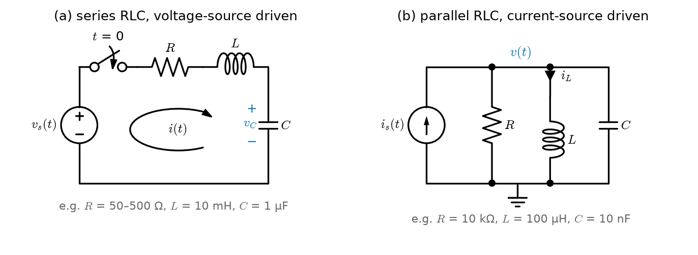
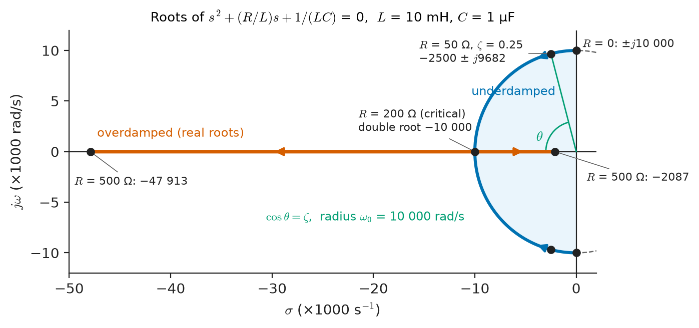
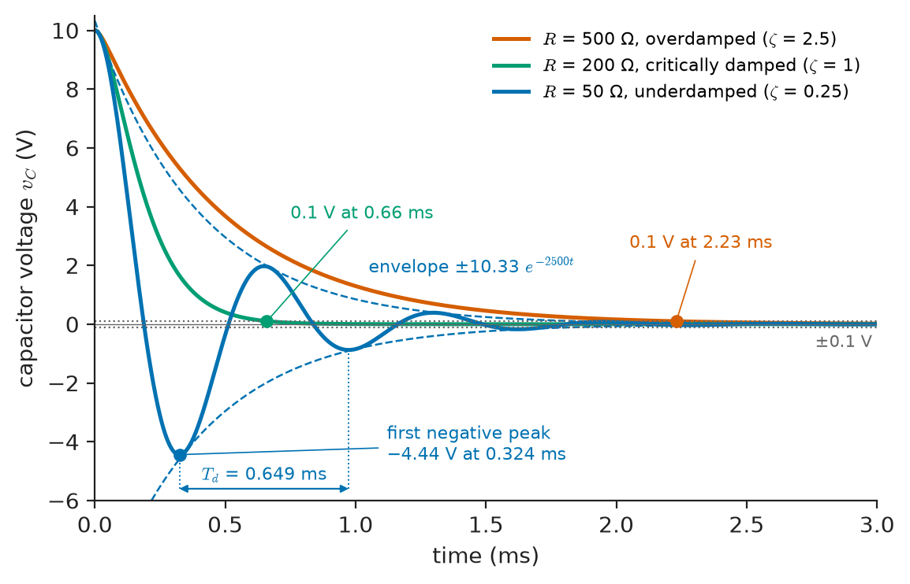
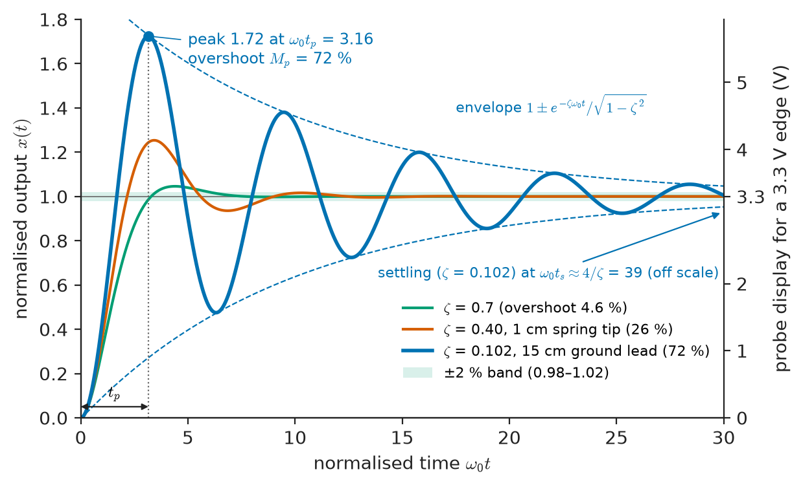
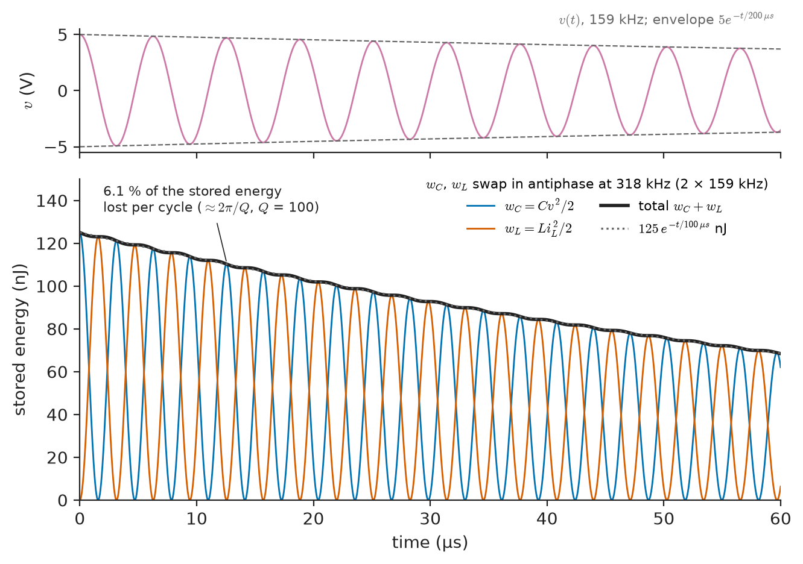

# Chapter 7 — Second-Order Circuits

*Part II · Transient and AC Analysis*

A technician probes a 3.3 V clock line on a new board and sees every rising edge overshoot to almost 5.7 V, then ring down in a decaying sinusoid at about 130 MHz. The logic family is rated for 3.6 V absolute maximum, and a design review is called. Before anyone redesigns the clock driver, a senior engineer swaps the 15 cm ground lead on the probe for a 1 cm spring clip. The overshoot drops to about a quarter of the step and the ringing frequency jumps to about 500 MHz. Most of what the technician saw was the probe itself: the inductance of the ground lead and the capacitance of the probe tip formed a resonant circuit, and the fast clock edge struck it like a bell. In a substation, the same mathematics appears at a very different scale: closing a breaker onto a discharged 3 Mvar capacitor bank draws a current spike of two kiloamperes oscillating at a few hundred hertz, and the bus voltage rings above its normal peak. And in an emergency room, a defibrillator delivers a 400 J pulse through a series inductor whose shape is chosen so the current through the patient's heart rises smoothly and does not swing strongly negative.

All three are **second-order circuits**: circuits whose behaviour is governed by a second-order differential equation, because they contain two independent energy-storage elements. Chapter 6 showed that one storage element gives a single exponential. Two storage elements can do something one cannot: pass energy back and forth between them, so the response can oscillate.

> **Why do circuits with an inductor and a capacitor ring, and what decides whether they ring, creep or settle as fast as possible?**
> **How are the frequency, the decay rate and the overshoot of that ringing predicted from component values, and what happens to the energy?**

| Concept | Engineering destination |
|---|---|
| Series and parallel RLC circuits | Probe and interconnect ringing, LC filters in converters, capacitor-bank switching |
| Characteristic equation and its roots | Every linear transient; the bridge to Laplace poles (Chapter 11) and control (Chapter 34) |
| Overdamped response | Snubbers, slow but monotone sensor and supply responses |
| Critically damped response | Meter movements, defibrillator pulse shaping, fastest non-overshooting designs |
| Underdamped response | Ringing on digital edges, power-supply load-step overshoot, tuned sensors |
| Natural frequency and damping ratio | Specifications of filters, servos, accelerometers and control loops |
| Resonance | Radio tuning, harmonic resonance in power networks, wireless power |
| Transient energy exchange | Tank circuits, inductive proximity sensors, quality factor, losses |

**Roadmap.** Building the circuits and their equations (7.1) → the characteristic equation (7.2) → natural frequency and damping ratio as the two numbers that classify everything (7.3) → the three natural responses: overdamped (7.4), critically damped (7.5), underdamped (7.6) → complete responses to steps, with probe ringing and capacitor-bank inrush as cases (7.7) → resonance as the sinusoidally driven view (7.8) → energy exchange and quality factor (7.9) → where the second-order model stops being valid (7.10).

---

## 7.1 RLC circuits

### Why two storage elements make a second-order equation

In Chapter 6 each circuit had one capacitor or one inductor, and its state at any instant was fully described by one number: the capacitor voltage or the inductor current. Kirchhoff's laws plus one constitutive equation gave a first-order differential equation, and the natural response was $e^{-t/\tau}$.

Put an inductor and a capacitor in the same circuit, and two numbers are needed to describe the state: $v_C$ and $i_L$. Each obeys its own first-order constitutive law,

$$
i_C=C\frac{dv_C}{dt},\qquad v_L=L\frac{di_L}{dt}
$$

and the circuit laws couple them. Eliminating one variable in favour of the other produces a single **second-order** linear differential equation with constant coefficients. Equivalently, the circuit has a two-dimensional state vector $(v_C,\,i_L)$; that state-space viewpoint returns in Chapter 35.

Two storage elements do not always give an oscillating circuit. Two capacitors (or two inductors) in an RC ladder give a second-order equation too, but as Section 7.2 shows, its roots are always real. Ringing needs one element that stores energy in an electric field and one that stores it in a magnetic field, so that the energy can slosh between them.

There is also a counting subtlety. Two capacitors directly in parallel, or two inductors in series, are really one element (Chapter 5) and add only one order. The order of a circuit equals the number of *independent* storage elements: capacitors that cannot be combined and do not form a loop with only voltage sources and other capacitors, inductors that do not form a cutset with only current sources and other inductors.

### The series RLC circuit

<!-- FIGURE 7.1 | figures/ch07/fig-7-1-series-parallel-rlc.png | circuit | The two canonical second-order circuits: series RLC driven by a voltage source and parallel RLC driven by a current source. | Content: two schematics side by side. Left: voltage source v_s(t) in series with switch closing at t = 0, resistor R, inductor L and capacitor C in one loop; loop current i(t) clockwise; capacitor voltage v_C marked + at top. Example values in small grey text R = 50 to 500 ohm, L = 10 mH, C = 1 uF. Right: current source i_s(t) feeding three parallel branches R, L, C between a top node v(t) and ground; inductor current i_L marked downward. Example values R = 10 kohm, L = 100 uH, C = 10 nF. -->

*Figure 7.1 — The two canonical second-order circuits: series RLC driven by a voltage source and parallel RLC driven by a current source.*

Figure 7.1 shows the two canonical circuits. In the series circuit (left), one current $i$ flows through all three elements. KVL around the loop gives

$$
Ri+L\frac{di}{dt}+v_C=v_s(t),\qquad i=C\frac{dv_C}{dt}
$$

Substituting $i$ and dividing by $LC$:

$$
\frac{d^2v_C}{dt^2}+\frac{R}{L}\frac{dv_C}{dt}+\frac{1}{LC}v_C=\frac{1}{LC}v_s(t)
$$

Differentiating the KVL equation instead and eliminating $v_C$ gives the same left-hand side for the current:

$$
\frac{d^2i}{dt^2}+\frac{R}{L}\frac{di}{dt}+\frac{1}{LC}i=\frac{1}{L}\frac{dv_s}{dt}
$$

The left-hand side, which fixes the natural response, is identical. That is general: every voltage and current in a linear circuit shares the same characteristic equation, because they are all linear combinations of the same two state variables. Only the forcing terms and initial conditions differ.

### The parallel RLC circuit

In the parallel circuit (Figure 7.1, right), one voltage $v$ appears across all three elements. KCL at the top node:

$$
\frac{v}{R}+i_L+C\frac{dv}{dt}=i_s(t),\qquad v=L\frac{di_L}{dt}
$$

Eliminating $v$ in favour of $i_L$:

$$
\frac{d^2i_L}{dt^2}+\frac{1}{RC}\frac{di_L}{dt}+\frac{1}{LC}i_L=\frac{1}{LC}i_s(t)
$$

The parallel circuit is the **dual** of the series one: swap voltage and current, $L$ and $C$, and $R$ and $G=1/R$. In particular, the damping term $R/L$ of the series circuit becomes $1/(RC)$ in the parallel one. A large series resistance damps a series circuit; a *small* parallel resistance damps a parallel one. Keeping this duality in mind halves the formulas to remember.

> **Status of the principle: Second-order circuit equation**
> *Derived.* It follows from KCL and KVL (Chapter 2) and the linear constitutive laws of R, L and C (Chapters 1 and 5); it is exact for ideal lumped, linear, time-invariant elements.

### Other second-order circuits

Real circuits rarely look exactly like Figure 7.1. A step-down (buck) converter's output filter is an inductor feeding a capacitor in parallel with a load resistor; a power-distribution network on a board is a decoupling capacitor in series with its mounting inductance and ESR; a capacitor bank on a bus sees the bus's Thévenin inductance. The method is the same in every case:

1. Reduce the resistive part of the network around the two storage elements to a Thévenin or Norton equivalent (Chapter 4).
2. Write KCL/KVL with the two state variables $v_C$ and $i_L$.
3. Eliminate one variable to obtain $\ddot x+a_1\dot x+a_0x=f(t)$.

The buck filter with a resistive load, for example, gives $\ddot v+\frac{1}{RC}\dot v+\frac{1}{LC}v=\frac{1}{LC}v_{in}$: it is a parallel-RLC damping term ($R$ across $C$) with a series-RLC forcing (the source drives through $L$). The coefficients $a_1$ and $a_0$ are what matter, and Section 7.3 extracts two physically meaningful numbers from them.

### The mechanical analogy

The series RLC equation has the same form as the equation of a mass on a spring with a viscous damper:

$$
m\ddot x+b\dot x+kx=F(t)
$$

with $L\leftrightarrow m$ (inertia), $R\leftrightarrow b$ (friction), $1/C\leftrightarrow k$ (stiffness), charge $q\leftrightarrow x$ and current $\leftrightarrow$ velocity. The analogy is exact, which is why MEMS accelerometers, loudspeaker cones, galvanometer movements and vehicle suspensions are all described with the same vocabulary of natural frequency and damping ratio that this chapter develops. Chapter 33 uses it systematically to model mixed electrical–mechanical systems.

---

## 7.2 Characteristic equations

### From the differential equation to an algebraic one

Write the homogeneous equation (no source, which gives the natural response) in the general form

$$
\frac{d^2x}{dt^2}+a_1\frac{dx}{dt}+a_0x=0
$$

where $x$ is any circuit variable. Constant-coefficient linear equations are solved by exponentials, because differentiating $e^{st}$ only multiplies it by $s$. Substituting $x=Ae^{st}$:

$$
\left(s^2+a_1s+a_0\right)Ae^{st}=0
$$

A nontrivial solution requires

$$
s^2+a_1s+a_0=0
$$

This is the **characteristic equation**. For the two canonical circuits:

$$
\text{series RLC:}\quad s^2+\frac{R}{L}s+\frac{1}{LC}=0,\qquad
\text{parallel RLC:}\quad s^2+\frac{1}{RC}s+\frac{1}{LC}=0
$$

Its two roots are

$$
s_{1,2}=-\frac{a_1}{2}\pm\sqrt{\left(\frac{a_1}{2}\right)^2-a_0}
$$

and the general natural response is $x_n(t)=A_1e^{s_1t}+A_2e^{s_2t}$ when the roots are distinct. The constants $A_1$ and $A_2$ come from two initial conditions. The mathematics of linear ODEs (existence, uniqueness and the repeated-root case) is developed in *The Mathematics Universe*; here it is used.

> **Status of the principle: Characteristic-equation solution**
> *Derived.* A theorem of linear constant-coefficient ODEs: every solution of the homogeneous equation is a combination of $e^{s_kt}$ (times powers of $t$ for repeated roots), where $s_k$ are the characteristic roots.

### Three kinds of roots

The discriminant $(a_1/2)^2-a_0$ sorts every second-order circuit into one of three cases:

- **Positive discriminant:** two distinct real negative roots. The response is a sum of two decaying exponentials — **overdamped**.
- **Zero discriminant:** one repeated real root. The response is $(A_1+A_2t)e^{st}$ — **critically damped**.
- **Negative discriminant:** a complex-conjugate pair $s=-\alpha\pm j\omega_d$. The response is a decaying sinusoid — **underdamped**.

For passive circuits $a_1\ge0$ and $a_0>0$, so the real parts of the roots are never positive: the natural response always decays (or, with zero resistance, persists without decay). Active circuits — an oscillator, an amplifier with too much feedback — can make $a_1$ negative, and then the roots move into the right half of the $s$-plane and the response grows. That is the subject of Chapter 34.

### Roots in the complex plane

<!-- FIGURE 7.2 | figures/ch07/fig-7-2-root-locus-vs-r.png | pole-zero | Characteristic roots of the series RLC circuit in the s-plane as the series resistance increases from zero. | Content: s-plane with real axis sigma from -50000 to +2000 1/s and imaginary axis j omega from -12000 to +12000 rad/s. L = 10 mH, C = 1 uF, omega0 = 10000 rad/s. Dashed circle of radius omega0. Root pair starts at plus/minus j10000 for R = 0, moves along the circle (marked points R = 50 ohm, zeta = 0.25, at -2500 plus/minus j9682), meets on the real axis at -10000 for R = 200 ohm (critical), then splits along the real axis: R = 500 ohm roots at -2087 and -47913. Arrows show direction of increasing R. Shade region labelled underdamped, mark angle theta with cos theta = zeta. -->

*Figure 7.2 — Characteristic roots of the series RLC circuit in the s-plane as the series resistance increases from zero.*

Figure 7.2 traces the roots of a series RLC with $L=10$ mH and $C=1\ \mu$F as $R$ increases. At $R=0$ they sit on the imaginary axis at $\pm j\omega_0$; as $R$ rises they move along a circle of radius $\omega_0$ into the left half-plane, collide on the negative real axis at the critical resistance, and then split, one root heading toward the origin and the other toward $-\infty$. The geometry is worth memorising: for complex roots, the **distance from the origin** is $\omega_0$, the **real part** is the decay rate, the **imaginary part** is the ringing frequency, and the **angle** from the negative real axis has cosine equal to the damping ratio $\zeta$ (Section 7.3). In Chapter 11 these roots reappear as the poles of a transfer function, and in Chapter 34 the path in Figure 7.2 is recognised as a simple root locus.

### Why two RC sections never ring

For two cascaded RC sections with equal $R$ and $C$, nodal analysis gives

$$
\tau^2s^2+3\tau s+1=0,\qquad \tau=RC
$$

whose discriminant $9\tau^2-4\tau^2=5\tau^2$ is always positive. With $R=1\ \mathrm{k\Omega}$ and $C=1\ \mu$F the roots are $-382$ and $-2618\ \mathrm{s^{-1}}$. This is not an accident of values: a network of resistors and capacitors only (or resistors and inductors only) always has real, negative natural frequencies, because it can store energy in only one form and has no mechanism to swap it. Oscillation in a passive circuit requires both $L$ and $C$.

### Initial conditions

The natural response has two unknown constants, so two initial conditions are needed: $x(0^+)$ and $\dot x(0^+)$. Circuits supply them through the continuity rules of Chapter 5: capacitor voltage and inductor current cannot jump (unless driven by an impulse). So the procedure is:

1. Find $v_C(0^-)$ and $i_L(0^-)$ from the circuit before switching (usually a DC steady state, with $C$ open and $L$ shorted).
2. Set $v_C(0^+)=v_C(0^-)$, $i_L(0^+)=i_L(0^-)$.
3. Get the derivative from the constitutive law: $\dot v_C(0^+)=i_C(0^+)/C$ or $\dot i_L(0^+)=v_L(0^+)/L$, where $i_C(0^+)$ or $v_L(0^+)$ follows from KCL/KVL applied to the circuit at $t=0^+$ with the storage elements replaced by sources of their known values.

For the series circuit with a charged capacitor $V_0$ and no initial current, for instance, $v_C(0^+)=V_0$ and $\dot v_C(0^+)=i(0^+)/C=0$. Section 7.4 uses exactly these values.

---

## 7.3 Natural frequency and damping ratio

### Two numbers that classify every second-order system

The coefficients $a_1$ and $a_0$ have units of s⁻¹ and s⁻², and their raw values do not reveal much. Engineers rewrite the characteristic equation in the **standard form**

$$
s^2+2\zeta\omega_0 s+\omega_0^2=0
$$

which defines two quantities:

- the **undamped natural frequency** $\omega_0=\sqrt{a_0}$ (rad/s), the frequency at which the circuit would oscillate with no loss;
- the **damping ratio** $\zeta=a_1/(2\omega_0)$ (dimensionless), the ratio of the actual damping to the damping that would make the circuit critically damped.

It is also convenient to define the **neper frequency** or decay rate $\alpha=\zeta\omega_0=a_1/2$ and, for $\zeta<1$, the **damped natural frequency** $\omega_d=\omega_0\sqrt{1-\zeta^2}$. In this notation the roots are

$$
s_{1,2}=-\zeta\omega_0\pm\omega_0\sqrt{\zeta^2-1}
=-\alpha\pm\sqrt{\alpha^2-\omega_0^2}
$$

and the three cases of Section 7.2 become $\zeta>1$ (overdamped), $\zeta=1$ (critically damped), and $0<\zeta<1$ (underdamped). The undamped case $\zeta=0$ gives a pure oscillation.

For the two canonical circuits:

$$
\text{both:}\quad \omega_0=\frac{1}{\sqrt{LC}}
$$

$$
\text{series:}\quad \alpha=\frac{R}{2L},\quad \zeta=\frac{R}{2}\sqrt{\frac{C}{L}};\qquad
\text{parallel:}\quad \alpha=\frac{1}{2RC},\quad \zeta=\frac{1}{2R}\sqrt{\frac{L}{C}}
$$

The quantity $Z_0=\sqrt{L/C}$, with units of ohms, is the **characteristic impedance** of the LC pair. It is the ratio of peak voltage to peak current when energy swings between them (Section 7.9). With it the damping ratios become $\zeta=R/(2Z_0)$ for the series circuit and $\zeta=Z_0/(2R)$ for the parallel one: the series circuit is critically damped when $R=2Z_0$ and the parallel one when $R=Z_0/2$. Comparing a resistor with $Z_0$ is the fastest way to judge damping by eye.

### Quality factor

Filter and resonator designers prefer the **quality factor**

$$
Q=\frac{1}{2\zeta}
$$

so that $Q=Z_0/R$ for a series circuit and $Q=R/Z_0$ for a parallel one. A lightly damped circuit has large $Q$. Section 7.9 gives $Q$ its energy meaning, and Chapters 8 and 13 its meaning as the sharpness of a resonance peak. Critical damping corresponds to $Q=0.5$; the "maximally flat" Butterworth second-order filter to $\zeta=0.707$, $Q=0.707$.

> **Status of the principle: Natural frequency and damping ratio**
> *Derived.* A re-parameterisation of the characteristic equation; $\omega_0$ and $\zeta$ carry exactly the same information as $a_0$ and $a_1$, but in a form that maps directly onto observable ringing frequency, decay and overshoot.

### Representative values

**Table 7.1 — Second-order circuits across EEE (typical values).**

| System | $L$ | $C$ | $f_0=\omega_0/2\pi$ | $Z_0=\sqrt{L/C}$ | Typical $\zeta$ |
|---|---|---|---|---|---|
| Scope probe, 15 cm ground lead | 150 nH | 10 pF | 130 MHz | 122 Ω | 0.1 (with 25 Ω source) |
| Scope probe, 1 cm spring tip | 10 nH | 10 pF | 500 MHz | 32 Ω | 0.4 |
| Board decoupling capacitor + mounting | 1 nH | 100 nF | 16 MHz | 0.1 Ω | 0.1–1 (set by ESR) |
| Buck-converter output filter, 1 Ω load | 10 µH | 100 µF | 5.0 kHz | 0.32 Ω | 0.16 from load, plus ESR |
| Inductive proximity-sensor tank | 100 µH | 10 nF | 159 kHz | 100 Ω | 0.005 ($Q=100$) |
| AM radio tuned circuit | 200 µH | 127 pF | 1 MHz | 1.26 kΩ | 0.005 ($Q\approx100$) |
| Monophasic defibrillator, 50 Ω patient | 50 mH | 32 µF | 126 Hz | 40 Ω | 0.63 |
| 11 kV capacitor bank on 250 MVA bus | 1.54 mH | 78.9 µF | 456 Hz | 4.4 Ω | 0.01–0.1 |

The table makes one point forcefully: the same equation spans nine decades of frequency. Everything below is written in terms of $\omega_0$ and $\zeta$, so it applies to every row.

---

## 7.4 Overdamped response

### Form of the response

For $\zeta>1$ the roots are real, distinct and negative:

$$
s_{1,2}=-\alpha\pm\sqrt{\alpha^2-\omega_0^2},\qquad s_2<s_1<0
$$

and the natural response is

$$
x(t)=A_1e^{s_1t}+A_2e^{s_2t}
$$

From the initial conditions $x(0)=X_0$ and $\dot x(0)=D_0$:

$$
A_1+A_2=X_0,\qquad s_1A_1+s_2A_2=D_0
\quad\Rightarrow\quad
A_1=\frac{D_0-s_2X_0}{s_1-s_2},\quad A_2=\frac{s_1X_0-D_0}{s_1-s_2}
$$

The response is a sum of a **slow** exponential (time constant $1/\lvert s_1\rvert$) and a **fast** one ($1/\lvert s_2\rvert$). The fast term dies quickly and mainly shapes the start of the transient — it makes the slope continuous, which a single exponential could not — while the slow term dominates the tail. As $\zeta$ grows the roots separate further and the slow root approaches $-\omega_0/(2\zeta)$, which is why heavily overdamped circuits are sluggish: adding damping beyond critical makes the response *slower*, not faster.

A heavily overdamped second-order circuit behaves almost like a first-order one with time constant $1/\lvert s_1\rvert$. This **dominant-pole** approximation is the reason so many real systems that contain several storage elements can be treated with Chapter 6 methods.

**Worked example — Overdamped discharge of a series RLC.** A series RLC circuit has $L=10$ mH and $C=1\ \mu$F; the capacitor is charged to $V_0=10$ V and the inductor current is zero when a switch closes the loop through $R=500\ \Omega$. Find $v_C(t)$.

The LC parameters are $\omega_0=1/\sqrt{(10^{-2})(10^{-6})}=10^4$ rad/s ($f_0=1.59$ kHz) and $Z_0=\sqrt{L/C}=100\ \Omega$, so critical damping would need $R=2Z_0=200\ \Omega$. With $R=500\ \Omega$: $\alpha=R/(2L)=25\,000\ \mathrm{s^{-1}}$ and $\zeta=\alpha/\omega_0=2.5$ — overdamped. The roots are

$$
s_{1,2}=-25\,000\pm\sqrt{25\,000^2-10^8}=-25\,000\pm22\,913
$$

so $s_1=-2087\ \mathrm{s^{-1}}$ and $s_2=-47\,913\ \mathrm{s^{-1}}$. Initial conditions: $v_C(0)=10$ V and $\dot v_C(0)=i(0)/C=0$. Then

$$
A_1=\frac{0-(-47\,913)(10)}{-2087+47\,913}=10.455\ \mathrm V,\qquad A_2=10-10.455=-0.455\ \mathrm V
$$

$$
v_C(t)=10.455\,e^{-2087t}-0.455\,e^{-47\,913t}\ \ \mathrm V
$$

The fast term is only 4.6 % of the response and is gone in about 0.1 ms; the slow term, with time constant 0.48 ms, governs the rest. The capacitor voltage falls below 1 % of its initial value (0.1 V) after 2.23 ms. The discharge current $i=-C\,dv_C/dt$ peaks at 18.1 mA after 68 µs. Note that the large resistor limits the current and *slows* the discharge.

---

## 7.5 Critically damped response

### Form of the response

At $\zeta=1$ the two roots merge at $s=-\alpha=-\omega_0$. A single exponential cannot satisfy two initial conditions, and the second independent solution of the ODE is $te^{-\alpha t}$:

$$
x(t)=\left(A_1+A_2t\right)e^{-\alpha t},\qquad A_1=X_0,\quad A_2=D_0+\alpha X_0
$$

The critically damped response is the boundary between the two other cases. Among all responses that do not overshoot the final value, it is the one that gets there fastest for a given $\omega_0$ — which is why it is a classic design target for indicating instruments (a moving-coil meter needle should settle quickly without wobbling past the reading), for some actuators and for certain pulse-shaping networks.

In practice "fastest without overshoot" is a fragile specification. Component tolerances move $\zeta$ by ±10–20 %, and a circuit tuned to exactly $\zeta=1$ may end up at 0.85 (a small overshoot) or 1.2 (somewhat slower). Many designers therefore aim for $\zeta\approx0.7$–$0.8$, accepting an overshoot of a few percent in exchange for a faster rise and lower sensitivity; Chapter 35 treats this trade-off as a control-design specification.

**Worked example — Critically damped discharge.** In the circuit of the previous example, set $R=200\ \Omega$. Then $\alpha=200/(2\times0.01)=10^4\ \mathrm{s^{-1}}=\omega_0$, so $\zeta=1$. With $X_0=10$ V and $D_0=0$: $A_1=10$ V, $A_2=\alpha X_0=10^5$ V/s, and

$$
v_C(t)=10\left(1+10^4t\right)e^{-10^4t}\ \mathrm V
$$

The capacitor voltage drops below 0.1 V after 0.66 ms — 3.4 times faster than with $R=500\ \Omega$. The current

$$
i(t)=-C\frac{dv_C}{dt}=\frac{V_0}{L}\,t\,e^{-\alpha t}
$$

peaks at $t=1/\alpha=100\ \mu$s with $i_{\max}=V_0/(L\alpha)\,e^{-1}=36.8$ mA, about twice the overdamped peak. Faster discharge costs a larger current; the energy delivered to the resistor is the same 50 µJ ($\tfrac12CV_0^2$) in both cases.

> **Status of the principle: Critical damping as the fastest non-overshooting response**
> *Derived.* For a pure second-order system with fixed $\omega_0$, the critically damped response reaches any band around the final value faster than any overdamped one and is the limiting case with no overshoot; for higher-order systems the statement holds only approximately, for the dominant pair.

---

## 7.6 Underdamped response

### Form of the response

For $0<\zeta<1$ the roots are complex conjugates, $s_{1,2}=-\alpha\pm j\omega_d$. Using Euler's formula, the pair of complex exponentials combines into a real decaying sinusoid:

$$
x(t)=e^{-\alpha t}\left(B_1\cos\omega_dt+B_2\sin\omega_dt\right),\qquad B_1=X_0,\quad B_2=\frac{D_0+\alpha X_0}{\omega_d}
$$

or, equivalently, $x(t)=Ke^{-\alpha t}\cos(\omega_dt-\theta)$ with $K=\sqrt{B_1^2+B_2^2}$. Three features dominate:

- **Ringing frequency.** The oscillation is at $\omega_d=\omega_0\sqrt{1-\zeta^2}$, slightly below $\omega_0$. For $\zeta=0.25$ the difference is only 3 %; for $\zeta=0.1$ it is 0.5 %. In practice the frequency one reads off an oscilloscope is almost the undamped $\omega_0$.
- **Envelope.** The oscillation is bounded by $\pm Ke^{-\alpha t}$, an exponential with time constant $1/\alpha=1/(\zeta\omega_0)$. A practical settling time to within 2 % is about $4/\alpha$.
- **Logarithmic decrement.** The ratio of successive peaks of the same sign is constant:

$$
\delta=\ln\frac{x_n}{x_{n+1}}=\alpha T_d=\frac{2\pi\zeta}{\sqrt{1-\zeta^2}}
$$

Measuring two successive peaks on an oscilloscope therefore gives $\zeta$ directly — a standard way to identify the damping of a cable, a PCB power plane, a structure or a MEMS resonator from a recorded transient.

<!-- FIGURE 7.3 | figures/ch07/fig-7-3-three-damping-cases.png | plot | Natural response of a series RLC circuit (L = 10 mH, C = 1 uF, capacitor initially at 10 V) for three resistances. | Content: capacitor voltage v_C in volts (-6 to 10) versus time in ms (0 to 3). Three curves: R = 500 ohm overdamped (zeta = 2.5), slow monotone decay crossing 0.1 V at 2.23 ms; R = 200 ohm critically damped (zeta = 1), fastest monotone decay crossing 0.1 V at 0.66 ms; R = 50 ohm underdamped (zeta = 0.25), decaying oscillation with period 0.649 ms and first negative peak -4.44 V at 0.324 ms, dashed exponential envelope plus/minus 10.33 exp(-2500 t). Horizontal dotted lines at plus/minus 0.1 V. -->

*Figure 7.3 — Natural response of a series RLC circuit (L = 10 mH, C = 1 uF, capacitor initially at 10 V) for three resistances.*

**Worked example — Underdamped discharge.** Reduce the resistance in the same circuit to $R=50\ \Omega$. Now $\alpha=2500\ \mathrm{s^{-1}}$ and $\zeta=0.25$. The damped frequency is $\omega_d=\sqrt{10^8-2500^2}=9682$ rad/s ($f_d=1.541$ kHz, period $T_d=0.649$ ms). With $X_0=10$ V and $D_0=0$:

$$
B_1=10\ \mathrm V,\quad B_2=\frac{2500\times10}{9682}=2.582\ \mathrm V
$$

$$
v_C(t)=e^{-2500t}\left(10\cos9682t+2.582\sin9682t\right)\ \mathrm V
$$

The capacitor voltage first swings to a negative peak at $t=\pi/\omega_d=0.324$ ms, where $v_C=-10\,e^{-\alpha\pi/\omega_d}=-4.44$ V: the inductor has driven the capacitor through zero and recharged it with the opposite polarity. The logarithmic decrement is $\delta=1.62$, so each full cycle multiplies the amplitude by $e^{-1.62}=0.197$. The envelope $10.33\,e^{-2500t}$ falls below 0.1 V after 1.85 ms, so this underdamped circuit takes longer to settle to 1 % than the critically damped one (0.66 ms), even though it is the only one of the three that crosses zero at all, at 0.19 ms. Figure 7.3 compares all three cases.

The comparison in Figure 7.3 summarises Sections 7.4–7.6: the overdamped circuit is slow because the damping resistor throttles the energy flow; the underdamped one is fast to *reach* the final value but slow to *stay* there; the critically damped one is the compromise.

> **Status of the principle: Damped-sinusoid response**
> *Derived.* Exact for an ideal linear second-order circuit with $0<\zeta<1$; for real components $L$, $C$ and especially $R$ vary with frequency (skin effect, dielectric loss, core loss), so the decay measured in a real circuit is often faster than the DC resistance predicts.

---

## 7.7 Complete response: forced plus natural

### Structure of the complete response

With a source present the solution has two parts:

$$
x(t)=x_f(t)+x_n(t)
$$

where $x_f$ is any particular solution of the full equation (the **forced response**, with the same form as the forcing: a constant for a DC step, a sinusoid at the source frequency for an AC source), and $x_n$ is the natural response of Sections 7.4–7.6, whose two constants are now fixed by applying the initial conditions to the **sum**. This is exactly the procedure of Chapter 6, with one extra constant. For a DC step the forced response is the final DC value, found from the circuit with capacitors open and inductors shorted.

For a unit step applied to a system in standard form with zero initial conditions and unity DC gain ($\ddot x+2\zeta\omega_0\dot x+\omega_0^2x=\omega_0^2u(t)$), the underdamped result is

$$
x(t)=1-\frac{e^{-\zeta\omega_0 t}}{\sqrt{1-\zeta^2}}\sin\!\left(\omega_dt+\phi\right),\qquad \phi=\arccos\zeta
$$

This is the capacitor voltage of a series RLC when a DC step is applied through $R$ and $L$, and it is the curve that power-supply engineers, oscilloscope designers and control engineers all describe with the same handful of metrics.

### Step-response metrics

<!-- FIGURE 7.4 | figures/ch07/fig-7-4-step-response-metrics.png | plot | Underdamped step response of a second-order system with the standard metrics marked, illustrated by probe ringing on a 0 to 3.3 V edge. | Content: normalised output x(t) from 0 to 1.8 versus normalised time omega0 t from 0 to 30. Main curve zeta = 0.102 (probe with 15 cm ground lead), peak 1.72 at omega0 t = 3.16, labelled overshoot 72 percent and peak time t_p; dashed exponential envelope; 2 percent band 0.98 to 1.02 shaded, settling time marked at omega0 t = 39 (arrow off right edge). Second curve zeta = 0.40 (1 cm spring tip) with overshoot 26 percent. Third curve zeta = 0.7 with overshoot 4.6 percent. Right-hand axis in volts for a 3.3 V step: 0 to 5.9 V. -->

*Figure 7.4 — Underdamped step response of a second-order system with the standard metrics marked, illustrated by probe ringing on a 0 to 3.3 V edge.*

Figure 7.4 marks the standard quantities on an underdamped step response:

- **Peak time** $t_p=\pi/\omega_d$, the time of the first maximum.
- **Percent overshoot**

$$
M_p=\exp\!\left(\frac{-\pi\zeta}{\sqrt{1-\zeta^2}}\right)
$$

which depends *only* on $\zeta$: 72 % at $\zeta=0.1$, 44 % at 0.25, 16 % at 0.5, 4.6 % at 0.7, 0 at 1.
- **Settling time** $t_s\approx4/(\zeta\omega_0)$ to stay within ±2 % of the final value.
- **Rise time** (10–90 %), which for moderate damping is roughly $1.8/\omega_0$.

> **Status of the principle: Step-response formulas for overshoot, peak and settling time**
> *Derived* for an ideal second-order system with no zeros, driven by an ideal step. *Approximate* when applied to higher-order circuits through a dominant complex pole pair, or when the input edge has a rise time comparable to the ringing period, which reduces the overshoot.

**Worked example — Oscilloscope-probe ringing.** A passive 10:1 probe presents about $C=10$ pF at its tip, and its 15 cm ground lead has an inductance of about $L=150$ nH (roughly 1 nH per mm for a loop of this size). It probes a CMOS driver with an output resistance of $R=25\ \Omega$ producing a 3.3 V edge with 0.5 ns rise time. Model the arrangement as a series RLC driven by a step.

$$
\omega_0=\frac{1}{\sqrt{150\times10^{-9}\times10\times10^{-12}}}=8.165\times10^8\ \mathrm{rad/s},\quad f_0=130\ \mathrm{MHz}
$$

$$
Z_0=\sqrt{L/C}=122.5\ \Omega,\qquad \zeta=\frac{R}{2Z_0}=0.102
$$

The overshoot is $M_p=\exp(-\pi\times0.102/\sqrt{1-0.0104})=0.724$, so the displayed edge peaks at $3.3\times1.724=5.69$ V, at $t_p=\pi/\omega_d=3.9$ ns after the edge, and rings at 129 MHz. Settling within 2 % takes $4/(\zeta\omega_0)=48$ ns — nearly a whole period of a 20 MHz clock. The edge rise time (0.5 ns) is much shorter than the ringing period (7.7 ns), so the step model is a good one and nearly the full overshoot is excited.

What can be done? Damping to $\zeta=0.7$ would need a total series resistance $R=2\zeta Z_0=171\ \Omega$; probe manufacturers indeed build damping resistors into probe tips, but adding 146 Ω also slows the edge. The better fix is to reduce $L$: with a 1 cm spring tip ($L\approx10$ nH), $f_0$ rises to 503 MHz, $Z_0$ falls to 32 Ω, $\zeta=0.40$ and the overshoot drops to 26 % — and, because 503 MHz is above the bandwidth of a typical 200–500 MHz oscilloscope, much of the remaining ringing is filtered by the instrument. The lesson is general: when a measurement rings at a frequency set by the measurement setup, it is the setup that is being measured.

**Worked example — Energising a capacitor bank.** A 3 Mvar, 11 kV (line-to-line) capacitor bank is switched onto a bus whose three-phase fault level is 250 MVA. Estimate the peak inrush current and its frequency. Use a single-phase equivalent (star, line-to-neutral); the three-phase background is in Chapter 10.

The bus Thévenin reactance per phase is $X_s=V^2/S_{sc}=11\,000^2/250\times10^6=0.484\ \Omega$, so $L_s=X_s/(2\pi\cdot50)=1.54$ mH. The bank's capacitance per phase is $C=Q/(\omega V^2)=3\times10^6/(314.16\times11\,000^2)=78.9\ \mu$F. The inrush is the response of a series LC (the resistance is small, $\zeta$ of order 0.01–0.1) to a step equal to the instantaneous source voltage at the closing instant. The worst case is closing at the voltage peak, $V_{pk}=11\,000\sqrt{2/3}=8.98$ kV:

$$
f_0=\frac{1}{2\pi\sqrt{L_sC}}=456\ \mathrm{Hz},\qquad Z_0=\sqrt{L_s/C}=4.42\ \Omega
$$

$$
\hat I_{inrush}\approx\frac{V_{pk}}{Z_0}=\frac{8980}{4.42}=2.03\ \mathrm{kA}
$$

The bank's rated peak current is $\sqrt2\times3\times10^6/(\sqrt3\times11\,000)=223$ A, so the inrush is 9.1 times rated, oscillating at 456 Hz and decaying over a few cycles of the mains. A neat result falls out of the algebra: the ratio of inrush to rated peak current, and the ratio $f_0/50$ Hz, are both $\sqrt{S_{sc}/Q_c}=\sqrt{250/3}=9.13$. Simultaneously, the capacitor voltage, starting at zero and driven by an almost constant 8.98 kV over the short oscillation, overshoots toward twice the peak, almost 18 kV. In practice damping, the instant of closing and the network beyond the bus all reduce this, but switching overvoltages of 1.5–2 per unit are routinely seen, and they are why capacitor banks are fitted with inrush-limiting reactors, pre-insertion resistors or point-on-wave controlled switching. The equipment side belongs to *Electrical Energy & Machines*.

> **Boundary.** The single-phase equivalent captures the dominant oscillation but not the coupling between phases, the travelling-wave behaviour on long cables, or the arc physics in the breaker. Those are treated with three-phase (Chapter 10), transmission-line (Chapter 14) and power-system switching models.

---

## 7.8 Resonance

### The driven view of the same circuit

So far the circuits have been left to themselves after a switching event. Drive them continuously with a sinusoid and the natural frequency appears in a different guise: **resonance**. If a series RLC is driven at frequency $\omega$, the inductive and capacitive voltages are opposite in sign and their magnitudes are $\omega L I$ and $I/(\omega C)$. At

$$
\omega=\omega_0=\frac{1}{\sqrt{LC}}
$$

they cancel exactly, the source sees only $R$, and the current is maximum. Meanwhile the voltages across $L$ and $C$ individually are $Q$ times the source voltage. A 1 mV signal at the antenna of an AM receiver with $Q=100$ produces 100 mV across its tuning capacitor; a 230 V supply driving an accidentally resonant series LC with $Q=20$ could put 4.6 kV across the capacitor.

The full frequency-domain treatment — impedance, the shape of the resonance curve, bandwidth $\omega_0/Q$ — needs phasors and is developed in Chapter 8 and, with Bode plots and filters, in Chapter 13. What the time-domain view adds is the answer to *how resonance builds up*.

### Build-up and ring-down

Switch on a sinusoid at exactly $\omega_0$ to a series RLC at rest. The complete response is the forced sinusoid (amplitude $V/R$ in current) plus a natural response that must cancel it at $t=0$. Because the natural response oscillates at almost the same frequency and decays at rate $\alpha$, the sum is a sinusoid whose amplitude grows as

$$
\hat i(t)\approx\frac{V}{R}\left(1-e^{-\alpha t}\right)
$$

The time constant of build-up, $1/\alpha=2L/R$, is the same as the time constant of ring-down after the source is removed. Expressed in cycles, it is $Q/\pi$ cycles. A high-$Q$ circuit therefore responds strongly but slowly: an AM tuned circuit with $Q=100$ at 1 MHz takes about 32 µs (32 cycles) to build up to 63 % of its final amplitude, and the same time to forget a signal. This is the time-domain face of the bandwidth–selectivity trade-off: a resonator that rejects neighbouring frequencies must integrate over many cycles to distinguish them, and so cannot follow fast amplitude changes. It reappears in Chapter 18 as the time–frequency relationship.

### Harmonic resonance in power systems

Resonance is not always wanted. The capacitor bank of the previous section forms, with the bus inductance, a resonant circuit at 456 Hz — the 9.1th harmonic of 50 Hz. If a nearby variable-speed drive injects 9th- or 11th-harmonic current, that current sees a high-impedance parallel resonance near 450 Hz and produces a large harmonic voltage on the bus, overheating capacitors and disturbing other loads. Power engineers therefore check the ratio $\sqrt{S_{sc}/Q_c}$ when siting banks and, when it lands near a characteristic harmonic (5th, 7th, 11th, 13th), they add a series reactor to *detune* the bank, typically to 3.8–4.2 times the fundamental (below the 5th harmonic). Chapter 9 returns to harmonics as a power-quality problem.

> **Status of the principle: Resonance at $\omega_0=1/\sqrt{LC}$**
> *Derived.* Exact for ideal lumped L and C; the frequency of maximum response shifts slightly from $\omega_0$ for voltages measured across $L$ or $C$ and for low-$Q$ circuits, and stray capacitance and inductance shift $\omega_0$ in real components (self-resonance, Chapter 5).

---

## 7.9 Transient energy exchange

### The lossless LC: energy sloshing back and forth

The physical reason a second-order circuit can ring is that energy can move between two different stores. In the inductor it is magnetic, in the capacitor electric:

$$
w_L=\tfrac12Li_L^2,\qquad w_C=\tfrac12Cv_C^2
$$

Consider a lossless LC loop ($R=0$) with the capacitor initially charged to $V_0$. The solution is $v_C=V_0\cos\omega_0t$, $i=V_0\sqrt{C/L}\,\sin\omega_0t=(V_0/Z_0)\sin\omega_0t$. Then

$$
w_C=\tfrac12CV_0^2\cos^2\omega_0t,\qquad w_L=\tfrac12L\frac{V_0^2C}{L}\sin^2\omega_0t=\tfrac12CV_0^2\sin^2\omega_0t
$$

and $w_C+w_L=\tfrac12CV_0^2$ at every instant. The energy oscillates between the two stores at **twice** the circuit frequency, $2\omega_0$, while the total stays constant. When all the energy is in the capacitor, the current is zero; a quarter period later the capacitor is empty and the current is at its peak $V_0/Z_0$. This gives the characteristic impedance its physical meaning: $Z_0$ is the ratio of peak voltage to peak current when a fixed amount of energy sloshes between $L$ and $C$. A low-$Z_0$ circuit swings large currents at modest voltage (a capacitor bank on a stiff bus: 4.4 Ω), a high-$Z_0$ circuit swings large voltages at small current (a radio tank: 1.26 kΩ).

> **Status of the principle: Energy conservation in the LC circuit**
> *Fundamental.* The sum of stored electric and magnetic energy plus energy dissipated equals energy supplied; in a lossless lumped LC circuit the stored total is constant, as energy conservation requires.

### Damping as dissipation

Add resistance and the total stored energy decays. Differentiating $w=w_L+w_C$ along the series-circuit equation:

$$
\frac{dw}{dt}=Li\frac{di}{dt}+Cv_C\frac{dv_C}{dt}=i\left(L\frac{di}{dt}+v_C\right)=-Ri^2
$$

The stored energy falls at exactly the rate the resistor dissipates heat. In the underdamped case the energy decays, on average, as $e^{-2\alpha t}$ (the amplitude decays as $e^{-\alpha t}$), with ripples at $2\omega_d$ as the energy moves between a store that is lossy (the inductor carries the current that heats $R$) and one that is not.

<!-- FIGURE 7.5 | figures/ch07/fig-7-5-energy-exchange.png | plot | Energy exchange in a lightly damped parallel LC tank (L = 100 uH, C = 10 nF, R = 10 kohm, Q = 100) after release with 5 V on the capacitor. | Content: stored energy in nJ (0 to 130) versus time in microseconds (0 to 60, about 9.5 cycles of 159 kHz). Three curves: w_C = C v^2 / 2 (blue), w_L = L i_L^2 / 2 (orange), oscillating in antiphase at 318 kHz (twice the circuit frequency); total w_C + w_L (black) decaying smoothly from 125 nJ as exp(-t/100 us) with small ripple. Inset: v(t) in volts from -5 to 5 with envelope 5 exp(-t/200 us). Annotation: 6.1 percent of stored energy lost per cycle, 2 pi / Q. -->

*Figure 7.5 — Energy exchange in a lightly damped parallel LC tank (L = 100 uH, C = 10 nF, R = 10 kohm, Q = 100) after release with 5 V on the capacitor.*

### Quality factor as an energy ratio

The energy view gives the most general definition of $Q$:

$$
Q=2\pi\,\frac{\text{peak energy stored}}{\text{energy dissipated per cycle}}
$$

For a lightly damped circuit the energy lost per cycle is $1-e^{-2\alpha T}\approx 4\pi\alpha/\omega_0=2\pi/Q$ of the stored energy, consistent with $Q=\omega_0/(2\alpha)=1/(2\zeta)$. This definition applies to any resonator — a quartz crystal ($Q\sim10^4$–$10^6$), a microwave cavity ($10^3$–$10^4$), a tuning fork, a building swaying in the wind — and is how $Q$ is measured from a ring-down when no circuit model is available.

**Worked example — Inductive proximity-sensor tank.** An inductive proximity sensor uses a parallel tank with $L=100\ \mu$H (a ferrite-cored coil facing the target), $C=10$ nF and an equivalent parallel loss resistance $R=10\ \mathrm{k\Omega}$. A metal target nearby absorbs energy through eddy currents, which lowers $R$; the electronics detects the faster decay.

$$
f_0=\frac{1}{2\pi\sqrt{LC}}=159.2\ \mathrm{kHz},\quad Z_0=\sqrt{L/C}=100\ \Omega,\quad Q=\frac{R}{Z_0}=100,\quad \zeta=0.005
$$

With 5 V on the capacitor at release, the stored energy is $\tfrac12CV^2=125$ nJ and the peak inductor current is $V/Z_0=50$ mA. The voltage envelope decays with time constant $2RC=200\ \mu$s — about 32 cycles — and the stored energy with time constant $RC=100\ \mu$s. Each cycle loses $1-e^{-2\pi/Q}=6.1$ % of the stored energy ($2\pi/Q=6.3$ % in the small-loss approximation), so after 10 cycles the amplitude is $e^{-10\pi/Q}=73$ % of its starting value. If a steel target halves $R$ to 5 kΩ, $Q$ falls to 50 and the amplitude after 10 cycles drops to 53 %: a change easily detected by a comparator. Figure 7.5 shows the energy sloshing between $w_L$ and $w_C$ while the total decays.

**Worked example — Defibrillator pulse.** A classic monophasic damped-sine defibrillator stores energy in a capacitor $C=32\ \mu$F charged to 5 kV and discharges it through a series inductor $L=50$ mH into the patient, modelled as a resistance $R=50\ \Omega$ (transthoracic impedance is typically 25–150 Ω). The stored energy is $\tfrac12CV_0^2=400$ J.

$$
\omega_0=\frac{1}{\sqrt{0.05\times32\times10^{-6}}}=790.6\ \mathrm{rad/s}\ (f_0=126\ \mathrm{Hz}),\quad \alpha=\frac{R}{2L}=500\ \mathrm{s^{-1}},\quad \zeta=0.632
$$

The circuit is underdamped. With $v_C(0)=V_0$ and $i(0)=0$, the patient current is

$$
i(t)=\frac{V_0}{\omega_dL}\,e^{-\alpha t}\sin\omega_dt,\qquad \omega_d=612.4\ \mathrm{rad/s}
$$

It peaks at 61.4 A after 1.45 ms and crosses zero at $\pi/\omega_d=5.13$ ms, after which it reverses with a peak of only 4.7 A — the ratio is $e^{-\alpha\pi/\omega_d}=7.7$ %, the same overshoot formula as in Section 7.7. Integrating $Ri^2$ over the pulse returns the full 400 J (in practice internal resistance of the inductor and electrodes takes a share). The inductor's purpose is visible here: without it, the capacitor would dump its charge as a single exponential with a peak of 100 A and a sharp leading edge; with it, the current rises smoothly over about 1.5 ms. The damping, however, depends on the patient. At 25 Ω, $\zeta=0.32$ and the reverse swing is larger; at 100 Ω, $\zeta=1.26$ and the pulse is overdamped and longer. The critical resistance is $2Z_0=79\ \Omega$. Modern biphasic defibrillators control the waveform electronically instead, partly to remove this dependence; the circuit theory above is the reason that was necessary.

---

## 7.10 Where the second-order model ends

The second-order model is powerful because so many real situations are dominated by one $L$ and one $C$. It is still a model, and it fails in recognisable ways.

**More than two storage elements.** A real buck converter has input and output filters; a probe has a cable, a compensation network and an input amplifier. The full circuit is of higher order, and its response is a sum of several exponentials and damped sinusoids. Often one complex pair dominates — it is closest to the imaginary axis and decays slowest — and the second-order formulas apply to it approximately. When two pairs have similar frequencies, the response beats and the simple overshoot formula fails. Chapter 11 handles arbitrary order with Laplace transforms and partial fractions.

**Frequency-dependent losses.** The resistance that damps a ringing PCB trace is not its DC resistance: skin effect raises it roughly as $\sqrt f$, and dielectric loss adds a term proportional to $f$. Damping inferred from a measured decrement is therefore often several times what the DC values suggest. Capacitor ESR and inductor core loss behave similarly.

**Nonlinearity.** A ferrite inductor saturates at high current, so $L$ falls as the current rises; ceramic capacitors (class II dielectrics) lose capacitance with DC bias. Large transients in power circuits therefore ring at a frequency that changes during the transient. An extreme case is **ferroresonance**, where a saturable transformer inductance and cable or grading capacitance produce sustained, erratic overvoltages that no linear model predicts.

**Distributed behaviour.** The lumped model assumes the circuit is small compared with a wavelength (Chapter 1). At 500 MHz the free-space wavelength is 60 cm, and on FR-4 about 30 cm; a 5 cm trace is already a sixth of a wavelength. Beyond this point the "ringing" is really reflections on a transmission line, with a rich set of resonances instead of one. Chapter 14 provides that model.

> **Boundary.** The derivation of solutions to linear ODEs, including repeated roots and the theory of complex exponentials, belongs to *The Mathematics Universe*. Ringing in transistor drivers, snubber design for switching devices and the circuitry of oscilloscope probes belong to *Electronics & Computing*; capacitor-bank switching equipment and power-system protection to *Electrical Energy & Machines*.

---

## What remains open

| Open question | Where it is answered |
|---|---|
| How does a circuit respond to a sinusoid that has been applied for a long time, without solving the differential equation? | Chapter 8 (phasors and impedance) |
| How sharp is a resonance in the frequency domain, and what are its bandwidth and power? | Chapter 8 (resonance, frequency response); Chapter 13 (quality factor, bandwidth) |
| How are circuits with many storage elements and arbitrary inputs solved systematically? | Chapter 11 (Laplace-domain analysis, poles, partial fractions) |
| Why do higher-frequency interconnects ring with many resonances rather than one? | Chapter 14 (transmission lines) |
| How do overshoot and settling-time specifications become controller design targets? | Chapter 34 (characteristic equations, root locus); Chapter 35 (transient-response specifications) |
| What happens when the damping term becomes negative and a circuit oscillates on purpose? | Chapter 34 (stability); oscillator circuits in *Electronics & Computing* |
| How are electrical and mechanical second-order systems combined into one model? | Chapter 33 (dynamic-system modeling) |

**Next:** Chapter 8 drives these circuits with sinusoids and replaces the differential equation with complex-number algebra, so that resonance, impedance and frequency response can be calculated directly.
