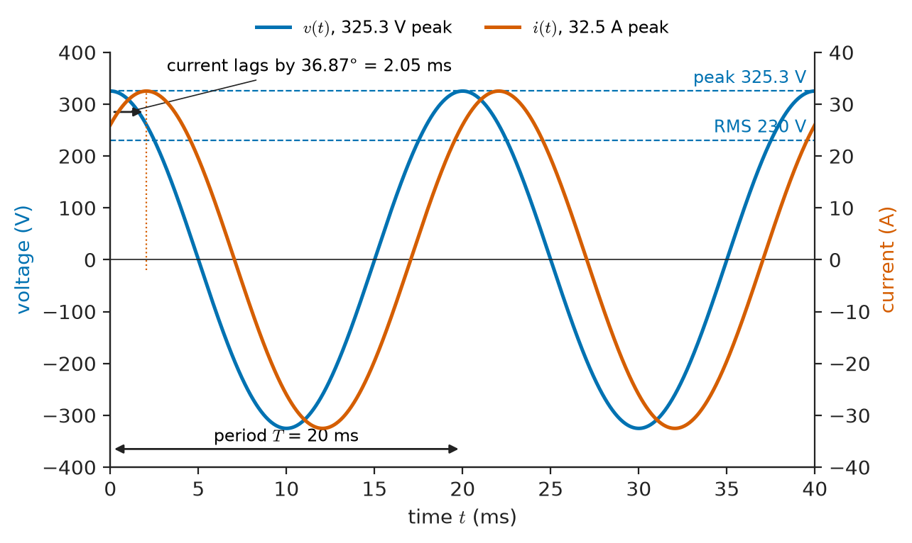
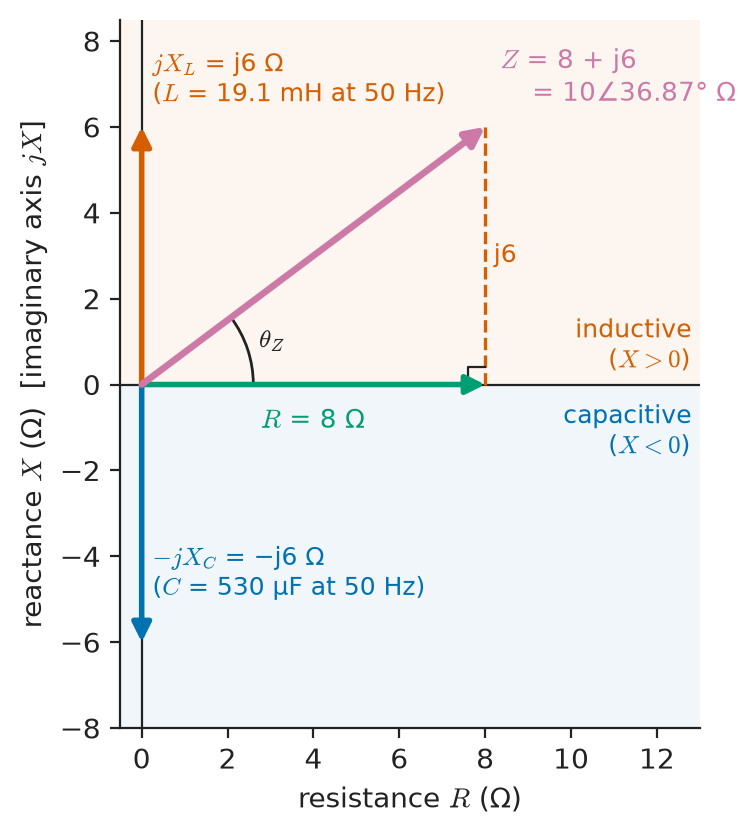
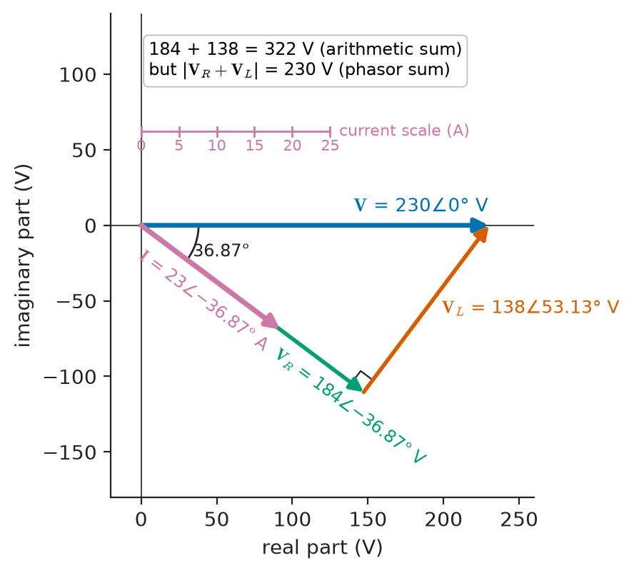
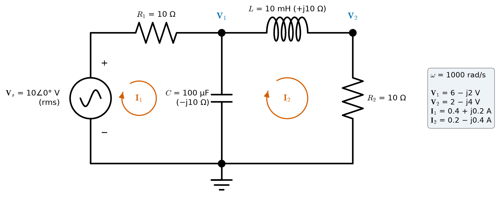
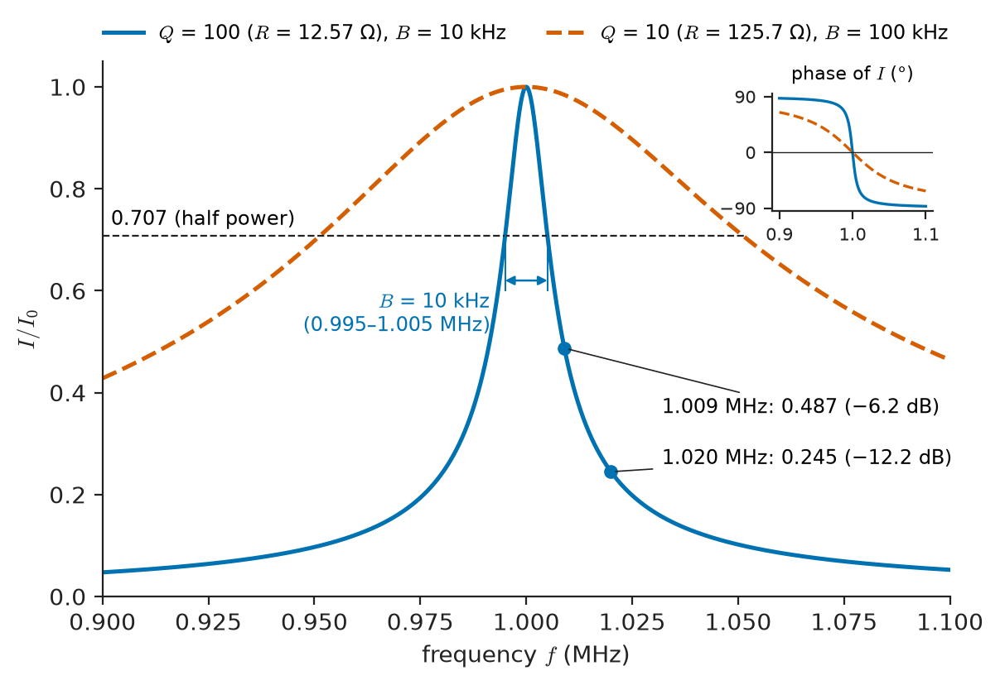
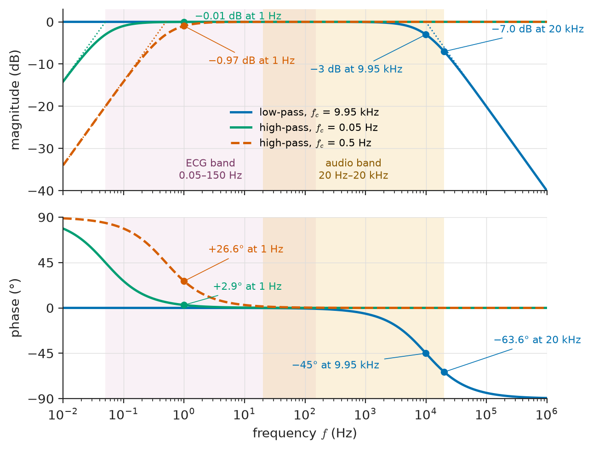

# Chapter 8 — Sinusoidal Steady-State Analysis

*Part II · Transient and AC Analysis*

A maintenance electrician clamps a meter on the supply to a workshop air compressor and reads 230 V and 23 A. Multiplying, she expects the motor to be drawing 5.29 kW, yet the plug-in energy monitor in the circuit says 4.23 kW, and the motor nameplate says nothing about either number. No instrument is faulty. The current is not in step with the voltage: it reaches its peak about 2 ms after the voltage does, and for part of every cycle energy flows back from the motor's magnetic field into the supply. A cardiologist meets the same mathematics from the other side. On a bedside monitor an ECG shows the ST segment displaced, suggesting ischaemia, but the same patient's diagnostic 12-lead recording looks normal. The monitor's input filter, set to remove baseline wander, passes the slow components of the heartbeat with the wrong amplitude and a phase shift of tens of degrees, and that distorts the waveform shape.

Both problems involve circuits driven by sinusoids long enough for every transient of Chapters 6 and 7 to have died away: the **sinusoidal steady state**. In this regime the differential equations of the last two chapters collapse into algebra with complex numbers, and the whole of DC circuit analysis (Chapters 2–4) can be reused with resistances replaced by complex impedances.

> **Why can a linear circuit driven by a sinusoid be analysed with complex numbers instead of differential equations?**
> **How are currents, voltages, resonances, frequency responses and power found in AC circuits, and what does "230 V" actually mean?**

| Concept | Engineering destination |
|---|---|
| Sinusoidal excitation | Mains supplies, test tones, carriers, sensor excitation |
| RMS and average values | Mains ratings, meter readings, heating of cables and resistors, PWM drives |
| Phasors | Every AC calculation in power, electronics and telecom |
| Complex impedance | Motor and transformer equivalent circuits, filter design, cable loading |
| Admittance | Parallel loads, power-factor correction, network admittance matrices |
| AC nodal and mesh analysis | Multi-source AC networks, bridge circuits, power-flow equations |
| Series and parallel AC circuits | Load modelling, crossover networks, LC filters |
| Resonance | Radio tuning, tank circuits, harmonic filters, wireless charging |
| Frequency response | Audio filters, ECG and EEG front ends, anti-alias filters, instrument bandwidth |
| Power calculations | Load ratings, efficiency, meter readings (developed in Chapter 9) |

**Roadmap.** Sinusoids and why they matter (8.1) → measuring their size with RMS and average values (8.2) → phasors (8.3) → impedance (8.4) and admittance (8.5) → series and parallel AC circuits (8.6) → nodal and mesh analysis in the phasor domain (8.7) → resonance (8.8) → frequency response (8.9) → average power from phasors (8.10) → the limits of the method (8.11).

---

## 8.1 Sinusoidal excitation

### Why sinusoids

Sinusoids deserve a chapter of their own for three reasons.

1. **They are what generators produce.** A coil rotating at constant speed in a uniform magnetic field produces a sinusoidal EMF; every synchronous generator in a power system is designed to approximate this. Oscillators in radios, function generators and sensor excitation circuits produce sinusoids because a lightly damped resonator (Chapter 7) naturally rings sinusoidally.
2. **They pass through linear circuits unchanged in shape.** Differentiating or integrating a sinusoid gives a sinusoid of the same frequency. A linear, time-invariant circuit driven by a sinusoid therefore responds, in steady state, with a sinusoid of the same frequency; only amplitude and phase change. In the language of Chapter 17, complex exponentials are the **eigenfunctions** of linear time-invariant systems.
3. **Everything else can be built from them.** Fourier's theorem (Chapter 18) represents periodic waveforms as sums of sinusoids, and aperiodic ones as integrals over sinusoids. Knowing a circuit's response to every sinusoid is knowing its response to everything.

### Parameters of a sinusoid

A sinusoidal voltage is written

$$
v(t)=V_m\cos(\omega t+\theta)
$$

where $V_m$ is the **amplitude** (peak value), $\omega=2\pi f$ the **angular frequency** in rad/s, $f=1/T$ the frequency in hertz, $T$ the period and $\theta$ the **phase angle**. This book uses the cosine as the reference; a sine is a cosine delayed by 90°: $\sin\omega t=\cos(\omega t-90^\circ)$. Mixing degrees and radians inside $\omega t+\theta$ is common in engineering practice and harmless as long as the conversion is made before evaluating.

Two sinusoids of the same frequency differ only in amplitude and phase. If $v=V_m\cos(\omega t+\theta_v)$ and $i=I_m\cos(\omega t+\theta_i)$, the voltage **leads** the current by $\theta_v-\theta_i$ when that difference is positive: its peaks occur earlier. A phase difference $\phi$ corresponds to a time shift $\Delta t=\phi/\omega$; at 50 Hz, 36.87° is 2.05 ms, the lag the electrician's compressor current showed.

<!-- FIGURE 8.1 | figures/ch08/fig-8-1-sinusoid-parameters.png | plot | A 230 V, 50 Hz mains voltage and the 23 A current of an inductive load lagging it by 36.87 degrees. | Content: time axis 0 to 40 ms (two cycles). Left axis voltage -400 to +400 V: v(t) = 325.3 cos(2 pi 50 t) with peak 325.3 V, period T = 20 ms and RMS level 230 V marked by dashed horizontal lines. Right axis current -40 to +40 A: i(t) = 32.5 cos(2 pi 50 t - 36.87 deg). Arrow between voltage peak at t = 0 and current peak at 2.05 ms labelled current lags by 36.87 deg = 2.05 ms. -->

*Figure 8.1 — A 230 V, 50 Hz mains voltage and the 23 A current of an inductive load lagging it by 36.87 degrees.*

### Frequencies across EEE

**Table 8.1 — Representative sinusoidal frequencies.**

| Application | Frequency | Notes |
|---|---|---|
| Public mains supply | 50 Hz (Europe, Asia, Africa, Australia), 60 Hz (Americas, parts of Asia) | Held within about ±0.2 Hz in large grids |
| Railway traction (some European systems) | 16.7 Hz | Legacy low-frequency AC |
| Aircraft electrical systems | 400 Hz | Lighter transformers and generators |
| Audio test tone | 1 kHz | Audio band 20 Hz–20 kHz |
| Induction heating, wireless EV charging | 10–100 kHz (EV charging about 85 kHz) | Resonant converters |
| Medical ultrasound | 2–15 MHz | Piezoelectric transducers |
| AM broadcast (medium wave) | 530–1700 kHz | Channel spacing 9 or 10 kHz |
| FM broadcast | 88–108 MHz | |
| Cellular, Wi-Fi | 0.7–6 GHz | e.g. Wi-Fi 2.4 GHz and 5 GHz bands |
| Automotive radar | 76–81 GHz | |

### When is a circuit in steady state?

Switching a sinusoidal source onto a circuit produces, as Chapters 6 and 7 showed, a forced response plus a natural response. The natural response decays with the circuit's time constants (or as $e^{-\alpha t}$ for second-order circuits), and once it has gone only the forced sinusoid remains. "Steady state" therefore means "several of the slowest time constants after the last disturbance". For a mains-frequency motor circuit with $L/R$ of a few milliseconds that is a few cycles; for a high-$Q$ crystal it may be milliseconds to seconds. Everything in this chapter assumes that this has happened. Switching transients, inrush and start-up are the province of Chapters 6, 7 and 11.

---

## 8.2 RMS and average values

### Average value

The **average** (mean, DC) value of a periodic waveform is

$$
V_{avg}=\frac1T\int_0^Tv(t)\,dt
$$

A pure sinusoid has zero average. Rectified waveforms do not: a half-wave rectified sine of peak $V_m$ has average $V_m/\pi$, a full-wave rectified sine $2V_m/\pi$. The average is what a moving-coil (d'Arsonval) meter responds to, what charges a battery, what electroplates a metal, and what an ideal low-pass filter extracts.

### RMS value

For heating, the average is the wrong measure: a resistor heats equally for positive and negative current. The **root-mean-square** (effective) value is defined as the DC value that would dissipate the same average power in a resistor:

$$
\frac{V_{rms}^2}{R}=\frac1T\int_0^T\frac{v^2(t)}{R}\,dt
\quad\Rightarrow\quad
V_{rms}=\sqrt{\frac1T\int_0^Tv^2(t)\,dt}
$$

For a sinusoid, the average of $\cos^2$ over a period is $\tfrac12$, so

$$
V_{rms}=\frac{V_m}{\sqrt2}\approx0.707\,V_m
$$

Mains voltages are always quoted as RMS: "230 V" means a peak of $230\sqrt2=325.3$ V and a peak-to-peak swing of 650.5 V; "120 V" means a peak of 169.7 V. Insulation, capacitors and semiconductors on mains equipment must therefore be rated for the peak, not the RMS value, plus transients.

> **Status of the principle: RMS as the heating-equivalent value**
> *Derived.* It follows from Joule heating $p=v^2/R$ and the definition of average power; it is exact for any waveform in a linear resistor whose resistance does not change during the cycle.

If a waveform is a sum of components at different frequencies (including DC), the cross terms average to zero over a common period and the RMS values add in quadrature:

$$
V_{rms}=\sqrt{V_0^2+V_{1,rms}^2+V_{2,rms}^2+\cdots}
$$

This result underpins the treatment of harmonics in Chapter 9 and of noise power in Chapter 29.

### Form factor and crest factor

Two ratios describe the shape of a waveform:

$$
\text{form factor}=\frac{V_{rms}}{\lvert V\rvert_{avg}},\qquad \text{crest factor}=\frac{V_{peak}}{V_{rms}}
$$

where $\lvert V\rvert_{avg}$ is the average of the rectified waveform.

**Table 8.2 — RMS, rectified average, form factor and crest factor of common waveforms (peak $V_m$).**

| Waveform | RMS | Rectified average | Form factor | Crest factor |
|---|---|---|---|---|
| Sine | $V_m/\sqrt2=0.707V_m$ | $2V_m/\pi=0.637V_m$ | 1.111 | 1.414 |
| Full-wave rectified sine | $0.707V_m$ | $0.637V_m$ | 1.111 | 1.414 |
| Half-wave rectified sine | $V_m/2$ | $V_m/\pi=0.318V_m$ | 1.571 | 2.0 |
| Square (±$V_m$) | $V_m$ | $V_m$ | 1.0 | 1.0 |
| Triangle or sawtooth | $V_m/\sqrt3=0.577V_m$ | $V_m/2$ | 1.155 | 1.732 |
| Unipolar pulse train, duty $D$ | $V_m\sqrt D$ | $DV_m$ | $1/\sqrt D$ | $1/\sqrt D$ |
| Rectifier–capacitor (SMPS) input current | — | — | typically 1.5–2.5 | typically 2.5–3.5 |

**Worked example — True RMS versus average-responding meters.** Many low-cost multimeters measure the rectified average and multiply by 1.111 — the form factor of a sine — to display "RMS". What do they show for other waveforms?

For a square wave of peak 1 V, the rectified average is 1 V, so the meter shows 1.111 V; the true RMS is 1 V, an error of +11.1 %. For a triangle wave of peak 1 V, the average is 0.5 V, so the meter shows 0.555 V against a true 0.577 V, −3.8 %. For a half-wave rectified sine of peak 1 V (AC coupled readings aside), the average is 0.318 V, the display 0.354 V, the true RMS 0.5 V: −29 %. For a 12 V PWM drive at 25 % duty, a DC meter reads the average, 3 V, while the heating in a resistive load corresponds to $12\sqrt{0.25}=6$ V RMS — four times the power the average would suggest. This is why electricians checking variable-speed drives, dimmers and switch-mode supplies use **true-RMS** instruments, which compute $\sqrt{\overline{v^2}}$ from samples or with a thermal or analog-computing converter. Even these are specified only up to a stated crest factor (typically 3 at full scale) and bandwidth.

---

## 8.3 Phasors

### The idea

Solving a circuit with sinusoidal sources directly in the time domain means substituting $A\cos(\omega t+\phi)$ into the differential equations and grinding through trigonometric identities. The phasor method replaces this with complex arithmetic, based on Euler's formula

$$
e^{j\phi}=\cos\phi+j\sin\phi
$$

A sinusoid can be written as the real part of a rotating complex number:

$$
v(t)=V_m\cos(\omega t+\theta)=\mathrm{Re}\left\{V_me^{j\theta}e^{j\omega t}\right\}
$$

All voltages and currents in a linear circuit in sinusoidal steady state share the same factor $e^{j\omega t}$. Only the complex constant in front — amplitude and phase — differs from one variable to another. That constant is the **phasor**.

### RMS phasors

This book uses **RMS phasors**, written in bold, because they make the power formulas of Section 8.10 and Chapter 9 free of factors of $\tfrac12$:

$$
v(t)=\sqrt2\,V\cos(\omega t+\theta)\quad\longleftrightarrow\quad \mathbf V=Ve^{j\theta}=V\angle\theta
$$

where $V$ is the RMS value. The reverse step is $v(t)=\mathrm{Re}\{\sqrt2\,\mathbf Ve^{j\omega t}\}$. Many circuit-theory texts use amplitude (peak) phasors instead; the analysis is identical, only power formulas pick up a factor $\tfrac12$. Whichever convention is used, it must be used consistently in a calculation.

Phasors can be written in polar form $V\angle\theta$ or rectangular form $a+jb$, with $V=\sqrt{a^2+b^2}$, $\theta=\arctan(b/a)$ (in the correct quadrant). Addition is easiest in rectangular form, multiplication and division in polar form. The algebra of complex numbers itself is covered in *The Mathematics Universe*.

### Two properties that make phasors work

**Linearity.** The phasor of a sum of same-frequency sinusoids is the sum of their phasors. KCL and KVL, which are sums of currents and voltages, therefore hold for phasors exactly as for instantaneous values:

$$
\sum_k\mathbf I_k=0\ \text{at a node},\qquad \sum_k\mathbf V_k=0\ \text{around a loop}
$$

**Differentiation becomes multiplication by $j\omega$.** Since $\frac{d}{dt}e^{j\omega t}=j\omega e^{j\omega t}$,

$$
\frac{dv}{dt}\ \longleftrightarrow\ j\omega\mathbf V,\qquad \int v\,dt\ \longleftrightarrow\ \frac{\mathbf V}{j\omega}
$$

Multiplying by $j$ rotates a phasor by +90°; dividing by $j$ rotates it by −90°. A differential equation in the time domain thus becomes an algebraic equation in the phasor domain.

> **Status of the principle: Phasor transformation**
> *Derived.* It follows from linearity and time invariance of the circuit and from the eigenfunction property of $e^{j\omega t}$; it is exact for linear time-invariant circuits in sinusoidal steady state at a single frequency, and gives nothing about transients.

### Phasor diagrams

A **phasor diagram** draws the phasors as arrows in the complex plane. It shows at a glance which quantity leads and which lags, and it makes KVL and KCL visible as closed polygons of arrows. Power engineers draw them for every machine and line; instrumentation engineers use them for bridges and lock-in amplifiers. Figure 8.3 shows the diagram for the compressor of the opening, solved in the next section.

---

## 8.4 Complex impedance

### Impedance of R, L and C

Apply the phasor rules to the three constitutive laws:

$$
v=Ri\ \to\ \mathbf V=R\,\mathbf I,\qquad
v=L\frac{di}{dt}\ \to\ \mathbf V=j\omega L\,\mathbf I,\qquad
i=C\frac{dv}{dt}\ \to\ \mathbf V=\frac{1}{j\omega C}\,\mathbf I
$$

Each is an "Ohm's law" $\mathbf V=Z\mathbf I$ with a complex **impedance** $Z$:

$$
Z_R=R,\qquad Z_L=j\omega L,\qquad Z_C=\frac{1}{j\omega C}=-\frac{j}{\omega C}
$$

In a resistor, voltage and current are in phase. In an inductor, the voltage leads the current by 90° (the current builds up only after voltage has been applied). In a capacitor, the current leads the voltage by 90° (charge must flow before voltage appears). The mnemonic "ELI the ICE man" — E leads I in an L, I leads E in a C — has served generations of electricians.

A general two-terminal impedance is written

$$
Z=R+jX=\lvert Z\rvert\angle\theta_Z
$$

where $R$ is the **resistance** and $X$ the **reactance**, both in ohms. Inductive reactance $X_L=\omega L$ is positive; capacitive reactance $X_C=-1/(\omega C)$ is negative. The impedance angle $\theta_Z$ is the angle by which voltage leads current. Figure 8.2 places these impedances in the complex plane: inductive impedances lie in the upper half, capacitive ones in the lower. The resistance $R=\mathrm{Re}\{Z\}$ of a composite impedance is in general *not* the resistance of any single resistor; it is whatever real part results from the combination.

<!-- FIGURE 8.2 | figures/ch08/fig-8-2-impedance-plane.png | phasor | Impedances in the complex plane: resistor, inductor, capacitor and the 8 + j6 ohm compressor load. | Content: axes R (horizontal, 0 to 12 ohm) and jX (vertical, -8 to +8 ohm). Arrow along positive real axis labelled R = 8 ohm; arrow up labelled jX_L = j6 ohm (L = 19.1 mH at 50 Hz); arrow down labelled -jX_C for a 530 uF capacitor (-j6 ohm). Resultant arrow 8 + j6 = 10 at 36.87 deg drawn as hypotenuse of impedance triangle, angle theta_Z marked. Upper half-plane shaded inductive, lower half-plane capacitive. -->

*Figure 8.2 — Impedances in the complex plane: resistor, inductor, capacitor and the 8 + j6 ohm compressor load.*

**Table 8.3 — Magnitude of reactance at representative frequencies.**

| Component | 50 Hz | 1 kHz | 1 MHz |
|---|---|---|---|
| 1 µH (a few cm of wire or a small SMD inductor) | 0.31 mΩ | 6.3 mΩ | 6.3 Ω |
| 10 mH (audio or mains choke) | 3.14 Ω | 62.8 Ω | 62.8 kΩ |
| 100 nF (decoupling capacitor) | 31.8 kΩ | 1.59 kΩ | 1.59 Ω |
| 1 µF | 3.18 kΩ | 159 Ω | 0.16 Ω |
| 100 µF (electrolytic) | 31.8 Ω | 1.59 Ω | 1.6 mΩ (ESR and ESL dominate) |

Table 8.3 explains much practical folklore: a 100 nF capacitor is practically an open circuit at mains frequency but a short at radio frequencies, which is why it decouples digital supplies; a few centimetres of wire are irrelevant at 50 Hz and decisive at 100 MHz (Chapter 7's probe). At high frequency every real capacitor has series inductance and every real inductor parallel capacitance (Chapter 5), and the simple impedances above apply only below self-resonance.

> **Status of the principle: Impedance of ideal R, L and C**
> *Derived.* Exact for ideal lumped linear elements in sinusoidal steady state; *approximate* for real components, whose parasitic elements, skin effect and dielectric loss make $R$ and $X$ depend on frequency in more complex ways.

### Impedances combine like resistances

Because KVL and KCL hold for phasors and every element obeys $\mathbf V=Z\mathbf I$, all the DC network rules of Chapters 2–4 carry over with $R$ replaced by $Z$: series impedances add, parallel admittances add, voltage and current dividers, source transformations, Thévenin and Norton equivalents, superposition (for sources at the same frequency), nodal and mesh analysis. The only change is that the arithmetic is complex.

<!-- FIGURE 8.3 | figures/ch08/fig-8-3-rl-phasor-diagram.png | phasor | Phasor diagram of the compressor modelled as R = 8 ohm in series with X_L = 6 ohm on a 230 V, 50 Hz supply. | Content: complex plane with voltage scale 0 to 250 V and current scale 0 to 25 A. Reference V = 230 at 0 deg along real axis. I = 23 A at -36.87 deg. V_R = 184 V at -36.87 deg in phase with I; V_L = 138 V at +53.13 deg drawn tip-to-tail from the end of V_R, closing the triangle on V. Right angle between V_R and V_L marked; angle 36.87 deg between V and I marked. Note: 184 + 138 = 322 V arithmetic sum but phasor sum 230 V. -->

*Figure 8.3 — Phasor diagram of the compressor modelled as R = 8 ohm in series with X_L = 6 ohm on a 230 V, 50 Hz supply.*

**Worked example — The compressor as a series RL load.** Model the compressor of the opening as $R=8\ \Omega$ in series with $L=19.1$ mH on a 230 V, 50 Hz supply. Find the current and the element voltages.

The reactance is $X_L=\omega L=2\pi\times50\times0.0191=6.00\ \Omega$, so

$$
Z=8+j6=10\angle36.87^\circ\ \Omega
$$

Taking the supply as reference, $\mathbf V=230\angle0^\circ$ V:

$$
\mathbf I=\frac{\mathbf V}{Z}=\frac{230\angle0^\circ}{10\angle36.87^\circ}=23\angle-36.87^\circ\ \mathrm A=18.4-j13.8\ \mathrm A
$$

$$
\mathbf V_R=R\mathbf I=184\angle-36.87^\circ\ \mathrm V,\qquad \mathbf V_L=jX_L\mathbf I=138\angle53.13^\circ\ \mathrm V
$$

The two element voltages add to 322 V arithmetically but to 230 V as phasors, because they are 90° apart: $\sqrt{184^2+138^2}=230$. A voltmeter placed across each in turn would read 184 V and 138 V, which confuses anyone expecting KVL to hold for RMS readings. KVL holds for phasors and instantaneous values, never for RMS magnitudes. Figure 8.3 shows the closed triangle. The 36.87° lag (2.05 ms at 50 Hz) is the one in Figure 8.1, and the reason the meter product $230\times23=5290$ disagrees with the 4232 W energy monitor is the subject of Section 8.10.

---

## 8.5 Admittance

### Definition

The reciprocal of impedance is the **admittance**

$$
Y=\frac1Z=\frac{\mathbf I}{\mathbf V}=G+jB
$$

measured in siemens (S). Its real part $G$ is the **conductance** and its imaginary part $B$ the **susceptance**. For the ideal elements:

$$
Y_R=\frac1R=G,\qquad Y_L=\frac{1}{j\omega L}=-\frac{j}{\omega L},\qquad Y_C=j\omega C
$$

An inductor has negative susceptance, a capacitor positive — the opposite signs to their reactances.

### Converting between impedance and admittance

For $Z=R+jX$,

$$
Y=\frac{1}{R+jX}=\frac{R}{R^2+X^2}-j\frac{X}{R^2+X^2}
$$

so $G=R/(R^2+X^2)$ and $B=-X/(R^2+X^2)$. The conductance of a series RL branch is **not** $1/R$ unless $X=0$. For the compressor, $Z=8+j6\ \Omega$ gives

$$
Y=\frac{8-j6}{100}=0.08-j0.06\ \mathrm S
$$

### Why admittance is useful

Parallel admittances add, exactly as parallel conductances do. Power systems are full of loads in parallel across a common supply, so power engineers reason with admittances. The network **admittance matrix** $\mathbf Y_{bus}$ of a power system — the AC version of the nodal conductance matrix of Chapter 3 — is the starting point of every load-flow study.

Admittance also makes one fact plain: the compressor's admittance $0.08-j0.06$ S is the same as a conductance of 0.08 S ($R_p=12.5\ \Omega$) in **parallel** with an inductive susceptance of −0.06 S ($X_p=16.67\ \Omega$). At a single frequency, any series RX branch has an equivalent parallel RX pair, and vice versa. The equivalence holds only at that frequency: change $\omega$ and the two models diverge.

> **Status of the principle: Series–parallel equivalence at one frequency**
> *Derived.* Two impedances with equal complex values are indistinguishable at that frequency; the equivalence breaks at other frequencies because the element values scale differently with $\omega$.

---

## 8.6 Series and parallel AC circuits

### Series circuits and the voltage divider

Impedances in series add:

$$
Z_{eq}=Z_1+Z_2+\cdots+Z_n
$$

and the voltage divides in proportion to impedance:

$$
\mathbf V_k=\frac{Z_k}{Z_{eq}}\mathbf V
$$

Because the impedances are complex, the divided voltages can have different phases from the source, and an individual element voltage can exceed the source voltage when inductive and capacitive reactances partly cancel in $Z_{eq}$ — the voltage magnification of a series resonance (Section 8.8).

### Parallel circuits and the current divider

Admittances in parallel add, $Y_{eq}=Y_1+Y_2+\cdots$, and currents divide in proportion to admittance:

$$
\mathbf I_k=\frac{Y_k}{Y_{eq}}\mathbf I
$$

For two branches, $Z_{eq}=Z_1Z_2/(Z_1+Z_2)$ and $\mathbf I_1=\mathbf I\,Z_2/(Z_1+Z_2)$, as for resistors.

**Worked example — A capacitor across the compressor.** A capacitor is connected across the compressor terminals so that the supply current is in phase with the voltage. What capacitance is needed, and what does the supply current become?

The compressor admittance is $0.08-j0.06$ S. Adding a capacitor $Y_C=j\omega C$ in parallel cancels the susceptance if $\omega C=0.06$ S:

$$
C=\frac{0.06}{2\pi\times50}=191\ \mu\mathrm F
$$

Then $Y_{eq}=0.08$ S, purely real, and $\mathbf I_{supply}=230\times0.08=18.4\angle0^\circ$ A. The compressor still draws 23 A at −36.87°, and the capacitor draws $230\times0.06=13.8\angle90^\circ$ A; these add as phasors to 18.4 A. The supply current has dropped from 23 A to 18.4 A with no change in what the motor does — the essence of **power-factor correction**, which Chapter 9 develops properly, including why a capacitor this large is rarely fitted to a single small motor.

### Series–parallel reduction and AC Thévenin equivalents

Any ladder of impedances can be reduced step by step, exactly as resistive networks were in Chapter 2. Likewise, any linear two-terminal AC network at a single frequency has a Thévenin equivalent $\mathbf V_{th}$ in series with $Z_{th}$ (or a Norton equivalent $\mathbf I_N$ in parallel with $Y_N$), found by the methods of Chapter 4 with complex arithmetic. The power-system "fault level" used in Chapter 7's capacitor-bank example is an AC Thévenin impedance in disguise: $Z_{th}\approx jV^2/S_{sc}$.

---

## 8.7 AC nodal and mesh analysis

### The method

The systematic methods of Chapter 3 apply unchanged:

- **Nodal analysis.** Choose a reference node, write KCL at each other node in terms of node-voltage phasors and branch admittances, and solve $\mathbf Y\mathbf V=\mathbf I_s$, where $\mathbf Y$ is the complex nodal admittance matrix.
- **Mesh analysis.** Assign mesh-current phasors, write KVL around each mesh with branch impedances, and solve $\mathbf Z\mathbf I=\mathbf V_s$.

Supernodes, supermeshes and dependent sources are handled as in Chapter 3. For passive reciprocal networks the matrices are symmetric, as in the DC case; they are now complex. A computer solves them with the same linear-algebra routines, in complex arithmetic.

<!-- FIGURE 8.4 | figures/ch08/fig-8-4-nodal-mesh-example.png | circuit | Two-node AC circuit used for nodal and mesh analysis at omega = 1000 rad/s. | Content: voltage source V_s = 10 at 0 deg V rms on the left, series resistor R1 = 10 ohm to node 1; capacitor C = 100 uF (-j10 ohm) from node 1 to ground; inductor L = 10 mH (+j10 ohm) from node 1 to node 2; resistor R2 = 10 ohm from node 2 to ground. Node voltages V1 and V2 labelled; mesh currents I1 (left loop through V_s, R1, C) and I2 (right loop through C, L, R2) drawn clockwise. Results in a small box: V1 = 6 - j2 V, V2 = 2 - j4 V, I1 = 0.4 + j0.2 A, I2 = 0.2 - j0.4 A. -->

*Figure 8.4 — Two-node AC circuit used for nodal and mesh analysis at omega = 1000 rad/s.*

**Worked example — Nodal and mesh analysis of a two-node circuit.** In Figure 8.4 a source $\mathbf V_s=10\angle0^\circ$ V (RMS) at $\omega=1000$ rad/s drives $R_1=10\ \Omega$ into node 1; node 1 has $C=100\ \mu$F to ground and $L=10$ mH to node 2; node 2 has $R_2=10\ \Omega$ to ground. Find all node voltages and branch currents.

*Impedances:* $Z_C=1/(j\times1000\times10^{-4})=-j10\ \Omega$; $Z_L=j\times1000\times0.01=j10\ \Omega$.

*Nodal equations.* KCL at node 1 (currents leaving):

$$
\frac{\mathbf V_1-10}{10}+\frac{\mathbf V_1}{-j10}+\frac{\mathbf V_1-\mathbf V_2}{j10}=0
$$

KCL at node 2:

$$
\frac{\mathbf V_2-\mathbf V_1}{j10}+\frac{\mathbf V_2}{10}=0
$$

Multiplying both by 10 and using $1/j=-j$:

$$
\begin{aligned}
(1+j-j)\mathbf V_1+j\mathbf V_2&=10\\
j\mathbf V_1+(1-j)\mathbf V_2&=0
\end{aligned}
$$

The capacitor and inductor admittances at node 1 cancel, which leaves $\mathbf V_1=10-j\mathbf V_2$. From the second equation, $\mathbf V_1=-(1-j)\mathbf V_2/j=(1+j)\mathbf V_2$. Equating, $(1+j)\mathbf V_2=10-j\mathbf V_2$, so $(1+2j)\mathbf V_2=10$ and

$$
\mathbf V_2=\frac{10}{1+2j}=2-j4=4.47\angle-63.43^\circ\ \mathrm V,\qquad
\mathbf V_1=(1+j)(2-j4)=6-j2=6.32\angle-18.43^\circ\ \mathrm V
$$

*Branch currents:* source current $(10-\mathbf V_1)/10=0.4+j0.2$ A; capacitor current $\mathbf V_1/(-j10)=0.2+j0.6$ A; inductor and $R_2$ current $\mathbf V_2/10=0.2-j0.4$ A. KCL at node 1 checks: $(0.2+j0.6)+(0.2-j0.4)=0.4+j0.2$.

*Mesh check.* With $\mathbf I_1$ in the left mesh and $\mathbf I_2$ in the right:

$$
\begin{bmatrix}10-j10 & j10\\ j10 & 10\end{bmatrix}
\begin{bmatrix}\mathbf I_1\\ \mathbf I_2\end{bmatrix}=
\begin{bmatrix}10\\0\end{bmatrix}
$$

(the right-mesh self-impedance is $-j10+j10+10=10\ \Omega$). Solving gives $\mathbf I_1=0.4+j0.2$ A and $\mathbf I_2=0.2-j0.4$ A, and the capacitor current $\mathbf I_1-\mathbf I_2=0.2+j0.6$ A, matching the nodal result. The input impedance seen by the source is $10/(0.4+j0.2)=20-j10\ \Omega$: net capacitive, even though the circuit contains equal reactances, because of where they sit.

### Sources at different frequencies

Phasors are tied to one frequency. If a circuit contains sources at different frequencies — a 50 Hz supply and a 150 Hz harmonic current, or an audio signal and a DC bias — each frequency must be solved separately with its own impedances, and the **time-domain** results added (superposition). Adding phasors of different frequencies is meaningless. DC is just the case $\omega=0$, where inductors are shorts and capacitors opens.

> **Status of the principle: AC nodal and mesh analysis**
> *Derived.* KCL and KVL hold for phasors, and every element obeys $\mathbf V=Z\mathbf I$; the methods are exact for linear time-invariant circuits at a single frequency.

---

## 8.8 Resonance

### Series resonance

The impedance of a series RLC branch is

$$
Z(j\omega)=R+j\left(\omega L-\frac{1}{\omega C}\right)
$$

The reactance vanishes at

$$
\omega_0=\frac{1}{\sqrt{LC}}
$$

the natural frequency of Chapter 7. At this **series resonance** the impedance is a minimum, equal to $R$, the current is maximum and in phase with the source, and the voltages across $L$ and $C$ are equal and opposite, each of magnitude

$$
V_L=V_C=\frac{\omega_0L}{R}V=QV,\qquad Q=\frac{\omega_0L}{R}=\frac1R\sqrt{\frac LC}
$$

Below $\omega_0$ the branch is capacitive; above it, inductive.

### Bandwidth

As the frequency moves away from $\omega_0$ the reactance grows and the current falls. The **half-power frequencies** $\omega_1$ and $\omega_2$ are where $\lvert X\rvert=R$, the current is $1/\sqrt2$ of its peak, and the power in $R$ is half its peak. Their separation is the **bandwidth**

$$
B=\omega_2-\omega_1=\frac{R}{L}=\frac{\omega_0}{Q}
$$

and $\omega_0=\sqrt{\omega_1\omega_2}$ (the resonance is at the geometric mean). Exactly, $\omega_{1,2}=\mp\frac{R}{2L}+\sqrt{\left(\frac{R}{2L}\right)^2+\omega_0^2}$; for $Q\gtrsim10$ the curve is nearly symmetric and $\omega_{1,2}\approx\omega_0\mp B/2$.

> **Status of the principle: Bandwidth–Q relation $B=\omega_0/Q$**
> *Derived.* Exact for the half-power bandwidth of an ideal series or parallel RLC; the symmetric approximation $\omega_0\pm B/2$ is *approximate*, good for $Q$ above about 10.

<!-- FIGURE 8.5 | figures/ch08/fig-8-5-resonance-curves.png | plot | Normalised current of a series RLC versus frequency for Q = 10 and Q = 100, centred on the 1 MHz AM tuner example. | Content: x-axis frequency 0.9 to 1.1 MHz (linear), y-axis I/I0 from 0 to 1.05. Q = 100 curve (R = 12.57 ohm, L = 200 uH, C = 126.7 pF) with half-power points at about 0.995 and 1.005 MHz, bandwidth 10 kHz marked; points at adjacent channel 1.009 MHz (I/I0 = 0.49, -6.2 dB) and 1.02 MHz (0.245, -12.2 dB). Q = 10 curve much broader, bandwidth 100 kHz. Horizontal dashed line at 0.707. Inset: phase of current from +90 to -90 deg versus frequency for both Q values. -->

*Figure 8.5 — Normalised current of a series RLC versus frequency for Q = 10 and Q = 100, centred on the 1 MHz AM tuner example.*

**Worked example — AM receiver tuning circuit.** An AM receiver's antenna circuit uses $L=200\ \mu$H with an effective series resistance of $R=12.57\ \Omega$. What capacitance tunes it to a station at 1 MHz, what are $Q$ and the bandwidth, and how well does it reject a station 9 kHz away?

$$
C=\frac{1}{(2\pi f_0)^2L}=\frac{1}{(2\pi\times10^6)^2\times200\times10^{-6}}=126.7\ \mathrm{pF}
$$

$$
X_L=2\pi f_0L=1257\ \Omega,\qquad Q=\frac{X_L}{R}=100,\qquad B=\frac{f_0}{Q}=10\ \mathrm{kHz}
$$

Figure 8.5 plots the resonance curve. At the adjacent European channel, 1.009 MHz, the current ratio is $R/\lvert Z\rvert=0.487$ (−6.2 dB); at 1.02 MHz it is 0.245 (−12.2 dB); at 1.1 MHz, 0.052 (−25.6 dB). A single tuned circuit therefore gives only modest adjacent-channel rejection — which is exactly why practical receivers use the superheterodyne principle (Chapter 26) to do their selectivity at a fixed intermediate frequency with several cascaded resonators. A 1 mV signal at resonance appears as $Q\times1$ mV $=100$ mV across the capacitor: the tuned circuit is also a passive voltage amplifier. Covering the medium-wave band 530–1700 kHz with this inductor needs a variable capacitor from about 44 pF to 451 pF.

### Parallel resonance

Dually, a parallel RLC has admittance $Y=G+j(\omega C-1/(\omega L))$, which is minimum (impedance maximum, equal to $R$) at the same $\omega_0$. At **parallel resonance** the currents in $L$ and $C$ are $Q$ times the source current and circulate between them, while the line current is small; $Q=R/(\omega_0L)=R\sqrt{C/L}$ and again $B=\omega_0/Q$.

A real tank is usually a capacitor in parallel with a coil that has series resistance $r$. For $Q_L=\omega_0L/r\gg1$ it behaves like an ideal parallel tank with a **dynamic resistance**

$$
R_D\approx\frac{L}{Cr}=Q_L^2r
$$

For example, a 10 kHz tank with $L=1$ mH, $r=5\ \Omega$ and $C=253$ nF has $Q_L=12.6$ and $R_D=790\ \Omega$: the resonant impedance is 158 times the coil's resistance. Parallel resonance is used in tuned amplifiers and oscillator tanks; it is also what makes harmonic resonance between capacitor banks and network inductance dangerous (Chapter 7) — at resonance a small harmonic current produces a large voltage.

> **Boundary.** Quality factor, bandwidth and the design of passive and active filters around resonant circuits are developed in Chapter 13. Microwave resonators, where the lumped model is replaced by cavities and lines, are in Chapter 32.

---

## 8.9 Frequency response

### Transfer function in the sinusoidal steady state

Most circuits are used as signal processors: an input sinusoid produces an output sinusoid of the same frequency, scaled and shifted. The ratio of output phasor to input phasor, as a function of frequency, is the **frequency response**

$$
H(j\omega)=\frac{\mathbf V_{out}}{\mathbf V_{in}}=\lvert H(j\omega)\rvert\,\angle\phi(\omega)
$$

$\lvert H\rvert$ is the **magnitude response** (gain) and $\phi$ the **phase response**. Magnitudes are usually expressed in decibels, $20\log_{10}\lvert H\rvert$: −3 dB is a factor 0.707 (half power), −20 dB a factor 0.1. The frequency response is computed by solving the circuit with phasors at a general $\omega$, which is exactly the work of Sections 8.4–8.7 with $\omega$ left as a symbol.

### First-order low-pass and high-pass sections

The RC low-pass (series $R$, output across $C$) is a voltage divider:

$$
H_{LP}(j\omega)=\frac{1/(j\omega C)}{R+1/(j\omega C)}=\frac{1}{1+j\omega RC}=\frac{1}{1+j\,f/f_c},\qquad f_c=\frac{1}{2\pi RC}
$$

At the **corner (cut-off) frequency** $f_c$ the magnitude is $1/\sqrt2$ (−3 dB) and the phase −45°. Far above $f_c$ the magnitude falls as $f_c/f$: −20 dB per decade. Exchanging $R$ and $C$ gives the high-pass

$$
H_{HP}(j\omega)=\frac{j\,f/f_c}{1+j\,f/f_c}
$$

with −3 dB and +45° at $f_c$, and a phase lead that approaches 90° well below it.

<!-- FIGURE 8.6 | figures/ch08/fig-8-6-rc-frequency-response.png | bode | Magnitude and phase of first-order RC sections: an audio low-pass with fc = 9.95 kHz and two ECG high-pass settings with fc = 0.05 Hz and 0.5 Hz. | Content: two stacked panels with logarithmic frequency axis from 0.01 Hz to 1 MHz. Top: magnitude in dB from -40 to +3. Low-pass curve (R = 1.6 kohm, C = 10 nF) flat to about 1 kHz, -3 dB at 9.95 kHz, -7.0 dB at 20 kHz, then -20 dB per decade with asymptotes dashed. High-pass curves for fc = 0.05 Hz and 0.5 Hz rising at +20 dB per decade and flat above, with marked points at 1 Hz: -0.01 dB and -0.97 dB. Bottom: phase in degrees from -90 to +90; low-pass phase -45 deg at 9.95 kHz and -63.6 deg at 20 kHz; high-pass phase at 1 Hz +2.9 deg (fc = 0.05 Hz) and +26.6 deg (fc = 0.5 Hz). Shade ECG band 0.05 to 150 Hz and audio band 20 Hz to 20 kHz lightly. -->

*Figure 8.6 — Magnitude and phase of first-order RC sections: an audio low-pass with fc = 9.95 kHz and two ECG high-pass settings with fc = 0.05 Hz and 0.5 Hz.*

**Worked example — Audio low-pass and ECG high-pass.** (a) An audio line input uses $R=1.6\ \mathrm{k\Omega}$ and $C=10$ nF to remove radio-frequency pickup. (b) An ECG amplifier blocks electrode DC offset and baseline wander with a high-pass RC section, set either to 0.05 Hz (diagnostic) or 0.5 Hz (monitoring). Find the response at the frequencies that matter.

(a) $f_c=1/(2\pi\times1600\times10^{-8})=9.95$ kHz. At 1 kHz the gain is 0.995 (−0.04 dB), phase −5.7°; at 20 kHz, the top of the audio band, 0.445 (−7.0 dB), phase −63.6°; at 100 kHz, 0.099 (−20.1 dB). The filter removes RF pickup but is too aggressive for high-fidelity audio: it cuts the top octave by several decibels. Moving $f_c$ to about 50 kHz (e.g. $C=2$ nF) would be the usual compromise.

(b) The fundamental of a heartbeat at 60 beats/min is 1 Hz, and the ST segment and T wave contain significant energy down to about 0.5 Hz. With $f_c=0.05$ Hz the gain at 1 Hz is 0.999 and the phase lead 2.9°; at 0.5 Hz, 0.995 and 5.7° — negligible distortion. With $f_c=0.5$ Hz the gain at 1 Hz is 0.894 (−0.97 dB) with a 26.6° phase lead, and at 0.5 Hz it is 0.707 with 45° lead. Different harmonics of the beat are shifted by different amounts, which reshapes the slow parts of the waveform and can depress or elevate the ST segment. This is why diagnostic ECG standards specify a low-frequency limit of 0.05 Hz (or an equivalent phase-linear digital filter), while monitoring equipment accepts 0.5 Hz in exchange for a steadier baseline. With a 1 µF coupling capacitor, the 0.05 Hz corner needs $R=3.18\ \mathrm{M\Omega}$, the 0.5 Hz corner 318 kΩ.

Figure 8.6 shows both responses. The ECG case illustrates a point developed fully in Chapter 18: preserving a waveform's *shape* requires not just flat magnitude but a phase that is linear in frequency (constant group delay) across the band of interest.

> **Status of the principle: Frequency response of a linear circuit**
> *Derived.* The sinusoidal-steady-state ratio of output to input phasors; it fully characterises a stable linear time-invariant circuit, and through Fourier analysis determines its response to any input (Chapter 18). It says nothing about unstable circuits, whose response does not reach a steady state.

---

## 8.10 Power calculations

### Average power from phasors

In the sinusoidal steady state with $v=\sqrt2V\cos(\omega t+\theta_v)$ and $i=\sqrt2I\cos(\omega t+\theta_i)$, the instantaneous power $p=vi$ oscillates at $2\omega$ about an average value (derived in Chapter 9):

$$
P=VI\cos(\theta_v-\theta_i)
$$

The product of RMS values, $VI$, is the **apparent power** in volt-amperes; the factor $\cos(\theta_v-\theta_i)$ is the **power factor**. For the compressor, $230\times23=5290$ VA and $\cos36.87^\circ=0.8$, so $P=4232$ W — the energy monitor's reading. The difference is not lost power: it is energy that flows into the motor's magnetic field and back each half-cycle.

With RMS phasors, power is most conveniently computed as the **complex power**

$$
S=\mathbf V\mathbf I^{*}=VI\angle(\theta_v-\theta_i)=P+jQ
$$

whose real part is the average power $P$ and whose imaginary part $Q$ is the **reactive power** in volt-amperes reactive (var). For an impedance $Z=R+jX$ carrying current $\mathbf I$: $P=I^2R$ and $Q=I^2X$. Only resistances absorb average power; reactances exchange energy but absorb none on average. Chapter 9 develops these quantities, their measurement and their economic consequences.

**Worked example — Power in the two-node circuit.** In the circuit of Figure 8.4, the source current is $\mathbf I_s=0.4+j0.2$ A ($\lvert\mathbf I_s\rvert^2=0.2\ \mathrm A^2$) and the $R_2$ current is $0.2-j0.4$ A (also $0.2\ \mathrm A^2$). The resistors absorb $P_{R1}=0.2\times10=2$ W and $P_{R2}=0.2\times10=2$ W. The capacitor current magnitude squared is $0.2^2+0.6^2=0.4\ \mathrm A^2$, so $Q_C=0.4\times(-10)=-4$ var; the inductor carries $0.2\ \mathrm A^2$, so $Q_L=0.2\times10=+2$ var. The source delivers

$$
S=\mathbf V_s\mathbf I_s^{*}=10\times(0.4-j0.2)=4-j2\ \mathrm{VA}
$$

matching $P=2+2=4$ W and $Q=-4+2=-2$ var: complex power is conserved, as Chapter 9 proves in general. The negative $Q$ confirms that the circuit is net capacitive, as its input impedance $20-j10\ \Omega$ said.

### Maximum average power transfer

Chapter 4 showed that a resistive load extracts maximum power from a resistive Thévenin source when $R_L=R_{th}$. With a complex source impedance $Z_{th}=R_{th}+jX_{th}$, the average power in a load $Z_L=R_L+jX_L$ is

$$
P_L=\frac{V_{th}^2R_L}{(R_{th}+R_L)^2+(X_{th}+X_L)^2}
$$

which is maximised by cancelling the reactance, $X_L=-X_{th}$, and then matching the resistance, $R_L=R_{th}$. The condition is the **conjugate match** $Z_L=Z_{th}^{*}$, and the maximum power is $V_{th}^2/(4R_{th})$. Conjugate matching is how an antenna is matched to a receiver front end and how a wireless-power coil is tuned to its load; Chapters 14 and 32 refine it for lines and RF networks. As in Chapter 4, it is a condition for maximum power *transfer*, not for efficiency, and power systems never operate there.

---

## 8.11 Limits of phasor analysis

The phasor method is exact under precise assumptions, and each one fails somewhere in practice.

**Steady state only.** Phasors describe the forced response after transients have decayed. Inrush current, switching overvoltages and start-up behaviour need the time-domain methods of Chapters 6 and 7 or the Laplace transform (Chapter 11), which handles transient and steady state together.

**A single frequency.** Non-sinusoidal periodic sources must be decomposed into harmonics (Chapter 18) and each harmonic solved separately. Mains currents drawn by rectifiers, drives and LED drivers are strongly non-sinusoidal; Chapter 9 shows what that does to power and power factor.

**Linearity.** A saturating transformer, a diode, a varistor or an arc does not have an impedance: its current is not proportional to its voltage, and a sinusoidal voltage produces a distorted current. Phasor analysis can only be applied to such elements after linearising them about an operating point (the small-signal model of *Electronics & Computing*).

**Lumped elements.** At frequencies where the circuit dimensions approach a tenth of a wavelength the impedance of a "wire" is no longer negligible or even simple. Transmission-line phasor analysis (Chapter 14) extends the method to distributed circuits.

**Time invariance.** A switched circuit — a chopper, a mixer, a PWM inverter — changes its topology every cycle. It may be analysed with phasors only through averaged or harmonic-balance models.

> **Boundary.** Complex-number algebra and Euler's formula belong to *The Mathematics Universe*; small-signal linearisation of transistors and diodes belongs to *Electronics & Computing*; the internal equivalent circuits of motors and transformers, used here only as $R$–$L$ loads, belong to *Electrical Energy & Machines*.

---

## What remains open

| Open question | Where it is answered |
|---|---|
| What exactly is reactive power, how is it billed and corrected, and how is power measured when waveforms are distorted? | Chapter 9 (AC power) |
| How are three sinusoidal sources 120° apart combined to supply power efficiently? | Chapter 10 (three-phase circuits) |
| How are transients and steady state handled together for arbitrary inputs? | Chapter 11 (Laplace-domain analysis) |
| How are frequency responses plotted and approximated, and how are filters designed? | Chapter 13 (Bode plots, quality factor, passive and active filters) |
| What happens to phasor analysis when the circuit is a wavelength long? | Chapter 14 (transmission lines) |
| How are non-sinusoidal signals decomposed into sinusoids, and what does phase linearity mean for waveform shape? | Chapter 18 (Fourier series, transforms, group delay, distortion) |
| How do receivers achieve the selectivity a single tuned circuit cannot? | Chapter 26 (superheterodyne receivers) |

**Next:** Chapter 9 takes the power formula introduced in Section 8.10 and builds from it the complete theory of active, reactive, apparent and complex power, power-factor correction, energy billing and power measurement with distorted waveforms.
