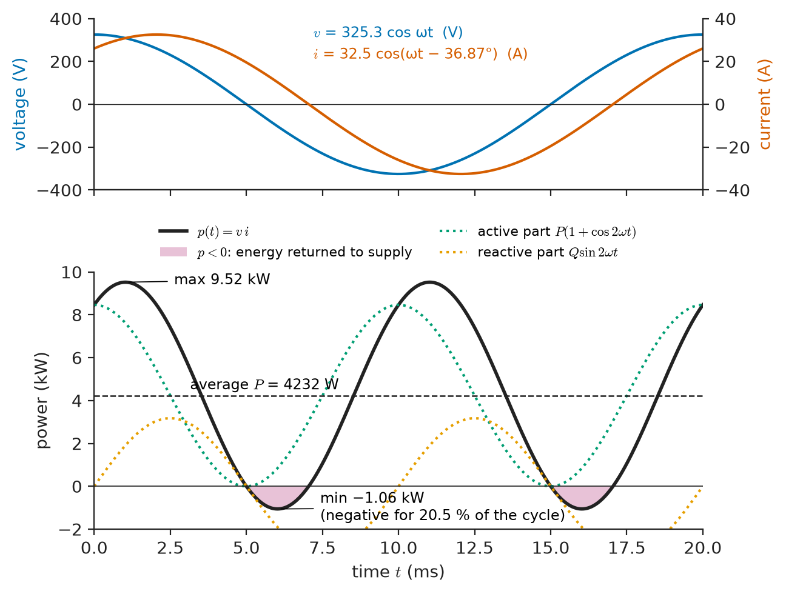
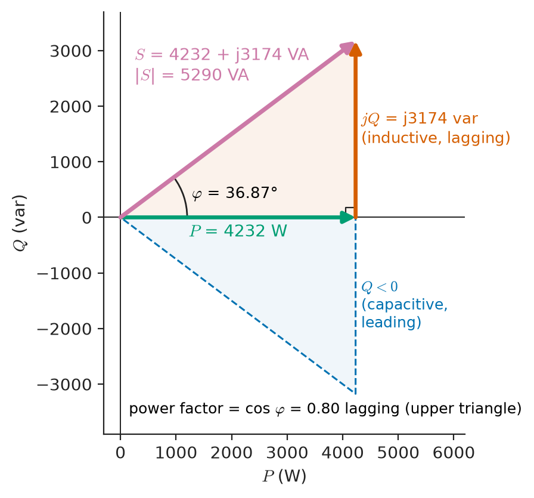
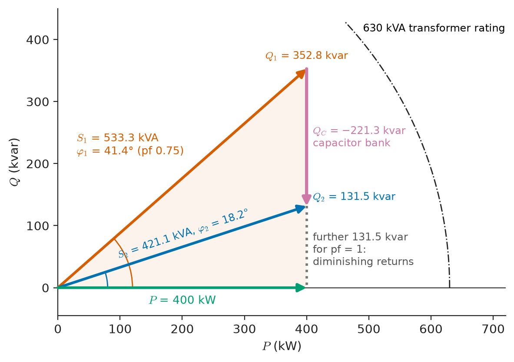
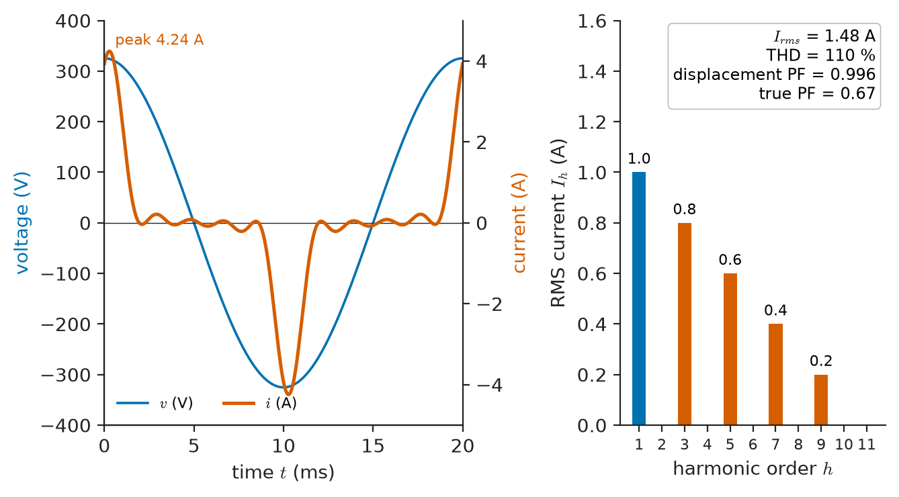
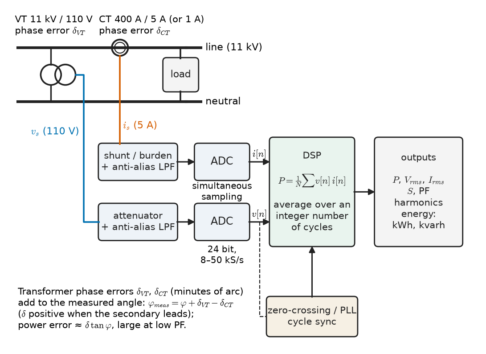

# Chapter 9 — AC Power

*Part II · Transient and AC Analysis*

A plastics-moulding plant receives its monthly electricity bill. Beside the expected charge for 208 000 kWh of energy there are two lines the production manager has never looked at: a "reactive energy" charge of almost a thousand US dollars, and a "maximum demand" charge billed not in kilowatts but in kilovolt-amperes. The same week, the site electrician reports that the 630 kVA supply transformer runs at 85 % of its rating although the plant draws only 400 kW, and that adding the planned new extruder line would overload it. A few kilometres away, an office building that has replaced all its desktop computers finds that the neutral conductors of its distribution boards are running hot, and an audit shows a power factor of 0.67 even though the current drawn by each computer is almost exactly in phase with the voltage.

All of these are questions about **AC power**: how energy flows in circuits where voltage and current are sinusoidal (or nearly so), what is billed and why, which part of the current does useful work and which merely loads the conductors, and how any of it is measured. Chapter 8 introduced the formula $P=VI\cos\phi$. This chapter builds the full theory on it.

> **Why does an AC load draw more current than its useful power requires, and what does that cost?**
> **How are active, reactive, apparent and complex power defined, corrected and measured, and what happens to these definitions when the current is distorted?**

| Concept | Engineering destination |
|---|---|
| Instantaneous power | Torque pulsation, DC-link capacitor sizing in single-phase converters, thermal cycling |
| Active power | Energy bills, efficiency, heating, mechanical output |
| Reactive power | Voltage regulation in grids, magnetising of motors and transformers, capacitor banks |
| Apparent power | Ratings of transformers, generators, UPS units, cables and switchgear |
| Complex power | Load-flow studies, summing plant loads, power balance checks |
| Power factor | Tariff penalties, conductor and transformer loading, supply standards |
| Power-factor correction | Capacitor banks, active PFC in power supplies, STATCOMs |
| Energy consumption | Metering, demand charges, appliance energy labels, efficiency projects |
| Non-sinusoidal considerations | Harmonics from drives, LED and IT loads; neutral overheating; THD limits |
| Practical power measurements | Wattmeters, power analysers, revenue meters, instrument-transformer errors |

**Roadmap.** Instantaneous power (9.1) → its average (active) and oscillating (reactive) parts (9.2) → apparent power and equipment ratings (9.3) → complex power and its conservation (9.4) → power factor (9.5) and its correction (9.6) → energy and how it is billed (9.7) → what changes when waveforms are not sinusoidal (9.8) → how power is actually measured (9.9).

---

## 9.1 Instantaneous power

### Power at every instant

The power delivered to any two-terminal element at each instant is the product of its voltage and current (with the passive sign convention of Chapter 1):

$$
p(t)=v(t)\,i(t)
$$

This holds for any waveforms. For the sinusoidal steady state, take the voltage as reference and let the current lag by the angle $\phi=\theta_v-\theta_i$:

$$
v(t)=\sqrt2\,V\cos\omega t,\qquad i(t)=\sqrt2\,I\cos(\omega t-\phi)
$$

where $V$ and $I$ are RMS values. Using $2\cos a\cos b=\cos(a-b)+\cos(a+b)$:

$$
p(t)=VI\cos\phi+VI\cos(2\omega t-\phi)
$$

The instantaneous power is a constant plus a sinusoid at **twice** the supply frequency. Expanding the second term separates two physically different flows:

$$
p(t)=\underbrace{VI\cos\phi\,\left(1+\cos2\omega t\right)}_{\text{always}\ \ge0}+\underbrace{VI\sin\phi\,\sin2\omega t}_{\text{average zero}}
$$

The first term pulses between 0 and $2VI\cos\phi$ but never reverses: it is energy flowing one way, from source to load, and its average is $VI\cos\phi$. The second term alternates symmetrically: energy flows into the load for a quarter cycle and back to the source for the next, with zero net transfer. Its amplitude is $VI\sin\phi$.

> **Status of the principle: Instantaneous power $p=vi$**
> *Fundamental.* It follows from the definitions of voltage (energy per charge) and current (charge per time) and from energy conservation; it holds for any waveform and any lumped element.

### The three elementary cases

- **Resistor** ($\phi=0$): $p=VI(1+\cos2\omega t)$, always positive. A resistor only absorbs energy.
- **Inductor** ($\phi=+90^\circ$): $p=VI\sin2\omega t$. The inductor absorbs energy as its current builds up, storing it in its magnetic field ($\tfrac12Li^2$), and returns it all as the current falls. Average zero.
- **Capacitor** ($\phi=-90^\circ$): $p=-VI\sin2\omega t$. The same exchange, with the electric field, in the opposite phase. Average zero.

A capacitor and an inductor on the same supply exchange energy in antiphase: while one absorbs, the other releases. This is why a capacitor can "supply" the reactive needs of a motor locally (Section 9.6), and it is the steady-state version of the energy sloshing studied in Section 7.9.

<!-- FIGURE 9.1 | figures/ch09/fig-9-1-instantaneous-power.png | plot | Voltage, current and instantaneous power of the 230 V, 23 A compressor load with power factor 0.8 lagging over one 50 Hz cycle. | Content: time axis 0 to 20 ms. Left axis voltage and current scaled to share the plot: v(t) = 325.3 cos(2 pi 50 t) V and i(t) = 32.5 cos(2 pi 50 t - 36.87 deg) A. Right axis power from -2 to +10 kW: p(t) = 4232 + 5290 cos(4 pi 50 t - 36.87 deg) W oscillating between +9.52 kW and -1.06 kW at 100 Hz; horizontal dashed line at average P = 4232 W; shaded negative regions labelled energy returned to supply (20.5 percent of the cycle). Thin dotted curves showing the decomposition: active component P(1 + cos 2 omega t) between 0 and 8464 W, and reactive component Q sin 2 omega t with amplitude 3174 W. -->

*Figure 9.1 — Voltage, current and instantaneous power of the 230 V, 23 A compressor load with power factor 0.8 lagging over one 50 Hz cycle.*

**Worked example — Instantaneous power of the compressor.** The compressor of Chapter 8 draws 23 A at 230 V with the current lagging by 36.87° ($\cos\phi=0.8$, $\sin\phi=0.6$). Describe $p(t)$.

$$
VI=230\times23=5290\ \mathrm{VA},\qquad p(t)=4232+5290\cos(2\omega t-36.87^\circ)\ \mathrm W
$$

The power oscillates at 100 Hz between $5290(0.8+1)=9522$ W and $5290(0.8-1)=-1058$ W. For $2\phi/2\pi=20.5$ % of each cycle the power is negative: the motor returns energy from its magnetic field to the supply. The average, 4232 W, is the useful power. The decomposition gives an active component swinging between 0 and 8464 W and a reactive component of amplitude 3174 W. Figure 9.1 shows the curves.

### Why the double-frequency pulsation matters

The average is what the energy meter integrates, but the pulsation is real and has engineering consequences. A single-phase motor's electrical input pulsates at 100 Hz, so its torque does too, which is one reason single-phase motors hum and vibrate more than three-phase ones. A single-phase inverter feeding the grid from a solar panel or battery must buffer the 100 Hz pulsation in its DC-link capacitor, and that capacitor is often the component that limits the inverter's lifetime. A balanced three-phase system, remarkably, delivers *constant* total instantaneous power, because the pulsations of the three phases cancel — one of the main reasons power is generated and transmitted three-phase (Chapter 10).

---

## 9.2 Active and reactive power

### Active power

The **active power** (real power, average power) is the average of $p(t)$ over a period:

$$
P=\frac1T\int_0^Tp(t)\,dt=VI\cos\phi\qquad[\mathrm W]
$$

It is the rate at which energy is converted irreversibly into heat, mechanical work, light, chemical energy or radiation. Only resistive parts of impedances absorb it: for a branch $Z=R+jX$ carrying RMS current $I$, $P=I^2R$.

### Reactive power

The **reactive power** is the amplitude of the oscillating, zero-average component:

$$
Q=VI\sin\phi\qquad[\mathrm{var}]
$$

measured in volt-amperes reactive (var, kvar, Mvar). With the convention $\phi=\theta_v-\theta_i$, an inductive load (current lagging) has $Q>0$ and is said to **absorb** reactive power; a capacitive load has $Q<0$ and is said to **generate** or supply it. For a branch $Z=R+jX$: $Q=I^2X$. In particular

$$
Q_L=I^2\omega L=\frac{V^2}{\omega L},\qquad Q_C=-I^2\frac{1}{\omega C}=-\omega CV^2
$$

Reactive power is *not* power in the energy-conversion sense: no fuel is burned to supply it. It is a measure of the energy that sloshes back and forth each cycle between the source and the load's magnetic and electric fields. The peak energy stored in an inductor is $LI_{pk}^2/2=LI^2$, and $Q_L=\omega LI^2=\omega\times$(peak stored energy) — reactive power is the stored-energy exchange rate.

> **Status of the principle: Active and reactive power for sinusoidal waveforms**
> *Derived.* $P$ and $Q$ follow from averaging and decomposing $p(t)=vi$ for same-frequency sinusoids; the definitions are exact for sinusoidal voltage and current and require generalisation for distorted waveforms (Section 9.8).

### Why reactive power matters

If reactive power transfers no net energy, why does anyone care? Three reasons.

1. **It costs current.** Delivering a given $P$ at a lower power factor needs a larger current, $I=P/(V\cos\phi)$. Every conductor, transformer winding and switch in the path carries that current.
2. **Current costs losses.** Losses in the supply path are $I^2R_{line}$, so they scale as $1/\cos^2\phi$. At $\cos\phi=0.7$ the losses for the same useful power are twice those at unity power factor.
3. **Reactive power moves voltage.** For a load at the end of a line with impedance $R+jX$, the voltage drop is approximately

$$
\Delta V\approx\frac{RP+XQ}{V}
$$

On high-voltage lines $X\gg R$, so the voltage at a substation is governed mainly by reactive power flow: grid operators control voltage by injecting or absorbing vars with generators, capacitor banks, reactors and static compensators. On a low-voltage feeder with $R=0.4\ \Omega$ and $X=0.3\ \Omega$ supplying 10 kW at 230 V, the drop is $4000/230=17.4$ V at unity power factor but $(4000+0.3\times7500)/230=27.2$ V if the load also absorbs 7.5 kvar ($\cos\phi=0.8$).

> **Status of the principle: Voltage-drop approximation $\Delta V\approx(RP+XQ)/V$**
> *Approximate.* It neglects the quadrature component of the drop and is accurate when the drop is a small fraction (below about 10 %) of the voltage, as in normal power-system operation.

---

## 9.3 Apparent power

### Definition

The product of RMS voltage and RMS current is the **apparent power**

$$
S=VI\qquad[\mathrm{VA}]
$$

It is the power a load *would* absorb if voltage and current were in phase, and it is the quantity that directly loads the supply equipment: transformer and generator windings heat according to current, insulation is stressed according to voltage, so their capability is the product $VI$ regardless of phase. For sinusoids,

$$
S^2=P^2+Q^2
$$

### Equipment rated in VA

**Table 9.1 — Typical apparent-power ratings.**

| Equipment | Typical rating | Why VA, not W |
|---|---|---|
| Distribution transformer (urban) | 250–1600 kVA at 11 kV/400 V | Winding heating set by current |
| Large generator | 100–1500 MVA | Stator current and rotor field limits |
| Office UPS | 1–20 kVA, often with a W rating at 0.8–1.0 power factor | Inverter switches limited by current |
| Wind turbine converter | 2–15 MVA | Converter current |
| Domestic consumer unit (main fuse) | 60–100 A at 230 V, i.e. 14–23 kVA | Fuse responds to current |
| Portable generator | 2–8 kVA | Alternator current |

The plant transformer of the opening is a case in point. Rated at 630 kVA, it supplies 400 kW at power factor 0.75, i.e. $S=400/0.75=533$ kVA, or 85 % of its rating. The same 400 kW at power factor 0.95 would be $421$ kVA, 67 %. At 0.95 the transformer could deliver up to $0.95\times630=599$ kW — enough for the planned extruder line without replacing the transformer. Raising power factor buys capacity.

---

## 9.4 Complex power

### Definition

The three quantities fit into one complex number. With RMS phasors $\mathbf V=V\angle\theta_v$ and $\mathbf I=I\angle\theta_i$, the **complex power** is

$$
S=\mathbf V\mathbf I^{*}=VI\angle(\theta_v-\theta_i)=P+jQ
$$

where the conjugate of the current makes the angle the difference $\theta_v-\theta_i=\phi$. Then $\lvert S\rvert$ is the apparent power, $\mathrm{Re}\,S=P$ and $\mathrm{Im}\,S=Q$. (With amplitude phasors, $S=\tfrac12\mathbf V_m\mathbf I_m^{*}$.) For an impedance $Z$:

$$
S=I^2Z=\frac{V^2}{Z^{*}}
$$

<!-- FIGURE 9.2 | figures/ch09/fig-9-2-power-triangle.png | phasor | The power triangle of the compressor load: complex power S = 4232 + j3174 VA. | Content: right triangle in the complex power plane. Horizontal side P = 4232 W along real axis; vertical side jQ = j3174 var upward; hypotenuse S = 5290 VA at angle phi = 36.87 deg. Labels: power factor = cos phi = 0.80 lagging. Dashed mirror triangle below the axis for a capacitive load labelled Q < 0, leading. Axis labels P (W) and Q (var). -->

*Figure 9.2 — The power triangle of the compressor load: complex power S = 4232 + j3174 VA.*

The geometric picture is the **power triangle** of Figure 9.2: $P$ along the real axis, $Q$ vertical, $S$ the hypotenuse, at the angle $\phi$. Inductive loads point upward, capacitive loads downward.

### Conservation of complex power

In any circuit, the complex power delivered by all sources equals the sum of the complex powers absorbed by all elements:

$$
\sum_{\text{sources}}S_k=\sum_{\text{elements}}S_k
$$

This is a consequence of KCL and KVL alone (it is a form of **Tellegen's theorem**), so it holds for any lumped network in sinusoidal steady state. Its real part says active power is conserved — energy conservation. Its imaginary part says the same for reactive power, which is less obvious but equally exact. Section 8.10 checked it in a small circuit. Its practical value is that the total load on a supply is found by **adding complex powers** of the individual loads, without solving any circuit.

> **Status of the principle: Conservation of complex power**
> *Derived.* It follows from KCL and KVL through Tellegen's theorem; it holds for any lumped network in sinusoidal steady state, and separately for each frequency when several are present.

Apparent powers do **not** add: $\lvert S_1+S_2\rvert\le\lvert S_1\rvert+\lvert S_2\rvert$, with equality only when the loads have the same power factor.

**Worked example — Total load of a plant.** A plant has four groups of load on its 400 V supply: resistive heating and lighting 60 kW at unity power factor; induction motors 180 kW at 0.80 lagging; variable-speed drives with front-end rectifiers 90 kW at 0.92 lagging (fundamental displacement power factor, see Section 9.8); and welding sets 40 kW at 0.60 lagging. Find the total complex power and power factor.

The reactive power of each group is $Q=P\tan(\arccos\mathrm{pf})$:

| Load | $P$ (kW) | pf | $Q$ (kvar) | $\lvert S\rvert$ (kVA) |
|---|---|---|---|---|
| Heating, lighting | 60 | 1.00 | 0 | 60.0 |
| Motors | 180 | 0.80 lag | 135.0 | 225.0 |
| Drives | 90 | 0.92 lag | 38.3 | 97.8 |
| Welding | 40 | 0.60 lag | 53.3 | 66.7 |
| **Total** | **370** | **0.853 lag** | **226.7** | **433.9** |

$$
S_{tot}=370+j226.7\ \mathrm{kVA},\qquad \lvert S_{tot}\rvert=433.9\ \mathrm{kVA},\qquad \mathrm{pf}=\frac{370}{433.9}=0.853
$$

The arithmetic sum of the apparent powers would be 449.5 kVA, 3.6 % too high. The motors dominate the reactive demand: they draw 60 % of the total kvar.

---

## 9.5 Power factor

### Definition

The **power factor** is the ratio of active to apparent power:

$$
\mathrm{PF}=\frac PS
$$

For sinusoidal voltage and current it equals $\cos\phi$, and is described as **lagging** (inductive load, current lags) or **leading** (capacitive load). It is a number between 0 and 1 that says what fraction of the current-carrying capacity of the supply path is doing useful work. The definition $P/S$ is the general one; $\cos\phi$ is only the sinusoidal special case, and Section 9.8 shows how badly the two can disagree for distorted currents.

### Typical values

**Table 9.2 — Representative power factors (typical values).**

| Load | Power factor | Remarks |
|---|---|---|
| Resistive heater, incandescent lamp | 1.0 | |
| Induction motor, full load | 0.80–0.90 lagging | Magnetising current roughly constant |
| Induction motor, 25 % load | 0.40–0.60 lagging | Lightly loaded motors are the worst offenders |
| Fluorescent lamp, magnetic ballast, uncorrected | 0.5 lagging | Usually corrected to 0.9 with a capacitor |
| Arc welder, arc furnace | 0.6–0.8 lagging | Strongly varying |
| Variable-speed drive (diode rectifier input) | 0.95–0.98 displacement, 0.65–0.9 total | Distorted current |
| PC or LED driver without PFC | 0.5–0.7 total | Displacement close to 1; distortion dominates |
| Power supply with active PFC | 0.95–0.99 | Required above 75 W in the EU (IEC 61000-3-2 harmonic limits) |
| Underground cable at light load | leading | Cable capacitance generates vars |

### Consequences

For fixed active power $P$ at voltage $V$, the current and the supply-path losses are

$$
I=\frac{P}{V\cdot\mathrm{PF}},\qquad P_{loss}=I^2R_{line}\propto\frac{1}{\mathrm{PF}^2}
$$

A plant at PF 0.7 draws 43 % more current and causes twice the line losses of one at unity. Utilities therefore require large consumers to keep their power factor above a threshold (commonly 0.9–0.95) and charge for reactive energy or for kVA demand when they do not (Section 9.7). Grid codes impose similar requirements on generators and renewable plants, which must be able to supply or absorb reactive power on demand.

---

## 9.6 Power-factor correction

### The principle

Most poor power factors are inductive: motors and transformers need magnetising current that lags the voltage by 90°. A capacitor in parallel with the load draws a current that *leads* by 90°. If the two reactive currents are equal, they circulate between the capacitor and the load, and the supply provides only the active current. In terms of power, the capacitor's negative $Q$ cancels the load's positive $Q$:

$$
Q_{supply}=Q_{load}+Q_C,\qquad Q_C=-\omega CV^2
$$

The load itself is unchanged — it still draws its full current — but the supply, cables and transformer upstream of the capacitor carry less. Correction should therefore be placed as close to the load as practical: correcting at the main switchboard relieves the transformer and the utility, but not the internal cables to the motors.

### Sizing the capacitor

To move a load of active power $P$ from power factor $\cos\phi_1$ to $\cos\phi_2$, the reactive power must fall from $P\tan\phi_1$ to $P\tan\phi_2$, so the capacitor must supply

$$
Q_C=P\left(\tan\phi_1-\tan\phi_2\right)
$$

and, for a single-phase connection at RMS voltage $V$, $C=Q_C/(\omega V^2)$.

<!-- FIGURE 9.3 | figures/ch09/fig-9-3-pf-correction.png | phasor | Power-factor correction of a 400 kW plant from 0.75 to 0.95 lagging, shown as power triangles. | Content: complex power plane with P on horizontal axis 0 to 450 kW and Q on vertical axis 0 to 400 kvar. Original triangle: P = 400 kW, Q1 = 352.8 kvar, S1 = 533.3 kVA at phi1 = 41.4 deg. Capacitor contribution Q_C = -221.3 kvar drawn as a downward arrow from the tip of S1. Corrected triangle: Q2 = 131.5 kvar, S2 = 421.1 kVA at phi2 = 18.2 deg. Dotted extension to unity power factor needing a further 131.5 kvar, labelled diminishing returns. Arc of radius 630 kVA labelled transformer rating. -->

*Figure 9.3 — Power-factor correction of a 400 kW plant from 0.75 to 0.95 lagging, shown as power triangles.*

**Worked example — Correcting a plant from 0.75 to 0.95.** The plant of the opening draws 400 kW at power factor 0.75 lagging from a 400 V, 50 Hz three-phase supply. Size a capacitor bank to raise the power factor to 0.95, and find the effect on current, losses and transformer loading.

$$
\tan\phi_1=\tan(\arccos0.75)=0.8819,\qquad \tan\phi_2=\tan(\arccos0.95)=0.3287
$$

$$
Q_1=400\times0.8819=352.8\ \mathrm{kvar},\quad Q_2=400\times0.3287=131.5\ \mathrm{kvar},\quad Q_C=221.3\ \mathrm{kvar}
$$

The apparent power falls from 533.3 kVA to 421.1 kVA. The line current, $I=S/(\sqrt3\,V_{LL})$ for a three-phase supply (Chapter 10), falls from 769.8 A to 607.7 A. Losses in the supply cables and transformer windings scale as $I^2$, so they fall to $(607.7/769.8)^2=0.623$ of their former value — a 37.7 % reduction. If those losses were 20 kW, they become 12.5 kW. The transformer loading falls from 85 % to 67 % of its 630 kVA rating, freeing the capacity noted in Section 9.3.

For the bank itself, with three capacitors connected in delta, each sees the 400 V line voltage and supplies one third of $Q_C$:

$$
C_\Delta=\frac{Q_C}{3\omega V_{LL}^2}=\frac{221.3\times10^3}{3\times314.16\times400^2}=1468\ \mu\mathrm F\ \text{per phase}
$$

A star connection would need three times that capacitance at $1/\sqrt3$ of the voltage, which is why low-voltage banks are almost always delta-connected. In practice the bank would be built from standard 25 or 50 kvar steps switched by a controller.

> **Status of the principle: Capacitive power-factor correction**
> *Approximate.* The sizing formula is exact for sinusoidal voltage and current at a fixed load; real loads vary, the capacitor's kvar varies with $V^2$, and harmonics can interact with the capacitor's resonance (Section 9.8).

### How far to correct

Correcting to unity would need a further 131.5 kvar — 59 % more capacitor — to remove the last 5 % of current. The return diminishes because $\cos\phi$ is flat near $\phi=0$. Targets of 0.95–0.98 are normal. There are also hazards on the far side of unity:

- **Over-correction.** When the plant's load drops at night but a fixed bank stays connected, the plant becomes capacitive. Leading power factor raises the voltage on the feeder (the $XQ$ term of Section 9.2 changes sign) and may also be penalised. Automatic banks switch capacitor steps in and out with the load.
- **Self-excitation.** A capacitor left across an induction motor that is disconnected from the supply while still spinning can keep it excited as a generator, producing dangerous voltages. Capacitors fitted directly at motors are therefore limited to about 90 % of the motor's no-load magnetising kvar.
- **Harmonic resonance.** A capacitor bank and the supply inductance form a parallel resonance at $f_0=f_1\sqrt{S_{sc}/Q_C}$ (Chapter 7). If that falls near a harmonic produced by drives or rectifiers, harmonic voltages are amplified. Banks in plants with significant non-linear load are **detuned** with series reactors so that the combination is inductive at all harmonic frequencies.
- **Switching transients.** Energising a bank produces the inrush current and overvoltage computed in Section 7.7.

### Other correction methods

Capacitor banks are the cheapest source of reactive power, but not the only one. **Synchronous condensers** — synchronous machines running unloaded with adjustable field — generate or absorb vars continuously and add inertia to the grid. **Static var compensators** (thyristor-switched capacitors and thyristor-controlled reactors) and **STATCOMs** (voltage-source converters) provide fast, continuous control for grids and arc furnaces. Inside equipment, **active PFC** stages in switch-mode power supplies shape the input current into a sinusoid in phase with the voltage, correcting both displacement and distortion; the circuits are in *Electronics & Computing*.

> **Boundary.** The construction, protection and switching of capacitor banks, synchronous condensers and static compensators belong to *Electrical Energy & Machines*. This chapter supplies the circuit theory that sizes them.

---

## 9.7 Energy consumption

### Energy from power

Energy is the time integral of instantaneous power:

$$
W=\int_{t_1}^{t_2}p(t)\,dt
$$

Over many cycles of a steady load the double-frequency pulsation integrates to nothing and $W=P\,\Delta t$. The billing unit is the **kilowatt-hour**: 1 kWh = 3.6 MJ. A 2 kW kettle running for 3 minutes uses 0.1 kWh; a refrigerator averaging 150 W at a 35 % compressor duty cycle uses $0.15\times0.35\times8760=460$ kWh per year; a device with a 5 W standby draw uses 43.8 kWh per year doing nothing.

**Table 9.3 — Representative annual energy consumption (typical values).**

| Load | Annual energy |
|---|---|
| Household (Europe, without electric heating) | 2500–4500 kWh |
| Household (North America) | 10 000–11 000 kWh |
| Electric car, 15 000 km at 0.17 kWh/km | 2500 kWh |
| 1 MW data-centre IT load at PUE 1.4 | 12.3 GWh |
| 400 kW plant, two shifts (about 6200 h/yr) | 2.5 GWh |

### Reactive energy and demand

Revenue meters for commercial and industrial customers record more than kWh:

- **Reactive energy** (kvarh), $\int Q\,dt$, measured separately for lagging and sometimes leading operation. Tariffs typically allow a free reactive energy equal to $\tan\phi_{lim}$ times the active energy (for a limit of 0.9, $\tan\phi=0.484$) and charge for the excess.
- **Maximum demand**, the highest average power (kW) or apparent power (kVA) over any metering interval (typically 15 or 30 minutes) in the billing period. A kVA demand charge penalises poor power factor directly, because it bills the capacity of the network the customer occupies.

> **Boundary.** Tariff structures, thresholds and prices differ between countries and utilities and change over time. The figures in the next example are illustrative, chosen to show the mechanism, not quoted from any specific tariff.

**Worked example — The plant's bill before and after correction.** The 400 kW plant of Section 9.6 operates 520 h in a billing month. Its tariff charges reactive energy above $0.484\times$kWh at 0.012 USD per kvarh and has a demand charge of 8 USD per kVA of monthly maximum demand. The capacitor bank costs about 25 USD per kvar installed. Estimate the monthly savings and the payback time.

Active energy: $400\times520=208\,000$ kWh. Reactive energy before correction: $352.8\times520=183\,439$ kvarh. The free allowance is $0.484\times208\,000=100\,739$ kvarh, leaving 82 700 kvarh chargeable: 992 USD. After correction to 0.95 the reactive energy is $131.5\times520=68\,366$ kvarh, within the allowance: no charge.

The kVA demand falls from 533.3 to 421.1 kVA, saving $112.3\times8=898$ USD per month. Together with the reduced losses (about 7.5 kW less, or roughly 3900 kWh per month), the savings exceed 2000 USD per month at an energy price of about 0.12 USD per kWh, against a bank cost of $221.3\times25\approx5500$ USD: a payback of two to three months. Few efficiency investments in an industrial plant are as quick, which is why power-factor correction is usually the first item on an energy audit.

### Energy efficiency through the circuit lens

Every efficiency calculation is a ratio of active powers: output power divided by input power, or useful energy over metered energy. Reactive power does not appear in the efficiency of a load, but it appears in the losses of the *supply*, so the system efficiency depends on power factor even when the load's does not. The same applies inside equipment: a power converter's input-filter capacitors circulate reactive current that heats their ESR and the converter's wiring without contributing to the output.

---

## 9.8 Non-sinusoidal considerations

### Distorted currents

The office building of the opening is full of switch-mode power supplies whose input stage is a diode bridge feeding a smoothing capacitor. The capacitor charges only near the peaks of the supply voltage, so the current flows in short pulses, one per half-cycle. The voltage stays nearly sinusoidal (the supply is stiff), but the current is far from it. Variable-speed drives, LED drivers, battery chargers, arc furnaces and saturated transformers all distort current in similar ways. The sinusoidal theory of Sections 9.1–9.6 must be generalised.

Any periodic current can be expanded as a Fourier series (Chapter 18) of harmonics at integer multiples $h f_1$ of the fundamental:

$$
i(t)=I_0+\sum_{h=1}^{\infty}\sqrt2\,I_h\cos\left(h\omega_1t-\phi_h\right)
$$

with $I_h$ the RMS value of the $h$th harmonic. Half-wave-symmetric waveforms (as from a bridge rectifier) contain only odd harmonics. The RMS value adds in quadrature (Section 8.2):

$$
I_{rms}=\sqrt{I_0^2+I_1^2+I_2^2+\cdots}
$$

The **total harmonic distortion** of the current is

$$
\mathrm{THD}_I=\frac{\sqrt{\sum_{h\ge2}I_h^2}}{I_1}
$$

Typical values: below 5 % for a power supply with active PFC; 30–50 % for a six-pulse drive with a DC choke; 80–150 % for a small single-phase rectifier–capacitor supply.

### Active power with harmonics

When voltage and current both contain harmonics, the average of their product contains only products of components at the **same** frequency, because products of different harmonics average to zero over a period (orthogonality of sinusoids):

$$
P=V_0I_0+\sum_{h=1}^{\infty}V_hI_h\cos\phi_h
$$

If the supply voltage is a pure sinusoid ($V_h=0$ for $h\ge2$), **only the fundamental current carries active power**: $P=V_1I_1\cos\phi_1$. The harmonic currents add to the RMS current, and so to losses and apparent power, without delivering any energy to the load.

> **Status of the principle: Active power as a sum over harmonics**
> *Derived.* A consequence of the orthogonality of sinusoids of different frequencies over a common period; it is exact for periodic waveforms in steady state and fails for non-periodic (interharmonic or fluctuating) loads unless averaged over a suitable long window.

### Power factor with harmonics

With sinusoidal voltage, $S=V_1I_{rms}$, and the true power factor factors into two parts:

$$
\mathrm{PF}=\frac PS=\frac{V_1I_1\cos\phi_1}{V_1I_{rms}}=\underbrace{\cos\phi_1}_{\text{displacement}}\times\underbrace{\frac{I_1}{I_{rms}}}_{\text{distortion}}=\frac{\cos\phi_1}{\sqrt{1+\mathrm{THD}_I^2}}
$$

The **displacement power factor** $\cos\phi_1$ is what a capacitor can correct. The **distortion factor** $I_1/I_{rms}$ is not: a capacitor does nothing to the harmonic currents except possibly resonate with them. Distortion is reduced only by changing the load (active PFC, multi-pulse rectifiers, chokes) or by filtering (passive tuned filters, active harmonic filters).

The apparent power no longer satisfies $S^2=P^2+Q^2$. With sinusoidal voltage one writes

$$
S^2=P^2+Q_1^2+D^2
$$

where $Q_1=V_1I_1\sin\phi_1$ is the fundamental reactive power and $D=V_1\sqrt{\sum_{h\ge2}I_h^2}$ is called the **distortion power**. When the voltage is also distorted, there is no unique accepted way to split $S$ into components: Budeanu's, Fryze's and the IEEE 1459 definitions of "reactive power" disagree, and instruments that implement different ones give different var readings on the same load. Active power and RMS values remain unambiguous; reactive power with distorted waveforms is a definition, not a measurement, and the definition should be stated.

> **Status of the principle: Power-factor decomposition into displacement and distortion factors**
> *Derived* for sinusoidal voltage. For distorted voltage the decomposition of apparent power into reactive and distortion parts is a matter of convention, with several standards in use.

<!-- FIGURE 9.4 | figures/ch09/fig-9-4-distorted-current.png | spectrum | Current drawn by a rectifier-capacitor power supply on a 230 V, 50 Hz supply: waveform and harmonic spectrum. | Content: left panel time domain 0 to 20 ms, sinusoidal voltage 325 V peak (left axis) and current pulses (right axis -3 to +3 A) formed by fundamental 1.0 A rms at -5 deg plus harmonics 3rd 0.8 A, 5th 0.6 A, 7th 0.4 A, 9th 0.2 A rms, peaking near the voltage peaks. Right panel bar chart of harmonic RMS current in A versus harmonic order 1 to 11: 1.0, 0, 0.8, 0, 0.6, 0, 0.4, 0, 0.2, 0, 0. Annotation: I_rms = 1.48 A, THD = 110 percent, displacement PF 0.996, true PF 0.67. -->

*Figure 9.4 — Current drawn by a rectifier-capacitor power supply on a 230 V, 50 Hz supply: waveform and harmonic spectrum.*

**Worked example — A computer power supply.** A desktop computer's power supply (without active PFC) on a 230 V sinusoidal supply draws a current with RMS harmonic components $I_1=1.0$ A (lagging the voltage by 5°), $I_3=0.8$ A, $I_5=0.6$ A, $I_7=0.4$ A and $I_9=0.2$ A. Find the RMS current, THD, active power, apparent power and power factor.

$$
I_{rms}=\sqrt{1.0^2+0.8^2+0.6^2+0.4^2+0.2^2}=\sqrt{2.20}=1.483\ \mathrm A
$$

$$
\mathrm{THD}_I=\frac{\sqrt{0.64+0.36+0.16+0.04}}{1.0}=\sqrt{1.20}=1.095=110\ \%
$$

$$
P=230\times1.0\times\cos5^\circ=229.1\ \mathrm W,\qquad Q_1=230\times1.0\times\sin5^\circ=20.0\ \mathrm{var}
$$

$$
S=230\times1.483=341.1\ \mathrm{VA},\qquad \mathrm{PF}=\frac{229.1}{341.1}=0.672
$$

The displacement power factor is $\cos5^\circ=0.996$ — an electrician measuring the phase between voltage zero-crossing and the fundamental current would think the load nearly ideal — but the distortion factor is $1/\sqrt{1+1.20}=0.674$, and that sets the true power factor. The distortion power is $D=\sqrt{341.1^2-229.1^2-20.0^2}=252$ VA, much larger than $Q_1$. Correcting with a capacitor would remove at most the 20 var of $Q_1$ and leave the power factor near 0.67. Figure 9.4 shows the waveform and its spectrum.

### Triplen harmonics and the neutral

The third harmonic and its odd multiples (9th, 15th, …) — the **triplen** harmonics — have a property that only shows in three-phase systems: the triplen currents of the three phases are in phase with each other, so instead of cancelling in the neutral as balanced fundamental currents do, they add. A building full of single-phase IT loads, each drawing 0.8 A of third harmonic per ampere of fundamental, can carry a neutral current larger than the phase currents. That is what overheated the office neutrals in the opening; Chapter 10 shows the arithmetic. Standards such as IEC 61000-3-2 (equipment up to 16 A per phase) and IEEE 519 (system level) limit harmonic emissions for this reason.

### Effects of harmonics on equipment

Harmonic currents produce extra losses out of proportion to their RMS value: eddy-current losses in transformer windings grow roughly as $h^2I_h^2$, so transformers serving non-linear loads are derated or specified with a "K-factor". Skin effect raises the resistance of conductors at harmonic frequencies. Capacitor banks, whose admittance rises with $h$, attract harmonic current and may fail. Harmonic voltage drops across the supply impedance distort the voltage seen by all other customers, which is why utilities limit voltage THD (typically to 5–8 % at low voltage).

---

## 9.9 Practical power measurements

### The measurement problem

Measuring power means measuring the average of a product of two signals that may be large (kilovolts, kiloamperes), distorted and noisy, with an accuracy of 0.1–1 %. There are three steps: scale the voltage and current to instrument levels, form the product, and average it.

<!-- FIGURE 9.5 | figures/ch09/fig-9-5-power-measurement-chain.png | block-diagram | Signal chain of a digital power analyser or revenue meter connected through instrument transformers. | Content: left, a single-phase line at 11 kV feeding a load, with a voltage transformer 11 kV / 110 V connected across line and neutral and a current transformer 400 A / 5 A (or 1 A) around the line conductor. Each secondary feeds a conditioning block (attenuator or shunt, anti-alias low-pass filter), then a simultaneously sampled ADC pair (e.g. 24 bit, 8 to 50 kS/s). Digital block multiplies v[n] i[n], averages over an integer number of cycles synchronised by a zero-crossing or PLL block, and outputs P, V_rms, I_rms, S, PF, harmonics and energy (kWh, kvarh). Annotate the phase error delta of each instrument transformer in minutes of arc and note that delta adds to the measured phase angle. -->

*Figure 9.5 — Signal chain of a digital power analyser or revenue meter connected through instrument transformers.*

### Analog wattmeters

The classical **electrodynamometer wattmeter** has a fixed current coil carrying the load current and a moving voltage coil connected (through a series resistor) across the supply. The torque on the moving coil is proportional to the instantaneous product $v\,i$, and the inertia of the movement averages it. It measures true active power for any waveform within its bandwidth, which is why it was the reference instrument for a century. Induction-disc energy meters, still in service in some places, integrate power over time by driving an aluminium disc whose speed is proportional to $P$.

### Digital power analysers and electronic meters

Modern instruments and revenue meters (Figure 9.5) sample voltage and current simultaneously with a pair of ADCs and compute

$$
P=\frac1N\sum_{n=0}^{N-1}v[n]\,i[n],\qquad V_{rms}=\sqrt{\frac1N\sum v[n]^2},\qquad I_{rms}=\sqrt{\frac1N\sum i[n]^2}
$$

over a window that contains an integer number of cycles (synchronised to the measured frequency); otherwise the incomplete cycle leaks into the average. From $P$, $V_{rms}$ and $I_{rms}$, the instrument derives $S=V_{rms}I_{rms}$ and $\mathrm{PF}=P/S$. Reactive power is computed by one of the conventions of Section 9.8, often by multiplying the voltage samples with current samples delayed by a quarter cycle, or from the fundamental components obtained by a DFT (Chapter 22). Harmonic measurement requires a sampling rate high enough to capture the harmonics of interest without aliasing: to measure up to the 50th harmonic of 50 Hz (2.5 kHz), the sampling rate must exceed 5 kHz and the anti-alias filter must reject everything above it (Chapter 19). Power-quality standards (IEC 61000-4-7) specify 10-cycle (50 Hz) or 12-cycle (60 Hz) windows for this reason.

> **Status of the principle: Active power as the average of sampled $v\cdot i$**
> *Approximate.* It equals the true average power when the signals are sampled fast enough to avoid aliasing and averaged over an integer number of periods; errors arise from sampling skew between channels, quantisation, and non-integer windows.

### Instrument transformers and accuracy

At medium and high voltage, and at currents above about 100 A, the signals reach the meter through **current transformers** (CTs, e.g. 400/5 A or 400/1 A) and **voltage transformers** (VTs, e.g. 11 kV/110 V). Each introduces a **ratio error** (a gain error) and a **phase displacement** $\delta$ between primary and secondary. Accuracy classes (IEC 61869) specify both: a class 0.5 CT has a ratio error within ±0.5 % and a phase displacement within ±30 minutes of arc (0.5°) at rated current. Revenue metering uses class 0.2 or 0.2S transformers and class 0.5S or 0.2S meters; protection CTs are designed for a different job (faithful reproduction of fault currents) and are less accurate at normal currents.

Phase displacement matters far more than its small size suggests. If the measured phase angle is $\phi-\delta$ instead of $\phi$, the measured power is $VI\cos(\phi-\delta)$, a relative error of

$$
\frac{\cos(\phi-\delta)-\cos\phi}{\cos\phi}\approx\delta\tan\phi
$$

which grows without bound as the power factor falls.

**Worked example — Phase error at low power factor.** A test on a lightly loaded motor at power factor 0.2 is made through a CT with 0.5° phase displacement. Estimate the error in measured power, and compare with power factors 0.8 and 1.0.

At PF 0.2, $\phi=78.46^\circ$ and $\tan\phi=4.90$. With $\delta=0.5^\circ=0.00873$ rad, the relative error is $4.90\times0.00873=0.0428$: **4.3 %**. The exact formula gives 4.27 %. At PF 0.8 ($\tan\phi=0.75$) the error is 0.65 %, and at PF 1.0 it is only $-0.004$ % (second order in $\delta$). Measuring no-load or short-circuit losses of transformers and motors, where the power factor may be 0.1–0.2, therefore requires class 0.1–0.2 transformers or phase-compensated instruments; a class 0.5 CT that is perfectly adequate for billing a factory can give a no-load loss figure that is several percent wrong.

### Clamp meters and portable analysers

For field work, current is measured with clamp-on probes: a split-core CT for AC, or a Hall-effect or fluxgate clamp for AC with DC. A Rogowski coil — an air-cored flexible loop whose output is proportional to $di/dt$ and is integrated electronically — handles very large and harmonic-rich currents without saturating, at the cost of lower accuracy at low current. Portable power-quality analysers combine voltage leads and clamps with the sampling chain of Figure 9.5, and log $P$, $Q$, PF, THD and individual harmonics over days to diagnose problems like those in the opening.

### Measuring three-phase and DC power

Three-phase power needs either three single-phase measurements or, on a three-wire system, two wattmeters whose readings sum to the total power (Blondel's theorem): the subject of Chapter 10. DC power in converters and batteries is simply $VI$, but measured on top of large ripple, it needs the same true-average computation; the interface with sampling and quantisation is in Chapters 19 and 21.

> **Boundary.** The design of instrument transformers and revenue-meter hardware belongs to *Electrical Energy & Machines*, and that of ADCs and signal-conditioning circuits to *Electronics & Computing*. This chapter supplies what they must compute.

---

## What remains open

| Open question | Where it is answered |
|---|---|
| How is power delivered and measured in balanced and unbalanced three-phase systems, and why is balanced three-phase power constant? | Chapter 10 (three-phase power, two-wattmeter method, neutral currents) |
| How large are triplen-harmonic neutral currents in a building, and why don't they cancel? | Chapter 10 (neutral currents) |
| How is a distorted waveform decomposed into harmonics, and what do magnitude and phase mean for each? | Chapter 18 (Fourier series and transforms) |
| How fast must a power analyser sample, and what does its anti-alias filter have to do? | Chapter 19 (sampling, aliasing, anti-aliasing filters) |
| How are harmonics computed from samples, and what errors does windowing introduce? | Chapter 22 (DFT, spectral leakage, windowing) |
| How are the resonances of capacitor banks and supply inductance analysed across frequency? | Chapter 7 (resonance); Chapter 13 (resonant circuits, passive filters) |
| How are active PFC circuits, rectifiers and inverters built? | *Electronics & Computing*; machines and power hardware in *Electrical Energy & Machines* |

**Next:** Chapter 10 extends single-phase AC power to the three-phase systems that generate, transmit and distribute almost all electrical energy, where balanced power is constant and neutral currents reveal the harmonics of Section 9.8.
