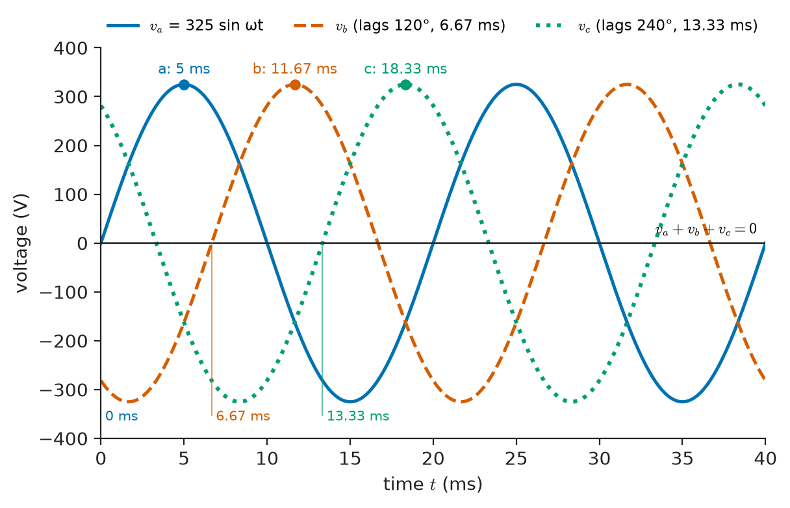
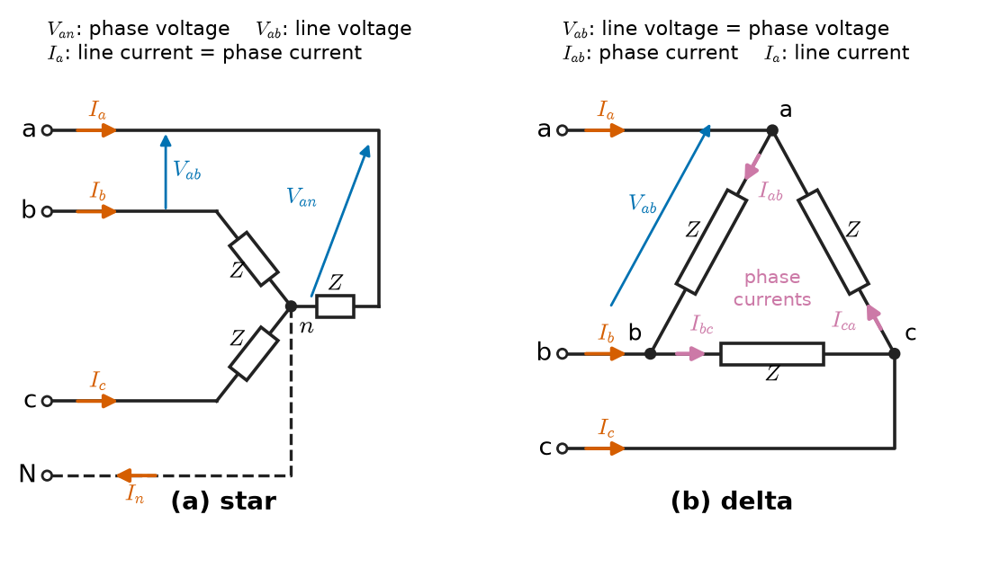
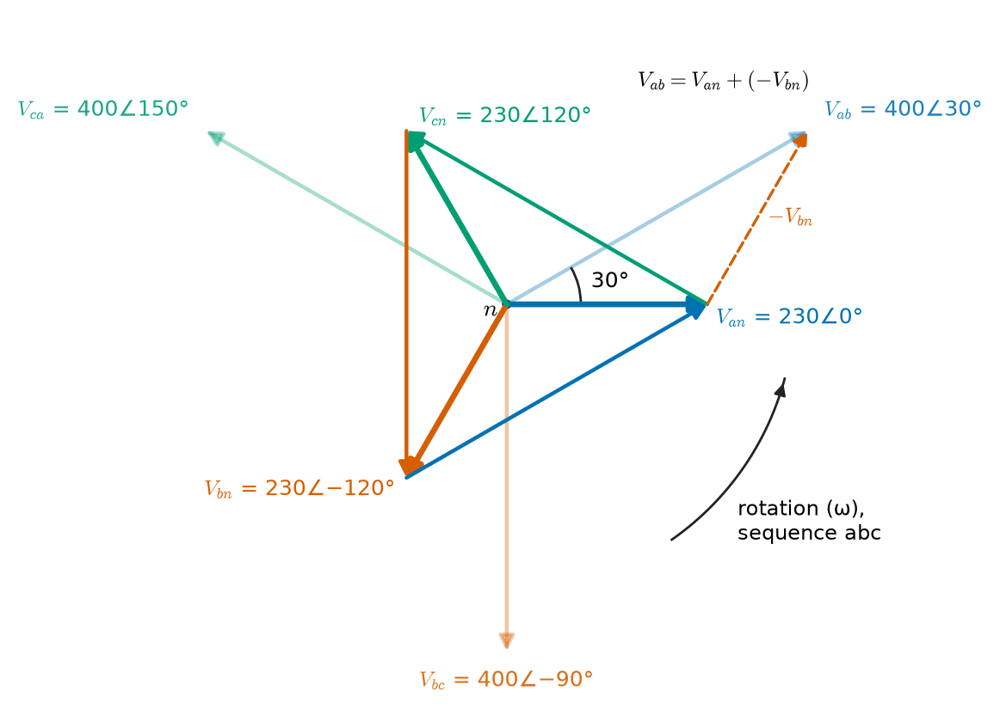
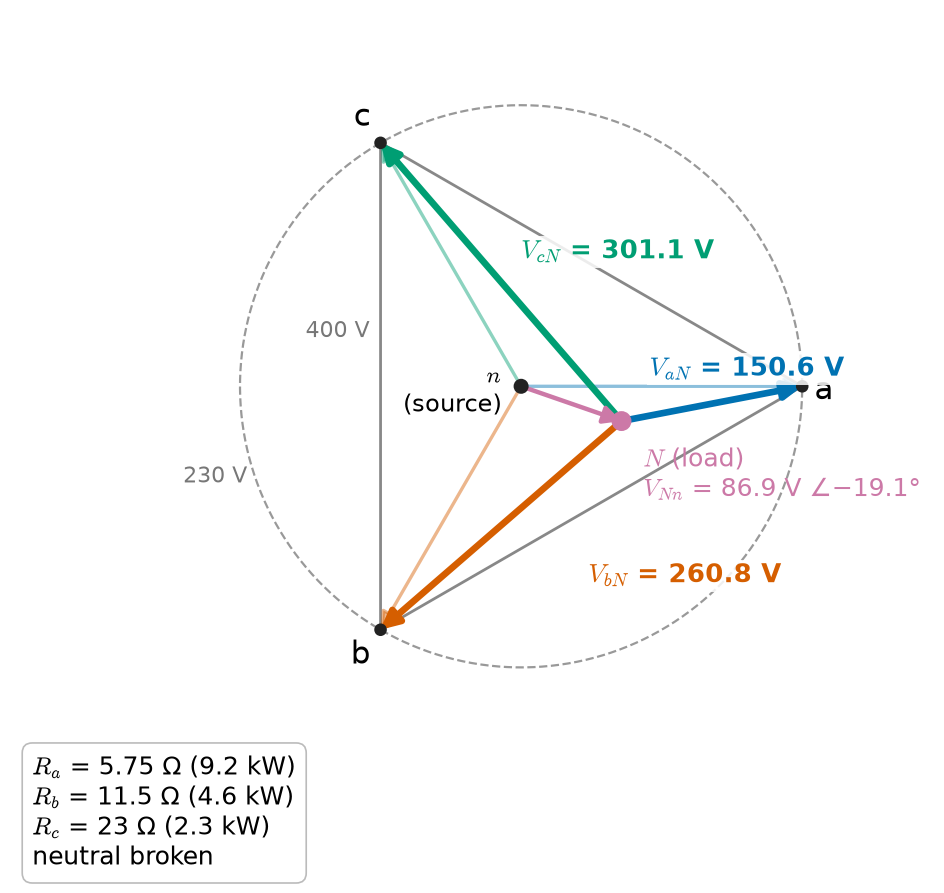
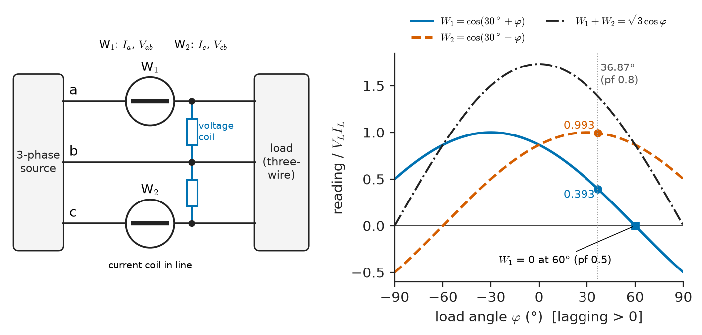
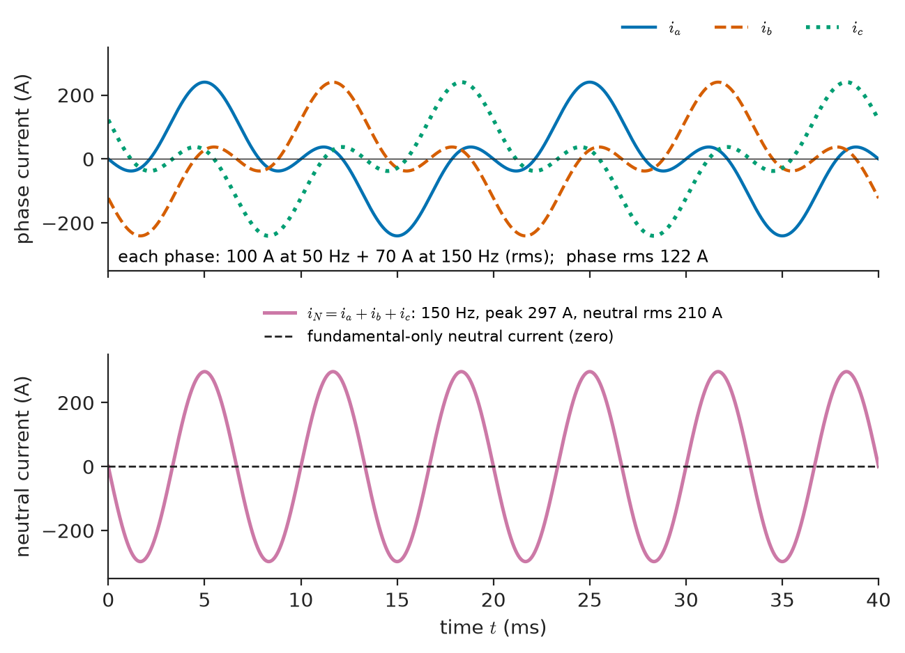

# Chapter 10 — Three-Phase Circuits

*Part II · Transient and AC Analysis*

A facilities engineer is called to an office building because the neutral conductor feeding the third floor is running hot. A clamp meter shows about 80 A in each of the three phase conductors, comfortably inside their rating, yet the neutral, which the original designers sized at half the phase conductor because "a balanced load returns nothing in the neutral", is carrying more than 120 A. Across town, at a small dairy, a different fault: a loose neutral connection at the service entrance. Within minutes the lights on one phase go dim, a refrigerator on another phase hums and fails, and a television on the third phase is destroyed by an overvoltage, even though the utility's supply never left its tolerance band. Both incidents are three-phase circuit problems. Neither can be understood with the single-phase ideas of Chapters 8 and 9 alone, and both are understood completely with the phasor tools those chapters built, once we take seriously that three sinusoids 120° apart are not three separate circuits but one.

> **Why is electrical power generated, transmitted and used in three phases, and how are line and phase quantities related in star and delta connections?**
> **What happens when the load is not balanced, how is three-phase power measured, and why can a neutral conductor carry more current than any phase?**

| Concept | Engineering destination |
|---|---|
| Three-phase generation | Synchronous generators, inverters, wind and solar grid interfaces |
| Phase sequence | Motor direction, synchronising a generator to the grid, protection relays |
| Star and delta connections | Distribution transformers, motor windings, capacitor banks, star–delta starters |
| Line and phase quantities | Nameplate ratings, cable sizing, instrument transformer selection |
| Balanced loads | Per-phase equivalent circuits for motors, drives and transmission studies |
| Unbalanced loads | Residential feeders, single-phase traction loads, broken-neutral faults |
| Three-phase power | Constant torque in machines, generator and transformer ratings |
| Power measurement | Two-wattmeter method, revenue meters, power analysers |
| Neutral currents | Neutral sizing, triplen harmonics from electronic loads, transformer heating |
| Practical applications | Industrial plants, data centres, traction, rectifiers, HVDC converters |

**Roadmap.** Generating three phases (10.1) → which phase leads (10.2) → star and delta connections (10.3) and the √3 relations between line and phase quantities (10.4) → balanced loads and the per-phase equivalent (10.5) → unbalanced loads and the neutral-displacement problem (10.6) → total power and its remarkable constancy (10.7) → how it is measured (10.8) → the neutral conductor and triplen harmonics (10.9) → where all of this appears in practice (10.10).

---

## 10.1 Three-phase generation

### From one coil to three

A single coil rotating at angular speed $\omega$ in a uniform magnetic field produces an EMF $e(t)=E_m\sin\omega t$. That is the single-phase source of Chapter 8. Its instantaneous power into a resistive load, $p(t)=E_m I_m\sin^2\omega t$, pulsates at twice the supply frequency between zero and twice its average. For a lamp the pulsation is invisible; for a 5 MW generator the pulsating electrical power appears as a pulsating torque on the shaft, which shakes the machine and its foundation at 100 Hz.

Place three identical coils on the same rotor (or, as in practice, on the stator with a rotating field), displaced mechanically so that their EMFs are displaced in time by one third of a cycle. For a two-pole machine the coils are 120° apart in space. The three EMFs are

$$
e_a(t)=E_m\sin\omega t,\qquad e_b(t)=E_m\sin(\omega t-120^\circ),\qquad e_c(t)=E_m\sin(\omega t-240^\circ)
$$

and they are shown in Figure 10.1. At every instant they sum to zero:

$$
e_a+e_b+e_c=E_m\left[\sin\omega t+\sin(\omega t-120^\circ)+\sin(\omega t+120^\circ)\right]=0
$$

This identity is the source of almost every advantage of three-phase systems. Its phasor form is even shorter. With the phasor operator

$$
a=1\angle 120^\circ=-\tfrac12+j\tfrac{\sqrt3}{2},\qquad a^2=1\angle 240^\circ,\qquad a^3=1,\qquad 1+a+a^2=0
$$

a balanced set of phase voltages is $\mathbf V_a=V\angle0^\circ$, $\mathbf V_b=a^2\mathbf V_a$, $\mathbf V_c=a\mathbf V_a$, and $\mathbf V_a+\mathbf V_b+\mathbf V_c=\mathbf V_a(1+a^2+a)=0$.

<!-- FIGURE 10.1 | figures/ch10/fig-10-1-three-phase-waveforms.png | plot | The three phase voltages of a 230 V, 50 Hz supply; at every instant their sum is zero. | Content: x-axis time 0 to 40 ms (two cycles), y-axis voltage -400 to +400 V. Three sinusoids of peak 325 V: va = 325 sin(wt) solid, vb lagging by 120 degrees (6.67 ms) dashed, vc lagging by 240 degrees (13.33 ms) dotted, labelled a, b, c. A fourth thin line at zero labelled "va + vb + vc = 0". Vertical markers at t = 0, 6.67 ms and 13.33 ms showing successive positive peaks of a, b, c at 5 ms, 11.67 ms and 18.33 ms. -->

*Figure 10.1 — The three phase voltages of a 230 V, 50 Hz supply; at every instant their sum is zero.*

### Frequency, speed and poles

A machine with $p$ poles produces one electrical cycle for every pair of poles that passes a coil, so the electrical frequency and the rotor speed $n$ in revolutions per minute are linked by

$$
f=\frac{p\,n}{120}
$$

A two-pole turbo-generator in a 50 Hz grid turns at 3000 rpm (3600 rpm in a 60 Hz grid); a four-pole machine at 1500 rpm; a hydro generator with 48 poles at 125 rpm. The construction of these machines, the shaping of the air-gap field to make the EMF sinusoidal and the excitation control that sets $E_m$ belong to *Electrical Energy & Machines*. For circuit analysis the generator is simply three sinusoidal voltage sources of equal amplitude, 120° apart, each with a small internal impedance.

> **Boundary.** How the rotating field is produced, why the EMF is sinusoidal and how generators are excited and synchronised are machine topics treated in *Electrical Energy & Machines*. Power-electronic inverters that synthesise three-phase voltages from DC (in solar plants, drives and battery systems) are treated in *Electronics & Computing*. Here a three-phase source is a set of ideal or near-ideal phasor sources.

### Why three phases and not two, four or six

Three is the smallest number of equally spaced phases that gives (i) instantaneous power that is constant in time for a balanced load (Section 10.7), (ii) a rotating magnetic field from stationary windings, which makes the induction motor possible, and (iii) a return current that cancels, so that the "return conductor" can be omitted or reduced. A two-phase system (90° apart) also gives constant power and a rotating field but needs a return conductor carrying $\sqrt2$ times the phase current. Six- and twelve-phase systems exist inside rectifiers to reduce ripple, but each extra phase adds a conductor without improving power constancy.

The conductor saving is easy to quantify. Deliver power $P$ at line voltage $V$ over a given distance with given losses. Single-phase two-wire: current $P/V$ in each of two conductors, loss $2P^2R_1/V^2$. Three-phase three-wire at unity power factor: line current $P/(\sqrt3V)$ in each of three conductors, loss $3\cdot P^2R_3/(3V^2)=P^2R_3/V^2$. Equal losses require $R_3=2R_1$, i.e. each three-phase conductor has half the cross-section of a single-phase conductor. Total conductor volume: three half-sized conductors against two full ones, $1.5/2=75\,\%$. Three-phase transmission uses three quarters of the copper or aluminium of single-phase transmission for the same power, voltage and loss.

Table 10.1 gives the three-phase supply voltages an engineer meets most often.

**Table 10.1 — Representative three-phase system voltages (line-to-line / line-to-neutral, nominal).**

| System | Line-to-line | Line-to-neutral | Frequency | Typical use |
|---|---|---|---|---|
| IEC low voltage (Europe, South Asia, Africa, Australia) | 400 V | 230 V | 50 Hz | Homes, offices, small industry |
| North American low voltage | 208 V | 120 V | 60 Hz | Commercial buildings |
| North American industrial | 480 V | 277 V | 60 Hz | Motors, lighting in industry |
| Industrial low voltage | 690 V | 400 V | 50 Hz | Large drives, wind turbines |
| Medium-voltage distribution | 11 kV (also 6.6, 13.8, 20, 33 kV) | 6.35 kV | 50/60 Hz | Feeders, large motors |
| Subtransmission | 66–132 kV | 38–76 kV | 50/60 Hz | Regional networks |
| Transmission | 220–400 kV (up to 765 kV and more) | 127–231 kV | 50/60 Hz | Bulk power transfer |
| Generator terminals | 11–25 kV | 6.4–14.4 kV | 50/60 Hz | Step-up transformer input |

Statutory tolerances are typically ±10 % at the low-voltage service point (230 V +10 %/−10 % in IEC countries, 120 V ±5 % in North America).

---

## 10.2 Phase sequence

### Positive and negative sequence

The order in which the three phase voltages reach their positive peaks is the **phase sequence** (or phase rotation). In Figure 10.1, $v_a$ peaks first, then $v_b$ a third of a cycle later, then $v_c$: the sequence is $abc$, also called positive sequence. Reversing the direction of rotation of the generator, or swapping any two supply leads, gives $acb$, the negative sequence.

In phasor form, with $\mathbf V_a$ as reference:

| Sequence | $\mathbf V_a$ | $\mathbf V_b$ | $\mathbf V_c$ |
|---|---|---|---|
| Positive ($abc$) | $V\angle0^\circ$ | $V\angle-120^\circ$ | $V\angle+120^\circ$ |
| Negative ($acb$) | $V\angle0^\circ$ | $V\angle+120^\circ$ | $V\angle-120^\circ$ |

Phasors rotate counter-clockwise, so in a positive-sequence diagram an observer at a fixed point sees $a$, then $b$, then $c$ pass.

### Why sequence matters

The sequence has no effect on a balanced static load: the magnitudes of currents and powers are the same either way. It matters whenever something rotates or whenever phases are compared:

- **Motor direction.** A three-phase induction motor turns in the direction of the rotating field, which is set by the sequence. Swapping two supply leads reverses a conveyor, a pump or a hoist. Pumps run backwards deliver little flow and can damage seals, so commissioning procedures include a sequence check.
- **Generator synchronisation.** A generator may be connected to the grid only when its voltage, frequency, phase angle *and* sequence match. Closing a breaker with the wrong sequence is a three-phase short circuit through two machines.
- **Two-wattmeter readings and power-factor meters.** The assignment of the "high" and "low" readings in Section 10.8 depends on sequence.
- **Unbalanced loads.** In Section 10.6 the voltages on the loads of an unbalanced, ungrounded star depend on the sequence: swapping two phases changes which load sees the overvoltage.

A phase-sequence indicator is a tiny unbalanced circuit used on purpose: a capacitor and two lamps in a star with no neutral. The lamp connected to the phase that follows the capacitor's phase glows brightly, the other dimly. The principle is the neutral-displacement calculation of Section 10.6.

---

## 10.3 Star and delta connections

### Star (wye, Y)

In a **star** connection one end of each of the three source windings (or load impedances) is joined at a common point, the **neutral** $n$, and the other ends are brought out to the three **lines** $a$, $b$, $c$ (Figure 10.2a). The neutral may be brought out as a fourth conductor (three-phase four-wire, the normal low-voltage distribution system) or left unconnected (three-wire). In distribution systems the neutral is usually earthed at the transformer.

The voltages from line to neutral, $\mathbf V_{an},\mathbf V_{bn},\mathbf V_{cn}$, are the **phase voltages** of a star. The voltages between lines, $\mathbf V_{ab}=\mathbf V_{an}-\mathbf V_{bn}$ and so on, are the **line voltages**. The current in each line is the same as the current in the corresponding phase winding.

### Delta (mesh, Δ)

In a **delta** connection the three windings or impedances are joined end to end in a closed loop, and the lines are taken from the three junctions (Figure 10.2b). There is no neutral point. Each phase element is connected directly between two lines, so the phase voltage *is* a line voltage. Each line current is the difference of two phase currents, by KCL at the junction.

A delta of sources is a closed loop of EMFs. It is permissible only because a balanced set sums to zero, so no circulating current flows (KVL around the loop gives $\mathbf E_{ab}+\mathbf E_{bc}+\mathbf E_{ca}=0$). Any imbalance or any third-harmonic content in the EMFs drives a circulating current limited only by the winding impedances. This is one reason why generators are almost always star-connected, while delta windings appear in transformers where the circulating third-harmonic current is wanted (Section 10.9).

<!-- FIGURE 10.2 | figures/ch10/fig-10-2-star-delta-connections.png | circuit | Star (a) and delta (b) connections of a three-phase load, with line and phase quantities marked. | Content: (a) three impedances Z joined at a neutral point n, lines a, b, c leaving to the left, optional dashed neutral conductor N; arrows for line currents Ia, Ib, Ic into the load and neutral current In; voltage arrows Van (phase) and Vab (line). (b) three impedances forming a triangle between nodes a, b, c; phase currents Iab, Ibc, Ica circulating in the triangle; line currents Ia, Ib, Ic entering the nodes; Vab across the a-b element. Label each panel with "phase voltage", "line voltage", "phase current", "line current". -->

*Figure 10.2 — Star (a) and delta (b) connections of a three-phase load, with line and phase quantities marked.*

### Source and load combinations

Source and load may each be star or delta, giving four combinations: Y–Y, Y–Δ, Δ–Y and Δ–Δ. Practical systems contain all four, often in a single path: a star-connected generator feeds a delta–star step-up transformer, which feeds a star–star or delta–star transmission network, a delta–star distribution transformer and finally star-connected household loads and delta-connected motors. For analysis, any balanced system can be reduced to an equivalent Y–Y system (Section 10.5), and unbalanced systems are solved directly with nodal or mesh analysis.

### Star–delta equivalence for balanced loads

The general Y–Δ (or T–π) transformation of Chapter 4 applies to phasor impedances. For a balanced load with $Z_\Delta$ in each delta branch, the equivalent star has

$$
Z_Y=\frac{Z_\Delta\,Z_\Delta}{3Z_\Delta}=\frac{Z_\Delta}{3}
$$

and conversely $Z_\Delta=3Z_Y$. A delta of 30 Ω resistors draws the same line currents as a star of 10 Ω resistors on the same supply.

> **Status of the principle: Star–delta equivalence**
> *Derived.* Follows from KCL and KVL applied to the three terminals; exact for linear impedances at a single frequency, and the balanced form $Z_Y=Z_\Delta/3$ holds at every frequency only when each branch has the same impedance function.

---

## 10.4 Line and phase quantities

### Voltages in a star

For a positive-sequence star with $\mathbf V_{an}=V_p\angle0^\circ$:

$$
\mathbf V_{ab}=\mathbf V_{an}-\mathbf V_{bn}=V_p\left(1-a^2\right)=V_p\left(\tfrac32+j\tfrac{\sqrt3}{2}\right)=\sqrt3\,V_p\angle30^\circ
$$

and similarly $\mathbf V_{bc}=\sqrt3V_p\angle-90^\circ$, $\mathbf V_{ca}=\sqrt3V_p\angle150^\circ$. The line voltages form a balanced set of their own, larger by $\sqrt3$ and leading the corresponding phase voltages by 30° (Figure 10.3):

$$
V_L=\sqrt3\,V_p,\qquad \mathbf V_{ab}=\sqrt3\,\mathbf V_{an}\angle30^\circ \quad(\text{positive sequence})
$$

For negative sequence the magnitude relation is the same but the line voltage *lags* by 30°. A 230 V phase voltage gives $\sqrt3\times230=398.4$ V, which is why the IEC system is described as 230/400 V. North American 120 V phases give $\sqrt3\times120=207.8$ V, the "208 V" of Table 10.1.

The line current in a star equals the phase current: $I_L=I_p$.

<!-- FIGURE 10.3 | figures/ch10/fig-10-3-line-phase-phasors.png | phasor | Phase and line voltage phasors of a positive-sequence star: line voltages are larger by the square root of 3 and lead by 30 degrees. | Content: three phase-voltage phasors Van at 0 deg, Vbn at -120 deg, Vcn at +120 deg, each 230 V long, drawn from a common origin n. Line-voltage phasors Vab = Van - Vbn at +30 deg, Vbc at -90 deg, Vca at +150 deg, each 400 V long, drawn as the closed triangle joining the tips of the phase phasors and also redrawn from the origin in a lighter colour. Mark the 30 degree angle between Van and Vab and the construction Van + (-Vbn) = Vab. Counter-clockwise rotation arrow labelled "rotation, sequence abc". -->

*Figure 10.3 — Phase and line voltage phasors of a positive-sequence star: line voltages are larger by the square root of 3 and lead by 30 degrees.*

### Currents in a delta

For a balanced delta with phase currents $\mathbf I_{ab}=I_p\angle\theta$, $\mathbf I_{bc}=a^2\mathbf I_{ab}$, $\mathbf I_{ca}=a\mathbf I_{ab}$, KCL at node $a$ gives the line current:

$$
\mathbf I_a=\mathbf I_{ab}-\mathbf I_{ca}=\mathbf I_{ab}\left(1-a\right)=\sqrt3\,\mathbf I_{ab}\angle-30^\circ
$$

The line currents are larger than the phase currents by $\sqrt3$ and lag them by 30° (positive sequence). The line voltage of a delta equals its phase voltage: $V_L=V_p$.

### Summary

| Quantity | Star (Y) | Delta (Δ) |
|---|---|---|
| Line voltage vs phase voltage | $V_L=\sqrt3\,V_p$, leads by 30° | $V_L=V_p$ |
| Line current vs phase current | $I_L=I_p$ | $I_L=\sqrt3\,I_p$, lags by 30° |
| Total apparent power | $3V_pI_p=\sqrt3V_LI_L$ | $3V_pI_p=\sqrt3V_LI_L$ |
| Neutral available | Yes | No |
| Phase element voltage stress | $V_L/\sqrt3$ | $V_L$ |

The angles in the table are for positive sequence; for negative sequence the signs of the 30° shifts reverse.

> **Status of the principle: The √3 relations**
> *Derived.* Consequences of KVL (star) and KCL (delta) applied to a perfectly balanced, sinusoidal, positive- or negative-sequence set; they do not hold for unbalanced voltages or currents, nor for harmonic components that are not themselves balanced positive- or negative-sequence sets (triplens, Section 10.9).

### Ratings and nameplates

By convention a three-phase equipment rating quotes the *line* voltage and the *line* current: "400 V, 22 A, 11 kW" on a motor nameplate means 400 V between any two terminals and 22 A in each supply cable, whatever the internal connection. Many motors are marked "Δ 400 V / Y 690 V": the same winding, each phase designed for 400 V, can be run in delta on a 400 V supply or in star on a 690 V supply, where each phase again sees $690/\sqrt3=398$ V. The star–delta starter exploits the same fact: starting a 400 V delta motor in star puts $400/\sqrt3$ V on each phase, so each phase current falls by $\sqrt3$ and the line current (no longer multiplied by $\sqrt3$) falls to one third of the direct-on-line value, along with the starting torque. The motor is switched to delta once it is near speed.

---

## 10.5 Balanced loads

### The per-phase equivalent

A **balanced** three-phase system has balanced source voltages and identical impedances in each phase of every load and line. For such a system, the neutral points of all star-connected parts are at the same potential, whether or not they are joined by a wire. To see this, take a Y–Y system without a neutral wire and write nodal analysis at the load neutral $N$, with the source neutral $n$ as reference:

$$
\frac{\mathbf V_{an}-\mathbf V_{Nn}}{Z}+\frac{\mathbf V_{bn}-\mathbf V_{Nn}}{Z}+\frac{\mathbf V_{cn}-\mathbf V_{Nn}}{Z}=0\quad\Rightarrow\quad \mathbf V_{Nn}=\frac{\mathbf V_{an}+\mathbf V_{bn}+\mathbf V_{cn}}{3}=0
$$

Because $\mathbf V_{Nn}=0$, a neutral wire (of any impedance) would carry no current, and each phase can be solved alone, as if it were a single-phase circuit between line and neutral. This is the **per-phase equivalent**: convert every delta to its equivalent star, draw phase $a$ from source neutral to load neutral, solve it, and obtain phases $b$ and $c$ by rotating the results by $-120^\circ$ and $+120^\circ$. The method reduces a balanced three-phase power system of any size to a single-phase problem; it is the basis of load-flow studies, transmission-line models (Chapter 12) and machine equivalent circuits.

> **Status of the principle: Per-phase equivalent**
> *Derived.* Exact for linear, perfectly balanced systems with balanced sources, by the symmetry argument above; it fails whenever any element is unbalanced (a single-phase load, an open conductor, a single-line-to-ground fault), and the system must then be solved as a whole or by symmetrical components.

**Worked example — Balanced star load on a 400 V supply.** A three-phase load with $Z=8+j6\ \Omega$ per phase is connected in star to a 400 V, 50 Hz, positive-sequence supply. Take $\mathbf V_{an}$ as reference.

Phase voltage: $V_p=400/\sqrt3=230.94$ V, so $\mathbf V_{an}=230.94\angle0^\circ$ V.

Impedance: $\lvert Z\rvert=\sqrt{8^2+6^2}=10\ \Omega$, $\varphi=\arctan(6/8)=36.87^\circ$.

Line (= phase) current: $\mathbf I_a=230.94\angle0^\circ/10\angle36.87^\circ=23.094\angle-36.87^\circ$ A; $\mathbf I_b=23.094\angle-156.87^\circ$ A; $\mathbf I_c=23.094\angle83.13^\circ$ A.

Power per phase: $P_p=I_p^2R=23.094^2\times8=4266.7$ W; $Q_p=I_p^2X=3200$ var.

Total: $P=12.8$ kW, $Q=9.6$ kvar, $S=\sqrt{12.8^2+9.6^2}=16.0$ kVA, power factor $\cos36.87^\circ=0.80$ lagging. Check with line quantities: $\sqrt3V_LI_L=\sqrt3\times400\times23.094=16\,000$ VA.

**Worked example — The same impedances in delta.** Reconnect the three $8+j6\ \Omega$ impedances in delta on the same supply.

Each impedance now sees the full line voltage: $\mathbf I_{ab}=400\angle30^\circ/10\angle36.87^\circ=40\angle-6.87^\circ$ A.

Line current: $I_L=\sqrt3\times40=69.28$ A, at $\mathbf I_a=69.28\angle-36.87^\circ$ A (30° behind $\mathbf I_{ab}$).

Power: $P=3\times40^2\times8=38.4$ kW, $Q=28.8$ kvar, $S=48$ kVA.

The delta connection draws exactly three times the power and three times the line current of the star connection. This factor of 3 is the star–delta starter of Section 10.4 seen from the other side; it is also the reason a delta-connected heater accidentally wired for a star supply overheats.

### Power-factor correction in three-phase plants

Chapter 9 sized a capacitor to correct a single-phase load. In a three-phase plant the capacitor bank is a three-phase load of its own, connected in star or delta, and its total reactive power is what matters. For the star load of the first example (12.8 kW, 9.6 kvar), raising the power factor to 0.95 lagging requires the total reactive power to fall to $12.8\tan(\arccos0.95)=4.207$ kvar, so the bank must supply $Q_C=9.6-4.207=5.393$ kvar, or 1.798 kvar per phase.

In delta, each capacitor sees 400 V: $C_\Delta=Q_{C,p}/(\omega V_L^2)=1798/(2\pi\cdot50\cdot400^2)=35.8\ \mu$F.
In star, each sees 230.9 V: $C_Y=1798/(2\pi\cdot50\cdot230.94^2)=107.3\ \mu$F.

The delta bank needs one third of the capacitance, but each capacitor must be rated for line voltage. At low voltage, where 440 V or 480 V capacitors are cheap, delta is the usual choice; at medium voltage, where insulation dominates the cost, star-connected (often ungrounded) banks are common. After correction the line current falls from 23.09 A to $12\,800/0.95/(\sqrt3\times400)=19.45$ A.

---

## 10.6 Unbalanced loads

### Where unbalance comes from

Most loads in a building or a village are single-phase, connected between one line and neutral. Distribution engineers spread them across the three phases, but at any instant the three phases carry different loads: one floor's air conditioners are on, a kitchen's ovens are off. Railways supplied from the public grid draw large single-phase loads between two lines. A blown fuse in one phase of a capacitor bank, a broken conductor or a single-line-to-ground fault also unbalance the system. Even generator and transformer impedances are not perfectly equal. Unbalance is the normal condition of a low-voltage network; balance is an approximation that improves as more loads are aggregated.

### Four-wire star with a solid neutral

When a star load is connected to a star source through a neutral conductor of negligible impedance, the load neutral is held at the source neutral potential. Each load impedance then sees its own phase voltage, independently of the others, and the phases are solved separately. The neutral carries the phasor sum of the line currents:

$$
\mathbf I_N=\mathbf I_a+\mathbf I_b+\mathbf I_c
$$

**Worked example — A residential feeder, with and without its neutral.** A 230/400 V four-wire supply feeds three groups of resistive load (heaters, kettles, ovens): 9.2 kW on phase $a$, 4.6 kW on phase $b$ and 2.3 kW on phase $c$, all rated at 230 V.

Load resistances: $R_a=230^2/9200=5.75\ \Omega$, $R_b=11.5\ \Omega$, $R_c=23\ \Omega$.

*With the neutral intact.* Each load sees 230 V: $\mathbf I_a=40\angle0^\circ$ A, $\mathbf I_b=20\angle-120^\circ$ A, $\mathbf I_c=10\angle120^\circ$ A. The neutral current is

$$
\mathbf I_N=40+20\angle-120^\circ+10\angle120^\circ=26.46\angle-19.1^\circ\ \mathrm{A}
$$

Smaller than the largest phase current, as is usual for fundamental-frequency unbalance, but far from zero.

*With the neutral broken* at the service head. The load neutral $N$ is now a floating node. Nodal analysis with the source neutral as reference gives the **neutral displacement voltage**

$$
\mathbf V_{Nn}=\frac{\mathbf V_{an}Y_a+\mathbf V_{bn}Y_b+\mathbf V_{cn}Y_c}{Y_a+Y_b+Y_c}
$$

With $Y_a=0.1739$ S, $Y_b=0.0870$ S, $Y_c=0.0435$ S: $\mathbf V_{Nn}=86.93\angle-19.1^\circ$ V. The voltages across the loads are $\mathbf V_{aN}=\mathbf V_{an}-\mathbf V_{Nn}$ and so on:

| Phase | Load (rated) | Voltage with neutral | Voltage with broken neutral | Power with broken neutral |
|---|---|---|---|---|
| $a$ | 9.2 kW | 230 V | 150.6 V | 3.94 kW |
| $b$ | 4.6 kW | 230 V | 260.8 V | 5.91 kW |
| $c$ | 2.3 kW | 230 V | 301.1 V | 3.94 kW |

The heavily loaded phase drops to 65 % of its rated voltage; the lightly loaded phase rises to 131 %. Electronic equipment on phase $c$, designed for 230 V +10 %, sees 301 V and fails. This is the dairy of the chapter opening. Figure 10.4 shows the geometry: the load neutral is pulled towards the phase with the largest admittance, away from the lightly loaded phases.

<!-- FIGURE 10.4 | figures/ch10/fig-10-4-broken-neutral-phasors.png | phasor | Neutral displacement in an unbalanced star load with a broken neutral: the load neutral moves towards the heavily loaded phase. | Content: source phase phasors Van, Vbn, Vcn of 230 V from source neutral n at 0, -120, +120 deg, forming the line-voltage triangle of 400 V sides. Displaced load neutral N at 86.9 V, -19.1 deg from n, marked with a dot. Load voltages drawn from N to each line tip: VaN = 150.6 V, VbN = 260.8 V, VcN = 301.1 V, labelled with magnitudes. Annotation: "Ra = 5.75 ohm (9.2 kW), Rb = 11.5 ohm, Rc = 23 ohm". A dashed circle of radius 230 V around n for reference. -->

*Figure 10.4 — Neutral displacement in an unbalanced star load with a broken neutral: the load neutral moves towards the heavily loaded phase.*

The same calculation explains the two-lamp phase-sequence indicator of Section 10.2 and the danger of a high-impedance neutral joint: it is not necessary for the neutral to be completely open for significant displacement to occur. Distribution codes therefore forbid fuses and switches in the neutral alone, require neutral conductors to be mechanically robust, and recommend protection that disconnects on overvoltage.

### Three-wire unbalanced loads

A three-wire supply (no neutral available) feeding an unbalanced star behaves exactly like the broken-neutral case: the line currents must sum to zero, so the load neutral floats to $\mathbf V_{Nn}$ above. An unbalanced delta load is simpler: each element is connected between two lines and sees its own line voltage regardless of the others, so the phase currents follow directly from $\mathbf I_{ab}=\mathbf V_{ab}/Z_{ab}$, and the line currents from KCL. A 20 kVA single-phase welder connected between lines $a$ and $b$ of a 400 V supply, for example, draws $20\,000/400=50$ A in lines $a$ and $b$ and nothing in line $c$. Large single-phase loads such as traction substations are connected line-to-line for this reason and rotated among the three line pairs from one substation to the next.

For general unbalanced networks, nodal or mesh analysis (Chapter 3) in phasor form handles any configuration; there is nothing special about three phases except the bookkeeping.

### Symmetrical components: a first look

An unbalanced set of three phasors can be written as the sum of three balanced sets: a **positive-sequence** set ($abc$), a **negative-sequence** set ($acb$) and a **zero-sequence** set (three equal phasors in phase). For currents,

$$
\begin{aligned}
\mathbf I_0&=\tfrac13\left(\mathbf I_a+\mathbf I_b+\mathbf I_c\right)\\
\mathbf I_1&=\tfrac13\left(\mathbf I_a+a\,\mathbf I_b+a^2\mathbf I_c\right)\\
\mathbf I_2&=\tfrac13\left(\mathbf I_a+a^2\mathbf I_b+a\,\mathbf I_c\right)
\end{aligned}
$$

For the residential feeder with its neutral intact, $\mathbf I_1=23.33\angle0^\circ$ A, $\mathbf I_2=8.82\angle19.1^\circ$ A and $\mathbf I_0=8.82\angle-19.1^\circ$ A. The neutral current is $3\mathbf I_0=26.46$ A, as found directly. The ratio $\lvert\mathbf I_2\rvert/\lvert\mathbf I_1\rvert=37.8\,\%$ is the current unbalance factor.

The value of the decomposition is that, in a network whose elements are themselves symmetrical (lines, transformers, machines), each sequence set flows in its own uncoupled per-phase network with its own impedance. Negative-sequence currents produce a field rotating backwards in a motor, causing rotor heating; zero-sequence currents flow only where there is a neutral or earth path. This is the standard tool of fault analysis and protection.

> **Status of the principle: Symmetrical components**
> *Derived.* A linear change of variables that is exact for any set of three phasors; it simplifies analysis only when the network itself is symmetrical, so that the sequence networks decouple.

> **Boundary.** Sequence impedances of machines and transformers, fault calculations and protection settings are power-system topics treated in *Electrical Energy & Machines*.

### Voltage unbalance in practice

Supply standards limit voltage unbalance rather than current unbalance, typically to 2 % negative-sequence voltage at the point of supply (EN 50160, IEC 61000-2-2). A quick estimate uses line voltages: the NEMA definition is the maximum deviation from the average, divided by the average. For measured line voltages of 400, 396 and 388 V, the average is 394.7 V, the maximum deviation 6.67 V, and the unbalance 1.69 %. Motors are sensitive to this: a rule of thumb is that the extra winding temperature rise in per cent is roughly twice the square of the percentage voltage unbalance, so 1.7 % unbalance gives about 6 % more temperature rise, and motor derating curves begin at about 1 %.

---

## 10.7 Three-phase power

### Instantaneous power is constant

For a balanced load with phase voltage $v_a=\sqrt2V_p\cos\omega t$ and current $i_a=\sqrt2I_p\cos(\omega t-\varphi)$, the instantaneous power in phase $a$ is (Chapter 9)

$$
p_a(t)=V_pI_p\left[\cos\varphi+\cos(2\omega t-\varphi)\right]
$$

The other phases have the same form with $\omega t$ replaced by $\omega t-120^\circ$ and $\omega t+120^\circ$. Their double-frequency terms are three cosines at $2\omega t-\varphi$, $2\omega t-\varphi-240^\circ$ and $2\omega t-\varphi+240^\circ$, again a balanced set, and they sum to zero. What remains is

$$
p(t)=p_a+p_b+p_c=3V_pI_p\cos\varphi
$$

constant at every instant. For the star load of Section 10.5, a time-domain evaluation gives exactly 12 800 W at every instant over two cycles, although each individual phase power swings between $4266.7-5333.3=-1066.7$ W and $4266.7+5333.3=9600$ W at 100 Hz (the per-phase apparent power is 5333.3 VA).

> **Status of the principle: Constant instantaneous power of a balanced three-phase system**
> *Derived.* Follows from the identity $1+a+a^2=0$ applied to the double-frequency terms; it holds for balanced sinusoidal operation at any power factor and fails under unbalance (a negative-sequence component produces a 2ω power pulsation) and with harmonics.

A constant electrical power implies a constant electromagnetic torque in a machine running at constant speed, which is why three-phase generators and motors run smoothly while large single-phase machines vibrate at twice the line frequency. It also means a three-phase rectifier draws power from the grid with little ripple and needs a much smaller smoothing capacitor than a single-phase one.

### Total active, reactive and apparent power

With $V_L$ and $I_L$ the line quantities and $\varphi$ the angle of the per-phase load impedance (the angle between *phase* voltage and *phase* current, not between line voltage and line current):

$$
P=\sqrt3\,V_LI_L\cos\varphi,\qquad Q=\sqrt3\,V_LI_L\sin\varphi,\qquad S=\sqrt3\,V_LI_L
$$

and the complex power of the whole load is $\mathbf S=\mathbf V_a\mathbf I_a^*+\mathbf V_b\mathbf I_b^*+\mathbf V_c\mathbf I_c^*$, valid for balanced and unbalanced loads alike. The same formula holds for star and delta. For an unbalanced load the per-phase powers are added; the scalar formula $\sqrt3V_LI_L$ no longer gives the apparent power, and different definitions of three-phase apparent power (arithmetic, vector, effective) give different numbers. Revenue meters and power-quality standards (IEEE 1459) specify which is used.

### Representative ratings

**Table 10.2 — Typical three-phase equipment ratings.**

| Equipment | Rating | Line voltage | Full-load line current | Typical power factor |
|---|---|---|---|---|
| Small induction motor | 2.2 kW | 400 V | 4.7 A | 0.80–0.83 |
| Medium induction motor | 11 kW | 400 V | 21–22 A | 0.84–0.86 |
| Large induction motor | 110 kW | 400 V | 190–200 A | 0.86–0.89 |
| Distribution transformer | 630 kVA | 400 V (secondary) | 909 A | Load dependent |
| Distribution transformer | 630 kVA | 11 kV (primary) | 33 A | Load dependent |
| Data-centre UPS | 500 kVA | 400 V | 722 A | 0.9–1.0 |
| Electric-vehicle fast charger | 150 kW | 400 V | 220 A | >0.98 |
| Turbo-generator | 600 MVA | 22 kV | 15.7 kA | 0.85–0.9 rated |

The transformer currents follow from $I_L=S/(\sqrt3V_L)$: $630\,000/(\sqrt3\times400)=909$ A and $630\,000/(\sqrt3\times11\,000)=33.1$ A.

---

## 10.8 Power measurement

### The three-wattmeter method

A wattmeter (electrodynamic in the past, digital sampling today) measures the average of the product of the voltage across its voltage element and the current through its current element: $W=\frac1T\int_0^Tv\,i\,dt=\mathrm{Re}\{\mathbf V\mathbf I^*\}$. In a four-wire system, three wattmeters, each with its current element in one line and its voltage element between that line and the neutral, read the three phase powers directly; their sum is the total power, balanced or not. Modern revenue meters for four-wire supplies are three-element meters of exactly this kind.

### Blondel's theorem and the two-wattmeter method

When there is no neutral, the three-wattmeter method still works if the voltage elements are joined to *any* common point, because the sum of the line currents is zero:

$$
\sum_k\mathrm{Re}\left\{(\mathbf V_k-\mathbf V_x)\mathbf I_k^*\right\}=\sum_k\mathrm{Re}\left\{\mathbf V_k\mathbf I_k^*\right\}-\mathrm{Re}\left\{\mathbf V_x\sum_k\mathbf I_k^*\right\}=P
$$

for any potential $\mathbf V_x$. Choose the common point to be one of the lines, say $b$: the wattmeter in line $b$ then has zero voltage across it and reads zero, and can be removed. This is **Blondel's theorem**: in a system of $n$ conductors, $n-1$ wattmeters suffice to measure total power. For a three-wire system, two wattmeters suffice (Figure 10.5).

> **Status of the principle: Blondel's theorem**
> *Derived.* A direct consequence of KCL ($\sum\mathbf I_k=0$ in an $n$-wire system with no other return path); it holds for unbalanced loads and non-sinusoidal waveforms, but fails if current returns through an uninstrumented path such as earth or an unmetered neutral.

<!-- FIGURE 10.5 | figures/ch10/fig-10-5-two-wattmeter-method.png | circuit | Two-wattmeter connection on a three-wire supply, and the readings as functions of load power-factor angle. | Content: left panel, circuit: three lines a, b, c from a source to a load box; wattmeter W1 current coil in line a, voltage coil from a to b; wattmeter W2 current coil in line c, voltage coil from c to b. Right panel, plot: x-axis load angle phi from -90 to +90 deg; y-axis reading normalised to VL IL from -0.6 to 1.0; curves W1 = cos(30 + phi) and W2 = cos(30 - phi) and their sum sqrt(3) cos(phi); marker at phi = 36.87 deg with W1 = 0.393, W2 = 0.993 (the worked example) and at phi = 60 deg where W1 = 0. -->

*Figure 10.5 — Two-wattmeter connection on a three-wire supply, and the readings as functions of load power-factor angle.*

For a balanced load and positive sequence, the meter with its current element in line $a$ and voltage element across $\mathbf V_{ab}$ reads, and the meter in line $c$ across $\mathbf V_{cb}$ reads,

$$
W_1=V_LI_L\cos(30^\circ+\varphi),\qquad W_2=V_LI_L\cos(30^\circ-\varphi)
$$

with sum $W_1+W_2=2V_LI_L\cos30^\circ\cos\varphi=\sqrt3V_LI_L\cos\varphi=P$ and difference $W_2-W_1=V_LI_L\sin\varphi$, so that

$$
Q=\sqrt3\,(W_2-W_1),\qquad \tan\varphi=\sqrt3\,\frac{W_2-W_1}{W_2+W_1}
$$

The two readings therefore give the power factor of a balanced load as well as its power. Several special cases are useful checks:

| Load angle $\varphi$ | Power factor | $W_1$ | $W_2$ |
|---|---|---|---|
| 0° | 1.0 | Equal to $W_2$ | $P/2$ |
| 36.87° | 0.8 lagging | $0.393\,V_LI_L$ | $0.993\,V_LI_L$ |
| 60° | 0.5 lagging | 0 | $P$ |
| 75° | 0.26 lagging | Negative | Larger than $P$ |
| 90° | 0 | $-V_LI_L/2$ | $+V_LI_L/2$ |

Below a power factor of 0.5 one meter reads negative, and with analogue instruments its current or voltage connections had to be reversed and the reading subtracted. A lightly loaded induction motor, whose power factor can be 0.2–0.3, is the classic case.

**Worked example — Two-wattmeter readings for the balanced star load.** For the 400 V load of Section 10.5 ($I_L=23.094$ A, $\varphi=36.87^\circ$ lagging):

$W_1=400\times23.094\times\cos66.87^\circ=3628.7$ W,
$W_2=400\times23.094\times\cos6.87^\circ=9171.3$ W.

Sum: 12 800.0 W, the load power. $\sqrt3(W_2-W_1)=\sqrt3\times5542.6=9600$ var, the load reactive power. $\tan\varphi=9600/12\,800=0.75$, $\varphi=36.87^\circ$. A direct phasor calculation of $\mathrm{Re}\{\mathbf V_{ab}\mathbf I_a^*\}$ and $\mathrm{Re}\{\mathbf V_{cb}\mathbf I_c^*\}$ gives the same two numbers, which confirms the assignment of $W_1$ to line $a$ for positive sequence. With negative sequence the two readings swap meters, which is why a sequence check precedes the interpretation of the readings.

For an *unbalanced* load the sum $W_1+W_2$ is still the total power (Blondel), but the reactive-power and power-factor formulas no longer apply.

### Other methods and modern instruments

- **One wattmeter, balanced load.** With a balanced four-wire load, one line-to-neutral wattmeter times three gives the total. With a balanced three-wire load, an artificial star point made of three equal resistors provides the neutral.
- **Reactive power by one wattmeter.** A wattmeter with its current element in line $a$ and its voltage element across $\mathbf V_{bc}$ (which is in quadrature with $\mathbf V_{an}$) reads $V_LI_L\sin\varphi=Q/\sqrt3$ for a balanced load. Many analogue varmeters were built on this principle.
- **Instrument transformers.** At medium and high voltage, wattmeters and meters are fed from voltage transformers (typically 110 V secondary line-to-line) and current transformers (1 A or 5 A secondary). Accuracy classes such as 0.2 and 0.5 (IEC 61869) specify ratio and phase-angle errors; a CT phase error of 10 minutes of arc at low power factor produces a noticeable power error, because the error is proportional to $\tan\varphi$.
- **Digital power analysers and smart meters.** These sample all voltages and currents at kHz to MHz rates and compute $P$ as the average of $\sum_k v_ki_k$, so they automatically include harmonics. They report the total, per-phase and sequence quantities, harmonic spectra (Chapter 22) and unbalance factors. A three-wire meter uses the two-element (Blondel) connection; a four-wire meter uses three elements.

---

## 10.9 Neutral currents

### Fundamental-frequency neutral current

In a four-wire star, the neutral carries $\mathbf I_N=\mathbf I_a+\mathbf I_b+\mathbf I_c=3\mathbf I_0$, the zero-sequence current. For linear loads drawing sinusoidal current, the neutral current is zero when the loads are balanced and, as the residential example showed, generally smaller than the largest phase current when they are not: its maximum for loads that never exceed a given phase current $I_{\max}$ equals $I_{\max}$, reached when one phase carries $I_{\max}$ and the other two carry nothing. This is the reasoning behind the old practice of using a reduced neutral, half or two thirds the phase conductor size, on large feeders.

### Triplen harmonics add in the neutral

Modern loads are not linear. A switched-mode power supply with a capacitor-input rectifier (in every computer, LED driver, television and phone charger) draws current in short pulses near the voltage peaks. Its current waveform contains odd harmonics; typical single-phase electronic loads have a third-harmonic current of 60–90 % of the fundamental, fifth 40–60 %, seventh 20–40 %.

Consider the $h$-th harmonic of the three phase currents of a balanced set of such loads. Phase $b$ is phase $a$ delayed by one third of a fundamental period, so its $h$-th harmonic is delayed by $h\times120^\circ$:

| Harmonic order $h$ | Shift of phase $b$ relative to $a$ | Sequence |
|---|---|---|
| 1, 7, 13, ... | $-120^\circ$ | Positive |
| 5, 11, 17, ... | $-600^\circ\equiv+120^\circ$ | Negative |
| 3, 9, 15, ... (triplens) | $-360^\circ\equiv0^\circ$ | Zero |

The third, ninth and fifteenth harmonics of the three phases are *in phase*. They do not cancel at the neutral point; they add. The neutral of a balanced set of electronic loads carries three times the third-harmonic phase current, at 150 Hz (180 Hz in a 60 Hz system).

> **Status of the principle: Triplen harmonics are zero-sequence**
> *Derived.* Follows from the time shift of $T/3$ between phases of a balanced set of identical periodic loads; it holds exactly only for identical loads on a balanced supply, and approximately for the aggregate of many similar electronic loads.

**Worked example — Neutral current from electronic loads.** Each phase of an office floor carries a fundamental current of 100 A rms plus a third-harmonic current of 70 A rms (70 %), from balanced single-phase computer and lighting loads; ignore higher harmonics.

Phase current rms: $I_p=\sqrt{100^2+70^2}=122.1$ A.

Neutral current: the fundamentals cancel and the third harmonics add: $I_N=3\times70=210$ A rms, at 150 Hz.

Ratio: $I_N/I_p=210/122.1=1.72$.

A neutral sized at half the phase conductor would carry 3.4 times its intended current. This is the overheated neutral of the chapter opening. It is why IEC 60364-5-52 forbids a reduced neutral once the third harmonic exceeds 15 %, derates the cable when it lies between 15 and 33 %, and requires the cable to be sized for the neutral current above 33 %; data centres and office buildings often use a double-size neutral. Figure 10.6 shows the waveforms.

<!-- FIGURE 10.6 | figures/ch10/fig-10-6-triplen-neutral-current.png | plot | Phase and neutral currents for balanced electronic loads: fundamentals cancel in the neutral, third harmonics add. | Content: x-axis time 0 to 40 ms, y-axis current -350 to +350 A. Top panel: three phase currents ia, ib, ic each = 141.4 sin(wt - k*120deg) + 99.0 sin(3(wt - k*120deg)), 50 Hz fundamental, peaky waveforms. Bottom panel: neutral current iN = 297 sin(3wt), a 150 Hz sinusoid of 210 A rms, with the fundamental-only neutral current (zero) as a dashed line. Annotate "phase rms 122 A", "neutral rms 210 A". -->

*Figure 10.6 — Phase and neutral currents for balanced electronic loads: fundamentals cancel in the neutral, third harmonics add.*

### Where the triplen currents go

At a delta–star distribution transformer, the zero-sequence (triplen) currents in the star-side windings induce corresponding currents in the delta winding, where they circulate around the closed delta without appearing in the primary lines. The delta therefore "traps" the triplens: the medium-voltage network does not see them, but the transformer does, as extra copper and eddy-current loss. Transformers for heavily nonlinear loads are derated by a **K-factor** or specified by harmonic loss factor (IEEE C57.110). The same zero-sequence path is why generator windings are star-connected with a high-impedance earth: a delta would let third-harmonic EMFs circulate.

### Other neutral issues

- **Neutral-to-earth voltage.** Current in the neutral produces a voltage drop along it, so the neutral at a remote socket can be several volts above earth. Sensitive instrumentation sees this as common-mode noise; with triplen currents it is a 150 Hz hum.
- **Residual-current devices.** An RCD compares the phase and neutral currents of a circuit and trips when their sum exceeds typically 30 mA, the signature of current leaking to earth through a person or faulty insulation. Three-phase RCDs sum all four conductors.
- **Harmonic mitigation.** Zigzag transformers provide a low-impedance zero-sequence path near the loads; active harmonic filters inject cancelling currents; power-factor-corrected power supplies draw nearly sinusoidal current and remove the problem at its source.

---

## 10.10 Practical applications

### Generation, transmission and distribution

Every large power system is three-phase from generator to distribution transformer. Transmission uses three-wire lines (often with overhead earth wires for lightning protection, not as a return), because the balanced load of thousands of customers makes a neutral unnecessary and the 75 % conductor saving matters at hundreds of kilometres. Per-phase equivalents with ABCD parameters (Chapter 12) and distributed-parameter models (Chapter 14) are the analytical tools for these lines. Distribution transformers are commonly delta–star (Dyn11 in IEC notation: delta primary, star secondary with neutral brought out, secondary leading primary by 30°), giving a four-wire 230/400 V system and trapping triplen currents.

### Motors and drives

Roughly half of all electrical energy in industrialised countries drives three-phase motors. The rotating field from three stationary windings makes the induction motor self-starting, rugged and cheap. Motor connection (star or delta), starting (direct-on-line, star–delta, soft starter, variable-frequency drive) and the effect of supply unbalance on motor heating all follow from the relations of Sections 10.4–10.6. A variable-frequency drive rectifies the three-phase supply to DC and inverts it back to three-phase at variable frequency; its input stage is a six-pulse rectifier that draws characteristic 5th and 7th harmonic currents (negative and positive sequence, so they do not appear in the neutral but do distort the supply).

### Rectifiers and DC systems

A three-phase six-pulse bridge rectifier produces a DC output whose ripple is at six times the supply frequency (300 Hz at 50 Hz) with a peak-to-peak ripple of only about 13.4 % of the peak line voltage, against 100 % at twice the supply frequency for a single-phase bridge without smoothing. Twelve-pulse rectifiers, built from two six-pulse bridges fed by star and delta transformer windings with their 30° phase shift, cancel the 5th and 7th harmonics; they are used in aluminium smelters, traction substations and HVDC converter stations.

### Data centres, buildings and EV charging

A data centre is a large, nearly balanced, highly nonlinear three-phase load. Its design involves the neutral-sizing rules of Section 10.9, power measurement per phase and per rack (Section 10.8), and three-phase UPS systems. Electric-vehicle chargers above about 7 kW use three-phase supplies (11 kW and 22 kW AC chargers at 400 V draw 16 A and 32 A per phase). Heat pumps and lifts in buildings are three-phase; lighting and sockets are distributed across the phases to keep unbalance low.

### Railways and other single-phase loads on three-phase grids

AC electric railways (25 kV, 50 Hz in many countries) draw single-phase power from two lines of the three-phase grid. A 10 MW train load on one line pair produces a large negative-sequence current in the grid; railway substations therefore alternate their connections among the three line pairs and are separated by neutral sections in the overhead line. Where the grid is weak, static balancers or Scott-connected transformers convert the single-phase load into a nearly balanced three-phase demand.

### Instrumentation and signal circuits

Three-phase ideas reach beyond power. Resolvers and synchros transmit shaft angles with three-wire signals. Three-phase sinusoidal encoders and the space-vector (Clarke and Park) transformations used in motor control are applications of the same $a$-operator algebra. In biomedical and audio instrumentation, the 50/60 Hz hum and its triplen harmonics that couple from building wiring are often the dominant interference, and identifying them begins with the neutral-current picture of Section 10.9.

---

## What remains open

| Open question | Where it is answered |
|---|---|
| How do switching events such as energising a three-phase motor or transformer produce transient currents beyond the phasor steady state? | Chapter 11 (Laplace-domain analysis of switching transients) |
| How is a three-phase transmission line represented as a per-phase network with input and output ports? | Chapter 12 (two-port and ABCD models) |
| How do long lines, with distributed inductance and capacitance, behave at power and at high frequency? | Chapter 14 (transmission lines) |
| How are the harmonic spectra of rectifier and electronic-load currents computed and measured? | Chapters 18 and 22 (Fourier series and DFT) |
| What filters suppress harmonics and interference from three-phase systems? | Chapters 13 and 23 (passive and digital filters) |
| Sequence networks, fault currents, protection and the machines themselves | *Electrical Energy & Machines* |
| Rectifier, inverter and motor-drive circuits | *Electronics & Computing* |
| How is the frequency of a three-phase grid regulated by feedback? | Chapters 33–35 (control fundamentals); grid control in *Electrical Energy & Machines* |

**Next:** Chapter 11 opens Part III by moving circuit analysis into the complex-frequency domain, where switching transients, initial conditions and steady state are handled by a single algebraic method.
