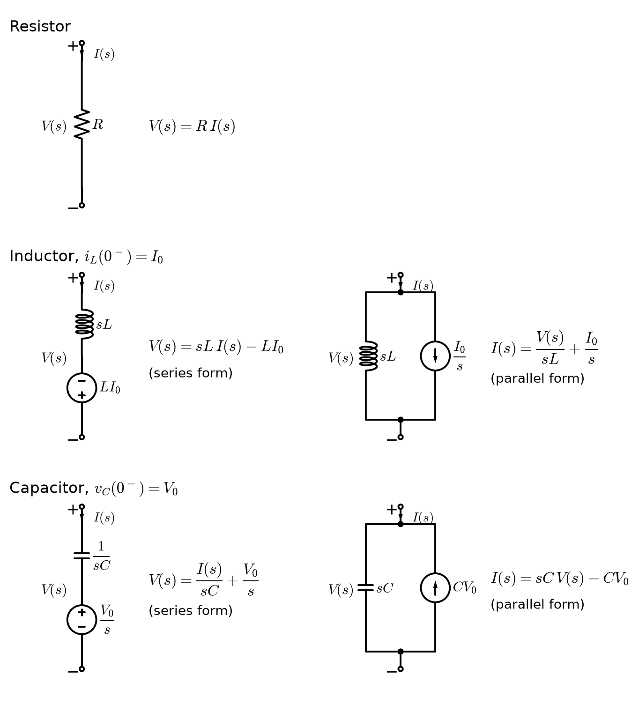
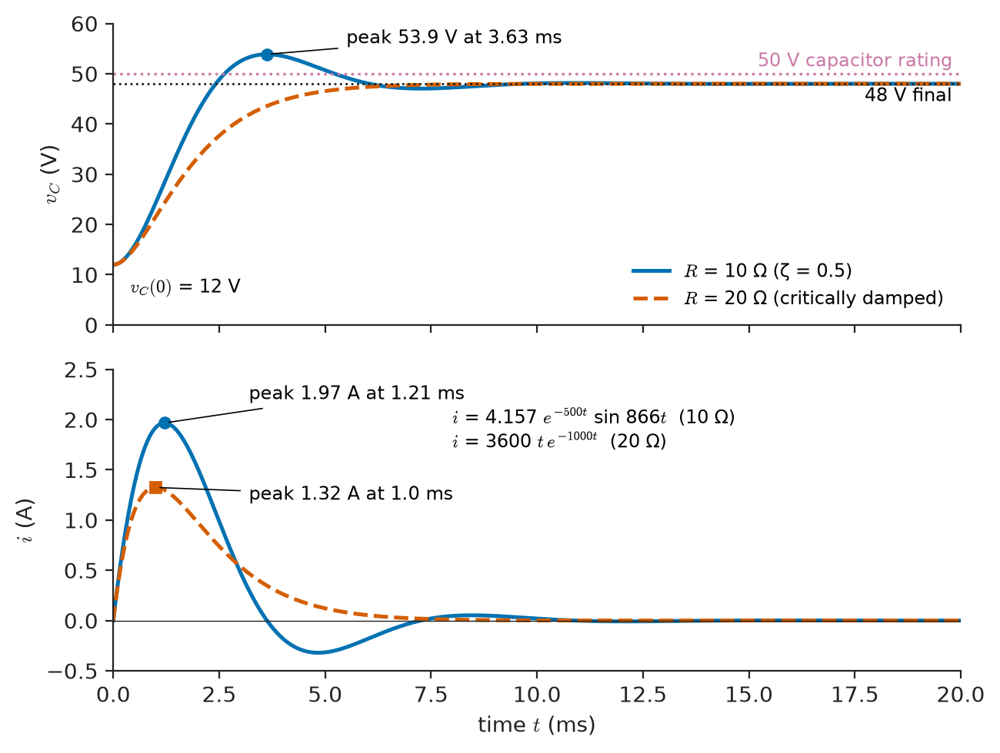
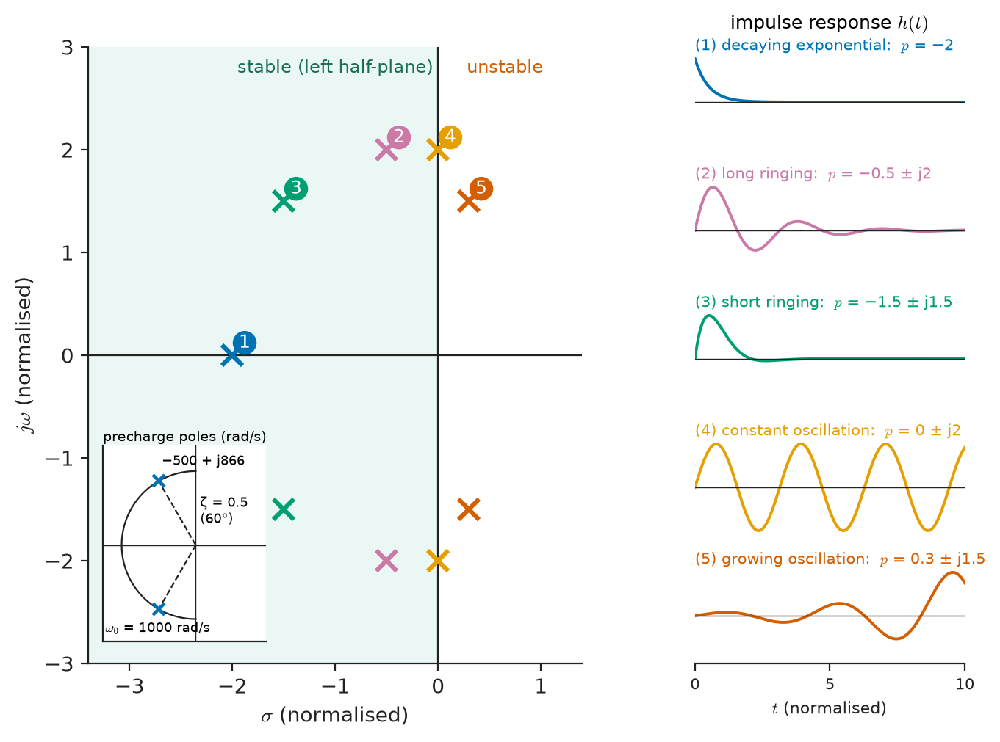
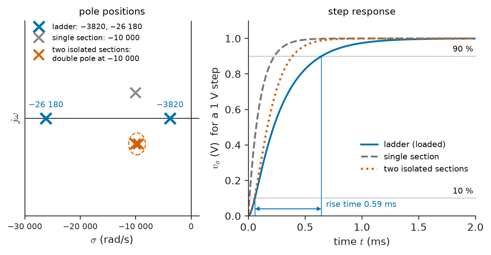
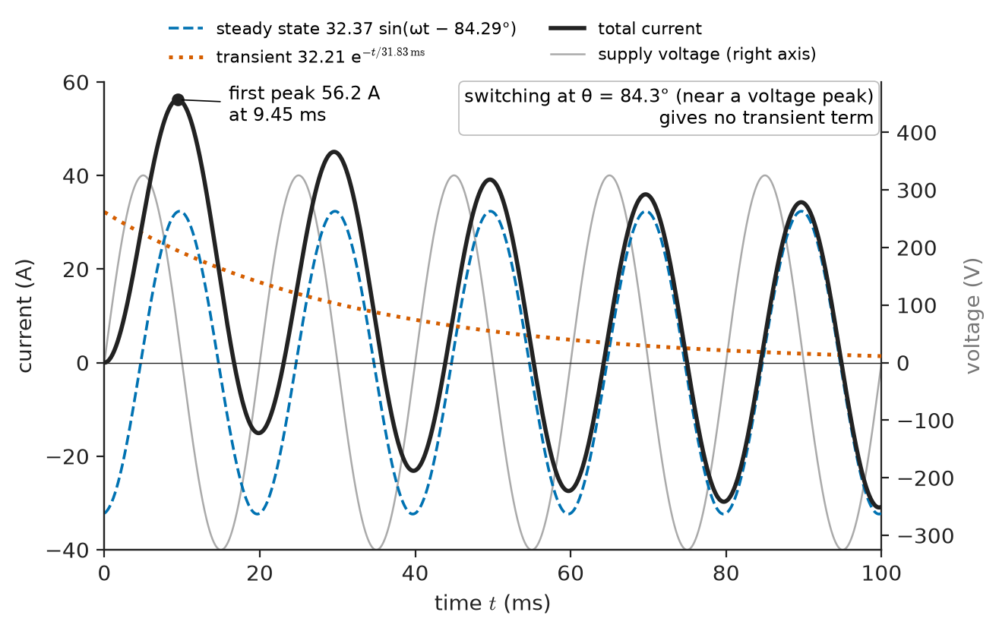

# Chapter 11 — Laplace-Domain Circuit Analysis

*Part III · Advanced Network Theory*

An inverter for a small battery system has a 48 V DC link. To avoid a destructive inrush when the battery contactor closes, the link is first energised through a 10 Ω precharge resistor and a 10 mH filter choke into the 100 μF link capacitor. On the bench everything works. In the field, a technician cycles the system quickly, so the capacitor still holds 12 V from the previous run when the precharge contactor closes. A week later a 50 V-rated electrolytic capacitor in the link has vented. The oscilloscope trace that finally explains it shows the link voltage overshooting to almost 54 V and ringing at about 138 Hz before settling at 48 V. Every ingredient of the failure was in Chapter 7: a series RLC circuit with an initial condition and a step input. But solving it by the classical method (write the differential equation, find the natural response, find a particular solution, fit two constants to the initial conditions) is laborious, error-prone, and hides the structure that tells an engineer how to fix it. This chapter replaces that procedure with algebra. In the Laplace domain the circuit, its initial conditions and its source become one rational function; the overshoot, the ringing frequency, the settling time and the final value are read off from the locations of its poles.

> **How can a circuit with stored energy and arbitrary sources be analysed with the same algebra as a resistive network?**
> **What do the poles and zeros of a network tell us about its transient and steady-state behaviour, and how is the time response recovered from them?**

| Concept | Engineering destination |
|---|---|
| s-domain circuit equations | Switching transients in power converters, relays and breakers |
| s-domain impedance and admittance | Filter design, matching networks, driving-point models of sensors and loudspeakers |
| Initial conditions | Precharge circuits, capacitor banks, pulsed-power and defibrillator discharge |
| Transfer functions | Amplifier and filter specifications, control-loop plant models, instrument front ends |
| Pole-zero analysis | Ringing and overshoot prediction, stability checks, notch filters |
| Partial-fraction expansion | Closed-form time responses for design equations and simulation checks |
| Network response | Step and impulse testing of instruments, settling time of ADC drivers |
| Transient and steady-state separation | Inrush and DC offset in power systems, settling of measurement channels |

**Roadmap.** Why the s-domain (11.1) → transforming the circuit laws (11.2) and the elements (11.3) → stored energy as initial-condition sources (11.4) → transfer functions (11.5) and their poles and zeros (11.6) → inverting by partial fractions (11.7) → complete network response (11.8) → separating transient from steady state, with the initial- and final-value theorems (11.9).

---

## 11.1 Why move to the s-domain

### What the classical method costs

Chapters 6 and 7 solved first- and second-order circuits by writing a differential equation, solving its homogeneous part, guessing a particular solution and fitting constants to the initial conditions. That method has three weaknesses. It requires a differential equation to be written first, which for a network with five energy-storage elements means eliminating variables among coupled ODEs. It treats the initial conditions separately, after the solution form has been chosen, so it is easy to fit the wrong initial value (the inductor current at $0^+$ instead of the inductor voltage, for example). And it handles each kind of input (step, ramp, sinusoid, pulse) with a separate guess.

Chapter 8 showed a better way for one special case: in sinusoidal steady state, impedances $j\omega L$ and $1/(j\omega C)$ turn every network into an algebraic problem. The Laplace transform generalises that idea from $j\omega$ to the complex frequency $s=\sigma+j\omega$, and from sinusoidal steady state to arbitrary inputs that start at $t=0$, with initial conditions built in.

### The transform in one paragraph

The (unilateral) Laplace transform of a signal $f(t)$ defined for $t\ge0^-$ is

$$
F(s)=\mathcal L\{f(t)\}=\int_{0^-}^{\infty}f(t)\,e^{-st}\,dt
$$

which converges for $\mathrm{Re}\{s\}$ larger than some abscissa set by the growth of $f$. The lower limit $0^-$ (just before any switching at $t=0$) is deliberate: it lets the transform include impulses at $t=0$ and makes initial conditions mean "the state of the circuit before the switch operates", which is the state an engineer actually knows. The transform is linear, it turns differentiation into multiplication by $s$ minus the initial value, and integration into division by $s$. These two properties are the whole reason it is useful for circuits. The theory of the transform, including existence, uniqueness and the inversion integral, belongs to *The Mathematics Universe*; Table 11.1 lists the results this chapter uses.

**Table 11.1 — Laplace-transform pairs and properties used in circuit analysis.**

| Time function or operation ($t\ge0$) | Transform |
|---|---|
| Unit impulse $\delta(t)$ | $1$ |
| Unit step $u(t)$ | $1/s$ |
| Ramp $t\,u(t)$ | $1/s^2$ |
| $t^n/n!$ | $1/s^{n+1}$ |
| $e^{-at}$ | $1/(s+a)$ |
| $t\,e^{-at}$ | $1/(s+a)^2$ |
| $\sin\omega t$ | $\omega/(s^2+\omega^2)$ |
| $\cos\omega t$ | $s/(s^2+\omega^2)$ |
| $e^{-at}\sin\omega t$ | $\omega/[(s+a)^2+\omega^2]$ |
| $e^{-at}\cos\omega t$ | $(s+a)/[(s+a)^2+\omega^2]$ |
| Linearity $af(t)+bg(t)$ | $aF(s)+bG(s)$ |
| Derivative $df/dt$ | $sF(s)-f(0^-)$ |
| Integral $\int_{0^-}^t f(\tau)d\tau$ | $F(s)/s$ |
| Time delay $f(t-t_0)u(t-t_0)$ | $e^{-st_0}F(s)$ |
| Exponential shift $e^{-at}f(t)$ | $F(s+a)$ |
| Convolution $\int_0^t f(\tau)g(t-\tau)d\tau$ | $F(s)G(s)$ |
| Initial value $f(0^+)$ | $\lim_{s\to\infty}sF(s)$ |
| Final value $f(\infty)$ (if it exists) | $\lim_{s\to0}sF(s)$ |

> **Boundary.** Convergence, the inversion integral and the two-sided transform are mathematics treated in *The Mathematics Universe*. This chapter uses the table above as established and concentrates on how a circuit is put into a form the table can invert.

### What $s$ means physically

A signal $e^{st}$ with $s=\sigma+j\omega$ is an exponentially growing or decaying sinusoid: $e^{\sigma t}(\cos\omega t+j\sin\omega t)$. The real part $\sigma$ (in nepers per second) is the decay or growth rate; the imaginary part $\omega$ (in radians per second) is the oscillation frequency. Constant signals have $s=0$; pure sinusoids have $s=\pm j\omega$; decaying transients have $\sigma<0$. Every signal a lumped linear circuit produces after switching is a sum of such terms, which is why the complex plane of $s$ is the natural map of circuit behaviour (Section 11.6).

---

## 11.2 Circuit equations in the s-domain

### Kirchhoff's laws transform directly

KCL at a node says $\sum_k i_k(t)=0$ at every instant. Because the transform is linear, the transformed currents also sum to zero: $\sum_kI_k(s)=0$. The same holds for KVL around any loop: $\sum_kV_k(s)=0$. The topology of the network, and therefore every nodal, mesh and matrix formulation of Chapter 3, carries over unchanged to the s-domain.

> **Status of the principle: Kirchhoff's laws in the s-domain**
> *Derived.* Linearity of the Laplace transform applied to KCL and KVL, which are themselves fundamental (charge and energy conservation in lumped circuits); valid wherever the lumped-element assumption holds.

### Element laws transform into algebra

The three passive element laws, with the passive sign convention, transform as follows.

- **Resistor.** $v=Ri$ becomes $V(s)=R\,I(s)$.
- **Inductor.** $v=L\,di/dt$ becomes $V(s)=sL\,I(s)-L\,i_L(0^-)$.
- **Capacitor.** $i=C\,dv/dt$ becomes $I(s)=sC\,V(s)-C\,v_C(0^-)$, or equivalently $V(s)=I(s)/(sC)+v_C(0^-)/s$.

Every derivative has become a multiplication by $s$, and every initial condition has become a known term on the right-hand side. A linear circuit with any number of energy-storage elements therefore produces, in the s-domain, a set of *linear algebraic* equations in the unknown node voltages or mesh currents, with coefficients that are polynomials in $s$. Solving them is Cramer's rule or Gaussian elimination, exactly as in Chapter 3.

Coupled coils transform the same way. The equations $v_1=L_1di_1/dt+M\,di_2/dt$ and $v_2=M\,di_1/dt+L_2di_2/dt$ become

$$
V_1=sL_1I_1+sMI_2-L_1i_1(0^-)-Mi_2(0^-),\qquad V_2=sMI_1+sL_2I_2-Mi_1(0^-)-L_2i_2(0^-)
$$

so a transformer or coupled-inductor filter is handled without any change of method. Dependent sources keep their algebraic definitions: a VCCS $i=g_mv_x$ becomes $I=g_mV_x(s)$.

### The general procedure

1. Determine the state of every capacitor voltage and inductor current at $t=0^-$, from the circuit before switching (usually a DC steady state, in which capacitors are open circuits and inductors short circuits).
2. Redraw the circuit for $t\ge0$ with every element replaced by its s-domain model (Section 11.3) including initial-condition sources (Section 11.4), and every source replaced by its transform.
3. Solve the resulting algebraic network for the wanted quantity by any method: nodal, mesh, division, Thévenin.
4. Simplify to a ratio of polynomials in $s$ and invert by partial fractions (Section 11.7).
5. Check the result at $t=0^+$ and $t\to\infty$ with the initial- and final-value theorems (Section 11.9).

---

## 11.3 Impedance and admittance in the s-domain

### Generalised impedance

With zero initial conditions, each element law reduces to $V(s)=Z(s)I(s)$:

| Element | Impedance $Z(s)$ | Admittance $Y(s)$ | Value at $s=j\omega$ |
|---|---|---|---|
| Resistor | $R$ | $G=1/R$ | $R$ |
| Inductor | $sL$ | $1/(sL)$ | $j\omega L$ |
| Capacitor | $1/(sC)$ | $sC$ | $1/(j\omega C)$ |

Impedances in series add; admittances in parallel add; voltage and current division, source transformation, Thévenin and Norton equivalents, star–delta transformation and every other result of Chapters 2–4 hold for $Z(s)$ and $Y(s)$, because they depend only on linearity and Kirchhoff's laws. Setting $s=j\omega$ recovers the phasor impedances of Chapter 8, so the s-domain contains AC analysis as a special case.

> **Status of the principle: s-domain impedance**
> *Derived.* Follows from the transformed element laws with zero initial state; it holds for linear time-invariant lumped elements and fails for nonlinear elements (saturating inductors, varactor capacitance, diodes), which must be linearised about an operating point first.

### Impedance functions of simple networks

Combining elements gives rational functions of $s$. Three examples recur throughout this book.

A series RLC branch:

$$
Z(s)=R+sL+\frac{1}{sC}=\frac{LC s^2+RCs+1}{sC}
$$

A parallel RLC tank:

$$
Z(s)=\frac{1}{1/R+sC+1/(sL)}=\frac{1}{C}\,\frac{s}{s^2+s/(RC)+1/(LC)}
$$

An RC low-pass section, as a voltage ratio:

$$
\frac{V_o(s)}{V_i(s)}=\frac{1/(sC)}{R+1/(sC)}=\frac{1}{1+sRC}
$$

Impedances of passive RLC networks are always ratios of polynomials with real, non-negative coefficients; they belong to the class of **positive-real** functions, whose real part is non-negative for $\mathrm{Re}\{s\}\ge0$. This property, which expresses the fact that a passive network cannot deliver net energy, is the starting point of network synthesis: given a positive-real function, a passive network that realises it can always be found.

### Thévenin and Norton in the s-domain

An s-domain Thévenin equivalent consists of a source $V_{Th}(s)$, the transform of the open-circuit voltage including any contribution from initial conditions, in series with $Z_{Th}(s)$, the impedance seen with all independent sources (and initial-condition sources) set to zero. This is often the fastest route to a transient response. For example, a sensor with source impedance $Z_s(s)$ driving a cable modelled as a capacitance is a first-order problem once $Z_s$ is known, regardless of how complicated the sensor's internal network is.

### Representative s-domain impedances

**Table 11.2 — Representative networks and their pole locations.**

| Network | Element values (typical) | Characteristic poles | Behaviour |
|---|---|---|---|
| Anti-aliasing RC (audio ADC) | 1 kΩ, 100 nF | $-1.0\times10^4$ rad/s | Corner 1.59 kHz |
| ECG amplifier AC-coupling high-pass | Corner 0.05 Hz | $-0.314$ rad/s | Time constant 3.2 s |
| Oscilloscope probe with 10 cm ground lead | ~100 nH, ~12 pF | $\sigma\pm j\,9.1\times10^8$ rad/s | Rings near 145 MHz |
| Loudspeaker (closed box, $Q_{tc}=0.4$) | $f_s=40$ Hz | $-126$ and $-503$ rad/s | Overdamped bass roll-off |
| Inverter DC-link precharge | 10 Ω, 10 mH, 100 μF | $-500\pm j866$ rad/s | Overshoot 16 % |
| Transmission network fault, X/R = 10–30, 50 Hz | — | $-10.5$ to $-31.4$ rad/s | DC offset decays in 32–95 ms |
| 32.768 kHz watch crystal | $Q\approx5\times10^4$ | $-2.06\pm j2.06\times10^5$ rad/s | Ring-down time constant 0.49 s |

The table spans more than nine decades of $\lvert s\rvert$, yet every entry is analysed with the same algebra.

---

## 11.4 Initial conditions

### The state of a circuit

The energy stored in a circuit at the switching instant is described completely by the capacitor voltages and inductor currents at $t=0^-$. These are the **state variables**: they are continuous in time whenever the currents into capacitors and the voltages across inductors are finite, because changing them instantaneously would require infinite power. Chapter 5 established this continuity; Chapter 6 used it to find $0^+$ values. In the s-domain we do not need $0^+$ values at all: the transformed element laws use the $0^-$ values, and the transform itself produces whatever happens at $0^+$, including any jumps.

### Initial-condition source models

The transformed element laws can be read as small circuits (Figure 11.1).

**Inductor with initial current $I_0=i_L(0^-)$.**
Series form: $V(s)=sL\,I(s)-LI_0$, an impedance $sL$ in series with a voltage source $LI_0$ (a constant times the transform of an impulse) oriented to oppose the reference direction of $V$. Parallel form: $I(s)=V(s)/(sL)+I_0/s$, an impedance $sL$ in parallel with a current source $I_0/s$ (a step) in the direction of the reference current.

**Capacitor with initial voltage $V_0=v_C(0^-)$.**
Series form: $V(s)=I(s)/(sC)+V_0/s$, an impedance $1/(sC)$ in series with a voltage source $V_0/s$ (a step). Parallel form: $I(s)=sCV(s)-CV_0$, an admittance $sC$ in parallel with a current source $CV_0$ (an impulse of charge) directed opposite to the reference current.

The series forms are convenient in mesh analysis, the parallel forms in nodal analysis. Either form, used consistently, gives the same answer; they are source transformations of each other.

<!-- FIGURE 11.1 | figures/ch11/fig-11-1-s-domain-element-models.png | circuit | s-domain models of the resistor, inductor and capacitor, with series and parallel initial-condition sources. | Content: three rows. Row 1: resistor R with V(s), I(s) and passive sign convention. Row 2: inductor; left, impedance sL in series with voltage source L*I0 (polarity opposing V); right, sL in parallel with current source I0/s in the direction of I(s). Row 3: capacitor; left, impedance 1/(sC) in series with voltage source V0/s (plus at the plus terminal of V); right, admittance sC in parallel with current source C*V0 directed against I(s). Label each with the governing equation, e.g. V(s) = sL I(s) - L I0. -->

*Figure 11.1 — s-domain models of the resistor, inductor and capacitor, with series and parallel initial-condition sources.*

> **Status of the principle: Initial-condition source models**
> *Derived.* Direct readings of the transformed constitutive laws with the $0^-$ convention; exact for linear time-invariant capacitors and inductors.

### Worked example — DC-link precharge with a partly charged capacitor

The inverter of the chapter opening: a 48 V source is connected at $t=0$ through $R=10\ \Omega$ and $L=10$ mH to $C=100\ \mu$F. Before the switch closes, $i_L(0^-)=0$ and $v_C(0^-)=12$ V.

**Step 1: s-domain circuit.** The source becomes $48/s$. The capacitor becomes $1/(sC)$ in series with a source $12/s$. The inductor carries no initial current, so it is just $sL$.

**Step 2: mesh equation.** KVL around the single loop:

$$
\frac{48}{s}=\left(R+sL+\frac{1}{sC}\right)I(s)+\frac{12}{s}
$$

so

$$
I(s)=\frac{36/s}{R+sL+1/(sC)}=\frac{36/L}{s^2+(R/L)s+1/(LC)}=\frac{3600}{s^2+1000s+10^6}
$$

The initial voltage has simply been subtracted from the source: only the 36 V difference drives current.

**Step 3: poles.** The denominator has roots $s=-500\pm j866.0$ rad/s. In the notation of Chapter 7, $\alpha=R/(2L)=500\ \mathrm{s^{-1}}$, $\omega_0=1/\sqrt{LC}=1000$ rad/s, $\zeta=\alpha/\omega_0=0.5$ and $\omega_d=\sqrt{\omega_0^2-\alpha^2}=866.0$ rad/s (137.8 Hz). The circuit is underdamped.

**Step 4: invert.** Writing the denominator as $(s+500)^2+866.0^2$ and using Table 11.1:

$$
i(t)=\frac{3600}{866.0}\,e^{-500t}\sin(866.0\,t)=4.157\,e^{-500t}\sin(866.0\,t)\ \mathrm A
$$

The current peaks when $\tan(\omega_dt)=\omega_d/\alpha$, at $t=1.209$ ms, where $i=1.967$ A.

**Step 5: capacitor voltage.** $V_C(s)=I(s)/(sC)+12/s=12/s+3.6\times10^7/[s(s^2+1000s+10^6)]$. Partial fractions (Section 11.7) give

$$
V_C(s)=\frac{48}{s}-\frac{36\,(s+1000)}{(s+500)^2+866.0^2}
$$

$$
v_C(t)=48-36\,e^{-500t}\left[\cos(866.0\,t)+0.5774\,\sin(866.0\,t)\right]\ \mathrm V
$$

The first peak occurs at $t=\pi/\omega_d=3.628$ ms, where $v_C=48+36\,e^{-500\times3.628\times10^{-3}}=53.87$ V. The overshoot is 16.3 % of the 36 V step, the standard $e^{-\pi\zeta/\sqrt{1-\zeta^2}}$ of a second-order system with $\zeta=0.5$ (Figure 11.2). A numerical integration of the circuit ODE gives 53.869 V at the same instant.

**Consequence.** The 50 V capacitor is overstressed by almost 4 V whenever the link is re-energised from a partly charged state. Notice that the overshoot is 16 % of the *difference* between source and initial voltage, so it is worst from a fully discharged capacitor (48 V step, peak $48+0.163\times48=55.8$ V). The design fix is to raise the damping: at $R=2\sqrt{L/C}=20\ \Omega$ the circuit is critically damped (worked in Section 11.7) and the capacitor voltage never exceeds 48 V.

<!-- FIGURE 11.2 | figures/ch11/fig-11-2-precharge-response.png | plot | DC-link precharge with a capacitor initially at 12 V: underdamped (10 ohm) and critically damped (20 ohm) responses. | Content: two stacked panels sharing x-axis time 0 to 20 ms. Top: capacitor voltage, y-axis 0 to 60 V; solid curve vC(t) = 48 - 36 e^(-500t)[cos(866t) + 0.577 sin(866t)] starting at 12 V, peak 53.9 V at 3.63 ms marked; dashed curve for R = 20 ohm, vC = 48 - 36(1 + 1000t) e^(-1000t), no overshoot; horizontal dotted lines at 48 V (final) and 50 V (capacitor rating). Bottom: current, y-axis -0.5 to 2.5 A; solid i(t) = 4.157 e^(-500t) sin(866t), peak 1.97 A at 1.21 ms; dashed i(t) = 3600 t e^(-1000t), peak 1.32 A at 1.0 ms. -->

*Figure 11.2 — DC-link precharge with a capacitor initially at 12 V: underdamped (10 ohm) and critically damped (20 ohm) responses.*

### Impulsive cases: when the state must jump

Continuity of capacitor voltage and inductor current fails in idealised circuits that force a jump: closing a switch that connects two capacitors charged to different voltages, or opening a switch in series with an inductor carrying current. Classical methods struggle here because the $0^+$ values are not given by continuity. The s-domain with the $0^-$ convention handles them automatically: the transform of the response contains a constant term (an impulse), and the jump appears in the inverse transform.

Consider two 100 μF capacitors, one charged to 48 V and one discharged, joined by an ideal switch at $t=0$ with no resistance. In the s-domain the loop contains the two capacitor impedances and the step source $48/s$. The current is $I(s)=(48/s)/(2/(sC))=24C=2.4\times10^{-3}$, a constant, whose inverse is $2.4\times10^{-3}\,\delta(t)$: an impulse carrying 2.4 mC from one capacitor to the other in zero time. Both capacitors end at 24 V. The stored energy falls from 0.1152 J to 0.0576 J; the missing half is dissipated in whatever resistance, arc or radiation the real circuit has, independently of its value. Real circuits always have some resistance and inductance, so the "impulse" is a large, short current pulse; the s-domain idealisation gives its charge exactly and tells the designer that a current-limiting element is needed. The same analysis governs paralleling capacitor banks in substations (inrush currents of several kA), hot-plugging boards onto a powered backplane, and the opening of an inductive circuit, where the impulse of voltage is what destroys relay contacts and transistors without a flyback diode or snubber.

---

## 11.5 Transfer functions

### Definition

For a linear time-invariant network with a single input $x(t)$ and a single output $y(t)$, and *zero initial conditions*, the ratio of the output transform to the input transform does not depend on the input:

$$
H(s)=\frac{Y(s)}{X(s)}\bigg\vert_{\text{zero initial state}}
$$

$H(s)$ is the **transfer function** (or network function). Depending on what $x$ and $y$ are, it is a voltage gain, a current gain, a transimpedance (output voltage per input current) or a transadmittance. When input and output are at the same port, it is a **driving-point** function: the input impedance $Z(s)=V(s)/I(s)$ or admittance $Y(s)$.

Because the input-output relation is algebraic in the s-domain, the transfer function of a lumped network is a ratio of polynomials in $s$ with real coefficients:

$$
H(s)=\frac{b_ms^m+\dots+b_1s+b_0}{a_ns^n+\dots+a_1s+a_0}
$$

The order $n$ of the denominator equals at most the number of independent energy-storage elements. For physical networks driven by finite sources, $m\le n$ (the function is *proper*); a transfer function with $m>n$ would amplify high frequencies without bound and corresponds to an ideal differentiator, which no real network achieves over all frequencies.

> **Status of the principle: Transfer function**
> *Derived.* Exists for linear time-invariant systems because the s-domain input-output relation is multiplication; it describes only the zero-state response and does not exist for nonlinear or time-varying circuits (mixers, switched-capacitor circuits analysed in continuous time, saturating magnetics).

### Impulse response

If the input is a unit impulse, $X(s)=1$ and $Y(s)=H(s)$. The transfer function is therefore the transform of the **impulse response** $h(t)$, and the zero-state response to any input is the convolution $y(t)=\int_0^th(\tau)x(t-\tau)d\tau$, whose transform is $Y(s)=H(s)X(s)$. The time-domain view of this result is the subject of Chapter 17; here it means that one function, $H(s)$, describes the network's response to every input.

### Frequency response is $H(j\omega)$

Evaluating the transfer function on the imaginary axis gives the sinusoidal steady-state gain and phase: $H(j\omega)=\lvert H(j\omega)\rvert e^{j\angle H(j\omega)}$. This is how a network's transient behaviour and its frequency response are tied together: they are the same function evaluated in different parts of the $s$-plane. Chapter 13 develops the frequency-response view (Bode plots, bandwidth, filters); this chapter concentrates on time response.

### Worked example — A two-section RC anti-aliasing filter

An audio data-acquisition front end uses two identical RC sections in cascade before the ADC, with $R=1\ \mathrm{k\Omega}$ and $C=100$ nF, driven from a low-impedance source and feeding a high-impedance ADC buffer. Find the transfer function.

Let $V_1$ be the voltage at the middle node and $\tau=RC=10^{-4}$ s. Nodal analysis at the middle node and at the output node:

$$
\frac{V_1-V_i}{R}+sCV_1+\frac{V_1-V_o}{R}=0,\qquad \frac{V_o-V_1}{R}+sCV_o=0
$$

The second equation gives $V_1=(1+s\tau)V_o$. Substituting in the first:

$$
(2+s\tau)(1+s\tau)V_o-V_o=V_i\quad\Rightarrow\quad H(s)=\frac{V_o}{V_i}=\frac{1}{\tau^2s^2+3\tau s+1}
$$

The denominator is *not* $(1+s\tau)^2$, which would be the product of two isolated sections. The second section loads the first. Its poles are

$$
s=\frac{-3\pm\sqrt5}{2\tau}=-3819.7\ \mathrm{rad/s}\ \ \text{and}\ \ -26\,180\ \mathrm{rad/s}
$$

that is, at 607.9 Hz and 4166.7 Hz, rather than a double pole at 1591.5 Hz. The −3 dB frequency is 595.6 Hz, much lower than the 1591.5 Hz of a single section. The loading effect between cascaded sections is precisely what the two-port methods of Chapter 12 are designed to handle: there the same $H(s)$ falls out of a product of two ABCD matrices.

---

## 11.6 Pole-zero analysis

### Factored form

Factoring numerator and denominator of a rational transfer function gives

$$
H(s)=K\,\frac{(s-z_1)(s-z_2)\cdots(s-z_m)}{(s-p_1)(s-p_2)\cdots(s-p_n)}
$$

The roots $z_i$ of the numerator are the **zeros**, the roots $p_i$ of the denominator the **poles**, and $K$ the gain constant. Because the coefficients are real, complex poles and zeros occur in conjugate pairs. Apart from $K$, the function is completely determined by its poles and zeros, so a plot of them in the $s$-plane (crosses for poles, circles for zeros) is a complete picture of the network.

### Poles are the natural frequencies

The poles of a transfer function are the roots of the circuit's characteristic equation: they are the complex frequencies $s$ at which the network can sustain a response with no input. Each pole contributes a term $e^{p_it}$ to the impulse response. Their location therefore determines the character of every transient (Figure 11.3):

| Pole location | Contribution to $h(t)$ | Circuit example |
|---|---|---|
| Negative real axis, $p=-\alpha$ | $e^{-\alpha t}$, decays with time constant $1/\alpha$ | RC low-pass, RL winding |
| Complex pair, $-\alpha\pm j\omega_d$ | $e^{-\alpha t}\cos(\omega_dt+\theta)$, damped ringing | Underdamped RLC, probe ringing |
| Imaginary axis, $\pm j\omega_0$ | Sustained oscillation | Lossless LC tank, oscillator at threshold |
| At the origin | Constant (a step in $h$) | Ideal integrator, capacitor fed by current |
| Right half-plane | Growing exponential or oscillation | Unstable amplifier, oscillator start-up |
| Repeated pole | Multiplied by $t$, $t^2$, ... | Critically damped RLC |

For a complex pair $p=-\alpha\pm j\omega_d$, the distance from the origin is the undamped natural frequency $\omega_0=\sqrt{\alpha^2+\omega_d^2}$, and the cosine of the angle from the negative real axis is the damping ratio $\zeta=\alpha/\omega_0$. Poles far from the imaginary axis die out quickly; poles close to it ring for a long time. The quality factor of a pole pair is $Q=\omega_0/(2\alpha)=1/(2\zeta)$.

<!-- FIGURE 11.3 | figures/ch11/fig-11-3-s-plane-pole-map.png | pole-zero | The s-plane as a map of transient behaviour: pole positions and the impulse-response shapes they produce. | Content: s-plane with sigma axis -3 to +1 and j omega axis -3 to +3 (normalised units). Pole markers (x) at: -2 (real), -0.5 +/- j2 (lightly damped pair), -1.5 +/- j1.5 (well-damped pair, zeta = 0.71), 0 +/- j2 (imaginary axis), 0.3 +/- j1.5 (right half plane). Next to each, a small inset sketch of h(t) over 0 to 10 time units: decaying exponential, long ringing, short ringing, constant-amplitude sinusoid, growing oscillation. Shade the left half-plane lightly and label it "stable". Dashed radial line at 60 deg from negative real axis labelled "zeta = 0.5" and circle labelled "omega0 = 1000 rad/s" passing through the precharge poles -500 +/- j866 drawn on a secondary inset. -->

*Figure 11.3 — The s-plane as a map of transient behaviour: pole positions and the impulse-response shapes they produce.*

> **Status of the principle: Pole location and stability**
> *Derived.* A response term $e^{p t}$ decays if and only if $\mathrm{Re}\{p\}<0$, so a network is stable (every bounded input gives a bounded output) if and only if all poles of its transfer function lie in the open left half-plane; this holds for any lumped LTI system, with the proviso that a pole cancelled by a zero can still be excited by initial conditions.

### Passive networks are stable

A network made of positive resistors, capacitors, inductors and coupled coils cannot generate energy. Its poles therefore lie in the closed left half-plane, and on the imaginary axis only if they are simple and correspond to lossless resonances. Instability requires an active element: a transistor, an op-amp, a negative-resistance device, or feedback. This is the reason the stability tests of Chapter 34 are needed for amplifiers and control loops but not for passive filters.

### Zeros are transmission blocks

A zero of a transfer function is a complex frequency at which the input produces no output. Zeros on the imaginary axis are frequencies that the network blocks completely: the twin-T notch at 50 Hz used to reject mains hum in an ECG or strain-gauge amplifier has a pair of zeros at $\pm j2\pi\cdot50$ rad/s, and the LC trap in a television IF strip a pair at the trapped frequency. A zero at the origin means DC is blocked (a coupling capacitor). Zeros at infinity (when $m<n$) mean the response falls at high frequency, at $20(n-m)$ dB per decade. Zeros in the right half-plane, which arise in bridged networks, lattice all-pass filters and some amplifiers, give a response that initially moves the wrong way and an extra phase lag; they matter greatly in control (Chapter 34).

Zeros do not affect *which* exponentials appear in a response; that is fixed by the poles. They determine *how much* of each exponential appears, through the residues of Section 11.7.

### Worked example — Pole-zero map of a parallel resonant tank

A parallel tank with $R=1\ \mathrm{k\Omega}$, $L=1$ mH and $C=1\ \mu$F (the kind of circuit used as a tuned load or as a model of a piezoelectric transducer near resonance) has the driving-point impedance

$$
Z(s)=\frac1C\,\frac{s}{s^2+s/(RC)+1/(LC)}=10^6\,\frac{s}{s^2+1000s+10^9}
$$

**Zeros.** One at $s=0$ (the inductor shorts DC) and one at $s=\infty$ (the capacitor shorts high frequencies).

**Poles.** $s=-500\pm j31\,619$ rad/s. So $\alpha=500\ \mathrm{s^{-1}}$, $\omega_0=31\,623$ rad/s ($f_0=5.033$ kHz), $Q=\omega_0/(2\alpha)=31.6$, which agrees with $Q=R\sqrt{C/L}$ for a parallel tank.

**Consequences.** On the imaginary axis at $s=j\omega_0$ the impedance equals $R=1\ \mathrm{k\Omega}$, purely resistive. The poles are close to the axis ($\zeta=0.016$), so a current impulse (a sudden charge dump into the tank) produces a voltage that rings at 5.03 kHz and decays with time constant $1/\alpha=2$ ms, about 10 cycles per time constant. The half-power bandwidth of the impedance is $2\alpha=1000$ rad/s (159 Hz). The pole-zero map alone gives frequency, selectivity and ring-down time, without solving any differential equation.

---

## 11.7 Partial-fraction expansion

### The idea

The transform of any response computed by the s-domain method is a rational function $F(s)=N(s)/D(s)$. If it is strictly proper ($\deg N<\deg D$), it can be written as a sum of simple terms, one for each pole, each of which is in Table 11.1. The coefficients of those terms are the **residues**. Inverting is then a matter of reading the table term by term.

If $F(s)$ is not strictly proper ($\deg N\ge\deg D$), first divide: $F(s)=Q(s)+R(s)/D(s)$. The polynomial part $Q(s)$ inverts to impulses and their derivatives at $t=0$, which appear, for example, in the current of a capacitor driven by an ideal voltage step.

### Distinct real poles

For $F(s)=N(s)/[(s-p_1)(s-p_2)\cdots(s-p_n)]$ with distinct $p_i$:

$$
F(s)=\sum_{i=1}^n\frac{k_i}{s-p_i},\qquad k_i=\left[(s-p_i)F(s)\right]_{s=p_i},\qquad f(t)=\sum_{i=1}^nk_ie^{p_it}
$$

The formula for $k_i$ is Heaviside's "cover-up" rule: cover the factor $(s-p_i)$ and evaluate what remains at $s=p_i$. Equivalently, $k_i=N(p_i)/D'(p_i)$.

### Complex-conjugate poles

A complex pair $p,p^*=-\alpha\pm j\omega_d$ gives conjugate residues $k$ and $k^*$, and their two terms combine into a real damped sinusoid:

$$
\frac{k}{s-p}+\frac{k^*}{s-p^*}\ \longrightarrow\ 2\lvert k\rvert\,e^{-\alpha t}\cos(\omega_dt+\angle k)
$$

In hand work it is usually quicker to avoid complex arithmetic: keep the quadratic factor, write the term as $(As+B)/[(s+\alpha)^2+\omega_d^2]$, find $A$ and $B$ by matching coefficients, and split it into the $e^{-\alpha t}\cos$ and $e^{-\alpha t}\sin$ pairs of Table 11.1. The capacitor voltage of the precharge example was found this way.

### Repeated poles

A pole of multiplicity $r$ at $p$ contributes $r$ terms:

$$
\frac{k_{r}}{(s-p)^r}+\frac{k_{r-1}}{(s-p)^{r-1}}+\dots+\frac{k_1}{s-p},\qquad k_{r-j}=\frac{1}{j!}\,\frac{d^j}{ds^j}\left[(s-p)^rF(s)\right]_{s=p}
$$

which invert to $k_r\,t^{r-1}e^{pt}/(r-1)!$ and so on. The factor $t^{r-1}$ is the signature of a repeated pole.

> **Status of the principle: Partial-fraction expansion**
> *Derived.* An algebraic identity for rational functions, combined with the uniqueness of the inverse Laplace transform; it applies to every lumped LTI network response and is replaced by numerical root-finding when the denominator is of high order.

### Worked example — Critically damped precharge

Repeat the precharge of Section 11.4 with $R=20\ \Omega$, so that $R^2=400=4L/C$ and the circuit is critically damped. The mesh equation now gives

$$
I(s)=\frac{3600}{s^2+2000s+10^6}=\frac{3600}{(s+1000)^2}\quad\Rightarrow\quad i(t)=3600\,t\,e^{-1000t}\ \mathrm A
$$

which peaks at $t=1/1000$ s $=1$ ms with $i=3600\times10^{-3}\times e^{-1}=1.324$ A. For the capacitor voltage,

$$
V_C(s)=\frac{12}{s}+\frac{3.6\times10^7}{s(s+1000)^2}=\frac{12}{s}+\frac{k_0}{s}+\frac{k_2}{(s+1000)^2}+\frac{k_1}{s+1000}
$$

Cover-up at $s=0$: $k_0=3.6\times10^7/10^6=36$. Cover-up of the square at $s=-1000$: $k_2=3.6\times10^7/(-1000)=-36\,000$. Derivative rule: $k_1=\frac{d}{ds}\left[3.6\times10^7/s\right]_{s=-1000}=-3.6\times10^7/10^6=-36$. Hence

$$
v_C(t)=48-36\,e^{-1000t}-36\,000\,t\,e^{-1000t}=48-36\,(1+1000t)\,e^{-1000t}\ \mathrm V
$$

which rises monotonically from 12 V to 48 V with no overshoot (dashed curves in Figure 11.2). The price is a slower approach: the critically damped voltage reaches 47 V (within 1 V of final) at about 5.4 ms, against a first crossing of 47 V at about 2.3 ms for the underdamped circuit, which then overshoots. In a precharge circuit the slower, safe response is the right choice; in a measurement channel the trade between speed and overshoot is the subject of the filter and control chapters.

### Worked example — Step response of the two-section RC filter

Apply a 1 V step to the filter of Section 11.5. With $p_1=-3819.7$ and $p_2=-26\,180$ rad/s,

$$
V_o(s)=\frac1s\,\frac{1}{\tau^2(s-p_1)(s-p_2)}=\frac{k_0}{s}+\frac{k_1}{s-p_1}+\frac{k_2}{s-p_2}
$$

$k_0=1/(\tau^2p_1p_2)=1$ (since $\tau^2p_1p_2=1$); $k_1=1/[\tau^2p_1(p_1-p_2)]=-1.1708$; $k_2=1/[\tau^2p_2(p_2-p_1)]=+0.1708$. Thus

$$
v_o(t)=1-1.1708\,e^{-3819.7t}+0.1708\,e^{-26\,180t}\ \mathrm V
$$

Checks: $v_o(0)=1-1.1708+0.1708=0$, as it must be with both capacitors initially discharged; the slope at $t=0$ is $1.1708\times3819.7-0.1708\times26\,180=0$, as it must be because the output capacitor's current comes through the middle node, which itself starts at zero. Values: 0.213 V at 0.1 ms, 0.456 V at 0.2 ms, 0.827 V at 0.5 ms, 0.974 V at 1 ms. The 10–90 % rise time is 0.586 ms, against $2.2\tau=0.22$ ms for one section alone. The slow pole $p_1$ dominates: its residue is seven times that of the fast pole and its time constant seven times longer. Figure 11.4 shows the pole positions and the step response.

<!-- FIGURE 11.4 | figures/ch11/fig-11-4-rc-ladder-poles-step.png | plot | Two-section RC filter (R = 1 kilohm, C = 100 nF): pole positions and step response compared with a single section. | Content: left panel, s-plane real axis from -30000 to 0 rad/s, poles of the ladder at -3820 and -26180 (x), pole of a single section at -10000 (x, grey), hypothetical double pole of two isolated sections at -10000 (double x, dashed). Right panel: x-axis time 0 to 2 ms, y-axis 0 to 1.1 V; solid curve 1 - 1.1708 e^(-3820t) + 0.1708 e^(-26180t) (ladder); dashed curve 1 - e^(-10000t) (single section); dotted curve for two isolated sections 1 - (1 + 10000t) e^(-10000t); mark the 10 percent and 90 percent levels and the ladder rise time 0.59 ms. -->

*Figure 11.4 — Two-section RC filter (R = 1 kilohm, C = 100 nF): pole positions and step response compared with a single section.*

---

## 11.8 Network response

### Zero-input and zero-state responses

Because the s-domain equations are linear in both the sources and the initial-condition terms, any response splits into two parts:

$$
Y(s)=\underbrace{H(s)X(s)}_{\text{zero-state}}+\underbrace{\frac{N_0(s)}{D(s)}}_{\text{zero-input}}
$$

The **zero-state response** is what the inputs produce from a de-energised circuit; it is the transfer function times the input transform. The **zero-input response** is what the stored energy produces with all independent sources set to zero; its numerator depends on the initial conditions, but its denominator is the same characteristic polynomial $D(s)$, so it contains the same natural frequencies. The complete response is their sum.

In the precharge example, the zero-input part is the response to $v_C(0^-)=12$ V with the 48 V source shorted, and the zero-state part is the response to the 48 V step with the capacitor discharged. For the current, the two parts are $-12/L$ and $+48/L$ over the same quadratic, giving the net $36/L$ found directly.

> **Status of the principle: Decomposition into zero-input and zero-state responses**
> *Derived.* Superposition applied to the s-domain equations, treating initial-condition sources as additional inputs; exact for linear networks, invalid for nonlinear ones, where the response to stored energy and the response to inputs interact.

### Response to standard inputs

| Input | $X(s)$ | Zero-state response transform | Use |
|---|---|---|---|
| Unit impulse | $1$ | $H(s)$ | Characterises the network; hammer test, short pulse test |
| Unit step | $1/s$ | $H(s)/s$ | Settling time, overshoot, rise time; switch-on behaviour |
| Ramp | $1/s^2$ | $H(s)/s^2$ | Tracking error of sweeps and ramps |
| Sinusoid $\cos\omega t$ | $s/(s^2+\omega^2)$ | $H(s)\,s/(s^2+\omega^2)$ | Switch-on transient plus AC steady state |
| Delayed pulse | $(1-e^{-sT})/s$ | $H(s)(1-e^{-sT})/s$ | Response to digital pulses and bursts |

The step response is the integral of the impulse response, $Y(s)=H(s)/s$, which is why a laboratory step test, easier to generate than an impulse, characterises a network just as completely. For the two-section filter the impulse response is

$$
h(t)=\frac{1}{\tau^2(p_1-p_2)}\left(e^{p_1t}-e^{p_2t}\right)=4472\left(e^{-3819.7t}-e^{-26\,180t}\right)\ \mathrm{s^{-1}}
$$

and its integral reproduces the step response of Section 11.7.

### Pulses and piecewise inputs

The time-delay property turns piecewise inputs into sums of shifted steps. A rectangular pulse of height $V$ and width $T$ is $V[u(t)-u(t-T)]$, with transform $V(1-e^{-sT})/s$. The response is the step response minus the same response delayed by $T$. This is how the effect of a finite-width digital pulse passing through an RC interconnect, or of a 1 ms defibrillator-test pulse through a biomedical amplifier's input network, is computed: one step response, superposed twice.

### Multi-input networks

When a network has several independent sources and stored energy, the s-domain solution by nodal or mesh analysis gives the complete response at once. For hand work, superposition is often clearer: compute the response to each source and to each initial condition separately, using the transfer function from that source to the output, and add. This is particularly useful in instrumentation, where a sensor signal, an interference source and an offset all drive the same front end and their contributions to the output must be ranked.

---

## 11.9 Transient and steady-state separation

### Which poles produce what

The response transform $Y(s)=H(s)X(s)$ (plus any zero-input part) has two kinds of poles:

- the poles of $H(s)$, the network's **natural frequencies**, which in a stable network all lie in the left half-plane and give terms that decay to zero: the **transient response**;
- the poles of $X(s)$, the **forced frequencies** of the input, which give terms of the same form as the input: the **steady-state** (or forced) response. A step has a pole at $s=0$ and gives a constant; a sinusoid has poles at $\pm j\omega$ and gives a sinusoid at the same frequency.

The partial-fraction expansion separates the two automatically: the terms belonging to the network poles are the transient, the terms belonging to the input poles are the steady state. The residues at the input poles are the steady-state amplitudes; for a sinusoidal input they equal $\lvert H(j\omega)\rvert$ and $\angle H(j\omega)$, which shows that phasor analysis (Chapter 8) is the steady-state part of the Laplace solution.

> **Status of the principle: Transient–steady-state separation**
> *Derived.* Follows from partial-fraction expansion of $H(s)X(s)$ when the poles of $H$ and $X$ are distinct; it requires a stable network (otherwise the "transient" never dies), and when an input pole coincides with a network pole (resonant excitation) the terms merge into a $t\,e^{pt}$ response that is neither purely transient nor steady.

### Worked example — Energising an inductive load on the mains

A large inductive load (a transformer's short-circuit impedance, a reactor or a motor at standstill) with $R=1\ \Omega$ and $X=\omega L=10\ \Omega$ at 50 Hz (so $L=31.83$ mH and $\tau=L/R=31.83$ ms) is switched onto a 230 V, 50 Hz supply, $v(t)=325.3\sin(\omega t+\theta)$, at $t=0$. The current is initially zero.

**Steady state by phasors.** $\lvert Z\rvert=\sqrt{1+100}=10.05\ \Omega$, $\varphi=\arctan10=84.29^\circ$, so the steady-state current is $i_{ss}(t)=32.37\sin(\omega t+\theta-84.29^\circ)$ A.

**Complete solution by Laplace.** For switching at a voltage zero ($\theta=0$), $V(s)=325.3\,\omega/(s^2+\omega^2)$ and

$$
I(s)=\frac{325.3\,\omega}{(s^2+\omega^2)\,(Ls+R)}=\frac{k}{s+R/L}+\frac{As+B}{s^2+\omega^2}
$$

The quadratic term inverts to the steady-state sinusoid above. The cover-up rule at the network pole $s=-R/L=-31.42$ rad/s gives the transient residue

$$
k=\frac{325.3\,\omega/L}{(R/L)^2+\omega^2}=\frac{325.3\times X}{R^2+X^2}=\frac{3253}{101}=32.21\ \mathrm A
$$

so that

$$
i(t)=32.37\sin(\omega t-84.29^\circ)+32.21\,e^{-t/31.83\,\mathrm{ms}}\ \mathrm A
$$

At $t=0$ the two terms cancel ($32.37\sin(-84.29^\circ)=-32.21$), as the continuity of inductor current requires. The second term is a **DC offset**: a decaying unidirectional component. Because $\tau$ is longer than a cycle, it has barely decayed half a cycle later, when the sinusoid reaches its own positive peak. The total current peaks at 56.2 A at $t=9.45$ ms, 1.74 times the steady-state peak (Figure 11.5).

If instead the switch closes at $\theta=\varphi=84.29^\circ$ (close to a voltage peak), the transient residue is zero and the current starts directly in its steady state. Switching at a voltage zero is the worst case for an inductive circuit. This is why circuit breakers must be rated for an asymmetrical peak current of up to about 2.5 times the symmetrical rms value (IEC 62271-100 uses 2.5 for 50 Hz systems with $X/R=14$), why controlled ("point-on-wave") switching closes reactors near voltage peaks, and why, in a transformer with a saturable core, the same DC offset of flux drives the core into saturation and produces inrush currents of several times rated current. The saturating case is nonlinear and outside the Laplace method, but the linear analysis shows where the offset comes from.

<!-- FIGURE 11.5 | figures/ch11/fig-11-5-rl-ac-energisation.png | plot | Energising an R-L load (1 ohm, 31.8 mH) at a voltage zero on a 230 V 50 Hz supply: steady-state and transient components add to an asymmetrical current. | Content: x-axis time 0 to 100 ms, y-axis current -40 to +60 A. Dashed: steady-state component 32.37 sin(314.16t - 84.29 deg). Dotted: transient component 32.21 e^(-t/31.83 ms). Solid: total current, first peak 56.2 A at 9.45 ms marked. Thin grey: supply voltage scaled to fit (secondary axis -325 to +325 V). Inset or annotation: switching at theta = 84.3 deg gives no transient. -->

*Figure 11.5 — Energising an R-L load (1 ohm, 31.8 mH) at a voltage zero on a 230 V 50 Hz supply: steady-state and transient components add to an asymmetrical current.*

### Initial- and final-value theorems

Two limits of the transform give values of the time response without inverting it:

$$
f(0^+)=\lim_{s\to\infty}sF(s),\qquad f(\infty)=\lim_{s\to0}sF(s)
$$

The final-value theorem is valid only when $f(t)$ actually settles: all poles of $sF(s)$ must lie in the open left half-plane. It gives nonsense for a sinusoidal steady state (poles on the imaginary axis) or an unstable network.

Applied to the precharge example: $\lim_{s\to\infty}sV_C(s)=12$ V, the initial capacitor voltage; $\lim_{s\to0}sV_C(s)=12+3.6\times10^7/10^6=48$ V, the final value. For the current, $\lim_{s\to\infty}sI(s)=0$ (the inductor prevents a jump) and $\lim_{s\to0}sI(s)=0$ (the capacitor blocks DC). For the RL energisation, the final-value theorem must not be used: $sI(s)$ has poles at $\pm j\omega$.

> **Status of the principle: Initial- and final-value theorems**
> *Derived.* Limits of the Laplace integral; the initial-value theorem requires $F(s)$ strictly proper (otherwise $f$ contains an impulse at $t=0$), and the final-value theorem requires all poles of $sF(s)$ in the open left half-plane.

### Settling time and the dominant pole

The transient dies away at the rate of the slowest network pole, the one nearest the imaginary axis. A practical measure is the settling time to within 2 % of the final value, approximately $4/\alpha_{\min}$ where $\alpha_{\min}$ is the smallest decay rate. For the two-section filter, $4/3819.7=1.05$ ms; for the underdamped precharge, $4/500=8$ ms; for the RL energisation, $4\tau=127$ ms, more than six cycles of the mains. An ADC driver that must settle to half an LSB of a 16-bit converter needs $\ln(2^{17})\approx11.8$ time constants of its dominant pole, which sets the minimum bandwidth of the driver for a given sample rate.

> **Status of the principle: Dominant-pole approximation**
> *Approximate.* When one real pole (or pair) is much closer to the imaginary axis than the others, typically by a factor of 5 or more, and its residue is not small, the response after the first few fast time constants is well described by that pole alone; it fails when poles are comparably spaced or when a nearby zero nearly cancels the dominant pole.

### Where the Laplace method stops

The method requires linear, time-invariant, lumped elements. It does not handle saturation, hysteresis, diodes and switches that change state during the transient (each interval must be solved separately with the end state of one as the initial state of the next), or distributed elements whose impedance is not rational in $s$. Transmission lines (Chapter 14) produce transforms containing $e^{-s\ell/v}$ and $\sqrt{s}$-type functions; they are still handled in the s-domain, but partial fractions no longer suffice. For large networks, the s-domain formulation is the basis of state-space and circuit-simulator methods (Chapters 33 and 35), which replace hand factoring by numerical eigenvalue computation.

---

## What remains open

| Open question | Where it is answered |
|---|---|
| How does a network with an input port and an output port compose with others, so that loading is handled systematically? | Chapter 12 (two-port networks, ABCD cascades) |
| How are magnitude, phase, bandwidth and Q displayed and designed from poles and zeros? | Chapter 13 (Bode plots, resonance, passive filters) |
| What happens when interconnects are long enough that the lumped model fails? | Chapter 14 (transmission lines) |
| How do impulse response, convolution and transfer function relate for general signals and systems? | Chapters 16–18 (systems, LTI theory, Fourier analysis) |
| What is the discrete-time counterpart of the s-plane? | Chapter 20 (Z-transform, poles and zeros in the z-plane) |
| How is stability tested and controlled when feedback can move poles into the right half-plane? | Chapter 34 (Routh–Hurwitz, root locus, Nyquist) |
| State-space form of network equations | Chapters 33 and 35 |
| The Laplace transform itself: existence, inversion integral, proofs | *The Mathematics Universe* |
| Transformer inrush and breaker asymmetry in power systems | *Electrical Energy & Machines* |

**Next:** Chapter 12 treats a network as a box with two ports and characterises it by a small matrix of s-domain functions, so that amplifiers, filters and transmission lines can be cascaded and terminated without re-solving them.
