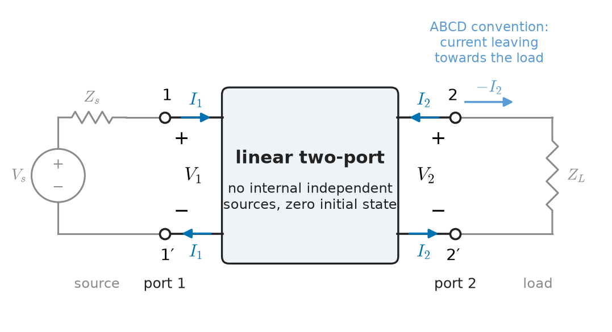
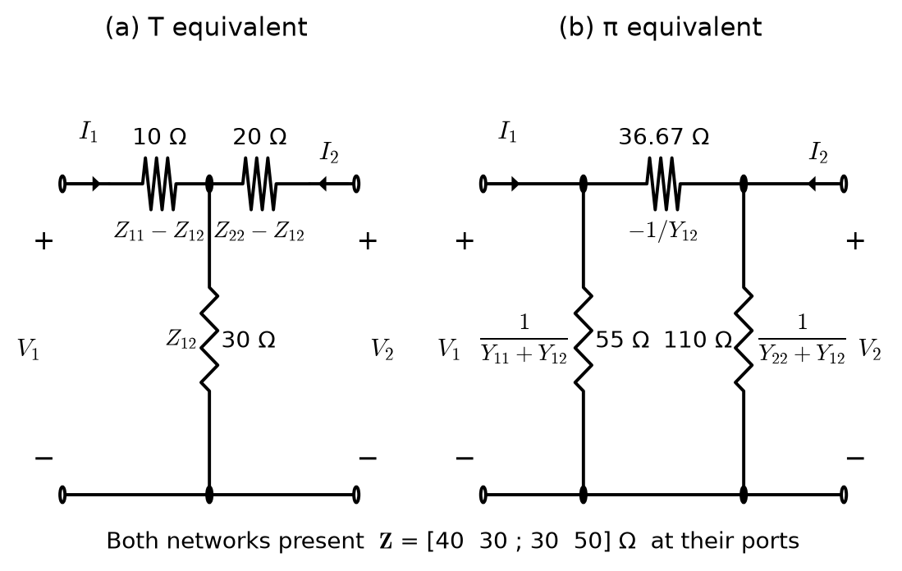
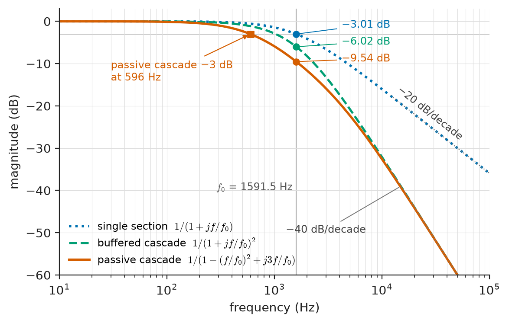
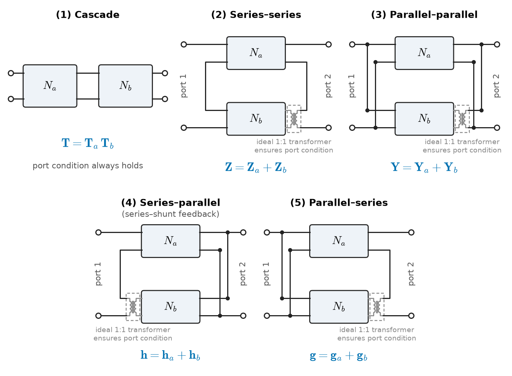
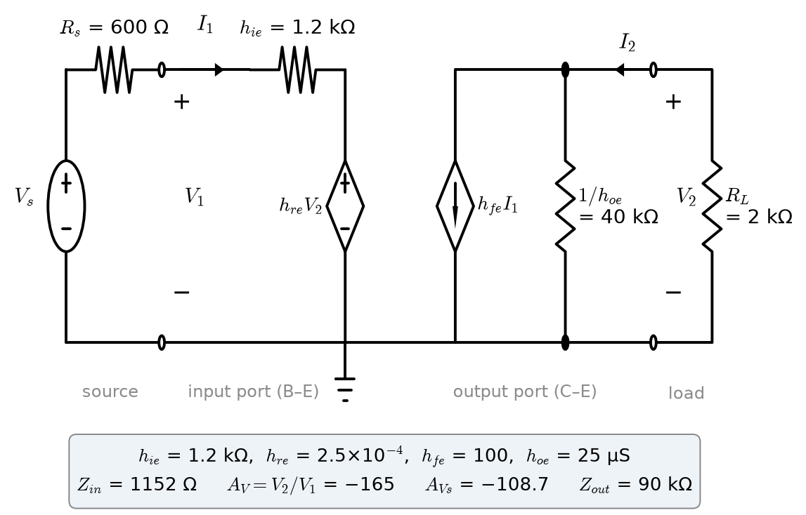
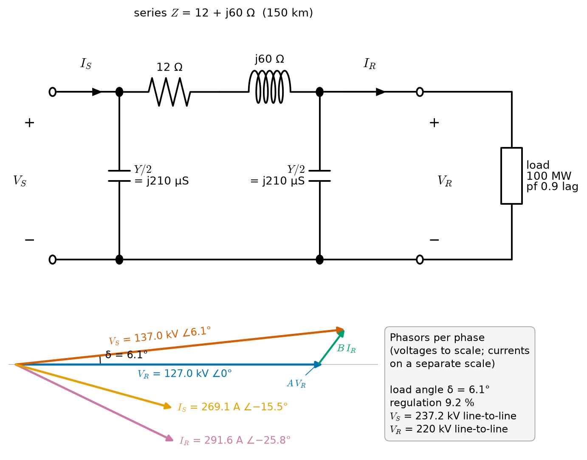

# Chapter 12 — Two-Port Networks

*Part III · Advanced Network Theory*

A technician needs 20 dB of attenuation in front of a spectrum analyser and finds two 10 dB coaxial pads in a drawer. Screwed together, they give 20.0 dB, exactly, as the label promises. The same technician then builds a crude anti-aliasing filter by putting two identical RC sections in series, each with a corner frequency of 1.59 kHz and each, on its own, 3 dB down at that frequency. The pair is not 6 dB down at 1.59 kHz but 9.5 dB down, and its corner has moved to 600 Hz. A transmission engineer has a related problem at a hundred thousand times the power: a 150 km, 220 kV line must deliver 100 MW at 0.9 power factor to a city substation, and the operator needs to know what voltage to hold at the power station, and what the substation voltage will do at night when the load drops away. In each case a network sits between a source and a load, and the question is what it does to the signal or the power passing through it, and what happens when it is connected to something else. Re-solving the whole circuit every time a load or source changes is wasteful and hides the answer's structure. This chapter treats each network as a box with an input port and an output port, characterised by four numbers (or four functions of $s$), and develops the algebra for terminating, converting and combining such boxes.

> **How can a linear network be described by its terminal behaviour alone, so that it can be connected to any source and load without re-solving its interior?**
> **Why do some networks cascade by simple multiplication and others not, and what do reciprocity and symmetry buy us?**

| Concept | Engineering destination |
|---|---|
| Z parameters | Transformer open-circuit tests, sensor and antenna coupling, series-connected networks |
| Y parameters | Transistor models at high frequency, nodal simulators, parallel-connected networks |
| Hybrid parameters | Bipolar-transistor small-signal models, series-shunt feedback amplifiers |
| ABCD parameters | Transmission lines, cascaded filters and attenuators, power-system line models |
| Parameter conversion | Combining datasheet models given in different forms, simulator interfaces |
| Cascaded networks | Filter chains, attenuator pads, multi-section lines, amplifier chains |
| Reciprocity and symmetry | Passive filters and pads, test-fixture de-embedding, measurement checks |
| Amplifier and transmission applications | Loaded gain and impedance of amplifiers; sending-end voltage, regulation and Ferranti rise on lines |

**Roadmap.** The two-port model and its assumptions (12.1) → the four principal parameter sets: Z (12.2), Y (12.3), hybrid (12.4), ABCD (12.5) → converting between them (12.6) → terminating a two-port with source and load (12.7) → combining two-ports, above all in cascade (12.8) → reciprocity and symmetry (12.9) → amplifiers and transmission systems (12.10).

---

## 12.1 The two-port model

### Ports and the port condition

A **port** is a pair of terminals at which the current entering one terminal equals the current leaving the other. A **two-port** is a network with two such pairs, conventionally an input port 1 and an output port 2 (Figure 12.1). Each port has a voltage $V_k$ and a current $I_k$, with $I_k$ defined as flowing *into* the network at the positive terminal. Four quantities $V_1,I_1,V_2,I_2$ describe everything the outside world can observe.

The port condition is not automatic. Inside a larger circuit, the current into terminal 1 need not return through terminal 1′; a path through some other connection can carry part of it. The two-port description is valid only when the external connections enforce the port condition, for example because the source and load each connect to one port only. Section 12.8 shows where this matters.

<!-- FIGURE 12.1 | figures/ch12/fig-12-1-two-port-conventions.png | schematic | A two-port network with port voltages and currents, and the alternative current direction used by ABCD parameters. | Content: central box labelled "linear two-port (no internal independent sources, zero initial state)". Left terminals 1 and 1', right terminals 2 and 2'. V1 across port 1 with + at 1, I1 entering at 1 and leaving at 1'. V2 across port 2 with + at 2, I2 entering at 2. A second, lighter arrow at port 2 labelled "-I2 (ABCD convention, current leaving towards the load)". Below the box, a source Vs with Zs at port 1 and a load ZL at port 2 drawn in grey. -->

*Figure 12.1 — A two-port network with port voltages and currents, and the alternative current direction used by ABCD parameters.*

### Assumptions

The two-port descriptions of this chapter assume that the network is

- **linear** and **time-invariant**, so that its port quantities are related by linear equations with constant coefficients in the s-domain or in phasor form;
- free of **independent sources** inside (dependent sources are allowed, and are what make amplifiers possible);
- at **zero initial state** when described in the s-domain (stored energy would add source-like terms, Chapter 11).

Under these assumptions, any two of the four port quantities can be chosen as independent variables, and the other two are linear functions of them. There are $\binom42=6$ ways to choose, so six parameter sets exist. Four are in common use and are developed here: impedance (Z), admittance (Y), hybrid (h, with its inverse g) and transmission (ABCD). The parameters are functions of $s$ (or of $j\omega$ in sinusoidal steady state); for purely resistive networks they are constants.

> **Status of the principle: Two-port representation**
> *Derived.* Linearity and the absence of internal independent sources make two of the port variables linear functions of the other two (by superposition); the description fails for nonlinear networks (large-signal transistors, saturating transformers), for networks with internal sources unless an offset term is added, and wherever the port condition is violated.

### What the model buys

Once a network has been reduced to four parameters, its interior can be forgotten. Its input impedance with any load, its gain from any source, its output impedance, and its behaviour when connected to another two-port all follow from those four numbers by formulas that never change. This is the same economy as Thévenin's theorem (Chapter 4), extended from one port to two. It is how a transistor datasheet describes a device without a circuit diagram, how a power-system engineer represents 150 km of line in a load-flow program, and how a vector network analyser characterises a filter.

---

## 12.2 Z parameters

### Definition

Choose the two currents as independent variables. Superposition gives

$$
\begin{aligned}
V_1&=Z_{11}I_1+Z_{12}I_2\\
V_2&=Z_{21}I_1+Z_{22}I_2
\end{aligned}
\qquad\text{or}\qquad
\begin{bmatrix}V_1\\V_2\end{bmatrix}=\mathbf Z\begin{bmatrix}I_1\\I_2\end{bmatrix}
$$

Each parameter is measured with one port open-circuited (zero current), which is why they are called **open-circuit impedance parameters**:

$$
Z_{11}=\frac{V_1}{I_1}\bigg\vert_{I_2=0},\quad Z_{12}=\frac{V_1}{I_2}\bigg\vert_{I_1=0},\quad Z_{21}=\frac{V_2}{I_1}\bigg\vert_{I_2=0},\quad Z_{22}=\frac{V_2}{I_2}\bigg\vert_{I_1=0}
$$

$Z_{11}$ and $Z_{22}$ are the driving-point impedances with the other port open; $Z_{12}$ and $Z_{21}$ are transfer impedances. All four are in ohms.

### The T equivalent

Any reciprocal two-port ($Z_{12}=Z_{21}$) can be represented by a T network: series arm $Z_{11}-Z_{12}$ at port 1, series arm $Z_{22}-Z_{12}$ at port 2, and shunt arm $Z_{12}$ (Figure 12.2a). Conversely, a T network with series arms $Z_a$ (port 1) and $Z_b$ (port 2) and shunt arm $Z_c$ has

$$
Z_{11}=Z_a+Z_c,\qquad Z_{12}=Z_{21}=Z_c,\qquad Z_{22}=Z_b+Z_c
$$

A non-reciprocal network adds a current-controlled voltage source $(Z_{21}-Z_{12})I_1$ in series with port 2.

**Worked example — Parameters of a resistive T network.** Take $Z_a=10\ \Omega$, $Z_b=20\ \Omega$, $Z_c=30\ \Omega$. Then

$$
\mathbf Z=\begin{bmatrix}40&30\\30&50\end{bmatrix}\ \Omega,\qquad \Delta Z=Z_{11}Z_{22}-Z_{12}Z_{21}=2000-900=1100\ \Omega^2
$$

Check by inspection: with port 2 open, port 1 sees $10+30=40\ \Omega$, and the open-circuit output voltage is the voltage across the 30 Ω shunt, $30I_1$. This network is used again in the following sections, so that every parameter set can be checked against the same circuit.

<!-- FIGURE 12.2 | figures/ch12/fig-12-2-t-and-pi-equivalents.png | circuit | The T and pi equivalents of the same reciprocal two-port, using the worked-example values. | Content: (a) T network between ports 1-1' and 2-2': series 10 ohm at port 1, series 20 ohm at port 2, shunt 30 ohm to the common bottom rail; general labels Z11 - Z12, Z22 - Z12, Z12 beside the numbers. (b) pi network: shunt 55 ohm at port 1, series 36.67 ohm between the top terminals, shunt 110 ohm at port 2; general labels 1/(Y11 + Y12), -1/Y12, 1/(Y22 + Y12). Ports marked with V1, I1, V2, I2. Caption note under the figure: both present Z = [40 30; 30 50] ohm at their ports. -->

*Figure 12.2 — The T and pi equivalents of the same reciprocal two-port, using the worked-example values.*

### Measurement and physical meaning

Z parameters are natural when open circuits are easy to make. The **open-circuit test of a power transformer** is a Z-parameter measurement: rated voltage is applied to one winding with the other open, and the measured current and power give $Z_{11}$ (dominated by the magnetising branch) and, from the open-circuit secondary voltage, $Z_{21}$. Z parameters also describe the mutual coupling of two antennas or two coils: for coupled inductors, $Z_{11}=R_1+sL_1$, $Z_{22}=R_2+sL_2$ and $Z_{12}=Z_{21}=sM$, which is exactly the s-domain coupled-coil law of Chapter 11.

Z parameters do not exist for every network. An ideal transformer has no finite open-circuit impedance, and a network consisting of a single series impedance between the ports has $Z_{11}$ undefined (with port 2 open no current flows, whatever the voltage). In such cases another parameter set is used.

---

## 12.3 Y parameters

### Definition

Choose the two voltages as independent variables:

$$
\begin{aligned}
I_1&=Y_{11}V_1+Y_{12}V_2\\
I_2&=Y_{21}V_1+Y_{22}V_2
\end{aligned}
\qquad
Y_{11}=\frac{I_1}{V_1}\bigg\vert_{V_2=0},\ \ Y_{12}=\frac{I_1}{V_2}\bigg\vert_{V_1=0},\ \ Y_{21}=\frac{I_2}{V_1}\bigg\vert_{V_2=0},\ \ Y_{22}=\frac{I_2}{V_2}\bigg\vert_{V_1=0}
$$

These are the **short-circuit admittance parameters**, in siemens. When both exist, $\mathbf Y=\mathbf Z^{-1}$.

### The π equivalent

A reciprocal two-port ($Y_{12}=Y_{21}$) is represented by a π network: shunt admittance $Y_{11}+Y_{12}$ at port 1, series admittance $-Y_{12}$ between the ports, shunt admittance $Y_{22}+Y_{12}$ at port 2. For a π network of shunt admittances $Y_A$ and $Y_B$ and series admittance $Y_C$: $Y_{11}=Y_A+Y_C$, $Y_{22}=Y_B+Y_C$, $Y_{12}=Y_{21}=-Y_C$. A non-reciprocal network adds a voltage-controlled current source $(Y_{21}-Y_{12})V_1$ across port 2; with $Y_{12}=0$ and $Y_{21}=g_m$, this is the familiar transconductance model of a field-effect transistor.

**Worked example — Y parameters of the T network.** Inverting $\mathbf Z$ of Section 12.2:

$$
\mathbf Y=\frac{1}{1100}\begin{bmatrix}50&-30\\-30&40\end{bmatrix}=\begin{bmatrix}45.45&-27.27\\-27.27&36.36\end{bmatrix}\ \mathrm{mS}
$$

Check $Y_{11}$ by inspection: with port 2 shorted, port 1 sees $10+(30\parallel20)=10+12=22\ \Omega$, and $1/22=45.45$ mS. The π equivalent has shunt arms $1/(45.45-27.27)\ \mathrm{mS}=55\ \Omega$ at port 1 and $1/(36.36-27.27)\ \mathrm{mS}=110\ \Omega$ at port 2, and a series arm $1/27.27\ \mathrm{mS}=36.67\ \Omega$ (Figure 12.2b). These are the values given by the star–delta transformation of Chapter 4: the sum of pairwise products of the T arms is $10\cdot20+20\cdot30+30\cdot10=1100$, and dividing by the opposite arm gives 36.67, 55 and 110 Ω.

### Where Y parameters are natural

Y parameters are measured with short circuits, which are easy to provide at high frequency with a large capacitor, so they were the classical way to characterise RF transistors before S-parameters (Chapter 32). They are the natural form for **parallel-connected** networks (Section 12.8) and for nodal analysis: a circuit simulator stamps each element's Y-matrix into the global nodal admittance matrix. A FET at moderate frequency is well described by $Y_{11}=s(C_{gs}+C_{gd})$, $Y_{12}=-sC_{gd}$, $Y_{21}=g_m-sC_{gd}$, $Y_{22}=g_{ds}+sC_{gd}$; the small feedback term $Y_{12}$ is what makes a high-gain stage prone to oscillation and gives the Miller effect.

---

## 12.4 Hybrid parameters

### The h parameters

Choose $I_1$ and $V_2$ as independent variables:

$$
\begin{aligned}
V_1&=h_{11}I_1+h_{12}V_2\\
I_2&=h_{21}I_1+h_{22}V_2
\end{aligned}
$$

$$
h_{11}=\frac{V_1}{I_1}\bigg\vert_{V_2=0}\ (\Omega),\quad h_{12}=\frac{V_1}{V_2}\bigg\vert_{I_1=0},\quad h_{21}=\frac{I_2}{I_1}\bigg\vert_{V_2=0},\quad h_{22}=\frac{I_2}{V_2}\bigg\vert_{I_1=0}\ (\mathrm S)
$$

The four parameters have mixed dimensions, hence "hybrid": $h_{11}$ is the input impedance with the output shorted, $h_{12}$ the reverse voltage ratio with the input open, $h_{21}$ the forward current ratio with the output shorted, and $h_{22}$ the output admittance with the input open. The equivalent circuit (drawn for a transistor stage in Figure 12.5) is a Thévenin form at the input ($h_{11}$ in series with a controlled voltage source $h_{12}V_2$) and a Norton form at the output (a controlled current source $h_{21}I_1$ in parallel with $h_{22}$).

### Why the bipolar transistor uses h parameters

At low frequency a bipolar transistor in common-emitter connection has a low input impedance (hundreds of ohms to tens of kilohms) and a high output impedance (tens of kilohms or more). Shorting the output (for $h_{11}$, $h_{21}$) is easy to do with a large capacitor across a high impedance; opening the input (for $h_{12}$, $h_{22}$) is easy because the source can be an inductor or large resistor compared with a low input impedance. The measurement conditions match the device, so the parameters can be measured accurately. The h parameters also have direct physical meaning: $h_{fe}$ (the common-emitter $h_{21}$) is the small-signal current gain β, $h_{ie}$ is the base input resistance $r_\pi$, and $h_{oe}$ is the inverse of the collector output resistance.

The subscripts $i,r,f,o$ (input, reverse, forward, output) followed by $e,b,c$ (the common terminal) are the standard datasheet notation: $h_{ie}=h_{11}$, $h_{re}=h_{12}$, $h_{fe}=h_{21}$, $h_{oe}=h_{22}$ for the common-emitter connection.

**Table 12.1 — Representative h parameters of small-signal bipolar transistors (common emitter, room temperature, audio frequencies).**

| Parameter | Symbol | Typical range | Example (general-purpose NPN, $I_C\approx2$ mA) |
|---|---|---|---|
| Input impedance | $h_{ie}$ | 0.5–10 kΩ (falls as $I_C$ rises) | 1.2 kΩ |
| Reverse voltage ratio | $h_{re}$ | $0.5$–$8\times10^{-4}$ | $2.5\times10^{-4}$ |
| Forward current gain | $h_{fe}$ | 50–500 | 100 |
| Output admittance | $h_{oe}$ | 1–50 μS | 25 μS (40 kΩ) |

The spread within one transistor type is large (datasheets for common types give $h_{fe}$ ranges of 3:1 or more), which is the reason amplifier designs use feedback to make the gain depend on resistor ratios rather than on $h_{fe}$.

> **Boundary.** Biasing, the physics behind these parameters, the hybrid-π model and transistor amplifier design belong to *Electronics & Computing*. Here a transistor is a two-port whose small-signal parameters are given.

### The g parameters

The inverse hybrid set takes $V_1$ and $I_2$ as independent variables:

$$
I_1=g_{11}V_1+g_{12}I_2,\qquad V_2=g_{21}V_1+g_{22}I_2
$$

with $\mathbf g=\mathbf h^{-1}$. The g parameters suit devices with high input impedance and low output impedance, such as a voltage amplifier or an op-amp follower, whose ideal model is $g_{11}=0$, $g_{12}=0$, $g_{21}=A$, $g_{22}=0$.

**Worked example — h parameters of the T network.** For the T network ($\mathbf Z=[40,30;30,50]\ \Omega$), with port 2 shorted, the input impedance is $22\ \Omega$ and the short-circuit current is divided between the 30 Ω and 20 Ω arms so that $I_2=-\frac{30}{50}I_1$:

$$
h_{11}=22\ \Omega,\quad h_{21}=-0.6,\quad h_{12}=\frac{Z_{12}}{Z_{22}}=0.6,\quad h_{22}=\frac{1}{Z_{22}}=0.02\ \mathrm S
$$

Note $h_{12}=-h_{21}$; this is the h-parameter form of reciprocity (Section 12.9).

---

## 12.5 ABCD parameters

### Definition

For cascading, the natural independent variables are the *output* quantities, so that the output of one network becomes the input of the next. The **transmission** or **ABCD parameters** express the input port in terms of the output port:

$$
\begin{bmatrix}V_1\\I_1\end{bmatrix}=\begin{bmatrix}A&B\\C&D\end{bmatrix}\begin{bmatrix}V_2\\-I_2\end{bmatrix}
$$

The output current is taken as $-I_2$, the current *leaving* port 2 towards the load. With this sign, the current leaving one network is the current entering the next, and the matrices multiply without sign changes. The parameters are

$$
A=\frac{V_1}{V_2}\bigg\vert_{I_2=0},\quad B=\frac{V_1}{-I_2}\bigg\vert_{V_2=0}\ (\Omega),\quad C=\frac{I_1}{V_2}\bigg\vert_{I_2=0}\ (\mathrm S),\quad D=\frac{I_1}{-I_2}\bigg\vert_{V_2=0}
$$

$A$ is the reciprocal of the open-circuit voltage gain, $D$ the reciprocal of the short-circuit current gain, $B$ the negative of the reciprocal short-circuit transfer admittance, $C$ the open-circuit transfer admittance. A good network has small $A$ for voltage transmission: $A=1$ means no voltage change with the output open.

> **Status of the principle: ABCD (chain) parameters**
> *Derived.* Equivalent to any other two-port description when it exists; they exist whenever the network transmits (when $V_2$ and $I_2$ can be chosen independently), and fail for networks with no transmission between the ports, such as two isolated one-ports.

### Elementary sections

The ABCD matrices of a few elementary sections allow almost any ladder network to be assembled by multiplication.

**Table 12.2 — ABCD matrices of elementary two-ports.**

| Two-port | $A$ | $B$ | $C$ | $D$ | $AD-BC$ |
|---|---|---|---|---|---|
| Series impedance $Z$ | 1 | $Z$ | 0 | 1 | 1 |
| Shunt admittance $Y$ | 1 | 0 | $Y$ | 1 | 1 |
| Ideal transformer $n:1$ | $n$ | 0 | 0 | $1/n$ | 1 |
| T network ($Z_a$, $Z_c$ shunt, $Z_b$) | $1+Z_a/Z_c$ | $Z_a+Z_b+Z_aZ_b/Z_c$ | $1/Z_c$ | $1+Z_b/Z_c$ | 1 |
| π network ($Y_A$, $Z$ series, $Y_B$) | $1+ZY_B$ | $Z$ | $Y_A+Y_B+ZY_AY_B$ | $1+ZY_A$ | 1 |
| RC low-pass section (series $R$, shunt $C$) | $1+sRC$ | $R$ | $sC$ | 1 | 1 |
| Lossless line, length $\ell$, impedance $Z_0$ | $\cos\beta\ell$ | $jZ_0\sin\beta\ell$ | $j\sin(\beta\ell)/Z_0$ | $\cos\beta\ell$ | 1 |
| Ideal voltage amplifier, gain $\mu$ | $1/\mu$ | 0 | 0 | 0 | 0 |

For the T network of the running example: $A=1+10/30=1.333$, $B=10+20+200/30=36.67\ \Omega$, $C=1/30=33.33$ mS, $D=1+20/30=1.667$, and $AD-BC=2.222-1.222=1$.

The ideal transformer has no Z or Y parameters but a simple ABCD matrix. Its $n:1$ ratio scales voltage by $n$ and current by $1/n$, so it transforms a load impedance $Z_L$ at port 2 into $n^2Z_L$ at port 1, the impedance-transformation rule used to match a loudspeaker to an output stage or a 50 Ω line to an antenna.

### Transmission lines in ABCD form

ABCD parameters were developed for power-line engineering, where they are still called the "generalised circuit constants". A line of any length is represented in each phase (using the per-phase equivalent of Chapter 10) by a two-port relating sending-end voltage and current to receiving-end voltage and current. For a short line (below roughly 80 km at 50 Hz), the shunt capacitance is neglected and the line is a series impedance $Z$: $A=D=1$, $B=Z$, $C=0$. For a medium line (roughly 80–250 km), the **nominal π** model places half the total shunt admittance $Y$ at each end: $A=D=1+ZY/2$, $B=Z$, $C=Y(1+ZY/4)$. For long lines the exact distributed solution gives $A=D=\cosh\gamma\ell$, $B=Z_c\sinh\gamma\ell$, $C=\sinh(\gamma\ell)/Z_c$ (Chapter 14). Section 12.10 works a medium-line example.

**Table 12.3 — Representative per-phase parameters of 50 Hz lines and cables (typical values per km).**

| Line or cable | $r$ (Ω/km) | $x$ (Ω/km) | $b$ (μS/km) | Surge impedance (Ω) |
|---|---|---|---|---|
| 11 kV overhead, 100 mm² Al | 0.3 | 0.35–0.4 | 3 | ~350–400 |
| 11 kV XLPE cable, 185 mm² Al | 0.16–0.21 | 0.09–0.11 | 60–100 | ~30–40 |
| 132 kV overhead, single conductor | 0.1–0.2 | 0.38–0.42 | 2.7–3.0 | ~380–400 |
| 220 kV overhead, single conductor | 0.06–0.1 | 0.38–0.42 | 2.8–3.0 | ~370–390 |
| 400 kV overhead, quad bundle | 0.02–0.03 | 0.26–0.33 | 3.5–4.3 | ~250–300 |

Cables have much lower series reactance and fifteen to thirty times the shunt susceptance of overhead lines, which is why long AC cables are limited by their charging current and why long submarine links use DC.

---

## 12.6 Parameter conversion

### Why convert

Datasheets, measurements and models arrive in different forms: an RF transistor in Y or S parameters, a bipolar transistor in h parameters, a line in ABCD form, a transformer from open- and short-circuit tests. Combining them requires a common form, and each interconnection (Section 12.8) has a preferred one. Since each parameter set is a rearrangement of the same two linear equations, conversion is algebra: solve the defining equations of one set for the variables of another.

### The conversion table

Write $\Delta Z=Z_{11}Z_{22}-Z_{12}Z_{21}$, and similarly $\Delta Y$, $\Delta h$ and $\Delta T=AD-BC$.

**Table 12.4 — Conversions between two-port parameter sets.**

| To ↓ / from → | Z | Y | h | ABCD |
|---|---|---|---|---|
| $Z_{11}$ | $Z_{11}$ | $Y_{22}/\Delta Y$ | $\Delta h/h_{22}$ | $A/C$ |
| $Z_{12}$ | $Z_{12}$ | $-Y_{12}/\Delta Y$ | $h_{12}/h_{22}$ | $\Delta T/C$ |
| $Z_{21}$ | $Z_{21}$ | $-Y_{21}/\Delta Y$ | $-h_{21}/h_{22}$ | $1/C$ |
| $Z_{22}$ | $Z_{22}$ | $Y_{11}/\Delta Y$ | $1/h_{22}$ | $D/C$ |
| $Y_{11}$ | $Z_{22}/\Delta Z$ | $Y_{11}$ | $1/h_{11}$ | $D/B$ |
| $Y_{12}$ | $-Z_{12}/\Delta Z$ | $Y_{12}$ | $-h_{12}/h_{11}$ | $-\Delta T/B$ |
| $Y_{21}$ | $-Z_{21}/\Delta Z$ | $Y_{21}$ | $h_{21}/h_{11}$ | $-1/B$ |
| $Y_{22}$ | $Z_{11}/\Delta Z$ | $Y_{22}$ | $\Delta h/h_{11}$ | $A/B$ |
| $h_{11}$ | $\Delta Z/Z_{22}$ | $1/Y_{11}$ | $h_{11}$ | $B/D$ |
| $h_{12}$ | $Z_{12}/Z_{22}$ | $-Y_{12}/Y_{11}$ | $h_{12}$ | $\Delta T/D$ |
| $h_{21}$ | $-Z_{21}/Z_{22}$ | $Y_{21}/Y_{11}$ | $h_{21}$ | $-1/D$ |
| $h_{22}$ | $1/Z_{22}$ | $\Delta Y/Y_{11}$ | $h_{22}$ | $C/D$ |
| $A$ | $Z_{11}/Z_{21}$ | $-Y_{22}/Y_{21}$ | $-\Delta h/h_{21}$ | $A$ |
| $B$ | $\Delta Z/Z_{21}$ | $-1/Y_{21}$ | $-h_{11}/h_{21}$ | $B$ |
| $C$ | $1/Z_{21}$ | $-\Delta Y/Y_{21}$ | $-h_{22}/h_{21}$ | $C$ |
| $D$ | $Z_{22}/Z_{21}$ | $-Y_{11}/Y_{21}$ | $-1/h_{21}$ | $D$ |

Each conversion exists only when its denominator is nonzero. That is the algebraic form of the existence remarks made earlier: a series impedance has $C=0$ and therefore no Z parameters; a shunt admittance has $B=0$ and no Y parameters; a network with no transmission has $Z_{21}=0$ (or $Y_{21}=0$) and no ABCD parameters.

> **Status of the principle: Parameter conversion**
> *Derived.* Algebraic rearrangement of the same pair of linear equations; exact wherever the relevant denominator is nonzero, and numerically ill-conditioned when it is close to zero (for example, converting a nearly unilateral transistor's h parameters to Z parameters at very low output conductance).

**Worked example — Converting the T network both ways.** Starting from the ABCD values of Section 12.5 ($A=4/3$, $B=36.67\ \Omega$, $C=1/30$ S, $D=5/3$, $\Delta T=1$):

$h_{11}=B/D=36.67/1.667=22\ \Omega$, $h_{12}=\Delta T/D=0.6$, $h_{21}=-1/D=-0.6$, $h_{22}=C/D=0.02$ S, in agreement with Section 12.4.

$Z_{11}=A/C=40\ \Omega$, $Z_{12}=Z_{21}=1/C=30\ \Omega$, $Z_{22}=D/C=50\ \Omega$, in agreement with Section 12.2.

$Y_{11}=D/B=45.45$ mS, $Y_{12}=Y_{21}=-1/B=-27.27$ mS, $Y_{22}=A/B=36.36$ mS, in agreement with Section 12.3.

Every set describes the same three resistors; the choice is a matter of convenience.

---

## 12.7 Terminated two-ports

### Input impedance, gain and output impedance

In use, a two-port sits between a source (Thévenin voltage $V_s$, impedance $Z_s$) at port 1 and a load $Z_L$ at port 2, which enforces $V_2=-I_2Z_L$. Substituting this into any parameter set gives the quantities a designer needs. In ABCD form, with $-I_2=V_2/Z_L$:

$$
Z_{in}=\frac{V_1}{I_1}=\frac{AZ_L+B}{CZ_L+D},\qquad \frac{V_2}{V_1}=\frac{Z_L}{AZ_L+B},\qquad \frac{-I_2}{I_1}=\frac{1}{CZ_L+D}
$$

Looking back into port 2 with the source connected, the Thévenin equivalent at the output is

$$
Z_{out}=\frac{DZ_s+B}{CZ_s+A},\qquad V_{oc}=\frac{V_s}{A+CZ_s}
$$

In h-parameter form, which is the usual one for transistor stages:

$$
Z_{in}=h_{11}-\frac{h_{12}h_{21}Z_L}{1+h_{22}Z_L},\quad A_I=\frac{I_2}{I_1}=\frac{h_{21}}{1+h_{22}Z_L},\quad A_V=\frac{V_2}{V_1}=\frac{-h_{21}Z_L}{h_{11}+\Delta h\,Z_L},\quad Z_{out}=\frac{h_{11}+Z_s}{\Delta h+h_{22}Z_s}
$$

These formulas show the central message of two-port theory: input impedance depends on the load, and output impedance depends on the source, *through the reverse transmission* ($B$, $C$, or $h_{12}$). A **unilateral** network, with no reverse transmission ($h_{12}=0$, $Y_{12}=0$, $Z_{12}=0$), has an input impedance independent of the load and an output impedance independent of the source. Ideal amplifiers are unilateral; real ones, and all passive networks, are not.

**Worked example — Loading the T network.** Terminate the T network with $Z_L=100\ \Omega$. From the ABCD form:

$$
Z_{in}=\frac{(4/3)(100)+36.67}{(1/30)(100)+5/3}=\frac{170}{5}=34\ \Omega,\qquad \frac{V_2}{V_1}=\frac{100}{133.33+36.67}=0.588
$$

Direct check: port 1 sees $10+30\parallel(20+100)=10+24=34\ \Omega$; the voltage across the shunt arm is $V_1\times24/34$, and the load receives $100/120$ of it, $V_1\times0.588$. With port 2 open, by contrast, $Z_{in}=Z_{11}=40\ \Omega$; with port 2 shorted, $22\ \Omega$. The load is visible from the input.

### Image impedance and matched termination

For a symmetrical network ($A=D$), there is one load impedance which, when connected to port 2, makes the input impedance equal to itself. Setting $Z_{in}=Z_L=Z_0$ in the ABCD formula gives

$$
Z_0=\sqrt{\frac BC}=\sqrt{Z_{oc}\,Z_{sc}}
$$

where $Z_{oc}=A/C$ and $Z_{sc}=B/D$ are the input impedances with the output open and shorted. This **image** (or iterative) **impedance** is the impedance level of the network. A chain of identical symmetrical sections, each terminated in $Z_0$, presents $Z_0$ at every junction; each section then multiplies the signal by the same factor. This is why matched attenuators and lines cascade by simple multiplication of their gains. For a line, $Z_0$ is the characteristic impedance of Chapter 14.

---

## 12.8 Cascaded networks and other interconnections

### Cascade: multiply the ABCD matrices

When the output port of network $a$ is connected to the input port of network $b$, $V_2^{(a)}=V_1^{(b)}$ and $-I_2^{(a)}=I_1^{(b)}$. Then

$$
\begin{bmatrix}V_1\\I_1\end{bmatrix}=\mathbf T_a\begin{bmatrix}V_2^{(a)}\\-I_2^{(a)}\end{bmatrix}=\mathbf T_a\mathbf T_b\begin{bmatrix}V_2\\-I_2\end{bmatrix}
\qquad\Rightarrow\qquad \mathbf T=\mathbf T_a\mathbf T_b
$$

The ABCD matrix of a cascade is the product of the individual matrices, in the order the signal passes through them. Matrix multiplication is not commutative: an RC low-pass section followed by a transformer is not the same network as the transformer followed by the section, and the products differ.

> **Status of the principle: Cascade rule**
> *Derived.* Follows from KCL and KVL at the junction between the two networks; it is exact for any linear two-ports with defined ABCD parameters, and automatically includes the loading of each network by the next.

The cascade rule explains both of the technician's results from the chapter opening.

**Worked example — Two RC sections in cascade.** Each section, series $R=1\ \mathrm{k\Omega}$ and shunt $C=100$ nF, has $\mathbf T_1=\begin{bmatrix}1+s\tau&R\\sC&1\end{bmatrix}$ with $\tau=RC=0.1$ ms. The cascade:

$$
\mathbf T=\mathbf T_1\mathbf T_1=\begin{bmatrix}(1+s\tau)^2+s\tau&R(2+s\tau)\\sC(2+s\tau)&1+s\tau\end{bmatrix}
$$

With the output open (high-impedance ADC input), $V_2/V_1=1/A=1/(\tau^2s^2+3\tau s+1)$, exactly the transfer function obtained by nodal analysis in Chapter 11. The extra $s\tau$ in $A$, beyond the $(1+s\tau)^2$ that would describe two isolated sections, is the loading of the first section by the second.

At $\omega=1/\tau=10^4$ rad/s (1591.5 Hz), one section alone gives $\lvert H\rvert=1/\lvert1+j\rvert=0.707$ (−3.01 dB). Two isolated sections would give $0.707^2=0.5$ (−6.02 dB). The cascade gives $A=(1+j)^2+j=3j$, so $\lvert H\rvert=1/3=0.333$ (−9.54 dB). The −3 dB frequency of the cascade is 595.6 Hz. Inserting a unity-gain buffer between the sections (a unilateral two-port with $A=1$, $B=C=D=0$ in the ideal case) removes the loading, and the cascade then gives the product response, $1/(1+s\tau)^2$. Figure 12.3 compares the three responses.

<!-- FIGURE 12.3 | figures/ch12/fig-12-3-rc-cascade-response.png | bode | Magnitude response of two RC sections (1 kilohm, 100 nF): single section, ideal product of two buffered sections, and the loaded passive cascade. | Content: x-axis frequency 10 Hz to 100 kHz (log), y-axis magnitude -60 to +3 dB. Curves: single section 1/(1 + j f/1591.5) dotted; buffered cascade 1/(1 + j f/1591.5)^2 dashed; passive cascade 1/(1 - (f/1591.5)^2 + j 3 f/1591.5) solid. Markers at 1591.5 Hz: -3.01 dB, -6.02 dB, -9.54 dB. Mark the -3 dB frequency of the passive cascade at 596 Hz. All three approach -20 or -40 dB per decade asymptotes, labelled. -->

*Figure 12.3 — Magnitude response of two RC sections (1 kilohm, 100 nF): single section, ideal product of two buffered sections, and the loaded passive cascade.*

**Worked example — Two matched 10 dB attenuators.** A symmetrical π attenuator for $Z_0=50\ \Omega$ and attenuation $K=10^{10/20}=3.162$ has shunt resistors $R_{sh}=Z_0(K+1)/(K-1)=96.25\ \Omega$ and a series resistor $R_{se}=Z_0(K^2-1)/(2K)=71.15\ \Omega$. Its ABCD matrix is the product shunt × series × shunt:

$$
\mathbf T_{pad}=\begin{bmatrix}1.7393&71.15\ \Omega\\28.46\ \mathrm{mS}&1.7393\end{bmatrix},\qquad AD-BC=1.000
$$

Image impedance: $\sqrt{B/C}=\sqrt{71.15/0.02846}=50.0\ \Omega$. Gain into 50 Ω: $50/(1.7393\times50+71.15)=0.3162$, i.e. −10.00 dB. Cascading two pads: $\mathbf T=\mathbf T_{pad}^2=\begin{bmatrix}5.05&247.5\ \Omega\\99.0\ \mathrm{mS}&5.05\end{bmatrix}$, and the gain into 50 Ω is $50/(5.05\times50+247.5)=0.1$, exactly −20.00 dB.

The pads cascade by addition of decibels because each is terminated in its own image impedance: the second pad presents 50 Ω to the first, which is what the first was designed to see. The RC sections do not, because the second section's input impedance at 1.59 kHz is not the open circuit the first section's −3 dB figure assumed. The matrix product handles both cases without distinction; the "dB add" shortcut is valid only for image-matched chains.

### Series, parallel and hybrid connections

Two-ports can also be interconnected port by port in four other ways (Figure 12.4). Each adds the matrices of one parameter set:

| Connection | Input ports | Output ports | Rule |
|---|---|---|---|
| Series–series | In series | In series | $\mathbf Z=\mathbf Z_a+\mathbf Z_b$ |
| Parallel–parallel (shunt–shunt) | In parallel | In parallel | $\mathbf Y=\mathbf Y_a+\mathbf Y_b$ |
| Series–parallel (series–shunt) | In series | In parallel | $\mathbf h=\mathbf h_a+\mathbf h_b$ |
| Parallel–series (shunt–series) | In parallel | In series | $\mathbf g=\mathbf g_a+\mathbf g_b$ |
| Cascade | Output of $a$ to input of $b$ | — | $\mathbf T=\mathbf T_a\mathbf T_b$ |

These rules are the basis of the classical analysis of feedback amplifiers. An amplifier with a feedback network whose input is in parallel with the amplifier's output and whose output is in series with the amplifier's input (voltage-sensing, voltage-mixing, or series–shunt feedback, as in the non-inverting op-amp stage) is a series–parallel connection, and the h parameters of amplifier and feedback network add. The other three feedback topologies map onto Z, Y and g additions in the same way.

<!-- FIGURE 12.4 | figures/ch12/fig-12-4-two-port-interconnections.png | block-diagram | The five standard interconnections of two two-ports and the parameter set that adds or multiplies in each. | Content: five small panels, each with two boxes labelled Na and Nb. (1) Cascade: Na output to Nb input, label "T = Ta Tb". (2) Series-series: input ports in series, output ports in series, label "Z = Za + Zb". (3) Parallel-parallel: input ports in parallel, output ports in parallel, label "Y = Ya + Yb". (4) Series-parallel: inputs in series, outputs in parallel, label "h = ha + hb", subtitle "series-shunt feedback". (5) Parallel-series: inputs in parallel, outputs in series, label "g = ga + gb". In panels 2 to 5, a small ideal 1:1 isolating transformer drawn dashed on one port of Nb, labelled "ensures port condition". -->

*Figure 12.4 — The five standard interconnections of two two-ports and the parameter set that adds or multiplies in each.*

### When the addition rules fail: the port condition

The addition rules assume that each two-port still satisfies the port condition after the connection. Connecting two three-terminal networks (both with a common bottom rail) in series–series, for example, shorts part of one network through the common connection, and the current entering a port no longer equals the current leaving it. The test for validity, known as the **Brune test**, checks that no voltage appears across the open connection points when the ports are excited as in the final interconnection. Where the test fails, an ideal 1:1 isolating transformer at one port of one network restores the port condition. The cascade connection never has this problem, because each network's ports remain separately connected; this is another reason the ABCD form dominates in practice.

> **Status of the principle: Parameter addition for series and parallel interconnections**
> *Derived.* KVL and KCL at the interconnected ports give the sums directly; valid only if the port condition holds for each constituent network after connection (Brune test), and invalid otherwise unless isolating transformers are used.

---

## 12.9 Reciprocity and symmetry

### Reciprocity

Chapter 4 stated the reciprocity theorem: in a network of linear passive bilateral elements, the transfer impedance from one port to another is the same in both directions. For a two-port this becomes a constraint on the parameters:

| Parameter set | Reciprocity condition |
|---|---|
| Z | $Z_{12}=Z_{21}$ |
| Y | $Y_{12}=Y_{21}$ |
| h | $h_{12}=-h_{21}$ |
| g | $g_{12}=-g_{21}$ |
| ABCD | $AD-BC=1$ |

A reciprocal two-port therefore has only three independent parameters, and is fully described by a three-element T or π network. Every network of resistors, capacitors, inductors, coupled coils and ideal transformers is reciprocal. Every passive network in this chapter has satisfied $AD-BC=1$: the T network, the RC sections, the attenuator, and, below, the transmission line.

> **Status of the principle: Two-port reciprocity**
> *Derived.* A consequence of the symmetry of the network's nodal admittance matrix, which follows from the bilateral nature of R, L, C, coupled coils and ideal transformers (ultimately from the time-reversal symmetry of Maxwell's equations in such media); it fails for networks containing dependent sources (transistors, amplifiers), ferrites in a magnetic bias field (isolators, circulators) and other non-reciprocal media.

Non-reciprocity is what makes amplification and isolation possible. A transistor with $h_{fe}=100$ and $h_{re}=2.5\times10^{-4}$ is very far from reciprocal ($h_{12}\ne-h_{21}$), and its usefulness comes from that asymmetry: signals pass forward with gain and backward with heavy attenuation. A microwave isolator uses a magnetised ferrite to pass power one way and absorb it the other.

Reciprocity is also a practical check. A measured passive network whose $\Delta T$ is not 1 within the measurement uncertainty indicates a fixture problem, a calibration error or an active element somewhere in the path.

### Symmetry

A two-port is **symmetrical** if its ports can be interchanged without changing the external behaviour. The conditions are:

| Parameter set | Symmetry condition (in addition to reciprocity) |
|---|---|
| Z | $Z_{11}=Z_{22}$ |
| Y | $Y_{11}=Y_{22}$ |
| h | $\Delta h=h_{11}h_{22}-h_{12}h_{21}=1$ |
| ABCD | $A=D$ |

A symmetrical reciprocal two-port has only two independent parameters. The attenuator pad ($A=D=1.7393$) and the transmission line ($A=D$ in the nominal π model and in the exact model) are symmetrical; the T network of the running example ($Z_{11}=40$, $Z_{22}=50$) and the single RC section ($A=1+s\tau$, $D=1$) are not. Physically symmetrical networks are electrically symmetrical, but the converse need not hold: networks with different internal structure can have equal $A$ and $D$.

For a symmetrical reciprocal network the two remaining parameters can be taken as the image impedance $Z_0=\sqrt{B/C}$ and the **image propagation constant** $\gamma$, defined by $\cosh\gamma=A$. Then

$$
\mathbf T=\begin{bmatrix}\cosh\gamma&Z_0\sinh\gamma\\ \sinh(\gamma)/Z_0&\cosh\gamma\end{bmatrix}
$$

For the 10 dB pad, $\cosh\gamma=1.7393$ gives $\gamma=1.1513$ Np, which is $1.1513\times8.686=10.0$ dB, as it must be. For a uniform transmission line, $\gamma$ becomes the propagation constant times the length (Chapter 14). This image-parameter form is the bridge between lumped filter sections and distributed lines, and it is the classical basis of filter design by constant-k and m-derived sections.

---

## 12.10 Applications in amplifiers and transmission systems

### Amplifier stages as two-ports

An amplifier stage is a non-reciprocal two-port. Its h, y or g parameters at the operating point are given by the device datasheet or a simulator; its behaviour with a given source and load follows from the terminated-two-port formulas of Section 12.7. Figure 12.5 shows the common-emitter stage in h-parameter form.

<!-- FIGURE 12.5 | figures/ch12/fig-12-5-h-parameter-amplifier.png | circuit | h-parameter small-signal model of a common-emitter stage with source and load, with the worked-example values. | Content: source Vs with Rs = 600 ohm on the left; input loop with hie = 1.2 kilohm in series with a controlled voltage source hre V2 (hre = 2.5e-4); output side with controlled current source hfe I1 (hfe = 100) in parallel with 1/hoe = 40 kilohm and load RL = 2 kilohm. Port quantities V1, I1, V2, I2 marked, I2 drawn into the collector node. Annotated results: Zin = 1152 ohm, Av = -165, Zout = 90 kilohm. -->

*Figure 12.5 — h-parameter small-signal model of a common-emitter stage with source and load, with the worked-example values.*

**Worked example — Loaded gain of a common-emitter stage.** A transistor biased at about 2 mA has $h_{ie}=1.2\ \mathrm{k\Omega}$, $h_{re}=2.5\times10^{-4}$, $h_{fe}=100$, $h_{oe}=25\ \mu$S (Table 12.1). It is driven from a source with $R_s=600\ \Omega$ and drives a load $R_L=2\ \mathrm{k\Omega}$ (the collector resistor in parallel with the next stage's input, as seen by the signal).

$\Delta h=h_{ie}h_{oe}-h_{re}h_{fe}=0.030-0.025=0.005$.

Current gain: $A_I=h_{fe}/(1+h_{oe}R_L)=100/1.05=95.24$.

Input impedance: $Z_{in}=h_{ie}-h_{re}h_{fe}R_L/(1+h_{oe}R_L)=1200-47.6=1152.4\ \Omega$.

Voltage gain: $A_V=-h_{fe}R_L/(h_{ie}+\Delta h\,R_L)=-200\,000/1210=-165.3$.

Overall gain from the source: $A_{Vs}=A_V\,Z_{in}/(Z_{in}+R_s)=-165.3\times1152.4/1752.4=-108.7$.

Output impedance: $Z_{out}=(h_{ie}+R_s)/(\Delta h+h_{oe}R_s)=1800/(0.005+0.015)=90\ \mathrm{k\Omega}$.

Compare the simplified, unilateral model ($h_{re}=0$, $h_{oe}=0$): $Z_{in}=1.2\ \mathrm{k\Omega}$, $A_V=-h_{fe}R_L/h_{ie}=-166.7$, $Z_{out}=\infty$. The gain and input impedance change by less than 4 %, which justifies the simplified model for quick design at audio frequencies. The output impedance, however, is not infinite but 90 kΩ, more than twice $1/h_{oe}=40\ \mathrm{k\Omega}$: through the source resistance, the reverse transmission $h_{re}$ partly cancels the output conductance, so that $Z_{out}$ depends on $R_s$. At high frequencies, where the base–collector capacitance makes the reverse transmission much larger (the Miller effect), the unilateral approximation fails, and the full two-port description, usually in Y or S parameters, is required.

Three further amplifier applications rest on the same algebra:

- **Multistage amplifiers.** Converting each stage to ABCD form and multiplying gives the overall gain with all interstage loading included; this is how an audio preamplifier chain or an RF receiver front end is analysed before simulation.
- **Feedback amplifiers.** The series–shunt connection of Section 12.8 adds the h parameters of the amplifier and the feedback network; from the sum, the closed-loop gain and the raised input and lowered output impedances follow. Chapter 34 treats the stability side of feedback.
- **Stability of RF stages.** A two-port with reverse transmission can present a negative-resistance input when loaded with certain impedances, and oscillate. Stability criteria for two-ports (Rollett's $K$-factor) are written in Y or S parameters (Chapter 32).

### Transmission systems as two-ports

**Worked example — A 150 km, 220 kV medium-length line.** A three-phase overhead line has, per phase, $z=0.08+j0.40\ \Omega$/km and $y=j2.8\ \mu$S/km, and is 150 km long. It delivers 100 MW at 0.9 power factor lagging to a substation held at 220 kV line-to-line. Use the nominal π model (Figure 12.6) and per-phase (line-to-neutral) quantities.

Totals: $Z=z\ell=12+j60\ \Omega$; $Y=y\ell=j420\ \mu$S.

ABCD constants:

$$
A=D=1+\frac{ZY}{2}=1+\frac{(12+j60)(j4.2\times10^{-4})}{2}=0.9874+j0.00252=0.9874\angle0.146^\circ
$$

$$
B=12+j60\ \Omega,\qquad C=Y\left(1+\frac{ZY}{4}\right)=-5.3\times10^{-7}+j4.174\times10^{-4}\ \mathrm S
$$

Check: $AD-BC=1.0000$, as reciprocity requires.

Receiving end: $V_R=220/\sqrt3=127.02$ kV (reference). $I_R=100\times10^6/(\sqrt3\times220\times10^3\times0.9)=291.6$ A at $-25.84^\circ$.

Sending end:

$$
V_S=AV_R+BI_R=136.97\angle6.09^\circ\ \mathrm{kV}\ (237.2\ \mathrm{kV\ line\text{-}to\text{-}line}),\qquad I_S=CV_R+DI_R=269.1\angle-15.48^\circ\ \mathrm A
$$

The sending-end current is *smaller* than the receiving-end current, because the line's shunt capacitance supplies part of the load's reactive power.

Sending-end power: $S_S=3V_SI_S^*=102.84+j40.66$ MVA, so the sending-end power factor is 0.930 and the line loss is 2.84 MW. Transmission efficiency $=100/102.84=97.2\,\%$.

Voltage regulation: if the load is removed with $V_S$ unchanged, $I_R=0$ and $V_R=V_S/A$, which is 240.3 kV line-to-line. The regulation is $(240.3-220)/220=9.2\,\%$.

Comparison with the exact distributed model (Chapter 14): $\cosh\gamma\ell=0.98743+j0.00251$ and $Z_c\sinh\gamma\ell=11.90+j59.76\ \Omega$, within 0.5 % of the nominal π values. At 150 km the lumped model is adequate; at 400 km it is not.

<!-- FIGURE 12.6 | figures/ch12/fig-12-6-nominal-pi-line.png | circuit | Nominal pi model of the 150 km, 220 kV line and its sending- and receiving-end phasors at full load. | Content: left, per-phase circuit: sending end VS, shunt admittance Y/2 = j210 microsiemens, series impedance Z = 12 + j60 ohm, shunt Y/2 = j210 microsiemens, receiving end VR = 127.0 kV with load 100 MW at 0.9 pf lagging; currents IS and IR marked. Right, phasor diagram (not to scale but proportions indicated): VR = 127.0 kV at 0 deg reference, IR = 291.6 A at -25.8 deg, VS = 137.0 kV at +6.1 deg, IS = 269.1 A at -15.5 deg; the drop B*IR drawn tip-to-tail from A*VR to VS. Annotate the load angle 6.1 deg and "regulation 9.2 percent". -->

*Figure 12.6 — Nominal pi model of the 150 km, 220 kV line and its sending- and receiving-end phasors at full load.*

### The Ferranti effect

At light load the receiving-end voltage of a long line rises above the sending-end voltage. With $V_S$ held at 220 kV and the receiving end open, $V_R=V_S/\lvert A\rvert=220/0.9874=222.8$ kV. The cause is the line's charging current flowing through its series inductance: the capacitive current produces a voltage rise along the inductive reactance. The rise grows roughly with the square of line length (since $1-A\approx -ZY/2\propto\ell^2$); on a 400 km, 400 kV line it is around 10 %, and long cables show it even more strongly because of their large capacitance. Grid operators control it at night by switching in shunt reactors, which, in two-port terms, cascade a shunt admittance $-jB_L$ at the receiving end to cancel part of $C$.

### Other transmission applications

- **Compensation.** A series capacitor halfway along a line, which reduces the effective $B$ and raises transfer capability, is analysed as a cascade: line half × series capacitor × line half.
- **Transformers in the chain.** The step-up transformer at a power station, the line and the step-down transformer at the substation form a cascade of three ABCD matrices, from which the overall regulation and losses follow.
- **Telephone and DSL loops.** Twisted-pair subscriber loops of a few kilometres are cascades of line sections, bridged taps and loading coils; DSL modems estimate the loop's ABCD (chain) matrix to predict attenuation at each tone frequency.
- **Instrumentation cables and sensor interfaces.** A thermocouple or strain-gauge sensor, its cable, a protection network and an amplifier input form a cascade whose overall transfer function and noise depend on every loading interaction, which the ABCD product captures.
- **High frequencies.** Above a few hundred megahertz, open and short circuits cannot be realised accurately, and the parameters that are measured instead are the scattering (S) parameters, defined with respect to matched 50 Ω terminations; they convert to ABCD form for cascading. They are treated in Chapter 32.

> **Boundary.** The design of line conductors, insulation, compensation equipment and the power-flow and stability studies that use these line models belong to *Electrical Energy & Machines*. This chapter supplies the network model on which those studies rest.

---

## What remains open

| Open question | Where it is answered |
|---|---|
| How do two-port parameters vary with frequency, and how are they displayed? | Chapter 13 (frequency response, Bode plots, filters) |
| What is the exact two-port model of a line with distributed parameters, and what happens at high frequency? | Chapter 14 (telegrapher's equations, $\cosh\gamma\ell$ form, reflection, Smith chart) |
| How are two-ports characterised at RF and microwave frequencies, where open and short circuits are impractical? | Chapter 32 (S-parameters, microwave networks) |
| Back: the s-domain transfer functions that two-port parameters contain | Chapter 11 |
| Back: reciprocity, Thévenin equivalents and star–delta transformation | Chapter 4 |
| How do feedback connections of two-ports affect stability? | Chapter 34 (feedback and stability) |
| How are block diagrams and signal-flow graphs used to combine subsystems more generally? | Chapter 33 (dynamic-system modelling) |
| Transistor biasing and amplifier circuit design | *Electronics & Computing* |
| Line design, compensation and power-flow studies | *Electrical Energy & Machines* |

**Next:** Chapter 13 takes the transfer functions and two-port gains of this part onto the $j\omega$ axis, and develops magnitude and phase response, Bode plots, resonance, Q and passive filters.
