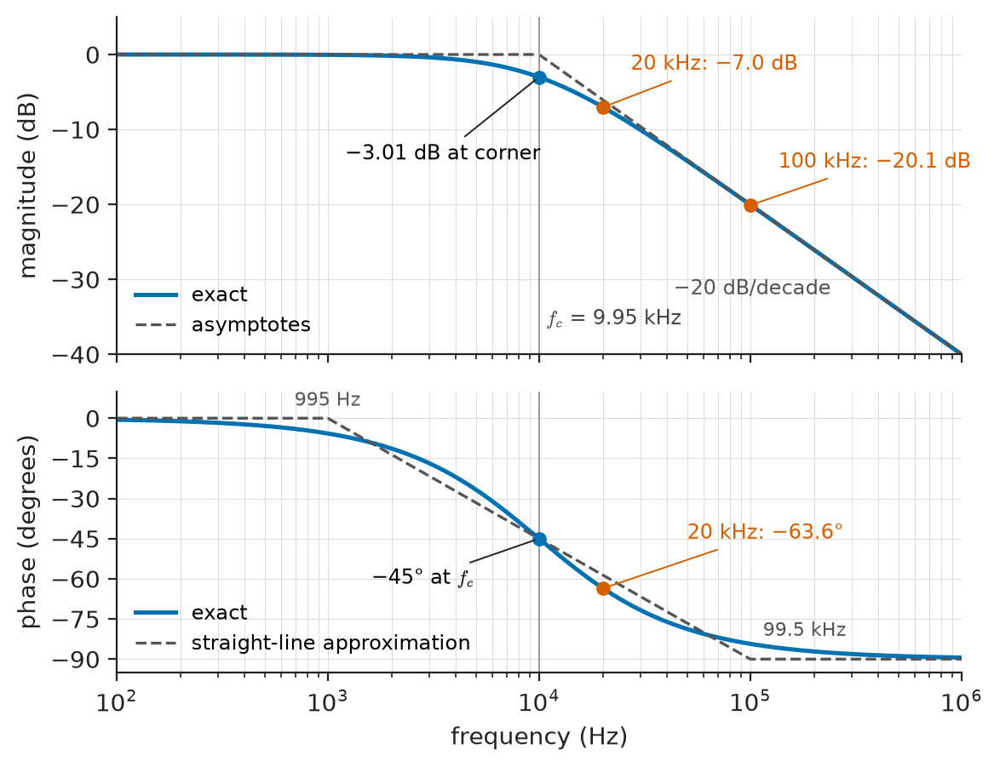
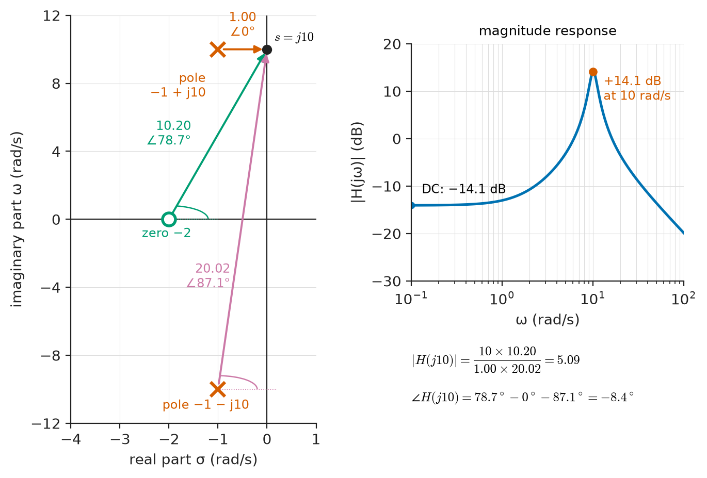
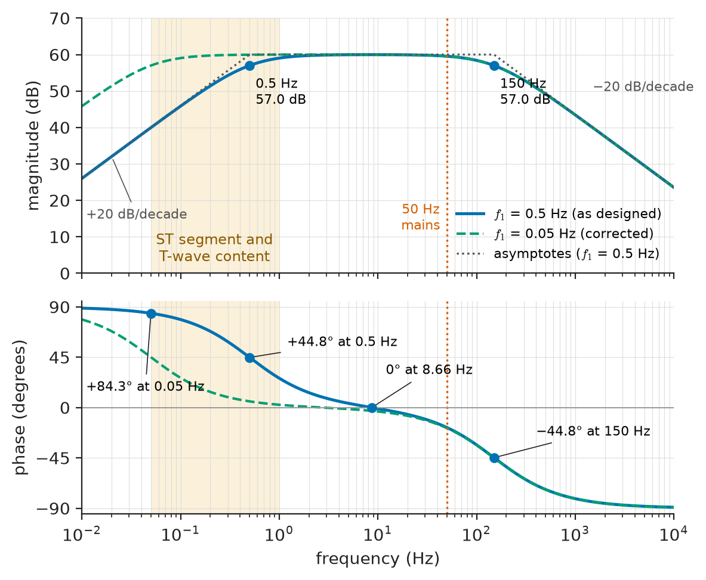
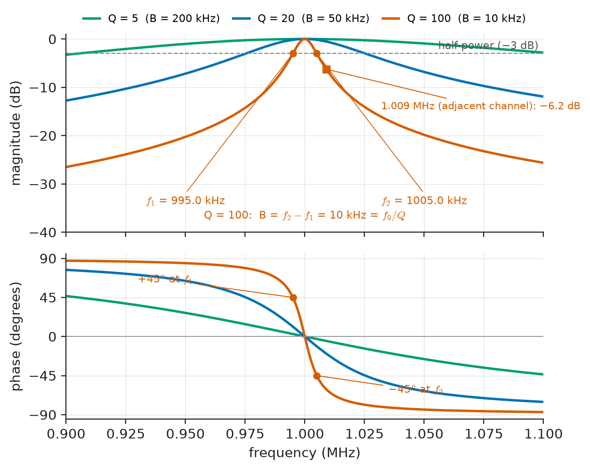
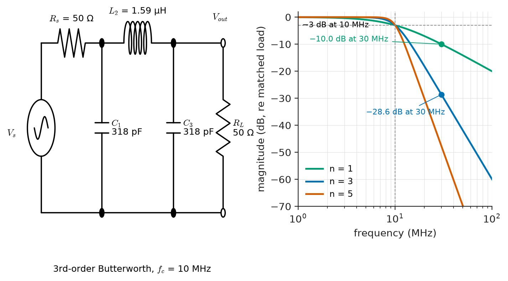
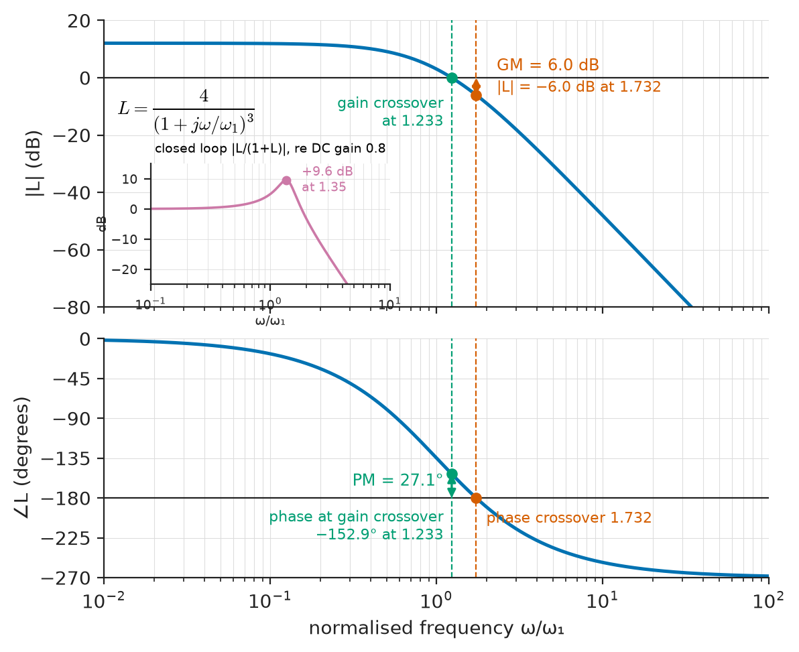

# Chapter 13 — Network Frequency Response

*Part III · Advanced Network Theory*

A clinical ECG recorder is returned with a complaint: the ST segment of every heartbeat looks depressed, and a cardiologist nearly diagnoses ischaemia in a healthy patient. The amplifier is not broken. Its gain at 10 Hz is exactly as specified, its noise is low and its input impedance is high. The fault is a single capacitor in the input coupling network, chosen so that the low-frequency corner sits at 0.5 Hz instead of 0.05 Hz. At 0.5 Hz the network does more than lose 3 dB of amplitude: it shifts the phase of the slow components of the waveform by 45°, and the slow, flat ST segment is distorted into a slope. Nothing in a single-frequency gain test reveals the problem. The amplifier has to be described by how *both* its magnitude and its phase change across the whole band the signal occupies.

That description is the network's frequency response. Chapter 8 introduced it as the phasor ratio $\mathbf V_\text{out}/\mathbf V_\text{in}$ of a circuit driven by one sinusoid; Chapter 11 showed that the same ratio is the transfer function $H(s)$ evaluated on the imaginary axis, $s=j\omega$. This chapter turns those two ideas into an engineering tool: reading a response off a pole-zero map, sketching it in minutes with Bode asymptotes, sizing resonant circuits by their quality factor and bandwidth, designing passive filters, connecting them to active stages, and recognising in a frequency plot the signs of a circuit that is about to oscillate.

> **How does the location of poles and zeros decide the gain and phase a network applies at each frequency?**
> **How are resonance, quality factor and bandwidth related, and how do they set the selectivity of filters and tuned circuits?**
> **What can a frequency plot say about whether a feedback circuit will be stable?**

| Concept | Engineering destination |
|---|---|
| Magnitude and phase response | Amplifier specifications, sensor front ends, waveform fidelity in ECG and audio |
| Poles and zeros | Fast mental evaluation of filters, compensation networks, notch placement |
| Bode plots | Datasheet frequency plots, loop-gain sketches, compensation design |
| Resonant circuits | Radio tuning, IF filters, wireless-power coils, harmonic filters in power systems |
| Quality factor | Selectivity of receivers, crystal and ceramic resonators, losses in reactive components |
| Bandwidth | Channel spacing, measurement bandwidth, rise time of instruments |
| Passive filters | Anti-aliasing, EMI filters, RF band selection, loudspeaker crossovers |
| Active-filter interface | Source and load effects when passive networks meet op-amp stages |
| Stability-related frequency behaviour | Phase margin of regulators and amplifiers, ringing, oscillation |

**Roadmap.** Magnitude and phase as two views of $H(j\omega)$ (13.1) → poles and zeros as the geometry behind them (13.2) → Bode asymptotes for fast sketching (13.3) → resonant circuits (13.4), quality factor (13.5) and bandwidth (13.6) → passive filters built from these pieces (13.7) → what happens when a passive network meets an active stage (13.8) → frequency-domain signs of instability (13.9).

---

## 13.1 Magnitude and phase response

### The frequency response as a complex function

Let a linear time-invariant network be described by its transfer function $H(s)=Y(s)/X(s)$ (Chapter 11), where $X$ and $Y$ are the Laplace transforms of input and output with zero initial conditions. If the network is stable and is driven by $x(t)=A\cos(\omega t+\theta)$, then once the transients have died away the output is

$$
y_\text{ss}(t)=A\,\lvert H(j\omega)\rvert\cos\big(\omega t+\theta+\angle H(j\omega)\big)
$$

This is the whole content of the **frequency response**: a sinusoid in gives a sinusoid of the same frequency out, scaled by the **magnitude response** $\lvert H(j\omega)\rvert$ and shifted by the **phase response** $\angle H(j\omega)$. The result rests on the fact that complex exponentials $e^{st}$ pass through an LTI system unchanged in form (they are its eigenfunctions, Chapter 17), and on stability, which guarantees that the natural response decays and leaves only the forced part.

> **Status of the principle: Sinusoidal steady-state response**
> *Derived.* Follows from linearity, time invariance and the eigenfunction property of $e^{j\omega t}$; it holds only for stable networks and only after the transient has decayed.

Writing $H(j\omega)=\lvert H\rvert e^{j\phi}$ separates two pieces of engineering information. The magnitude says which frequencies are passed and which are suppressed. The phase says how much each frequency is delayed. A pure time delay $T$ has $H(j\omega)=e^{-j\omega T}$: unity magnitude, phase $-\omega T$ falling linearly with frequency. Any network whose phase in the band of interest is approximately linear therefore delays the signal without distorting its shape; departures from linear phase reshape the waveform even when the magnitude is perfectly flat. This was the ECG fault: the magnitude error at the 1 Hz components was only a fraction of a decibel, but their phase was shifted by tens of degrees, and the waveform changed. Group delay, $\tau_g=-d\phi/d\omega$, quantifies this and is developed in Chapter 18.

### Decibels and logarithmic frequency

Gains that span many orders of magnitude are expressed in decibels,

$$
\lvert H\rvert_\text{dB}=20\log_{10}\lvert H(j\omega)\rvert
$$

The factor 20 (rather than 10) is used because $\lvert H\rvert$ is a ratio of amplitudes and power is proportional to amplitude squared; when input and output share the same impedance, the decibel gain equals the power gain in decibels. Useful anchors are $\sqrt2\to 3.01$ dB, $2\to6.02$ dB, $10\to20$ dB and $1000\to60$ dB. Decibels turn products of cascaded gains into sums, which is why Bode plots (Section 13.3) can be built by adding curves. Frequency is plotted on a logarithmic axis, where a **decade** is a factor of 10 and an **octave** a factor of 2.

### The first-order low-pass as the reference case

The RC voltage divider with output across the capacitor is the simplest filter and the building block of the rest of the chapter:

$$
H(s)=\frac{1}{1+sRC},\qquad H(j\omega)=\frac{1}{1+j\omega/\omega_c},\qquad \omega_c=\frac1{RC}
$$

so that

$$
\lvert H(j\omega)\rvert=\frac1{\sqrt{1+(\omega/\omega_c)^2}},\qquad \angle H(j\omega)=-\arctan\frac{\omega}{\omega_c}
$$

At the **corner frequency** $\omega_c$ the magnitude is $1/\sqrt2$ (−3.01 dB) and the phase is −45°. Well below the corner the network is transparent; well above it the magnitude falls in proportion to $1/\omega$ (−20 dB per decade) and the phase approaches −90°.

**Worked example — audio anti-aliasing RC.** A first-order RC filter ahead of an audio converter uses $R=1.6\ \mathrm{k\Omega}$ and $C=10\ \mathrm{nF}$. The time constant is $RC=16\ \mu\mathrm{s}$, so

$$
f_c=\frac{1}{2\pi RC}=\frac{1}{2\pi(16\times10^{-6})}=9.95\ \mathrm{kHz}
$$

At 1 kHz, $f/f_c=0.1005$, $\lvert H\rvert=0.995$ (−0.04 dB) and the phase is −5.7°. At 20 kHz, the top of the audio band, $f/f_c=2.01$, $\lvert H\rvert=1/\sqrt{1+4.04}=0.445$ (−7.0 dB) and the phase is −63.6°. At 100 kHz, $\lvert H\rvert=0.099$ (−20.1 dB) and the phase is −84.3°. Two lessons follow. The filter already removes 7 dB at the top of the audio band, which is audible; and a decade above the corner it attenuates by only 20 dB, far less than the 80–100 dB a 16-bit or 24-bit converter needs against aliasing. A single pole is not a usable anti-aliasing filter on its own; Section 13.7 and Chapter 19 show what is.

<!-- FIGURE 13.1 | figures/ch13/fig-13-1-rc-lowpass-bode.png | bode | Magnitude and phase of the first-order RC low-pass with R = 1.6 kOhm and C = 10 nF, exact curves with straight-line asymptotes. | Content: two stacked panels, shared log x-axis frequency 100 Hz to 1 MHz. Top: magnitude in dB from -40 to +5, exact curve solid, asymptotes dashed (0 dB to corner, then -20 dB/decade), corner 9.95 kHz marked, -3 dB point annotated, points at 20 kHz (-7.0 dB) and 100 kHz (-20.1 dB) marked. Bottom: phase in degrees 0 to -90, exact arctangent curve solid, three-segment straight-line approximation dashed (0 deg until 995 Hz, -45 deg/decade to 99.5 kHz, then -90 deg), -45 deg at corner marked, 20 kHz point at -63.6 deg marked. -->

*Figure 13.1 — Magnitude and phase of the first-order RC low-pass with R = 1.6 kOhm and C = 10 nF, exact curves with straight-line asymptotes.*

Figure 13.1 shows both curves on logarithmic axes. The magnitude curve is close to two straight lines that meet at the corner; the phase curve is an S-shape that does most of its turning within one decade on either side of the corner. These two shapes are the alphabet from which Bode plots are written.

### Magnitude and phase are not independent

For a large and important class of networks, the magnitude curve determines the phase curve. A network whose poles and zeros all lie in the left half of the $s$-plane is called **minimum-phase**. For such a network, Bode's gain–phase relation states that the phase at any frequency is approximately proportional to the local slope of the magnitude curve on log–log axes: a slope of $-20n$ dB/decade, sustained over a wide band, corresponds to a phase near $-90n$ degrees. A flat region has little phase shift; a region falling at −40 dB/decade has close to −180°.

> **Status of the principle: Bode gain–phase relation**
> *Derived.* A consequence of the analyticity of $\ln H(s)$ in the right half-plane for stable minimum-phase networks; it fails for networks with right-half-plane zeros or pure delays, which add phase lag without changing magnitude.

The practical value is enormous. A feedback designer who sees a loop gain falling at −40 dB/decade through 0 dB knows, without computing anything, that the phase there is close to −180° and the loop will be on the edge of instability (Section 13.9). A delay or a right-half-plane zero, by contrast, adds lag the magnitude curve does not reveal.

---

## 13.2 Poles and zeros

### The factored transfer function

Every lumped linear network with constant elements has a rational transfer function, the ratio of two polynomials in $s$ with real coefficients. Factoring numerator and denominator gives

$$
H(s)=K\,\frac{(s-z_1)(s-z_2)\cdots(s-z_m)}{(s-p_1)(s-p_2)\cdots(s-p_n)}
$$

The roots $z_k$ of the numerator are the **zeros**; the roots $p_k$ of the denominator are the **poles**. Real coefficients force complex poles and zeros to come in conjugate pairs. For a physical network with energy-storing elements, $n$ equals the number of independent capacitor voltages and inductor currents (the order of the network), and $m\le n$ for any network that does not have infinite gain at infinite frequency.

The poles are the natural frequencies of the network: they are the exponents in its unforced response (Chapter 11). A pole at $s=-\alpha$ produces a term $e^{-\alpha t}$; a conjugate pair $-\alpha\pm j\omega_d$ produces a decaying oscillation $e^{-\alpha t}\cos(\omega_d t+\theta)$. The zeros are the complex frequencies at which the network transmits nothing: an input $e^{z_k t}$ produces no forced output. A zero on the $j\omega$ axis at $\pm j\omega_z$ is a **notch**: a sinusoid at $\omega_z$ is blocked completely.

### Geometric evaluation of the frequency response

Setting $s=j\omega$, each factor $(j\omega-z_k)$ or $(j\omega-p_k)$ is a complex number: the vector drawn from the zero or pole to the point $j\omega$ on the imaginary axis. Hence

$$
\lvert H(j\omega)\rvert=\lvert K\rvert\frac{\prod_k \lvert j\omega-z_k\rvert}{\prod_k \lvert j\omega-p_k\rvert},\qquad
\angle H(j\omega)=\angle K+\sum_k\angle(j\omega-z_k)-\sum_k\angle(j\omega-p_k)
$$

The magnitude is the product of the distances from the zeros divided by the product of the distances from the poles; the phase is the sum of the zero angles minus the sum of the pole angles. As $\omega$ sweeps up the imaginary axis, the point $j\omega$ moves, the vectors change length and direction, and the response is traced out (Figure 13.2).

> **Status of the principle: Pole-zero geometry of the frequency response**
> *Derived.* Exact algebra on the factored rational transfer function; it applies to any lumped LTI network, but the frequency response it computes is physically observable only when all poles are in the left half-plane.

This geometric view explains the shapes of all frequency responses at a glance:

- A pole close to the $j\omega$ axis makes one distance very small as $j\omega$ passes it, so the magnitude rises to a sharp peak there: **resonance** is a pole pair near the axis.
- A zero on or near the axis makes a distance vanish, so the magnitude falls to a sharp dip: a **notch**.
- Far above all poles and zeros, every distance is approximately $\omega$, so $\lvert H\rvert\propto\omega^{m-n}$: the high-frequency roll-off is $20(n-m)$ dB per decade and the phase tends to $-90(n-m)$ degrees.
- At $\omega=0$ the distances are the magnitudes of the poles and zeros themselves, giving the DC gain $\lvert K\rvert\prod\lvert z_k\rvert/\prod\lvert p_k\rvert$.

**Worked example — a lightly damped resonance read from the pole-zero map.** A vibration-sensor conditioning network has

$$
H(s)=\frac{10(s+2)}{s^2+2s+101}
$$

with $s$ in rad/s. The poles are the roots of $s^2+2s+101$, namely $p_{1,2}=-1\pm j10$, and the zero is at $z=-2$. At DC the gain is $10\cdot2/101=0.198$ (−14.1 dB). At $\omega=10$ rad/s the point $j10$ sits directly opposite the upper pole. The distances are $\lvert j10-z\rvert=\sqrt{2^2+10^2}=10.20$, $\lvert j10-p_1\rvert=\lvert j10-(-1+j10)\rvert=1.00$ and $\lvert j10-p_2\rvert=\lvert 1+j20\rvert=20.02$. So

$$
\lvert H(j10)\rvert=\frac{10\times10.20}{1.00\times20.02}=5.09\quad(+14.1\ \mathrm{dB})
$$

The angles are $78.7°$ from the zero, $0°$ from the upper pole and $87.1°$ from the lower pole, giving $\angle H=78.7°-0°-87.1°=-8.4°$. The response at 10 rad/s is 25.7 times larger than at DC, a 28.2 dB resonant peak produced entirely by the upper pole lying only 1 rad/s from the axis. Moving that pole further left (more damping) would lengthen the short vector and flatten the peak; this is exactly what a damping resistor does in a real circuit.

<!-- FIGURE 13.2 | figures/ch13/fig-13-2-pole-zero-vectors.png | pole-zero | Pole-zero map of H(s) = 10(s+2)/(s^2+2s+101) with the vectors used to evaluate H at s = j10. | Content: s-plane, real axis -4 to 1, imaginary axis -12 to 12 (rad/s). Crosses at -1 +/- j10, circle at -2. Point j10 on imaginary axis marked with a dot. Three arrows from the zero and both poles to j10, labelled with lengths 10.20, 1.00 and 20.02 and angles 78.7 deg, 0 deg, 87.1 deg. Inset at right: magnitude in dB versus omega 0.1 to 100 rad/s (log axis), showing -14.1 dB at low frequency and a +14.1 dB peak at 10 rad/s. -->

*Figure 13.2 — Pole-zero map of H(s) = 10(s+2)/(s^2+2s+101) with the vectors used to evaluate H at s = j10.*

### Pole and zero locations and what they mean in a circuit

The table collects the common locations and their meaning.

| Location | Time-domain signature | Frequency-domain signature | Typical circuit |
|---|---|---|---|
| Real pole at $-\omega_p$ | Decaying exponential, time constant $1/\omega_p$ | −3 dB corner at $\omega_p$, then −20 dB/decade | RC or RL low-pass |
| Pole at origin | Step becomes ramp (integration) | −20 dB/decade everywhere, −90° | Ideal integrator, capacitor charged by a current |
| Real zero at $-\omega_z$ | Derivative-like term | +20 dB/decade above $\omega_z$, +90° | Lead network, RC high-pass corner |
| Zero at origin | Blocks DC | +20 dB/decade from DC | Coupling capacitor, AC-coupled input |
| Complex pole pair near axis | Ringing at $\omega_d$, slow decay | Resonant peak near $\omega_n$ | Tuned circuit, under-damped LC filter |
| Zero pair on $j\omega$ axis | Input at $\omega_z$ produces no output | Notch at $\omega_z$ | Twin-T or bridged-T notch, LC trap |
| Right-half-plane pole | Growing response | Frequency response not observable | Oscillator, unstable loop |
| Right-half-plane zero | Initial response in the wrong direction | Phase lag with rising magnitude | Boost converter, some feedback paths |

---

## 13.3 Bode plots

### Why straight lines work

Hendrik Bode's insight was that on log–log axes the factors of $H(j\omega)$ become additive, and each factor is very close to a pair of straight lines. Write the transfer function in **time-constant form**, with every real pole and zero normalised to unity at DC:

$$
H(j\omega)=K_0\,(j\omega)^{\ell}\,\frac{\prod_k(1+j\omega/\omega_{zk})}{\prod_k(1+j\omega/\omega_{pk})}\cdot\frac{1}{\prod_i\big[1-(\omega/\omega_{ni})^2+j2\zeta_i\omega/\omega_{ni}\big]}
$$

where $\ell$ counts zeros ($\ell>0$) or poles ($\ell<0$) at the origin and the last factor collects complex pole pairs with natural frequency $\omega_n$ and damping ratio $\zeta$ (Chapter 7). Then

$$
\lvert H\rvert_\text{dB}=20\log K_0+20\ell\log\omega+\sum_k 20\log\lvert1+j\omega/\omega_{zk}\rvert-\sum_k20\log\lvert1+j\omega/\omega_{pk}\rvert-\cdots
$$

and the phase is likewise a sum. Each term can be sketched separately and added.

### The building blocks

| Factor | Magnitude asymptotes | Exact correction at corner | Phase |
|---|---|---|---|
| Constant $K_0$ | Flat at $20\log K_0$ | — | 0° (or 180° if $K_0<0$) |
| $(j\omega)^{\pm1}$ | ±20 dB/decade through 0 dB at $\omega=1$ | — | ±90° |
| $(1+j\omega/\omega_p)^{-1}$ | 0 dB, then −20 dB/decade from $\omega_p$ | −3.0 dB | 0 to −90°, −45° at $\omega_p$ |
| $(1+j\omega/\omega_z)$ | 0 dB, then +20 dB/decade from $\omega_z$ | +3.0 dB | 0 to +90°, +45° at $\omega_z$ |
| Complex pole pair | 0 dB, then −40 dB/decade from $\omega_n$ | $-20\log(2\zeta)$ dB | 0 to −180°, −90° at $\omega_n$; steepness grows as $\zeta$ falls |

For the phase of a real pole, the standard straight-line approximation is 0° up to $\omega_p/10$, a slope of −45° per decade to $10\omega_p$, then −90°. Its worst error is 5.7°, at $0.1\omega_p$ and $10\omega_p$. The magnitude asymptote errs by at most 3 dB, at the corner, and by 1 dB an octave either side. For complex poles the asymptote can be badly wrong near $\omega_n$: at $\zeta=0.1$ the true response at $\omega_n$ is $+14$ dB above the asymptote. Lightly damped pairs must always be corrected by hand (Section 13.5).

> **Status of the principle: Bode asymptotes**
> *Approximate.* The straight lines are the exact limits of each factor for $\omega\ll$ and $\omega\gg$ the corner; the error is bounded (3 dB and 5.7° for real factors) when corners are separated by a decade or more, and grows when corners crowd together or complex pairs are lightly damped.

### Procedure

1. Put $H$ into time-constant form and list the corner frequencies in ascending order.
2. Find the low-frequency asymptote: the constant and any $(j\omega)^\ell$ factor.
3. Move up in frequency; at each corner change the slope by +20 dB/decade for a zero, −20 for a pole, ±40 for a complex pair.
4. Add the corner corrections where accuracy matters.
5. Sketch the phase by summing the straight-line phase of each factor.

**Worked example — Bode plot of an ECG front end.** A diagnostic ECG amplifier needs a gain of 1000, a high-pass corner to remove electrode offset drift and a low-pass corner to limit noise. Suppose a poorly designed version uses corners at $f_1=0.5$ Hz and $f_2=150$ Hz:

$$
H(jf)=1000\cdot\frac{jf/f_1}{1+jf/f_1}\cdot\frac{1}{1+jf/f_2}
$$

The asymptotes are: a +20 dB/decade line rising to 60 dB at 0.5 Hz, a flat 60 dB plateau to 150 Hz, and −20 dB/decade above. Exact values computed from the expression:

| Frequency | Magnitude (exact) | Phase (exact) | Comment |
|---|---|---|---|
| 0.05 Hz | 40.0 dB | +84.3° | On the rising asymptote |
| 0.5 Hz | 57.0 dB | +44.8° | High-pass corner: −3 dB |
| 5 Hz | 60.0 dB | +3.8° | Phase error still almost 4° |
| 8.66 Hz | 60.0 dB | 0° | Geometric centre $\sqrt{f_1f_2}$ |
| 50 Hz | 59.5 dB | −17.9° | Mains frequency still passed at full gain |
| 150 Hz | 57.0 dB | −44.8° | Low-pass corner |
| 1 kHz | 43.4 dB | −81.4° | Falling at −20 dB/decade |

The magnitude looks excellent: within 0.5 dB of 60 dB from about 2 Hz to 50 Hz. The phase tells the real story. The ST segment and T wave contain energy between roughly 0.05 Hz and 1 Hz, where this network applies roughly 26° (at 1 Hz) to 84° (at 0.05 Hz) of phase lead; the slow segments are differentiated rather than reproduced, which is the distortion described at the opening. Diagnostic ECG standards therefore place the high-pass corner at 0.05 Hz (a time constant of 3.2 s), or require linear-phase filtering, precisely because of the phase response. The 50 Hz mains interference, meanwhile, passes at almost full gain; it must be removed separately with a notch (Section 13.7).

<!-- FIGURE 13.3 | figures/ch13/fig-13-3-ecg-bandpass-bode.png | bode | Bode plot of an ECG front end with a 0.5 Hz high-pass and 150 Hz low-pass corner and mid-band gain 1000. | Content: two stacked panels, log x-axis 0.01 Hz to 10 kHz. Top: magnitude 0 to 70 dB, exact curve solid, asymptotes dashed (+20 dB/decade, 60 dB plateau, -20 dB/decade), corners at 0.5 Hz and 150 Hz marked with -3 dB points at 57.0 dB. Shaded band 0.05 to 1 Hz labelled ST segment and T wave content; vertical dotted line at 50 Hz labelled mains. Bottom: phase +90 to -90 deg, exact curve, points marked at 0.05 Hz (+84.3 deg), 0.5 Hz (+44.8 deg), 8.66 Hz (0 deg), 150 Hz (-44.8 deg). Dashed second magnitude/phase curve for the corrected 0.05 Hz high-pass corner for comparison. -->

*Figure 13.3 — Bode plot of an ECG front end with a 0.5 Hz high-pass and 150 Hz low-pass corner and mid-band gain 1000.*

Figure 13.3 shows the plot with the diagnostically important band shaded. The general lesson is that every corner affects the phase for a decade on either side of it: to keep phase distortion below about 6° over a band, both corners must lie at least a decade outside it.

---

## 13.4 Resonant circuits

### The series RLC circuit

Resonance appeared in Chapter 7 as the natural oscillation of an RLC circuit and in Chapter 8 as the frequency at which reactances cancel. Here it is treated as a frequency-selective network. A series RLC circuit driven by a voltage source has impedance

$$
Z(j\omega)=R+j\Big(\omega L-\frac1{\omega C}\Big)
$$

which is purely resistive and minimum at the **resonant frequency**

$$
\omega_0=\frac1{\sqrt{LC}}
$$

The current, and therefore the voltage across $R$, peaks there. Taking the resistor voltage as the output,

$$
H_R(s)=\frac{V_R}{V_s}=\frac{sR/L}{s^2+sR/L+1/(LC)}
$$

a second-order **band-pass** response whose poles are

$$
p_{1,2}=-\frac{R}{2L}\pm j\sqrt{\omega_0^2-\Big(\frac{R}{2L}\Big)^2}
$$

For small $R$ the poles sit just to the left of $\pm j\omega_0$, and the geometric picture of Section 13.2 predicts a sharp peak at $\omega_0$. The output across $C$ gives a low-pass response, across $L$ a high-pass response, and across the series $LC$ pair a notch: the same circuit supplies all four basic filter types, depending on where the output is taken.

### The parallel RLC circuit

The dual circuit, $R$, $L$ and $C$ in parallel fed by a current source, has admittance

$$
Y(j\omega)=\frac1R+j\Big(\omega C-\frac1{\omega L}\Big)
$$

which is minimum at the same $\omega_0=1/\sqrt{LC}$. The impedance therefore *peaks* at resonance, reaching $R$, and the voltage across the tank is maximum. At resonance the inductor and capacitor currents are each $Q$ times the source current but cancel each other, circulating inside the tank. This is the **tank circuit** of oscillators, the IF filter of radio receivers and the tuned load of RF amplifiers.

### Practical tanks: the lossy inductor

Real inductors are not ideal. Their winding resistance, skin effect and core loss are often summarised by a series resistance $r$ in the inductor branch, so a practical parallel tank is $L$ in series with $r$, in parallel with $C$. Near resonance this branch can be replaced by an equivalent parallel combination: with the coil quality factor $Q_L=\omega L/r$,

$$
R_p=r(1+Q_L^2)\approx Q_L^2 r,\qquad L_p=L\Big(1+\frac1{Q_L^2}\Big)\approx L
$$

The series-to-parallel conversion is exact at one frequency and very accurate over the narrow band of a high-$Q$ tank.

> **Status of the principle: Series-to-parallel equivalence of a lossy reactance**
> *Approximate.* Exact at the frequency of conversion; over a band it holds while $Q_L\gg1$ and the fractional bandwidth is small, because both $R_p$ and $L_p$ depend on frequency through $Q_L$.

**Worked example — a 10.7 MHz IF tank.** An FM receiver's intermediate-frequency stage uses a tank tuned to 10.7 MHz with $L=1.0\ \mu\mathrm{H}$ of series resistance $r=0.5\ \Omega$. The capacitor is

$$
C=\frac{1}{\omega_0^2L}=\frac{1}{(2\pi\cdot10.7\times10^{6})^2(1.0\times10^{-6})}=221\ \mathrm{pF}
$$

The inductive reactance is $\omega_0L=67.2\ \Omega$, so $Q_L=67.2/0.5=134$ and the equivalent parallel resistance is $R_p=0.5(1+134.5^2)=9.04\ \mathrm{k\Omega}$. Unloaded, the tank would have a bandwidth $f_0/Q_L=79.6$ kHz. The next stage presents a load of $10\ \mathrm{k\Omega}$ in parallel with the tank, so the total resistance is $9.04\parallel10=4.75\ \mathrm{k\Omega}$ and the loaded quality factor is $Q=4750/67.2=70.6$. The bandwidth widens to $10.7\ \mathrm{MHz}/70.6=152$ kHz, which happens to suit the 150–200 kHz occupied by a broadcast FM channel. The example shows a central design fact: the bandwidth of a tuned circuit is set as much by what it is connected to as by its own components.

### Resonance across EEE

| Application | Typical resonant frequency | Typical loaded Q | What resonance does |
|---|---|---|---|
| AM broadcast tuner | 0.53–1.7 MHz | 50–150 | Selects one station, magnifies antenna voltage |
| FM IF transformer | 10.7 MHz | 30–100 | Sets the IF bandwidth |
| Quartz crystal | 32.768 kHz to tens of MHz | $10^4$–$10^6$ | Frequency reference for clocks and radios |
| Wireless-power (Qi) coil | 87–205 kHz | 20–100 | Increases coupling efficiency between coils |
| Power-system harmonic filter | 250 Hz (5th harmonic on 50 Hz) | 20–100 | Low-impedance shunt path for a harmonic current |
| Accelerometer or MEMS gyroscope | 1–50 kHz | 10 (damped) to $10^4$ (vacuum) | Sets sensing bandwidth or sensitivity |

---

## 13.5 Quality factor

### The energy definition

"Quality factor" has several working definitions; the one that applies to every resonator, electrical or not, is based on energy:

$$
Q=2\pi\,\frac{\text{peak energy stored}}{\text{energy dissipated per cycle}}\Bigg\vert_{\omega=\omega_0}
=\omega_0\,\frac{W_\text{stored}}{P_\text{loss}}
$$

A resonator with $Q=100$ loses $2\pi/100\approx6\%$ of its stored energy per cycle. In a series RLC circuit the stored energy at resonance is $\tfrac12 L I_m^2$ (it moves between $L$ and $C$ but its total is constant) and the average loss is $\tfrac12 I_m^2R$, so

$$
Q_\text{series}=\frac{\omega_0L}{R}=\frac1{\omega_0CR}=\frac1R\sqrt{\frac LC}
$$

For the parallel circuit the roles of $R$ invert:

$$
Q_\text{parallel}=\frac{R}{\omega_0L}=\omega_0CR=R\sqrt{\frac CL}
$$

A small series resistance and a large parallel resistance both mean small losses and high $Q$. The quantity $\sqrt{L/C}$ is the **characteristic impedance** of the resonator, the impedance level at which energy sloshes between the two reactances; it reappears as the characteristic impedance of a transmission line in Chapter 14, for the same physical reason.

> **Status of the principle: Energy definition of quality factor**
> *Fundamental.* Follows from energy conservation in a resonator with small losses; it applies equally to LC tanks, cavities, quartz crystals and mechanical resonators, which is why their $Q$ values can be compared directly.

### Q, damping ratio and pole position

The second-order denominator can be written in three equivalent ways:

$$
s^2+\frac{\omega_0}{Q}s+\omega_0^2=s^2+2\zeta\omega_ns+\omega_n^2,\qquad Q=\frac{1}{2\zeta},\quad \omega_n=\omega_0
$$

The poles are at $-\omega_0/(2Q)\pm j\omega_0\sqrt{1-1/(4Q^2)}$. They lie on a circle of radius $\omega_0$ in the $s$-plane, and $Q$ sets the angle: the real part is $\omega_0/(2Q)$, so high $Q$ puts the poles close to the $j\omega$ axis. In the time domain, the envelope of the natural response decays as $e^{-\omega_0t/(2Q)}$, so the oscillation rings for about $Q/\pi$ cycles before its amplitude falls to $e^{-1}$. A quartz crystal with $Q=10^5$ at 10 MHz rings for 3 ms after excitation stops; an LC tank with $Q=50$ dies in about 16 cycles.

### Voltage and current magnification

At resonance in the series circuit the current is $V_s/R$, and the capacitor voltage is

$$
\lvert V_C\rvert=\frac{I}{\omega_0C}=\frac{V_s}{\omega_0CR}=Q\,V_s
$$

The same holds for the inductor voltage. In the parallel circuit the reactive branch currents are $Q$ times the source current. Magnification is useful at the input of a radio, where a 10 µV antenna signal appears as 1 mV across the tuning capacitor of a $Q=100$ circuit. It is a hazard in power systems: a capacitor bank that resonates with the supply inductance near a harmonic frequency can amplify a modest harmonic current into a large one, overheating the capacitors and blowing fuses. The same arithmetic explains both.

### Representative quality factors

| Resonator or component | Typical Q | Main loss mechanism |
|---|---|---|
| Ferrite-core power inductor at 100 kHz | 10–50 | Core loss and winding resistance |
| Air-core RF inductor, 1–100 MHz | 50–250 | Skin and proximity effect in the wire |
| Multilayer ceramic capacitor (C0G), 100 MHz | 500–2000 | Electrode resistance (ESR) |
| Microstrip resonator on FR-4, 2 GHz | 50–150 | Dielectric loss ($\tan\delta\approx0.02$) and conductor loss |
| Metal waveguide cavity, 10 GHz | $10^3$–$10^4$ | Wall currents |
| Quartz crystal | $10^4$–$10^6$ | Mounting and internal friction |
| Tuning-fork watch crystal (32.768 kHz) | 50 000–100 000 | Acoustic loss, air damping |

---

## 13.6 Bandwidth

### Half-power bandwidth of a resonator

The **bandwidth** of a band-pass response is the width of the band over which the output power is at least half its peak value, so that $\lvert H\rvert\ge\lvert H\rvert_\text{max}/\sqrt2$. For the series RLC band-pass, normalised so that the peak gain is 1,

$$
\lvert H(j\omega)\rvert=\frac{1}{\sqrt{1+Q^2\big(\frac{\omega}{\omega_0}-\frac{\omega_0}{\omega}\big)^2}}
$$

The half-power points occur where $Q(\omega/\omega_0-\omega_0/\omega)=\pm1$, which gives

$$
\omega_{1,2}=\omega_0\Big(\sqrt{1+\frac1{4Q^2}}\mp\frac1{2Q}\Big),\qquad \omega_2-\omega_1=\frac{\omega_0}{Q},\qquad \omega_1\omega_2=\omega_0^2
$$

The bandwidth is exactly $\omega_0/Q$ for any $Q$, and the centre frequency is the *geometric* mean of the half-power frequencies. For $Q\gtrsim10$ the response is also nearly symmetric on a linear frequency axis. The relation

$$
B=\frac{f_0}{Q}
$$

is the single most useful formula in tuned-circuit design: it ties selectivity (narrow $B$) to low loss (high $Q$).

> **Status of the principle: Bandwidth–Q relation**
> *Derived.* Exact for the second-order band-pass $s\,\omega_0/Q\,/(s^2+s\omega_0/Q+\omega_0^2)$; for other responses (higher order, or low-pass rather than band-pass) the bandwidth must be computed from the actual transfer function.

<!-- FIGURE 13.4 | figures/ch13/fig-13-4-rlc-resonance-curves.png | plot | Normalised series-RLC band-pass response for Q = 5, 20 and 100 around 1 MHz, showing that bandwidth equals f0/Q. | Content: two stacked panels, x-axis frequency 0.9 to 1.1 MHz (linear). Top: magnitude in dB, 0 to -30 dB, three curves for Q = 5, 20, 100 with half-power lines at -3 dB; for Q = 100 mark f1 = 995.0 kHz, f2 = 1005.0 kHz, B = 10 kHz; mark 1.009 MHz (adjacent channel) at -6.2 dB on the Q = 100 curve. Bottom: phase +90 to -90 deg for the three curves, all passing through 0 deg at 1 MHz, Q = 100 curve reaching +/-45 deg at the half-power frequencies. -->

*Figure 13.4 — Normalised series-RLC band-pass response for Q = 5, 20 and 100 around 1 MHz, showing that bandwidth equals f0/Q.*

**Worked example — selectivity of an AM tuner.** A medium-wave receiver uses a series tuned circuit with $L=200\ \mu\mathrm{H}$ to receive a station at 1.000 MHz. The required capacitor is

$$
C=\frac1{(2\pi\times10^6)^2(200\times10^{-6})}=126.7\ \mathrm{pF}
$$

The inductive reactance at resonance is $\omega_0L=1257\ \Omega$. If the total series resistance (coil loss plus the antenna's radiation and loss resistance as reflected into the circuit) is $R=12.6\ \Omega$, then $Q=1257/12.6=100$ and $B=1\ \mathrm{MHz}/100=10$ kHz. The exact half-power frequencies are $f_1=995.0$ kHz and $f_2=1005.0$ kHz. In regions using 9 kHz channel spacing, the adjacent station at 1.009 MHz sees

$$
\lvert H\rvert=\frac{1}{\sqrt{1+100^2\big(1.009-1/1.009\big)^2}}=0.487\quad(-6.2\ \mathrm{dB})
$$

and a station two channels away, at 1.018 MHz, is attenuated by only 11.4 dB. A single tuned circuit cannot separate adjacent AM stations: suppressing a neighbour by 40–60 dB requires a much steeper skirt than a second-order resonance provides. This is the historical reason for the superheterodyne receiver (Chapter 26), which moves every station to a fixed intermediate frequency where several coupled resonators or a ceramic filter can provide steep skirts once, for all stations. Figure 13.4 shows how the resonance narrows as $Q$ grows while the skirts far from $f_0$ still fall only at −20 dB/decade.

The example also illustrates voltage magnification: a 10 µV antenna voltage appears as $QV_s=1$ mV across the tuning capacitor.

### Bandwidth of low-pass systems and rise time

For low-pass systems the bandwidth is the frequency where the gain has fallen by 3 dB from its DC value. For a first-order low-pass, $B=f_c=1/(2\pi\tau)$, and the 10–90 % rise time of its step response is $t_r=\tau\ln9=2.2\tau$. Eliminating $\tau$,

$$
t_r\approx\frac{0.35}{B}
$$

This relation, exact for a single pole, holds within about 10–20 % for many well-damped higher-order low-pass systems and is used routinely to relate oscilloscope bandwidth to the fastest edge it can display: a 100 MHz oscilloscope has an intrinsic rise time near 3.5 ns.

> **Status of the principle: Rise-time–bandwidth product**
> *Approximate.* Exact ($0.35$) for a single real pole; between about 0.33 and 0.45 for typical well-damped responses; meaningless for strongly resonant systems whose step response rings.

### Representative bandwidths

| System | Bandwidth | Comment |
|---|---|---|
| Diagnostic ECG | 0.05–150 Hz | High-pass corner set low for phase fidelity |
| EEG | 0.5–70 Hz typical | Notch at 50 or 60 Hz common |
| Telephone voice channel | 300–3400 Hz | Historical analog channel, 8 kHz sampling |
| High-fidelity audio | 20 Hz–20 kHz | Limit of human hearing |
| AM broadcast channel | 9 or 10 kHz | Depends on region |
| FM broadcast channel | ≈200 kHz | Carson's-rule estimate for 75 kHz deviation |
| General-purpose oscilloscope | 50 MHz–1 GHz | Rise time 7 ns to 0.35 ns |

---

## 13.7 Passive filters

### Specifications

A filter is a network designed to pass a range of frequencies (the **passband**) and reject another (the **stopband**). Its specification states the passband edge $f_p$ and the maximum passband ripple or loss, the stopband edge $f_s$ and the minimum stopband attenuation, and often limits on phase or group-delay variation. The region between $f_p$ and $f_s$ is the **transition band**. The four classic types are low-pass, high-pass, band-pass and band-stop (notch); all-pass networks, which have flat magnitude and shape only the phase, are used for delay equalisation.

The steepness of the transition is set by the filter order $n$. Far into the stopband, an $n$-th-order low-pass falls at $20n$ dB/decade (6$n$ dB/octave). The required order can be estimated from the specification before any circuit is drawn.

### Classic approximations

Real filters approximate the ideal "brick wall" with rational functions chosen to optimise one property:

| Approximation | Passband | Transition | Phase/delay | Typical use |
|---|---|---|---|---|
| Butterworth | Maximally flat, no ripple | Moderate | Moderate nonlinearity | General purpose, audio, anti-aliasing |
| Chebyshev type I | Equiripple | Steeper than Butterworth for same order | Worse | RF band filters, where ripple is acceptable |
| Inverse Chebyshev | Flat | Steep, with stopband zeros | Moderate | Anti-aliasing with notches |
| Elliptic (Cauer) | Equiripple | Steepest for a given order | Worst | Channel filters, tight specifications |
| Bessel | Gently rolling | Slow | Nearly linear phase | Pulse and waveform fidelity, ECG, data acquisition |

The Butterworth low-pass of order $n$ has

$$
\lvert H(j\omega)\rvert^2=\frac{1}{1+(\omega/\omega_c)^{2n}}
$$

whose poles lie equally spaced on a semicircle of radius $\omega_c$ in the left half-plane. Every $n$ gives −3 dB at $\omega_c$, but higher $n$ keeps the passband flatter and the transition steeper.

> **Status of the principle: Classic filter approximations**
> *Derived.* Each is the solution of a stated optimisation problem (maximal flatness, equiripple, linear phase) over rational functions; they say nothing about component tolerance, parasitics or loss, which set how closely a built filter follows the ideal.

### The LC ladder

At radio frequencies, and wherever power must pass with little loss, filters are built as **ladders** of series inductors and shunt capacitors between equal source and load resistances. Normalised element values ("$g$-values") are tabulated for each approximation; for Butterworth filters

$$
g_k=2\sin\frac{(2k-1)\pi}{2n},\qquad k=1,\dots,n
$$

giving $1,2,1$ for $n=3$ and $0.765,1.848,1.848,0.765$ for $n=4$. Scaling to a cut-off $\omega_c$ and impedance level $R_0$ gives shunt capacitors $C_k=g_k/(\omega_cR_0)$ and series inductors $L_k=g_kR_0/\omega_c$.

Doubly terminated LC ladders have a remarkable property: at frequencies of maximum power transfer the sensitivity of the response to every element value is zero to first order. A 5 % error in an inductor changes the passband response far less than 5 %. This low sensitivity is why LC ladders remain the prototype for active and digital filter designs (Chapter 23).

**Worked example — a 10 MHz Butterworth low-pass for a 50 Ω system.** A third-order Butterworth low-pass is to remove harmonics from a signal generator output, with cut-off $f_c=10$ MHz between 50 Ω terminations. With $\omega_c=2\pi\times10^7=6.283\times10^7$ rad/s,

$$
C_1=C_3=\frac{1}{\omega_cR_0}=\frac{1}{(6.283\times10^7)(50)}=318\ \mathrm{pF},\qquad
L_2=\frac{2R_0}{\omega_c}=\frac{100}{6.283\times10^7}=1.59\ \mu\mathrm{H}
$$

Including the 6 dB loss of the 50 Ω divider (so that the reference is the voltage delivered to a matched load), the response is $-10\log_{10}(1+(f/f_c)^6)$ dB. A circuit simulation of the ladder confirms the formula: −0.07 dB at 5 MHz, −3.01 dB at 10 MHz (phase −135°), −18.1 dB at 20 MHz, and −28.6 dB at 30 MHz, the third harmonic of a 10 MHz signal. A first-order RC with the same cut-off would give only −10.0 dB at 30 MHz. In practice standard values of 330 pF and 1.5 µH would be used, moving the corner by a few percent.

<!-- FIGURE 13.5 | figures/ch13/fig-13-5-butterworth-ladder.png | circuit | Third-order Butterworth LC low-pass ladder for 10 MHz in a 50-ohm system, with its response compared with first-order and higher-order Butterworth filters. | Content: left panel circuit: source 50 ohm, shunt C1 = 318 pF, series L2 = 1.59 uH, shunt C3 = 318 pF, load 50 ohm, output across load. Right panel: magnitude in dB from 0 to -70 versus log frequency 1 MHz to 100 MHz, curves for Butterworth n = 1, 3 and 5 with fc = 10 MHz, all passing -3 dB at 10 MHz; markers at 30 MHz showing -10.0 dB (n = 1) and -28.6 dB (n = 3). -->

*Figure 13.5 — Third-order Butterworth LC low-pass ladder for 10 MHz in a 50-ohm system, with its response compared with first-order and higher-order Butterworth filters.*

### Band-pass, band-stop and notch filters

A low-pass prototype becomes a band-pass filter by replacing each series inductor with a series LC resonator and each shunt capacitor with a parallel LC resonator, all tuned to the centre frequency $\omega_0$; the bandwidth of the result equals the prototype cut-off. The same transformation family gives high-pass and band-stop filters. These frequency transformations are also used, in discrete-time form, for digital filters (Chapter 23).

A **notch** suppresses one frequency. The canonical passive notch is a series LC trap across the signal path: at its resonance it short-circuits the line. In biomedical and instrumentation amplifiers the twin-T RC network places a zero pair on the $j\omega$ axis at $\omega_z=1/(RC)$ without inductors, removing 50 or 60 Hz mains pickup. Its passive Q is only 0.25, so the notch is broad and attenuates neighbouring frequencies; feedback around an amplifier sharpens it. In power systems, the "single-tuned harmonic filter" is the same idea at high power: a series RLC branch tuned slightly below the 5th, 7th or 11th harmonic provides a low-impedance path that diverts harmonic current away from the supply.

### Limitations of passive filters

Passive filters need no power supply, can handle large signals and add no active noise. Their limits are practical. At audio and lower frequencies the inductors become large, heavy, lossy and susceptible to magnetic pickup; a 1 H inductor for a 100 Hz filter is not a component anyone wants. Passive networks cannot give gain, and their response depends on the source and load impedances. Above a few hundred megahertz, the "lumped" components themselves become transmission-line sections, and filters are built from lines (Chapter 14) or cavities (Chapter 32). Between these limits, below about 1 MHz, the inductor is replaced by an active circuit, which is the subject of the next section.

---

## 13.8 Active-filter interface

### Why active filters

An active filter replaces inductors with combinations of resistors, capacitors and an amplifier (usually an op-amp) whose feedback synthesises the required complex poles. It offers gain, isolation from the load and practical component values at low frequencies. The design of op-amp circuits themselves belongs to *Electronics & Computing*; what this book owns is the network interface: the transfer function the active stage realises, and what happens when it is connected to real sources and loads.

> **Boundary.** The internal design of op-amps and of particular active-filter topologies (Sallen–Key, multiple-feedback, state-variable, biquad) is treated in *Electronics & Computing*. Here an op-amp is modelled at the network level: a voltage-controlled voltage source with very high gain, high input impedance and low output impedance, valid well below its gain-bandwidth limit.

### The second-order section as a building block

Almost all active filters are cascades of second-order sections, each realising

$$
H(s)=K\frac{\omega_0^2}{s^2+(\omega_0/Q)s+\omega_0^2}
$$

(for a low-pass) with one conjugate pole pair. An $n$-th-order filter is factored into its pole pairs (plus one real pole if $n$ is odd), and each pair is assigned to one section. The fourth-order Butterworth, for example, needs two sections with $Q=0.541$ and $Q=1.307$, both at $\omega_0=\omega_c$. Because each op-amp output is a near-ideal voltage source, sections can be cascaded without loading one another, and the overall response is simply the product of the section responses. This is the main network advantage of active filters over passive ladders, where every element interacts with every other.

A widely used unity-gain section (the Sallen–Key low-pass) uses two resistors $R_1$, $R_2$, a capacitor $C_1$ from the middle node back to the output and a capacitor $C_2$ from the op-amp input to ground. Its parameters are

$$
\omega_0=\frac1{\sqrt{R_1R_2C_1C_2}},\qquad Q=\frac{\sqrt{R_1R_2C_1C_2}}{C_2(R_1+R_2)}
$$

### Source impedance

The equations above assume the section is driven from an ideal voltage source. In practice the source has an output resistance $R_s$, and since it is in series with the input resistor, the section actually sees $R_1+R_s$.

**Worked example — a Sallen–Key filter driven from a sensor.** A unity-gain Sallen–Key low-pass with Butterworth response at 1 kHz is designed with $R_1=R_2=10\ \mathrm{k\Omega}$. With equal resistors, $Q=\tfrac12\sqrt{C_1/C_2}$, so $Q=0.707$ needs $C_1=2C_2$, and $\omega_0=1/(R\sqrt{C_1C_2})=1/(R\sqrt2\,C_2)$ gives

$$
C_2=\frac1{2\pi(1000)(10^4)\sqrt2}=11.25\ \mathrm{nF},\qquad C_1=22.5\ \mathrm{nF}
$$

Driven from an ideal source it meets its specification exactly: $f_0=1000$ Hz, $Q=0.707$. Suppose instead it is driven directly from a sensor with $1\ \mathrm{k\Omega}$ output resistance. The effective $R_1$ becomes $11\ \mathrm{k\Omega}$; recomputing, $f_0=953$ Hz and $Q=0.706$. The corner has moved down 4.7 %, and the response at 1 kHz is now −3.45 dB instead of −3.01 dB. If the source resistance is $10\ \mathrm{k\Omega}$, comparable to the filter resistors, $f_0$ falls to 707 Hz and $Q$ to 0.667: the filter is no longer the one designed. The rule is that the source impedance must be either much smaller than the filter's input impedance level, or absorbed into the design (here by reducing $R_1$ by $R_s$), or isolated by a buffer.

### Load impedance and the passive–active boundary

At the output, the op-amp's low output impedance makes the response almost independent of load, which is why active filters are usually placed last before a heavy load or a cable. A passive network driving an active stage sees the stage's input impedance, which for most op-amp inputs is high and can be ignored; but a passive filter that drives an ADC input directly sees the ADC's switched sampling capacitor, which draws current pulses at each sample. This is a frequent source of errors in data-acquisition designs and is why a small RC "charge reservoir" is placed at the converter input (Chapter 19).

The general principle is the two-port view of Chapter 12: a filter's transfer function is defined *between specified terminations*, and any change in those terminations changes the transfer function. Passive filters are designed for their terminations; active stages are used to make terminations irrelevant.

### Where active filters stop working

The op-amp model holds only while the op-amp has plenty of loop gain at the frequencies involved. As $f_0$ approaches a few percent of the op-amp's gain-bandwidth product, the realised $Q$ rises above its design value, and high-$Q$ sections can even oscillate; the effect is a stability phenomenon of the type described in the next section. Typical practice keeps the gain-bandwidth product at least $100\,Q\,f_0$. Above about 1 MHz, passive LC, ceramic, SAW or BAW and transmission-line filters take over again; switched-capacitor filters, whose corner is set by a clock, cover roughly 1 Hz to 100 kHz.

---

## 13.9 Stability-related frequency behaviour

### Poles, peaking and ringing

A passive RLC network is always stable: its poles lie in the left half-plane because its resistors dissipate energy. Networks with active elements (amplifiers, dependent sources, negative resistances) can place poles on or to the right of the $j\omega$ axis, and then the network oscillates or its output grows until something saturates. Long before that point, the frequency response shows warning signs.

The clearest is **resonant peaking**. For a second-order low-pass with damping ratio $\zeta$ below $1/\sqrt2$, the magnitude peaks above its DC value by

$$
M_r=\frac{1}{2\zeta\sqrt{1-\zeta^2}}
$$

at $\omega_r=\omega_n\sqrt{1-2\zeta^2}$. The same poles make the step response overshoot by $e^{-\pi\zeta/\sqrt{1-\zeta^2}}$. A frequency plot with a peak is therefore a time response that rings, and the peak height is a quantitative measure of how close the poles are to the axis.

| Damping ratio $\zeta$ | $Q=1/(2\zeta)$ | Peak $M_r$ | Peak (dB) | Step overshoot | Equivalent phase margin |
|---|---|---|---|---|---|
| 0.1 | 5.0 | 5.03 | 14.0 | 73 % | 11° |
| 0.2 | 2.5 | 2.55 | 8.1 | 53 % | 23° |
| 0.3 | 1.67 | 1.75 | 4.8 | 37 % | 33° |
| 0.5 | 1.0 | 1.15 | 1.2 | 16 % | 52° |
| 0.707 | 0.707 | 1.00 | 0.0 | 4.3 % | 66° |
| 1.0 | 0.5 | no peak | — | 0 % | 76° |

The last column anticipates the feedback view developed next: for a standard second-order closed loop, the phase margin of the corresponding open loop is tied one-to-one to $\zeta$, and a rule of thumb follows that $\zeta\approx\mathrm{PM}/100°$ for phase margins below about 60°.

### Loop gain and the frequency-domain view of feedback

When a network contains a feedback loop (an amplifier with a feedback network, a voltage regulator, a phase-locked loop) its closed-loop transfer function has the form

$$
T(s)=\frac{G(s)}{1+L(s)}
$$

where $L(s)$ is the **loop gain**, the product of all gains around the loop. The closed-loop poles are the roots of $1+L(s)=0$. On the imaginary axis this equation says that the network is on the edge of oscillation at any frequency where $L(j\omega)=-1$: a gain of exactly 1 and a phase of exactly −180°. A signal travelling around the loop then returns with the same amplitude and inverted, and negative feedback has turned into positive feedback.

Two frequencies on the Bode plot of $L$ therefore matter:

- the **gain crossover** $\omega_{gc}$, where $\lvert L\rvert=1$ (0 dB), at which the **phase margin** is $\mathrm{PM}=180°+\angle L(j\omega_{gc})$;
- the **phase crossover** $\omega_{pc}$, where $\angle L=-180°$, at which the **gain margin** is $\mathrm{GM}=-20\log\lvert L(j\omega_{pc})\rvert$ dB.

For loop gains that are stable on their own and whose magnitude crosses 0 dB once, positive margins mean a stable closed loop. The margins quantify how much extra gain or phase lag the loop can tolerate, from component tolerances, temperature, ageing or an unexpected load, before it oscillates.

> **Status of the principle: Gain and phase margins as stability indicators**
> *Derived.* Follows from the Nyquist criterion (Chapter 34) for open-loop-stable systems with a single gain crossover; for loops with several crossings, unstable open-loop poles or conditionally stable behaviour, the full Nyquist plot is needed.

**Worked example — a three-pole loop.** A feedback loop contains three identical first-order stages, each a buffered RC section with corner $\omega_1$, and a gain $A_0$:

$$
L(j\omega)=\frac{A_0}{(1+j\omega/\omega_1)^3}
$$

Each pole contributes −60° when $\omega/\omega_1=\tan60°=\sqrt3$, so the phase crossover is at $\omega_{pc}=1.732\,\omega_1$. There the magnitude of each factor is $\sqrt{1+3}=2$, so $\lvert L\rvert=A_0/8$. The loop oscillates if $A_0\ge8$ (18.1 dB). Take $A_0=4$. The gain crossover satisfies $(1+x^2)^{3/2}=4$, so $x=\sqrt{4^{2/3}-1}=1.233$. The phase there is $-3\arctan(1.233)=-152.9°$, giving

$$
\mathrm{PM}=180°-152.9°=27.1°,\qquad \mathrm{GM}=20\log_{10}\frac{8}{4}=6.0\ \mathrm{dB}
$$

The loop is stable but poorly damped. Computing the closed-loop response $T=L/(1+L)$ confirms this: the DC gain is $4/5=0.8$, and the response peaks 9.6 dB above it at $1.35\,\omega_1$. The closed-loop poles are at $-2.59\,\omega_1$ and $(-0.21\pm j1.37)\,\omega_1$, a complex pair very close to the axis. With a 27° phase margin, the table above predicts $\zeta\approx0.25$ and overshoot near 45 %, which is what such a loop delivers. Raising $A_0$ to 7.9 moves the pair to $(-0.004\pm j1.72)\,\omega_1$, essentially on the axis at the predicted phase-crossover frequency $\sqrt3\,\omega_1$.

<!-- FIGURE 13.6 | figures/ch13/fig-13-6-three-pole-loop-margins.png | bode | Loop-gain Bode plot of L = 4/(1 + j omega/omega1)^3 showing gain crossover, phase crossover, phase margin and gain margin. | Content: two stacked panels, log x-axis normalised frequency omega/omega1 from 0.01 to 100. Top: magnitude 20 log of L from -80 to +20 dB, 0 dB line, gain crossover at 1.233 marked, magnitude at phase crossover (1.732) marked at -6.0 dB with vertical arrow labelled GM = 6.0 dB. Bottom: phase 0 to -270 deg, -180 deg line, phase at gain crossover -152.9 deg with arrow labelled PM = 27.1 deg, phase crossover at 1.732 marked. Small inset: closed-loop magnitude of L/(1+L) showing 9.6 dB peak at 1.35. -->

*Figure 13.6 — Loop-gain Bode plot of L = 4/(1 + j omega/omega1)^3 showing gain crossover, phase crossover, phase margin and gain margin.*

Figure 13.6 shows the margins on the loop-gain plot. The same arithmetic, with a loading correction, explains the classic RC **phase-shift oscillator**: three RC sections in a passive ladder (not buffered) produce 180° at a frequency where their attenuation is 1/29, so an inverting amplifier with gain at least 29 oscillates there. An oscillator is a feedback loop designed to fail the stability test at exactly one frequency.

### Signs of marginal stability in measured responses

In practice, a circuit approaching instability shows itself in measurements before it oscillates: a closed-loop gain peak of several decibels, a sharp peak in a regulator's output impedance, or a peak that grows when a capacitive load is added or the temperature changes. A familiar example is an op-amp driving a long cable. The cable's capacitance, together with the op-amp's output resistance, adds a pole inside the feedback loop; the phase margin shrinks, the closed-loop response peaks at high frequency and square waves ring. The cure (a small series resistor at the output, or a compensation capacitor) is a frequency-response fix. Similar effects appear in switch-mode power supplies whose output capacitor ESR moves a zero, in power systems where long lines and generator controls interact to produce lightly damped electromechanical oscillation modes near 0.1–2 Hz, and in drones whose attitude loop rings as the gain is raised.

> **Boundary.** Systematic stability analysis (Routh–Hurwitz, root locus, the full Nyquist criterion) and the design of compensators to achieve specified margins are developed in Part VII (Chapters 34 and 35). This section introduces only the frequency-domain signatures that a network analyst encounters.

---

## What remains open

| Open question | Where it is answered |
|---|---|
| How do magnitude and phase extend to non-periodic signals, and what is group delay in general? | Chapter 18 (Frequency-Domain System Analysis) |
| What happens to frequency response when wires are a sizeable fraction of a wavelength? | Chapter 14 (Transmission Lines) |
| How is an anti-aliasing filter specified from converter resolution and sample rate? | Chapter 19 (Sampling and Reconstruction) |
| How are Butterworth, Chebyshev and elliptic designs carried into discrete time? | Chapter 23 (Digital Filters) |
| How do resonators and filters behave at microwave frequencies and in S-parameter terms? | Chapter 32 (RF and Microwave Fundamentals) |
| How does a superheterodyne receiver use fixed IF filters to obtain selectivity? | Chapter 26 (Analog Communication) |
| How is stability decided rigorously from the Nyquist plot, and how are margins designed? | Chapters 34 and 35 (Feedback and Stability; Control Design Fundamentals) |
| How are op-amp active-filter circuits designed and built? | *Electronics & Computing* |
| How are the transfer functions recapped here derived from Laplace transforms? | Chapter 11 and *The Mathematics Universe* |

**Next:** Chapter 14 follows signals onto cables, PCB traces and power lines whose length is comparable to a wavelength, where the lumped circuits of this chapter give way to distributed transmission lines.
