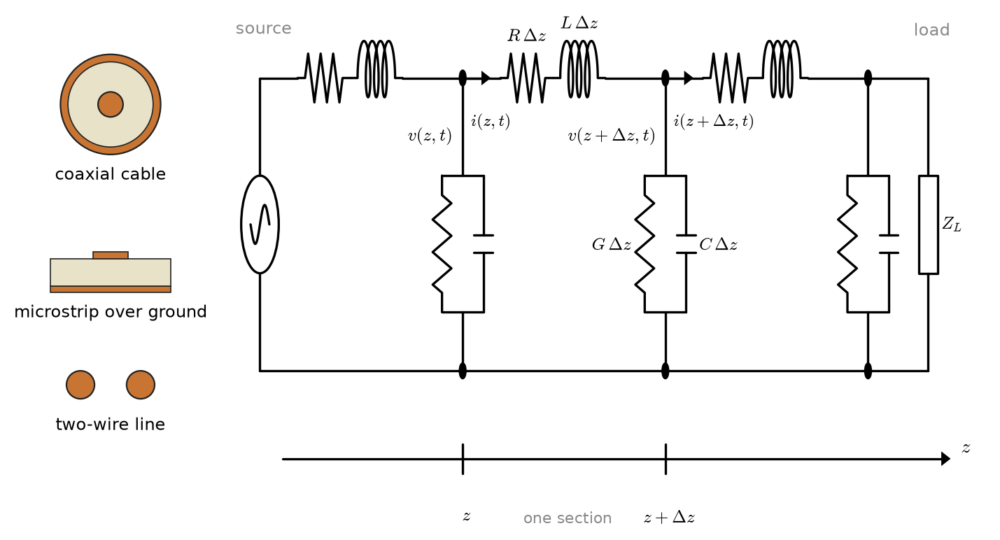
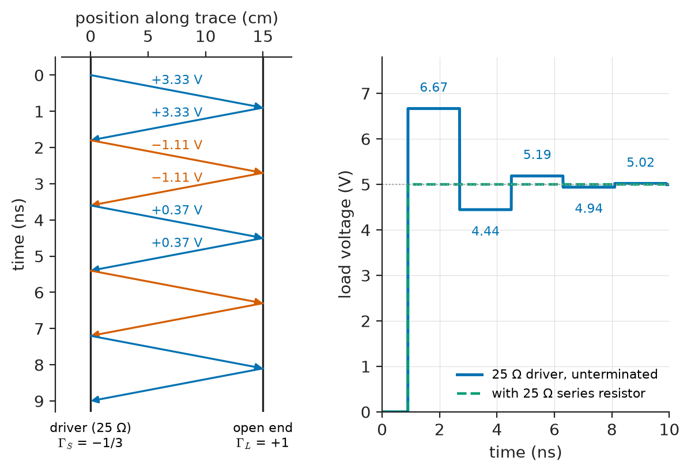
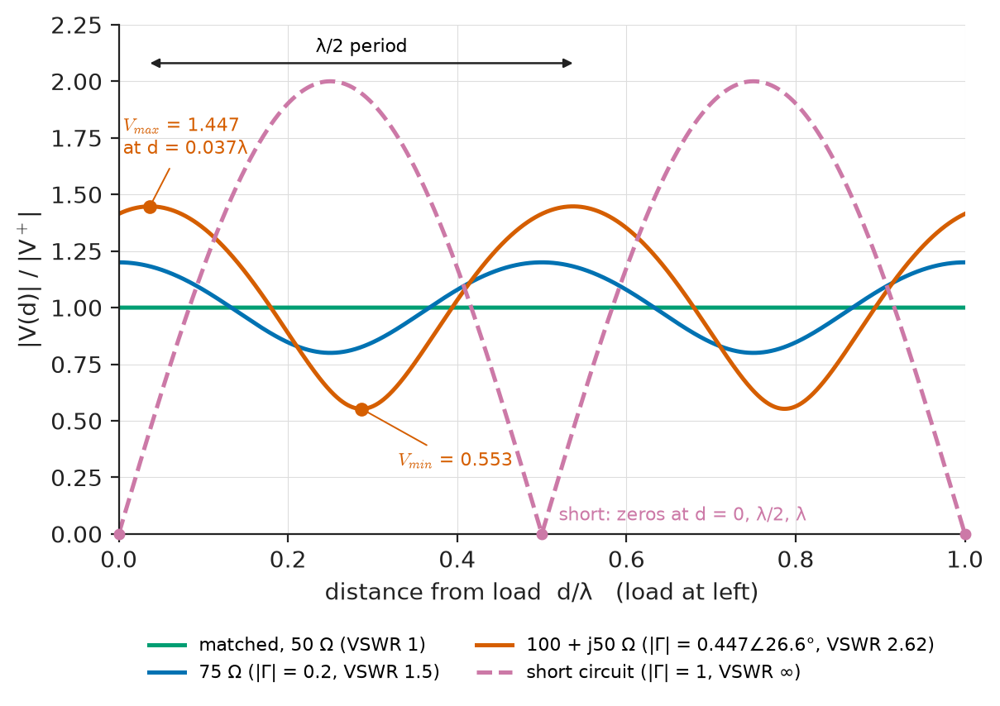
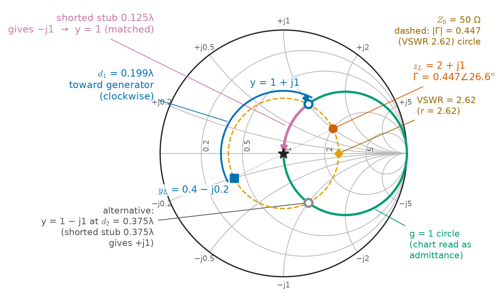
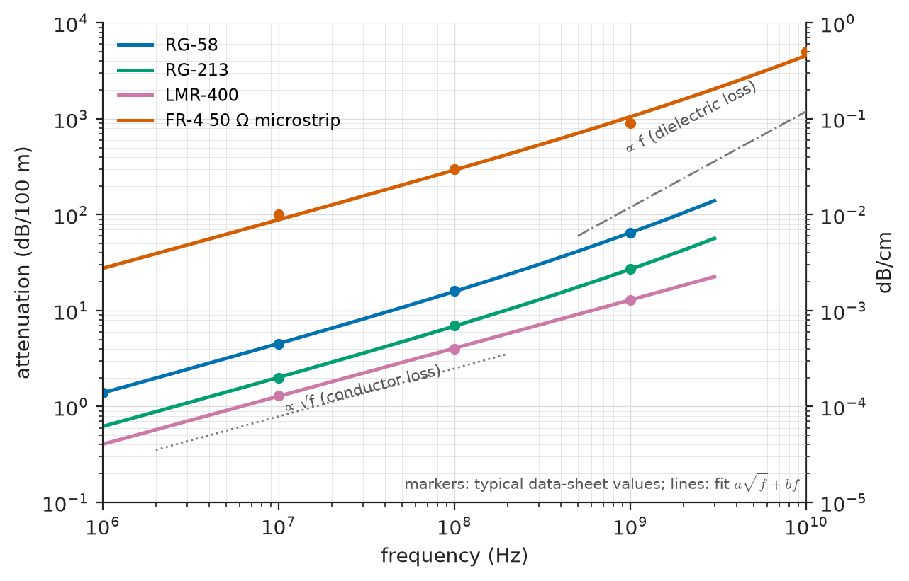
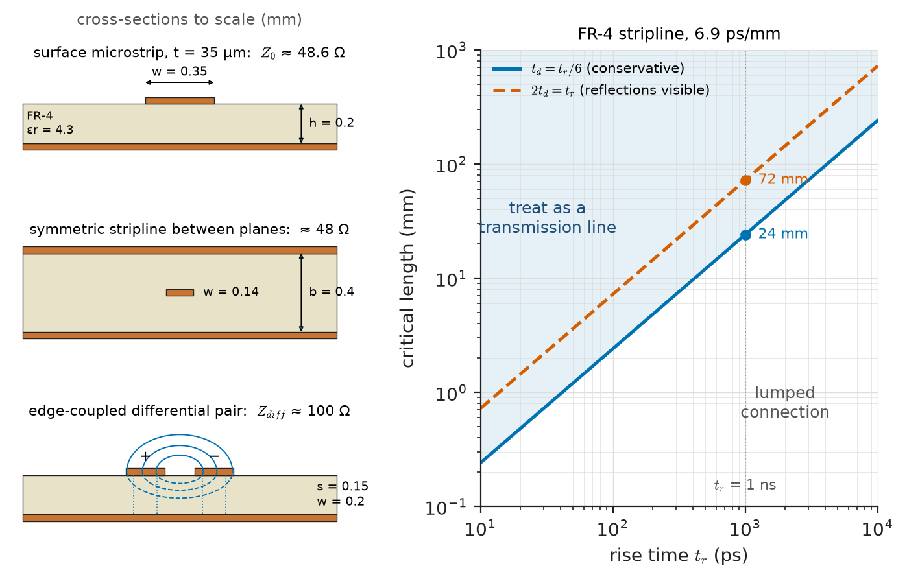

# Chapter 14 — Transmission Lines

*Part III · Advanced Network Theory*

A new digital board works on the bench with short test leads and fails in the enclosure. The clock output of a processor drives a memory chip 15 cm away along a printed trace. On an oscilloscope the clock at the memory input no longer looks like a square wave: each rising edge overshoots to 6.7 V on a 5 V logic level, falls back to 4.4 V, rises again, and takes several nanoseconds to settle. Occasionally the memory sees two clock edges where the processor sent one. Every component is within specification, and Kirchhoff's laws, applied to the trace as a wire, predict a clean waveform. The prediction fails because the trace is not a wire: the edge takes almost a nanosecond to travel its length, and in that time the voltage at the two ends is not the same.

The same physics appears at every scale. A 300 km, 400 kV overhead line carries 50 Hz power, but its voltage at the open receiving end rises above the sending-end voltage. A technician finds a fault in a buried cable by sending a pulse and timing its echo. A radio transmitter shuts down its power amplifier because the antenna cable reflects power back. In each case the interconnect must be treated as a **transmission line**: a structure with inductance, capacitance and loss distributed along its length, on which voltage and current travel as waves.

> **When does a connection stop behaving as a wire and start behaving as a transmission line?**
> **What decides how much of a signal is reflected at a load, and how can reflections be removed?**
> **How do loss and frequency change what a long line delivers?**

| Concept | Engineering destination |
|---|---|
| Distributed parameters | Cable and PCB-trace models, overhead-line constants in power systems |
| Telegrapher's equations | Wave propagation on any two-conductor line, from power lines to coax |
| Characteristic impedance | 50 Ω RF systems, 75 Ω video, 100 Ω differential pairs, surge impedance of power lines |
| Propagation constant | Delay and attenuation budgets for cables, DSL reach, line loadability |
| Reflection coefficient | Signal integrity, TDR fault location, antenna matching |
| Standing-wave ratio | Transmitter protection, antenna tuning, RF power measurement |
| Impedance matching | Quarter-wave transformers, stub tuners, termination of digital buses |
| Smith chart | Graphical design of matching networks, reading VNA measurements |
| Lossy and lossless lines | Cable selection, long-distance power transmission, telephone and DSL loops |
| High-frequency interconnects | PCB layout rules, differential signalling, termination strategies |

**Roadmap.** Distributed parameters replace lumped elements (14.1) → the telegrapher's equations (14.2) → their wave solution defines characteristic impedance (14.3) and the propagation constant (14.4) → a load sends part of the wave back, measured by the reflection coefficient (14.5) and the standing-wave ratio (14.6) → reflections are removed by matching (14.7), designed on the Smith chart (14.8) → loss changes the picture (14.9) → all of it applied to PCB and cable interconnects (14.10).

---

## 14.1 Distributed parameters

### When the lumped model fails

Every circuit in Chapters 1–13 rested on the **lumped-element assumption**: the circuit is small enough that a change of current at one end of a wire is felt instantly at the other end, so that one voltage describes each node and one current each branch. Electromagnetic disturbances travel at a finite speed $v$, close to the speed of light $c=3.00\times10^8$ m/s in air and slower in dielectrics. A signal of frequency $f$ has wavelength $\lambda=v/f$. The lumped model is accurate when the physical length $\ell$ of the circuit is small compared with $\lambda$; a common working threshold is

$$
\ell<\frac{\lambda}{10}
$$

For signals with fast edges rather than a single frequency, the equivalent statement compares the propagation delay $t_d=\ell/v$ with the rise time $t_r$ (Section 14.10).

| Signal | Frequency or edge | Wavelength (in the medium) | Length where line effects matter |
|---|---|---|---|
| Mains power, overhead line | 50 Hz | ≈5900 km | ≳ 100–300 km |
| Telephone voice | 3.4 kHz | ≈50 km on a loaded pair, less unloaded | Every subscriber loop |
| AM radio | 1 MHz | 300 m in air | Antenna feeders, towers |
| FM radio and VHF | 100 MHz | 2 m in coax (VF 0.66) | ≳ 20 cm |
| Wi-Fi | 2.4 GHz | 6.2 cm on FR-4 | ≳ a few millimetres |
| Digital logic, 1 ns edge | knee ≈ 350 MHz | ≈ 42 cm on FR-4 | ≳ 3–7 cm |

The last column does not mark a sharp boundary: line effects grow continuously with $\ell/\lambda$. The table shows why the same 50 Hz power that is lumped inside a building becomes distributed across a continent, and why every trace on a multi-gigahertz board is a transmission line.

### The per-unit-length model

A **transmission line** is any pair of conductors (two wires, a coaxial cable, a trace over a ground plane, a twisted pair, a phase conductor over earth) whose cross-section is uniform along its length. A short piece of length $\Delta z$ has:

- **series resistance** $R\,\Delta z$, from the finite conductivity of both conductors (Ω/m);
- **series inductance** $L\,\Delta z$, from the magnetic flux linking the current loop (H/m);
- **shunt conductance** $G\,\Delta z$, from leakage through the dielectric (S/m);
- **shunt capacitance** $C\,\Delta z$, from the electric field between the conductors (F/m).

$R$, $L$, $G$ and $C$ are the **primary line constants** or distributed parameters. They are fixed by geometry and materials. For a coaxial cable with inner radius $a$, outer radius $b$ and dielectric permittivity $\varepsilon_r$,

$$
L=\frac{\mu_0}{2\pi}\ln\frac ba,\qquad C=\frac{2\pi\varepsilon_0\varepsilon_r}{\ln(b/a)}
$$

and for most lines $LC=\mu\varepsilon$, a relation that ties the propagation speed to the dielectric alone. $R$ grows with frequency through the skin effect (Section 14.9), and $G$ grows in proportion to frequency for most dielectrics.

<!-- FIGURE 14.1 | figures/ch14/fig-14-1-distributed-line-section.png | circuit | Lumped equivalent of a short section of transmission line of length delta z, with series R and L and shunt G and C per unit length. | Content: left: cross-section sketches of a coaxial cable, a microstrip trace over ground, and a two-wire line. Right: a ladder of three identical sections, each with series R dz and L dz in the top conductor and shunt G dz parallel to C dz to the return conductor; node voltages v(z,t) and v(z+dz,t), branch currents i(z,t) and i(z+dz,t) labelled; position axis z below; source at left, load ZL at right. -->

*Figure 14.1 — Lumped equivalent of a short section of transmission line of length delta z, with series R and L and shunt G and C per unit length.*

Figure 14.1 shows the model as a ladder of infinitesimal sections. It is still a circuit, and Kirchhoff's laws still apply to each section, because each section is short compared with a wavelength. The new physics enters only through the limit $\Delta z\to0$.

> **Boundary.** The derivation of $L$ and $C$ for arbitrary geometries, and the field picture of a TEM wave guided between two conductors, belong to *Engineering Physics*. This chapter takes the per-unit-length constants as given and builds the circuit theory of lines from them.

### Representative line constants

| Line | $R$ | $L$ | $C$ | $G$ | Use |
|---|---|---|---|---|---|
| RG-58 coax (50 Ω, VF 0.66) | ≈ 0.03 Ω/m at 1 MHz, rises as $\sqrt f$ | 250 nH/m | 100 pF/m | negligible below 100 MHz | Lab RF, instrumentation |
| RG-6 coax (75 Ω, VF 0.85, foam) | ≈ 0.02 Ω/m at 1 MHz | 295 nH/m | 52 pF/m | small | TV, satellite |
| 0.4 mm telephone pair | 280 Ω/km (loop) | 0.6 mH/km | 50 nF/km | ≈ 1 µS/km | Subscriber loops, DSL |
| 400 kV overhead line, bundled | ≈ 0.03 Ω/km | ≈ 1.0 mH/km | ≈ 11.5 nF/km | ≈ 0 | Bulk power transmission |
| 50 Ω microstrip on FR-4 | ≈ 5–10 Ω/m at 1 GHz | ≈ 300 nH/m | ≈ 120 pF/m | from $\tan\delta\approx0.02$ | PCB signals |

---

## 14.2 Telegrapher's equations

### Derivation from the section model

Apply KVL around one section of Figure 14.1. The voltage drop along the section is caused by the series resistance and inductance:

$$
v(z,t)-v(z+\Delta z,t)=R\,\Delta z\,i(z,t)+L\,\Delta z\,\frac{\partial i(z,t)}{\partial t}
$$

Apply KCL at the node $z+\Delta z$. The current lost along the section flows through the shunt conductance and capacitance:

$$
i(z,t)-i(z+\Delta z,t)=G\,\Delta z\,v(z+\Delta z,t)+C\,\Delta z\,\frac{\partial v(z+\Delta z,t)}{\partial t}
$$

Dividing by $\Delta z$ and letting $\Delta z\to0$ gives the **telegrapher's equations**:

$$
\frac{\partial v}{\partial z}=-R\,i-L\frac{\partial i}{\partial t},\qquad
\frac{\partial i}{\partial z}=-G\,v-C\frac{\partial v}{\partial t}
$$

They were derived by Oliver Heaviside in the 1880s to explain why telegraph pulses on long submarine cables smeared out, and they describe every uniform two-conductor line.

> **Status of the principle: Telegrapher's equations**
> *Fundamental.* They follow from Maxwell's equations for a transverse electromagnetic (TEM) wave between two conductors, with $R$, $L$, $G$, $C$ capturing the geometry; they are exact for TEM lines with uniform cross-section and an excellent approximation (quasi-TEM) for microstrip and twisted pairs below the frequencies at which higher-order modes or radiation appear.

### The lossless wave equation

For a lossless line ($R=G=0$), differentiating one equation with respect to $z$ and substituting the other gives

$$
\frac{\partial^2v}{\partial z^2}=LC\,\frac{\partial^2v}{\partial t^2}
$$

which is the one-dimensional wave equation. Its general solution, found by d'Alembert, is the sum of two arbitrary waveforms travelling in opposite directions:

$$
v(z,t)=v^+\Big(t-\frac zv\Big)+v^-\Big(t+\frac zv\Big),\qquad v=\frac1{\sqrt{LC}}
$$

A forward wave $v^+$ moves toward increasing $z$ at speed $v$ without changing shape; a backward wave $v^-$ moves the other way. For RG-58 with $L=252.5$ nH/m and $C=101$ pF/m, $v=1/\sqrt{LC}=1.98\times10^8$ m/s, which is 0.66 of the speed of light. This **velocity factor** equals $1/\sqrt{\varepsilon_r}$ for a TEM line filled with a dielectric of relative permittivity $\varepsilon_r$; for solid polyethylene ($\varepsilon_r=2.25$) it is 0.667. The delay per metre is 5.05 ns/m, a figure every engineer who has synchronised instruments with cables learns to use.

### The phasor form

For sinusoidal steady state at angular frequency $\omega$, the time derivatives become $j\omega$ and the equations become ordinary differential equations in the phasors $V(z)$ and $I(z)$:

$$
\frac{dV}{dz}=-(R+j\omega L)I=-Z'I,\qquad \frac{dI}{dz}=-(G+j\omega C)V=-Y'V
$$

with $Z'=R+j\omega L$ the series impedance per metre and $Y'=G+j\omega C$ the shunt admittance per metre. Eliminating $I$ gives

$$
\frac{d^2V}{dz^2}=\gamma^2V,\qquad \gamma=\sqrt{Z'Y'}=\sqrt{(R+j\omega L)(G+j\omega C)}
$$

whose solution is

$$
V(z)=V^+e^{-\gamma z}+V^-e^{+\gamma z},\qquad I(z)=\frac{1}{Z_0}\big(V^+e^{-\gamma z}-V^-e^{+\gamma z}\big)
$$

The two terms are again forward and backward waves; $\gamma$ and $Z_0$ are the subject of the next two sections. These equations, with the two constants $V^+$ and $V^-$ fixed by the source and the load, are the entire sinusoidal theory of transmission lines.

---

## 14.3 Characteristic impedance

### Definition

Substituting the forward wave alone into $dV/dz=-Z'I$ shows that its voltage and current are in a fixed ratio at every point:

$$
Z_0=\frac{V^+}{I^+}=\sqrt{\frac{Z'}{Y'}}=\sqrt{\frac{R+j\omega L}{G+j\omega C}}
$$

This is the **characteristic impedance** of the line. It is not the impedance of any component and cannot be measured with an ohmmeter. It is the ratio of voltage to current in a single travelling wave: a source launching a wave onto a long line sees $Z_0$, regardless of what is connected at the far end, until a reflection returns. For a lossless line, or any line at frequencies where $\omega L\gg R$ and $\omega C\gg G$,

$$
Z_0=\sqrt{\frac LC}
$$

which is real and independent of frequency. For RG-58, $\sqrt{252.5\times10^{-9}/101\times10^{-12}}=50.0\ \Omega$.

> **Status of the principle: Characteristic impedance**
> *Derived.* A direct consequence of the telegrapher's equations; the lossless form $\sqrt{L/C}$ is approximate, valid when $\omega L\gg R$ and $\omega C\gg G$, which for cables means above roughly 100 kHz.

### Physical interpretation

A useful way to see $Z_0$ is to imagine an infinitely long line. A source connected to it sees a resistance $Z_0$ forever, because the energy it sends travels away and never comes back; a lossless line of infinite length absorbs power exactly like a resistor. A finite line terminated in a resistor equal to $Z_0$ is indistinguishable from an infinite line: this is **matched termination**, and it is the goal of most interconnect design.

The value of $Z_0$ depends only on the cross-section geometry, logarithmically for coax:

$$
Z_0=\frac{60}{\sqrt{\varepsilon_r}}\ln\frac ba\ \ \Omega
$$

so doubling the diameter ratio changes $Z_0$ by only $41.6/\sqrt{\varepsilon_r}$ Ω. Practical characteristic impedances therefore span a modest range, roughly 20 Ω to 600 Ω.

| Line or system | Typical $Z_0$ | Reason for the value |
|---|---|---|
| RF instrumentation coax | 50 Ω | Compromise between minimum loss (≈77 Ω) and maximum power handling (≈30 Ω) in air-dielectric coax |
| Video, cable TV, satellite coax | 75 Ω | Close to minimum attenuation |
| Twisted pair (Ethernet, Cat 5e/6) | 100 Ω differential | Wire gauge and twist geometry |
| USB 2.0 and HDMI differential pairs | 90 Ω and 100 Ω differential | Interface standards |
| Single-ended PCB trace (DDR, general logic) | 40–60 Ω | Trace width and dielectric height |
| Telephone pair at voice frequencies | ≈ 500–1700 Ω, angle ≈ −45° | Loss-dominated regime (Section 14.9) |
| Twin-lead ribbon feeder | 300 Ω | Wide spacing in air |
| Overhead power line (surge impedance) | ≈ 250–400 Ω | Conductor height and bundle geometry |
| Underground power cable | ≈ 20–60 Ω | Thin insulation, high capacitance |

### Surge impedance loading of power lines

Power engineers call $Z_0$ the **surge impedance** of a line, because it governs the travelling waves set up by lightning and switching surges. It also defines a natural power level. If a lossless line is terminated in its surge impedance, voltage and current keep a constant ratio along the whole line, and the reactive power generated by the line capacitance exactly balances that absorbed by its inductance. The real power delivered at that condition is the **surge impedance loading**:

$$
\mathrm{SIL}=\frac{V_\text{LL}^2}{Z_0}
$$

**Worked example — surge impedance of a 400 kV line.** A 400 kV line has $L=1.0$ mH/km and $C=11.5$ nF/km per phase. The lossless surge impedance is $\sqrt{1.0\times10^{-3}/11.5\times10^{-9}}=295\ \Omega$. Including $R=0.03$ Ω/km at 50 Hz gives $Z_0=295.2-j14.1\ \Omega$, magnitude 295.6 Ω and angle −2.7°: the loss changes $Z_0$ by less than 0.3 % in magnitude. The SIL is $(400\times10^3)^2/295=543$ MW. Below SIL the line generates net reactive power and the receiving-end voltage tends to rise; above SIL it absorbs reactive power and the voltage sags. The wave speed is $1/\sqrt{LC}=2.95\times10^5$ km/s, close to the speed of light, so the 50 Hz wavelength is 5900 km. A 300 km line is $300/5900\times360°=18.3°$ long, and its open-circuit receiving-end voltage is $1/\cos18.3°=1.053$ times the sending-end voltage: the **Ferranti effect**, a 5.3 % rise produced entirely by distributed capacitance. Long lines are therefore operated near SIL or compensated with shunt reactors, a topic of *Electrical Energy & Machines*.

---

## 14.4 Propagation constant

### Attenuation and phase constants

The **propagation constant** is complex:

$$
\gamma=\alpha+j\beta=\sqrt{(R+j\omega L)(G+j\omega C)}
$$

A forward wave $V^+e^{-\gamma z}=V^+e^{-\alpha z}e^{-j\beta z}$ decays in amplitude at the rate set by the **attenuation constant** $\alpha$ (in nepers per metre) and rotates in phase at the rate set by the **phase constant** $\beta$ (in radians per metre). One neper is a factor $e$ in amplitude, equal to 8.686 dB, so

$$
\text{attenuation in dB/m}=8.686\,\alpha
$$

The phase constant determines the wavelength on the line, $\lambda=2\pi/\beta$, and the **phase velocity**, $v_p=\omega/\beta$.

> **Status of the principle: Propagation constant**
> *Derived.* Follows from the phasor telegrapher's equations; $\alpha$ and $\beta$ inherit the frequency dependence of $R$, $L$, $G$, $C$, so a measured $\gamma(\omega)$ also characterises the line's materials.

### The lossless case

When $R=G=0$, $\gamma=j\omega\sqrt{LC}$, so $\alpha=0$ and

$$
\beta=\omega\sqrt{LC},\qquad v_p=\frac1{\sqrt{LC}},\qquad \lambda=\frac{v_p}{f}
$$

The phase velocity is independent of frequency: all frequency components of a signal travel together and the waveform arrives undistorted, only delayed. This is the ideal that real interconnects approach at high frequency.

### Electrical length

What matters for the behaviour of a line is not its physical length but its length in wavelengths, the **electrical length**

$$
\theta=\beta\ell=2\pi\frac{\ell}{\lambda}
$$

usually quoted in degrees. A line with $\theta$ of a few degrees behaves almost like a lumped connection; at $\theta=90°$ (a quarter wavelength) it inverts impedances (Section 14.7); at $\theta=180°$ it reproduces the load impedance at its input. For the 400 kV example, 300 km at 50 Hz is 18.3°; for a 10 cm FR-4 trace at 2.4 GHz with $v_p=1.45\times10^8$ m/s, $\lambda=6.0$ cm, and the trace is about 600° long.

---

## 14.5 Reflection coefficient

### Boundary condition at the load

Let a line of characteristic impedance $Z_0$ be terminated at $z=\ell$ by a load $Z_L$. At the load the line voltage and current must satisfy Ohm's law for the load, $V(\ell)=Z_LI(\ell)$. A single forward wave has $V/I=Z_0$, so unless $Z_L=Z_0$ it cannot satisfy the boundary condition alone. A reflected wave must appear, with just the amplitude needed to make the total voltage and current match the load. Writing $V_L=V^++V^-$ and $I_L=(V^+-V^-)/Z_0$ (with phasors referred to the load position) and setting $V_L/I_L=Z_L$ gives the **reflection coefficient**

$$
\Gamma_L=\frac{V^-}{V^+}=\frac{Z_L-Z_0}{Z_L+Z_0}
$$

> **Status of the principle: Reflection coefficient**
> *Derived.* Follows from continuity of voltage and current at the line–load junction and the fixed $V/I$ ratio of each travelling wave; it applies to any linear load and, at an instant, to any junction between lines of different $Z_0$.

The three limiting cases are worth memorising:

| Load | $\Gamma_L$ | What happens |
|---|---|---|
| Matched, $Z_L=Z_0$ | 0 | No reflection; all incident power absorbed |
| Open circuit, $Z_L\to\infty$ | +1 | Voltage doubles at the load; current is zero |
| Short circuit, $Z_L=0$ | −1 | Voltage is zero; current doubles |
| Pure reactance, $Z_L=jX$ | $\lvert\Gamma\rvert=1$, angle varies | All power reflected, with a phase shift |
| Resistive, $R_L>Z_0$ | Real, between 0 and +1 | Partial reflection, same polarity |
| Resistive, $R_L<Z_0$ | Real, between −1 and 0 | Partial reflection, inverted polarity |

For a passive load, $\lvert\Gamma_L\rvert\le1$. The fraction of incident power reflected is $\lvert\Gamma_L\rvert^2$; the fraction delivered to the load is $1-\lvert\Gamma_L\rvert^2$. RF engineers express these as the **return loss**, $\mathrm{RL}=-20\log_{10}\lvert\Gamma_L\rvert$ dB, and the **mismatch loss**, $-10\log_{10}(1-\lvert\Gamma_L\rvert^2)$ dB. In S-parameter language (Chapter 32), $\Gamma$ measured at a port is $S_{11}$.

**Worked example — a 75 Ω camera on a 50 Ω cable, and a dipole on a 50 Ω feed.** A 75 Ω video load at the end of a 50 Ω cable gives $\Gamma_L=(75-50)/(75+50)=0.20$. The return loss is $-20\log0.20=14.0$ dB, 4 % of the incident power is reflected, and the mismatch loss is only 0.18 dB. The more serious consequence on a video line is the echo: a reflection of 20 % in amplitude, delayed by the cable round trip, appears as a faint "ghost" image. A half-wave dipole antenna slightly longer than resonant presents roughly $Z_L=73+j42.5\ \Omega$ to a 50 Ω feed. Then

$$
\Gamma_L=\frac{23+j42.5}{123+j42.5}=0.274+j0.251=0.371\angle42.5°
$$

The return loss is 8.6 dB and 13.8 % of the power is reflected (mismatch loss 0.64 dB). Trimming the dipole to resonance removes the reactance and brings $\Gamma$ down to $(73-50)/123=0.187$.

### Reflections in the time domain

The reflection coefficient applies equally to fast edges, which makes it the main tool of **signal integrity** and **time-domain reflectometry**. When a step travels down a line and meets a load, the reflected step has amplitude $\Gamma_L$ times the incident step and travels back toward the source, where it reflects again with the source reflection coefficient $\Gamma_S=(Z_S-Z_0)/(Z_S+Z_0)$. The voltage at any point is the running sum of all the waves that have passed it. A **bounce** (lattice) **diagram** tracks the waves graphically: position along the horizontal axis, time downward, each wave a diagonal line.

**Worked example — ringing on an unterminated clock trace.** A logic driver with 25 Ω output resistance switches from 0 to 5 V into a 50 Ω PCB trace 15 cm long, ending at a CMOS input that behaves as an open circuit. With a delay of 6.0 ps/mm the one-way delay is $t_d=0.90$ ns. The initial wave is set by the divider between source resistance and $Z_0$:

$$
V_1=5\times\frac{50}{25+50}=3.33\ \mathrm{V},\qquad \Gamma_S=\frac{25-50}{25+50}=-\frac13,\qquad \Gamma_L=+1
$$

At $t=t_d$ the 3.33 V wave reaches the open end, reflects with $\Gamma_L=+1$, and the load voltage jumps to $3.33+3.33=6.67$ V, the overshoot seen in the opening. The reflected 3.33 V wave returns to the source, reflects as $-1.11$ V, and arrives at the load at $3t_d$, where it doubles again, bringing the load to $6.67-2.22=4.44$ V. Continuing, the load voltage at $t_d,3t_d,5t_d,7t_d,9t_d$ is 6.67, 4.44, 5.19, 4.94 and 5.02 V. It converges to 5 V, the DC value Kirchhoff's laws predict, but only after several round trips of 1.8 ns each. A 25 Ω series resistor at the driver, making $Z_S=50\ \Omega$, would give $\Gamma_S=0$: the load would jump cleanly from 0 to 5 V at $t_d$ and stay there.

<!-- FIGURE 14.2 | figures/ch14/fig-14-2-bounce-diagram-ringing.png | plot | Bounce diagram and load voltage for a 5 V step from a 25-ohm driver into an open-ended 50-ohm, 0.90 ns trace. | Content: left panel: lattice diagram with position 0 to 15 cm horizontal and time 0 to 9 ns downward; diagonal waves labelled 3.33 V, 3.33 V (reflected, Gamma L = +1), -1.11 V (Gamma S = -1/3), -1.11 V, +0.37 V; Gamma S and Gamma L labelled at the ends. Right panel: load voltage versus time 0 to 10 ns as a staircase: 0 V until 0.9 ns, 6.67 V to 2.7 ns, 4.44 V to 4.5 ns, 5.19 V to 6.3 ns, 4.94 V to 8.1 ns, 5.02 V after; dashed line at 5 V; second curve for the series-terminated case (25-ohm series resistor) stepping cleanly from 0 to 5 V at 0.9 ns. -->

*Figure 14.2 — Bounce diagram and load voltage for a 5 V step from a 25-ohm driver into an open-ended 50-ohm, 0.90 ns trace.*

Figure 14.2 shows the lattice and the staircase waveform. On a real board the edges are not instantaneous and the input has a few picofarads of capacitance, so the staircase becomes a damped ringing waveform, but the levels follow the bounce diagram closely.

### Time-domain reflectometry

The same mechanism locates faults. A **time-domain reflectometer** (TDR) launches a fast step or pulse into a cable and records the echoes. The delay of an echo gives the distance to the discontinuity, and the sign and size of the echo give its nature: an open circuit returns a positive step, a short a negative one, a crushed or water-logged section a smaller dip. If an echo returns $1.2\ \mu$s after launch on a cable with velocity factor 0.66, the fault lies at

$$
d=\frac{v\,t}{2}=\frac{0.66\times(3.00\times10^8)\times(1.2\times10^{-6})}{2}=119\ \mathrm{m}
$$

TDR is used on telephone and data cables, on underground power cables (where the high-voltage version is called surge or impulse-current fault location), on PCB traces to measure $Z_0$ along their length, and in soil-moisture probes, where the delay measures the soil's permittivity.

---

## 14.6 Standing-wave ratio

### Standing waves

With a sinusoidal source, the forward and reflected waves coexist on the line and interfere. Measured from the load ($d=\ell-z$ is the distance toward the source), the voltage magnitude is

$$
\lvert V(d)\rvert=\lvert V^+\rvert\,\big\lvert1+\Gamma_Le^{-j2\beta d}\big\rvert
$$

As $d$ increases, the reflected term rotates twice as fast as $\beta d$, and the magnitude oscillates between a maximum $\lvert V^+\rvert(1+\lvert\Gamma_L\rvert)$ where the two waves add in phase and a minimum $\lvert V^+\rvert(1-\lvert\Gamma_L\rvert)$ where they oppose. Maxima and minima repeat every half wavelength and are a quarter wavelength apart. This stationary pattern of maxima and minima is a **standing wave** (Figure 14.3).

The **voltage standing-wave ratio** is the ratio of maximum to minimum:

$$
\mathrm{VSWR}=\frac{V_\text{max}}{V_\text{min}}=\frac{1+\lvert\Gamma_L\rvert}{1-\lvert\Gamma_L\rvert},\qquad \lvert\Gamma_L\rvert=\frac{\mathrm{VSWR}-1}{\mathrm{VSWR}+1}
$$

It runs from 1 (perfect match) to infinity (total reflection). Before vector network analysers became common, VSWR was the easiest quantity to measure on a line: a slotted line with a sliding probe recorded $V_\text{max}$ and $V_\text{min}$ directly, and the position of the minimum gave the phase of $\Gamma_L$.

> **Status of the principle: Standing-wave ratio**
> *Derived.* An algebraic consequence of the superposition of forward and reflected waves on a lossless line; on a lossy line the ratio varies along the line and is lowest near the source, which can make a badly mismatched antenna look acceptable from the transmitter end.

<!-- FIGURE 14.3 | figures/ch14/fig-14-3-standing-wave-patterns.png | plot | Voltage magnitude along a lossless 50-ohm line for four loads, showing standing waves and VSWR. | Content: x-axis distance from load d/lambda from 0 to 1 (load at left), y-axis normalised voltage magnitude 0 to 2. Curves: matched load (flat at 1, VSWR 1), 75-ohm load (Gamma = 0.2, between 0.8 and 1.2, VSWR 1.5), load 100 + j50 ohm (Gamma = 0.447 at 26.6 deg, between 0.553 and 1.447, VSWR 2.62, first maximum at d = 0.037 lambda), short circuit (between 0 and 2, VSWR infinite, zero at d = 0, 0.5 lambda). Annotate Vmax, Vmin and the half-wavelength period. -->

*Figure 14.3 — Voltage magnitude along a lossless 50-ohm line for four loads, showing standing waves and VSWR.*

### What VSWR means in practice

| VSWR | $\lvert\Gamma\rvert$ | Return loss | Power reflected | Typical interpretation |
|---|---|---|---|---|
| 1.0 | 0 | ∞ | 0 % | Ideal termination |
| 1.2 | 0.091 | 20.8 dB | 0.8 % | Good test-equipment port |
| 1.5 | 0.200 | 14.0 dB | 4.0 % | Typical antenna specification limit |
| 2.0 | 0.333 | 9.5 dB | 11.1 % | Marginal; many transmitters begin to reduce power |
| 3.0 | 0.500 | 6.0 dB | 25.0 % | Poor; protection circuits often trip |
| ∞ | 1 | 0 dB | 100 % | Open, short or pure reactance |

High VSWR harms a transmitter in two ways: reflected power is not radiated, and the voltage maxima along the line and at the amplifier output can exceed device ratings. Transmitters measure forward and reflected power with a directional coupler and fold back their output when the reflection exceeds a threshold.

### Input impedance of a terminated line

The ratio $V(d)/I(d)$ at a distance $d$ from the load is the impedance seen looking toward the load. For a lossless line,

$$
Z_\text{in}(d)=Z_0\frac{Z_L+jZ_0\tan\beta d}{Z_0+jZ_L\tan\beta d}
$$

This **impedance transformation** formula shows that a line changes the impedance its load presents, periodically with period $\lambda/2$. Special cases include a short-circuited line, $Z_\text{in}=jZ_0\tan\beta d$, and an open-circuited line, $Z_\text{in}=-jZ_0\cot\beta d$: lossless line stubs behave as pure inductors or capacitors of any value, depending on length. A shorted 50 Ω line one-eighth of a wavelength long has $\tan(\pi/4)=1$ and presents $+j50\ \Omega$, an inductor; an open one of the same length presents $-j50\ \Omega$, a capacitor. Above about 1 GHz, stubs replace lumped inductors and capacitors in filters and matching networks.

---

## 14.7 Impedance matching

### Why match

Matching serves three different purposes, which sometimes conflict:

1. **Maximum power transfer** from a source to a load (Chapter 4), which for a lossless line requires the load to present the conjugate of the source impedance at the input.
2. **Absence of reflections** on the line, which requires $Z_L=Z_0$ at the load; this protects transmitters, avoids video ghosts, and keeps digital edges clean.
3. **Low noise** in receivers, where the source impedance that minimises the amplifier's noise figure is generally not the conjugate match (Chapter 29).

In most RF and high-speed digital systems the second requirement dominates, and everything is designed to the same reference impedance, usually 50 Ω, so that any component can be connected to any other.

### Termination in digital interconnects

| Scheme | Arrangement | Advantage | Cost |
|---|---|---|---|
| Series (source) termination | Resistor $Z_0-R_\text{out}$ at driver | No DC power; one resistor | Half-amplitude wave travels down the line; only the far end sees a clean edge |
| Parallel termination | $R=Z_0$ from far end to ground or $V_\text{TT}$ | Clean edge everywhere | DC power dissipation |
| Thévenin termination | Two resistors to supply and ground | Sets a mid-rail bias | Continuous current |
| AC termination | $R=Z_0$ in series with $C$ at far end | No DC power | Needs $RC\gg$ bit time |
| Differential termination | $R=Z_\text{diff}$ (100 Ω) across the pair | Standard for LVDS, Ethernet, USB | Requires differential routing |

### The quarter-wave transformer

At $\beta d=\pi/2$ (a quarter wavelength) the transformation formula reduces to

$$
Z_\text{in}=\frac{Z_T^2}{Z_L}
$$

for a line section of characteristic impedance $Z_T$. To match a real load $R_L$ to a line $Z_0$, choose

$$
Z_T=\sqrt{Z_0R_L}
$$

To match a 100 Ω load to 50 Ω, a quarter-wave section of $\sqrt{50\times100}=70.7\ \Omega$ is needed. It works exactly only at the design frequency. At 10 % above or below that frequency, the section is 99° or 81° long and the input impedance becomes $50.6\pm j5.5\ \Omega$, a VSWR of 1.12, which is still good; wider bandwidths are obtained with several cascaded sections of stepped impedance. Quarter-wave transformers are used in antenna feeds, power dividers, and the impedance-inverting sections of RF amplifiers.

> **Status of the principle: Quarter-wave impedance inversion**
> *Derived.* Exact for a lossless line at the frequency where it is a quarter wavelength long; the match degrades smoothly away from that frequency, and loss in the section adds a resistive error.

### Lumped and stub matching

A general complex load can be matched by moving along the line until the real part of the admittance equals $1/Z_0$, then cancelling the remaining susceptance with a reactive element in parallel. At low RF that element is a capacitor or inductor (an L-network); above about 1 GHz it is a short- or open-circuited stub. This **single-stub match** is worked through on the Smith chart in the next section.

---

## 14.8 Smith chart

### Mapping impedance to reflection coefficient

The impedance transformation formula is awkward to apply by hand, especially for complex loads. Phillip Smith's 1939 chart makes it geometric. Normalise every impedance to the line, $z=Z/Z_0=r+jx$. The reflection coefficient is

$$
\Gamma=\frac{z-1}{z+1}
$$

and moving a distance $d$ toward the source multiplies it by $e^{-j2\beta d}$: on a lossless line, $\lvert\Gamma\rvert$ stays the same and its angle decreases by $2\beta d$. On the complex $\Gamma$-plane, then, moving along a lossless line is simply **rotation about the centre**, clockwise toward the generator, by $720°$ per wavelength.

The Smith chart is the $\Gamma$-plane with the grid of constant $r$ and constant $x$ drawn on it. The bilinear map $z\mapsto\Gamma$ sends lines of constant resistance to circles tangent at $\Gamma=1$, and lines of constant reactance to arcs through the same point. The whole right half of the impedance plane (all passive loads) fills the unit circle.

> **Status of the principle: Smith chart**
> *Derived.* A graphical form of the bilinear transformation between normalised impedance and reflection coefficient; it is exact for lossless lines, and loss can be included by spiralling inward at the rate $e^{-2\alpha d}$.

Key features:

| Point or curve | Meaning |
|---|---|
| Centre, $\Gamma=0$ | Matched, $z=1$ |
| Right edge, $\Gamma=+1$ | Open circuit |
| Left edge, $\Gamma=-1$ | Short circuit |
| Upper half | Inductive impedances ($x>0$) |
| Lower half | Capacitive impedances ($x<0$) |
| Circle about the centre through the load | Constant $\lvert\Gamma\rvert$ and constant VSWR |
| Where that circle crosses the right horizontal axis | Value of $r$ equals the VSWR |
| Rotating 180° about the centre | Quarter-wave move; turns impedance into admittance |

The last property lets the same chart be read as an admittance chart, which is convenient for shunt elements.

### Worked single-stub match

**Worked example — matching $100+j50\ \Omega$ with a shunt stub.** A load $Z_L=100+j50\ \Omega$ terminates a 50 Ω line. Normalising, $z_L=2+j1$, so

$$
\Gamma_L=\frac{1+j1}{3+j1}=0.40+j0.20=0.447\angle26.6°
$$

The VSWR is $1.447/0.553=2.62$ and 20 % of the power is reflected (mismatch loss 0.97 dB). On the chart the load lies in the upper half on the circle $\lvert\Gamma\rvert=0.447$. To use a shunt stub, work in admittance: the normalised load admittance is $y_L=1/z_L=0.4-j0.2$. Rotating toward the generator on the constant-$\lvert\Gamma\rvert$ circle, the admittance first meets the unit-conductance circle $g=1$ at a distance $d_1=0.199\lambda$ from the load, where $y=1+j1.0$. A shunt element with normalised susceptance $-j1.0$ placed there cancels the imaginary part and leaves $y=1$: matched. A short-circuited stub has normalised admittance $-j\cot\beta\ell_s$, so $\cot\beta\ell_s=1$ and $\ell_s=\lambda/8=0.125\lambda$. The second solution is $d_2=0.375\lambda$, where $y=1-j1.0$, with a shorted stub of $0.375\lambda$. The shorter combination is normally chosen because it has the wider bandwidth. At 2.4 GHz on a microstrip with $\lambda=7.3$ cm (effective permittivity 2.9), the stub would sit 14.6 mm from the load and be 9.2 mm long.

<!-- FIGURE 14.4 | figures/ch14/fig-14-4-smith-chart-stub-match.png | smith-chart | Single shunt-stub match of the load 100 + j50 ohm on a 50-ohm line, plotted on the Smith chart. | Content: standard impedance Smith chart with r circles 0, 0.2, 0.5, 1, 2, 5 and x arcs +/-0.2, 0.5, 1, 2, 5. Mark load z = 2 + j1 (Gamma = 0.447 at 26.6 deg) and its admittance y = 0.4 - j0.2 diametrically opposite. Draw the constant-Gamma circle (VSWR 2.62, crossing the right axis at r = 2.62). Highlight the g = 1 circle of the admittance chart. Arrow clockwise (toward generator) from y_L to y = 1 + j1 labelled d1 = 0.199 lambda. Arrow from y = 1 + j1 along the g = 1 circle to the centre labelled shorted stub 0.125 lambda gives -j1. Second intersection y = 1 - j1 at d2 = 0.375 lambda marked as alternative. -->

*Figure 14.4 — Single shunt-stub match of the load 100 + j50 ohm on a 50-ohm line, plotted on the Smith chart.*

Figure 14.4 shows the construction. Network analysers display measured $S_{11}$ directly on a Smith chart for the same reason: a single glance shows whether a load is inductive or capacitive, how far it is from the match, and how it moves with frequency.

---

## 14.9 Lossy and lossless lines

### Sources of loss

Two loss mechanisms dominate real lines:

- **Conductor loss**, through $R$. At high frequency current crowds into a thin layer at the conductor surfaces, the **skin depth** $\delta=\sqrt{\rho/(\pi f\mu)}$. For copper, $\delta$ is 9.3 mm at 50 Hz, 66 µm at 1 MHz, 6.6 µm at 100 MHz, 2.1 µm at 1 GHz and 0.66 µm at 10 GHz. Since the effective conducting area shrinks with $\delta$, $R$ grows as $\sqrt f$, and surface roughness of PCB copper adds further loss at gigahertz frequencies.
- **Dielectric loss**, through $G=\omega C\tan\delta_d$, where $\tan\delta_d$ is the loss tangent of the insulation. It grows in proportion to $f$, and dominates above a few gigahertz on FR-4 ($\tan\delta_d\approx0.02$); low-loss laminates ($\tan\delta_d\approx0.002$–$0.004$) and PTFE-based materials ($\approx0.001$) are used where this matters.

> **Boundary.** The conductivity, permittivity and loss tangent of cable and board materials, and their dependence on frequency and temperature, are properties covered in *The Materials Core*.

### The low-loss approximation

For most cables at radio frequencies, $R\ll\omega L$ and $G\ll\omega C$. Expanding $\gamma$ to first order in the small ratios gives

$$
\alpha\approx\frac{R}{2Z_0}+\frac{GZ_0}{2},\qquad \beta\approx\omega\sqrt{LC},\qquad Z_0\approx\sqrt{\frac LC}
$$

The first term of $\alpha$ is conductor loss and the second dielectric loss. The phase behaviour remains that of the lossless line, and only the amplitude decays. This is why the lossless results of Sections 14.5–14.8 can be used for RF design with a separate attenuation budget.

> **Status of the principle: Low-loss line approximation**
> *Approximate.* Valid when $R/(\omega L)$ and $G/(\omega C)$ are both well below about 0.1; it fails at audio frequencies on telephone pairs and at very low frequencies on any cable, where $R$ dominates $\omega L$.

| Cable or line | Loss at 10 MHz | Loss at 100 MHz | Loss at 1 GHz |
|---|---|---|---|
| RG-58 (50 Ω, solid PE) | ≈ 4.5 dB/100 m | ≈ 16 dB/100 m | ≈ 60–70 dB/100 m |
| RG-213 (50 Ω, solid PE) | ≈ 2 dB/100 m | ≈ 7 dB/100 m | ≈ 25–30 dB/100 m |
| LMR-400 (50 Ω, foam) | ≈ 1.3 dB/100 m | ≈ 4 dB/100 m | ≈ 13 dB/100 m |
| Cat 6 twisted pair (100 Ω) | ≈ 6 dB/100 m | ≈ 20 dB/100 m | not specified |
| 50 Ω microstrip on FR-4 | ≈ 0.01 dB/cm | ≈ 0.03 dB/cm | ≈ 0.1 dB/cm (≈ 0.5–1 dB/cm at 10 GHz) |

The values are typical manufacturer figures; they rise roughly as $\sqrt f$ where conductor loss dominates and faster where dielectric loss takes over.

<!-- FIGURE 14.5 | figures/ch14/fig-14-5-cable-attenuation.png | plot | Attenuation versus frequency for common cables and for an FR-4 microstrip, showing the square-root-of-frequency conductor-loss region and the linear dielectric-loss region. | Content: log-log axes, x frequency 1 MHz to 10 GHz, y attenuation 0.1 to 10000 dB/100 m. Curves: RG-58 (about 1.4 at 1 MHz, 4.5 at 10 MHz, 16 at 100 MHz, 65 at 1 GHz), RG-213 (2, 7, 27 at 10 MHz, 100 MHz, 1 GHz), LMR-400 (1.3, 4, 13), FR-4 50-ohm microstrip in the same units (about 100 dB/100 m at 10 MHz, 300 at 100 MHz, 800 to 1000 at 1 GHz, 5000 at 10 GHz, i.e. 0.01 to 0.5 dB/cm), y-axis extended to 10000. Reference slope lines labelled proportional to sqrt f and proportional to f. -->

*Figure 14.5 — Attenuation versus frequency for common cables and for an FR-4 microstrip, showing the square-root-of-frequency conductor-loss region and the linear dielectric-loss region.*

### Distortionless lines and the telephone loop

When loss is not small, $Z_0$ and $\gamma$ depend strongly on frequency, so different frequency components of a signal travel at different speeds and are attenuated differently: the line distorts. Heaviside showed that if

$$
\frac RL=\frac GC
$$

then $\gamma=\sqrt{RG}+j\omega\sqrt{LC}$ and $Z_0=\sqrt{L/C}$ exactly, at all frequencies: the line attenuates but does not distort. Real cables have $R/L\gg G/C$, so the condition was approached by *adding* inductance, either by winding iron tape around the conductors or by inserting loading coils every 1.8 km or so. Loaded telephone cables carried voice across continents for most of the twentieth century.

**Worked example — a telephone subscriber pair.** A 0.4 mm pair has $R=280$ Ω/km (loop), $L=0.6$ mH/km, $C=50$ nF/km and negligible $G$. At 1 kHz, $\omega L=3.8$ Ω/km is only 1.3 % of $R$, so the line is resistance-dominated. Computing exactly,

$$
Z_0=\sqrt{\frac{280+j3.77}{j3.14\times10^{-4}}}=944\angle-44.6°\ \Omega
$$

with attenuation 1.81 dB/km and phase velocity $2.98\times10^4$ km/s, one-tenth of the speed in air. At 300 Hz the attenuation is 1.00 dB/km and $\lvert Z_0\rvert=1720\ \Omega$; at 3.4 kHz it is 3.28 dB/km and $\lvert Z_0\rvert=512\ \Omega$. A 5 km loop therefore attenuates the top of the voice band by 16 dB but the bottom by only 5 dB, and the waveform is distorted. At 1 MHz, where DSL operates, $\omega L$ dominates, $Z_0$ approaches $\sqrt{L/C}=110\ \Omega$ and is almost real, but the skin-effect resistance has risen sharply, and real 0.4 mm pairs lose 20–30 dB/km at 1 MHz (the constant-$R$ model used here underestimates this). This is why DSL rates fall so steeply with loop length, and why loading coils, good for voice, had to be removed before DSL could be deployed: they make the line a low-pass filter above about 3.5 kHz.

### Long power lines

At 50 or 60 Hz an overhead line is close to lossless in the sense of Section 14.4: from the 400 kV example, $\alpha=4.4\times10^{-4}$ dB/km, or 0.13 dB of wave attenuation over 300 km. Its line effects are therefore phase effects: the Ferranti rise, the dependence of receiving-end voltage on loading relative to SIL, and the limit on transmittable power set by the angle across the line. Lines shorter than about 80 km are modelled as a series impedance, medium lines (80–250 km) as a lumped π-network, and long lines with the exact distributed equations in ABCD form (Chapter 12), with $A=D=\cosh\gamma\ell$, $B=Z_0\sinh\gamma\ell$ and $C=\sinh(\gamma\ell)/Z_0$.

---

## 14.10 High-frequency interconnects

### When is a trace a line?

On a digital board the relevant signal is not a sinusoid but an edge with rise time $t_r$. Its spectrum extends to roughly the **knee frequency** $f_\text{knee}\approx0.35/t_r$ to $0.5/t_r$. A trace must be treated as a transmission line when its one-way delay is a significant fraction of the rise time. Common rules of thumb are

$$
t_d>\frac{t_r}{6}\quad\text{(conservative)}\qquad\text{or}\qquad 2t_d>t_r\quad\text{(reflections clearly visible)}
$$

> **Status of the principle: Critical length for interconnects**
> *Empirical.* The fractions $1/6$ to $1/2$ come from simulation and measurement experience, not from a sharp physical boundary; reflections grow continuously with $t_d/t_r$, and the acceptable level depends on the logic family's noise margin.

**Worked example — critical trace length.** A logic family with 1 ns edges drives traces on FR-4 ($\varepsilon_r=4.3$). In stripline (trace buried between planes) the delay per length is $\sqrt{\varepsilon_r}/c=6.9$ ps/mm; in microstrip (surface trace with field partly in air, effective permittivity about 3.3) it is about 6.0 ps/mm. The conservative criterion $t_d>t_r/6=167$ ps gives a critical length of about 24 mm in stripline and 28 mm in microstrip; the looser criterion $2t_d>t_r$ gives 72 mm and 83 mm. The knee frequency is 350 MHz, where the wavelength in stripline is $145\ \mathrm{mm/ns}\div0.35\ \mathrm{GHz}=414$ mm, so $\lambda/10=41$ mm: the different rules agree that traces longer than a few centimetres need controlled impedance and termination. The 15 cm clock trace of the opening example is well beyond all of them. With 100 ps edges, as in modern serial links, the critical length shrinks to a few millimetres and every trace is a line.

### Controlled-impedance traces

A PCB trace becomes a controlled transmission line when its width, the dielectric height and permittivity, and its distance to the reference plane are held to specified tolerances. For a surface microstrip, a widely used curve fit (IPC-2141) is

$$
Z_0\approx\frac{87}{\sqrt{\varepsilon_r+1.41}}\ln\frac{5.98h}{0.8w+t}\quad\Omega
$$

for trace width $w$, copper thickness $t$ and dielectric height $h$. On 0.2 mm FR-4 ($\varepsilon_r=4.3$) with 35 µm copper, a 0.35 mm wide trace gives $Z_0\approx48.6\ \Omega$. The formula is accurate to a few percent in its range of validity (roughly $0.1<w/h<2$); field solvers are used for production designs, and fabricators typically hold $Z_0$ to ±10 %.

> **Status of the principle: Closed-form microstrip impedance**
> *Empirical.* A curve fit to field-solver results and measurements over a limited range of geometries; it ignores frequency dependence of $\varepsilon_r$, solder mask and conductor roughness.

<!-- FIGURE 14.6 | figures/ch14/fig-14-6-pcb-interconnects.png | schematic | Cross-sections of common PCB transmission lines and the critical-length criterion versus rise time. | Content: left: cross-sections (to scale) of surface microstrip (w = 0.35 mm, t = 35 um, h = 0.2 mm, FR-4 eps_r = 4.3, Z0 about 48.6 ohm), symmetric stripline between two planes, and an edge-coupled differential pair (100 ohm differential) with field lines sketched. Right: log-log plot of critical length (mm) versus rise time 10 ps to 10 ns for FR-4 stripline (6.9 ps/mm), two lines: t_d = t_r/6 and 2 t_d = t_r; mark 1 ns rise time at 24 mm and 72 mm; shaded region above lines labelled treat as transmission line. -->

*Figure 14.6 — Cross-sections of common PCB transmission lines and the critical-length criterion versus rise time.*

### Differential signalling

Most fast serial interfaces (USB, PCI Express, Ethernet, HDMI, LVDS) use **differential pairs**: two coupled lines carrying equal and opposite signals, received by a circuit that responds only to the difference. The pair has a **differential impedance**, typically 85–100 Ω, set by the trace geometry and the coupling between the two traces. Because the two currents are equal and opposite, the pair radiates little and rejects noise coupled equally onto both lines. A differential termination resistor equal to the differential impedance absorbs the incoming wave at the receiver.

### Other discontinuities

Any change in cross-section is a change in $Z_0$, and therefore a reflection. Common ones on boards and in cables are:

| Discontinuity | Effect | Typical mitigation |
|---|---|---|
| Via between layers | Capacitive dip plus inductive bump; stub resonance at high GHz | Back-drilling, short stubs, ground vias alongside |
| Connector | Impedance step of 5–20 % | Controlled-impedance connectors |
| Component pad or IC input | Capacitive load of 1–5 pF | Minimise stubs; series termination |
| Break in reference plane | Return current detours; inductive bump and radiation | Never route over plane splits |
| Branch (stub) to a second receiver | Reflections from the stub end | Daisy-chain (fly-by) topology, as in DDR memory |
| Bend in a trace | Small capacitive discontinuity | Mitered or curved corners |

Above roughly 10 Gb/s the cumulative effect of loss, reflections and crosstalk is assessed with S-parameters (Chapter 32) and compensated at the receiver with equalisation, a digital signal-processing problem (Chapter 23). The physics underneath is still that of this chapter: travelling waves on distributed RLGC lines, and reflections wherever the impedance changes.

---

## What remains open

| Open question | Where it is answered |
|---|---|
| How are $L$ and $C$ derived from Maxwell's equations, and what is a TEM wave? | *Engineering Physics* |
| How are matching networks, couplers and stubs described with S-parameters? | Chapter 32 (RF and Microwave Fundamentals) |
| How does an antenna turn a guided wave into a radiated one? | Chapter 32 (RF and Microwave Fundamentals) |
| How does dispersion limit data rate on an optical fibre, the optical analogue of a lossy line? | Chapter 31 (Optical Communications) |
| How is the received noise and link budget of a cable or radio link computed? | Chapters 25, 29 and 30 |
| How is the frequency-dependent loss of a channel equalised digitally? | Chapters 18 and 23 |
| How are long power lines compensated and operated near their stability limit? | *Electrical Energy & Machines* |
| What do the ABCD parameters of a distributed line mean for cascading? | Chapter 12 (Two-Port Networks) |
| How do conductor and dielectric materials set $R$ and $G$? | *The Materials Core* |

**Next:** Chapter 15 opens Part IV by stepping back from circuits to the signals they carry, defining the continuous- and discrete-time signals and the elementary operations used in the rest of the book.
