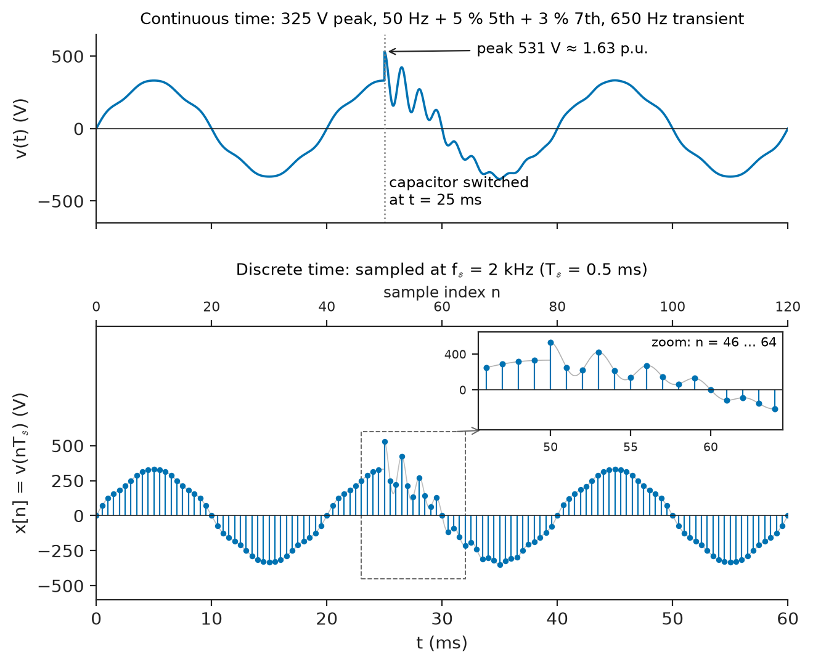
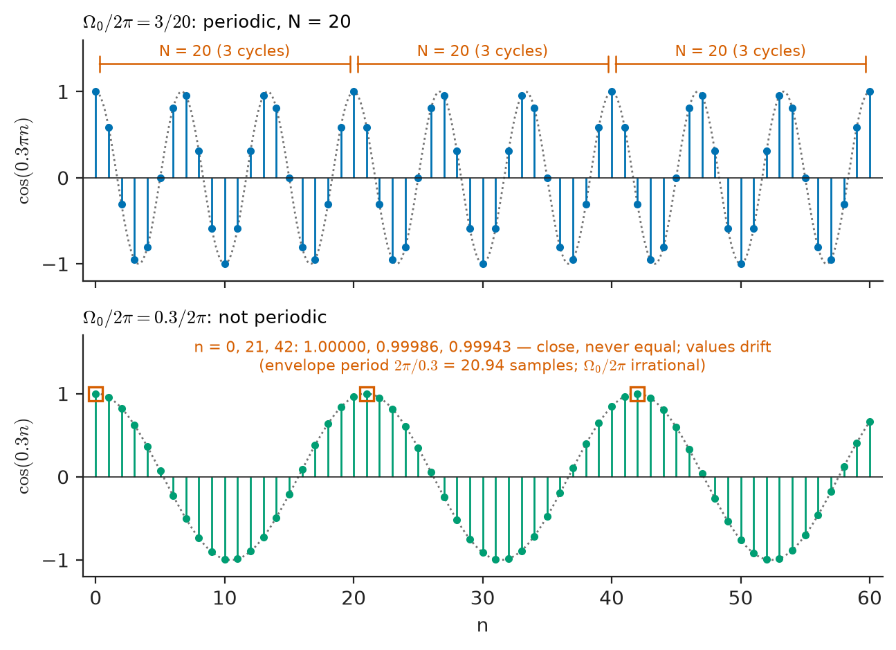
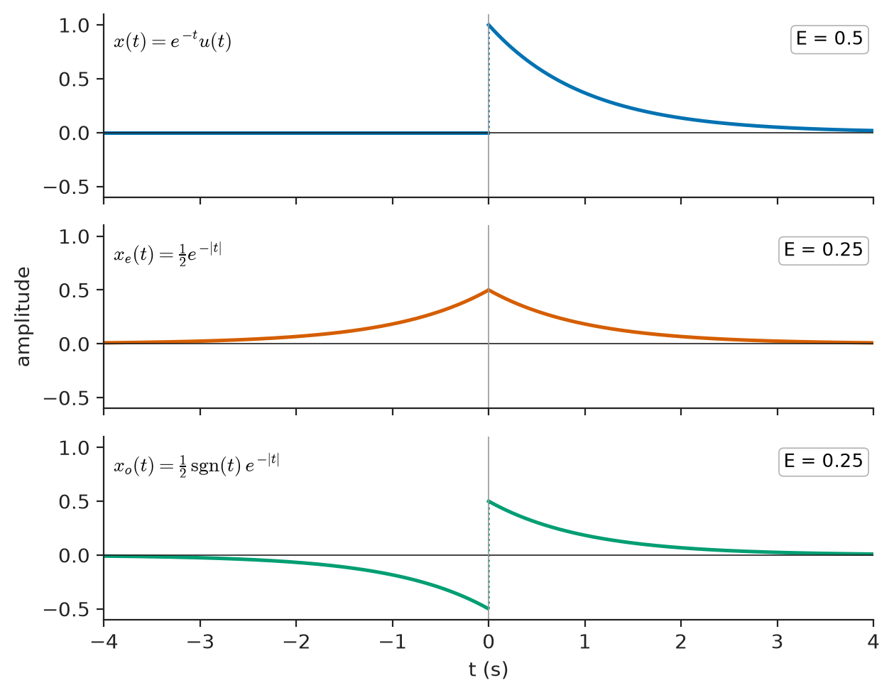
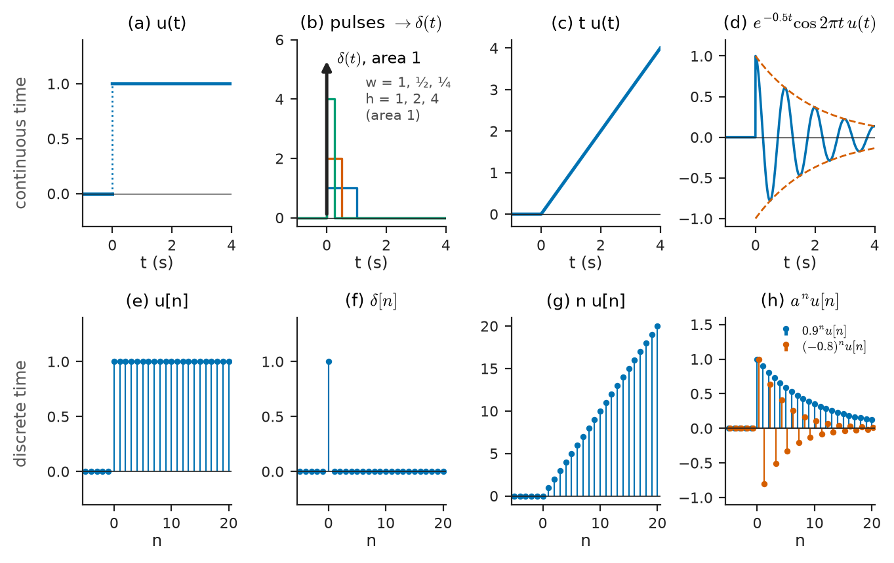
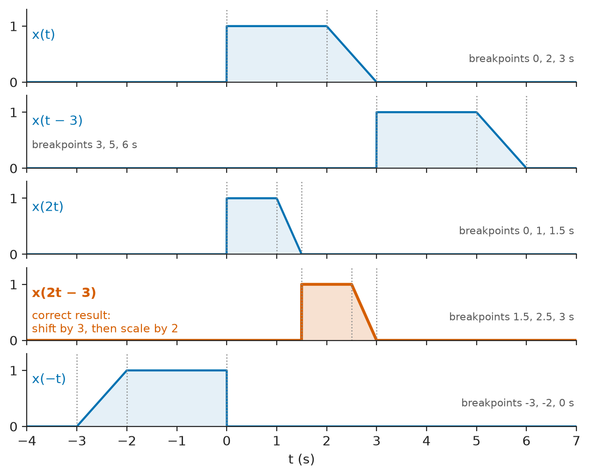
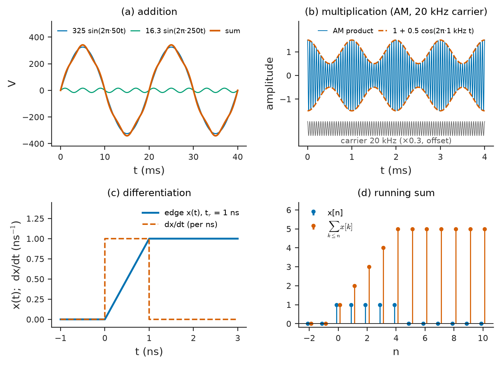

# Chapter 15 — Signal Fundamentals

*Part IV · Signals and Systems*

A power-quality analyser is clipped onto the supply of a factory that keeps tripping its variable-speed drives. For a week it records the line voltage. Most of the time the record is a slightly flattened 50 Hz sine wave, 230 V rms, repeating every 20 ms with a few percent of fifth and seventh harmonic. Twice a day, when the utility switches a capacitor bank on a nearby substation, a burst of 500–800 Hz oscillation lasting a few milliseconds rides on top of the sine wave, its peak reaching 1.6 times the normal value. The drives trip on those bursts. To diagnose the problem the engineer must describe the recorded signal precisely: is it periodic or not, how much power does each part carry, when does the transient start and how quickly does it decay, how does the analyser's sampled record relate to the continuous voltage on the busbar, and how would the waveform look if it were shifted, scaled, filtered or combined with the drive's own current?

Those questions are not specific to power quality. An ECG, a radar echo, a seismic trace, a sampled audio track and the bit stream in a fibre all raise them. This chapter builds the vocabulary of signals: the classifications (continuous or discrete, periodic or not, even or odd, energy or power), the elementary building-block signals (steps, impulses, ramps and exponentials), and the operations (shifting, scaling, reflection, addition, multiplication, differentiation and integration) from which the rest of Parts IV–VII are constructed.

> **What distinguishes a continuous-time signal from a discrete-time one, and how are they related?**
> **How are signals classified by symmetry, repetition and energy content, and why do those classes matter for analysis?**
> **What are the elementary signals and operations from which any engineering signal can be modelled?**

| Concept | Engineering destination |
|---|---|
| Continuous-time signals | Sensor outputs, circuit voltages and currents, received radio waveforms |
| Discrete-time signals | ADC records, digital audio, sampled control loops, digital communication symbols |
| Periodic and aperiodic signals | Mains and harmonics, clocks, rotating-machine vibration, transients and pulses |
| Even and odd signals | Symmetry shortcuts in Fourier analysis, filter design, correlation |
| Energy and power signals | Pulse energy in radar and defibrillators, rms ratings, SNR and link budgets |
| Unit step and impulse | Switching events, test inputs, impulse response of systems |
| Ramp and exponential signals | Charging transients, sweep generators, damped oscillations, phasors |
| Time shifting and scaling | Propagation delay, Doppler, playback speed, decimation |
| Signal operations | Modulation, mixing, averaging, integration in sensors and controllers |

**Roadmap.** Two kinds of independent variable: continuous time (15.1) and discrete time (15.2) → classification by repetition (15.3), symmetry (15.4) and energy (15.5) → the elementary signals: step and impulse (15.6), ramp and exponential (15.7) → operations on the time axis (15.8) and on amplitude (15.9).

---

## 15.1 Continuous-time signals

### What a signal is

A **signal** is a function that carries information about the behaviour of a physical system. In this book the information is almost always carried as a voltage, a current or a quantity converted into one (pressure by a microphone, acceleration by an accelerometer, light intensity by a photodiode, the heart's electrical activity by ECG electrodes). The independent variable is usually time; in images it is position, and in some sensors (a line-scan camera, an ultrasound array) both.

A **continuous-time** (CT) signal $x(t)$ is defined for every real value of $t$ in some interval. The voltage on the busbar, the current in an inductor and the pressure at a microphone diaphragm are continuous-time signals: nature does not skip instants. The amplitude may also take any real value, in which case the signal is called **analog**. Continuous-time signals are what circuits produce and process; Parts I–III were, in effect, the theory of continuous-time signals in electrical networks.

### Real and complex signals

Physical signals are real. It is nevertheless very convenient to work with complex-valued signals, above all the complex exponential

$$
x(t)=Ae^{j(\omega t+\phi)}=A\cos(\omega t+\phi)+jA\sin(\omega t+\phi)
$$

The phasors of Chapter 8 were a disguised use of this signal: a real sinusoid is the real part of a rotating complex exponential, or equivalently the sum of two counter-rotating ones,

$$
A\cos(\omega t+\phi)=\frac A2e^{j(\omega t+\phi)}+\frac A2e^{-j(\omega t+\phi)}
$$

Complex signals also appear directly in communications, where a receiver's in-phase and quadrature channels are combined into one complex **baseband** signal $x_I(t)+jx_Q(t)$ (Chapter 27).

### Deterministic and random signals

A signal whose value at every instant is fixed by a formula or a known record is **deterministic**: a 50 Hz sine wave, a clock, a radar chirp. A signal that can be described only statistically is **random**: thermal noise, speech before it is spoken, the arrival pattern of data packets. Every real measurement is a deterministic part plus a random part. This chapter and Chapters 16–20 treat deterministic signals; random signals and noise are the subject of Chapter 29.

### Representative engineering signals

| Signal | Type | Typical amplitude | Bandwidth or rate | Comment |
|---|---|---|---|---|
| Mains voltage (Europe, Asia, Africa) | CT, periodic | 230 V rms, 325 V peak | 50 Hz plus harmonics to ≈ 2.5 kHz | 120 V, 60 Hz in North America |
| Surface ECG | CT, quasi-periodic | 0.5–4 mV | 0.05–150 Hz | Sampled at 250–1000 Hz |
| Scalp EEG | CT, random-like | 10–100 µV | 0.5–70 Hz | Very low amplitude |
| Microphone output | CT | 1–50 mV | 20 Hz–20 kHz | Speech or music |
| CD audio | DT | 16-bit samples | 44.1 kHz sampling | Studio: 24-bit, 48–192 kHz |
| Telephone speech | DT | 8-bit companded | 8 kHz sampling | 300–3400 Hz voice band |
| Seismic accelerometer | CT, then DT | µg to g | 0.01–50 Hz, sampled at 100–200 Hz | Earthquake and structural monitoring |
| Radar pulse | CT, aperiodic burst | kW–MW peak | 1–100 MHz instantaneous | Repeats at the pulse repetition frequency |
| GPS signal at the antenna | CT, random-like spread spectrum | ≈ −130 dBm | 2 MHz (L1 C/A) | Below the thermal noise floor |

---

## 15.2 Discrete-time signals

### Sequences

A **discrete-time** (DT) signal $x[n]$ is defined only at integer values of an index $n$; it is a **sequence** of numbers. Square brackets distinguish it from a continuous-time signal. Discrete-time signals arise in two ways:

1. **By sampling** a continuous-time signal at regular intervals $T_s$: $x[n]=x_c(nT_s)$, where $f_s=1/T_s$ is the **sampling rate**. The power-quality analyser of the opening samples the busbar voltage, typically at 10–25 kHz; a digital ECG machine at 500 Hz; a CD at 44.1 kHz.
2. **Naturally**, when the quantity is defined only at discrete instants or positions: the daily closing value of an energy price, the number of packets arriving per millisecond, the pixel values along a line of an image, the bits of a digital message.

A discrete-time signal whose amplitude is also restricted to a finite set of levels is a **digital** signal. An ADC produces digital signals; the step from discrete-time to digital, **quantization**, adds an error that is analysed in Chapters 19 and 21. In the theory of Parts IV and V, discrete-time signals are usually treated as having real or complex amplitudes and quantization is considered separately.

### Notation and the role of the sampling interval

Once a sequence has been formed, the index $n$ is dimensionless: the sequence does not "know" its sampling rate. A 50 Hz sine wave sampled at 1 kHz gives

$$
x[n]=\sin\Big(2\pi\frac{50}{1000}n\Big)=\sin(0.1\pi n)
$$

and so does a 5 Hz sine wave sampled at 100 Hz. The quantity that matters inside the sequence is the **normalised (digital) frequency** $\Omega=\omega T_s=2\pi f/f_s$, measured in radians per sample. Physical frequency is restored only when the sequence is related back to a sampling rate. This scale-free property is what lets one digital filter design serve many sampling rates.

> **Status of the principle: Discrete-time model of a sampled signal**
> *Approximate.* The sequence $x[n]=x_c(nT_s)$ represents the continuous signal without loss only if $x_c$ is bandlimited below $f_s/2$ and the samples are exact; aliasing, sampling jitter and quantization are the three ways the model departs from the physical record (Chapters 19 and 21).

**Worked example — what a sampled record contains.** A diagnostic ECG is recorded for 10 s at 500 samples per second with a 12-bit ADC. The record contains $10\times500=5000$ samples, and at 12 bits each it occupies $5000\times12/8=7500$ bytes per lead; a standard 12-lead record is therefore about 90 kB. The sampling interval is 2 ms. A QRS complex lasting 80–100 ms is described by 40–50 samples, and the R-wave peak, which rises in about 20 ms, by about 10 samples. Whether that is enough to measure the amplitude of the peak accurately is a question about the signal's bandwidth (the diagnostic band extends to 150 Hz, below the 250 Hz half-sampling rate), answered in Chapter 19.

<!-- FIGURE 15.1 | figures/ch15/fig-15-1-ct-and-dt-power-quality.png | plot | A continuous-time busbar voltage with a capacitor-switching transient, and the discrete-time record made by a power-quality analyser sampling it. | Content: two stacked panels, shared time axis 0 to 60 ms. Top: continuous 230 V rms (325 V peak) 50 Hz sine with 5 percent fifth and 3 percent seventh harmonic; at t = 25 ms a capacitor-switching transient adds a 650 Hz oscillation of initial amplitude 200 V decaying with time constant 4 ms, peak about 1.6 per unit. Bottom: the same signal as stems sampled at 2 kHz (T_s = 0.5 ms), index n on a secondary axis 0 to 120, with a zoomed inset of the samples across the transient. Axes in volts and ms. -->

*Figure 15.1 — A continuous-time busbar voltage with a capacitor-switching transient, and the discrete-time record made by a power-quality analyser sampling it.*

Figure 15.1 shows the two descriptions of the same voltage. The continuous signal exists at every instant; the analyser knows it only at the stems. Everything in the analyser's report (rms value, harmonic content, transient detection) is computed from those stems.

### Continuous versus discrete: a comparison

| Property | Continuous time | Discrete time |
|---|---|---|
| Independent variable | $t\in\mathbb R$ | $n\in\mathbb Z$ |
| Typical origin | Physical quantity, circuit variable | Sampled measurement, digital computation |
| Elementary impulse | Dirac $\delta(t)$, a generalised function | Kronecker $\delta[n]$, an ordinary sequence |
| Sinusoid | Periodic for every $\omega$ | Periodic only for rational $\Omega/2\pi$ |
| Distinct frequencies | $-\infty<\omega<\infty$ | $-\pi<\Omega\le\pi$ (frequencies repeat every $2\pi$) |
| Energy | $\int\lvert x(t)\rvert^2dt$ | $\sum\lvert x[n]\rvert^2$ |
| Calculus | Derivative, integral | Difference, running sum |
| System model | Differential equations | Difference equations |

---

## 15.3 Periodic and aperiodic signals

### Continuous-time periodicity

A continuous-time signal is **periodic** if there is a positive $T$ such that

$$
x(t+T)=x(t)\quad\text{for all }t
$$

The smallest such $T$ is the **fundamental period** $T_0$, and $f_0=1/T_0$ is the fundamental frequency. A signal that is not periodic is **aperiodic**. The mains voltage, a crystal-oscillator clock and the vibration of a machine running at constant speed are periodic (to good approximation); a lightning surge, a radar echo and a spoken word are aperiodic. Strictly, no physical signal is periodic, since a periodic signal must have existed forever; "periodic" always means "periodic over the observation interval", and the error made by that idealisation reappears as spectral leakage in Chapter 22.

A sum of periodic signals is periodic if and only if the ratio of every pair of periods is a rational number; the fundamental period of the sum is then the least common multiple of the individual periods. The distorted mains voltage

$$
v(t)=325\sin(2\pi\,50t)+16.3\sin(2\pi\,250t)+9.8\sin(2\pi\,350t)\ \ \mathrm{V}
$$

has components with periods 20 ms, 4 ms and 2.86 ms, all of which fit an integer number of times into 20 ms, so $T_0=20$ ms. In contrast, $\cos(2\pi t)+\cos(2\sqrt2\,\pi t)$ is not periodic: the period ratio $\sqrt2$ is irrational, and the waveform never repeats exactly. Such **almost-periodic** signals occur when two unsynchronised sources are combined, for example a 50 Hz grid and a 49.8 Hz islanded generator, whose sum beats at 0.2 Hz; because both frequencies drift and their ratio is not a ratio of small integers, the sum does not repeat over any practical record.

### Discrete-time periodicity

A sequence is periodic with period $N$ (a positive integer) if $x[n+N]=x[n]$ for all $n$. This differs from the continuous case in an important way. The discrete sinusoid $\cos(\Omega_0n)$ is periodic only if there is an integer $N$ with $\Omega_0N=2\pi k$ for some integer $k$, that is, only if

$$
\frac{\Omega_0}{2\pi}=\frac kN\quad\text{is a rational number}
$$

The fundamental period is the smallest such $N$, obtained by writing $k/N$ in lowest terms.

> **Status of the principle: Periodicity of discrete-time sinusoids**
> *Derived.* Follows directly from the requirement that $\Omega_0N$ be an integer multiple of $2\pi$ with $N$ an integer; it has no continuous-time counterpart, where every sinusoid is periodic.

**Worked example — periodic and non-periodic sequences.** The sequence $\cos(0.3\pi n)$ has $\Omega_0/2\pi=0.15=3/20$, so it is periodic with $N=20$: twenty samples cover three cycles of the underlying cosine. The sequence $\cos(0.3n)$ has $\Omega_0/2\pi=0.3/2\pi$, which is irrational, so the samples never repeat, although they lie on a cosine envelope with a "period" of $2\pi/0.3=20.9$ samples. For a sum, $x[n]=\cos(2\pi n/12)+\sin(2\pi n/18)$ has periods 12 and 18, and the sum repeats after $\mathrm{lcm}(12,18)=36$ samples. In practice: a 50 Hz signal sampled at 1 kHz repeats every 20 samples, and at 48 kHz every 960; a 60 Hz signal sampled at 48 kHz repeats every 800 samples; but a 50 Hz signal sampled at 44.1 kHz repeats every 882 samples only because $44\,100/50$ happens to be an integer. If the grid drifts to 50.01 Hz, the sampled record is no longer periodic over any practical length, and a power-quality analyser must synchronise its sampling to the measured grid frequency to avoid leakage errors in its harmonic measurements.

<!-- FIGURE 15.2 | figures/ch15/fig-15-2-discrete-sinusoid-periodicity.png | plot | The discrete sinusoids cos(0.3 pi n), which repeats every 20 samples, and cos(0.3 n), which never repeats. | Content: two stacked stem plots, n from 0 to 60, amplitude -1.2 to 1.2. Top: cos(0.3 pi n) stems with the continuous envelope cos(0.3 pi t) dotted; brackets showing the period N = 20 (three envelope cycles) repeated three times. Bottom: cos(0.3 n) stems with the dotted envelope of period 20.94 samples; a note that sample values at n and n + 21 differ slightly and drift. -->

*Figure 15.2 — The discrete sinusoids cos(0.3 pi n), which repeats every 20 samples, and cos(0.3 n), which never repeats.*

Figure 15.2 contrasts the two. A second difference from continuous time is that discrete frequencies separated by $2\pi$ are identical: $\cos((\Omega_0+2\pi)n)=\cos(\Omega_0n)$ for every integer $n$. Only frequencies in a band of width $2\pi$, conventionally $-\pi<\Omega\le\pi$, are distinct, and the highest frequency a sequence can represent is $\Omega=\pi$, alternating $+1,-1,+1,\dots$. This is the discrete-time face of aliasing (Chapter 19).

### Quasi-periodic and transient signals

Many signals of engineering interest are neither strictly periodic nor arbitrary. A heartbeat repeats with a period that varies by several percent from beat to beat (heart-rate variability is itself a diagnostic quantity); the vibration of a gearbox repeats at each shaft revolution while the speed drifts; speech vowels are periodic for tens of milliseconds at a time. These **quasi-periodic** signals are analysed over windows short enough that the period is nearly constant, which leads to the time-frequency methods of Chapter 24. A **transient** is an aperiodic signal that is significant only for a finite time, such as the capacitor-switching burst of the opening or the step response of a circuit.

---

## 15.4 Even and odd signals

### Definitions

A signal is **even** if it is symmetric about $t=0$,

$$
x(-t)=x(t)
$$

and **odd** if it is antisymmetric,

$$
x(-t)=-x(t)
$$

The same definitions hold for sequences with $n$ in place of $t$. The cosine is even, the sine is odd, and an odd signal must be zero at the origin. Many signals are neither, but every signal can be split uniquely into an even and an odd part:

$$
x_e(t)=\frac{x(t)+x(-t)}{2},\qquad x_o(t)=\frac{x(t)-x(-t)}{2},\qquad x(t)=x_e(t)+x_o(t)
$$

> **Status of the principle: Even–odd decomposition**
> *Derived.* An algebraic identity valid for any signal; uniqueness follows because a signal that is both even and odd must be zero.

Products follow sign rules: even × even and odd × odd are even, even × odd is odd. The integral of an odd signal over a symmetric interval is zero. These two facts are the source of most symmetry shortcuts in signal analysis: the Fourier series of an even periodic signal contains only cosines, that of an odd one only sines (Chapter 18), and the Fourier transform of a real even signal is real.

For complex signals the useful symmetry is **conjugate symmetry**, $x(-t)=x^*(t)$. Real signals have conjugate-symmetric Fourier transforms, which is why the spectrum of any real signal is fully described by its positive-frequency half.

### Symmetry and the choice of time origin

Symmetry depends on where $t=0$ is placed. A square wave that switches at $t=0$ is odd; shifted by a quarter period it becomes even. Choosing the origin to make a signal even or odd often halves the work of an analysis. In a three-phase power system, choosing the time origin at the peak of the phase-$a$ voltage makes it a pure cosine (even), while the phase-$b$ and phase-$c$ voltages, delayed by 120° and 240°, are neither. Half-wave symmetry, $x(t+T_0/2)=-x(t)$, is a related property: a waveform with it contains only odd harmonics. Most mains-supplied loads draw currents with half-wave symmetry, which is why power-system harmonic spectra are dominated by the 3rd, 5th, 7th, ... and even harmonics indicate a DC component or asymmetric rectification.

**Worked example — even and odd parts of a decaying exponential.** The voltage on a discharging capacitor, normalised, is $x(t)=e^{-t}u(t)$: zero before $t=0$, then decaying with time constant 1. Its reflection is $x(-t)=e^{t}u(-t)$. So

$$
x_e(t)=\tfrac12e^{-\lvert t\rvert},\qquad x_o(t)=\tfrac12\,\mathrm{sgn}(t)\,e^{-\lvert t\rvert}
$$

The even part is a symmetric two-sided exponential with peak 0.5; the odd part is a step-like signal jumping from −0.5 to +0.5 at the origin and decaying both ways. Their energies (Section 15.5) are each $2\int_0^\infty\tfrac14e^{-2t}dt=\tfrac14$, and they add to the energy of $x(t)$, $\int_0^\infty e^{-2t}dt=\tfrac12$, as they must: the even and odd parts of any real energy signal are orthogonal, so their energies add. For a sequence, $x[n]=\{1,2,3\}$ at $n=0,1,2$ (zero elsewhere) has $x_e[n]=\{1.5,1,1,1,1.5\}$ and $x_o[n]=\{-1.5,-1,0,1,1.5\}$ for $n=-2,\dots,2$.

<!-- FIGURE 15.3 | figures/ch15/fig-15-3-even-odd-decomposition.png | plot | Decomposition of the causal exponential e^(-t)u(t) into its even and odd parts. | Content: three stacked panels, t from -4 to 4 s, amplitude -0.6 to 1.1. Top: x(t) = e^(-t) u(t), zero for t < 0, 1 at t = 0+. Middle: even part 0.5 e^(-abs t), symmetric peak 0.5. Bottom: odd part 0.5 sgn(t) e^(-abs t), jumping from -0.5 to +0.5 at t = 0. Annotate energies: x 0.5, even 0.25, odd 0.25. -->

*Figure 15.3 — Decomposition of the causal exponential e^(-t)u(t) into its even and odd parts.*

Figure 15.3 shows the decomposition. The even part of a causal signal mirrors the future into the past, and the odd part makes the two cancel for $t<0$; this pairing is the time-domain root of the relation between the real and imaginary parts of a causal system's frequency response.

---

## 15.5 Energy and power signals

### Signal energy and power

The terms energy and power are borrowed from circuits. If $x(t)$ is the voltage across, or the current through, a 1 Ω resistor, the instantaneous power is $x^2(t)$ and the energy dissipated is its integral. For signals in general, the **energy** and the **average power** are defined as

$$
E_x=\int_{-\infty}^{\infty}\lvert x(t)\rvert^2\,dt,\qquad
P_x=\lim_{T\to\infty}\frac1{2T}\int_{-T}^{T}\lvert x(t)\rvert^2\,dt
$$

and for sequences

$$
E_x=\sum_{n=-\infty}^{\infty}\lvert x[n]\rvert^2,\qquad
P_x=\lim_{N\to\infty}\frac{1}{2N+1}\sum_{n=-N}^{N}\lvert x[n]\rvert^2
$$

These "normalised" quantities have units of V²·s and V² (or A²·s and A²) rather than joules and watts; the physical energy and power follow by dividing by the actual resistance for a voltage, or multiplying for a current. The ratio of two signal powers, such as signal-to-noise ratio, does not depend on the normalisation.

A signal is an **energy signal** if $0<E_x<\infty$; then $P_x=0$. It is a **power signal** if $0<P_x<\infty$; then $E_x=\infty$. Transients, pulses and anything of finite duration and finite amplitude are energy signals. Periodic signals and stationary random signals are power signals. Some signals are neither: the ramp $t\,u(t)$ grows without bound and has infinite power.

> **Status of the principle: Energy–power classification**
> *Derived.* A mathematical consequence of the definitions; it is a modelling choice for physical signals, which always have finite energy over any finite observation, and the class chosen decides whether a Fourier transform (energy) or a power spectrum (power) is the appropriate description.

For a periodic signal the limit reduces to an average over one period,

$$
P_x=\frac1{T_0}\int_{T_0}\lvert x(t)\rvert^2dt,\qquad X_\text{rms}=\sqrt{P_x}
$$

so the power is the square of the rms value of Chapter 8. For a sinusoid of peak $A$, $P=A^2/2$; for a sum of sinusoids at different frequencies the powers add, because the cross-terms average to zero.

### Worked examples

**Worked example — the mains as a power signal.** The mains voltage $v(t)=325.3\sin(2\pi\,50t)$ V has normalised power $325.3^2/2=52\,900\ \mathrm{V^2}$, so $V_\text{rms}=230$ V. Across a 52.9 Ω kettle element it delivers $52\,900/52.9=1000$ W. Its energy over all time is infinite, as for any periodic signal. Adding 5 % fifth and 3 % seventh harmonic (16.3 V and 9.8 V peak) raises the power by the sum of their individual powers, giving $V_\text{rms}=230\sqrt{1+0.05^2+0.03^2}=230.4$ V; the total harmonic distortion is $\sqrt{0.05^2+0.03^2}=5.8\ \%$. The rms value barely changes, but the waveform's shape and peak do, which is why power-quality standards limit harmonic content directly rather than through rms.

**Worked example — the energy of a defibrillator pulse.** A simple monophasic defibrillator discharges a $C=100\ \mu\mathrm{F}$ capacitor charged to $V_0=2000$ V into a patient whose chest presents about 50 Ω. The voltage is $v(t)=V_0e^{-t/\tau}u(t)$ with $\tau=RC=5$ ms. This is an energy signal. The energy delivered to the resistance is

$$
E=\frac1R\int_0^\infty V_0^2e^{-2t/\tau}dt=\frac{V_0^2\tau}{2R}=\frac{(2000)^2(5\times10^{-3})}{2\times50}=200\ \mathrm{J}
$$

exactly the $\tfrac12CV_0^2=200$ J stored in the capacitor, as energy conservation requires. The peak current is 40 A. Since the energy density decays with time constant $\tau/2$, 86 % of the energy is delivered in the first 5 ms and 98 % in the first 10 ms. Modern defibrillators shape the pulse as a truncated biphasic waveform precisely to control how energy and current are distributed in time, which is a signal-design problem.

**Worked example — a radar pulse train.** A surveillance radar transmits rectangular pulses of 1 µs duration at 1 MW peak power, repeated 1000 times per second. One pulse is an energy signal carrying $10^6\times10^{-6}=1$ J. The pulse train is a power signal: its average power is $1\ \mathrm J\times1000\ \mathrm{s^{-1}}=1$ kW, the peak power times the duty cycle of 0.001. The transmitter must handle 1 MW peaks but only 1 kW of average heat, and the detection range depends on the energy per pulse (Chapter 29), which is why long pulses compressed after reception (chirp radar) are used to obtain energy without extreme peak power.

### Crest factor and peak-to-average ratio

Power and peak are different things, and circuits care about both: heating depends on rms, while breakdown, clipping and ADC overload depend on peak. The **crest factor** is the ratio of peak to rms value; its square, expressed in decibels, is the **peak-to-average power ratio** (PAPR).

| Signal | Crest factor | PAPR | Consequence |
|---|---|---|---|
| Square wave | 1 | 0 dB | Most power per peak volt |
| Sinusoid | $\sqrt2=1.414$ | 3.0 dB | Basis of rms ratings |
| Triangle wave | $\sqrt3=1.732$ | 4.8 dB | Sweep generators |
| PWM, 12 V at 25 % duty | 2.0 | 6.0 dB | 3 V average, 6 V rms |
| Speech | ≈ 4–10 | ≈ 12–20 dB | Audio headroom in amplifiers and ADCs |
| OFDM (Wi-Fi, LTE) before clipping | ≈ 3–4 | ≈ 10–12 dB | Power-amplifier back-off, low efficiency |
| Rectifier input current | ≈ 2–3 | 6–10 dB | Extra heating in transformers and cables |

The PWM entry is a short calculation: a 12 V pulse train with duty cycle $D=0.25$ has average $12D=3$ V, power $12^2D=36\ \mathrm{V^2}$ and rms $12\sqrt D=6$ V, so a voltmeter that reads average and one that reads true rms disagree by a factor of 2.

---

## 15.6 Unit step and impulse

### The unit step

The **unit step** is the idealisation of a switch closing at $t=0$:

$$
u(t)=\begin{cases}0,&t<0\\1,&t>0\end{cases}
$$

Its value at $t=0$ is usually left undefined or set to $1/2$; it never matters in integrals. The discrete-time step is $u[n]=1$ for $n\ge0$ and $0$ otherwise, with no ambiguity. Multiplying a signal by $u(t)$ makes it **causal** (zero for $t<0$): $e^{-t/\tau}u(t)$ is a decay that starts at the switching instant. A rectangular pulse of width $T$ is a difference of steps, $u(t)-u(t-T)$; a gated burst of a carrier, as in a radar pulse, is a carrier multiplied by such a pulse.

### The unit impulse

Consider a rectangular pulse of width $\varepsilon$ and height $1/\varepsilon$, so that its area is always 1. As $\varepsilon\to0$ the pulse becomes infinitely tall and narrow with unchanged area. The limit is the **unit impulse** or **Dirac delta** $\delta(t)$, defined not by its values but by what it does inside an integral:

$$
\int_{-\infty}^{\infty}\delta(t)\,dt=1,\qquad \int_{-\infty}^{\infty}x(t)\,\delta(t-t_0)\,dt=x(t_0)
$$

The second relation is the **sifting property**: integrating against a shifted impulse extracts the signal's value at that instant. A related identity is $x(t)\delta(t-t_0)=x(t_0)\delta(t-t_0)$. The step and impulse are related by

$$
\delta(t)=\frac{du(t)}{dt},\qquad u(t)=\int_{-\infty}^{t}\delta(\tau)\,d\tau
$$

The impulse is the mathematical model of anything that happens much faster than the system observing it can respond: a lightning stroke seen by a power system, a hammer tap on a structure under modal test, a short laser pulse on a photodetector, the charge delivered by an ionising particle in a radiation detector.

> **Status of the principle: The impulse as a physical model**
> *Approximate.* $\delta(t)$ is a generalised function, not an ordinary one; as a model of a physical pulse it is valid when the pulse is much shorter than the fastest time constant of the system it drives, so that only the pulse's area matters.

**Worked example — impulsive charging of a capacitor.** A radiation detector's charge-sensitive input is modelled as a 10 nF capacitor. A particle deposits 1 µC of charge in a few nanoseconds, much faster than any other time constant in the circuit. The current is modelled as $i(t)=Q\,\delta(t)$ with $Q=1\ \mu\mathrm{C}$, and the capacitor voltage is

$$
v(t)=\frac1C\int_{-\infty}^{t}Q\,\delta(\tau)\,d\tau=\frac QC\,u(t)=\frac{10^{-6}}{10^{-8}}u(t)=100\,u(t)\ \mathrm V
$$

An impulse of current produces a step of voltage whose height depends only on the charge, not on the details of the pulse shape. This is why such amplifiers are called charge-sensitive, and why the impulse model is the right one: the measured quantity is the area.

The impulse has a scaling property that is easily overlooked:

$$
\delta(at)=\frac{1}{\lvert a\rvert}\delta(t)
$$

because compressing the narrow pulse by $a$ also divides its area by $\lvert a\rvert$.

### The discrete-time impulse

In discrete time there is no limiting process. The **unit sample** (Kronecker delta) is simply

$$
\delta[n]=\begin{cases}1,&n=0\\0,&n\ne0\end{cases}
$$

with $\delta[n]=u[n]-u[n-1]$ and $u[n]=\sum_{k=-\infty}^{n}\delta[k]$. Any sequence can be written as a weighted sum of shifted unit samples,

$$
x[n]=\sum_{k=-\infty}^{\infty}x[k]\,\delta[n-k]
$$

which is trivial-looking but becomes the basis of convolution in Chapter 17: if a system's response to $\delta[n]$ is known, its response to any input follows. The continuous-time analogue, $x(t)=\int x(\tau)\delta(t-\tau)\,d\tau$, plays the same role.

> **Boundary.** The rigorous theory of generalised functions (distributions), which makes statements such as $d u/dt=\delta$ precise, belongs to *The Mathematics Universe*. This book uses the impulse through its sifting and integration properties only.

---

## 15.7 Ramp and exponential signals

### The ramp

The **unit ramp** is the integral of the step:

$$
r(t)=t\,u(t)=\int_{-\infty}^{t}u(\tau)\,d\tau
$$

with discrete counterpart $r[n]=n\,u[n]$. Ramps model a capacitor charged by a constant current ($v=It/C$), the sweep of an oscilloscope timebase or a radar's frequency chirp, the position of a vehicle at constant speed, and the slowly increasing setpoint used to test how well a control system tracks (Chapter 34). A ramp is neither an energy nor a power signal. The sequence of increasingly smooth signals, impulse → step → ramp → parabola, each the integral of the previous, is used to probe systems with inputs of increasing order.

Steps, ramps and impulses combine into piecewise-linear signals. A trapezoidal logic edge with rise time $t_r$ is $\frac{1}{t_r}[r(t)-r(t-t_r)]$; a triangular pulse of half-width $T$ is $\frac1T[r(t+T)-2r(t)+r(t-T)]$. Writing waveforms this way makes their derivatives easy: the derivative of the trapezoidal edge is a rectangular pulse of height $1/t_r$, the shape of the current a logic edge drives into a capacitive load.

### Real exponentials

The **real exponential** $x(t)=Ae^{\sigma t}$ grows if $\sigma>0$ and decays if $\sigma<0$. Decaying causal exponentials $Ae^{-t/\tau}u(t)$ are the natural response of every first-order circuit (Chapter 6), with time constant $\tau$; a decay to 1 % takes $4.6\tau$. Growing exponentials describe unstable systems and avalanche processes.

In discrete time the corresponding signal is the **geometric sequence** $x[n]=Aa^n$. It decays if $\lvert a\rvert<1$ and grows if $\lvert a\rvert>1$; if $a$ is negative it alternates in sign. A sampled continuous exponential gives $a=e^{\sigma T_s}$. The causal sequence $0.9^nu[n]$ is an energy signal with $E=\sum_{n\ge0}0.81^n=1/(1-0.81)=5.26$; it is the impulse response of the simplest recursive digital filter, $y[n]=0.9y[n-1]+x[n]$, the digital analogue of an RC low-pass (Chapter 20).

### Complex exponentials and damped sinusoids

The most important signal in this book is the **complex exponential**

$$
x(t)=Ae^{st},\qquad s=\sigma+j\omega
$$

Using Euler's formula,

$$
Ae^{st}=Ae^{\sigma t}\big(\cos\omega t+j\sin\omega t\big)
$$

so its real part is a sinusoid with an exponential envelope. Four cases cover most of engineering:

| $s$ | Signal | Example |
|---|---|---|
| $\sigma<0$, $\omega=0$ | Decaying exponential | RC discharge, thermal cooling |
| $\sigma=0$, $\omega\ne0$ | Constant-amplitude sinusoid (phasor) | Mains, carriers, clocks |
| $\sigma<0$, $\omega\ne0$ | Damped sinusoid | Ringing RLC circuit, struck bell, capacitor-switching transient |
| $\sigma>0$, $\omega\ne0$ | Growing sinusoid | Oscillator start-up, unstable control loop, flutter |

The complex frequency $s$ is the variable of the Laplace transform (Chapter 11), and the locations of a circuit's poles in the $s$-plane are precisely the complex frequencies of the exponentials in its natural response. The capacitor-switching transient of the opening is a damped sinusoid,

$$
v_\text{tr}(t)=200\,e^{-(t-t_0)/4\,\mathrm{ms}}\cos\big(2\pi\,650\,(t-t_0)\big)\,u(t-t_0)\ \ \mathrm V
$$

corresponding to $s=-250\pm j4084$ rad/s. Reading $\sigma$ and $\omega$ off a recorded transient identifies the network that produced it: the oscillation frequency points to the resonance between the capacitor bank and the supply inductance, and the decay rate to the damping provided by the loads.

> **Status of the principle: Complex exponentials as the basis of signal analysis**
> *Derived.* Every signal of practical interest can be built from complex exponentials (Fourier and Laplace analysis), and linear time-invariant systems map each exponential to a scaled copy of itself (Chapter 17); together these make $e^{st}$ the natural building block.

In discrete time the analogue is $x[n]=Az^n$ with complex $z=re^{j\Omega}$: the envelope grows or decays as $r^n$ and the phase rotates by $\Omega$ per sample. The Z-transform (Chapter 20) is built on this signal as the Laplace transform is built on $e^{st}$.

<!-- FIGURE 15.4 | figures/ch15/fig-15-4-elementary-signals.png | plot | The elementary signals: step, approximations to the impulse, ramp, decaying exponential and damped sinusoid, in continuous and discrete time. | Content: grid of 2 rows by 4 columns. Top row continuous time, t from -1 to 4: (a) unit step u(t); (b) rectangular pulses of width 1, 0.5, 0.25 and height 1, 2, 4 converging to an arrow labelled delta(t) area 1; (c) ramp t u(t); (d) damped sinusoid e^(-0.5t) cos(2 pi t) u(t) with dashed envelope +/- e^(-0.5t). Bottom row discrete time, n from -5 to 20: (e) u[n] stems; (f) delta[n] single stem; (g) n u[n] stems; (h) 0.9^n u[n] stems and (-0.8)^n u[n] stems in a second colour showing alternation. -->

*Figure 15.4 — The elementary signals: step, approximations to the impulse, ramp, decaying exponential and damped sinusoid, in continuous and discrete time.*

Figure 15.4 collects the elementary signals. Each later chapter uses them as test inputs or as building blocks: steps for transient response (Chapters 6–7, 34), impulses for system characterisation (Chapter 17), exponentials for frequency analysis (Chapters 18 and 20).

---

## 15.8 Time shifting and scaling

### Time shifting

The signal $x(t-t_0)$ is $x(t)$ delayed by $t_0$ if $t_0>0$ (moved to the right on the time axis) or advanced if $t_0<0$. Whatever $x$ did at $t=0$, $x(t-t_0)$ does at $t=t_0$. In discrete time, $x[n-n_0]$ is a delay by $n_0$ samples, with $n_0$ an integer.

Delays are everywhere: propagation along a cable (5 ns per metre in coax, Chapter 14), the travel time of sound (2.9 ms per metre in air), the round trip of a radar pulse ($6.67\ \mu$s per kilometre of range), the latency of a digital filter, and the transport delay of material on a conveyor in a process plant. A pure delay changes no property of the signal except its timing, and for a sinusoid it is equivalent to a phase shift $-\omega t_0$, a phase proportional to frequency (Chapter 13).

### Time scaling

The signal $x(at)$ with $a>1$ is $x(t)$ **compressed** in time by the factor $a$: events happen $a$ times faster. With $0<a<1$ it is **expanded**. Playing an audio recording at double speed is $x(2t)$; every frequency doubles and the pitch rises by an octave. Time scaling also appears physically. The Doppler effect compresses the echo from an approaching target. For sound from a source approaching at 30 m/s, the received signal is the transmitted one scaled by $343/(343-30)=1.096$, so a 1 kHz tone is heard at 1096 Hz. For electromagnetic waves the scaling is tiny, and it is usually described as a frequency shift: a 10 GHz radar sees a 30 m/s target shifted by $2v f/c=2.0$ kHz.

In discrete time, scaling is not a simple change of variable because $an$ must be an integer. **Decimation** $x[Mn]$ keeps every $M$-th sample and discards the rest, losing information unless the signal was oversampled; **expansion** inserts zeros between samples. Both are central to multirate processing (Chapter 24).

### Reflection

With $a=-1$, $x(-t)$ is the **time reversal** of $x(t)$, its mirror image about $t=0$. Time reversal appears in convolution (Chapter 17), in matched filters, whose impulse response is the time-reversed expected pulse (Chapter 27), and in the even–odd decomposition of Section 15.4.

### Combined operations

The general transformation of the independent variable is $x(at-b)$. Because it is easy to apply the operations in the wrong order, the safest method is to substitute: the value $x(\tau)$ appears in the new signal at the time $t$ for which $at-b=\tau$, that is $t=(\tau+b)/a$. Equivalently, shift first, then scale: form $v(t)=x(t-b)$, then $v(at)=x(at-b)$.

> **Status of the principle: Transformation of the independent variable**
> *Derived.* The rule $t=(\tau+b)/a$ is direct substitution; it holds for any signal and any real $a\ne0$, while in discrete time only integer shifts and integer decimation or expansion factors are defined.

**Worked example — shifting and scaling a pulse.** Let $x(t)$ be a rectangular pulse of height 1 between $t=0$ and $t=2$ s, followed by a linear fall to zero at $t=3$ s. Find $y(t)=x(2t-3)$. The pulse's start, $\tau=0$, maps to $t=(0+3)/2=1.5$ s; its top's end, $\tau=2$, maps to $t=2.5$ s; the end of the fall, $\tau=3$, maps to $t=3$ s. The result is a pulse of height 1 from 1.5 s to 2.5 s with a fall to zero at 3 s: half as long and centred later. The wrong order (scale first, giving $x(2t)$, then shift by 3 to give $x(2(t-3))=x(2t-6)$) would place it at 3 to 4.5 s. Figure 15.5 shows each step.

<!-- FIGURE 15.5 | figures/ch15/fig-15-5-shift-scale-pulse.png | plot | Time shifting, scaling and reflection of a pulse: x(t), x(t-3), x(2t), x(2t-3) and x(-t). | Content: five stacked panels, common t-axis -4 to 7 s, amplitude 0 to 1.2. x(t): height 1 from 0 to 2 s, linear fall to 0 at 3 s. x(t-3): same shape from 3 to 6 s. x(2t): height 1 from 0 to 1 s, fall to 0 at 1.5 s. x(2t-3): height 1 from 1.5 to 2.5 s, fall to 0 at 3 s (highlighted as the correct result). x(-t): mirrored, height 1 from -2 to 0 s with rise from -3 s. Dotted vertical guides at the mapped breakpoints. -->

*Figure 15.5 — Time shifting, scaling and reflection of a pulse: x(t), x(t-3), x(2t), x(2t-3) and x(-t).*

### Time shifts in systems: a preview

Whether a system treats a delayed input by producing an equally delayed output is the property of **time invariance**, defined in Chapter 16. For time-invariant systems, the response to $x(t-t_0)$ is $y(t-t_0)$; for time-varying systems, such as a sampled-data system observed between samples or a mixer driven by a local oscillator, it is not. The operations of this section are therefore the language in which system properties are stated.

---

## 15.9 Signal operations

### Amplitude operations

Operations on the dependent variable are as important as those on time. The basic ones, and where each appears in hardware, are:

| Operation | Definition | Typical realisation |
|---|---|---|
| Amplitude scaling | $y(t)=a\,x(t)$ | Amplifier, attenuator, sensor gain |
| Offset | $y(t)=x(t)+c$ | Bias network, DC level shift for an ADC |
| Addition | $y(t)=x_1(t)+x_2(t)$ | Summing amplifier, superposition of signal and noise, mixing desk |
| Multiplication | $y(t)=x_1(t)\,x_2(t)$ | Mixer, modulator, gating, windowing, power measurement $v\cdot i$ |
| Differentiation | $y(t)=dx/dt$ | Capacitor current, inductor voltage, edge detection |
| Integration | $y(t)=\int_{-\infty}^{t}x(\tau)\,d\tau$ | Capacitor voltage from current, energy meter, integral controller |
| Nonlinear mapping | $y(t)=g(x(t))$ | Rectifier, limiter, quantizer, square-law detector |

In discrete time, differentiation becomes the **first difference** $y[n]=x[n]-x[n-1]$ and integration the **running sum** $y[n]=\sum_{k\le n}x[k]$, the digital analogues used in every software controller and digital meter.

### Addition and multiplication

Addition is the operation behind superposition: a measured signal is the sum of the wanted signal, interference and noise, and much of signal processing consists of undoing that sum. Multiplication is different in kind. When a signal is multiplied by a sinusoid, its spectrum is shifted in frequency; this is **modulation**, the basis of radio (Chapters 26–27). Amplitude modulation of a 1 MHz carrier by an audio tone,

$$
y(t)=\big[1+m\cos(2\pi f_mt)\big]\cos(2\pi f_ct)
$$

is an offset, a scaling and a multiplication combined. Multiplication by a rectangular pulse **gates** or **windows** a signal, keeping only a segment of it; every finite measurement is a window applied to an infinitely long signal, with consequences for spectral analysis (Chapter 22). Multiplication of voltage by current gives instantaneous power, which an electronic energy meter computes sample by sample.

<!-- FIGURE 15.6 | figures/ch15/fig-15-6-signal-operations.png | plot | Signal operations illustrated: addition of a 50 Hz signal and its fifth harmonic, multiplication of a carrier by an offset message (AM), differentiation of a trapezoidal edge, and the running sum of a sampled pulse. | Content: four panels in a 2 by 2 grid. (a) t 0 to 40 ms: 325 sin(2 pi 50 t), 16.3 sin(2 pi 250 t) and their sum. (b) t 0 to 4 ms: message 1 + 0.5 cos(2 pi 1 kHz t) dashed as envelope, carrier 20 kHz (scaled for visibility) and the AM product. (c) trapezoidal edge 0 to 1 with rise time 1 ns and its derivative, a 1 ns rectangular pulse of height 1 per ns. (d) stems of a rectangular pulse x[n] = 1 for n = 0 to 4 and its running sum rising 1, 2, 3, 4, 5 then constant at 5. -->

*Figure 15.6 — Signal operations illustrated: addition of a 50 Hz signal and its fifth harmonic, multiplication of a carrier by an offset message (AM), differentiation of a trapezoidal edge, and the running sum of a sampled pulse.*

### Differentiation and integration

Differentiation emphasises rapid changes and suppresses slow ones; integration does the opposite. These are the time-domain views of high-pass and low-pass behaviour. A capacitor's current is $C\,dv/dt$, so a fast logic edge produces a current spike; an inductor's voltage is $L\,di/dt$, so interrupting current in a relay coil produces a high voltage that must be clamped. Integration recovers velocity from an accelerometer and displacement from velocity, which is why inertial navigation accumulates drift: any small offset is integrated into a growing ramp, and twice-integrated into a parabola. Differentiation amplifies noise, whose rapid fluctuations have large derivatives; practical differentiators are always band-limited.

### Signal decomposition into elementary pieces

The operations and elementary signals combine to build complex waveforms. A pulse-width-modulated motor drive voltage is a sum of shifted, scaled steps. A sampled signal is a sum of scaled, shifted impulses. A periodic signal is a sum of scaled, shifted complex exponentials (its Fourier series), and an aperiodic one an integral of them (its Fourier transform). The general idea is to express an arbitrary signal as a combination of simple ones whose effect on a system is known, and then use linearity to find the system's response to the whole. That programme, which runs through Chapters 16–20, depends only on the vocabulary of this chapter.

> **Status of the principle: Decomposition of signals into elementary components**
> *Derived.* The representations as sums of shifted impulses, steps or complex exponentials are exact for well-behaved signals (with convergence conditions recapped in Chapter 18); their usefulness for system analysis depends on the system being linear, which is the subject of Chapter 16.

### Operations on discrete-time signals in practice

**Worked example — a moving-average smoother.** A process sensor sampled at 10 Hz gives temperature readings corrupted by fast fluctuations. A five-point moving average,

$$
y[n]=\frac15\big(x[n]+x[n-1]+x[n-2]+x[n-3]+x[n-4]\big)
$$

combines delay, scaling and addition. Fed with the unit sample $\delta[n]$, it outputs five samples of 0.2 at $n=0,\dots,4$ and zero otherwise: its impulse response is a short rectangular pulse. Fed with a unit step, it outputs 0.2, 0.4, 0.6, 0.8 and then 1.0 from $n=4$ onward: the running sum of the impulse response, a ramp that rises over 0.5 s (five samples at 0.1 s). The step response shows that the smoother delays a sudden temperature change by an average of 2 samples (0.2 s) and spreads it over 0.5 s. That trade between smoothing and delay is the most basic fact of filtering, and the steps of this example (impulse response, step response as its running sum) are developed generally as convolution in Chapter 17.

---

## What remains open

| Open question | Where it is answered |
|---|---|
| What properties (linearity, time invariance, causality, stability) make a system tractable? | Chapter 16 (System Fundamentals) |
| How does the impulse response determine a system's response to any input? | Chapter 17 (Linear Time-Invariant Systems) |
| How is a signal represented as a sum of complex exponentials, and what is its spectrum? | Chapter 18 (Frequency-Domain System Analysis) |
| When does a sequence of samples represent a continuous signal exactly, and what is aliasing? | Chapter 19 (Sampling and Reconstruction) |
| How are sequences and difference equations analysed with the Z-transform? | Chapter 20 (Discrete-Time Signals and Systems) |
| What does quantization do to a discrete-time signal? | Chapters 19 and 21 |
| Why does a finite record of a periodic signal show leakage in its spectrum? | Chapter 22 (Discrete Fourier Transform) |
| How are random signals and noise described by power and correlation? | Chapter 29 (Random Signals and Communication Noise) |
| How are generalised functions such as $\delta(t)$ defined rigorously? | *The Mathematics Universe* |

**Next:** Chapter 16 turns from signals to the systems that act on them, and defines the properties that decide which analysis methods apply.
