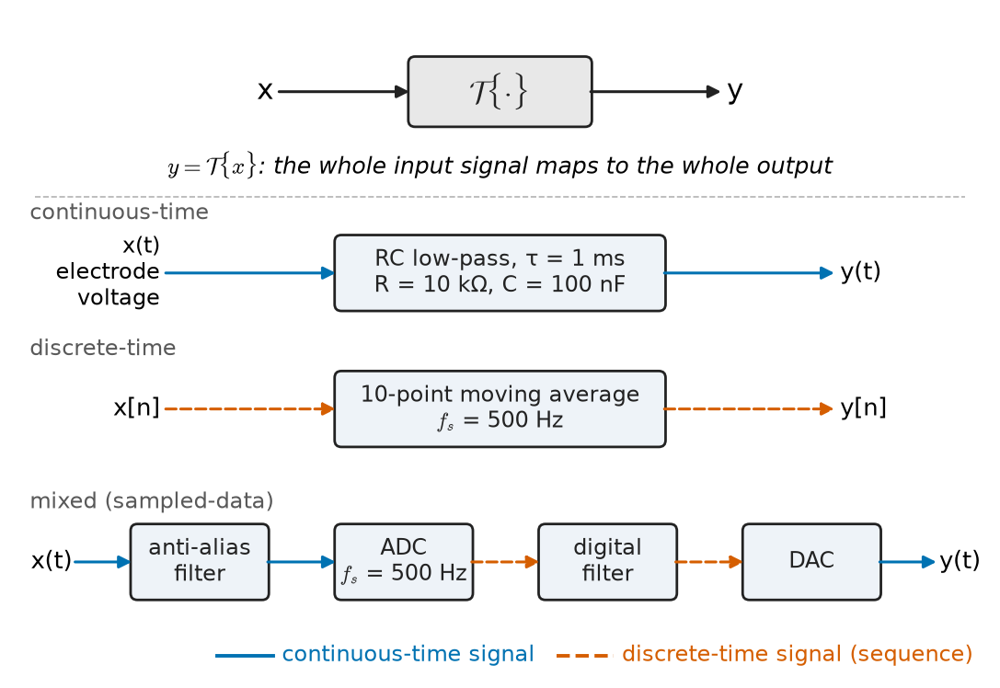
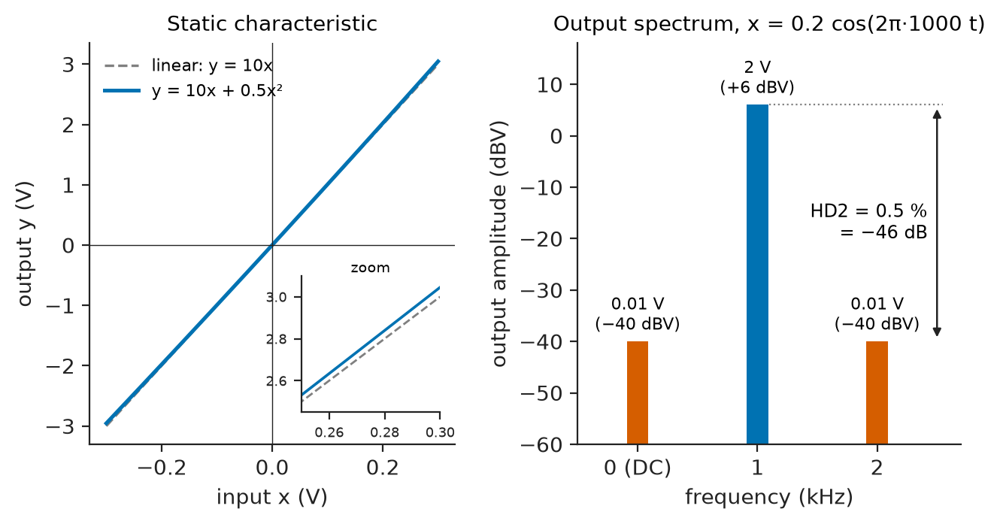
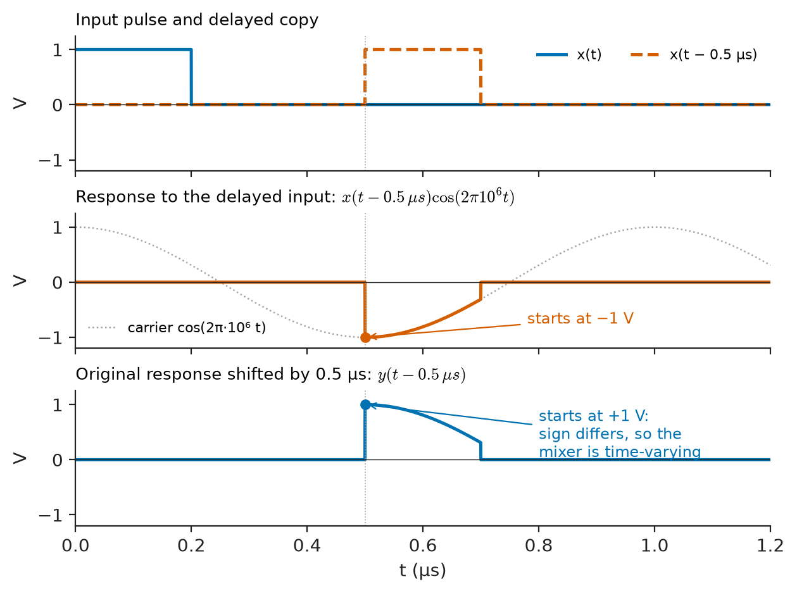
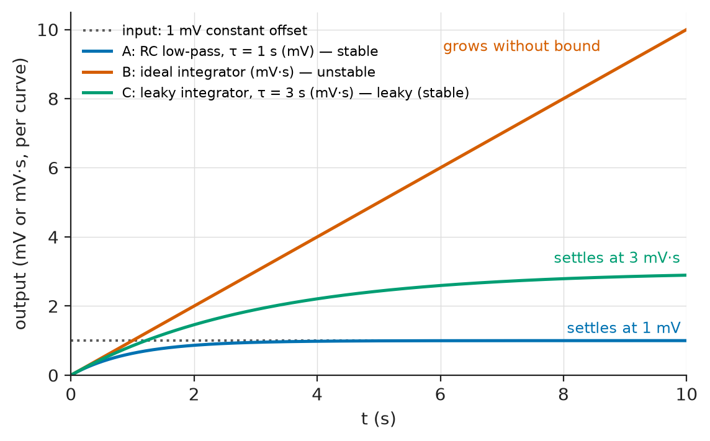
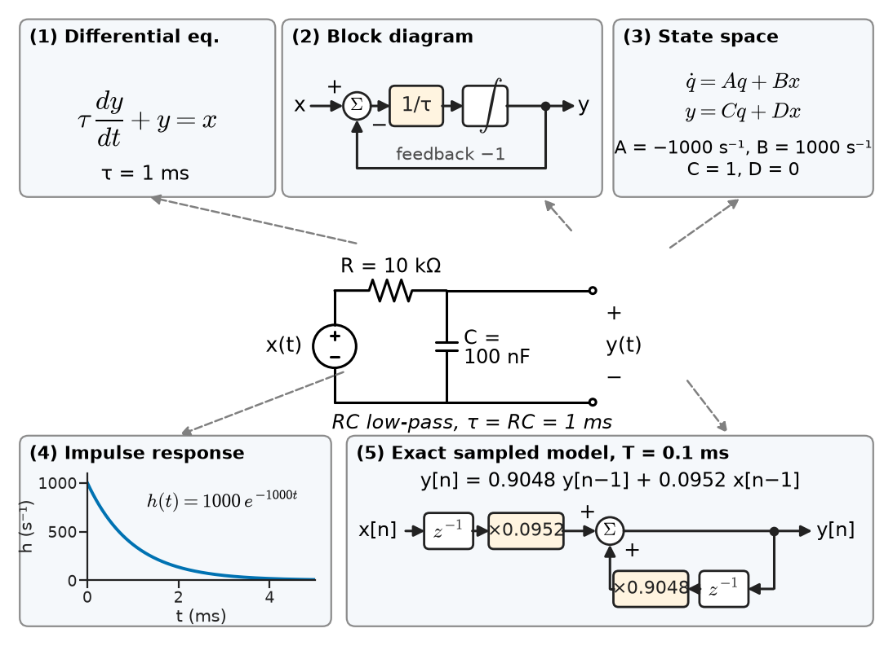

# Chapter 16 — System Fundamentals

*Part IV · Signals and Systems*

A biomedical engineer is commissioning a new bedside ECG monitor. On the bench, fed from a calibrated simulator, the trace is perfect. On the ward it is not. With the patient lying still, the baseline wanders slowly up and down with breathing; when the patient lifts an arm, the trace jumps off the screen and takes several seconds to come back; a fine 50 Hz ripple rides on every beat; and when the engineer doubles the simulator amplitude to check the gain, the recorded R-wave grows by slightly less than a factor of two. Each of these complaints is a statement about the *system* between the electrodes and the screen, not about the heart. The baseline wander tests whether the filters respond the same way at every moment. The slow recovery after a large artefact tests whether the amplifier stays in its linear range and how long its memory of the past is. The ripple asks what the filter does to a 50 Hz input. The missing gain asks whether doubling the input really doubles the output.

Chapter 15 described signals. This chapter describes what acts on them. It introduces a small set of yes-or-no properties — linear or not, time-invariant or not, causal or not, stable or not, with memory or without — that classify a system before any detailed analysis is attempted, and it shows the main ways an input–output relationship can be written down. These properties decide which tools are allowed later: convolution and the frequency response (Chapters 17 and 18) are valid *only* for systems that pass the linearity and time-invariance tests.

> **What exactly is a "system", and which of its properties can be decided from its input–output description alone?**
> **Why do linearity and time invariance matter so much, and how do real circuits approximate them?**
> **What do causality and stability mean precisely, and how are they tested?**

| Concept | Engineering destination |
|---|---|
| System as an input–output map | Amplifiers, filters, sensors, channels, controllers, power networks |
| Continuous and discrete systems | Analog front ends, ADC/DSP chains, sampled-data control |
| Memory | Capacitors and inductors, filters, integrators, echo paths |
| Linearity, superposition | Small-signal amplifiers, harmonic analysis in power systems, distortion budgets |
| Time invariance | Filters and channels with fixed parameters; failure in modulators, switched circuits, fading radio channels |
| Causality | Real-time filtering, control loops, latency budgets; non-causal offline processing |
| BIBO stability | Filter design, integrator drift, feedback amplifiers, power-system oscillations |
| Input–output representations | Differential and difference equations, block diagrams, state-space models, impulse and frequency responses |

**Roadmap.** What a system is and how systems are classified (16.1) → continuous, discrete and mixed systems (16.2) → memory (16.3) → linearity and its approximations (16.4) → time invariance (16.5) → causality (16.6) → stability (16.7) → ways of writing the input–output relationship (16.8).

---

## 16.1 Systems and system classification

### A system as an operator

A **system** is any process that takes an input signal and produces an output signal. The word covers an RC low-pass filter, a power transformer, a loudspeaker, a radio channel between a base station and a phone, a digital filter running on a microcontroller, the arterial tree between heart and fingertip, and a building swaying under wind load. What all of these share, for the purposes of this part of the book, is that we can describe them by a rule that maps an input signal to an output signal:

$$
y(t)=\mathcal{T}\{x(t)\}\qquad\text{or}\qquad y[n]=\mathcal{T}\{x[n]\}
$$

The operator $\mathcal{T}$ acts on the *whole* input signal, not on a single value. This point matters: $y(t_0)$ may depend on $x$ at times other than $t_0$. A capacitor voltage at noon depends on all the current that flowed into it before noon.

Many real systems have several inputs and outputs — a three-phase motor drive, a MIMO radio link, a stereo amplifier. The properties below extend to vector signals without change, and most of Part IV is written for the single-input single-output case.

<!-- FIGURE 16.1 | figures/ch16/fig-16-1-system-block-examples.png | block-diagram | A system maps a whole input signal to an output signal; the same abstraction covers analog, digital and mixed chains. | Content: three rows of block diagrams. Row 1 continuous-time: x(t) electrode voltage into box labelled RC low-pass R = 10 kOhm C = 100 nF tau = 1 ms into y(t). Row 2 discrete-time: x[n] into box labelled 10-point moving average fs = 500 Hz into y[n]. Row 3 mixed: x(t) into anti-alias filter into ADC fs = 500 Hz into digital filter into DAC into y(t), with arrows marking where signals are continuous and where discrete. A generic operator box T{.} drawn above all three with the caption y = T{x}. -->

*Figure 16.1 — A system maps a whole input signal to an output signal; the same abstraction covers analog, digital and mixed chains.*

Figure 16.1 shows the abstraction for three chains that appear in the ECG monitor of the opening: a continuous-time RC filter, a discrete-time moving average, and a mixed chain that converts between the two.

### Why classify

Detailed models — differential equations, transfer functions, circuit simulations — are expensive. Before building one, an engineer wants to know which mathematics is even legitimate. Five properties do most of that work:

| Property | Question it answers | If yes, it allows | Typical violator |
|---|---|---|---|
| Memoryless | Does $y$ at time $t$ depend only on $x$ at time $t$? | Static transfer-characteristic analysis | Any circuit with C or L |
| Linear | Does superposition hold? | Decomposition of inputs, phasors, Fourier methods | Diode, saturating amplifier, squarer |
| Time-invariant | Does a delayed input give an equally delayed output? | Impulse response, convolution, transfer functions | Mixer, chopper, fading channel |
| Causal | Does the output depend only on present and past inputs? | Real-time implementation | Zero-phase offline filter |
| BIBO stable | Does every bounded input give a bounded output? | Safe operation, meaningful frequency response | Integrator, oscillator, unstable loop |

Two further properties are occasionally needed. A system is **invertible** if distinct inputs always produce distinct outputs, so that the input can be recovered; a channel equaliser or an echo canceller tries to build the inverse of a channel, which is possible only if the channel is invertible (a squarer $y=x^2$ is not, because $x$ and $-x$ give the same output). A system is **real** if real inputs give real outputs; almost all physical systems are, while the complex-baseband models used in communication (Chapter 27) are not.

Each property is tested against the *definition*, applied to arbitrary inputs. A single counter-example is enough to show a property fails; showing that it holds requires an argument for all inputs. The following sections give each definition, the standard tests and the engineering systems that pass or fail.

---

## 16.2 Continuous and discrete systems

### Three kinds of system

A **continuous-time system** maps a continuous-time input to a continuous-time output: every passive circuit, analog amplifier, mechanical structure and propagation channel. Its natural mathematical description is a differential equation.

A **discrete-time system** maps a sequence $x[n]$ to a sequence $y[n]$. Discrete-time systems exist as algorithms — a digital filter, a data-compression stage, a control law executed every millisecond — but also arise naturally where data are counted per period: monthly energy consumption, daily peak load, per-revolution measurements of a rotating machine. The natural description is a difference equation.

A **hybrid** or **sampled-data system** contains both. Every digital instrument, digital audio chain, software-defined radio and digital controller is hybrid: a continuous-time plant or sensor, an ADC, a discrete-time algorithm, a DAC and usually a reconstruction filter. The interfaces are covered in Chapter 19 (sampling and reconstruction) and Chapter 21 (DSP workflow); within each section of the chain the classification below applies separately.

| System | Domain | Typical rate or bandwidth |
|---|---|---|
| RC anti-alias filter in an audio ADC | continuous | cut-off around 20–24 kHz |
| Digital audio equaliser | discrete | 44.1 or 48 kHz sample rate |
| ECG acquisition and filtering | hybrid | 250–1000 Hz sample rate typical |
| Protection relay (digital) | hybrid | 16–96 samples per mains cycle typical |
| Power-system electromechanical dynamics | continuous | oscillation modes about 0.1–2 Hz |
| Digital motor current loop | hybrid | 8–20 kHz control rate typical |
| LTE baseband receiver | discrete | 30.72 MHz sample rate for a 20 MHz carrier |

### The two are not separate subjects

The same physical system often has both descriptions. An RC filter with time constant $\tau=RC$ obeys

$$
\tau\frac{dy}{dt}+y(t)=x(t)
$$

If the input is held constant over each interval of length $T$ (as a DAC does) and the output is read every $T$ seconds, the exact relationship between samples is

$$
y[n]=a\,y[n-1]+(1-a)\,x[n-1],\qquad a=e^{-T/\tau}
$$

which is a discrete-time system. Section 16.8 returns to this example. The properties of this chapter are defined in parallel for both domains; wherever the text writes a statement in $t$, the same statement holds with $n$ in place of $t$ and integer shifts in place of real ones.

---

## 16.3 Memory and memoryless systems

### Definition

A system is **memoryless** (static, instantaneous) if the output at each instant depends only on the input at that same instant:

$$
y(t)=f\big(x(t),t\big)
$$

Otherwise it has **memory** (it is dynamic). A resistor, $v(t)=R\,i(t)$, is memoryless. An ideal transformer, $v_2=(N_2/N_1)v_1$, is memoryless. So is an ideal diode, an ideal comparator, a quantiser in an ADC and the static characteristic $y=a_1x+a_2x^2$ of an amplifier at low frequency. A capacitor is not:

$$
v(t)=v(t_0)+\frac{1}{C}\int_{t_0}^{t} i(\lambda)\,d\lambda
$$

The capacitor voltage summarises the entire past current. The state variable $v(t_0)$ is exactly the "memory" — a single number that carries everything about the past that the future needs (Chapter 35 builds state-space models on this idea).

**Worked example — the memory of a capacitor.** A 10 µF hold capacitor in a sample-and-hold circuit is at 0 V. A constant current of 2 mA charges it for 5 ms and then stops. While current flows, $dv/dt=i/C=2\times10^{-3}/10^{-5}=200$ V/s, so after 5 ms the voltage is $200\times0.005=1.0$ V. At $t=8$ ms the input current is zero, yet the output is still 1.0 V. A memoryless system with zero input would have to give zero output; the capacitor does not, because its output records the integral of the past. The same arithmetic in reverse explains droop: a leakage of 10 nA discharges the capacitor at $10^{-8}/10^{-5}=1$ mV/s, which is why hold times in precision sample-and-hold circuits are kept short.

### Degrees of memory

Memory can be short or long, finite or infinite:

- A **pure delay**, $y(t)=x(t-t_0)$, remembers exactly $t_0$ seconds of past input. A 1 km length of coaxial cable with velocity factor 0.66 is a delay of about 5.05 µs; an acoustic echo path in a room is a delay of tens of milliseconds.
- An **N-point moving average**, $y[n]=\frac{1}{N}\sum_{k=0}^{N-1}x[n-k]$, has finite memory of $N$ samples.
- An **RC filter** has infinite memory that fades: the influence of an input $t$ seconds ago decays as $e^{-t/\tau}$. After $5\tau$ it is below 1 %.
- An **ideal integrator** or accumulator has infinite memory that never fades. This is useful (a charge amplifier, an energy meter, the integral term of a PID controller) and dangerous (any offset accumulates without limit, Section 16.7).

A practical rule: a system's memory length is the time over which a disturbance continues to affect the output. For the ECG monitor of the opening, the slow recovery after an arm movement is the memory of the 0.05 Hz high-pass filter (time constant $1/(2\pi\cdot0.05)\approx3.2$ s) — clinical monitors often reduce it by switching temporarily to a shorter time constant after a large artefact, which deliberately makes the system time-varying for a moment.

### Differentiators

A differentiator $y=dx/dt$ — the inductor law $v=L\,di/dt$ is one — is usually classified as having memory, because the derivative at $t$ needs the input in an arbitrarily small neighbourhood around $t$, not only the value at $t$. The memory is infinitesimally short, but it is enough to make the response depend on how the input is changing, and it is what lets an inductor produce a large voltage when a current is interrupted.

---

## 16.4 Linearity

### Definition: superposition

A system is **linear** if, for any inputs $x_1$, $x_2$ and any constants $a$, $b$,

$$
\mathcal{T}\{a\,x_1+b\,x_2\}=a\,\mathcal{T}\{x_1\}+b\,\mathcal{T}\{x_2\}
$$

The single statement contains two properties. **Additivity**: the response to a sum is the sum of the responses. **Homogeneity** (scaling): doubling the input doubles the output. Neither alone is sufficient in general, although for physical systems with continuous characteristics additivity usually implies homogeneity.

The engineering value of linearity is decomposition. If a system is linear, a complicated input can be broken into simple pieces — impulses, steps, sinusoids — the response to each piece found once, and the answers added. Fourier analysis of harmonics in a power network, the phasor method of Chapter 8, the superposition theorem of Chapter 4 and convolution in Chapter 17 are all this idea.

> **Status of the principle: Superposition**
> *Derived.* For a system that satisfies the linearity definition, superposition is an exact mathematical consequence; whether a physical circuit satisfies the definition is a separate, approximate question about its components and signal levels.

### Quick tests

Three consequences give fast tests:

1. **Zero in, zero out.** Setting $a=0$ shows that a linear system must give $y=0$ for $x=0$ (with zero initial conditions). Any system with an output offset fails.
2. **Scaling.** Apply $x$ and $2x$; the output must exactly double.
3. **Two-tone test.** Apply $x_1$, then $x_2$, then $x_1+x_2$; compare.

Examples, checked against the definition:

| System | Linear? | Reason |
|---|---|---|
| $y=Kx$ (ideal amplifier) | yes | direct |
| $y(t)=\int_{-\infty}^{t}x(\lambda)\,d\lambda$ | yes | integral is linear |
| $y(t)=x(t)\cos\omega_c t$ (mixer) | yes | scaling and addition pass through the product with a fixed function |
| $y=2x+1$ | no | fails zero-in, zero-out |
| $y=x^2$ | no | $(x_1+x_2)^2\ne x_1^2+x_2^2$ |
| $y=\lvert x\rvert$ (rectifier) | no | fails for $a=-1$ |
| $y[n]=\mathrm{round}(x[n])$ (quantiser) | no | fails scaling |
| RC circuit with nonzero initial voltage | no (strictly) | output nonzero for zero input |

The mixer row surprises many students: multiplying by a *known* time function is linear. Linearity concerns how the output depends on the input, not whether the formula contains a product. The mixer fails a different test (Section 16.5).

### Incrementally linear systems and initial conditions

The system $y=2x+1$ is not linear, but its *change* in output is linear in the change in input. Such a system is called **incrementally linear**: it is a linear system plus a fixed response that does not depend on the input. A circuit with an initial capacitor voltage is exactly this:

$$
y(t)=\underbrace{y_{zi}(t)}_{\text{zero-input}}+\underbrace{y_{zs}(t)}_{\text{zero-state}}
$$

The zero-input response comes from stored energy; the zero-state response is linear in the input. Chapter 17 uses this split systematically. In practice, an amplifier with a DC offset, a sensor with a zero error or a circuit started from a nonzero state is analysed by removing the fixed part and treating the remainder as linear.

### Linear models of nonlinear devices

No physical device is exactly linear. Resistors heat up and change value; capacitor dielectrics have voltage-dependent permittivity (class-2 ceramic capacitors can lose more than half their capacitance at rated DC bias); iron cores saturate; every amplifier clips at its supply rails. Linearity is an approximation that becomes good when signals are small enough. The standard way to obtain it is **linearisation** about an operating point: write the device law $y=f(x)$, choose a bias point $X_0$, and keep the first term of the Taylor series,

$$
y\approx f(X_0)+f'(X_0)\,(x-X_0)
$$

The constant term is the operating point; the slope $f'(X_0)$ is the small-signal gain. This is how transistor amplifiers are analysed (in *Electronics & Computing*), how power-flow models are linearised for stability studies, and how a strain gauge bridge is treated as linear in strain.

**Worked example — how small is "small signal" for a diode?** A silicon diode biased at $I_D=1$ mA follows $i=I_S(e^{v/V_T}-1)$ with $V_T\approx25.85$ mV at 300 K. The small-signal resistance is $r_d=V_T/I_D=25.85\ \Omega$, so the linear model predicts a current change $\Delta i=\Delta v/r_d$. The exact change for a voltage step $\Delta v$ above the bias point is $\Delta i=I_D(e^{\Delta v/V_T}-1)$. For $\Delta v=1$ mV: linear 0.0387 mA, exact 0.0394 mA, error 1.9 %. For $\Delta v=5$ mV: linear 0.193 mA, exact 0.213 mA, error 9.4 %. For $\Delta v=10$ mV: linear 0.387 mA, exact 0.472 mA, error 18 %. The diode is "linear" to within a few percent only for excursions of a few millivolts — a small fraction of $V_T$. This is the quantitative content of the phrase "small-signal".

> **Status of the principle: Small-signal linearisation**
> *Approximate.* A smooth nonlinear device behaves linearly about its operating point when the signal excursion is small compared with the scale over which its slope changes (for a diode, a few millivolts compared with $V_T\approx26$ mV); it fails for large signals, at clipping and at discontinuities such as switching.

### What nonlinearity does to signals

The signature of nonlinearity is **new frequencies**. A linear system can change the amplitude and phase of each sinusoid it is given, but never creates a frequency that was not in the input (Chapter 17 proves this using eigenfunctions). A nonlinear system does. Consider an amplifier whose static characteristic is

$$
y=a_1x+a_2x^2
$$

driven by $x=A\cos\omega t$. Using $\cos^2\theta=\tfrac12(1+\cos2\theta)$,

$$
y=\frac{a_2A^2}{2}+a_1A\cos\omega t+\frac{a_2A^2}{2}\cos2\omega t
$$

The squared term creates a DC shift and a **second harmonic**. With two input tones $\omega_1$ and $\omega_2$, it also creates sum and difference frequencies $\omega_1\pm\omega_2$ — **intermodulation**.

<!-- FIGURE 16.2 | figures/ch16/fig-16-2-quadratic-nonlinearity.png | plot | A weak quadratic term in an amplifier characteristic creates a DC shift and a second harmonic that a linear system could never produce. | Content: left panel static characteristic y = 10x + 0.5x^2 for x from -0.3 V to 0.3 V with the straight line y = 10x dashed for comparison, axes input x (V) and output y (V). Right panel line spectrum of the output for x = 0.2 cos(2 pi 1000 t): bars at 0 Hz height 0.01 V, at 1 kHz height 2.0 V, at 2 kHz height 0.01 V, vertical axis logarithmic in dBV from -60 to +10, annotation HD2 = 0.5 percent = -46 dB. -->

*Figure 16.2 — A weak quadratic term in an amplifier characteristic creates a DC shift and a second harmonic that a linear system could never produce.*

**Worked example — second-harmonic distortion of an amplifier.** An audio preamplifier has $a_1=10$ and a weak curvature $a_2=0.5\ \mathrm{V^{-1}}$ (Figure 16.2). The input is a 1 kHz tone of amplitude $A=0.2$ V. The fundamental output is $a_1A=2.0$ V. The second-harmonic amplitude at 2 kHz is $a_2A^2/2=0.5\times0.04/2=0.010$ V, and there is a DC shift of the same 0.010 V. The second-harmonic distortion is $0.010/2.0=0.5\ \%$, or $20\log_{10}(0.005)=-46$ dB. Because the ratio is $a_2A/(2a_1)$, it is proportional to amplitude: halving the input to 0.1 V halves the distortion to 0.25 %. This proportionality is a practical diagnostic. Distortion that falls as the signal falls is curvature of the characteristic; distortion that stays roughly constant at low level (crossover distortion in a class-B output stage, quantisation in an ADC) comes from a nonlinearity near zero, where small-signal linearisation does not help.

The same mathematics describes harmonic currents drawn from the mains by rectifier loads (Chapter 9 and Chapter 18), the third-order intercept point of a radio receiver's low-noise amplifier (Chapter 32), and the spurious tones in a digitised signal.

### Linearity in practice

| Device or system | Typical linearity figure |
|---|---|
| Metal-film resistor | voltage coefficient below about 1 ppm/V |
| C0G/NP0 ceramic capacitor | essentially no voltage coefficient |
| X7R ceramic capacitor at rated DC bias | capacitance loss often 30–70 % |
| Good audio power amplifier, rated power | THD about 0.001–0.05 % |
| Instrumentation amplifier | gain nonlinearity about 1–10 ppm of full scale |
| 16-bit precision ADC | integral nonlinearity about ±1–2 LSB |
| Current transformer, protection class 5P | composite error 5 % at the accuracy-limit current |
| Mobile-phone power amplifier | operated near compression; linearised by digital predistortion |

The last row shows that linearity is also a design trade-off. A transmitter amplifier is most efficient near saturation, where it is least linear; communication standards specify how much spectral regrowth is allowed into the next channel, and the engineer chooses the operating point accordingly.

---

## 16.5 Time invariance

### Definition

A system is **time-invariant** (shift-invariant) if a time shift of the input produces the same time shift of the output and nothing else. If $y(t)=\mathcal{T}\{x(t)\}$, then for every $t_0$

$$
\mathcal{T}\{x(t-t_0)\}=y(t-t_0)
$$

and in discrete time, for every integer $n_0$, $\mathcal{T}\{x[n-n_0]\}=y[n-n_0]$. Informally: the system behaves the same today as it did yesterday. An RC filter built from stable components is time-invariant; the same filter with a resistor that warms up during operation is, strictly, not, though the variation may be negligible over the time of interest.

The test is mechanical. Compute the response to the shifted input; separately, shift the original output; compare. If the system's formula contains $t$ explicitly (other than through $x$), or contains time scaling such as $x(2t)$, it usually fails.

### Examples

| System | Time-invariant? | Comment |
|---|---|---|
| $y(t)=x(t-t_0)$ (delay) | yes | |
| $y(t)=\int_{-\infty}^{t}x(\lambda)\,d\lambda$ | yes | |
| $\tau\,dy/dt+y=x$ with constant $\tau$ | yes | coefficients constant |
| $y(t)=x(t)\cos\omega_ct$ (mixer, AM modulator) | no | gain depends on absolute time |
| $y(t)=x(2t)$ (playback at double speed) | no | shifts are compressed |
| $y[n]=x[2n]$ (downsampler) | no | a shift of 1 at the input is not a shift at the output |
| Mobile radio channel with moving user | no | multipath gains change with position |
| Switched-capacitor filter | no, strictly | periodically time-varying; nearly LTI for signals well below the clock |
| Battery with state-of-charge-dependent resistance | no, slowly | treated as LTI over short intervals |

**Worked example — a mixer is linear but not time-invariant.** An AM modulator multiplies its input by a 1 MHz carrier, $y(t)=x(t)\cos(2\pi\cdot10^6\,t)$. Feed it a short rectangular pulse of amplitude 1 V and width 0.2 µs starting at $t=0$. During the pulse the output is $\cos(2\pi10^6t)$, which starts at its positive peak, $+1$ V. Now delay the input by $t_0=0.5$ µs. The output during the delayed pulse is $\cos(2\pi10^6t)$ for $0.5\le t\le0.7$ µs, which starts at $\cos(\pi)=-1$ V. Shifting the *original* output by 0.5 µs would instead give $\cos\big(2\pi10^6(t-0.5\times10^{-6})\big)$, which starts at $+1$ V. The two differ in sign, so the system is time-varying. Linearity still holds: doubling the pulse doubles the output at every instant. This combination — linear, time-varying — is exactly what a modulator needs to be, because its purpose is to move a signal to a new frequency, something no LTI system can do (Chapter 26).

<!-- FIGURE 16.3 | figures/ch16/fig-16-3-mixer-time-variance.png | plot | Time-invariance test on a 1 MHz mixer: delaying the input does not simply delay the output. | Content: three stacked panels, time axis 0 to 1.2 microseconds. Top: input pulse 1 V from 0 to 0.2 us (solid) and delayed copy from 0.5 to 0.7 us (dashed). Middle: response to the delayed input, a 1 MHz cosine burst between 0.5 and 0.7 us starting at -1 V. Bottom: original response shifted by 0.5 us, a cosine burst starting at +1 V. Annotation arrow showing the sign difference at t = 0.5 us. Vertical axes in volts from -1.2 to 1.2. -->

*Figure 16.3 — Time-invariance test on a 1 MHz mixer: delaying the input does not simply delay the output.*

Figure 16.3 shows the test graphically. A related family, **periodically time-varying** systems — mixers, choppers, switched-mode converters, sample-and-hold circuits — are time-varying but in a regular way, and they have their own analysis methods (averaging for converters, conversion matrices for mixers).

### Linear time-invariant systems

The systems that satisfy both linearity and time invariance form the class **LTI** (in discrete time sometimes LSI, linear shift-invariant). They are the central object of Part IV because, as Chapter 17 shows, an LTI system is completely described by one signal, its impulse response, and its output is the convolution of input with impulse response. Every lumped circuit of resistors, capacitors, inductors, coupled coils and linear dependent sources with constant values is LTI once the initial conditions are separated off. Many systems that are not exactly LTI are treated as LTI over a limited range of amplitude and time: a small-signal amplifier over a frequency band, a radio channel over a few milliseconds (its coherence time), a power network around a load-flow operating point.

---

## 16.6 Causality

### Definition

A system is **causal** if its output at any time depends only on the present and past values of the input:

$$
y(t_1)\ \text{depends only on}\ x(t)\ \text{for}\ t\le t_1
$$

Equivalently, if two inputs agree up to time $t_1$, their outputs agree up to time $t_1$. For a linear system with zero initial conditions this reduces to: if $x(t)=0$ for $t<t_0$, then $y(t)=0$ for $t<t_0$. A causal system cannot respond before it is excited.

> **Status of the principle: Causality of physical systems**
> *Fundamental.* A physical system operating in real time cannot respond to an input that has not yet arrived; this follows from the ordering of cause and effect and, for electromagnetic systems, from the finite speed of propagation.

Every circuit, mechanical structure and propagation path is causal when its input and output are physical quantities measured on the same clock. The interest of the definition lies in the systems that are *not* causal, all of which are algorithms working on stored data:

- A **centred moving average**, $y[n]=\frac13\big(x[n-1]+x[n]+x[n+1]\big)$, needs the next sample.
- A **zero-phase filter**, made by filtering a record forwards and then backwards, removes phase distortion completely (Chapter 18) but uses the whole record.
- **Interpolation** that reconstructs a value between samples using samples on both sides.
- **Smoothing** of a recorded seismogram, biomedical record or vibration log.

These are perfectly legitimate offline. In real time, a non-causal operation is made causal by **delaying** its output: a centred $N$-point average becomes causal if its output is labelled $(N-1)/2$ samples later. The price is **latency**.

**Worked example — the latency of a mains-hum filter.** An ECG front end samples at $f_s=500$ Hz. A 10-point moving average,

$$
y[n]=\frac{1}{10}\sum_{k=0}^{9}x[n-k]
$$

is causal. Averaging over exactly ten samples spans 20 ms, one full cycle of 50 Hz mains, so 50 Hz interference averages to zero; its gain is exactly zero at 50 Hz and also at 100 Hz, 150 Hz and so on. The gain at 10 Hz is 0.936 and at 25 Hz is 0.639, so it also smooths the QRS complex, whose content extends well above 25 Hz — Chapter 23 shows how to do better. The filter's output corresponds to the input $(N-1)/2=4.5$ samples earlier, a delay of $4.5/500=9$ ms. For a monitor display, 9 ms is irrelevant. For a pacemaker that must sense an R-wave and respond, or for a protection relay that must trip within one cycle, every millisecond of filter latency is budgeted. Making the filter centred (non-causal) would remove the label offset in an offline plot, but cannot remove the physical waiting time.

### Causality and time variable

Causality refers to time. When the independent variable is not time — position along an image row, distance along a pipeline in a leak-detection survey, frequency in a spectrum — "causal" has no physical meaning, and image filters are routinely symmetric (non-causal). The concept also needs care with **predictors**: a system that estimates $x(t+\Delta)$ from past data is causal (it uses the past), even though its output refers to the future.

---

## 16.7 Stability

### BIBO stability

Several definitions of stability exist. The one used for input–output descriptions is **bounded-input bounded-output (BIBO) stability**: a system is BIBO stable if every bounded input produces a bounded output,

$$
\lvert x(t)\rvert\le B_x<\infty\ \text{for all}\ t\quad\Longrightarrow\quad \lvert y(t)\rvert\le B_y<\infty\ \text{for all}\ t
$$

The bound $B_y$ may depend on $B_x$ but must be finite for every bounded input. A single bounded input that produces an unbounded output — even one carefully chosen — shows the system is unstable.

Stability is the property engineers most need and most often lose. An amplifier with too much feedback oscillates; a digital filter with a coefficient quantised the wrong way grows without bound; a power system after a fault can swing apart; an integrator fed with a small offset drifts to its rail. For LTI systems the test reduces to a condition on the impulse response (absolutely integrable or summable) and, equivalently, on pole locations — all poles in the left half of the $s$-plane or inside the unit circle of the $z$-plane. Chapter 17 derives this; Chapters 11, 20 and 34 use it.

> **Status of the principle: BIBO stability**
> *Derived.* BIBO stability is a mathematical property of the input–output map; for LTI systems it is equivalent to absolute integrability of the impulse response, a result proved from the convolution integral in Chapter 17.

### Examples

**Moving average.** For the 10-point average, $\lvert y[n]\rvert\le\frac1{10}\sum\lvert x[n-k]\rvert\le B_x$. Every bounded input gives an output bounded by the same value: stable.

**RC low-pass.** The output is a weighted average of the past input with weights $e^{-t/\tau}/\tau$ that integrate to 1; the output can never exceed the largest input magnitude. Stable.

**Integrator and accumulator.** The accumulator $y[n]=y[n-1]+x[n]$ is the discrete integrator. A bounded constant input $x[n]=c$ gives $y[n]=(n+1)c$, which grows without bound. Unstable — even though no individual sample is large and nothing in the system "explodes".

**Worked example — integrator drift.** A vibration-monitoring system integrates an accelerometer signal to obtain velocity, using an accumulator at $f_s=1$ kHz with scaling $T=1$ ms per sample. The ADC has an uncorrected offset equivalent to 1 m/s² (1 % of a 100 m/s² full scale). After one second the integrated velocity error is $1\times1=1$ m/s; after one minute, 60 m/s. The same mechanism makes a MEMS rate gyroscope with a 0.01 °/s bias accumulate a heading error of $0.01\times3600=36$° per hour. The physical sensor is fine; the integrator is not BIBO stable. Practical systems replace the pure integrator by a "leaky" one — a low-pass filter with a long but finite time constant, or a high-pass filter before the integrator — which is stable, at the price of losing the slowest components of the true signal.

<!-- FIGURE 16.4 | figures/ch16/fig-16-4-stable-vs-unstable.png | plot | A bounded input gives a bounded output from an RC filter but an unbounded drift from an integrator. | Content: input a constant 1 mV offset (dotted) from t = 0 to 10 s. Curve A: RC low-pass with tau = 1 s rising to 1 mV and staying there. Curve B: ideal integrator output in mV s rising linearly to 10 at t = 10 s. Curve C: leaky integrator with time constant 3 s saturating at 3. Horizontal axis time 0 to 10 s, vertical axis output 0 to 10 (units noted per curve). Legend with labels stable, unstable, leaky (stable). -->

*Figure 16.4 — A bounded input gives a bounded output from an RC filter but an unbounded drift from an integrator.*

Figure 16.4 compares the three behaviours for the same bounded input.

**Marginal stability.** An ideal LC tank, or a system with a pair of poles exactly on the imaginary axis, responds to a brief kick with a sinusoid that neither grows nor decays. Its response to some bounded inputs is bounded, but a sinusoidal input at exactly its resonant frequency produces an output whose amplitude grows linearly in time. It is therefore **not** BIBO stable. Oscillators are deliberately built near this condition, with amplitude limited by a nonlinearity; filters must keep well away from it.

### Other notions of stability

BIBO stability is about forced response. **Internal (Lyapunov) stability** concerns the natural response: a system is asymptotically stable if every initial state decays to zero with zero input. For LTI systems without hidden pole–zero cancellations the two coincide; when a cancellation hides an unstable mode, the input–output map may look stable while an internal variable grows — a capacitor voltage drifting to the supply in a circuit whose output looks fine. Chapter 35 returns to this through controllability and observability. Power-system engineers additionally distinguish **small-signal stability** (the linearised model about an operating point) from **transient stability** (whether the nonlinear system recovers after a large disturbance such as a fault); only the first is a property of an LTI model.

| System | BIBO stable? | Remark |
|---|---|---|
| Resistive divider | yes | memoryless with finite gain |
| Passive RLC filter with $R>0$ | yes | energy dissipated |
| Ideal integrator, accumulator | no | constant input → ramp |
| Lossless LC tank | no | resonant input → growing response |
| Op-amp with too much phase lag in feedback | no | oscillates |
| FIR digital filter | always yes | finite sum of bounded terms |
| IIR digital filter | depends | poles must lie inside the unit circle |
| Synchronous generator, lightly damped mode | yes, marginally | poorly damped electromechanical oscillation |

---

## 16.8 Input–output representations

The properties above describe *what kind* of system we have. To compute responses we need a concrete description. There are several, each suited to different tasks, and they are interchangeable for LTI systems.

### Explicit input–output formula

The simplest description gives $y$ directly in terms of $x$: $y=Kx$, $y=x^2$, $y(t)=x(t-t_0)$, $y[n]=\frac1N\sum x[n-k]$. Memoryless systems and FIR filters have such formulas. Many systems do not, because the output depends on its own past.

### Differential equations

Continuous-time lumped systems are described by ordinary differential equations relating input and output, obtained from KCL, KVL and the element laws (Chapters 5–7) or from Newton's laws for mechanical systems (Chapter 33):

$$
a_N\frac{d^Ny}{dt^N}+\dots+a_1\frac{dy}{dt}+a_0y=b_M\frac{d^Mx}{dt^M}+\dots+b_1\frac{dx}{dt}+b_0x
$$

Constant coefficients make the system time-invariant; the absence of products and powers of $x$ and $y$ makes it linear (with zero initial conditions). The order $N$ equals the number of independent energy-storage elements. The solution needs $N$ initial conditions, which carry the system's memory of the past.

### Difference equations

The discrete-time counterpart is the linear constant-coefficient difference equation,

$$
\sum_{k=0}^{N}a_k\,y[n-k]=\sum_{k=0}^{M}b_k\,x[n-k]
$$

which can be solved recursively: with $a_0=1$, $y[n]$ is computed from the current and past inputs and the past outputs. This is how every IIR digital filter, digital controller and recursive estimator is executed. If all $a_k$ for $k\ge1$ are zero the equation is an explicit FIR formula.

### Block diagrams

A block diagram draws the system as an interconnection of a few primitive operations: gains, adders, integrators (continuous time) or unit delays (discrete time). Any linear constant-coefficient differential or difference equation can be drawn this way, and the diagram is directly a recipe for implementation — an analog computer, an active filter or a DSP program. Chapter 33 develops block-diagram algebra and signal-flow graphs.

### State-space form

A state-space model writes an $N$th-order equation as $N$ coupled first-order equations in a state vector $\mathbf{q}$:

$$
\dot{\mathbf{q}}(t)=\mathbf{A}\mathbf{q}(t)+\mathbf{B}x(t),\qquad y(t)=\mathbf{C}\mathbf{q}(t)+D\,x(t)
$$

The natural states of a circuit are capacitor voltages and inductor currents. State-space handles multiple inputs and outputs, nonzero initial conditions and time-varying systems naturally, and is the basis of modern control (Chapter 35) and of circuit simulators.

### Impulse response and frequency response

For LTI systems two further descriptions are complete on their own: the **impulse response** $h(t)$ or $h[n]$ — the output when the input is a unit impulse — and the **frequency response** $H(j\omega)$, which gives the gain and phase shift at each frequency, along with its generalisation the **transfer function** $H(s)$ or $H(z)$. Chapter 17 shows how $h$ determines the output for any input; Chapter 18 develops $H(j\omega)$; Chapters 11 and 20 use $H(s)$ and $H(z)$. These are the representations of choice for filters, channels and amplifiers because they can be measured directly: an impulse or step test for $h$, a swept sine or a noise excitation for $H(j\omega)$.

<!-- FIGURE 16.5 | figures/ch16/fig-16-5-rc-five-representations.png | block-diagram | One RC low-pass filter written in five equivalent input-output representations. | Content: centre: circuit with source x(t), series R = 10 kOhm, shunt C = 100 nF, output y(t) across C. Around it five labelled panels: (1) differential equation tau dy/dt + y = x with tau = 1 ms; (2) block diagram with adder, gain 1/tau and integrator in a loop with feedback -1; (3) state-space A = -1000 per s, B = 1000 per s, C = 1, D = 0; (4) impulse response h(t) = 1000 exp(-1000 t) for t from 0 to 5 ms sketched; (5) difference equation y[n] = 0.9048 y[n-1] + 0.0952 x[n-1] for T = 0.1 ms, with a unit-delay block diagram. Arrows indicating each is derivable from the circuit. -->

*Figure 16.5 — One RC low-pass filter written in five equivalent input-output representations.*

### One system, five descriptions

Figure 16.5 collects the descriptions for the RC low-pass filter with $R=10\ \mathrm{k\Omega}$, $C=100$ nF, $\tau=RC=1$ ms:

| Representation | RC low-pass, $\tau=1$ ms |
|---|---|
| Differential equation | $\tau\,dy/dt+y=x$ |
| State-space | $\dot q=-1000\,q+1000\,x$, $y=q$ (units s⁻¹) |
| Impulse response | $h(t)=1000\,e^{-1000t}$ for $t\ge0$ |
| Frequency response | $H(j\omega)=1/(1+j\omega\tau)$, cut-off 159 Hz |
| Exact sampled model, $T=0.1$ ms | $y[n]=0.9048\,y[n-1]+0.0952\,x[n-1]$ |

**Worked example — discretising the RC filter.** A digital controller must simulate the RC filter at a sample interval $T=0.1$ ms. Two discrete models are common. The exact one for a piecewise-constant input uses $a=e^{-T/\tau}=e^{-0.1}=0.9048$, giving $y[n]=0.9048\,y[n-1]+0.0952\,x[n-1]$. The simpler forward-Euler approximation replaces $dy/dt$ by $(y[n]-y[n-1])/T$ evaluated one step back, giving $y[n]=(1-T/\tau)\,y[n-1]+(T/\tau)\,x[n-1]=0.9\,y[n-1]+0.1\,x[n-1]$. For a unit step at $t=0$, the continuous system reaches $1-e^{-1}=0.6321$ at $t=1$ ms. The exact discrete model reaches $1-0.9048^{10}=0.6321$ after 10 steps — identical, by construction. The Euler model reaches $1-0.9^{10}=0.6513$, about 3 % high. Both discrete models are linear, time-invariant, causal and stable, as the continuous filter is; but they are different systems, and a careless discretisation can even destroy stability (forward Euler becomes unstable if $T>2\tau$). Chapter 23 treats discretisation methods properly.

### Choosing a representation

| Task | Preferred representation |
|---|---|
| Deriving a model from a circuit or mechanism | differential equation, state-space |
| Implementing a digital filter or controller | difference equation, block diagram |
| Predicting the response to a measured transient | impulse response and convolution |
| Specifying or measuring a filter, amplifier or channel | frequency response |
| Locating instability and resonances | transfer function poles and zeros |
| Nonlinear or time-varying systems | state-space, simulation |

> **Boundary.** The mathematical theory of differential and difference equations, and of the transforms that solve them, belongs to *The Mathematics Universe*; this book uses the results. The internal design of amplifiers, ADCs and DACs that implement these systems belongs to *Electronics & Computing*.

---

## What remains open

| Open question | Where it is answered |
|---|---|
| How is an LTI system completely characterised by one signal, and how is its output computed? | Chapter 17 (impulse response, convolution) |
| Why are complex exponentials special for LTI systems, and what is the frequency response? | Chapter 17 (eigenfunctions), Chapter 18 |
| How are BIBO stability and causality read from pole locations? | Chapter 17, Chapter 11 (s-domain), Chapter 20 (z-domain) |
| What happens at the boundary between continuous and discrete systems? | Chapter 19 (sampling and reconstruction) |
| How are digital filters designed to meet specifications without losing stability? | Chapter 23 |
| How are nonlinear distortion and noise quantified in communication systems? | Chapter 18 (distortion), Chapter 29 (noise) |
| How does feedback change linearity, sensitivity and stability? | Chapter 17 (interconnection), Chapter 34 |
| How are state-space models used for design, and what are controllability and observability? | Chapter 35 |
| How are transistor amplifiers linearised about an operating point? | *Electronics & Computing* |

**Next:** Chapter 17 takes the systems that pass both the linearity and time-invariance tests and shows that a single response — to an impulse — determines everything they do.
