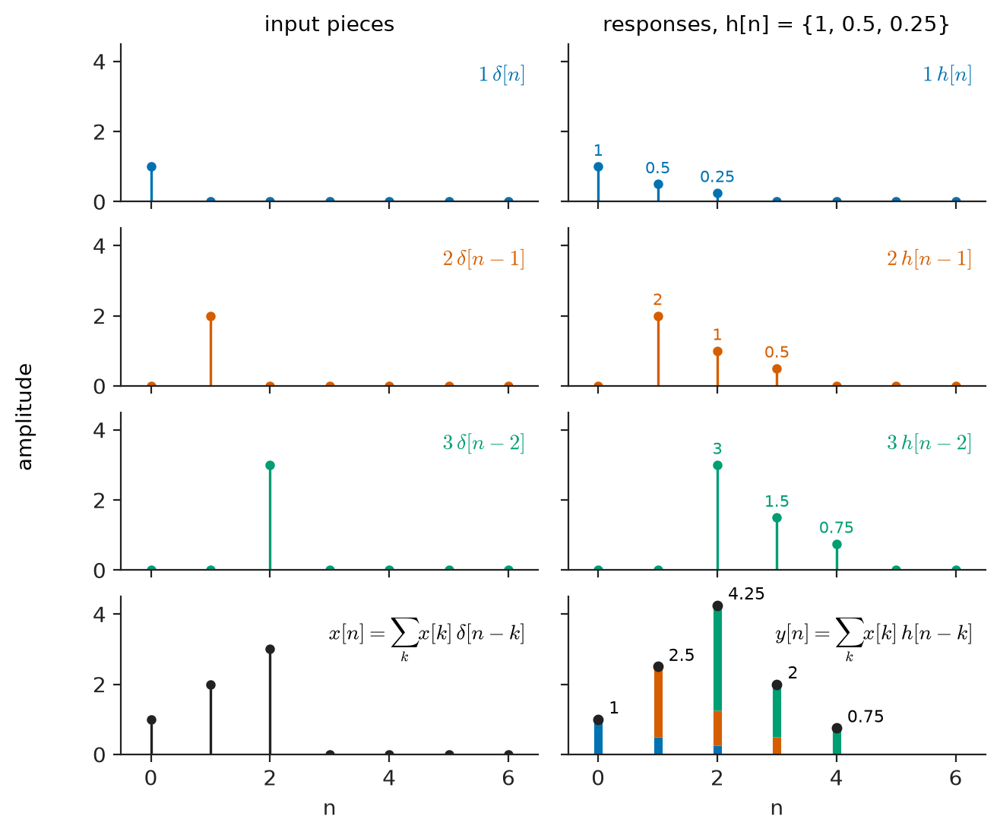
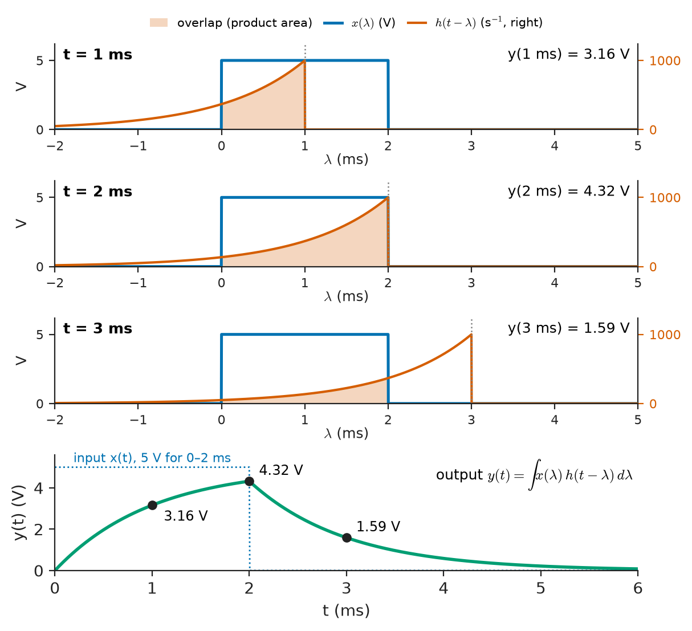
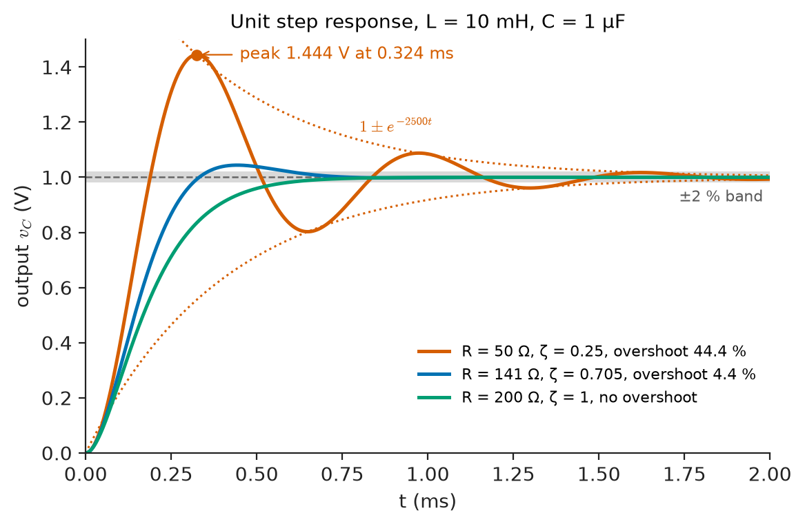
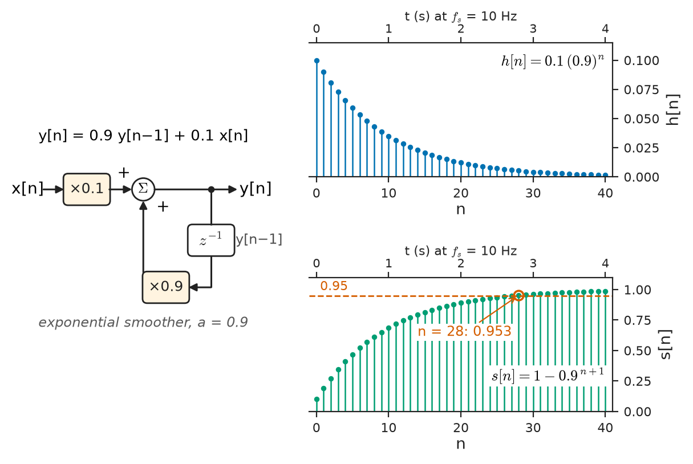
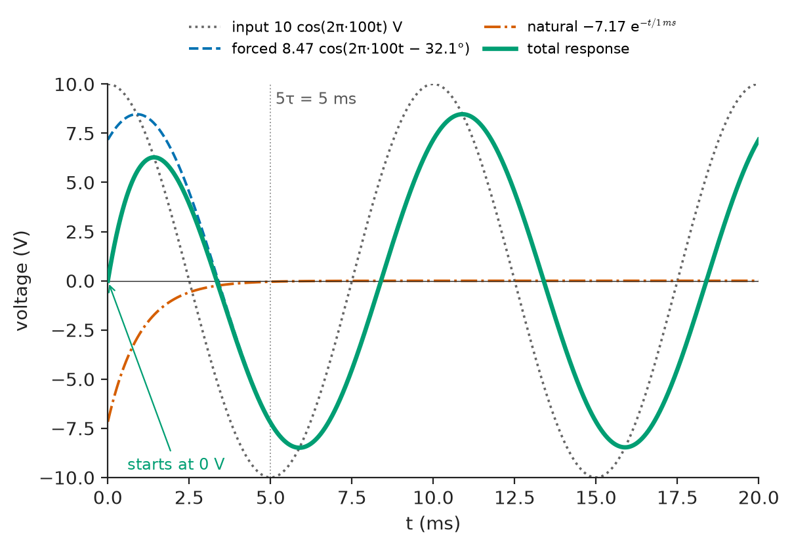
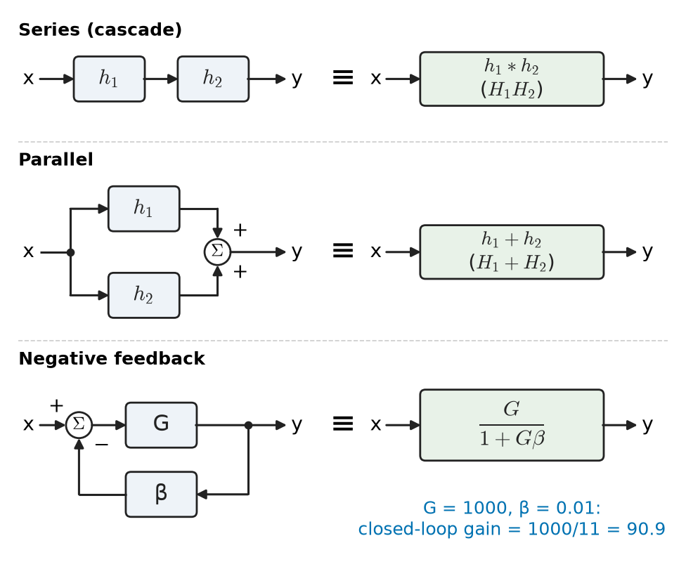

# Chapter 17 — Linear Time-Invariant Systems

*Part IV · Signals and Systems*

An acoustic consultant is asked why speech is hard to understand in a newly built lecture hall. She does not play speech into the room. She stands at the lectern, bursts a balloon, and records the result at a seat in row twenty: a sharp click, a cluster of strong early reflections over the first 50 ms, then a dense decaying tail that takes about 1.8 s to fall by 60 dB. From that single recording she can compute what *any* sound produced at the lectern will sound like at that seat — a lecturer's voice, a piano, a fire alarm — without ever playing them. Audio engineers use the same trick in reverse to put a dry studio recording "into" a cathedral. A radio engineer does the equivalent with a channel sounder to predict how a 5G signal will be smeared by multipath; a cardiologist's ECG system designer does it with a step input to characterise the amplifier; a seismologist does it with a controlled explosion.

All of this rests on one fact: for a system that is linear and time-invariant, the response to a brief impulse contains everything there is to know about the system. This chapter establishes that fact, derives the operation — convolution — that turns the impulse response into the output for any input, connects it to the differential and difference equations that physical systems actually obey, and shows why sinusoids and complex exponentials pass through LTI systems unchanged in shape. These results are the foundation for the frequency-domain view of Chapter 18 and for everything in Parts V–VII.

> **Why does one measured response — to an impulse — determine the output of an LTI system for every input?**
> **How do differential and difference equations, impulse responses and convolution describe the same system?**
> **Why do complex exponentials pass through LTI systems unchanged in shape, and what does that imply for stability and interconnection?**

| Concept | Engineering destination |
|---|---|
| Impulse response | Room acoustics, channel sounding, loudspeaker and sensor characterisation |
| Convolution | Filtering, reverberation, multipath channels, blurring and deblurring |
| Differential-equation models | RC, RL and RLC circuits, sensors, mechanical structures, plant models |
| Difference equations | Digital filters, smoothers, digital controllers, recursive estimators |
| Zero-input and zero-state response | Switching transients, start-up of filters and converters |
| Eigenfunctions | Phasor analysis, frequency response, modulation and demodulation |
| Causality and stability from $h$ | Real-time filters, feedback amplifiers, IIR filter design |
| Interconnection | Cascaded filter stages, parallel channels, feedback amplifiers, echo cancellation |

**Roadmap.** Impulse response and the decomposition of inputs (17.1) → convolution, its mechanics and properties (17.2) → differential-equation systems (17.3) → difference-equation systems (17.4) → the structure of the system response (17.5) → eigenfunctions (17.6) → causality and stability read from $h$ (17.7) → series, parallel and feedback interconnections (17.8).

---

## 17.1 Impulse response

### Discrete time first

The idea is cleanest in discrete time. Any sequence can be written as a sum of scaled, shifted unit impulses (Chapter 15):

$$
x[n]=\sum_{k=-\infty}^{\infty}x[k]\,\delta[n-k]
$$

Each term is a single sample: the value $x[k]$ placed at position $k$. Define the **impulse response** $h[n]$ as the output of the system when the input is $\delta[n]$ and the system starts at rest:

$$
h[n]=\mathcal{T}\{\delta[n]\}
$$

Now apply the two LTI properties in turn. Time invariance says the response to $\delta[n-k]$ is $h[n-k]$. Linearity says the response to $x[k]\,\delta[n-k]$ is $x[k]\,h[n-k]$, and the response to the sum is the sum of the responses. Therefore

$$
y[n]=\sum_{k=-\infty}^{\infty}x[k]\,h[n-k]
$$

This is the **convolution sum**, written $y=x*h$. Nothing else about the system was used. Its internal structure — whether it is a digital filter with ten coefficients, a cable, an amplifier or a room — is irrelevant once $h$ is known.

<!-- FIGURE 17.1 | figures/ch17/fig-17-1-impulse-decomposition.png | plot | An input sequence is a sum of shifted impulses; for an LTI system the output is the same sum of shifted, scaled impulse responses. | Content: left column three stem plots for n = 0 to 6: x[n] = 1, 2, 3 at n = 0, 1, 2; its three components 1 delta[n], 2 delta[n-1], 3 delta[n-2]. Right column the corresponding responses using h[n] = 1, 0.5, 0.25 at n = 0, 1, 2: 1 h[n], 2 h[n-1], 3 h[n-2] as stems in three colours, and at the bottom their sum y[n] = 1, 2.5, 4.25, 2.0, 0.75 at n = 0 to 4 as stacked stems. Vertical axes amplitude 0 to 4.5. -->

*Figure 17.1 — An input sequence is a sum of shifted impulses; for an LTI system the output is the same sum of shifted, scaled impulse responses.*

### Continuous time

In continuous time the same argument uses the sifting property of the Dirac impulse,

$$
x(t)=\int_{-\infty}^{\infty}x(\lambda)\,\delta(t-\lambda)\,d\lambda
$$

which expresses $x$ as a continuum of impulses of strength $x(\lambda)\,d\lambda$. With $h(t)=\mathcal{T}\{\delta(t)\}$, linearity and time invariance give the **convolution integral**

$$
y(t)=\int_{-\infty}^{\infty}x(\lambda)\,h(t-\lambda)\,d\lambda=(x*h)(t)
$$

A more physical route reaches the same result: approximate $x(t)$ by a staircase of narrow rectangular pulses of width $\Delta$; each pulse is close to an impulse of area $x(k\Delta)\Delta$ when $\Delta$ is short compared with the system's response time; add the responses; let $\Delta\to0$. The approximation explains how impulse responses are measured. No real input is a Dirac delta, but any pulse much shorter than the fastest feature of $h(t)$ acts as one. A balloon burst lasting a millisecond is "an impulse" to a room whose response lasts seconds; a 10 ns pulse is an impulse to a 100 kHz amplifier but not to a 1 GHz one.

> **Status of the principle: Convolution representation of LTI systems**
> *Derived.* It follows exactly from linearity, time invariance and the impulse decomposition of the input; it holds for any system with those two properties and for no other.

### Step response

The impulse is an idealisation that is often hard to apply in practice — a large, short pulse may overload an amplifier. The **unit step response** $s(t)$, the output for input $u(t)$, is easier to measure and contains the same information. Since $u(t)=\int_{-\infty}^{t}\delta(\lambda)\,d\lambda$ and the system is LTI,

$$
s(t)=\int_{-\infty}^{t}h(\lambda)\,d\lambda,\qquad h(t)=\frac{ds}{dt}
$$

and in discrete time $s[n]=\sum_{k\le n}h[k]$, $h[n]=s[n]-s[n-1]$. Oscilloscope probe compensation, the specification of amplifier settling time, and the calibration of ECG amplifiers with a 1 mV step all use step responses.

### Measured impulse responses

| System | Typical length of impulse response |
|---|---|
| RC anti-alias filter, $f_c=20$ kHz | about 40 µs (to 1 %) |
| ECG high-pass filter, 0.05 Hz | about 15 s (to 1 %) |
| Living room, reverberation time $T_{60}$ | about 0.3–0.6 s |
| Concert hall, $T_{60}$ | about 1.8–2.2 s |
| Indoor radio channel, RMS delay spread | about 10–100 ns |
| Urban cellular channel, RMS delay spread | about 0.5–5 µs |
| Hybrid echo on a long-distance telephone circuit | tens of ms |
| Broadband seismometer | tens to hundreds of seconds |

The lengths span thirteen orders of magnitude, but the mathematics is the same in every row.

---

## 17.2 Convolution

### Mechanics: flip, shift, multiply, integrate

To evaluate $y(t)=\int x(\lambda)h(t-\lambda)\,d\lambda$ at one particular time $t$:

1. Write both signals as functions of the dummy variable $\lambda$.
2. **Flip** $h$: $h(-\lambda)$.
3. **Shift** it right by $t$: $h(t-\lambda)$.
4. **Multiply** pointwise by $x(\lambda)$.
5. **Integrate** (or sum) the product over $\lambda$.

Repeating for each $t$ traces out $y(t)$. The flipped impulse response acts as a weighting window that slides along the input; $h(t-\lambda)$ says how much the input at time $\lambda$ contributes to the output at time $t$. For a causal system the window only looks backwards, and its shape is the system's memory.

**Worked example — discrete convolution by hand.** A three-tap FIR filter has $h[n]=\{1,\ 0.5,\ 0.25\}$ for $n=0,1,2$. The input is $x[n]=\{1,\ 2,\ 3\}$ for $n=0,1,2$. Using $y[n]=\sum_kx[k]h[n-k]$:

- $y[0]=x[0]h[0]=1$
- $y[1]=x[0]h[1]+x[1]h[0]=0.5+2=2.5$
- $y[2]=x[0]h[2]+x[1]h[1]+x[2]h[0]=0.25+1+3=4.25$
- $y[3]=x[1]h[2]+x[2]h[1]=0.5+1.5=2.0$
- $y[4]=x[2]h[2]=0.75$

The output has $3+3-1=5$ samples: convolving sequences of lengths $L$ and $M$ gives length $L+M-1$. Figure 17.1 shows the same calculation as a sum of three shifted, scaled copies of $h$. A useful check: the sum of the output samples, 10.5, equals the product of the input sum (6) and the impulse-response sum (1.75), because convolution multiplies DC gains.

**Worked example — a rectangular pulse through an RC filter.** An RC low-pass filter with $\tau=RC=1$ ms has $h(t)=\frac1\tau e^{-t/\tau}u(t)$. The input is a 5 V pulse lasting 2 ms, from $t=0$ to $t=2$ ms — for instance a gating pulse on a long line. For $0\le t\le2$ ms the flipped, shifted impulse response overlaps the pulse from $\lambda=0$ to $\lambda=t$:

$$
y(t)=\int_0^t5\cdot\frac1\tau e^{-(t-\lambda)/\tau}\,d\lambda=5\big(1-e^{-t/\tau}\big)
$$

At $t=1$ ms, $y=5(1-e^{-1})=3.16$ V; at the end of the pulse, $y(2\ \mathrm{ms})=5(1-e^{-2})=4.32$ V. For $t>2$ ms the overlap is $\lambda\in[0,2\ \mathrm{ms}]$, and the result is $y(t)=4.32\,e^{-(t-2\,\mathrm{ms})/\tau}$; at $t=3$ ms, $y=4.32e^{-1}=1.59$ V. This is the familiar charge–discharge waveform of Chapter 6, now obtained without writing a differential equation. Figure 17.2 shows the sliding window at three instants.

<!-- FIGURE 17.2 | figures/ch17/fig-17-2-graphical-convolution-rc.png | plot | Graphical convolution: the flipped RC impulse response slides across a 2 ms rectangular pulse, and the area of the product gives the output. | Content: top three panels with horizontal axis lambda from -2 to 5 ms: rectangular x(lambda) = 5 V from 0 to 2 ms, and flipped h(t - lambda) = 1000 exp(-(t - lambda)/1 ms) drawn for t = 1 ms, 2 ms and 3 ms with the overlapping product shaded. Bottom panel output y(t) for t from 0 to 6 ms: rising 5(1 - exp(-t/1ms)) to 4.32 V at 2 ms then decaying, with dots marking 3.16 V at 1 ms, 4.32 V at 2 ms and 1.59 V at 3 ms. -->

*Figure 17.2 — Graphical convolution: the flipped RC impulse response slides across a 2 ms rectangular pulse, and the area of the product gives the output.*

### Properties

Convolution behaves like multiplication, and each algebraic property has an engineering reading:

| Property | Statement | Engineering meaning |
|---|---|---|
| Commutative | $x*h=h*x$ | input and system are interchangeable mathematically |
| Associative | $(x*h_1)*h_2=x*(h_1*h_2)$ | a cascade is one system with impulse response $h_1*h_2$ |
| Distributive | $x*(h_1+h_2)=x*h_1+x*h_2$ | parallel paths add |
| Identity | $x*\delta=x$ | a wire has impulse response $\delta$ |
| Shift | $x(t)*\delta(t-t_0)=x(t-t_0)$ | a pure delay has impulse response $\delta(t-t_0)$ |
| Width | widths add (supports add in length) | filters smear signals; cascading smears more |
| Area | $\int y=\int x\cdot\int h$ | DC gains multiply |

The width property explains intersymbol interference in digital communication. A transmitted symbol of duration $T_s$ convolved with a channel whose delay spread is $T_d$ occupies about $T_s+T_d$: when $T_d$ is comparable to $T_s$, successive symbols overlap. In an urban cellular channel with a 5 µs delay spread, symbols of 1 µs would overlap badly; this is one reason LTE and 5G use OFDM symbols of about 67 µs (at 15 kHz subcarrier spacing) with a cyclic prefix of about 4.7 µs (Chapter 30).

### The cost of convolution

Evaluating the convolution sum directly for an FIR impulse response of $M$ samples costs $M$ multiply–accumulate operations per output sample. For a short filter this is trivial: a 10-tap mains-hum average at 500 Hz needs 5000 operations per second. For a measured room response it is not. Convolution reverb for a concert hall with a 2 s impulse response sampled at 48 kHz uses $M=96\,000$ taps; at 48 000 output samples per second, direct convolution needs $96\,000\times48\,000\approx4.6\times10^9$ multiply–accumulates per second per channel. Real-time convolution reverbs therefore compute the convolution in blocks using the FFT, where the cost grows roughly as $\log M$ per sample rather than $M$ (Chapter 22). Recursive (IIR) systems are the other escape: when $h$ has the form of decaying exponentials, a few feedback coefficients generate an arbitrarily long response at fixed cost (Section 17.4).

### Convolution in the wider world

Convolution is not only a filtering operation in circuits. A camera's optical blur is the convolution of the scene with the lens's point-spread function; a radar return is the transmitted pulse convolved with the target's reflectivity profile; a seismogram is the source wavelet convolved with the earth's layered reflectivity; drug concentration in blood after repeated doses is the dose sequence convolved with the body's clearance response. In each case, undoing the convolution — **deconvolution** — is valuable and difficult, a theme revisited in Section 17.8.

---

## 17.3 Differential-equation representation

### Where the equations come from

Lumped LTI systems obey linear differential equations with constant coefficients. A series RC circuit with output across the capacitor gives

$$
RC\,\frac{dy}{dt}+y=x
$$

A series RLC circuit with output across the capacitor gives

$$
LC\,\frac{d^2y}{dt^2}+RC\,\frac{dy}{dt}+y=x
$$

Mass–spring–damper systems, accelerometers, DC motors, thermal systems and many process plants give equations of the same form (Chapter 33). It is convenient to write the second-order case in standard form,

$$
\frac{d^2y}{dt^2}+2\zeta\omega_0\frac{dy}{dt}+\omega_0^2y=\omega_0^2x,\qquad \omega_0=\frac1{\sqrt{LC}},\quad \zeta=\frac R2\sqrt{\frac CL}
$$

### The equation defines a system only with conditions attached

A differential equation by itself does not define a unique input–output map: it has a family of solutions differing by the homogeneous solution. Two conventions remove the ambiguity. The system is said to be at **initial rest** if $x(t)=0$ for $t<t_0$ implies $y(t)=0$ for $t<t_0$. Under initial rest, a linear constant-coefficient differential equation defines a system that is linear, time-invariant and causal. With nonzero initial conditions the system is incrementally linear (Chapter 16), and the response splits as in Section 17.5.

### From the equation to $h(t)$

The impulse response is the solution under initial rest with $x=\delta(t)$. For the RC circuit, integrating the equation across $t=0$ shows that the impulse charges the capacitor instantly to $y(0^+)=1/\tau$, after which it discharges freely:

$$
h(t)=\frac1\tau e^{-t/\tau}u(t)
$$

For the second-order system with $\zeta<1$ (underdamped),

$$
h(t)=\frac{\omega_0}{\sqrt{1-\zeta^2}}\,e^{-\zeta\omega_0t}\sin(\omega_dt)\,u(t),\qquad \omega_d=\omega_0\sqrt{1-\zeta^2}
$$

In general, $h(t)$ is a sum of terms $e^{p_it}$, one for each root $p_i$ of the characteristic equation; these roots are the poles of the transfer function (Chapter 11). Every property of $h$ — its duration, its oscillation, whether it decays — is set by those roots.

**Worked example — step response of an RLC sensor filter.** A passive filter in a vibration-sensor front end uses $L=10$ mH, $C=1$ µF and $R=50\ \Omega$ in series, with output across $C$. Then $\omega_0=1/\sqrt{10^{-2}\times10^{-6}}=10^4$ rad/s ($f_0=1.59$ kHz) and $\zeta=\frac{50}{2}\sqrt{10^{-6}/10^{-2}}=25\times0.01=0.25$. The damped frequency is $\omega_d=10^4\sqrt{1-0.0625}=9682$ rad/s. The unit step response peaks at $t_p=\pi/\omega_d=0.324$ ms, with overshoot $e^{-\pi\zeta/\sqrt{1-\zeta^2}}=e^{-0.811}=0.444$, that is, 44 %. The envelope decays as $e^{-\zeta\omega_0t}=e^{-2500t}$; the usual estimate of 2 % settling time, $4/(\zeta\omega_0)$, gives 1.6 ms (an exact calculation gives 1.4 ms). A 1 V step from the sensor would briefly drive the following ADC to 1.44 V — if the ADC's full scale is set just above the expected signal, this overshoot clips. Raising $R$ to about 141 Ω would give $\zeta\approx0.707$ and an overshoot of only 4.3 %.

<!-- FIGURE 17.3 | figures/ch17/fig-17-3-rlc-step-response.png | plot | Step response of a series RLC low-pass with L = 10 mH, C = 1 uF for three damping values. | Content: time axis 0 to 2 ms, output axis 0 to 1.5 V. Curves for R = 50 Ohm (zeta = 0.25, peak 1.444 V at 0.324 ms marked), R = 141 Ohm (zeta = 0.707, overshoot 4.3 percent), R = 200 Ohm (zeta = 1.0, no overshoot). Dashed horizontal line at the final value 1 V and a shaded band of plus or minus 2 percent. Dotted exponential envelope 1 +/- exp(-2500 t) shown for the zeta = 0.25 case. -->

*Figure 17.3 — Step response of a series RLC low-pass with L = 10 mH, C = 1 uF for three damping values.*

Figure 17.3 compares three damping values. The figure also illustrates a point used repeatedly in Chapter 18: the same system that rings for a step has a resonant peak in its frequency response.

### When the input is differentiated

If derivatives of $x$ appear on the right-hand side of the equation, the impulse response can contain an impulse itself. The RC high-pass filter used as an AC-coupling stage — output across $R$ — obeys $\tau\,dy/dt+y=\tau\,dx/dt$, and its impulse response is

$$
h(t)=\delta(t)-\frac1\tau e^{-t/\tau}u(t)
$$

The $\delta(t)$ term says that a fast edge passes straight through the coupling capacitor; the negative exponential then pulls the output back towards zero. The step response, $s(t)=e^{-t/\tau}u(t)$, is the familiar "tilt" or droop of a pulse passed through AC coupling. For the 0.05 Hz high-pass filter of a diagnostic ECG amplifier, $\tau=3.18$ s, so a 1 mV calibration step droops by $1-e^{-0.2/3.18}\approx6$ % over 200 ms — the reason the ST segment of an ECG, which lasts a few hundred milliseconds, is sensitive to the choice of low-frequency cut-off. The integral of this $h$ is zero: a high-pass filter has zero DC gain.

---

## 17.4 Difference equations

### Recursive systems

The discrete-time counterpart of a differential equation is a linear constant-coefficient difference equation:

$$
y[n]=-\sum_{k=1}^{N}a_k\,y[n-k]+\sum_{k=0}^{M}b_k\,x[n-k]
$$

Written this way it is an algorithm: each new output is a weighted combination of the current input, a few past inputs and a few past outputs. It needs memory for $M$ past inputs and $N$ past outputs and $M+N+1$ multiplications per sample.

Two families result:

- **FIR (finite impulse response)**: $N=0$, no feedback. The impulse response is just the coefficient list, $h[n]=b_n$ for $0\le n\le M$, zero otherwise. The moving average is the standard example.
- **IIR (infinite impulse response)**: at least one $a_k\ne0$. Feedback makes the impulse response infinitely long. A handful of coefficients produce a long, possibly very selective, response — and also the possibility of instability.

As with differential equations, the difference equation defines an LTI causal system under initial rest.

### The exponential smoother

The simplest IIR system, used everywhere from temperature sensors to network-traffic estimators and power meters, is the **exponential smoother** (first-order recursive low-pass):

$$
y[n]=a\,y[n-1]+(1-a)\,x[n],\qquad 0<a<1
$$

Setting $x=\delta$ and iterating from rest gives $h[0]=1-a$, $h[1]=a(1-a)$, $h[2]=a^2(1-a)$, ..., that is,

$$
h[n]=(1-a)\,a^n\,u[n]
$$

which sums to $(1-a)/(1-a)=1$: unity DC gain. It is the sampled cousin of the RC filter.

<!-- FIGURE 17.4 | figures/ch17/fig-17-4-exponential-smoother.png | block-diagram | Difference-equation realisation of the exponential smoother and its impulse and step responses. | Content: left: block diagram with input x[n], gain 0.1, adder, output y[n], feedback path through a unit delay z^-1 block and gain 0.9 back to the adder. Right top: stem plot of h[n] = 0.1 (0.9)^n for n = 0 to 40, starting at 0.1. Right bottom: step response 1 - 0.9^(n+1) for n = 0 to 40 with horizontal dashed line at 0.95 crossed at n = 28, time axis also labelled in seconds for fs = 10 Hz (0 to 4 s). -->

*Figure 17.4 — Difference-equation realisation of the exponential smoother and its impulse and step responses.*

**Worked example — smoothing a temperature reading.** A battery-pack temperature sensor is sampled at $f_s=10$ Hz and smoothed with $a=0.9$ (Figure 17.4). The impulse response is $h[n]=0.1\times0.9^n$. Its equivalent time constant is $-T/\ln a=-0.1/\ln0.9=0.949$ s, close to the 1 s an RC filter would need. The step response is $s[n]=\sum_{k=0}^{n}h[k]=1-0.9^{n+1}$: after 10 samples (at 0.9 s), $s[9]=0.651$; after 29 samples, $s[28]=1-0.9^{29}=0.953$, so a sudden 10 °C rise is reported to within 0.5 °C after 2.8 s. Each update costs two multiplications and one addition, and the smoother needs to remember only one number, $y[n-1]$, regardless of how long its memory effectively is. A moving average with comparable smoothing would need about 20 stored samples.

### Solving difference equations

Difference equations can be solved like differential equations, with geometric sequences $r^n$ playing the role of exponentials: the homogeneous solution is a combination of $r_i^n$ for the roots $r_i$ of the characteristic polynomial $r^N+a_1r^{N-1}+\dots+a_N=0$, and a particular solution is added for the input. For the smoother the single root is $r=a$. Roots inside the unit circle, $\lvert r_i\rvert<1$, give decaying terms; a root outside gives growth. The z-transform of Chapter 20 turns all of this into algebra, exactly as the Laplace transform does for differential equations in Chapter 11.

### Difference equations as models of sampled continuous systems

A difference equation is often a model of a continuous system observed at intervals of $T$. Sampling the RC impulse response $e^{-t/\tau}$ at $t=nT$ gives $\big(e^{-T/\tau}\big)^n$, a geometric sequence with ratio $a=e^{-T/\tau}$. Every continuous mode $e^{pt}$ maps in the same way to a discrete mode $r^n$ with

$$
r=e^{pT}
$$

so left-half-plane poles ($\mathrm{Re}\,p<0$) map to roots inside the unit circle ($\lvert r\rvert<1$). The smoother with $a=0.9$ at $T=0.1$ s is the sampled version of a mode with $p=\ln(0.9)/0.1=-1.054\ \mathrm{s^{-1}}$, the time constant of 0.949 s found above. The correspondence $r=e^{pT}$ reappears as the mapping between the $s$- and $z$-planes in Chapter 20 and as the impulse-invariant design method in Chapter 23. It also shows why fast sampling of a slow system produces coefficients close to 1 — $a=e^{-0.001}=0.999$ for a 1 s time constant sampled at 1 kHz — which is a source of the finite-precision problems discussed in Chapter 21.

> **Boundary.** The general solution theory of linear differential and difference equations, and the Laplace and z-transforms, are developed in *The Mathematics Universe*. This chapter uses the results and focuses on what they mean for engineering systems.

---

## 17.5 System response

### Zero-input and zero-state

A system with stored energy at $t=0$ and an input applied from $t=0$ has a total response that splits into two parts:

$$
y(t)=y_{zi}(t)+y_{zs}(t)
$$

The **zero-input response** $y_{zi}$ is what the stored energy produces with the input switched off; it depends on initial conditions only and consists of the system's natural modes. The **zero-state response** $y_{zs}$ is what the input produces from rest; it is $y_{zs}=x*h$ for $t\ge0$. The split is exact, follows from linearity, and lets each part be computed separately — the zero-state part by convolution or transforms, the zero-input part from the initial conditions.

### Natural and forced, transient and steady state

A second, independent split groups the response by *form* rather than by cause:

- The **natural response** contains the system's own modes $e^{p_it}$ — the homogeneous solution.
- The **forced response** has the form of the input — a constant for a step, a sinusoid at the input frequency for a sinusoid.

For a stable system the natural modes decay, so the natural response is also the **transient** and the forced response for a persistent input is the **steady state**. Both splits are used: zero-input/zero-state when initial conditions are given, natural/forced when the steady state is the goal. Note that the zero-state response itself contains natural-mode terms — switching on an input excites the system's modes even from rest.

**Worked example — switching a sinusoid onto an RC filter.** The RC filter with $\tau=1$ ms is at rest when a 100 Hz signal $x(t)=10\cos(2\pi\cdot100\,t)$ V is switched on at $t=0$. Section 17.6 shows that the steady-state response is the input scaled by $\lvert H\rvert=1/\sqrt{1+(\omega\tau)^2}$ and shifted by $-\arctan\omega\tau$; with $\omega\tau=0.628$ this gives amplitude 8.47 V and phase $-32.1$°. That is the forced response:

$$
y_f(t)=8.47\cos(2\pi\cdot100\,t-32.1^\circ)\ \mathrm{V}
$$

At $t=0^+$ the capacitor voltage must still be zero, but $y_f(0)=8.47\cos(-32.1^\circ)=7.17$ V. The natural response supplies the difference: $y_n(t)=-7.17\,e^{-t/\tau}$ V. The complete response is $y=y_f+y_n$; the transient has fallen below 1 % of its initial value after $5\tau=5$ ms, half a cycle of the input. Had the input been switched on at a zero crossing of the forced response instead, there would have been no transient at all. The same phenomenon, in a second-order and much larger form, is the inrush and DC-offset current when a circuit breaker closes onto a power line (Chapter 7 and *Electrical Energy & Machines*).

<!-- FIGURE 17.5 | figures/ch17/fig-17-5-rc-switch-on-transient.png | plot | Switching a 100 Hz sinusoid onto an RC filter with tau = 1 ms: forced response, natural response and their sum. | Content: time axis 0 to 20 ms. Dotted: input 10 cos(2 pi 100 t) V. Dashed: forced response 8.47 cos(2 pi 100 t - 32.1 deg). Dash-dot: natural response -7.17 exp(-t / 1 ms) decaying to near zero by 5 ms. Solid thick: total response starting at 0 V and merging with the forced response. Vertical axis -10 to 10 V. -->

*Figure 17.5 — Switching a 100 Hz sinusoid onto an RC filter with tau = 1 ms: forced response, natural response and their sum.*

Figure 17.5 shows the three components.

---

## 17.6 Eigenfunctions

### Complex exponentials pass through unchanged

Apply the complex exponential $x(t)=e^{st}$, with $s$ any complex number, to an LTI system with impulse response $h$:

$$
y(t)=\int_{-\infty}^{\infty}h(\lambda)\,e^{s(t-\lambda)}\,d\lambda=e^{st}\underbrace{\int_{-\infty}^{\infty}h(\lambda)\,e^{-s\lambda}\,d\lambda}_{H(s)}
$$

The output is the input multiplied by a complex constant $H(s)$, provided the integral converges. In linear-algebra language, $e^{st}$ is an **eigenfunction** of every LTI system and $H(s)$ is the corresponding **eigenvalue**. $H(s)$ as a function of $s$ is the **transfer function** — the Laplace transform of $h$ (Chapter 11). In discrete time, $z^n$ is an eigenfunction with eigenvalue $H(z)=\sum_nh[n]z^{-n}$, the z-transform (Chapter 20).

> **Status of the principle: Eigenfunction property of LTI systems**
> *Derived.* It follows directly from the convolution integral and the factorisation $e^{s(t-\lambda)}=e^{st}e^{-s\lambda}$; it holds for every LTI system for those $s$ at which the integral defining $H(s)$ converges.

### Sinusoids

With $s=j\omega$ the eigenfunction is $e^{j\omega t}$, and the eigenvalue $H(j\omega)$ is the **frequency response**. For a real system ($h$ real), $H(-j\omega)=H^*(j\omega)$, and since $\cos\omega t=\tfrac12(e^{j\omega t}+e^{-j\omega t})$,

$$
A\cos(\omega t+\theta)\ \longrightarrow\ A\,\lvert H(j\omega)\rvert\cos\big(\omega t+\theta+\angle H(j\omega)\big)
$$

A sinusoid goes in, a sinusoid of the *same frequency* comes out, scaled in amplitude and shifted in phase. This is the theoretical basis of the phasor method of Chapter 8, of every Bode plot, and of the claim in Chapter 16 that an LTI system cannot create new frequencies.

**Worked example — what an RC filter does to two tones.** For the RC filter with $\tau=1$ ms, $H(j\omega)=1/(1+j\omega\tau)$. At 100 Hz, $\omega\tau=0.628$, so $\lvert H\rvert=0.847$ and $\angle H=-32.1$°. At 1 kHz, $\omega\tau=6.28$, so $\lvert H\rvert=0.157$ ($-16.1$ dB) and $\angle H=-81.0$°. An input of 10 V at 100 Hz plus 10 V at 1 kHz emerges as 8.47 V at 100 Hz and 1.57 V at 1 kHz — no other frequencies. The phase shift of $-32.1$° at 100 Hz corresponds to a time delay of $32.1/360\times10$ ms $=0.893$ ms; the $-81.0$° at 1 kHz corresponds to only 0.225 ms. The two components are delayed by different amounts, a fact that matters for pulse shapes and is quantified as group delay in Chapter 18.

### Why eigenfunctions matter

The eigenfunction property turns convolution into multiplication. If an input can be written as a sum (or integral) of complex exponentials — which is what Fourier series and transforms do — then each component is simply multiplied by $H$ at its own frequency, and the outputs are added. A difficult integral in time becomes a product in frequency. Chapter 18 builds on this; it is also why modulation (multiplication by a carrier) cannot be performed by an LTI system and requires a time-varying or nonlinear one.

| Input | Output of LTI system |
|---|---|
| $e^{st}$ | $H(s)\,e^{st}$ |
| $e^{j\omega t}$ | $H(j\omega)\,e^{j\omega t}$ |
| $\cos(\omega t)$, real $h$ | $\lvert H(j\omega)\rvert\cos(\omega t+\angle H(j\omega))$ |
| constant $c$ | $H(0)\,c$ (DC gain) |
| $z^n$ | $H(z)\,z^n$ |
| $\cos(\Omega n)$, real $h$ | $\lvert H(e^{j\Omega})\rvert\cos(\Omega n+\angle H(e^{j\Omega}))$ |

**Worked example — smoothing a 1 Hz oscillation.** The temperature smoother of Section 17.4 ($a=0.9$, $f_s=10$ Hz) has $H(e^{j\Omega})=0.1/(1-0.9e^{-j\Omega})$. A 1 Hz oscillation corresponds to $\Omega=2\pi\cdot1/10=0.628$ rad/sample. Evaluating, $\lvert H\rvert=0.168$ and $\angle H=-62.8$°. A 1 Hz ripple of ±2 °C (for example, electrical pickup from a cooling-fan controller) is reduced to ±0.34 °C. The smoother's −3 dB frequency is about 0.17 Hz, so slow genuine temperature changes pass with little attenuation.

---

## 17.7 Causal and stable systems

### Causality from the impulse response

For an LTI system, the convolution integral $y(t)=\int h(\lambda)x(t-\lambda)\,d\lambda$ involves future inputs $x(t-\lambda)$ with $\lambda<0$ only through values of $h(\lambda)$ for negative $\lambda$. Hence:

$$
\text{LTI system causal}\iff h(t)=0\ \text{for}\ t<0\qquad(h[n]=0\ \text{for}\ n<0)
$$

The convolution then becomes $y(t)=\int_0^{\infty}h(\lambda)x(t-\lambda)\,d\lambda$: only the past and present input matter. The impulse response of a real-time system starts at or after the impulse. The ideal "brick-wall" low-pass filter of Chapter 18 has a sinc impulse response that extends to $t=-\infty$; it is non-causal and therefore can only be approximated, with delay, in real time.

### Stability from the impulse response

For an LTI system,

$$
\text{BIBO stable}\iff\int_{-\infty}^{\infty}\lvert h(t)\rvert\,dt<\infty\qquad\Big(\sum_n\lvert h[n]\rvert<\infty\Big)
$$

*Sufficiency:* if $\lvert x\rvert\le B_x$ then $\lvert y(t)\rvert\le\int\lvert h(\lambda)\rvert\,\lvert x(t-\lambda)\rvert\,d\lambda\le B_x\int\lvert h\rvert$, which is finite. *Necessity:* if $\int\lvert h\rvert$ is infinite, choose the bounded input $x(t-\lambda)=\mathrm{sgn}\,h(\lambda)$ at a chosen time $t$; the output at that time is $\int\lvert h\rvert$, which is unbounded.

> **Status of the principle: Absolute-integrability test for BIBO stability**
> *Derived.* A two-line consequence of the convolution integral; it applies to LTI systems only, and for systems with rational transfer functions it is equivalent to all poles lying in the open left half-plane (continuous time) or strictly inside the unit circle (discrete time).

Applying the test:

| Impulse response | $\int\lvert h\rvert$ or $\sum\lvert h\rvert$ | Stable? |
|---|---|---|
| $\frac1\tau e^{-t/\tau}u(t)$ (RC) | 1 | yes |
| $(1-a)a^nu[n]$, $\lvert a\rvert<1$ (smoother) | 1 for $0<a<1$ | yes |
| any FIR $h[n]$ | finite sum | yes |
| $u(t)$ (integrator) | infinite | no |
| $\sin(\omega_0t)u(t)$ (lossless LC) | infinite | no |
| $e^{\sigma t}u(t)$, $\sigma>0$ | infinite | no |
| $e^{-\zeta\omega_0t}\sin(\omega_dt)u(t)$, $\zeta>0$ | finite | yes |

### Poles and the shape of $h$

For a system described by a differential equation, $h(t)$ is a sum of modes $e^{p_it}$. A real pole $p=-\sigma$ gives a decaying exponential with time constant $1/\sigma$; a complex pair $p=-\sigma\pm j\omega_d$ gives a decaying oscillation. A pole in the right half-plane gives growth; a pole on the imaginary axis gives a constant or a sustained oscillation (marginal). Stability is decided by the sign of the real parts, and the *degree* of stability by their size — the most slowly decaying pole, the **dominant pole**, sets how long the system takes to settle.

| Pole location (s-plane) | Mode in $h(t)$ | Example |
|---|---|---|
| $-1000$ | $e^{-1000t}$, 1 ms time constant | RC filter, $\tau=1$ ms |
| $-2500\pm j9682$ | decaying oscillation at 1.54 kHz | RLC filter of Section 17.3 |
| $0$ | constant (step) | integrator, charge amplifier without reset |
| $\pm j\omega_0$ | sustained sinusoid | lossless LC tank, ideal oscillator |
| $+\sigma$ | growing exponential | latch-up, positive-feedback runaway, thermal runaway |

### Causal and stable together

A system that must run in real time and remain safe must be both causal and stable. For a rational transfer function, this means all poles strictly in the left half-plane (or inside the unit circle). The requirement has a sharp consequence. If we want to invert a system — undo a channel's distortion — the inverse has the original's zeros as its poles. If the original has a zero in the right half-plane (a **non-minimum-phase** system), its causal inverse is unstable and its stable inverse is non-causal. Loudspeaker equalisation, channel equalisation in modems, and control of systems such as boost converters and aircraft pitch all run into this limit (Chapter 34).

---

## 17.8 Interconnection of systems

### Series (cascade)

When system 1 feeds system 2, the overall impulse response is

$$
h(t)=h_1(t)*h_2(t)
$$

and by commutativity the order does not matter — for LTI systems. In practice the order matters for other reasons: a high-gain stage placed first sets the noise figure (Chapter 29), and a stage placed first can saturate on an out-of-band signal that a filter placed first would have removed. The cascade formula also assumes that connecting the stages does not change either one; with passive circuits this is false, because the second stage loads the first. A buffer amplifier between stages, or two-port analysis (Chapter 12), resolves this.

**Worked example — two buffered RC stages.** Two RC low-pass stages with time constants $\tau_1=1$ ms and $\tau_2=0.1$ ms are separated by a unity-gain buffer. Convolving the two exponential impulse responses gives

$$
h(t)=\frac{e^{-t/\tau_1}-e^{-t/\tau_2}}{\tau_1-\tau_2}\,u(t)
$$

which starts at zero (a cascade of two first-order systems cannot respond instantly to an impulse), rises to a peak at $t_p=\frac{\tau_1\tau_2}{\tau_1-\tau_2}\ln\frac{\tau_1}{\tau_2}=0.256$ ms with height $774\ \mathrm{s^{-1}}$, and then decays essentially with the slower 1 ms time constant. The integral of $h$ is 1 — the product of the two unit DC gains. Without the buffer, the second stage would load the first and the result would differ.

### Parallel

When the same input drives two systems whose outputs are added,

$$
h(t)=h_1(t)+h_2(t)
$$

Multipath radio propagation is a parallel connection of delayed, attenuated paths, $h(t)=\sum_i\alpha_i\,\delta(t-\tau_i)$. A two-way loudspeaker crossover splits the signal into parallel low- and high-frequency paths whose outputs add acoustically. Parallel FIR filter banks underlie sub-band audio coding.

### Feedback

When the output is fed back and subtracted from the input,

<!-- FIGURE 17.6 | figures/ch17/fig-17-6-interconnections.png | block-diagram | The three basic interconnections of LTI systems and their equivalent single systems. | Content: three rows. Row 1 series: x into h1 into h2 into y, equals single block h1 * h2 (in s-domain H1 H2). Row 2 parallel: x splits into h1 and h2, outputs summed, equals h1 + h2 (H1 + H2). Row 3 negative feedback: x into summing junction (+ and -), forward block G, output y, feedback block beta from y back to the minus input, equals G / (1 + G beta). Under row 3 a numerical annotation G = 1000, beta = 0.01, closed-loop gain 90.9. -->

*Figure 17.6 — The three basic interconnections of LTI systems and their equivalent single systems.*

the relationship cannot be written as a simple convolution in the time domain, because the output depends on itself. In the transfer-function domain it becomes algebraic. With forward transfer function $G$ and feedback $\beta$,

$$
\frac{Y}{X}=\frac{G}{1+G\beta}
$$

This formula, applied at each frequency, is the basis of the feedback amplifier, the phase-locked loop and the control loop. Figure 17.6 collects the three interconnections.

**Worked example — desensitising an amplifier with feedback.** An amplifier has forward gain $G=1000$, which varies by ±50 % with temperature and from unit to unit. A resistive feedback network returns $\beta=0.01$ of the output. The closed-loop gain is $1000/(1+10)=90.9$. If $G$ falls to 500, the closed-loop gain becomes $500/(1+5)=83.3$: a 50 % drop in $G$ gives only an 8.3 % drop in closed-loop gain. As $G\beta$ grows, the gain approaches $1/\beta=100$ and depends only on the stable resistive network. The price is that gain has been traded for accuracy (from 1000 to 91), and that feedback can turn a stable system unstable if $G$ has enough phase lag — the subject of Chapter 34. Feedback also reduces nonlinear distortion of the forward path by roughly the factor $1+G\beta$, which is why the second-harmonic distortion of Chapter 16 can be pushed below 0.01 % in practice.

### Inverse systems and echo cancellation

An inverse system $h_{\mathrm{inv}}$ satisfies $h*h_{\mathrm{inv}}=\delta$: cascading it after $h$ restores the input. Inverses are built as feedback systems, and they are only useful when they are causal and stable.

**Worked example — removing a single echo.** A voice path at $f_s=8$ kHz contains a direct signal and one echo of half the amplitude delayed by 50 ms ($D=400$ samples): $y[n]=x[n]+0.5\,x[n-400]$. The inverse system must satisfy $w[n]+0.5\,w[n-400]=y[n]$, which is implemented recursively as

$$
w[n]=y[n]-0.5\,w[n-400]
$$

Its impulse response is $1,-0.5,+0.25,-0.125,\dots$ at multiples of 400 samples — an infinite train, because each correction itself produces an echo that must be corrected. The coefficients decay geometrically because $\lvert-0.5\rvert<1$, so the inverse is stable; after ten terms (0.5 s) they have fallen to $0.5^{10}\approx0.001$, or −60 dB. If the echo had been *stronger* than the direct signal (gain greater than 1, as can happen when the direct path is shadowed in a radio channel), the same recursion would grow without bound: the causal inverse would be unstable, the non-minimum-phase situation of Section 17.7. Practical echo cancellers in telephony and speakerphones do not invert the path directly; they estimate the echo path adaptively and subtract a replica of the echo (Chapter 24).

### Deconvolution in practice

Inverse filtering is fragile even when the inverse is stable. Where $\lvert H(j\omega)\rvert$ is small, the inverse has a large gain and amplifies whatever noise is present at those frequencies. Sharpening a blurred photograph, equalising a long telephone line, and recovering the reflectivity series from a seismogram all face this trade-off between resolution and noise amplification, which the Wiener filter of Chapter 24 resolves optimally.

---

## What remains open

| Open question | Where it is answered |
|---|---|
| How is a signal written as a sum of complex exponentials, so that convolution becomes multiplication? | Chapter 18 (Fourier series and transform) |
| How do magnitude and phase of $H(j\omega)$ translate into filtering, bandwidth, group delay and distortion? | Chapter 18 |
| How are transfer functions and initial conditions handled algebraically in the s-domain? | Chapter 11 (Laplace-domain circuit analysis) |
| How is the z-transform used to analyse difference equations and pole locations in discrete time? | Chapter 20 |
| How is convolution computed efficiently for long signals? | Chapter 22 (DFT and FFT), Chapter 23 |
| How are FIR and IIR filters designed to meet a specification? | Chapter 23 |
| How do adaptive filters estimate and cancel echoes and invert channels in the presence of noise? | Chapter 24 (adaptive and Wiener filtering) |
| How does multipath convolution limit symbol rates, and how do OFDM and equalisation cope? | Chapter 27, Chapter 30 |
| When does feedback make a system unstable, and how is that predicted? | Chapter 34 |

**Next:** Chapter 18 uses the eigenfunction property to move the whole analysis into the frequency domain, where filtering, bandwidth, delay and distortion become properties of a single function, $H(j\omega)$.
