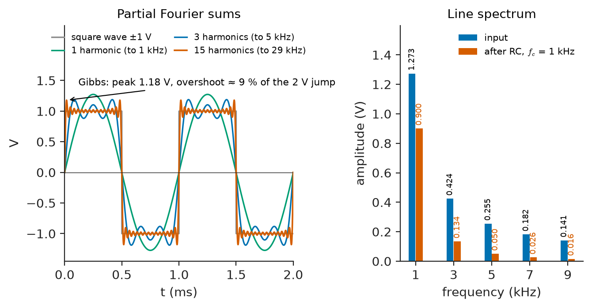
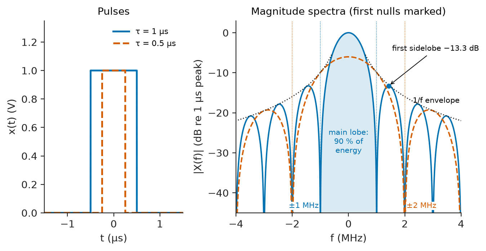
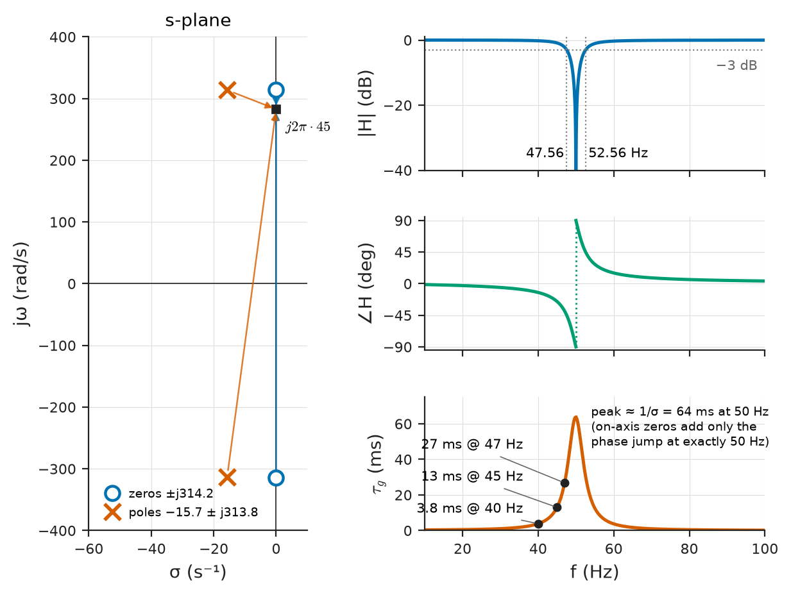
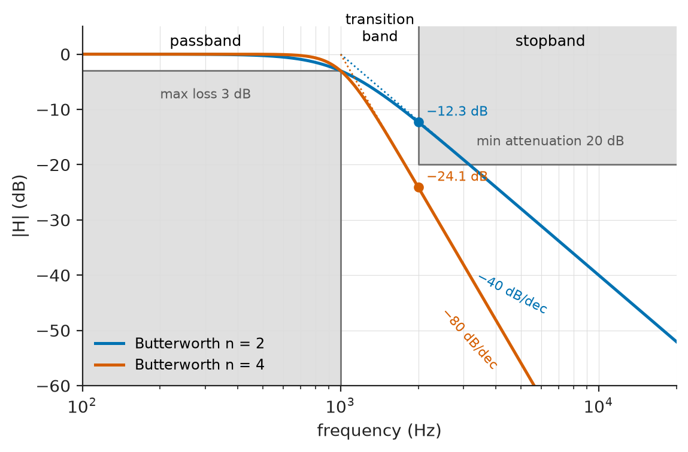
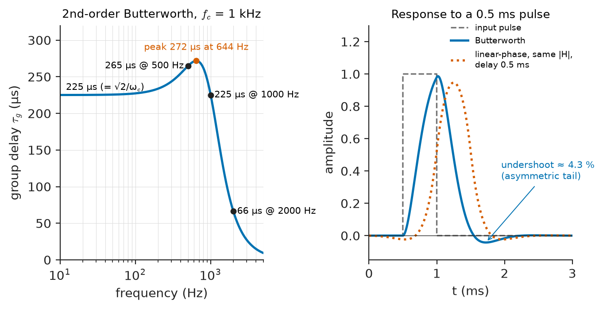
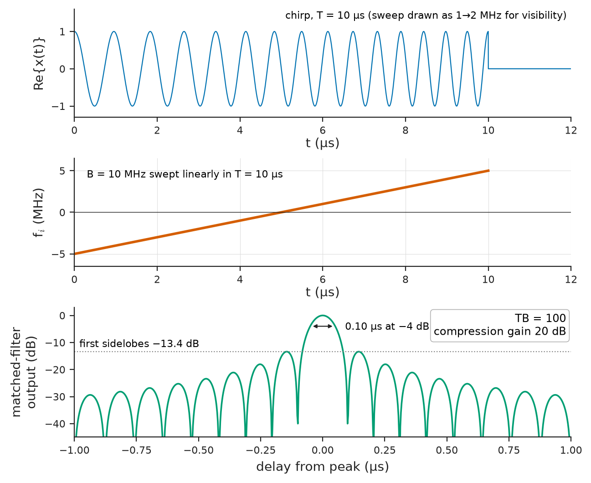

# Chapter 18 — Frequency-Domain System Analysis

*Part IV · Signals and Systems*

A plant engineer at a water-treatment works is chasing two problems at once. The first is in the power system: since variable-speed drives were fitted to the pumps, transformers run hot and a capacitor bank for power-factor correction has failed twice. A power-quality analyser clipped onto the supply shows a current waveform that looks nothing like a sinusoid — two humps per half-cycle — and reports "THD 27 %". The second is in the instrumentation: a new digital filter in the flow-meter chain was supposed to remove 50 Hz pickup, and it does, but now the step response to a valve closing rings for a quarter of a second before settling, and the control loop that uses the measurement has started to hunt. Neither problem can be understood well in the time domain. Both become clear the moment the signals are described as sums of sinusoids and the systems as functions of frequency: the drive current contains 250 Hz and 350 Hz components that the capacitor bank resonates with, and the notch filter delays frequencies near 50 Hz by tens of milliseconds while passing others almost instantly.

Chapter 17 showed that complex exponentials pass through LTI systems unchanged except for a complex factor $H$. This chapter exploits that fact. It writes signals as sums or integrals of complex exponentials — the Fourier series and the Fourier transform — and systems as their frequency responses, then develops the vocabulary engineers use to specify and judge systems in the frequency domain: magnitude and phase, filtering, bandwidth, group delay and distortion, and the reciprocal relationship between duration and bandwidth that limits every pulse, radar and communication link.

> **How can any practical signal be built from sinusoids, and why does that make LTI analysis simple?**
> **What do magnitude, phase, bandwidth and group delay of a system actually do to a signal?**
> **What is distortion, which kinds can be undone, and why can a signal not be both short and narrowband?**

| Concept | Engineering destination |
|---|---|
| Fourier series | Harmonics in power systems, PWM spectra, waveform synthesis, THD measurement |
| Fourier transform | Pulse spectra, radar, spectrum occupancy, EMC |
| Frequency response | Amplifier, filter, sensor and channel specifications |
| Transfer function | Filter design, pole-zero placement, feedback analysis |
| Magnitude and phase | Bode plots, loudspeaker and microphone responses, equalisation |
| Filtering | Anti-aliasing, hum removal, channel selection, noise reduction |
| Bandwidth | Data rate, rise time, noise power, spectrum allocation |
| Group delay | Pulse fidelity, data-channel equalisation, audio crossovers, control-loop delay |
| Distortion | Audio and RF linearity, power quality, intersymbol interference |
| Time–frequency relationships | Radar range resolution, pulse shaping, uncertainty in spectral measurements |

**Roadmap.** Periodic signals as Fourier series (18.1) → aperiodic signals and the Fourier transform (18.2) → the frequency response as the system's gain at each frequency (18.3) → transfer functions, poles and zeros (18.4) → magnitude and phase (18.5) → filtering (18.6) → bandwidth (18.7) → group delay (18.8) → distortion (18.9) → time–frequency relationships (18.10).

---

## 18.1 Fourier-series representation

### Periodic signals as sums of harmonics

A periodic signal with period $T_0$ and fundamental angular frequency $\omega_0=2\pi/T_0$ can be written as a sum of complex exponentials at integer multiples of $\omega_0$:

$$
x(t)=\sum_{k=-\infty}^{\infty}c_k\,e^{jk\omega_0t},\qquad c_k=\frac1{T_0}\int_{T_0}x(t)\,e^{-jk\omega_0t}\,dt
$$

The coefficient $c_k$ is the complex amplitude of the $k$th **harmonic**; $c_0$ is the DC (average) value. For a real signal $c_{-k}=c_k^*$, and the pair $k,-k$ combines into a real sinusoid, giving the equivalent **trigonometric form**

$$
x(t)=c_0+\sum_{k=1}^{\infty}A_k\cos(k\omega_0t+\theta_k),\qquad A_k=2\lvert c_k\rvert,\ \theta_k=\angle c_k
$$

The plot of $A_k$ (or $\lvert c_k\rvert$) against frequency is the signal's **line spectrum**. Power-quality analysers, audio analysers and spectrum analysers display exactly this.

The series converges to $x(t)$ wherever $x$ is continuous, for every signal an engineer will meet: the Dirichlet conditions (absolutely integrable over a period, finitely many maxima, minima and discontinuities per period) are satisfied by any physically generated waveform. At a jump, the series converges to the midpoint, and partial sums overshoot by about 9 % of the jump on either side however many terms are taken — the **Gibbs phenomenon**, visible as ringing on sharply filtered square waves.

> **Status of the principle: Fourier-series representation**
> *Derived.* A theorem of analysis: any periodic signal satisfying the Dirichlet conditions equals the sum of its harmonic series except at discontinuities; physical waveforms always satisfy those conditions.

### Symmetry shortcuts

| Signal symmetry | Consequence for coefficients |
|---|---|
| Even, $x(-t)=x(t)$ | cosine terms only, $c_k$ real |
| Odd, $x(-t)=-x(t)$ | sine terms only, $c_k$ imaginary |
| Half-wave symmetric, $x(t+T_0/2)=-x(t)$ | odd harmonics only |
| Zero average | $c_0=0$ |

Half-wave symmetry matters enormously in power engineering. Any distortion that treats positive and negative half-cycles identically — magnetising current of a transformer, a six-pulse rectifier, fluorescent lamp ballasts — produces only odd harmonics, which is why 150, 250, 350 Hz (on a 50 Hz system) dominate harmonic surveys while even harmonics are usually small.

### Parseval's relation and harmonic distortion

The average power of a periodic signal equals the sum of the powers of its harmonics:

$$
P=\frac1{T_0}\int_{T_0}\lvert x(t)\rvert^2dt=\sum_{k=-\infty}^{\infty}\lvert c_k\rvert^2=c_0^2+\sum_{k=1}^{\infty}\frac{A_k^2}2
$$

This makes it possible to say how much of a signal's power lies in each harmonic, and leads to the **total harmonic distortion**,

$$
\mathrm{THD}=\frac{\sqrt{\sum_{k\ge2}A_k^2}}{A_1}
$$

the RMS of all harmonics relative to the fundamental.

**Worked example — the square wave.** A symmetric square wave of amplitude ±1 V at 1 kHz is odd and half-wave symmetric, so it contains only odd sine harmonics, with amplitudes $A_k=4/(\pi k)$: 1.273 V at 1 kHz, 0.424 V at 3 kHz, 0.255 V at 5 kHz, 0.182 V at 7 kHz, and so on. Its power is 1 W into 1 Ω. The fundamental carries $A_1^2/2=0.811$ W, 81 % of the total; the first three odd harmonics together carry 93 %. By Parseval, the harmonics above the fundamental carry $1-8/\pi^2=0.189$ W, so

$$
\mathrm{THD}=\sqrt{\frac{0.189}{0.811}}=\sqrt{\frac{\pi^2}8-1}=0.483=48.3\ \%
$$

A square wave is the extreme case of a clipped sine. An overdriven guitar amplifier approaches it deliberately; an inverter producing a "modified sine wave" is a stepped approximation whose harmonics can overheat motors and mains transformers.

**Worked example — harmonic current of a drive.** The pump drives of the opening use six-pulse diode rectifiers, whose input current ideally contains harmonics of order $6m\pm1$ (5, 7, 11, 13, ...). Measured magnitudes relative to the fundamental are typical of such drives: 20 % (5th, 250 Hz), 14 % (7th, 350 Hz), 9 % (11th, 550 Hz), 8 % (13th, 650 Hz). The current THD is

$$
\mathrm{THD}_I=\sqrt{0.20^2+0.14^2+0.09^2+0.08^2}=\sqrt{0.0741}=27.2\ \%
$$

which matches the analyser reading. The RMS current is $\sqrt{1+0.0741}=1.036$ times the fundamental, so conductors and transformers carry 3.6 % more current — and, because eddy-current losses grow roughly with the square of frequency, considerably more than 3.6 % extra loss. The capacitor bank, whose impedance falls with frequency, forms a parallel resonance with the supply inductance; if that resonance lies near 250 or 350 Hz, the harmonic currents are magnified, which is how the bank failed. Chapter 9 treats the power-factor side of the same problem.

<!-- FIGURE 18.1 | figures/ch18/fig-18-1-square-wave-series-rc.png | spectrum | A 1 kHz square wave as a sum of odd harmonics, and the same harmonics after an RC low-pass with cut-off 1 kHz. | Content: left panel time domain for 0 to 2 ms: square wave plus or minus 1 V, partial sums with 1, 3 and 15 harmonics showing Gibbs overshoot about 9 percent at the edges. Right panel line spectrum at 1, 3, 5, 7, 9 kHz: input bars 1.273, 0.424, 0.255, 0.182, 0.141 V; output bars after RC with fc = 1 kHz: 0.900, 0.134, 0.050, 0.026, 0.016 V, shown side by side in two colours; vertical axis amplitude 0 to 1.4 V. -->

*Figure 18.1 — A 1 kHz square wave as a sum of odd harmonics, and the same harmonics after an RC low-pass with cut-off 1 kHz.*

### Periodic signals through LTI systems

Because each harmonic is an eigenfunction, a periodic input through an LTI system gives a periodic output with the same period and coefficients

$$
c_k^{(y)}=H(jk\omega_0)\,c_k^{(x)}
$$

**Worked example — rounding a square wave.** The 1 kHz square wave is passed through an RC low-pass filter with cut-off $f_c=1$ kHz, so $H(jk\omega_0)=1/(1+jk)$. The harmonic amplitudes become (Figure 18.1):

| Harmonic $k$ | Input $A_k$ (V) | $\lvert H\rvert$ | $\angle H$ | Output (V) |
|---|---|---|---|---|
| 1 | 1.273 | 0.707 | −45.0° | 0.900 |
| 3 | 0.424 | 0.316 | −71.6° | 0.134 |
| 5 | 0.255 | 0.196 | −78.7° | 0.050 |
| 7 | 0.182 | 0.141 | −81.9° | 0.026 |
| 9 | 0.141 | 0.110 | −83.7° | 0.016 |

The output is dominated by the fundamental; the square wave has become a rounded, nearly triangular-sinusoidal wave. Summing $\lvert c_k^{(y)}\rvert^2$ over all harmonics gives an output power of 0.416 W, of which 0.405 W is in the fundamental. This is how an RC network converts a PWM output from a microcontroller into a smooth analog voltage, and why it needs a cut-off far below the PWM frequency to do so well.

---

## 18.2 Fourier transforms

### From series to transform

An aperiodic signal — a single pulse, a transient, a burst of speech — can be viewed as a periodic signal whose period has grown without limit. The harmonics crowd together and the line spectrum becomes a continuous function, the **Fourier transform**:

$$
X(j\omega)=\int_{-\infty}^{\infty}x(t)\,e^{-j\omega t}\,dt,\qquad x(t)=\frac1{2\pi}\int_{-\infty}^{\infty}X(j\omega)\,e^{j\omega t}\,d\omega
$$

Engineers often prefer ordinary frequency $f$ in hertz, with $X(f)=\int x(t)e^{-j2\pi ft}\,dt$ and $x(t)=\int X(f)e^{j2\pi ft}\,df$; this avoids factors of $2\pi$ and is used for spectra below when convenient. $X$ has units of signal × seconds (V/Hz for a voltage): it is a spectral *density*. Energy is recovered by Parseval's relation for the transform,

$$
E=\int_{-\infty}^{\infty}\lvert x(t)\rvert^2dt=\int_{-\infty}^{\infty}\lvert X(f)\rvert^2df
$$

so $\lvert X(f)\rvert^2$ is the **energy spectral density**, in J/Hz into 1 Ω. Periodic signals are included by allowing impulses in $X$: a sinusoid at $f_0$ has a transform consisting of two impulses at $\pm f_0$.

> **Boundary.** Existence conditions, the inversion theorem and the full catalogue of properties of the Fourier transform are developed in *The Mathematics Universe*. This section collects the results used throughout this book.

### Key pairs and properties

| Signal $x(t)$ | Transform $X(f)$ |
|---|---|
| $\delta(t)$ | $1$ |
| $1$ | $\delta(f)$ |
| $\cos(2\pi f_0t)$ | $\tfrac12[\delta(f-f_0)+\delta(f+f_0)]$ |
| Rectangular pulse, height $A$, width $\tau$, centred at 0 | $A\tau\,\mathrm{sinc}(f\tau)$, with $\mathrm{sinc}\,u=\sin(\pi u)/(\pi u)$ |
| $e^{-t/\tau}u(t)$ | $\tau/(1+j2\pi f\tau)$ |
| Gaussian $e^{-\pi t^2/T^2}$ | $T\,e^{-\pi f^2T^2}$ |
| Ideal low-pass impulse response $2B\,\mathrm{sinc}(2Bt)$ | rectangle of height 1 for $\lvert f\rvert<B$ |

| Property | Time domain | Frequency domain |
|---|---|---|
| Linearity | $ax_1+bx_2$ | $aX_1+bX_2$ |
| Time shift | $x(t-t_0)$ | $e^{-j2\pi ft_0}X(f)$ |
| Frequency shift (modulation) | $x(t)e^{j2\pi f_ct}$ | $X(f-f_c)$ |
| Time scaling | $x(at)$ | $\frac1{\lvert a\rvert}X(f/a)$ |
| Convolution | $x*h$ | $X\,H$ |
| Multiplication | $x\,w$ | $X*W$ |
| Differentiation | $dx/dt$ | $j2\pi f\,X(f)$ |
| Duality | $X(t)$ | $x(-f)$ |

Two rows carry most of the engineering weight. The **convolution property** says that filtering in time is multiplication in frequency — this is why LTI analysis is easy in the frequency domain. The **modulation property** says that multiplying by a carrier slides the spectrum to the carrier frequency — the basis of every radio system (Chapter 26), and the reason a mixer must be time-varying (Chapter 16).

### The rectangular pulse

The pulse of height $A$ and width $\tau$ has the transform $A\tau\,\mathrm{sinc}(f\tau)$, whose main lobe extends to the first nulls at $f=\pm1/\tau$ and whose sidelobes decay only as $1/f$ because of the sharp edges. About 90 % of the pulse energy lies within the main lobe. Shorter pulses have wider spectra: halving $\tau$ doubles the null-to-null bandwidth. This trade-off is formalised in Section 18.10.

<!-- FIGURE 18.2 | figures/ch18/fig-18-2-rect-pulse-sinc.png | plot | Rectangular pulses of 1 us and 0.5 us and their sinc spectra: halving the duration doubles the spectral width. | Content: left panel time domain, pulses of height 1 V, width 1 us (solid) and 0.5 us (dashed) centred at 0, axis -1.5 to 1.5 us. Right panel magnitude spectra in dB normalised to the 1 us peak, frequency -4 to 4 MHz, first nulls marked at plus or minus 1 MHz and plus or minus 2 MHz, sidelobe envelope decaying as 1/f, first sidelobe at -13.3 dB relative to the main lobe. Shaded main lobe annotated 90 percent of energy. -->

*Figure 18.2 — Rectangular pulses of 1 us and 0.5 us and their sinc spectra: halving the duration doubles the spectral width.*

Figure 18.2 shows this for two radar-type pulses. A rectangular switching edge in a power converter or a digital clock produces exactly this slowly decaying sidelobe structure, which is why EMC problems extend to frequencies far above the switching rate; slowing the edges (trapezoidal pulses) makes the spectrum fall as $1/f^2$ above $1/(\pi t_r)$.

---

## 18.3 Frequency response

### Definition and meaning

The **frequency response** of an LTI system is the Fourier transform of its impulse response:

$$
H(j\omega)=\int_{-\infty}^{\infty}h(t)\,e^{-j\omega t}\,dt
$$

It is the eigenvalue of Chapter 17: the complex gain that multiplies a complex exponential at frequency $\omega$. By the convolution property, the output spectrum of any input is

$$
Y(j\omega)=H(j\omega)\,X(j\omega)
$$

so the system acts independently on each frequency, changing its amplitude by $\lvert H\rvert$ and its phase by $\angle H$. The frequency response exists (as an ordinary function) for every BIBO-stable system, since $\lvert H(j\omega)\rvert\le\int\lvert h\rvert\,dt<\infty$.

### Obtaining $H(j\omega)$

There are three practical routes:

1. **From the circuit**, using impedances $j\omega L$ and $1/(j\omega C)$ (Chapter 8). For the RC low-pass, $H=1/(1+j\omega RC)$.
2. **From the differential equation**, replacing each $d/dt$ by $j\omega$ (the differentiation property). For $\sum a_ky^{(k)}=\sum b_kx^{(k)}$,
$$
H(j\omega)=\frac{\sum_kb_k(j\omega)^k}{\sum_ka_k(j\omega)^k}
$$
3. **By measurement**: a swept sine (network analyser, frequency-response analyser), or a broadband excitation — an impulse, a step, a chirp or noise — with $H=Y/X$ computed from the measured spectra (Chapter 22).

| System | Typical frequency-response specification |
|---|---|
| Hi-fi power amplifier | 20 Hz – 20 kHz within ±0.5 dB |
| Measurement microphone | 20 Hz – 20 kHz within ±1 dB, class 1 |
| Diagnostic ECG amplifier | 0.05 – 150 Hz (−3 dB) |
| Telephone voice channel | 300 – 3400 Hz |
| Current transformer for protection | flat at 50/60 Hz; bandwidth a few kHz |
| 100 MHz oscilloscope | −3 dB at 100 MHz |
| Piezoelectric accelerometer | flat within 5 % up to about 1/3 of mounted resonance |

The frequency response is the natural specification for amplifiers, sensors and channels because it answers directly the question a user asks: which frequencies get through, and how altered?

---

## 18.4 Transfer functions

### From $H(s)$ to $H(j\omega)$

The transfer function $H(s)$ of Chapter 17 — the eigenvalue for $e^{st}$, equivalently the Laplace transform of $h$ — is defined for complex $s=\sigma+j\omega$. The frequency response is its value on the imaginary axis:

$$
H(j\omega)=H(s)\big\rvert_{s=j\omega}
$$

valid whenever the imaginary axis lies in the region where $H(s)$ converges, which for a causal system is precisely when the system is stable. For lumped systems $H(s)$ is a ratio of polynomials,

$$
H(s)=K\frac{(s-z_1)(s-z_2)\cdots(s-z_M)}{(s-p_1)(s-p_2)\cdots(s-p_N)}
$$

with zeros $z_i$ and poles $p_i$. Chapter 11 develops $H(s)$ from circuits; Chapter 13 develops Bode plots from it. Here its use is geometric.

### Reading the frequency response from poles and zeros

At $s=j\omega$, each factor $(j\omega-z_i)$ is a vector from the zero $z_i$ to the point $j\omega$ on the imaginary axis, and similarly for poles. Hence

$$
\lvert H(j\omega)\rvert=\lvert K\rvert\frac{\prod\lvert j\omega-z_i\rvert}{\prod\lvert j\omega-p_i\rvert},\qquad \angle H(j\omega)=\angle K+\sum\angle(j\omega-z_i)-\sum\angle(j\omega-p_i)
$$

As $\omega$ moves up the axis, the gain falls where it passes close to a zero (that zero's vector becomes short in the numerator) and rises where it passes close to a pole (that pole's vector becomes short in the denominator). Two rules summarise the geometry:

- A **zero on the imaginary axis** at $\pm j\omega_z$ makes $\lvert H\rvert=0$ at $\omega_z$: a perfect notch.
- A **pole close to the imaginary axis** at $-\sigma\pm j\omega_d$ with small $\sigma$ makes a sharp peak near $\omega_d$: a resonance, whose −3 dB width is about $2\sigma$ rad/s.

**Worked example — a 50 Hz notch filter.** The second-order notch

$$
H(s)=\frac{s^2+\omega_0^2}{s^2+(\omega_0/Q)\,s+\omega_0^2},\qquad \omega_0=2\pi\cdot50\ \mathrm{rad/s},\quad Q=10
$$

has zeros exactly on the axis at $\pm j\omega_0$ and poles at $-\omega_0/(2Q)\pm j\omega_0\sqrt{1-1/(4Q^2)}=-15.7\pm j313.8$ rad/s, just to the left of the zeros. Far from 50 Hz the pole and zero vectors have nearly equal lengths and $\lvert H\rvert\approx1$; at 50 Hz the zero vector vanishes. Evaluating $H(j2\pi f)$:

| $f$ (Hz) | $\lvert H\rvert$ | dB | $\angle H$ |
|---|---|---|---|
| 10 | 0.9998 | −0.002 | −1.2° |
| 45 | 0.904 | −0.88 | −25.3° |
| 47.56 | 0.707 | −3.0 | −45° |
| 49 | 0.375 | −8.5 | −68.0° |
| 50 | 0 | −∞ | jumps from −90° to +90° |
| 52.56 | 0.707 | −3.0 | +45° |
| 60 | 0.965 | −0.31 | +15.3° |
| 100 | 0.998 | −0.02 | +3.8° |

The −3 dB stop band runs from 47.56 to 52.56 Hz, a width of $f_0/Q=5$ Hz. The notch removes mains pickup from an ECG or a strain-gauge signal while leaving most of the spectrum untouched — in magnitude. The phase column shows the cost, examined in Section 18.8.

<!-- FIGURE 18.3 | figures/ch18/fig-18-3-notch-pole-zero-response.png | pole-zero | A 50 Hz notch filter with Q = 10: pole-zero plot and the resulting magnitude, phase and group delay. | Content: left panel s-plane with zeros (circles) at plus or minus j314.2 rad/s on the imaginary axis and poles (crosses) at -15.7 plus or minus j313.8 rad/s, axes real -60 to 10 and imaginary -400 to 400 rad/s, with vectors drawn from the poles and zeros to the point j 2 pi 45. Right panels versus frequency 10 to 100 Hz on a linear axis: magnitude in dB from -40 to +1 with -3 dB points at 47.56 and 52.56 Hz marked; phase from -90 to +90 deg; group delay in ms showing values 3.8 ms at 40 Hz, 13 ms at 45 Hz and 27 ms at 47 Hz. -->

*Figure 18.3 — A 50 Hz notch filter with Q = 10: pole-zero plot and the resulting magnitude, phase and group delay.*

Figure 18.3 shows the pole-zero geometry and the resulting response.

---

## 18.5 Magnitude and phase

### Decibels and logarithmic axes

Magnitude response is usually plotted in decibels, $20\log_{10}\lvert H\rvert$, against frequency on a logarithmic axis — the Bode plot of Chapter 13. The logarithm makes cascaded gains add, makes the slopes of poles and zeros straight lines (−20 dB/decade per pole, +20 dB/decade per zero), and fits the six or more decades of interest in audio, instrumentation and RF onto one page.

| Ratio $\lvert H\rvert$ | dB |
|---|---|
| 10 | +20 |
| 2 | +6.0 |
| $\sqrt2$ | +3.0 |
| 1 | 0 |
| $1/\sqrt2=0.707$ | −3.0 |
| 0.5 | −6.0 |
| 0.1 | −20 |
| 0.001 | −60 |

### What phase does

Magnitude says how much of each frequency survives; phase says how the surviving components line up in time. A constant phase shift is rarely what is wanted. The phase response that preserves waveform shape is a straight line through the origin, $\angle H=-\omega t_0$, which corresponds to a pure delay $t_0$ (time-shift property). Any other phase response shifts different frequencies by different amounts of time. The ear is relatively tolerant of phase changes in steady tones, but transients, pulses, digital data, ECG complexes and control signals are all sensitive to them.

### Magnitude and phase are not independent for causal minimum-phase systems

For a causal, stable system with no zeros in the right half-plane — a **minimum-phase** system — the phase is determined by the magnitude (through the Hilbert-transform relations; Bode's gain-phase relation is the engineering form). Roughly, a magnitude slope of $-20n$ dB/decade, sustained over a wide band, is accompanied by a phase lag of about $n\times90$°. This is why one cannot design a filter with an arbitrarily steep magnitude cut-off and a small phase lag at the same time, and why it is enough to check gain slope near crossover in many feedback designs (Chapter 34). Systems with right-half-plane zeros, or pure delays, have *more* phase lag than their magnitude implies: they are non-minimum-phase.

> **Status of the principle: Gain–phase relation for minimum-phase systems**
> *Derived.* For causal, stable systems with no right-half-plane zeros, the phase response is fixed by the magnitude response through the Hilbert-transform relations; the "$n\times90$° per $-20n$ dB/decade" rule is its approximate form for slopes held over about a decade or more.

### Measuring magnitude and phase

| Instrument | What it measures | Typical range |
|---|---|---|
| Frequency-response analyser | $\lvert H\rvert$, $\angle H$ by swept sine with correlation | about 10 µHz – 30 MHz |
| Audio analyser | gain, phase, THD+N | about 10 Hz – 100 kHz |
| Vector network analyser | S-parameters (magnitude and phase) | kHz to tens or hundreds of GHz |
| Dynamic signal analyser | $H=Y/X$ from FFTs of broadband excitation | DC – about 100 kHz |
| Power-quality analyser | harmonic magnitudes and phase angles | up to the 50th harmonic (2.5 kHz at 50 Hz) |

---

## 18.6 Filtering

### Ideal filters

A filter is a system designed to pass some frequencies and reject others. The ideal versions have $\lvert H\rvert=1$ in the **passband**, $\lvert H\rvert=0$ in the **stopband**, and linear phase throughout:

| Type | Passband | Typical use |
|---|---|---|
| Low-pass | $\lvert f\rvert<f_c$ | anti-aliasing, smoothing, PWM reconstruction |
| High-pass | $\lvert f\rvert>f_c$ | AC coupling, ECG baseline removal, rumble filtering |
| Band-pass | $f_1<\lvert f\rvert<f_2$ | channel selection in radio, vibration bands, EEG rhythms |
| Band-stop (notch) | all except $f_1<\lvert f\rvert<f_2$ | mains hum, interfering carrier |
| All-pass | all frequencies, $\lvert H\rvert=1$ | phase/delay equalisation |

The ideal low-pass filter with cut-off $B$ has impulse response $h(t)=2B\,\mathrm{sinc}(2Bt)$, which extends to $t=-\infty$. It is non-causal (Chapter 17) and cannot be built. Truncating and delaying the sinc gives a realisable approximation with a delay, a transition band and ripple — the window method of FIR design in Chapter 23. Every real filter therefore has a **transition band** between passband and stopband, a **passband ripple**, and a finite **stopband attenuation**.

<!-- FIGURE 18.4 | figures/ch18/fig-18-4-filter-specs-butterworth.png | bode | Filter specification template and second- and fourth-order Butterworth low-pass responses with cut-off 1 kHz. | Content: magnitude in dB from -60 to +5 versus frequency 100 Hz to 20 kHz log axis. Shaded template: passband edge 1 kHz with maximum loss 3 dB, stopband from 2 kHz with minimum attenuation 20 dB. Curves: 2nd-order Butterworth (-12.3 dB at 2 kHz, -40 dB/decade asymptote), 4th-order Butterworth (-24.1 dB at 2 kHz, -80 dB/decade asymptote). Labels passband, transition band, stopband. -->

*Figure 18.4 — Filter specification template and second- and fourth-order Butterworth low-pass responses with cut-off 1 kHz.*

### Approximating the ideal

Practical analog filters are built from standard rational approximations. The **Butterworth** response is maximally flat in the passband:

$$
\lvert H(j\omega)\rvert^2=\frac1{1+(\omega/\omega_c)^{2n}}
$$

for order $n$. At $\omega=\omega_c$ the loss is 3 dB for any $n$; one octave above, at $2\omega_c$, it is $10\log_{10}(1+2^{2n})$: 12.3 dB for $n=2$ and 24.1 dB for $n=4$ (Figure 18.4). The **Chebyshev** response trades passband ripple for a steeper transition; the **elliptic** response adds stopband ripple for the steepest transition of all; the **Bessel** response gives up selectivity for the most nearly linear phase. The choice among them is a choice about what matters more — selectivity, flatness, or waveform fidelity — and is made in Chapter 23 for digital filters and in *Electronics & Computing* for active analog realisations.

> **Status of the principle: Realisable filters cannot be ideal**
> *Derived.* A causal filter cannot have zero gain over a finite band (Paley–Wiener condition) and cannot have a discontinuous magnitude response, so every real filter has a transition band and finite stopband attenuation.

### Filtering examples across EEE

| Application | Filter | Typical numbers |
|---|---|---|
| Audio ADC anti-aliasing | low-pass | passband to 20 kHz, ≥ 80–100 dB rejection above 24 kHz (mostly digital, after oversampling) |
| ECG baseline wander removal | high-pass | 0.05 Hz (diagnostic), 0.5 Hz (monitoring) |
| Mains interference removal | notch | 50 or 60 Hz, $Q$ about 5–30 |
| FM broadcast receiver IF | band-pass | 10.7 MHz centre, about 150–250 kHz wide |
| Protection relay | band-pass around fundamental | rejects DC offset and harmonics |
| Switched-mode power supply output | LC low-pass | corner well below the switching frequency |
| Radar receiver | matched filter | bandwidth ≈ 1/pulse length (Chapter 27) |

---

## 18.7 Bandwidth

"Bandwidth" is used for both signals and systems, and it has several precise definitions. Confusing them is a common source of factors of two.

### Definitions for systems

- **−3 dB (half-power) bandwidth**: the range over which $\lvert H\rvert\ge\lvert H\rvert_{\max}/\sqrt2$. For a low-pass system it is the cut-off frequency; for a band-pass system it is $f_2-f_1$, and $Q=f_0/(f_2-f_1)$.
- **Noise-equivalent bandwidth**: the width of an ideal rectangular filter, with the same peak gain, that passes the same white-noise power,
$$
B_N=\frac1{\lvert H\rvert_{\max}^2}\int_0^\infty\lvert H(f)\rvert^2df
$$
For a single RC pole, $B_N=\frac\pi2f_c$; for higher-order filters it approaches $f_c$. It is the bandwidth that sets the noise power $kTB_N$ in Chapter 29.
- **Passband (ripple) bandwidth**: the range over which the response stays within a stated tolerance (±0.1 dB, ±1 dB). Audio and instrumentation specifications use this.

### Definitions for signals

- **Null-to-null bandwidth**: the width of the main spectral lobe, $2/\tau$ for a rectangular pulse (two-sided) or $1/\tau$ one-sided.
- **Fractional-power bandwidth**: the band containing a stated fraction (99 %) of the power. Spectrum regulators use this as "occupied bandwidth".
- **RMS bandwidth**: the standard deviation of $\lvert X(f)\rvert^2$ treated as a distribution, used in the uncertainty relation (Section 18.10).

### Bandwidth and rise time

A low-pass system cannot follow a fast edge. For a single-pole system with cut-off $f_c$, the 10–90 % rise time of the step response is $2.2\tau=2.2/(2\pi f_c)$:

$$
t_r\approx\frac{0.35}{f_c}
$$

The constant varies slightly with the response shape (about 0.35–0.45 for typical well-damped systems), and the rule is widely used to relate bandwidth to edge speed.

> **Status of the principle: Rise time – bandwidth rule**
> *Approximate.* Exact for a single-pole low-pass ($t_r=0.35/f_c$); within roughly ±25 % for other well-damped low-pass responses; meaningless for strongly resonant systems, whose step response rings.

**Worked example — what an oscilloscope can show.** A 100 MHz oscilloscope with an approximately Gaussian response has its own rise time $t_{r,\mathrm{scope}}\approx0.35/100\ \mathrm{MHz}=3.5$ ns. Cascaded rise times of well-damped systems add approximately in root-sum-square. A logic edge whose true rise time is 5 ns is displayed with

$$
t_{r,\mathrm{displayed}}\approx\sqrt{5^2+3.5^2}=6.1\ \mathrm{ns}
$$

a 22 % error. To keep the error below about 2 %, the instrument must be roughly five times faster than the signal — here a 500 MHz oscilloscope. The same rule sizes the bandwidth of current probes for switching-converter measurements and of the amplifiers in a pulse-oximeter or ultrasound front end.

| Signal or channel | Typical bandwidth |
|---|---|
| ECG (diagnostic) | 0.05 – 150 Hz |
| EEG | about 0.5 – 70 Hz |
| Telephone speech | 300 – 3400 Hz |
| Wideband (HD) voice | 50 – 7000 Hz |
| High-fidelity audio | 20 Hz – 20 kHz |
| AM broadcast channel | 9 kHz (Region 1) or 10 kHz (Americas) |
| FM broadcast channel | about 200 kHz |
| Wi-Fi channel | 20, 40, 80 or 160 MHz |
| 5G NR carrier (below 6 GHz) | up to 100 MHz |

---

## 18.8 Group delay

### Phase delay and group delay

Write the frequency response as $H(j\omega)=\lvert H(j\omega)\rvert e^{j\phi(\omega)}$. Two delays can be defined from the phase:

$$
\tau_p(\omega)=-\frac{\phi(\omega)}{\omega}\qquad\text{(phase delay)},\qquad
\tau_g(\omega)=-\frac{d\phi(\omega)}{d\omega}\qquad\text{(group delay)}
$$

The phase delay is the time shift of a single steady sinusoid. The group delay is the time shift of the **envelope** of a narrowband signal centred on $\omega$ — a modulated carrier, a tone burst, a wave packet. To see why, consider two closely spaced tones at $\omega_1$ and $\omega_2$, whose sum has an envelope at the difference frequency. After the system, the envelope is shifted by $-(\phi_2-\phi_1)/(\omega_2-\omega_1)$, which tends to $-d\phi/d\omega$ as the tones approach each other. Since information is carried by envelopes, group delay is the delay that matters for pulses, data and modulated signals.

> **Status of the principle: Envelope travels at the group delay**
> *Approximate.* Exact for a pair of tones; for a general narrowband signal it holds when the phase is close to linear and the magnitude close to constant across the signal bandwidth — the narrowband assumption.

### Constant group delay means no phase distortion

If $\phi(\omega)=-\omega t_0$ (linear phase), then $\tau_p=\tau_g=t_0$ at all frequencies and every component is delayed equally: the waveform is preserved. If the group delay varies across the band of interest, different frequency components of a pulse arrive at different times and the pulse spreads. This is the frequency-domain description of the dispersion of Chapter 14 (transmission lines) and Chapter 31 (optical fibre).

<!-- FIGURE 18.5 | figures/ch18/fig-18-5-butterworth-group-delay.png | plot | Group delay of a 2nd-order Butterworth low-pass with fc = 1 kHz, and the effect of nonconstant delay on a pulse. | Content: left panel group delay in microseconds versus frequency 10 Hz to 5 kHz log axis: 225 us at low frequency, peak 272 us near 644 Hz, 225 us at 1 kHz, 66 us at 2 kHz. Right panel time response 0 to 3 ms to a 0.5 ms rectangular pulse: input (dashed), output of the Butterworth filter showing delay and a small undershoot after the pulse, output of a linear-phase FIR with the same magnitude delayed by 0.5 ms (dotted) showing symmetric ringing. -->

*Figure 18.5 — Group delay of a 2nd-order Butterworth low-pass with fc = 1 kHz, and the effect of nonconstant delay on a pulse.*

**Worked example — group delay of a Butterworth filter.** A second-order Butterworth low-pass with $f_c=1$ kHz has $H(s)=\omega_c^2/(s^2+\sqrt2\,\omega_cs+\omega_c^2)$, $\omega_c=6283$ rad/s. At low frequency the group delay is $\sqrt2/\omega_c=225$ µs. Computing $-d\phi/d\omega$ numerically: 265 µs at 500 Hz, a peak of 272 µs near 644 Hz, 225 µs at 1 kHz, and 66 µs at 2 kHz (Figure 18.5). The delay varies by about 21 % across the passband, peaking just below cut-off. A pulse whose spectrum spans the passband therefore emerges slightly asymmetric, with a small undershoot after it (about 4 %); the same phase distortion gives the step response its 4.3 % overshoot. For an audio crossover these differences of tens of microseconds are inaudible; for a 10 kbit/s data signal filtered by the same circuit, they distort the bit shapes and create intersymbol interference. The Bessel filter, designed for maximally flat group delay, reduces this variation at the cost of a gentler cut-off.

**Worked example — the notch filter's hidden delay.** The 50 Hz notch of Section 18.4 has group delay 3.8 ms at 40 Hz, 13 ms at 45 Hz and 27 ms at 47 Hz, compared with almost zero far from the notch. Components of a step or of an ECG complex lying near 50 Hz are delayed by tens of milliseconds relative to the rest; after a sharp transient they emerge late, as a decaying 50 Hz ringing of duration about $Q/(\pi f_0)\approx64$ ms per time constant. This explains the flow-meter ringing in the opening: a notch is a sharp resonance in reverse, and sharpness in frequency always costs duration in time (Section 18.10). Lowering $Q$ shortens the ringing but widens the notch; replacing the notch by a moving average over exactly one mains cycle (Chapter 16) trades the ringing for a fixed 10 ms delay and broader smoothing.

### Group delay in practice

| System | Typical group delay or its variation |
|---|---|
| Coaxial cable, velocity factor 0.66 | 5.05 ns/m, constant (linear phase) |
| Linear-phase FIR filter of $N$ taps | $(N-1)/2$ samples, constant |
| Second-order Butterworth, $f_c=1$ kHz | 225 µs at DC, 272 µs peak |
| Narrow band-pass or notch, $Q=10$ at 50 Hz | tens of ms near the centre |
| Decimation filter of a delta-sigma audio ADC at 48 kHz | typically about 0.2–1 ms, linear phase |

---

## 18.9 Distortion

### Distortionless transmission

A system is **distortionless** if the output is a scaled, delayed copy of the input,

$$
y(t)=K\,x(t-t_0)\quad\Longleftrightarrow\quad H(j\omega)=K\,e^{-j\omega t_0}
$$

over the band occupied by the signal: constant magnitude and linear phase. Any departure is **distortion**. It is useful to separate two kinds, because their causes, signatures and cures differ completely.

> **Status of the principle: Condition for distortionless transmission**
> *Derived.* From the time-shift property of the Fourier transform: constant gain and linear phase across the signal's band are necessary and sufficient for the output to be a scaled, delayed replica.

### Linear distortion

**Linear distortion** arises in an LTI system that is not distortionless. It changes the relative amplitudes and timings of frequency components that are already present, but creates no new ones.

- **Amplitude (attenuation) distortion**: $\lvert H\rvert$ not constant across the band. The rounded square wave of Section 18.1, the muffled sound of a telephone channel, the loss of high-frequency detail through a long cable.
- **Phase (delay) distortion**: group delay not constant. The asymmetric pulse of Section 18.8, the ringing of the notch filter, the dispersion of a data pulse on a long line.

Because it is linear, this kind of distortion can in principle be undone by an inverse system, an **equaliser**, with response $1/H$ over the band (subject to the stability and noise limits of Chapter 17). Modems, DSL, optical receivers and loudspeaker processors all equalise. Offline, phase distortion can also be removed completely by forward–backward (zero-phase) filtering, a non-causal operation (Chapter 16).

### Nonlinear distortion

**Nonlinear distortion** arises from a nonlinear system. It creates new frequencies (Chapter 16): **harmonics** $kf$ of each input tone and **intermodulation products** $mf_1\pm nf_2$ of pairs of tones. With a cubic term $a_3x^3$, two tones at $f_1$ and $f_2$ produce third-order products at $2f_1-f_2$ and $2f_2-f_1$, which lie close to the original tones and cannot be filtered out — the reason radio receivers specify a third-order intercept point (Chapter 32) and why intermodulation between adjacent carriers is a major constraint in cellular base stations.

Nonlinear distortion cannot be removed by an LTI equaliser. Its cures are to stay in the linear region (back off the signal level), linearise the device with feedback (Chapter 17) or predistortion, or accept and filter harmonics that fall outside the band of interest.

| Measure | Definition | Typical values |
|---|---|---|
| THD | RMS of harmonics / fundamental | 0.001–0.05 % good audio amplifier; IEEE 519 voltage limit 5–8 % on power systems |
| THD+N | RMS of everything except the fundamental / total | audio analyser standard |
| IMD | intermodulation products relative to tones | SMPTE and CCIF audio tests; −30 to −50 dBc in RF power amplifiers |
| Third-order intercept (IP3) | extrapolated input or output level where third-order products equal fundamentals | about +10 to +40 dBm for RF amplifiers |
| Adjacent-channel leakage ratio | power leaking into the next channel | about −45 dBc required in LTE |

### Telling them apart

A simple experiment distinguishes the two kinds. Apply a single pure tone and examine the output spectrum. If new frequencies appear, the distortion is nonlinear. If only the input frequency appears but its amplitude or phase depends on frequency, the distortion is linear. Applying the tone at two different amplitudes gives a second check: linear distortion is independent of level; nonlinear distortion grows with it.

**Worked example — identifying distortion on a telemetry link.** A pulse-code telemetry signal from a wind-turbine sensor is received with rounded, smeared bits. A test with a single 2 kHz tone at the transmitter shows at the receiver only 2 kHz, 6 dB down, with a 30° phase lag; at 500 Hz the loss is 0.5 dB and the lag 8°. No harmonics appear above −60 dBc. The distortion is therefore linear — amplitude and phase distortion from the cable and line filters — and an equaliser with about +5.5 dB of gain lift at 2 kHz relative to 500 Hz, together with phase correction, can restore the pulse shape. Had a 4 kHz harmonic appeared at −20 dBc, the cure would instead have been to reduce the drive level or replace a saturating line driver.

---

## 18.10 Time–frequency relationships

### Scaling: short in time means wide in frequency

The scaling property $x(at)\leftrightarrow\frac1{\lvert a\rvert}X(f/a)$ says that compressing a signal in time by a factor $a$ stretches its spectrum by the same factor. Playing a tape at double speed doubles every frequency; a pulse half as long needs twice the bandwidth. For any pulse shape, the product of a suitably defined duration $\Delta t$ and bandwidth $\Delta f$ is fixed by the shape, not the scale.

### The uncertainty relation

With duration and bandwidth defined as RMS widths of $\lvert x(t)\rvert^2$ and $\lvert X(f)\rvert^2$,

$$
\Delta t\,\Delta f\ \ge\ \frac1{4\pi}
$$

with equality only for the Gaussian pulse. No signal can be arbitrarily concentrated in both time and frequency. Practical consequences appear everywhere:

- A spectrum analyser that must resolve two tones 1 Hz apart must observe for at least about 1 s (Chapter 22).
- A narrow filter (small bandwidth) has a long impulse response and rings: the 5 Hz-wide notch of Section 18.4 rings for tens of milliseconds.
- A short-time spectrum of speech or vibration must trade time resolution against frequency resolution (the spectrogram, Chapter 24).
- A data symbol of duration $T_s$ needs a bandwidth of order $1/T_s$: doubling the symbol rate doubles the bandwidth (Chapter 27).

> **Status of the principle: Time–bandwidth uncertainty**
> *Derived.* A mathematical theorem about Fourier pairs (the Gabor limit), valid for any signal whatever its physical origin; the constant depends on how duration and bandwidth are defined.

<!-- FIGURE 18.6 | figures/ch18/fig-18-6-chirp-pulse-compression.png | plot | A linear-FM chirp lasts 10 us yet occupies 10 MHz; matched filtering compresses it to a peak about 0.1 us wide. | Content: top panel real part of a chirp pulse of duration 10 us sweeping 10 MHz (shown at reduced frequency for visibility), time 0 to 12 us. Middle panel its time-frequency trajectory, instantaneous frequency rising linearly from -5 MHz to +5 MHz over 10 us. Bottom panel normalised matched-filter output magnitude in dB versus time -1 to 1 us around the peak, main lobe width about 0.1 us between -4 dB points, first sidelobes near -13 dB, annotation TB = 100, compression gain 20 dB. -->

*Figure 18.6 — A linear-FM chirp lasts 10 us yet occupies 10 MHz; matched filtering compresses it to a peak about 0.1 us wide.*

**Worked example — radar range resolution and pulse compression.** A radar distinguishes two targets in range only if their echoes do not overlap. A simple rectangular pulse of duration $\tau$ gives range resolution $\Delta R=c\tau/2$: for $\tau=1$ µs, $\Delta R=3\times10^8\times10^{-6}/2=150$ m. Shortening the pulse improves resolution but reduces the energy on target for a given peak transmitter power, and with it the detection range. The time–frequency view breaks the deadlock. Resolution actually depends on bandwidth, $\Delta R\approx c/(2B)$, not on duration as such; a simple pulse merely ties the two together through $B\approx1/\tau$. A **chirp** — a pulse of duration $T=10$ µs whose frequency sweeps linearly over $B=10$ MHz — has the energy of a 10 µs pulse and the bandwidth of a 0.1 µs pulse. After a matched filter (Chapter 27), its echo is compressed to a peak about $1/B=0.1$ µs wide, giving $\Delta R=c/(2B)=15$ m. The time–bandwidth product $TB=100$ is the compression ratio, a 20 dB gain in peak signal-to-noise ratio over an uncompressed pulse of the same peak power and resolution (Figure 18.6). Medical ultrasound, sonar and some automotive radars use the same principle.

### Time–frequency relationships in system terms

The same reciprocity applies to systems. A system with bandwidth $B$ has an impulse response of duration of order $1/B$, a rise time of about $0.35/B$, and — if it is selective, with a narrow band-pass of width $\Delta f$ — a build-up and decay time of order $1/(\pi\Delta f)$. The table collects these links:

| Frequency-domain feature | Time-domain consequence |
|---|---|
| Wide bandwidth $B$ | fast rise time, $t_r\approx0.35/B$ |
| Narrow resonance, bandwidth $\Delta f$ | long ringing, decay time constant $\approx1/(\pi\Delta f)$ |
| Sharp cut-off (steep transition) | long, oscillating impulse response; Gibbs ringing |
| Linear phase | symmetric impulse response, constant delay |
| Nonconstant group delay | dispersion, asymmetric pulse distortion |
| Smooth spectrum (no sharp features) | short, compact pulse |
| Discontinuity in time (sharp edge) | spectrum decaying as $1/f$ |

These are the relationships an engineer uses to estimate, in seconds, what a frequency-domain specification will do to a waveform — and to spot specifications that cannot both be met, such as a filter required to have a very steep cut-off and also to settle within a few cycles.

---

## What remains open

| Open question | Where it is answered |
|---|---|
| What happens to a signal's spectrum when it is sampled, and how is the original recovered? | Chapter 19 (sampling and reconstruction) |
| What is the discrete-time frequency response, and how does the z-transform relate to it? | Chapter 20 |
| How are spectra computed from finite records of data, and what are leakage and windowing? | Chapter 22 (DFT) |
| How are FIR and IIR filters designed to meet passband, stopband and phase specifications? | Chapter 23 |
| How are time and frequency resolved jointly for non-stationary signals? | Chapter 24 (time-frequency analysis, wavelets) |
| How is bandwidth traded against data rate and noise in communication links? | Chapters 25, 27 and 28 |
| How is noise bandwidth used to compute noise power and SNR? | Chapter 29 |
| How do dispersion in cables and fibres arise physically? | Chapter 14 (transmission lines), Chapter 31 (optical fibre) |
| How do magnitude and phase of a loop gain decide closed-loop stability? | Chapter 34 (Bode and Nyquist methods) |
| How are Bode plots built from poles and zeros in detail? | Chapter 13 |

**Next:** Chapter 19 applies the frequency-domain view to the bridge between continuous and discrete signals, showing when a sampled signal determines the original exactly and what goes wrong when it does not.
