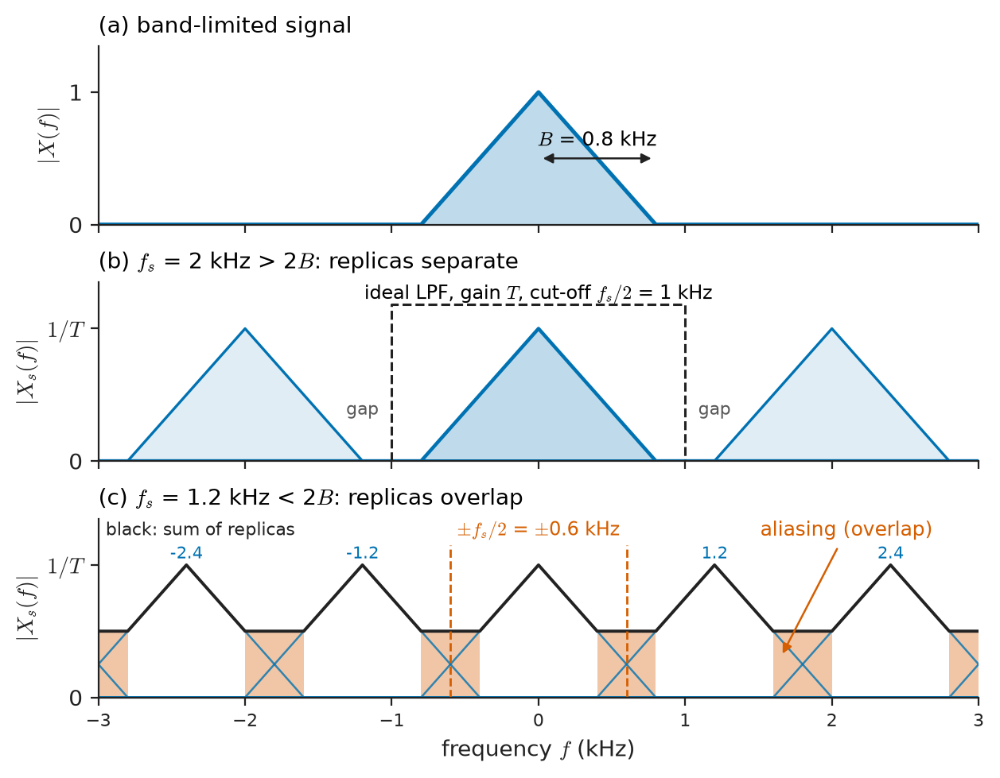
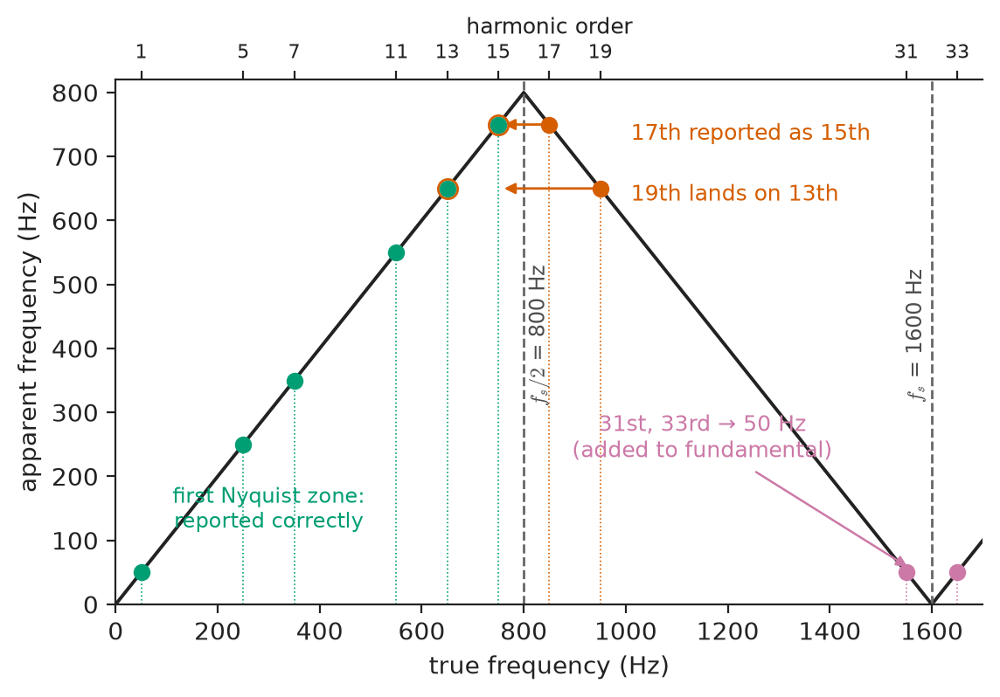
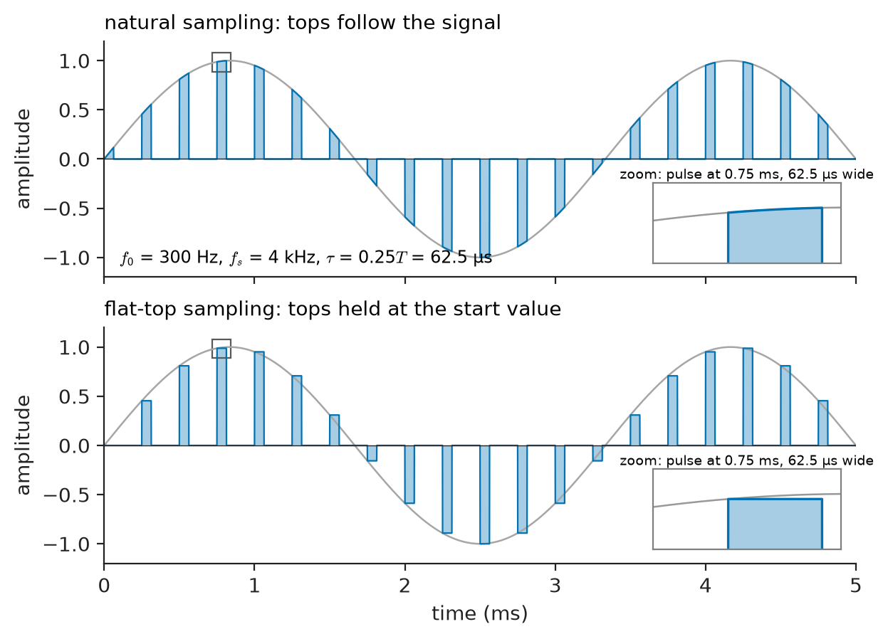
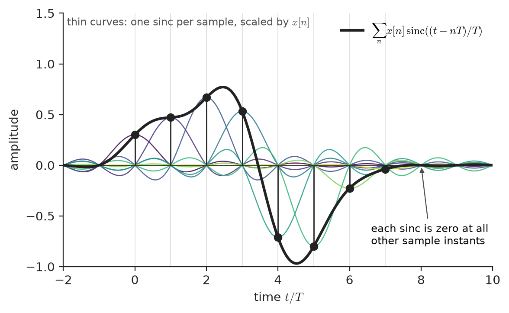
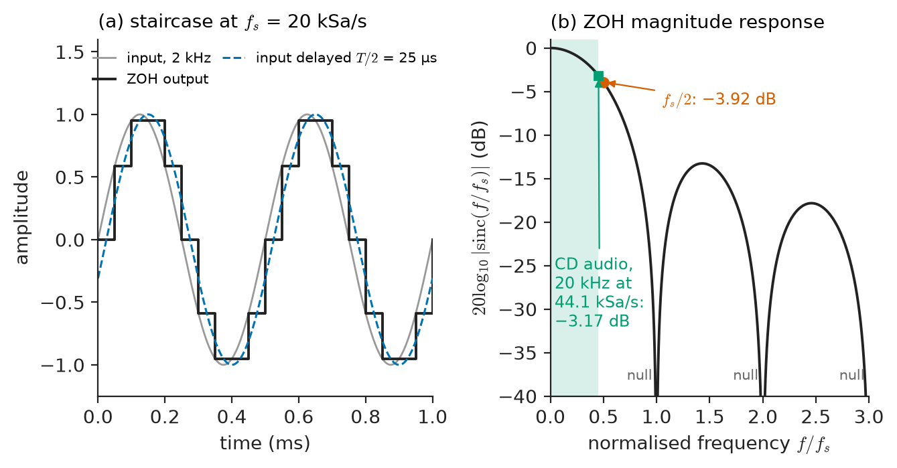
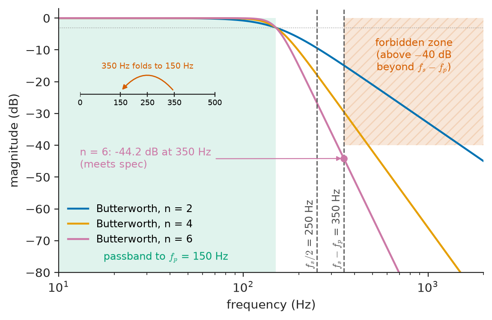

# Chapter 19 — Sampling and Reconstruction

*Part IV · Signals and Systems*

A power-quality analyser is clipped onto the feeder of a factory that runs large six-pulse variable-speed drives. The instrument samples each voltage and current channel 32 times per 50 Hz cycle, 1600 samples per second, and reports a harmonic spectrum. The report shows a strong 15th harmonic at 750 Hz, and the plant engineer orders a tuned filter for it. The filter is installed, resonates, and does nothing useful, because there was very little 15th harmonic on the feeder. What the drives actually produced was a large 17th harmonic at 850 Hz, and the analyser, with no analogue filter worth the name in front of its converter, had folded 850 Hz down onto 750 Hz. Every sample the instrument took was correct; the conclusion drawn from them was wrong. The same thing happens when a cheap audio interface turns an ultrasonic bat call into an audible chirp, when a 500 Hz ECG recorder shows a slow ghost wave that is really interference from a switching supply, and when a spinning fan in a video appears to stand still.

This chapter is about the bridge between the continuous-time world of Chapters 15–18 and the discrete-time world of Chapter 20 and Part V. Sampling replaces a function of time by a list of numbers; reconstruction turns a list of numbers back into a voltage. The question is when that round trip loses nothing, what it costs when it does, and how real hardware — finite-width sampling pulses, jittery clocks, staircase outputs, finite word lengths and imperfect filters — differs from the ideal.

> **When does a sequence of samples contain everything there is to know about a continuous-time signal, and how can the signal be rebuilt from it?**
> **What happens to frequencies the sampler cannot represent, and how do real samplers, hold circuits and filters change the ideal answer?**

| Concept | Engineering destination |
|---|---|
| Ideal (impulse) sampling | The mathematical model behind every ADC, digital scope and sampled-value relay |
| Sampling theorem | Choosing sample rates for audio, biomedical, power and radio systems |
| Nyquist frequency and Nyquist rate | Datasheet sample rates, oscilloscope bandwidth-to-sample-rate ratios |
| Aliasing | Harmonic-analyser errors, stroboscopic effects, bandpass (IF) sampling in radios |
| Practical sampling (finite aperture, jitter) | Track-and-hold design limits, SNR of high-frequency ADCs |
| Reconstruction | DAC outputs, audio playback, arbitrary waveform generators |
| Sample-and-hold behaviour | Sinc droop in DACs, delay in digital control loops |
| Quantization interface | ADC word length, dynamic range of digitised measurements |
| Anti-aliasing filters | Front ends of data-acquisition systems, ECG and audio converters |

**Roadmap.** Sampling as multiplication by an impulse train (19.1) → the spectrum of a sampled signal and the sampling theorem (19.2) → Nyquist frequency and Nyquist rate (19.3) → aliasing, including its deliberate use (19.4) → practical sampling with finite pulses, apertures and jitter (19.5) → ideal and practical reconstruction (19.6) → sample-and-hold behaviour (19.7) → the quantization interface to Chapter 21 (19.8) → anti-aliasing filters (19.9).

---

## 19.1 Ideal sampling

### Sampling as a model

A sampler looks at a continuous-time signal $x(t)$ at regularly spaced instants $t=nT$ and records the values

$$
x[n]=x(nT),\qquad n\in\mathbb{Z}
$$

where $T$ is the **sampling interval** and $f_s=1/T$ the **sampling rate** (samples per second, quoted in Sa/s or simply Hz). The square brackets mark a discrete-time sequence, as in Chapter 15. The angular sampling frequency is $\omega_s=2\pi f_s$.

The sequence $x[n]$ is a list of numbers, not a function of continuous time, and that makes it awkward to compare with $x(t)$ in the frequency domain. The standard device is to represent the sampled signal as a continuous-time signal that carries the sample values as the areas of impulses:

$$
x_s(t)=x(t)\sum_{n=-\infty}^{\infty}\delta(t-nT)=\sum_{n=-\infty}^{\infty}x(nT)\,\delta(t-nT)
$$

The second form uses the sifting property of the impulse (Chapter 15): multiplying a continuous function by $\delta(t-nT)$ keeps only its value at $nT$. The impulse train

$$
p(t)=\sum_{n=-\infty}^{\infty}\delta(t-nT)
$$

is called the **sampling function** or Dirac comb. Ideal sampling is therefore modulation: the signal multiplies a periodic carrier made of impulses.

No physical circuit produces impulses. A real sampler closes a switch for a short but finite time, or a track-and-hold amplifier follows the input and then freezes it. Ideal sampling is the limiting model in which the switch closes for an infinitesimal time; Section 19.5 restores the finite width. The model is used because it keeps the information content of the samples exactly and lets the Fourier transform of Chapter 18 do the rest.

### Why the impulse model gives the right answer

One might worry that $x_s(t)$ is a mathematical fiction — infinite spikes no instrument could produce. What makes it legitimate is that its Fourier transform depends only on the numbers $x(nT)$:

$$
X_s(f)=\int_{-\infty}^{\infty}x_s(t)\,e^{-j2\pi ft}\,dt=\sum_{n=-\infty}^{\infty}x[n]\,e^{-j2\pi fnT}
$$

The right-hand side is precisely the discrete-time Fourier transform of the sequence $x[n]$ evaluated at the digital frequency $\Omega=2\pi fT$ (Chapter 20 and Chapter 22). The impulse-train representation is therefore not an extra physical assumption; it is a bookkeeping device that lets the spectrum of a sequence be drawn on the same frequency axis, in hertz, as the spectrum of the original analogue signal.

> **Status of the principle: Impulse-train model of sampling**
> *Derived.* An exact mathematical representation of the sample values; it describes a physical sampler only in the limit of vanishing aperture time and zero clock jitter, which Section 19.5 relaxes.

---

## 19.2 The spectrum of a sampled signal and the sampling theorem

### Periodic replication

The comb $p(t)$ is periodic with period $T$, so it has a Fourier series. All its coefficients are equal to $1/T$ (Chapter 18):

$$
p(t)=\frac{1}{T}\sum_{k=-\infty}^{\infty}e^{j2\pi kf_st}
\qquad\Longleftrightarrow\qquad
P(f)=\frac{1}{T}\sum_{k=-\infty}^{\infty}\delta(f-kf_s)
$$

A comb in time is a comb in frequency, with spacing $f_s$. Multiplication in time becomes convolution in frequency, and convolving $X(f)$ with a shifted impulse simply shifts it, so

$$
X_s(f)=X(f)*P(f)=\frac{1}{T}\sum_{k=-\infty}^{\infty}X(f-kf_s)
$$

This one line is the whole theory of sampling. The spectrum of the sampled signal is the original spectrum, scaled by $1/T$, plus copies of it centred on every multiple of the sampling rate: $\pm f_s$, $\pm 2f_s$, and so on. These copies are called **images** or **spectral replicas**. The sampled spectrum is periodic in $f$ with period $f_s$, which is the frequency-domain statement that sampled data cannot distinguish $f$ from $f+f_s$.

<!-- FIGURE 19.1 | figures/ch19/fig-19-1-sampled-spectrum-replicas.png | spectrum | Spectrum of a band-limited signal before and after ideal sampling, for adequate and inadequate sampling rates. | Content: three stacked panels with common frequency axis from -3 to 3 kHz. Top: triangular baseband spectrum X(f) occupying -0.8 to 0.8 kHz, peak 1, labelled B = 0.8 kHz. Middle: sampled spectrum for fs = 2 kHz, triangles of peak 1/T centred at 0, plus and minus 2 kHz, gaps between them, dashed ideal reconstruction low-pass from -1 to 1 kHz labelled fs/2. Bottom: fs = 1.2 kHz, replicas centred at 0, plus and minus 1.2 kHz and plus and minus 2.4 kHz overlapping, overlap regions shaded red and labelled aliasing, vertical line at fs/2 = 0.6 kHz. -->

*Figure 19.1 — Spectrum of a band-limited signal before and after ideal sampling, for adequate and inadequate sampling rates.*

### Band-limited signals and the condition for no overlap

Suppose $x(t)$ is **band-limited** to $B$ hertz: $X(f)=0$ for $\lvert f\rvert\ge B$. The baseband copy of $X_s(f)$ then occupies $-B<f<B$, the first replica occupies $f_s-B<f<f_s+B$, and the two do not overlap if

$$
f_s-B\ge B\qquad\Longleftrightarrow\qquad f_s\ge 2B
$$

with strict inequality needed in the general case for reasons shown in Section 19.3. When the copies do not overlap (Figure 19.1, middle), an ideal low-pass filter with cut-off anywhere between $B$ and $f_s-B$ and gain $T$ extracts the baseband copy exactly and returns $X(f)$. When they overlap (Figure 19.1, bottom), the tail of one replica is added to the baseband copy, and no filter can separate them afterwards: the sum is all that the samples know.

### The sampling theorem

> **Sampling theorem.** If $x(t)$ has no spectral content at or above $B$ hertz and is sampled at $f_s>2B$, then $x(t)$ is uniquely determined by its samples and can be recovered exactly by
> $$
> x(t)=\sum_{n=-\infty}^{\infty}x[n]\,\operatorname{sinc}\!\left(\frac{t-nT}{T}\right),\qquad \operatorname{sinc}(u)=\frac{\sin \pi u}{\pi u}
> $$

The interpolation formula follows from the filtering picture. The ideal reconstruction filter with gain $T$ and cut-off $f_s/2$ has impulse response $h_r(t)=\operatorname{sinc}(t/T)$; passing $x_s(t)$ through it replaces each impulse $x[n]\,\delta(t-nT)$ by a sinc pulse $x[n]\operatorname{sinc}((t-nT)/T)$. Each sinc equals 1 at its own sampling instant and 0 at every other one, so the sum passes exactly through all the samples and, between them, fills in the one band-limited curve consistent with them.

The theorem is associated with Whittaker (1915), Kotelnikov (1933), Nyquist (whose 1928 telegraph analysis gave the $2B$ pulse rate) and Shannon (1949), who stated it in its communication-theory form. It is the reason a CD can store an orchestra as 44 100 numbers per second per channel, and the reason a protection relay can compute the impedance of a transmission line from a few dozen samples per cycle.

> **Status of the principle: Sampling theorem**
> *Derived.* A mathematical consequence of the Fourier transform and the periodic replication of the sampled spectrum; exact for strictly band-limited signals with uniform, jitter-free sampling and an ideal (non-causal, infinitely long) reconstruction filter.

### What the theorem does not say

Three limits matter in practice and recur through the chapter.

1. **No real signal is strictly band-limited.** A signal that lasts a finite time has a spectrum that extends to infinite frequency (Chapter 18, time–frequency relationships). Every real signal therefore aliases a little. The engineering version of the theorem is "if the energy above $f_s/2$ is small enough, the aliasing error is small enough", and the anti-aliasing filter of Section 19.9 is what makes it small enough.
2. **The reconstruction filter is non-causal.** The sinc pulse extends to $t=-\infty$; it responds before its input arrives. Real reconstruction truncates, windows or approximates it, at a cost of delay and accuracy (Section 19.6).
3. **Uniformity is assumed.** If the sampling instants wander (jitter), or samples are missing, the replicas acquire noise and the formula no longer recovers $x(t)$ exactly (Section 19.5).

The theorem is also not the only sufficient condition. A signal confined to a band $f_L<\lvert f\rvert<f_H$ can be sampled at a rate tied to its bandwidth $f_H-f_L$ rather than to $f_H$ (Section 19.4), and signals with other kinds of structure (sparse spectra, finite rate of innovation) can be recovered from fewer samples with nonlinear methods. Those extensions use the same replication picture.

---

## 19.3 Nyquist frequency and Nyquist rate

### Two names for two different things

The literature uses two closely related terms, and confusing them causes real specification errors.

- The **Nyquist frequency** is a property of the *sampler*: $f_N=f_s/2$. It is the highest frequency that a sampled system can represent unambiguously. The band $0\le f\le f_s/2$ is called the first Nyquist zone; $f_s/2\le f\le f_s$ is the second zone, and so on.
- The **Nyquist rate** is a property of the *signal*: $2B$, twice its highest frequency. It is the minimum sampling rate the theorem allows for that signal.

A system is correctly sampled if its Nyquist frequency exceeds the signal's highest frequency, or equivalently if its sampling rate exceeds the signal's Nyquist rate. In the digital domain the Nyquist frequency corresponds to the digital frequency $\Omega=\pi$ rad/sample, or normalised frequency 0.5 cycles/sample, and it is the right-hand edge of every frequency-response plot in Chapters 20–23.

### Why the inequality is strict

Consider a sinusoid exactly at the Nyquist frequency, $x(t)=A\sin(2\pi f_0t+\phi)$ with $f_s=2f_0$. Its samples are

$$
x[n]=A\sin(\pi n+\phi)=A(-1)^n\sin\phi
$$

The samples depend on $A\sin\phi$ only. A sine with $\phi=0$ produces all zeros; a cosine produces $\pm A$; any phase in between produces $\pm A\sin\phi$, which is indistinguishable from a cosine of smaller amplitude. Amplitude and phase cannot be separated, so a component at exactly $f_s/2$ is not recoverable. For signals with continuous spectra this single frequency carries no energy and the distinction is academic, but for line spectra — mains harmonics, a test tone, a clock spur — it matters: a sampler must be strictly faster than twice the highest line, and in practice comfortably faster.

### Representative sampling rates

Table 19.1 shows how the theorem is used across EEE. The ratio $f_s/(2B)$ — the margin over the Nyquist rate — is set by how difficult the anti-aliasing filter is allowed to be and by what the processing needs; it is rarely below 1.1.

**Table 19.1 — Representative sampling rates (typical values).**

| Application | Signal bandwidth $B$ | Sampling rate $f_s$ | $f_s/(2B)$ |
|---|---|---|---|
| Seismic monitoring (broadband station) | up to ~40 Hz | 100 Sa/s | ~1.25 |
| Diagnostic ECG | 0.05–150 Hz | 500–1000 Sa/s | 1.7–3.3 |
| Clinical EEG | up to ~70–100 Hz | 256–1000 Sa/s | 1.3–7 |
| Narrowband telephone speech | 300–3400 Hz | 8 kSa/s | 1.18 |
| Wideband (HD) speech | 50–7000 Hz | 16 kSa/s | 1.14 |
| CD audio | 20 Hz–20 kHz | 44.1 kSa/s | 1.10 |
| Professional audio and video sound | 20 kHz (or more) | 48, 96, 192 kSa/s | 1.2–4.8 |
| Protection relay (50 Hz system) | up to ~1 kHz after filtering | 1–4 kSa/s (20–80 samples/cycle) | — |
| Sampled values, metering class (IEC 61850-9-2 LE, 50 Hz) | up to ~5 kHz harmonics | 12.8 kSa/s (256 samples/cycle) | ~1.3 |
| Machine-vibration analysis | up to 10 kHz | 25.6 kSa/s | 1.28 |
| LTE baseband, 20 MHz channel | ±9 MHz complex | 30.72 MSa/s | ~1.7 |
| Digital oscilloscope, 1 GHz bandwidth | 1 GHz | 2.5–10 GSa/s | 1.25–5 |

The CD figure is a historical compromise. 44.1 kHz was chosen so that audio could be recorded on modified video tape recorders (three samples per video line: 245 usable lines per field at 60 fields/s, or 294 at 50 fields/s, both give 44 100), and it leaves only a 2.05 kHz transition band between the top of the audio band and the Nyquist frequency — the reason early CD players needed brutally sharp analogue filters (Section 19.9).

---

## 19.4 Aliasing

### Folding

When a component at frequency $f_0$ lies above the Nyquist frequency, its samples are identical to those of a component at a lower frequency. For a cosine,

$$
\cos\!\left(2\pi f_0 nT\right)=\cos\!\left(2\pi (f_0-kf_s)nT\right)
$$

for any integer $k$, because the difference in phase per sample is $2\pi k$. Since $\cos$ is even, $f_0-kf_s$ and its negative are also indistinguishable. The frequency the sampled data appear to contain, the **alias frequency**, is therefore

$$
f_a=\left\lvert f_0-k f_s\right\rvert,\qquad k=\operatorname{round}\!\left(\frac{f_0}{f_s}\right)
$$

which always lies in the first Nyquist zone, $0\le f_a\le f_s/2$. Geometrically, the frequency axis is folded like a paper fan at $f_s/2$, $f_s$, $3f_s/2$, …, and every frequency lands on the first zone. Components in odd zones land with their spectrum upright; components in even zones land mirrored (spectrally inverted), because they come from a negative-frequency image. The Nyquist frequency is sometimes called the **folding frequency** for this reason.

Aliasing is not distortion in the usual sense. The aliased component keeps its amplitude; it simply appears at the wrong frequency, and with sampled data alone there is no way to tell that it is wrong. A tone at 1 kHz, a tone at 7 kHz and a tone at 9 kHz sampled at 8 kSa/s produce exactly the same sequence of numbers.

> **Status of the principle: Alias frequency rule**
> *Derived.* Follows from the $2\pi$ periodicity of complex exponentials in the sample index; exact for any sampled sinusoid regardless of amplitude.

### Familiar faces of aliasing

- **Stroboscopic effects.** A film camera samples at 24 frames per second. A wagon wheel with 12 spokes turning at 2.1 revolutions per second presents a spoke-passing frequency of 25.2 Hz; its alias is $\lvert 25.2-24\rvert=1.2$ Hz, and the wheel appears to turn slowly. The direction it appears to turn depends on which side of the fold the true frequency lies. A stroboscope used to "freeze" a rotating shaft or a vibrating blade exploits exactly this.
- **Audio.** A 30 kHz ultrasonic tone (a cleaning bath, a motion sensor, a bat) sampled at 44.1 kSa/s aliases to $44.1-30=14.1$ kHz, squarely in the audible band. A 25 kHz tone aliases to 19.1 kHz.
- **Digital oscilloscopes.** With the sample rate reduced on a long time-base setting, a 10 MHz clock can appear as a slowly drifting sine of a few kilohertz. The trace looks clean and stable — that is what makes aliasing dangerous on instruments.
- **Images.** Moiré patterns on a photographed striped shirt or a scanned halftone are two-dimensional aliasing of spatial frequencies above the sensor's pixel Nyquist frequency.

**Worked example — Harmonic aliasing in a power-quality analyser.** The analyser of the opening samples at $f_s=32\times 50=1600$ Sa/s, so its Nyquist frequency is 800 Hz, which is the 16th harmonic. The odd harmonics of a six-pulse drive appear at orders $6k\pm1$: 5, 7, 11, 13, 17, 19, 23, 25, … Harmonics up to the 15th (750 Hz) lie in the first zone and are reported correctly. Above it:

- 17th, 850 Hz: $k=\operatorname{round}(850/1600)=1$, $f_a=\lvert 850-1600\rvert=750$ Hz — reported as 15th harmonic.
- 19th, 950 Hz: $f_a=650$ Hz — reported as 13th harmonic.
- 31st, 1550 Hz: $f_a=50$ Hz — added to the fundamental.
- 33rd, 1650 Hz: $f_a=\lvert 1650-1600\rvert=50$ Hz — also on the fundamental.

In general, with $M$ samples per cycle, harmonic $h$ is reported as harmonic $\lvert h-kM\rvert$. With $M=32$, the pairs (15, 17), (13, 19), (1, 31), (1, 33) collide. Doubling to $M=64$ (3.2 kSa/s) moves the fold to the 32nd harmonic; then the 31st and 33rd both land at 1550 Hz and only harmonics around the 63rd and 65th land on the fundamental. Because the aliased harmonic adds as a phasor to the true one, its effect depends on relative phase: a 17th harmonic of 4 % folded onto a true 15th of 0.5 % produces a reading anywhere from 3.5 % to 4.5 %, almost all of it fictitious. This is why IEC 61000-4-7 class instruments specify both the analysis window and a mandatory anti-aliasing filter, and why a scope-based "FFT" of a mains waveform at a low sample rate must be read with suspicion. Figure 19.2 shows the folding.

<!-- FIGURE 19.2 | figures/ch19/fig-19-2-harmonic-folding.png | plot | Folding of mains harmonics into the first Nyquist zone for a sampler at 32 samples per 50 Hz cycle. | Content: horizontal axis true frequency 0 to 1700 Hz with tick labels at harmonic orders 1, 5, 7, 11, 13, 15, 17, 19, 31, 33; vertical axis apparent frequency 0 to 800 Hz. Sawtooth-like folding line rising from (0,0) to (800,800), falling to (1600,0), rising again to (1700,100). Vertical dashed lines at 800 Hz labelled fs/2 and 1600 Hz labelled fs. Dots for harmonics 5, 7, 11, 13 on the rising branch, harmonics 17 and 19 on the falling branch with horizontal arrows showing they land on 750 Hz and 650 Hz, harmonics 31 and 33 landing on 50 Hz. Annotation: 17th reported as 15th. -->

*Figure 19.2 — Folding of mains harmonics into the first Nyquist zone for a sampler at 32 samples per 50 Hz cycle.*

### Aliasing as a tool: bandpass (undersampling) sampling

Aliasing is harmful only when a signal folds onto another signal. If a signal is confined to a band that lies entirely inside one Nyquist zone, folding moves it to baseband without overlapping itself, and nothing is lost. This is **bandpass sampling** or **undersampling**, and it is how many radio and radar receivers digitise an intermediate frequency (IF) directly with a converter running far below the IF.

For a real signal occupying $f_L\le\lvert f\rvert\le f_H$ with bandwidth $B=f_H-f_L$, the replicas do not overlap if

$$
\frac{2f_H}{n}\le f_s\le\frac{2f_L}{n-1},\qquad n=1,2,\dots,\left\lfloor \frac{f_H}{B}\right\rfloor
$$

where $n$ is the index of the Nyquist zone into which the band falls. The case $n=1$ is ordinary low-pass sampling. The minimum possible rate is $2B$, reached only when $f_H$ is an integer multiple of $B$, and only with zero margin.

> **Status of the principle: Bandpass sampling condition**
> *Derived.* The same no-overlap requirement as the sampling theorem, applied to the two sidebands of a bandpass spectrum; exact for strictly band-limited signals, but the allowed $f_s$ windows narrow quickly as $n$ grows and become sensitive to clock tolerance.

**Worked example — Direct IF sampling.** A radar receiver delivers a 20 MHz-wide signal centred on a 70 MHz IF: $f_L=60$ MHz, $f_H=80$ MHz, $B=20$ MHz. Then $\lfloor f_H/B\rfloor=4$ and the allowed windows are:

| Zone $n$ | $2f_H/n$ (MHz) | $2f_L/(n-1)$ (MHz) | Allowed $f_s$ (MHz) |
|---|---|---|---|
| 1 | 160 | — | $\ge 160$ |
| 2 | 80 | 120 | 80–120 |
| 3 | 53.3 | 60 | 53.3–60 |
| 4 | 40 | 40 | exactly 40 (no margin) |

Choosing $f_s=56$ MHz, near the middle of the $n=3$ window, the band lies in the third Nyquist zone (56–84 MHz), which is odd, so it maps upright: 60 MHz → 4 MHz, 70 MHz → 14 MHz, 80 MHz → 24 MHz. The digitised signal occupies 4–24 MHz inside the 0–28 MHz first zone, with 4 MHz guard bands at each end. A converter at 56 MSa/s replaces one that would otherwise need more than 160 MSa/s, at the price of two strict requirements: an analogue bandpass filter that removes everything outside 60–80 MHz before the converter (noise from every other zone folds in too), and a sampler whose analogue input bandwidth and aperture jitter are good at 80 MHz, not at 28 MHz (Section 19.5).

---

## 19.5 Practical sampling

### Natural sampling

The simplest physical sampler is a switch that connects the signal to the output for a time $\tau$ every $T$ seconds. The output is

$$
x_p(t)=x(t)\,p_\tau(t)
$$

where $p_\tau(t)$ is a train of rectangular pulses of width $\tau$ and height 1. The pulse tops follow the signal, which is why this is called **natural sampling**. The pulse train is periodic, so it has Fourier coefficients $c_k=(\tau/T)\operatorname{sinc}(k\tau/T)$ (Chapter 18), and

$$
X_p(f)=\sum_{k=-\infty}^{\infty}\frac{\tau}{T}\operatorname{sinc}\!\left(\frac{k\tau}{T}\right)X(f-kf_s)
$$

The replicas are still exact copies of $X(f)$; only their weights change, falling off along a sinc envelope. The baseband copy is undistorted, scaled by the duty cycle $\tau/T$. Natural sampling is how time-division multiplexed analogue telephony (pulse-amplitude modulation) was carried, and it is the model for a chopper amplifier's switching stage.

### Flat-top sampling

Most converters need a constant voltage while they work, so practical samplers capture the value at the sampling instant and hold it flat for a time $\tau$. This **flat-top sampling** is the ideal sampled signal convolved with a rectangular pulse:

$$
x_{ft}(t)=\sum_{n}x(nT)\,\Pi\!\left(\frac{t-nT-\tau/2}{\tau}\right)=x_s(t)*h_\tau(t)
$$

with $h_\tau(t)$ a unit-height pulse of width $\tau$ starting at $t=0$. Its spectrum is the replicated spectrum multiplied by the pulse transform:

$$
X_{ft}(f)=\underbrace{\tau\operatorname{sinc}(f\tau)\,e^{-j\pi f\tau}}_{H_\tau(f)}\cdot\frac{1}{T}\sum_{k}X(f-kf_s)
$$

The difference from natural sampling is decisive: here the *whole* spectrum, baseband copy included, is shaped by $\operatorname{sinc}(f\tau)$. Frequencies near the top of the band are attenuated relative to low frequencies — the **aperture effect** — and delayed by $\tau/2$. For $\tau\ll T$ the droop is negligible; for $\tau=T$ (a hold for the whole sample interval) it is the zero-order-hold droop of Section 19.7.

<!-- FIGURE 19.3 | figures/ch19/fig-19-3-natural-flat-top-sampling.png | plot | Natural versus flat-top sampling of a 300 Hz sine with fs = 4 kHz and pulse width tau = 0.25T. | Content: two stacked panels, time axis 0 to 5 ms, amplitude -1.2 to 1.2. Thin grey continuous sine of 300 Hz in both. Top panel labelled natural sampling: pulses of width 62.5 microseconds whose tops follow the sine curvature. Bottom panel labelled flat-top sampling: pulses of the same width with flat tops equal to the sine value at the pulse start. Inset in each panel zooming one pulse near 0.8 ms to show curved versus flat top. -->

*Figure 19.3 — Natural versus flat-top sampling of a 300 Hz sine with fs = 4 kHz and pulse width tau = 0.25T.*

### The track-and-hold and the aperture

In a modern ADC the sampling switch is followed by a hold capacitor, together forming a **track-and-hold** (T/H). During the track phase the capacitor voltage follows the input through the switch on-resistance $R_{on}$, a first-order RC low-pass with bandwidth $1/(2\pi R_{on}C_H)$ that must comfortably exceed the highest input frequency. At the hold command the switch opens; the instant of opening is the effective sampling instant. Three non-idealities limit how closely this approximates impulse sampling:

- **Finite tracking bandwidth.** The RC response attenuates and phase-shifts high input frequencies. Datasheets quote a "full-power analogue input bandwidth", often several times $f_s/2$ in converters designed for undersampling.
- **Aperture delay.** The fixed time between the hold command and the actual opening. It shifts all samples equally and matters only when several channels must be simultaneous, as in a three-phase power meter or a phased-array receiver.
- **Aperture uncertainty (jitter).** The random variation of the effective sampling instant from sample to sample, combining clock jitter and switch-timing noise.

> **Boundary.** The transistor-level design of track-and-hold circuits, converter architectures and clock oscillators belongs to *Electronics & Computing*. Here they appear only through their effect on the sampled signal.

### Jitter

If sample $n$ is taken at $nT+\varepsilon_n$ instead of $nT$, the value recorded is

$$
x(nT+\varepsilon_n)\approx x(nT)+\varepsilon_n\,\dot x(nT)
$$

The timing error turns into an amplitude error proportional to the slope of the signal. For a full-scale sine $A\sin(2\pi f_0t)$ the slope has RMS value $2\pi f_0 A/\sqrt2$, and if the jitter $\varepsilon_n$ is random with RMS value $\sigma_j$ and uncorrelated with the signal, the error power is $(2\pi f_0\sigma_j)^2A^2/2$. The signal power is $A^2/2$, so the jitter-limited signal-to-noise ratio is

$$
\mathrm{SNR}_j=-20\log_{10}\!\left(2\pi f_0\,\sigma_j\right)\ \mathrm{dB}
$$

> **Status of the principle: Jitter-limited SNR**
> *Approximate.* First-order Taylor expansion of the signal about the nominal sampling instant; valid when $2\pi f_0\sigma_j\ll1$ and the jitter is random and uncorrelated with the signal. Periodic jitter instead produces discrete spurs.

The formula depends on the *input* frequency, not on the sampling rate. That is why jitter is a minor issue for audio and a dominant one for IF sampling.

**Worked example — How good must the clock be?**

| Input frequency | RMS jitter | $\mathrm{SNR}_j$ | Context |
|---|---|---|---|
| 1 kHz | 1 ns | 104.0 dB | Instrumentation: jitter irrelevant |
| 20 kHz | 1 ns | 78.0 dB | Audio: a cheap 1 ns clock limits a "24-bit" converter to about 13 bits |
| 10 MHz | 1 ps | 84.0 dB | Baseband radio ADC |
| 70 MHz | 0.5 ps | 73.2 dB | IF sampling with a good crystal oscillator |
| 70 MHz | 0.1 ps | 87.1 dB | IF sampling with a low-jitter clock synthesiser |
| 100 MHz | 100 fs | 84.0 dB | Wideband receiver |

For the 70 MHz IF of the previous example, the receiver designer who wants about 74 dB (roughly 12 effective bits; Section 19.8) must hold total aperture jitter near 0.45 ps RMS — a requirement on the clock source and its distribution on the board, not on the converter's sample rate. Running the same converter at the same 56 MSa/s on a 4 MHz baseband signal would relax the jitter requirement by the ratio of input frequencies, $70/4=17.5$, almost 25 dB.

### Non-uniform and missing samples

Telemetry systems drop packets; event-driven sensors report only when something changes; distributed measurement units are synchronised by GPS with microsecond rather than picosecond timing. When sample times are known but irregular, the signal can often still be recovered by least-squares fitting of a band-limited model, provided the average rate exceeds the Nyquist rate and the gaps are not too long. When sample times are irregular and *unknown*, the error behaves like jitter. Phasor measurement units on transmission grids are a clear case: an error of 1 µs in the time stamp is a phase error of $360^\circ\times 50\times10^{-6}=0.018^\circ$ at 50 Hz, which is why PMU standards tie total vector error to timing accuracy.

---

## 19.6 Reconstruction

### The ideal reconstruction filter

Reconstruction is the inverse problem: given $x[n]$, produce a continuous-time signal. The theory of Section 19.2 gives the ideal answer. Form the impulse train $x_s(t)$ and pass it through a low-pass filter of gain $T$ and cut-off $f_s/2$:

$$
H_r(f)=\begin{cases}T, & \lvert f\rvert<f_s/2\\ 0, & \lvert f\rvert>f_s/2\end{cases}
\qquad\Longleftrightarrow\qquad
h_r(t)=\operatorname{sinc}\!\left(\frac{t}{T}\right)
$$

The output is the sinc interpolation formula. Figure 19.4 shows it working: each sample launches a sinc pulse that passes through zero at every other sampling instant, and their sum is a smooth curve through all the samples.

<!-- FIGURE 19.4 | figures/ch19/fig-19-4-sinc-interpolation.png | plot | Ideal reconstruction as a sum of sinc pulses, one per sample. | Content: time axis in units of T from -2 to 10, amplitude -1 to 1.5. Eight samples (stems with dots) of the band-limited signal 0.8 sin(2 pi 0.15 t/T) + 0.3 cos(2 pi 0.35 t/T) at n = 0 to 7. For each sample a thin coloured sinc pulse scaled by the sample value and centred on it. Thick black curve equal to their sum, passing through every sample. Annotation: each sinc is zero at all other sample instants. -->

*Figure 19.4 — Ideal reconstruction as a sum of sinc pulses, one per sample.*

The ideal filter cannot be built. Its impulse response begins at $t=-\infty$, so it is non-causal, and it decays only as $1/t$, so truncating it to a finite number of terms leaves errors that die out slowly. Practical reconstruction makes three compromises:

1. **Delay.** A causal approximation uses a delayed and truncated sinc, accepting a fixed latency. A digital interpolator that uses 32 samples on each side of the output point introduces a delay of 32 samples.
2. **Windowing.** Multiplying the truncated sinc by a smooth window (Chapter 22) reduces the ripple caused by abrupt truncation. Windowed-sinc interpolators are standard in audio sample-rate converters.
3. **Transition band.** A realisable analogue filter needs a band between the top of the signal and the start of the first image. This is why practical systems sample faster than the Nyquist rate: the margin in Table 19.1 is the transition band of the reconstruction (and anti-aliasing) filter.

> **Status of the principle: Sinc interpolation**
> *Derived.* Exact reconstruction for a strictly band-limited signal sampled above its Nyquist rate; any finite, causal implementation is an approximation whose error is set by truncation length, window and transition band.

### Simpler interpolators

When the sample rate is high compared with the signal bandwidth, crude interpolators work well, and they are often what is actually used:

- **Zero-order hold** (staircase): each sample is held until the next one. This is what most DACs output (Section 19.7).
- **First-order hold** (linear interpolation): straight lines join the samples. Its impulse response is a triangle of base $2T$, and its frequency response is $T\operatorname{sinc}^2(fT)$: images are suppressed more strongly than with a hold (12 dB per octave far from the band rather than 6), but the in-band droop is twice as large in decibels. Digital oscilloscopes use it, or a sinc interpolator, to draw traces between sample points; a scope that shows a sine sampled at 2.5 samples per cycle with linear interpolation looks jagged, while sinc interpolation shows the true sine.
- **Higher-order and spline interpolators** sit between linear interpolation and the windowed sinc in accuracy and cost.

Each of these is just a different reconstruction filter $h_r(t)$, and its quality can be judged by how flat its response is below $f_s/2$ and how strongly it attenuates the images at $f_s\pm f$.

### The DAC and its reconstruction (image-rejection) filter

A digital-to-analogue converter does not output impulses; it outputs a held level per sample. The analogue reconstruction chain is therefore:

$$
x[n]\ \longrightarrow\ \text{DAC (zero-order hold)}\ \longrightarrow\ \text{analogue low-pass (image-rejection) filter}\ \longrightarrow\ x_r(t)
$$

The image-rejection filter has the same specification problem as the anti-aliasing filter (Section 19.9), mirrored: it must pass up to the signal's top frequency and suppress the first image starting at $f_s-B$. In audio this filter used to be a 9th- to 11th-order analogue design. Modern audio DACs avoid it by **oversampling**: a digital interpolation filter raises the sample rate by 8 or more before the DAC, so the first image moves to hundreds of kilohertz and a 2nd- or 3rd-order analogue filter suffices. The sharp filtering is done digitally, where it is exact and cheap (Chapters 23–24).

---

## 19.7 Sample-and-hold behaviour

### The zero-order hold

A **zero-order hold** (ZOH) keeps each sample value constant for one full interval $T$. It is the flat-top sampler of Section 19.5 with $\tau=T$, and its impulse response is a unit pulse of width $T$:

$$
h_0(t)=\begin{cases}1, & 0\le t<T\\ 0, & \text{otherwise}\end{cases}
\qquad\Longleftrightarrow\qquad
H_0(f)=T\operatorname{sinc}(fT)\,e^{-j\pi fT}
$$

Equivalently, in the Laplace domain of Chapter 11, $H_0(s)=(1-e^{-sT})/s$: a step at $t=0$ minus a delayed step at $t=T$. Figure 19.5 shows the staircase output and the magnitude response.

<!-- FIGURE 19.5 | figures/ch19/fig-19-5-zoh-staircase-droop.png | plot | Zero-order hold: staircase output and its sinc-shaped frequency response. | Content: left panel time axis 0 to 1 ms, a 2 kHz sine (thin grey) and its ZOH staircase at fs = 20 kSa/s (black), dashed copy of the sine delayed by T/2 = 25 microseconds overlaid to show the average delay. Right panel frequency axis 0 to 3 fs in units of f/fs, magnitude in dB from -40 to 0 of 20 log10 of the absolute value of sinc(f/fs), with nulls at f/fs = 1, 2, 3; marker at f/fs = 0.5 labelled -3.92 dB; shaded passband 0 to 0.4535 (CD audio, 20 kHz at 44.1 kHz) with marker at -3.17 dB. -->

*Figure 19.5 — Zero-order hold: staircase output and its sinc-shaped frequency response.*

### Three consequences

**Amplitude droop.** The magnitude $\lvert\operatorname{sinc}(f/f_s)\rvert$ falls from 1 at DC to $2/\pi=0.637$ ($-3.92$ dB) at the Nyquist frequency. The hold acts as a gentle low-pass inside the signal band.

**Partial image rejection.** $H_0(f)$ has nulls at $f_s$, $2f_s$, …, so it attenuates the images near those frequencies, but only weakly at their edges; an image at $f_s-f$ for small $f$ is attenuated by only $\operatorname{sinc}(1-f/f_s)\approx f/f_s$. The staircase still contains strong high-frequency content (its steps), which is why the image-rejection filter cannot be omitted unless the load (a loudspeaker, a motor) filters for itself.

**Delay.** The linear phase $e^{-j\pi fT}$ is a pure delay of $T/2$: the staircase is, on average, half a sample late. In digital control loops (Chapter 35) this delay costs phase margin: at a crossover frequency $f_c$ the hold adds a lag of $180^\circ f_c/f_s$, which is why control loops are sampled 10–30 times faster than their crossover frequency, much faster than the sampling theorem alone would demand.

> **Status of the principle: Zero-order-hold response**
> *Derived.* Exact for an ideal DAC whose output steps instantaneously and stays flat; real DACs add settling transients and glitches at each code change, which add to the image energy.

**Worked example — Sinc droop in audio and its correction.** For a CD player whose DAC is a plain zero-order hold at $f_s=44.1$ kSa/s, the response at 20 kHz is

$$
\lvert H_0\rvert=\operatorname{sinc}\!\left(\frac{20}{44.1}\right)=\frac{\sin(0.4535\pi)}{0.4535\pi}=0.694\quad(-3.17\ \mathrm{dB})
$$

against $0.99915$ ($-0.007$ dB) at 1 kHz: a 3 dB treble loss, plainly audible. The half-sample delay is $0.5/44\,100=11.3$ µs. Three remedies are used:

| Remedy | Response at 20 kHz | Notes |
|---|---|---|
| Plain ZOH at 44.1 kSa/s | $-3.17$ dB | Unacceptable for hi-fi |
| ZOH at 48 kSa/s | $-2.64$ dB | Higher rate helps a little |
| ZOH at 96 kSa/s | $-0.63$ dB | Higher rate helps a lot |
| ZOH after 8× digital oversampling (352.8 kSa/s) | $-0.05$ dB | Standard practice |
| Inverse-sinc ($x/\sin x$) digital pre-emphasis | ≈ 0 dB (flat by design) | Used in video and RF DACs |

The 8× entry follows from $\operatorname{sinc}(20/352.8)=\operatorname{sinc}(0.0567)=0.9947$. Oversampling solves both the droop and the image-filter problem at once, which is why nearly every audio DAC does it. In RF transmitters, where the DAC must run close to its Nyquist frequency, an inverse-sinc digital filter is placed before the DAC to boost the upper band by up to 3.9 dB.

### Sample-and-hold in front of an ADC

The hold appears on the input side too. A successive-approximation converter takes $N$ clock cycles to resolve $N$ bits, and the input must not change by more than half an LSB during conversion. Without a hold, a full-scale sine of frequency $f_0$ changes at up to $2\pi f_0 A$ per second; for a 12-bit converter (LSB $=2A/4096$) and a 10 µs conversion, the limit would be $f_0<2A/(2\times4096)\,/\,(2\pi A\times10^{-5})\approx 3.9$ Hz. With a track-and-hold, the limit is set instead by aperture jitter (Section 19.5), raising the usable input frequency by orders of magnitude. The sample-and-hold is what makes the ideal sampling model apply to a converter that takes a finite time to think.

---

## 19.8 The quantization interface

### Two discretisations

Sampling discretises time; **quantization** discretises amplitude. An ADC does both: after the track-and-hold freezes a value, the converter maps it to the nearest of $2^N$ levels. For a converter with full-scale range $V_{FS}$ (peak to peak) the step, or LSB size, is

$$
\Delta=\frac{V_{FS}}{2^N}
$$

A 12-bit converter with a $\pm5$ V range ($V_{FS}=10$ V) has $\Delta=2.44$ mV. Unlike sampling, quantization is irreversible: the theorem of Section 19.2 restores the exact signal from its samples, but nothing restores the exact amplitude from its rounded value. The output is the input plus an error $e[n]=x_q[n]-x[n]$ that is confined to $\pm\Delta/2$ for an input inside the range.

### The additive-noise model

When the input is busy — large compared with $\Delta$, not locked in frequency to the sampling clock — the error behaves like a random variable uniformly distributed on $[-\Delta/2,\Delta/2]$, independent from sample to sample and of the signal. Its variance is

$$
\sigma_e^2=\frac{\Delta^2}{12}
$$

and its power is spread evenly from 0 to $f_s/2$. For a full-scale sine of amplitude $V_{FS}/2$, the ratio of signal power to quantization-noise power is

$$
\mathrm{SQNR}=6.02N+1.76\ \mathrm{dB}
$$

> **Status of the principle: Uniform quantization-noise model**
> *Approximate.* Valid for signals that span many quantization steps and are not correlated with the sampling clock; it fails for small, slow or periodic signals locked to the clock, where the error becomes deterministic harmonic distortion — the case that dither (Chapter 21) repairs.

This rule — roughly 6 dB per bit — sets the vocabulary of every data-acquisition specification. A 12-bit converter can at best reach 74.0 dB, a 16-bit one 98.1 dB and a 24-bit one 146.2 dB. Real converters fall short because of thermal noise, nonlinearity and the jitter of Section 19.5, and their performance is quoted as an **effective number of bits**, $\mathrm{ENOB}=(\mathrm{SINAD}-1.76)/6.02$, measured with a full-scale sine.

### Where sampling and quantization meet

Two interactions between the two discretisations matter for the rest of this chapter.

1. **Aliasing defines the noise floor of the anti-aliasing filter.** An interfering component that aliases into the band is harmless only if it lands below the quantization noise. That turns the anti-aliasing specification into a number: the stopband attenuation should be roughly the SQNR, about $6N$ dB, for components that can reach full scale (Section 19.9).
2. **Oversampling spreads the noise.** Because the quantization noise is spread over $0$–$f_s/2$, sampling faster than needed and then filtering digitally to the signal band $B$ removes a fraction of the noise. The in-band noise falls by $10\log_{10}\!\left(f_s/(2B)\right)$ dB — about 3 dB, or half a bit, per doubling of $f_s$. Noise-shaping converters (sigma–delta) do much better by pushing the noise out of band before filtering.

Chapter 21 develops quantization fully — the quantizer as a nonlinearity, dither, headroom and crest factor, oversampling gain and the finite-precision arithmetic that follows the converter. Chapter 27 uses the same mathematics for pulse-code modulation, where the quantizer is the source encoder of a digital link.

> **Boundary.** Converter architectures (successive approximation, pipeline, flash, sigma–delta), their nonlinearity and their interface circuits are the subject of *Electronics & Computing*. This book uses their input–output model only.

---

## 19.9 Anti-aliasing filters

### What the filter must do

The anti-aliasing filter is an analogue low-pass placed before the sampler to make the input band-limited enough. Its specification follows directly from the folding picture of Section 19.4. Let the useful signal extend to $f_p$ (the passband edge) and let the sampling rate be $f_s$.

- Components between $f_p$ and $f_s-f_p$ fold into the band from $f_p$ to $f_s/2$, which contains no useful signal. They can be removed later by a sharp digital filter, so the analogue filter need not suppress them strongly.
- Components above $f_s-f_p$ fold *into the passband* $0$–$f_p$, where nothing can remove them. They must be attenuated, before sampling, to below the acceptable error floor — usually the quantization noise level.

So the stopband of the anti-aliasing filter begins at $f_{stop}=f_s-f_p$, not at $f_s/2$ as is often assumed, and the required attenuation $A$ is set by how strong out-of-band interference can be and by the converter resolution. Figure 19.6 shows the arrangement.

<!-- FIGURE 19.6 | figures/ch19/fig-19-6-anti-aliasing-specification.png | bode | Anti-aliasing filter specification for an ECG front end sampled at 500 Sa/s. | Content: frequency axis logarithmic 10 Hz to 2 kHz, magnitude 0 to -80 dB. Passband shaded from 0 to 150 Hz labelled fp. Vertical dashed lines at 250 Hz labelled fs/2 and at 350 Hz labelled fs - fp. Stopband region above 350 Hz below -40 dB shaded as the forbidden zone. Curves of Butterworth responses with -3 dB at 150 Hz for orders 2, 4 and 6, the 6th-order curve reaching -44.2 dB at 350 Hz and labelled meets spec. Small inset frequency fold showing 350 Hz folding to 150 Hz. -->

*Figure 19.6 — Anti-aliasing filter specification for an ECG front end sampled at 500 Sa/s.*

### Filter order

For a Butterworth low-pass with $-3$ dB cut-off $f_c$ and order $n$, the attenuation at frequency $f$ is $10\log_{10}\!\left(1+(f/f_c)^{2n}\right)$ dB. Requiring at least $A$ dB at $f_{stop}$ gives

$$
n\ \ge\ \frac{\log_{10}\!\left(10^{A/10}-1\right)}{2\log_{10}\!\left(f_{stop}/f_c\right)}
$$

Chebyshev and elliptic designs (Chapter 13 and Chapter 23) reach the same attenuation with lower order, at the cost of passband ripple and worse group delay — and group delay distortion matters for waveforms whose shape carries meaning, such as an ECG or a radar pulse. Bessel filters keep the waveform best and need the highest order.

> **Status of the principle: Anti-aliasing stopband rule**
> *Derived.* The stopband edge $f_s-f_p$ follows from the folding geometry; the required attenuation is an engineering choice tied to converter resolution and the expected interference level.

**Worked example — ECG front end.** A diagnostic ECG must pass 0.05–150 Hz and is sampled at 500 Sa/s with a 16-bit converter. Folding makes 350–500 Hz land on 150–0 Hz, so the stopband begins at $f_{stop}=500-150=350$ Hz. The main out-of-band threats are muscle noise, electrosurgical and switching-supply interference; suppose 40 dB of rejection at 350 Hz is required. With a Butterworth response and $f_c=150$ Hz,

$$
n\ge\frac{\log_{10}(10^4-1)}{2\log_{10}(350/150)}=\frac{4.000}{2\times0.3680}=5.44\ \Rightarrow\ n=6
$$

A 6th-order Butterworth gives $10\log_{10}(1+(350/150)^{12})=44.2$ dB at 350 Hz. Asking for 60 dB would need $n\ge 8.15$, i.e. 9th order — and an analogue 9th-order filter with matched components across many channels is expensive. The modern alternative is to sample at, say, 4 kSa/s with a simple 2nd-order analogue filter, then filter and decimate digitally to 500 Sa/s (Chapter 24). The electrode's own impedance and the input protection network often provide the first pole for free.

**Worked example — Why audio converters oversample.** A CD-rate system passes 20 kHz and samples at 44.1 kSa/s, so $f_{stop}=44.1-20=24.1$ kHz. For 16-bit performance the filter should give about 96 dB there. The Butterworth order is

$$
n\ge\frac{\log_{10}(10^{9.6}-1)}{2\log_{10}(24.1/20)}=\frac{9.6}{2\times0.0810}\approx 59.3
$$

A 60th-order analogue filter is absurd; even an elliptic design (0.1 dB ripple) needs 11th order with tightly matched components and severe phase distortion near 20 kHz. Now let the converter sample at $64\times44.1=2.8224$ MSa/s. The stopband moves to $2.8224-0.02=2.8024$ MHz, and

$$
n\ge\frac{9.6}{2\log_{10}(2.8024/0.02)}=\frac{9.6}{2\times2.1465}=2.24\ \Rightarrow\ n=3
$$

A 3rd-order filter with cut-off 50 kHz gives 104.9 dB at 2.8024 MHz, and costs only 0.018 dB of droop at 20 kHz. The sharp filtering moves into a digital decimation filter, which is exact, linear-phase and identical in every unit. This trade — analogue simplicity bought with a higher sample rate and digital processing — is the central design pattern of Part V.

### Placement and practicalities

- **Before the sampler, always.** No digital processing after the converter can undo aliasing. A digital filter can only remove what is still distinguishable.
- **Every channel, matched.** In a three-phase power meter, a mismatch of filter phase between voltage and current channels becomes a power-factor error; at 50 Hz a 0.1° mismatch gives an error of 0.3 % in active power at a power factor of 0.5.
- **Noise also aliases.** Broadband thermal noise above $f_s/2$ folds into the band just as tones do. Without a filter, an amplifier with 1 MHz of noise bandwidth feeding a 10 kSa/s converter folds about 200 Nyquist zones of noise into the 5 kHz band — a 23 dB noise penalty.
- **Bandpass sampling needs bandpass filters.** In the IF example of Section 19.4 the filter must reject everything outside 60–80 MHz, including the noise in other zones.
- **The sampler's own bandwidth.** A converter's analogue input is wider than $f_s/2$; it will happily alias anything the filter lets through.

Table 19.2 collects typical anti-aliasing approaches.

**Table 19.2 — Typical anti-aliasing arrangements.**

| System | $f_s$ | Analogue filter | Digital stage |
|---|---|---|---|
| Diagnostic ECG (oversampled design) | 2–8 kSa/s at the ADC, 500 Sa/s output | 1st–2nd-order RC | FIR decimation |
| Power-quality analyser (IEC 61000-4-7) | 10–20 kSa/s | 4th–8th-order, cut-off near 3–5 kHz | Synchronised FFT window |
| Protection relay | 1–4 kSa/s | 2nd–3rd-order, cut-off a few hundred hertz | Fourier or cosine filter per cycle |
| Studio audio ADC (sigma–delta) | 64× to 256× of 48 kSa/s | 1st–2nd-order RC | Multi-stage FIR decimation |
| Vibration monitoring | 25.6 kSa/s | 6th–8th-order elliptic or switched-capacitor | Decimation for lower bands |
| Radio IF sampling | 50–250 MSa/s | SAW or LC bandpass | Digital down-conversion |

---

## What remains open

| Open question | Where it is answered |
|---|---|
| How are sequences, discrete-time convolution and the Z-transform used to describe sampled systems? | Chapter 20 |
| How do quantization, dither, headroom and finite word length behave inside a processor? | Chapter 21 |
| How is the spectrum of a finite record of samples computed, and what do leakage and windowing do? | Chapter 22 |
| How are the sharp digital filters that replace analogue anti-aliasing and image filters designed? | Chapter 23 |
| How do decimation and interpolation change sample rates inside a system? | Chapter 24 |
| How does sampling become pulse-code modulation in a digital link? | Chapter 27 |
| How does the hold delay of Section 19.7 affect a digital control loop? | Chapter 35 |
| How do track-and-hold and ADC circuits actually work at transistor level? | *Electronics & Computing* |
| Where does the Fourier theory of the Dirac comb come from rigorously? | *The Mathematics Universe* |

**Next:** Chapter 20 leaves the analogue world behind and studies the sampled sequence as a signal in its own right, with discrete-time convolution, difference equations and the Z-transform.
