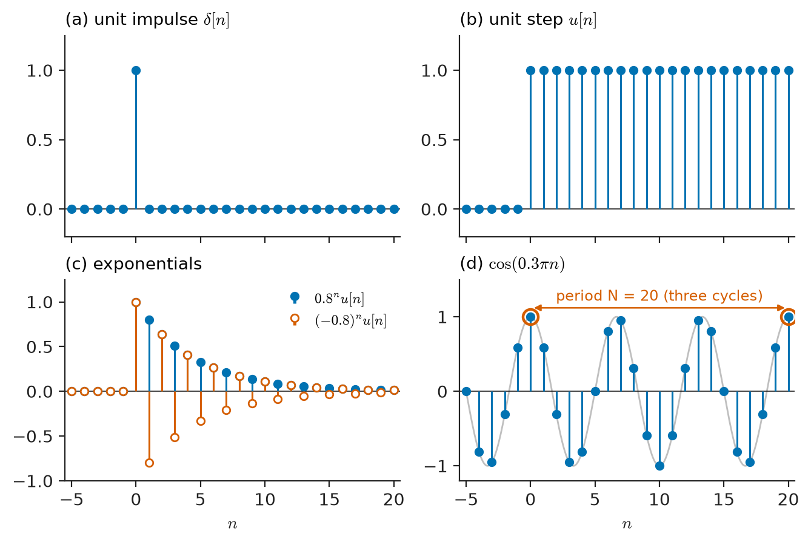
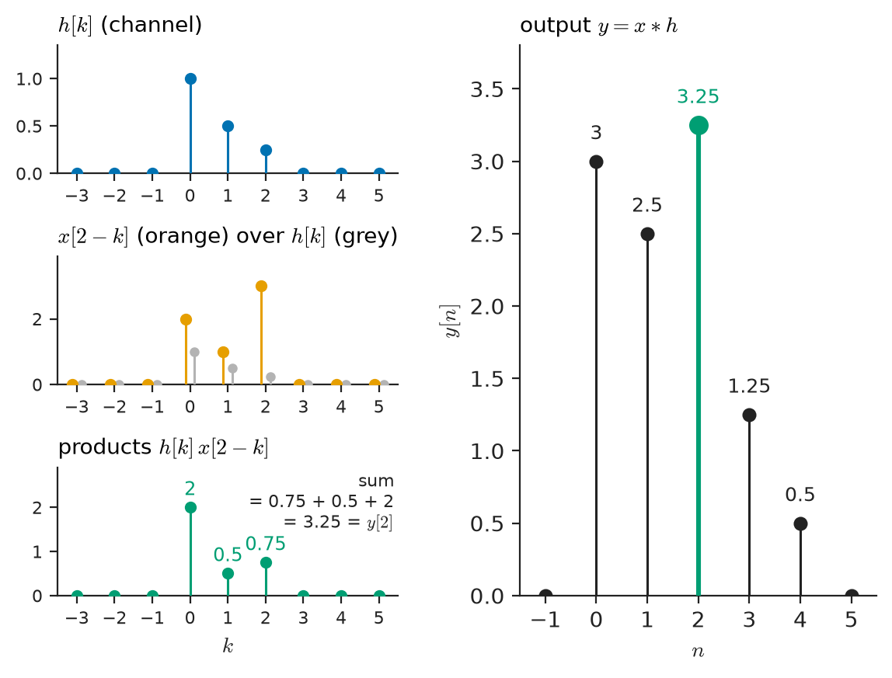
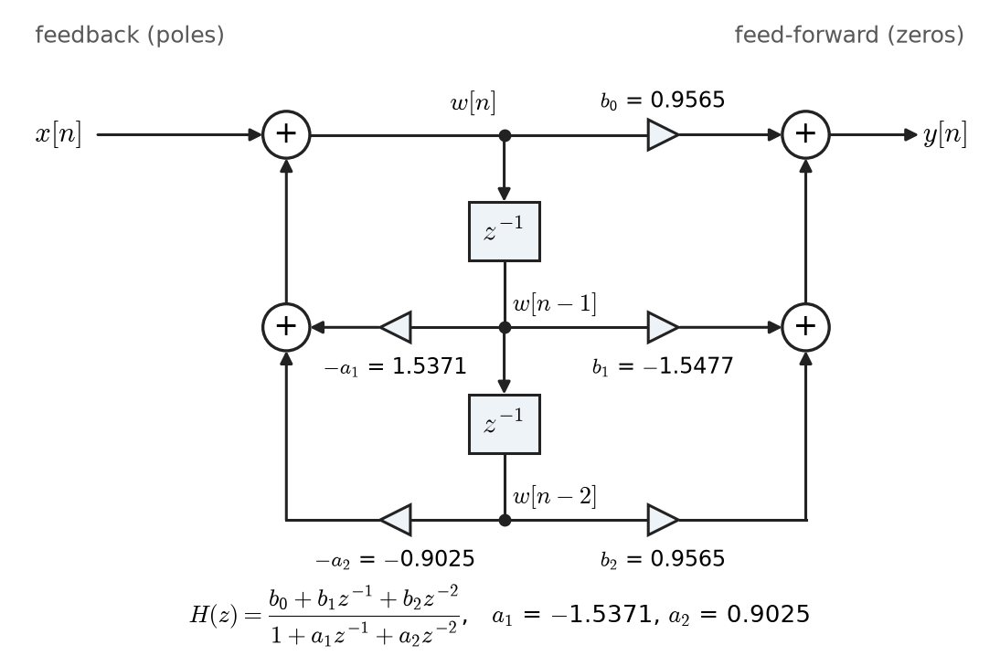
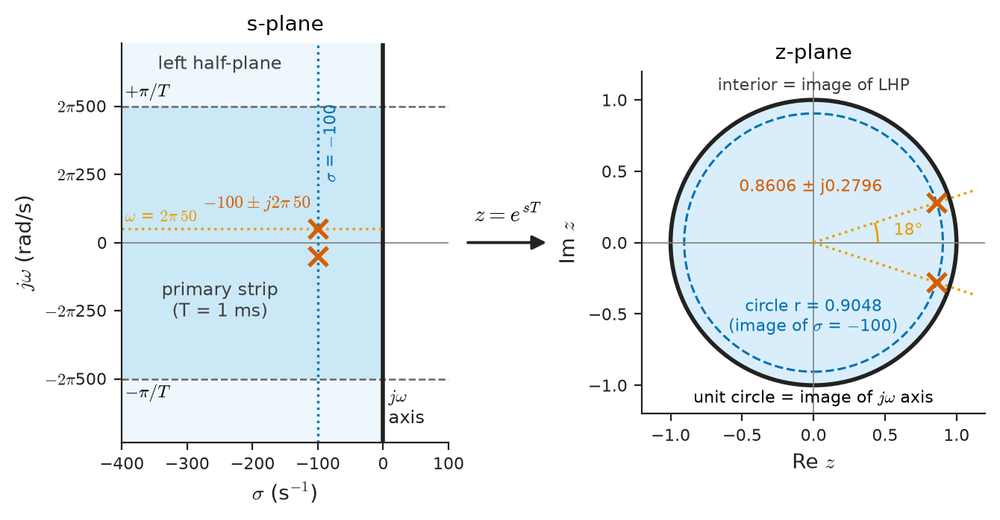
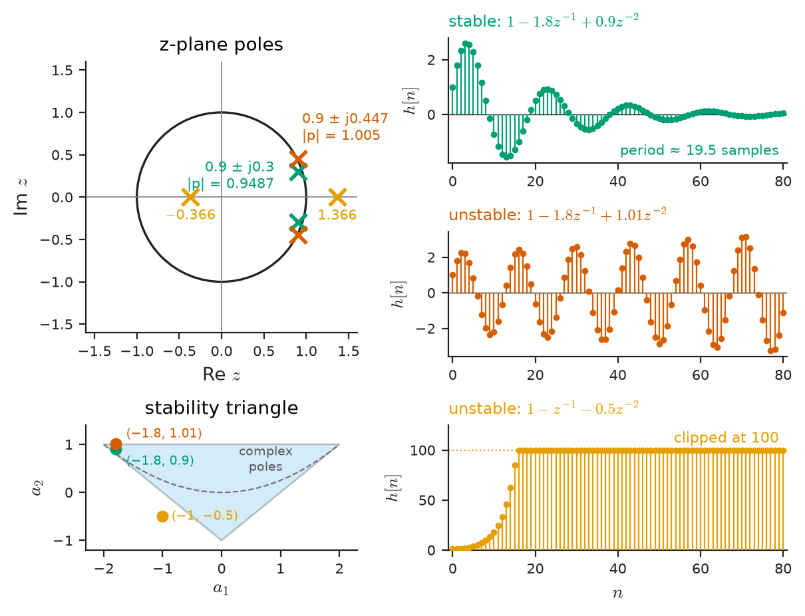
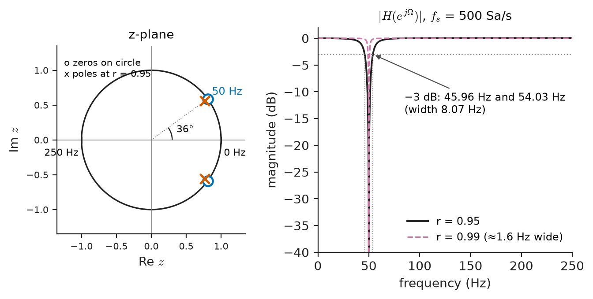

# Chapter 20 — Discrete-Time Signals and Systems

*Part IV · Signals and Systems*

A biomedical engineer is handed an ECG recorder that samples at 500 Sa/s and asked to remove the 50 Hz mains hum that rides on every trace recorded in the ward. The analogue anti-aliasing filter of Chapter 19 is already in place and the converter is fine; what remains is a stream of numbers with an unwanted sinusoid in it. In the analogue world the cure would be a twin-T notch with precision resistors and capacitors that drift with temperature. In the sampled world it is three lines of code: each output sample is a weighted sum of the last three input samples and the last two output samples, with five coefficients computed once. That filter never drifts, is identical in every recorder, and can be retuned to 60 Hz for export by changing two numbers. To design it with confidence, however, the engineer needs to answer questions the analogue theory of Chapters 11–18 answered for circuits: what is the response to an arbitrary input, where are the poles, is the filter stable, and what does it do at every frequency?

This chapter builds that theory for sequences. Its central objects mirror those of continuous time — the impulse response, convolution, difference equations instead of differential equations, the Z-transform instead of the Laplace transform, poles and zeros in the $z$-plane instead of the $s$-plane — but several behaviours are new: frequency is periodic, the stability boundary is a circle, and every system can be implemented exactly with additions, multiplications and memory.

> **How are discrete-time signals and systems described, and how is the output of a discrete-time LTI system computed from its input?**
> **What does the Z-transform reveal about a digital system — its frequency response, its poles and zeros, its stability — and what makes a digital filter work?**

| Concept | Engineering destination |
|---|---|
| Sequences and discrete frequency | Representation of every sampled measurement, audio stream and baseband radio signal |
| Discrete-time convolution | FIR filtering, multipath channel models, smoothing of sensor data |
| Difference equations | Recursive filters, digital controllers, numerical models of circuits |
| Z-transform | Solving difference equations, analysing digital filters and sampled-data control |
| System functions $H(z)$ | Frequency response of digital filters, equalisers and controllers |
| Poles and zeros | Notch and resonator design, echo cancellers, predicting transient behaviour |
| Discrete-time stability | Safe recursive filters, digital control loops, adaptive algorithms |
| Digital filter fundamentals | Mains-hum removal, smoothing, DC blocking, the starting point for Chapter 23 |

**Roadmap.** Sequences and discrete frequency (20.1) → convolution sum (20.2) → difference equations (20.3) → the Z-transform (20.4) → system functions and frequency response (20.5) → poles and zeros in the $z$-plane (20.6) → stability and the unit circle (20.7) → first digital filters (20.8).

---

## 20.1 Sequences

### Signals indexed by integers

A discrete-time signal is a **sequence** $x[n]$, a number for every integer $n$. Sequences arise from sampling ($x[n]=x_a(nT)$, Chapter 19), from inherently discrete processes (daily energy consumption, bits from a source, pixels along a line), and from computation. Once inside a processor, a sequence has no attached time unit: $n$ is a sample index and the sample interval $T$ is a separate piece of information that must travel with the data. Forgetting it is a common source of error when filter coefficients designed for one sampling rate are reused at another.

The elementary sequences of Chapter 15 carry over directly, and Figure 20.1 shows them.

- **Unit impulse** (Kronecker delta): $\delta[n]=1$ for $n=0$, and $0$ otherwise. Unlike the Dirac impulse it is an ordinary, finite sequence, so the discrete theory has none of the generalised-function subtleties of continuous time.
- **Unit step**: $u[n]=1$ for $n\ge0$, and $0$ for $n<0$. The two are related by a first difference and a running sum: $\delta[n]=u[n]-u[n-1]$ and $u[n]=\sum_{k=-\infty}^{n}\delta[k]$.
- **Exponential**: $x[n]=a^n u[n]$. For $0<a<1$ it decays; for $a>1$ it grows; for $-1<a<0$ it alternates in sign while decaying. Every real number $a$ gives a valid sequence, so a decaying alternating exponential — impossible as a real continuous-time exponential — is perfectly ordinary here.
- **Sinusoid**: $x[n]=A\cos(\Omega_0 n+\phi)$, where $\Omega_0$ is the **digital frequency** in radians per sample.
- **Complex exponential**: $x[n]=z_0^n$ with complex $z_0=re^{j\Omega_0}$, which contains the real exponential ($\Omega_0=0$) and the sinusoid ($r=1$) as special cases.

Any sequence can be written as a weighted sum of shifted impulses,

$$
x[n]=\sum_{k=-\infty}^{\infty}x[k]\,\delta[n-k]
$$

which is trivial to read and is the foundation of convolution in Section 20.2.

<!-- FIGURE 20.1 | figures/ch20/fig-20-1-basic-sequences.png | plot | Elementary discrete-time sequences shown as stem plots. | Content: four panels, horizontal axis n from -5 to 20. (a) unit impulse delta[n] with a single stem of height 1 at n = 0. (b) unit step u[n]. (c) exponentials 0.8^n u[n] (dots) and (-0.8)^n u[n] (open circles, alternating). (d) cos(0.3 pi n), period 20 samples, with the continuous cosine faintly drawn behind the stems and the samples at n = 0 and 20 highlighted to show the repeat. -->

*Figure 20.1 — Elementary discrete-time sequences shown as stem plots.*

### Discrete frequency is periodic

If the sequence came from sampling a continuous sinusoid of frequency $f_0$ at rate $f_s$, then $\Omega_0=2\pi f_0/f_s$. The Nyquist frequency $f_s/2$ maps to $\Omega=\pi$. Two properties distinguish discrete from continuous sinusoids, and both follow from the integer index:

1. **Frequency is only defined modulo $2\pi$.** $\cos((\Omega_0+2\pi k)n)=\cos(\Omega_0n)$ for every integer $k$, because $2\pi kn$ is a multiple of $2\pi$. This is the aliasing of Chapter 19 seen from inside the sequence: all frequency information lives in $-\pi<\Omega\le\pi$, and "high frequency" means $\Omega$ near $\pi$, where the sequence alternates in sign every sample. The fastest possible discrete oscillation is $(-1)^n=\cos(\pi n)$.
2. **A discrete sinusoid need not be periodic.** $\cos(\Omega_0 n)$ repeats after $N$ samples only if $\Omega_0N=2\pi m$ for integers $m$ and $N$, that is, only if $\Omega_0/2\pi=m/N$ is rational. The fundamental period is the smallest such $N$. For $\Omega_0=0.3\pi$, $\Omega_0/2\pi=3/20$ and the period is 20 samples (spanning three cycles of the underlying cosine). For $\Omega_0=1$ rad/sample, $1/2\pi$ is irrational and the sequence never repeats exactly, although it is perfectly well behaved.

The second property is why a sampled 50 Hz waveform repeats every cycle only if $f_s$ is an integer multiple of 50 Hz — and why power instruments lock their sampling clock to the measured mains frequency with a phase-locked loop, so that each analysis window contains exactly an integer number of cycles (a matter of spectral leakage, Chapter 22).

### Operations on sequences

The operations of Chapter 15 apply with one restriction: time arguments must remain integers.

- **Shift**: $x[n-n_0]$ delays by $n_0$ samples. Delay is the fundamental hardware operation of DSP: a register, a memory location or a circular-buffer pointer.
- **Reversal**: $x[-n]$.
- **Down-sampling** by $M$: $x[Mn]$ keeps every $M$-th sample and discards the rest. This is not reversible in general and can alias (Chapter 24).
- **Up-sampling** by $L$: inserting $L-1$ zeros between samples. Scaling time by a non-integer factor is not defined directly; it requires interpolation (Chapter 24).
- **Even–odd decomposition**, **energy** $\sum\lvert x[n]\rvert^2$ and **average power** $\lim_{N\to\infty}\frac{1}{2N+1}\sum_{-N}^{N}\lvert x[n]\rvert^2$ are defined as in Chapter 15 with sums in place of integrals.

---

## 20.2 Discrete-time convolution

### The convolution sum

A discrete-time system maps an input sequence to an output sequence. Linearity and time invariance (Chapter 16) mean exactly what they did for continuous systems, with shifts by integers. For an LTI system, let $h[n]$ be the response to $\delta[n]$ — the **impulse response**. Because $x[n]$ is a sum of weighted, shifted impulses, linearity and time invariance give

$$
y[n]=\sum_{k=-\infty}^{\infty}x[k]\,h[n-k]=\sum_{k=-\infty}^{\infty}h[k]\,x[n-k]\equiv(x*h)[n]
$$

> **Status of the principle: Convolution sum**
> *Derived.* Follows directly from linearity, time invariance and the decomposition of a sequence into impulses; exact for every discrete-time LTI system, with no regularity conditions beyond convergence of the sum.

The derivation is the same as for the continuous convolution integral of Chapter 17, but it is simpler and more immediately useful: it is an algorithm. Each output sample is a finite or infinite weighted sum of input samples, and if $h[n]$ has finite length it can be computed exactly with a known number of multiplications. Convolution is commutative, associative and distributive over addition, so cascaded systems combine by convolving their impulse responses and parallel systems by adding them (Chapter 17).

### Computing a convolution

The second form, $y[n]=\sum_k h[k]x[n-k]$, has a direct reading: the output is the current input times $h[0]$, plus the previous input times $h[1]$, and so on. Graphically, $x[n-k]$ as a function of $k$ is the input flipped and slid so that its sample at time $n$ sits at $k=0$; the output is the sum of the products where the two overlap (Figure 20.2). If $x$ has length $L$ and $h$ length $M$, the result has length $L+M-1$.

**Worked example — A two-path radio channel.** A narrowband telemetry link arrives by a direct path and by two reflections, and at the receiver's sampling rate the channel is modelled as an impulse response $h=[1,\ 0.5,\ 0.25]$: the first echo arrives one sample later with half the amplitude, the second two samples later with a quarter. A transmitted burst $x=[3,\ 1,\ 2]$ (starting at $n=0$) produces

$$
\begin{aligned}
y[0]&=h[0]x[0]=3\\
y[1]&=h[0]x[1]+h[1]x[0]=1+1.5=2.5\\
y[2]&=h[0]x[2]+h[1]x[1]+h[2]x[0]=2+0.5+0.75=3.25\\
y[3]&=h[1]x[2]+h[2]x[1]=1+0.25=1.25\\
y[4]&=h[2]x[2]=0.5
\end{aligned}
$$

so $y=[3,\ 2.5,\ 3.25,\ 1.25,\ 0.5]$, of length $3+3-1=5$. The received samples no longer resemble the transmitted ones: each symbol is smeared into its neighbours. This **intersymbol interference** is what an equaliser in a modem or a mobile receiver must undo (Chapters 24, 27 and 30). As a check, the sum of the outputs equals the product of the sums of the two sequences, $6\times1.75=10.5$, a property that follows from evaluating the Z-transforms of Section 20.4 at $z=1$.

<!-- FIGURE 20.2 | figures/ch20/fig-20-2-graphical-convolution.png | plot | Graphical evaluation of the convolution of x = [3, 1, 2] with the channel h = [1, 0.5, 0.25]. | Content: left column of three small stem plots against k from -3 to 5: h[k]; x[2-k] (input reversed and shifted to n = 2) overlaid on h[k] with the overlapping products 0.75, 0.5, 2 annotated; the products summed to 3.25. Right panel: output y[n] for n = 0 to 4 with values 3, 2.5, 3.25, 1.25, 0.5 labelled, the n = 2 stem highlighted. -->

*Figure 20.2 — Graphical evaluation of the convolution of x = [3, 1, 2] with the channel h = [1, 0.5, 0.25].*

### Finite and infinite impulse responses

The structure of $h[n]$ divides discrete-time LTI systems into two classes that run through the rest of Part V.

- **FIR (finite impulse response)** systems have $h[n]\ne0$ only for $0\le n\le M-1$. The convolution sum is finite: $y[n]=\sum_{k=0}^{M-1}h[k]x[n-k]$. It is computed directly, needs $M$ multiply–accumulate operations per sample, and is always stable.
- **IIR (infinite impulse response)** systems have impulse responses that continue forever, such as $h[n]=a^nu[n]$. The convolution sum cannot be evaluated directly, but such systems can often be computed recursively from a few past outputs (Section 20.3) at a fixed, small cost per sample.

### Causality and memory

A discrete-time LTI system is **causal** if $h[n]=0$ for $n<0$: the output depends only on present and past inputs. Real-time systems — a hearing aid, a protection relay, a digital controller — must be causal. Off-line systems processing a stored record — an image, a recorded seismogram, a post-processed ECG — need not be; a non-causal, symmetric smoother that uses future samples gives zero phase distortion, something no causal filter can achieve. A system is **memoryless** if $h[n]=c\,\delta[n]$, a pure gain.

---

## 20.3 Difference equations

### Linear constant-coefficient difference equations

The discrete counterpart of a linear differential equation with constant coefficients is the **linear constant-coefficient difference equation** (LCCDE):

$$
\sum_{k=0}^{N}a_k\,y[n-k]=\sum_{k=0}^{M}b_k\,x[n-k],\qquad a_0=1
$$

Solving for the current output gives the recursion that a processor executes every sample:

$$
y[n]=\sum_{k=0}^{M}b_kx[n-k]-\sum_{k=1}^{N}a_ky[n-k]
$$

This book uses this sign convention throughout Part V: the denominator coefficients $a_k$ appear with a minus sign in the recursion and with a plus sign in the system function of Section 20.5, matching common DSP software. When all $a_k$ for $k\ge1$ are zero the equation is **non-recursive**, and the $b_k$ are simply the FIR impulse response. When any $a_k\ne0$ the equation is **recursive** and, in general, IIR.

Difference equations arise in three ways in EEE:

1. **As algorithms** for digital filters and controllers, where they are the design itself.
2. **As discretisations** of differential equations. Approximating $dy/dt$ by $(y[n]-y[n-1])/T$ turns $\tau\,dy/dt+y=x$ into $y[n]=\frac{\tau}{\tau+T}y[n-1]+\frac{T}{\tau+T}x[n]$. Circuit simulators such as SPICE replace every capacitor and inductor by such a discrete model at each time step.
3. **As exact models** of inherently sampled processes: a bank balance compounded monthly, a population counted yearly, a buffer that fills and empties once per frame.

### Solving by recursion

A difference equation can always be solved by running it forward from initial conditions. This is the main practical advantage over differential equations: no approximation is involved, and the solution for any input is obtained sample by sample.

**Worked example — Recursive solution with an initial condition.** The system $y[n]-0.5\,y[n-1]=x[n]$ has initial condition $y[-1]=1$ and input $x[n]=u[n]$. Recursion gives

$$
y[0]=0.5(1)+1=1.5,\quad y[1]=0.5(1.5)+1=1.75,\quad y[2]=0.5(1.75)+1=1.875,\ \dots
$$

The values approach 2, the steady state at which $y=0.5y+1$. A closed form, found in Section 20.4, is $y[n]=2-0.5(0.5)^n$ for $n\ge0$, which reproduces $1.5$, $1.75$, $1.875$.

### Homogeneous and particular solutions

The classical method mirrors Chapter 7. The homogeneous equation $\sum a_ky[n-k]=0$ has solutions of the form $y[n]=\lambda^n$; substituting gives the **characteristic equation**

$$
\lambda^N+a_1\lambda^{N-1}+\dots+a_N=0
$$

whose roots $\lambda_i$ are the **natural modes**. With distinct roots the natural response is $\sum C_i\lambda_i^n$; a repeated root $\lambda$ of multiplicity $m$ contributes $\lambda^n, n\lambda^n,\dots,n^{m-1}\lambda^n$. A particular solution matching the form of the input is added, and the constants are fixed by the initial conditions. In the example above, $\lambda=0.5$, the particular solution for a constant input is the constant $2$, and $y[-1]=1$ fixes $C=-0.5$, consistent with $C\lambda^{-1}=-1$.

Complex roots $\lambda=re^{\pm j\theta}$ give natural responses $r^n\cos(\theta n+\phi)$: a sampled damped oscillation, decaying if $r<1$. Their magnitude sets the decay per sample and their angle sets the oscillation frequency in radians per sample — the same information as the pole positions of Section 20.6, because they *are* the poles.

### Zero-input and zero-state responses

The response separates into the **zero-input response** (initial conditions, zero input) and the **zero-state response** (input applied to a system initially at rest). For the example, the zero-state response to $u[n]$ is $2-(0.5)^n$ and the zero-input response from $y[-1]=1$ is $0.5(0.5)^n$; their sum is the total. Only the zero-state response is described by convolution with $h[n]$. The distinction matters in practice: a digital filter that is started with stale data in its delay registers, or a controller switched in with a non-zero integrator state, shows a zero-input transient superimposed on its intended behaviour. The cure is to initialise the state deliberately, a practice called **bumpless transfer** in control.

---

## 20.4 The Z-transform

### Definition

The Laplace transform turned differential equations into algebra by weighting signals with $e^{-st}$. The **Z-transform** does the same for sequences with powers of a complex variable $z$:

$$
X(z)=\sum_{n=-\infty}^{\infty}x[n]\,z^{-n}
$$

It is a power series in $z^{-1}$ whose coefficients are the samples. The sample $x[n]$ is the coefficient of $z^{-n}$, so $z^{-1}$ marks one sample of delay. For a sequence obtained by sampling, $z=e^{sT}$ connects it to the Laplace variable: the impulse-train representation of Chapter 19 has Laplace transform $\sum x[n]e^{-snT}$, which is $X(z)$ with $z=e^{sT}$.

> **Boundary.** The Z-transform as a mathematical object — Laurent series, analyticity, the contour-integral inverse — is developed in *The Mathematics Universe*. This section recaps the results needed for system analysis and uses them.

### Region of convergence

The sum converges only for some values of $z$, and the set where it does, the **region of convergence** (ROC), is part of the transform. For the right-sided exponential $x[n]=a^nu[n]$,

$$
X(z)=\sum_{n=0}^{\infty}(az^{-1})^n=\frac{1}{1-az^{-1}},\qquad \lvert z\rvert>\lvert a\rvert
$$

a geometric series that converges when $\lvert az^{-1}\rvert<1$. For the left-sided sequence $x[n]=-a^nu[-n-1]$ the same algebraic expression results, but with ROC $\lvert z\rvert<\lvert a\rvert$. The formula alone does not determine the sequence; the ROC does. The general rules follow from this example:

- The ROC is an annulus centred on the origin; it contains no poles.
- A **right-sided** sequence (zero before some $n_0$), which includes every causal sequence, has an ROC outside the outermost pole.
- A **left-sided** sequence has an ROC inside the innermost pole.
- A **two-sided** sequence has an annular ROC between two poles, or none at all.
- A **finite-length** sequence converges everywhere except possibly at $z=0$ or $z=\infty$.

For causal systems — the usual case in real-time DSP — the ROC is always "outside the outermost pole", and the notation often leaves it implicit.

### A short table

**Table 20.1 — Common Z-transform pairs.**

| Sequence $x[n]$ | $X(z)$ | ROC |
|---|---|---|
| $\delta[n]$ | $1$ | all $z$ |
| $\delta[n-k]$, $k>0$ | $z^{-k}$ | $z\ne0$ |
| $u[n]$ | $\dfrac{1}{1-z^{-1}}$ | $\lvert z\rvert>1$ |
| $a^nu[n]$ | $\dfrac{1}{1-az^{-1}}$ | $\lvert z\rvert>\lvert a\rvert$ |
| $-a^nu[-n-1]$ | $\dfrac{1}{1-az^{-1}}$ | $\lvert z\rvert<\lvert a\rvert$ |
| $na^nu[n]$ | $\dfrac{az^{-1}}{(1-az^{-1})^2}$ | $\lvert z\rvert>\lvert a\rvert$ |
| $r^n\cos(\Omega_0n)\,u[n]$ | $\dfrac{1-r\cos\Omega_0\,z^{-1}}{1-2r\cos\Omega_0\,z^{-1}+r^2z^{-2}}$ | $\lvert z\rvert>r$ |
| $r^n\sin(\Omega_0n)\,u[n]$ | $\dfrac{r\sin\Omega_0\,z^{-1}}{1-2r\cos\Omega_0\,z^{-1}+r^2z^{-2}}$ | $\lvert z\rvert>r$ |

### Properties

The properties used constantly in system analysis are:

| Property | Sequence | Transform |
|---|---|---|
| Linearity | $\alpha x_1[n]+\beta x_2[n]$ | $\alpha X_1(z)+\beta X_2(z)$ |
| Time shift | $x[n-k]$ | $z^{-k}X(z)$ |
| Convolution | $x[n]*h[n]$ | $X(z)H(z)$ |
| Multiplication by $a^n$ | $a^nx[n]$ | $X(z/a)$ |
| Time reversal | $x[-n]$ | $X(1/z)$ |
| Differentiation in $z$ | $nx[n]$ | $-z\,\dfrac{dX}{dz}$ |
| Initial value (causal $x$) | $x[0]$ | $\lim_{z\to\infty}X(z)$ |
| Final value (if it exists) | $\lim_{n\to\infty}x[n]$ | $\lim_{z\to1}(1-z^{-1})X(z)$ |

The convolution property is the reason for the whole apparatus: a convolution sum in time becomes a product in $z$, exactly as the convolution integral became a product in $s$. The final-value theorem holds only if all poles of $(1-z^{-1})X(z)$ lie strictly inside the unit circle.

> **Status of the principle: Convolution property of the Z-transform**
> *Derived.* A consequence of the definition and the time-shift property; holds wherever the ROCs of $X(z)$ and $H(z)$ overlap.

### Inverse Z-transform by partial fractions

For the rational transforms of LTI systems, the inverse is found as in Chapter 11: expand in partial fractions in $z^{-1}$ and invert each term from the table. Long division of the power series gives the first few samples directly and is a useful check.

**Worked example — Impulse response of a two-pole system.** A sensor-conditioning filter has

$$
H(z)=\frac{1}{(1-0.5z^{-1})(1-0.25z^{-1})}=\frac{1}{1-0.75z^{-1}+0.125z^{-2}}
$$

and is causal. Write $H(z)=\dfrac{A}{1-0.5z^{-1}}+\dfrac{B}{1-0.25z^{-1}}$. Setting $z^{-1}=2$ (the root of the first factor) in $A=\left.H(z)(1-0.5z^{-1})\right|$ gives $A=1/(1-0.25\cdot2)=2$; setting $z^{-1}=4$ gives $B=1/(1-0.5\cdot4)=-1$. Therefore

$$
h[n]=\left[2(0.5)^n-(0.25)^n\right]u[n]
$$

which gives $h[0]=1$, $h[1]=0.75$, $h[2]=0.4375$, $h[3]=0.234375$, $h[4]=0.12109$. The same values follow from running the recursion $y[n]=0.75y[n-1]-0.125y[n-2]+x[n]$ with $x=\delta$, and from the initial-value theorem ($H(\infty)=1$). The DC gain is $H(1)=1/(1-0.75+0.125)=2.667$, which equals $\sum h[n]=2\times2-4/3=2.667$. The slower pole at $0.5$ dominates the tail: after 10 samples the $0.25$ term has fallen below $10^{-6}$ while the $0.5$ term is still about $2\times10^{-3}$.

### The unilateral Z-transform and initial conditions

To handle initial conditions, the **unilateral** transform $\mathcal{Z}_u\{x\}=\sum_{n=0}^{\infty}x[n]z^{-n}$ is used, in which the shift property picks up the initial values:

$$
\mathcal{Z}_u\{y[n-1]\}=z^{-1}Y(z)+y[-1]
$$

Applied to the earlier example $y[n]-0.5y[n-1]=u[n]$ with $y[-1]=1$:

$$
Y(z)\left(1-0.5z^{-1}\right)-0.5=\frac{1}{1-z^{-1}}
\quad\Rightarrow\quad
Y(z)=\frac{1}{(1-z^{-1})(1-0.5z^{-1})}+\frac{0.5}{1-0.5z^{-1}}
$$

Partial fractions of the first term give $\dfrac{2}{1-z^{-1}}-\dfrac{1}{1-0.5z^{-1}}$, so

$$
y[n]=\underbrace{2-(0.5)^n}_{\text{zero-state}}+\underbrace{0.5(0.5)^n}_{\text{zero-input}}=2-0.5(0.5)^n,\qquad n\ge0
$$

which is the closed form quoted in Section 20.3. The role is exactly that of the one-sided Laplace transform with initial capacitor voltages in Chapter 11.

---

## 20.5 Discrete-time system functions

### From difference equation to $H(z)$

Taking the Z-transform of the LCCDE of Section 20.3 with zero initial conditions and using the shift property,

$$
Y(z)\sum_{k=0}^{N}a_kz^{-k}=X(z)\sum_{k=0}^{M}b_kz^{-k}
\quad\Rightarrow\quad
H(z)=\frac{Y(z)}{X(z)}=\frac{b_0+b_1z^{-1}+\dots+b_Mz^{-M}}{1+a_1z^{-1}+\dots+a_Nz^{-N}}
$$

The **system function** $H(z)$ is the Z-transform of the impulse response, the ratio of output to input transforms, and the rational function whose coefficients are those of the difference equation — three descriptions of the same object. An FIR filter has denominator 1; an IIR filter has a non-trivial denominator. Reading coefficients off $H(z)$ gives the implementation directly, which makes the discrete transfer function more immediately practical than its analogue counterpart: there is no component-selection step between the equation and the hardware.

### Frequency response

Complex exponentials are eigenfunctions of discrete-time LTI systems (Chapter 17): the input $x[n]=z_0^n$ produces

$$
y[n]=\sum_kh[k]z_0^{n-k}=z_0^n\sum_kh[k]z_0^{-k}=H(z_0)\,z_0^n
$$

For a sinusoidal input, $z_0=e^{j\Omega}$ lies on the **unit circle**, and the multiplier is the **frequency response**

$$
H(e^{j\Omega})=H(z)\big|_{z=e^{j\Omega}}=\sum_{n}h[n]e^{-j\Omega n}
$$

which is the discrete-time Fourier transform of $h[n]$. A sinusoid $\cos(\Omega n)$ emerges as $\lvert H(e^{j\Omega})\rvert\cos(\Omega n+\angle H(e^{j\Omega}))$, with gain and phase given by the value of $H(z)$ at the point $e^{j\Omega}$. Three facts follow at once:

- $H(e^{j\Omega})$ is periodic in $\Omega$ with period $2\pi$, so only $-\pi<\Omega\le\pi$ needs to be plotted; for real $h[n]$ the magnitude is even and the phase odd, so $0\le\Omega\le\pi$ suffices.
- $\Omega=0$ (DC) corresponds to $z=1$ and $\Omega=\pi$ (the Nyquist frequency) to $z=-1$. The DC gain is $H(1)=\sum h[n]$, the Nyquist gain $H(-1)=\sum(-1)^nh[n]$.
- In physical units, $\Omega=2\pi f/f_s$. The same coefficients give a filter whose frequency features scale with $f_s$: a notch at $\Omega=0.2\pi$ sits at 50 Hz if $f_s=500$ Sa/s and at 60 Hz if $f_s=600$ Sa/s.

The frequency response exists (the unit circle lies in the ROC) only for stable systems, which anticipates Section 20.7.

**Worked example — An exponential smoother.** A temperature transmitter sampled at $f_s=1$ kSa/s smooths its readings with

$$
y[n]=0.9\,y[n-1]+0.1\,x[n],\qquad H(z)=\frac{0.1}{1-0.9z^{-1}}
$$

The DC gain is $0.1/(1-0.9)=1$, so a steady reading passes unchanged. The step response is $1-0.9^{n+1}$: after 10 samples (10 ms) it has reached $1-0.9^{11}\approx0.686$, and it takes $\ln0.05/\ln0.9=28.4$ samples to reach 95 %. Matching $0.9^n=e^{-nT/\tau}$ gives an equivalent analogue time constant $\tau=-T/\ln0.9=9.49$ ms. The magnitude response is

$$
\lvert H(e^{j\Omega})\rvert=\frac{0.1}{\sqrt{1-1.8\cos\Omega+0.81}}
$$

Setting this to $1/\sqrt2$ gives $\cos\Omega_c=1-(0.1)^2/(2\times0.9)$, $\Omega_c=0.1055$ rad/sample, or $f_c=\Omega_cf_s/2\pi=16.8$ Hz. An analogue RC filter with $\tau=9.49$ ms has $f_c=1/(2\pi\tau)=16.8$ Hz too: the two agree well while $f_c\ll f_s$. They part company near Nyquist: the digital filter's gain at $\Omega=\pi$ is $0.1/1.9=0.0526$ ($-25.6$ dB) and then *rises again* as frequency increases further (the response is periodic), whereas the RC filter keeps falling at 20 dB/decade. This is why digital smoothing never replaces the analogue anti-aliasing filter of Chapter 19.

### Block diagrams and realisations

A system function can be implemented by many different arrangements of adders, multipliers and unit delays ($z^{-1}$ blocks), called **realisations** or **structures**. The **direct form I** implements the numerator (feed-forward) and denominator (feedback) sections with separate delay lines; the **direct form II** shares one delay line of length $\max(M,N)$ and is canonical (minimum delays). **Cascade** realisations factor $H(z)$ into second-order sections, and **parallel** realisations use partial fractions. All are equivalent in exact arithmetic; they differ greatly in finite precision, which is the subject of Chapter 21 and Chapter 23. Figure 20.3 shows the direct form II of a second-order section, the "biquad" that is the building block of almost every IIR filter.

<!-- FIGURE 20.3 | figures/ch20/fig-20-3-biquad-direct-form-ii.png | block-diagram | Direct form II realisation of a second-order section (biquad). | Content: input x[n] enters an adder; adder output w[n] feeds a vertical chain of two z^-1 delay blocks producing w[n-1] and w[n-2]. Feedback branches with gains -a1 and -a2 from w[n-1] and w[n-2] back to the input adder. Feed-forward branches with gains b0, b1, b2 from w[n], w[n-1], w[n-2] to an output adder producing y[n]. Labels show the 50 Hz notch coefficients from the text beside each gain: b0 = 0.9565, b1 = -1.5477, b2 = 0.9565, a1 = -1.5371, a2 = 0.9025. -->

*Figure 20.3 — Direct form II realisation of a second-order section (biquad).*

---

## 20.6 Poles and zeros

### Factorising the system function

Multiplying numerator and denominator of $H(z)$ by $z^{\max(M,N)}$ and factorising,

$$
H(z)=b_0\,\frac{\prod_{k=1}^{M}(1-q_kz^{-1})}{\prod_{k=1}^{N}(1-p_kz^{-1})}
$$

The $q_k$ are the **zeros** and the $p_k$ the **poles**. For real coefficients they are real or occur in complex-conjugate pairs. An FIR filter has all its poles at $z=0$, which contribute only delay. As in the $s$-plane (Chapters 11 and 13), the pole–zero pattern plus a gain constant determines the system completely.

### Pole position and natural response

A causal pole at $p=re^{j\theta}$ contributes a mode $r^n\cos(\theta n+\phi)$ to the impulse response. The **radius** $r$ sets the decay per sample and the **angle** $\theta$ the oscillation frequency in radians per sample:

- poles near the origin give responses that die out in a few samples;
- poles near the unit circle give long, slowly decaying responses — the time constant in samples is $-1/\ln r\approx1/(1-r)$ for $r$ close to 1;
- a pole on the positive real axis gives a non-oscillating decay; on the negative real axis a response that alternates in sign every sample (oscillation at the Nyquist frequency);
- a pole on the unit circle gives a sustained oscillation, outside it a growing one.

Figure 20.5 later in the chapter shows these cases side by side.

### The mapping $z=e^{sT}$

When a discrete system is designed to mimic a continuous one, or a continuous signal is sampled, an $s$-plane pole at $s=\sigma+j\omega$ appears in the $z$-plane at

$$
z=e^{sT}=e^{\sigma T}e^{j\omega T}
$$

so $r=e^{\sigma T}$ and $\theta=\omega T$. The left half of the $s$-plane maps inside the unit circle, the $j\omega$ axis onto the unit circle (with $\omega$ from $-\pi/T$ to $\pi/T$ covering it once — the aliasing of Chapter 19 again), and the right half-plane outside. Lines of constant damping in $s$ become circles of constant radius; lines of constant frequency become rays from the origin. Figure 20.4 shows the mapping.

> **Status of the principle: Pole mapping $z=e^{sT}$**
> *Derived.* Exact for the poles of a sampled continuous-time impulse response (impulse invariance); other discretisations used in filter design, such as the bilinear transform of Chapter 23, map poles differently.

**Worked example — Sampling a damped oscillation.** A power-system oscillation mode has poles at $s=-100\pm j2\pi(50)$ s$^{-1}$ — a 50 Hz oscillation decaying with a 10 ms time constant. A relay samples at $f_s=1$ kSa/s ($T=1$ ms). The $z$-plane poles are at

$$
r=e^{-100\times0.001}=e^{-0.1}=0.9048,\qquad \theta=2\pi\times50\times0.001=0.3142\ \mathrm{rad}=18^\circ
$$

that is, $z=0.8606\pm j0.2796$. In the sampled record the oscillation shrinks by the factor 0.9048 each sample and completes one cycle every $2\pi/0.3142=20$ samples, exactly as it should. At $f_s=200$ Sa/s the angle would be $0.5\pi$ — still unambiguous; at $f_s=100$ Sa/s it would be $\pi$, on the negative real axis, and the 50 Hz oscillation would become indistinguishable from a Nyquist-rate alternation.

<!-- FIGURE 20.4 | figures/ch20/fig-20-4-s-to-z-mapping.png | pole-zero | Mapping of the s-plane to the z-plane by z = exp(sT). | Content: left panel s-plane, sigma from -400 to 100 s^-1, j omega from -2 pi x 500 to 2 pi x 500 rad/s, shaded left half-plane, horizontal band between plus and minus pi/T marked as primary strip for T = 1 ms; poles x at -100 plus and minus j 2 pi 50. Right panel z-plane, Re and Im from -1.2 to 1.2, unit circle solid, interior shaded; corresponding poles x at 0.8606 plus and minus j 0.2796 on the circle of radius 0.9048 (dashed) and on the rays at plus and minus 18 degrees (dotted). Arrows indicate j omega axis maps to unit circle, left half-plane to interior, lines of constant sigma to circles. -->

*Figure 20.4 — Mapping of the s-plane to the z-plane by z = exp(sT).*

### Geometric evaluation of the frequency response

Write the factored $H(z)$ at a point $z=e^{j\Omega}$ on the unit circle. Each factor $(e^{j\Omega}-q_k)$ is the vector from the zero $q_k$ to that point, and each $(e^{j\Omega}-p_k)$ the vector from a pole. Hence

$$
\lvert H(e^{j\Omega})\rvert=\lvert b_0\rvert\frac{\prod_k\text{distance from zero }q_k}{\prod_k\text{distance from pole }p_k},\qquad
\angle H=\sum\angle(\text{zero vectors})-\sum\angle(\text{pole vectors})+\text{linear term}
$$

As the evaluation point walks around the circle from $\Omega=0$ to $\pi$:

- passing close to a **zero** makes the response small; a zero *on* the circle gives an exact null;
- passing close to a **pole** makes the response large; the closer the pole to the circle, the sharper and higher the peak;
- a pole and a zero at the same angle, with the pole just inside the zero, give a narrow notch: far from them the two distances are nearly equal and cancel; near them, the zero distance shrinks to nothing while the pole distance stays finite.

This picture is the single most useful design intuition in digital filtering, and it leads straight to the notch filter of Section 20.8.

---

## 20.7 Discrete-time stability

### BIBO stability and the impulse response

A discrete-time system is **bounded-input bounded-output (BIBO) stable** if every bounded input produces a bounded output (Chapter 16). For an LTI system, this holds if and only if the impulse response is absolutely summable:

$$
\sum_{n=-\infty}^{\infty}\lvert h[n]\rvert<\infty
$$

Sufficiency follows from $\lvert y[n]\rvert\le\sum\lvert h[k]\rvert\,\lvert x[n-k]\rvert\le B_x\sum\lvert h[k]\rvert$. Necessity follows by choosing the bounded input $x[n-k]=\operatorname{sgn}(h[k])$, which makes $y[n]$ equal to $\sum\lvert h[k]\rvert$. Every FIR filter is stable, since its sum is finite.

### The unit-circle criterion

For a system with rational $H(z)$, absolute summability is equivalent to the ROC including the unit circle. For a **causal** system, whose ROC lies outside the outermost pole, this gives the working rule:

> A causal LTI system with rational system function is BIBO stable if and only if all its poles lie strictly inside the unit circle, $\lvert p_k\rvert<1$.

> **Status of the principle: Unit-circle stability criterion**
> *Derived.* Follows from the absolute-summability condition and the geometric decay of each mode $p_k^n$; exact in infinite-precision arithmetic. In fixed-point hardware, poles very close to the circle can move onto or outside it when coefficients are rounded (Chapter 21), and nonlinear limit cycles can appear even for stable poles.

A pole exactly on the circle is **marginally stable**: the impulse response neither decays nor grows, but a bounded input at the pole's frequency produces an unbounded output (resonance in the discrete sense). The accumulator $y[n]=y[n-1]+x[n]$, with a pole at $z=1$, is the classic example: a constant input makes the output ramp forever. Digital integrators in controllers and phase accumulators in frequency synthesisers have exactly this pole, and their implementation must guard against the consequent growth (anti-windup, modular arithmetic).

The unit-circle criterion is the image of the left-half-plane criterion of Chapter 34 under $z=e^{sT}$.

### Testing a second-order denominator

For a second-order denominator $1+a_1z^{-1}+a_2z^{-2}$ the poles lie inside the unit circle if and only if

$$
\lvert a_2\rvert<1\qquad\text{and}\qquad\lvert a_1\rvert<1+a_2
$$

These inequalities define the **stability triangle** in the $(a_1,a_2)$ plane, with vertices at $(-2,1)$, $(2,1)$ and $(0,-1)$. Complex poles occur when $a_1^2<4a_2$, inside a parabola within the triangle. For higher orders, the Jury test (the discrete counterpart of Routh–Hurwitz, Chapter 34) or direct numerical root-finding is used; in practice filters are implemented as cascades of second-order sections precisely so that each section can be checked with this simple test.

**Worked example — Is this resonator stable?** A vibration-analysis rig sampling at $f_s=1$ kSa/s uses the resonator

$$
y[n]=1.8\,y[n-1]-0.9\,y[n-2]+x[n],\qquad A(z)=1-1.8z^{-1}+0.9z^{-2}
$$

so $a_1=-1.8$, $a_2=0.9$. The test: $\lvert0.9\rvert<1$ and $1.8<1.9$ — stable. The poles are the roots of $z^2-1.8z+0.9=0$, $z=0.9\pm j0.3$, with radius $\sqrt{0.9}=0.9487$ and angle $\arctan(0.3/0.9)=0.3218$ rad. The impulse response is a decaying oscillation at $0.3218f_s/2\pi=51.2$ Hz, shrinking by 0.9487 per sample (time constant about $-1/\ln0.9487=19$ samples). The DC gain is $1/(1-1.8+0.9)=10$.

Now let a coefficient error change $a_2$ to $1.01$, i.e. $y[n]=1.8y[n-1]-1.01y[n-2]+x[n]$. Then $\lvert a_2\rvert=1.01>1$ and the system is unstable: the poles move to $0.9\pm j0.4472$, radius $\sqrt{1.01}=1.005$, and the oscillation grows by 0.5 % per sample — a factor of about 150 per second at this sample rate. A third case, $y[n]=y[n-1]+0.5y[n-2]+x[n]$, has $A(z)=1-z^{-1}-0.5z^{-2}$: $\lvert a_2\rvert=0.5<1$ but $\lvert a_1\rvert=1>1+a_2=0.5$, so it fails, and indeed it has a real pole at $1.366$. Figure 20.5 shows the three impulse responses.

<!-- FIGURE 20.5 | figures/ch20/fig-20-5-pole-location-responses.png | pole-zero | Pole locations in the z-plane and the corresponding impulse responses. | Content: left panel z-plane with unit circle, Re and Im from -1.6 to 1.6; poles x at 0.9 plus and minus j0.3 (green, stable, radius 0.9487), 0.9 plus and minus j0.4472 (red, radius 1.005), and real poles at 1.366 and -0.366 (orange). Stability triangle inset in the (a1, a2) plane with vertices (-2,1), (2,1), (0,-1) and the three coefficient pairs marked. Right column of three stem plots, n from 0 to 80: decaying oscillation of period about 19.5 samples (green), slowly growing oscillation (red), and rapidly growing non-oscillating response clipped at 100 (orange). -->

*Figure 20.5 — Pole locations in the z-plane and the corresponding impulse responses.*

### Stability of what, exactly?

BIBO stability of the transfer function is not the whole story. A system can have a pole outside the unit circle that is cancelled by a zero, so that $H(z)$ looks stable while an internal state grows. In exact arithmetic the cancellation hides the growth; in a processor, rounding excites the hidden mode and the internal variable eventually overflows. The rule is the same as in continuous time (Chapter 35): never rely on cancelling an unstable pole. Adaptive filters (Chapter 24) and digital control loops (Chapter 35) add another layer — their stability depends on step sizes and loop gains, not only on pole positions at one instant.

---

## 20.8 Digital filter fundamentals

### What a digital filter is

A digital filter is a discrete-time LTI system designed to shape the spectrum of a sequence: to pass some frequencies, attenuate others, or alter phase. Everything in Sections 20.2–20.7 applies, and the vocabulary of Chapter 13 — passband, stopband, transition band, ripple, attenuation, group delay — carries over with frequencies measured in $\Omega$ or as a fraction of $f_s$. Chapter 23 develops systematic design; this section collects the elementary filters that every engineer meets and that illustrate the pole–zero intuition.

### FIR and IIR compared

| Property | FIR | IIR |
|---|---|---|
| Impulse response | finite, length $M$ | infinite |
| Poles | all at $z=0$ | anywhere inside the unit circle |
| Stability | always | must be ensured by design and implementation |
| Exact linear phase | possible (symmetric coefficients) | not possible with a causal filter |
| Order for a sharp transition | high (tens to hundreds of taps) | low (4 to 10) |
| Cost per output sample | $M$ multiply–accumulates | about $2N+1$ multiply–accumulates |
| Sensitivity to coefficient rounding | low | can be high for poles near the unit circle |
| Typical uses | audio crossovers, data converters, communications, imaging | notch and resonator filters, low-cost smoothing, emulation of analogue filters |

An FIR filter with symmetric coefficients, $h[n]=h[M-1-n]$, has **linear phase**: its frequency response is $H(e^{j\Omega})=A(\Omega)e^{-j\Omega(M-1)/2}$ with $A$ real, so every frequency is delayed by the same $(M-1)/2$ samples and the waveform shape is preserved. That property is why FIR filters dominate where waveform fidelity matters — ECG morphology, data-communication pulses, audio crossovers.

### The moving average

The $N$-point moving average $y[n]=\frac{1}{N}\sum_{k=0}^{N-1}x[n-k]$ is the simplest FIR low-pass. Summing the geometric series,

$$
H(z)=\frac{1}{N}\frac{1-z^{-N}}{1-z^{-1}},\qquad
\lvert H(e^{j\Omega})\rvert=\left\lvert\frac{\sin(N\Omega/2)}{N\sin(\Omega/2)}\right\rvert
$$

Its zeros are the $N$-th roots of unity except $z=1$ (cancelled by the pole there), placing exact nulls at $f=kf_s/N$, $k=1,\dots,N-1$. That is a useful property: a 10-point moving average at $f_s=500$ Sa/s has nulls at 50, 100, 150, 200 and 250 Hz, so it removes mains interference *and all its harmonics* completely — which is why integrating ADCs in digital multimeters integrate over exactly one or several mains periods (20 ms at 50 Hz) to reject hum. Its group delay is $(N-1)/2=4.5$ samples (9 ms). The cost is a poor low-pass shape: the first sidelobe is only about 13 dB down. The recursive form $y[n]=y[n-1]+\frac1N(x[n]-x[n-N])$ computes the same output with two additions per sample, at the price of a pole on the unit circle that relies on exact cancellation — fine in integer arithmetic, risky in floating point (Chapter 21).

### The first-order IIR smoother

The exponential smoother of Section 20.5, $y[n]=a\,y[n-1]+(1-a)x[n]$, has a single pole at $z=a$ and unit DC gain. It is the digital RC filter: one multiply, one state variable, a time constant of about $1/(1-a)$ samples. It is used everywhere a slowly varying estimate is wanted from noisy samples — battery state of charge, RMS meters, automatic gain control, the "exponentially weighted moving average" of network traffic monitors.

### The DC blocker

The filter $H(z)=\dfrac{1-z^{-1}}{1-pz^{-1}}$, with $p$ slightly less than 1, has a zero exactly at $z=1$ (complete rejection of DC) and a pole just inside it. Far from DC the pole and zero distances are nearly equal and the gain is close to 1 (at Nyquist it is $2/(1+p)$). With $p=0.995$ at $f_s=1$ kSa/s the $-3$ dB frequency is about $(1-p)f_s/2\pi=0.80$ Hz: it removes electrode offset from a biosignal or the DC bias from a microphone channel while leaving everything above a few hertz untouched.

### The notch filter

The pole–zero picture of Section 20.6 builds a notch in two steps. To reject a frequency $\Omega_0$ completely, place a conjugate pair of zeros on the unit circle at $e^{\pm j\Omega_0}$. Alone, they would also attenuate a wide band around $\Omega_0$. To make the notch narrow, place a conjugate pair of poles at the same angles at radius $r$ just inside the circle. The result is

$$
H(z)=g\,\frac{1-2\cos\Omega_0\,z^{-1}+z^{-2}}{1-2r\cos\Omega_0\,z^{-1}+r^2z^{-2}}
$$

with $g$ chosen for unit gain at DC. For $r$ close to 1, the $-3$ dB width of the notch is approximately $\Delta\Omega\approx2(1-r)$ rad/sample, or $\Delta f\approx(1-r)f_s/\pi$.

> **Status of the principle: Notch-width approximation**
> *Approximate.* Obtained by linearising the pole distance near the notch; accurate for $1-r\ll1$ and notch frequencies not close to 0 or $f_s/2$.

**Worked example — Removing 50 Hz hum from an ECG.** With $f_s=500$ Sa/s and $f_0=50$ Hz, $\Omega_0=2\pi\times50/500=0.2\pi=0.6283$ rad/sample and $2\cos\Omega_0=1.6180$. Choose $r=0.95$. Then

$$
H(z)=g\,\frac{1-1.6180z^{-1}+z^{-2}}{1-1.5371z^{-1}+0.9025z^{-2}}
$$

with $2r\cos\Omega_0=1.5371$ and $r^2=0.9025$. At $z=1$ the numerator is $0.3820$ and the denominator $0.3654$, so $g=0.3654/0.3820=0.9565$, and the final coefficients are $b=[0.9565,\ -1.5477,\ 0.9565]$, $a=[1,\ -1.5371,\ 0.9025]$. The implementation is

$$
y[n]=0.9565x[n]-1.5477x[n-1]+0.9565x[n-2]+1.5371y[n-1]-0.9025y[n-2]
$$

Its response, computed numerically:

| Frequency (Hz) | 0 | 40 | 45 | 48 | 49 | 50 | 55 | 60 | 100 | 150 |
|---|---|---|---|---|---|---|---|---|---|---|
| Gain (dB) | 0.00 | $-0.62$ | $-2.17$ | $-7.08$ | $-12.4$ | $-\infty$ | $-2.17$ | $-0.62$ | $+0.03$ | $+0.05$ |

The $-3$ dB band runs from 45.96 Hz to 54.03 Hz, a width of 8.07 Hz, against the estimate $(1-0.95)\times500/\pi=7.96$ Hz. The poles have radius 0.95, so the filter's own transient — the time it takes to lock on to a hum that suddenly appears — decays with a time constant of about $1/(1-0.95)=20$ samples, or 40 ms. Moving $r$ to 0.99 would narrow the notch to about 1.6 Hz, protecting more of the ECG spectrum, but would lengthen the transient to about 200 ms and make the filter ring visibly after sharp QRS complexes, and it would be more sensitive to the mains frequency drifting by a few tenths of a hertz. The trade between selectivity and transient length is a direct consequence of the time–frequency relationship of Chapter 18. Figure 20.6 shows the pole–zero plot and the response.

<!-- FIGURE 20.6 | figures/ch20/fig-20-6-ecg-notch-pole-zero.png | pole-zero | Pole-zero plot and magnitude response of the 50 Hz notch filter for an ECG sampled at 500 Sa/s. | Content: left panel z-plane, unit circle, zeros o at exp(plus and minus j 0.2 pi) on the circle, poles x at radius 0.95 at the same angles, angle 36 degrees marked, labels 50 Hz on the circle and 0 Hz at z = 1, 250 Hz at z = -1. Right panel magnitude in dB from -40 to +2 against frequency 0 to 250 Hz, sharp notch at 50 Hz, dashed -3 dB line crossing at 45.96 and 54.03 Hz, second dashed curve for r = 0.99 showing the narrower notch about 1.6 Hz wide. -->

*Figure 20.6 — Pole-zero plot and magnitude response of the 50 Hz notch filter for an ECG sampled at 500 Sa/s.*

### Resonators and combs

Swapping the roles — poles near the circle with no compensating zeros — gives a **resonator**, a narrow band-pass whose centre frequency is the pole angle. The stable example of Section 20.7 is one; tone detectors in telephony (the Goertzel algorithm for DTMF, Chapter 22) and the vibration-tracking filters of rotating machinery use the same idea. Replacing $z^{-1}$ by $z^{-D}$ in any filter replicates its response $D$ times around the circle, producing a **comb filter**: $1-z^{-D}$ places nulls at every multiple of $f_s/D$ and is used to remove a fundamental and all its harmonics at once, or, with feedback, to create the echoes of audio effects and the reverberation of room models.

### Specifications and what comes next

A practical filter is designed from a specification: passband edge and ripple, stopband edge and attenuation, phase or group-delay requirements, and the cost of computing each sample. The simple filters above meet loose specifications by placing a few poles and zeros by hand. Chapter 23 shows how to meet tight ones — an anti-aliasing decimator flat to 0.01 dB with 100 dB of stopband rejection, say — using windowed and equiripple FIR designs and IIR designs transformed from analogue prototypes. Chapter 21 first establishes what happens when the coefficients and arithmetic of these filters are not exact.

---

## What remains open

| Open question | Where it is answered |
|---|---|
| How do finite word length, rounding and overflow change the behaviour of these filters in real hardware? | Chapter 21 |
| How is the frequency content of a finite sequence computed efficiently? | Chapter 22 |
| How are FIR and IIR filters designed to meet tight specifications, and how are analogue designs transformed to digital? | Chapter 23 |
| How do down-sampling and up-sampling, and filters that adapt their own coefficients, work? | Chapter 24 |
| How do equalisers undo the intersymbol interference of the multipath channel of Section 20.2? | Chapters 27 and 30 |
| How is the Jury test related to Routh–Hurwitz, and how are discrete-time feedback loops analysed? | Chapter 34 |
| How are digital controllers designed and the hold delay accounted for? | Chapter 35 |
| What is the rigorous theory of the Z-transform and its inversion contour integral? | *The Mathematics Universe* |

**Next:** Chapter 21 opens Part V by asking what happens when these exact sequences and system functions are carried out by real processors with finite word lengths and limited arithmetic.
