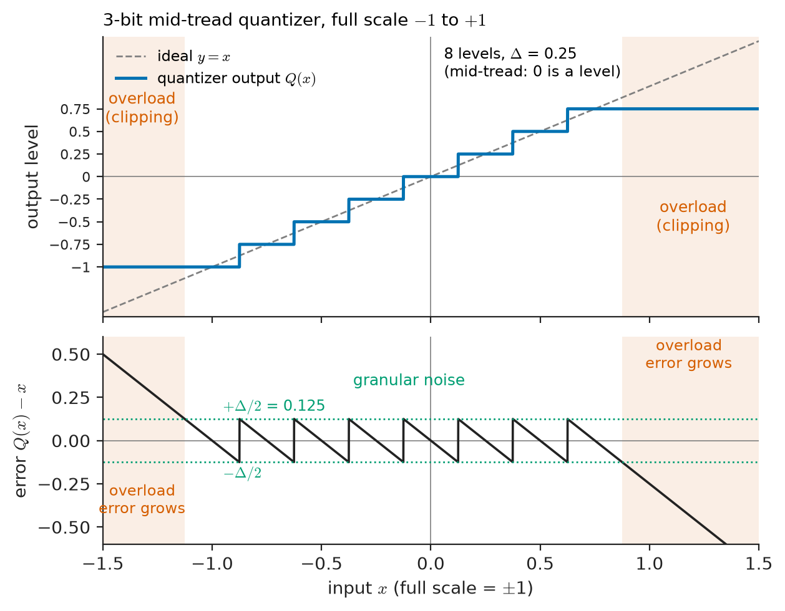
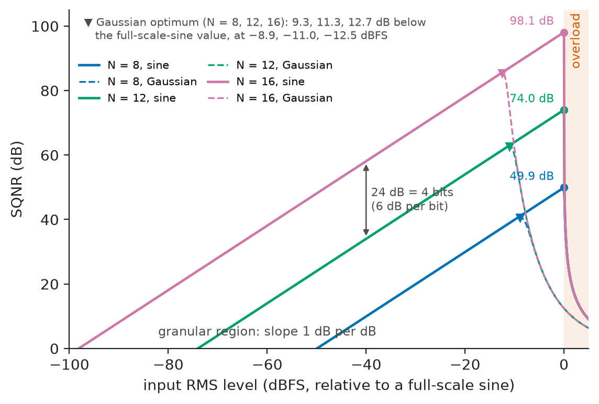
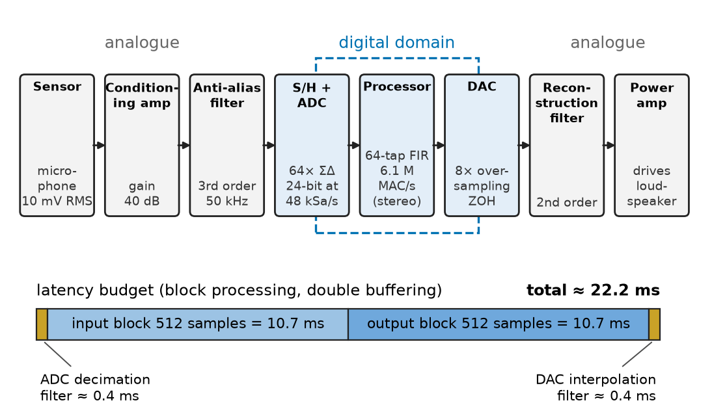
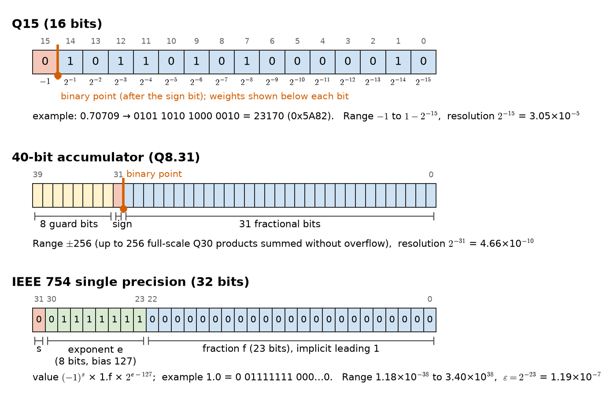
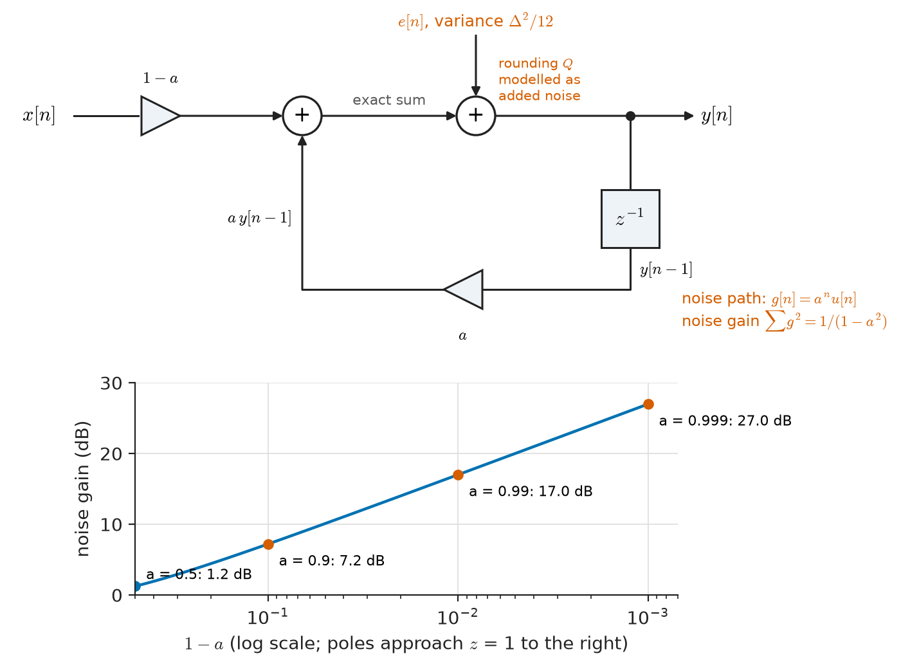
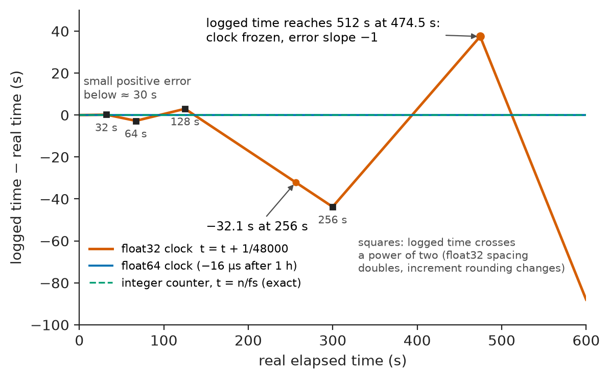

# Chapter 21 — DSP Fundamentals

*Part V · Digital Signal Processing*

A team ports a vibration-monitoring algorithm from a laptop to a small fixed-point processor mounted on a pump. On the laptop, written in double-precision floating point, the algorithm tracks a 5 Hz structural resonance perfectly. On the target, with 16-bit coefficients, the resonance tracker drifts to the wrong frequency, then locks up at a constant output and never recovers. Elsewhere in the same plant, a data logger built on a different board timestamps its samples by adding $1/48\,000$ s to a single-precision floating-point clock at each sample; after eight minutes its clock stops advancing altogether. A third engineer computes the variance of a high-voltage test supply's ripple, a few millivolts riding on ten kilovolts, and the code reports a negative number. None of these failures is a bug in the usual sense. Each program does exactly what the mathematics of Chapter 20 says — but with numbers that have finite length.

Part IV treated sequences and systems as exact mathematical objects. Part V turns them into working processing: programs and hardware that read samples from a converter, compute, and write samples out, on time, every time. This chapter sets up the vocabulary for the whole part. It describes how discrete-time signals are represented in a machine, how sampling and quantization turn an analogue quantity into numbers, how a DSP system is organised and designed, and how finite precision — in the converter, in the coefficients and in every arithmetic operation — changes the ideal answer.

> **How is a continuous-world signal turned into numbers a processor can work on, and what is the processing chain around it?**
> **What do finite word length, fixed-point and floating-point arithmetic do to the results, and how is numerical error predicted and kept under control?**

| Concept | Engineering destination |
|---|---|
| Discrete-time representations | Sample buffers, frames, I/Q streams, file formats for audio, ECG and fault records |
| Sampling and quantization | Choosing ADC resolution and rate, headroom, dither, oversampling converters |
| DSP workflow | Real-time budgets on microcontrollers, DSP chips and FPGAs; design-to-deployment flow |
| Finite-precision effects | Filter noise floors, limit cycles, overflow, coefficient sensitivity |
| Fixed-point arithmetic | Low-power audio codecs, hearing aids, motor drives, protection relays, FPGA filters |
| Floating-point arithmetic | Audio workstations, radar and sonar processing, scientific instruments |
| Numerical error in DSP | Error budgets, scaling, structure choice, robust accumulators and statistics |

**Roadmap.** How signals and systems are represented in a machine (21.1) → sampling and quantization as one interface (21.2) → the end-to-end processing chain and design flow (21.3) → the catalogue of finite-precision effects (21.4) → fixed-point and floating-point arithmetic (21.5) → predicting and controlling numerical error (21.6).

---

## 21.1 Discrete-time representations

### A sequence in memory

In Chapter 20 a sequence $x[n]$ was defined for all integers $n$. In a machine it is a finite array of numbers, each held in a fixed number of bits, together with the information needed to interpret them. A complete discrete-time representation therefore has several parts, all of which must travel with the data:

- **Sample values**, in a stated number format (Section 21.5): 16-bit integers, 24-bit integers packed into 32 bits, 32-bit floats.
- **Sample rate** $f_s$, which turns the index $n$ into time $nT$ and the digital frequency $\Omega$ into hertz.
- **Scale**, the physical quantity represented by full scale or by one count: volts, amperes, pascals, millivolts of ECG, $g$ of acceleration.
- **Time reference**: the absolute time of a chosen sample, essential when signals from different recorders must be aligned (fault records from both ends of a transmission line, EEG and video).
- **Channel layout**: how several channels are stored — interleaved (L, R, L, R, … in audio files) or in separate blocks.

Table 21.1 shows how real systems package these parts.

**Table 21.1 — Representative discrete-time data representations.**

| Domain | Typical rate and format | Scale and metadata |
|---|---|---|
| Consumer audio (WAV, CD) | 44.1 or 48 kSa/s, 16-bit signed integer, interleaved stereo | Full scale = 0 dBFS; rate and channel count in file header |
| Studio audio | 48–192 kSa/s, 24-bit integer or 32-bit float | Float: $\pm1.0$ = full scale, values above allowed internally |
| Diagnostic ECG | 500–1000 Sa/s, 12–16 bits per lead, 12 leads | Gain in µV per count, lead names, patient time stamp |
| Power-system fault records (COMTRADE, IEEE C37.111) | 1–20 kSa/s, 16- or 32-bit integers | Per-channel multiplier and offset to primary amperes or volts; trigger time |
| Software-defined radio | 1–100 MSa/s, complex I/Q pairs of 12–16-bit integers | Centre frequency, gain, rate |
| Seismic (miniSEED) | 1–200 Sa/s, 24-bit or 32-bit integer, compressed | Instrument response, station and channel code, UTC time |
| Machine-vibration monitoring | 25.6 kSa/s, 24-bit | Sensitivity in mV per $g$, shaft speed reference |

### Real and complex sequences

Most measured signals are real, but much of DSP works with **complex** sequences. A radio receiver mixes its input with a cosine and a sine to produce in-phase and quadrature components, $x[n]=x_I[n]+jx_Q[n]$, a complex baseband signal whose spectrum need not be symmetric about zero (Chapters 26 and 27). Complex data make positive and negative frequencies distinguishable, so a complex sampler at rate $f_s$ covers a band of width $f_s$ rather than $f_s/2$: the LTE example in Chapter 19's Table 19.1 samples a 20 MHz channel with 30.72 MSa/s complex. Each complex sample costs two real numbers, and a complex multiplication costs four real multiplications and two additions (or three and five with a rearrangement).

### Sample-by-sample and block processing

Real-time systems process data in one of two ways.

- **Sample-by-sample**: each new sample is processed immediately and an output sample produced before the next input arrives. Latency is one sample plus the converters' delay. Digital control loops, protection relays and active noise cancellation work this way.
- **Block (frame) processing**: samples are collected into blocks of $L$ samples, typically using two alternating buffers (ping-pong buffering) filled by direct memory access while the processor works on the other. Overheads are paid once per block, and block algorithms such as the FFT (Chapter 22) become available. The price is latency: at least one block, and in practice about two. With $L=512$ at 48 kSa/s, one block is 10.7 ms.

### Representing systems

A discrete-time system is represented in a machine by three things: its **coefficients** (the $b_k$ and $a_k$ of Chapter 20, stored in some number format), its **structure** (the order of operations, Section 20.5) and its **state** (the contents of the delay elements). The mathematics of Chapter 20 is indifferent to structure, but finite precision is not: two structures with the same $H(z)$ can behave very differently once coefficients and state are rounded, which is the subject of Sections 21.4–21.6. A signal-flow graph or block diagram is the standard drawing of a structure; it is also, nearly literally, the data-flow graph that an FPGA synthesis tool turns into hardware.

---

## 21.2 Sampling and quantization

Chapter 19 treated sampling and introduced quantization at its interface. Here the converter is viewed from the processor's side: what the numbers mean, how good they are and how to get the most out of a given word length.

### The uniform quantizer

A uniform quantizer with $N$ bits maps an input $x$ in a range of width $V_{FS}$ to one of $2^N$ levels spaced $\Delta=V_{FS}/2^N$ apart. In a **mid-tread** quantizer zero is an output level (inputs within $\pm\Delta/2$ of zero give exactly zero); in a **mid-rise** quantizer zero is a decision threshold and the levels sit at $\pm\Delta/2,\pm3\Delta/2,\dots$ Most ADCs are mid-tread with two's-complement output codes from $-2^{N-1}$ to $2^{N-1}-1$. Rounding to the nearest level gives an error $e=Q(x)-x$ in $[-\Delta/2,\Delta/2]$ inside the range. Outside the range the output **clips** at the end levels and the error grows without limit — **overload**. Figure 21.1 shows the staircase and both kinds of error.

<!-- FIGURE 21.1 | figures/ch21/fig-21-1-quantizer-staircase-error.png | plot | Transfer characteristic and error of a 3-bit mid-tread quantizer, showing granular and overload regions. | Content: top panel input x from -1.5 to 1.5 (full scale -1 to 1), output staircase with 8 levels from -1 to 0.75 in steps of 0.25, dashed ideal line y = x, overload regions beyond the end levels shaded. Bottom panel quantization error from -0.6 to 0.6: sawtooth between plus and minus 0.125 (Delta/2) inside the range, labelled granular noise, and linearly growing error outside, labelled overload (clipping). -->

*Figure 21.1 — Transfer characteristic and error of a 3-bit mid-tread quantizer, showing granular and overload regions.*

### The quantization-noise model and SQNR

The additive-noise model of Chapter 19 treats the granular error as white noise, uniform on $[-\Delta/2,\Delta/2]$, uncorrelated with the signal, with variance

$$
\sigma_e^2=\frac{1}{\Delta}\int_{-\Delta/2}^{\Delta/2}e^2\,de=\frac{\Delta^2}{12}
$$

For a sine of amplitude $A$, the signal power is $A^2/2$. With $A$ at full scale, $A=V_{FS}/2=2^{N-1}\Delta$, the signal-to-quantization-noise ratio is

$$
\mathrm{SQNR}=10\log_{10}\frac{A^2/2}{\Delta^2/12}=10\log_{10}\left(\frac{3}{2}\,2^{2N}\right)=6.02N+1.76\ \mathrm{dB}
$$

and for a sine $L$ dB below full scale (level $-L$ dBFS) it is $6.02N+1.76-L$ dB. Every bit is worth about 6 dB, every halving of signal level costs 6 dB.

> **Status of the principle: SQNR $=6.02N+1.76$ dB**
> *Approximate.* Exact consequence of the uniform-noise model for a full-scale sine; the model holds for busy signals spanning many levels and not synchronised with the sampling clock, and fails for small, slow or periodic signals and in overload.

**Worked example — Audio word length and level.** A 16-bit audio channel carrying a full-scale sine has SQNR $=6.02\times16+1.76=98.1$ dB. A simulation of one million samples of a near-full-scale sine (amplitude 0.999 of full scale, at a frequency not related to $f_s$) rounded to 16 bits gives 98.09 dB — the model is excellent here. But music is rarely at full scale. A passage at $-20$ dBFS has SQNR $78.1$ dB, and a quiet passage at $-60$ dBFS only $38.1$ dB, by which point the error is no longer noise-like (see dither, below). Studio recording at 24 bits is therefore not about the final listener's dynamic range but about **headroom**: recording at $-20$ dBFS to avoid any risk of clipping still leaves a theoretical 126 dB, far below the converter's analogue noise floor.

### Loading, crest factor and headroom

Signals other than sines have different ratios of peak to RMS value, the **crest factor** $C=x_{peak}/x_{rms}$. A sine has $C=\sqrt2$ (3.01 dB); speech and music have 12–20 dB; Gaussian noise has no strict peak, but values beyond $4\sigma$ occur with probability $6\times10^{-5}$, so $C\approx4$ (12.0 dB) is a common loading choice; an OFDM radio signal (Chapter 30) behaves like Gaussian noise. If the quantizer range is set to $\pm C\sigma_x$, then $\Delta=2C\sigma_x/2^N$ and

$$
\mathrm{SQNR}=6.02N+4.77-20\log_{10}C\ \mathrm{dB}
$$

**Worked example — Loading a 16-bit converter with noise-like signals.** For a Gaussian signal with $C=4$ the formula gives $\mathrm{SQNR}=6.02\times16+4.77-12.04=89.0$ dB — but the formula counts granular noise only. A Gaussian signal exceeds $4\sigma$ about 0.006 % of the time, and each clipped sample carries an error of many LSBs; at 16 bits that overload noise dominates, and a simulation including it gives only 52 dB. Lower loading (larger $C$) reduces overload but raises granular noise; higher loading does the reverse. The optimum balances the two and moves with $N$: for 8 bits it lies near $C=4$ (40.6 dB, about 9 dB below the sine figure), for 16 bits near $C=6$ (85.5 dB, about 12.6 dB below the full-scale sine figure of 98.1 dB). The more bits a converter has, the more headroom a noise-like signal needs. Figure 21.2 shows SQNR against input level: a 6 dB-per-bit straight line in the granular region, a peak, and a cliff when overload sets in. Running a converter "hot" to gain a few decibels is a bad bargain, because clipping produces distortion spread across the whole band and, in a radio, spectral regrowth into neighbouring channels.

<!-- FIGURE 21.2 | figures/ch21/fig-21-2-sqnr-versus-level.png | plot | SQNR versus input level for 8-, 12- and 16-bit uniform quantizers with sine and Gaussian inputs. | Content: horizontal axis input RMS level from -100 to +5 dBFS (relative to a full-scale sine), vertical axis SQNR 0 to 105 dB. Straight lines of slope 1 dB per dB for N = 8, 12, 16 reaching 49.9, 74.0 and 98.1 dB at 0 dBFS for a sine and dropping sharply above 0 dBFS (overload). Dashed curves for Gaussian input, including clipping, peaking 9 to 13 dB lower, near -9 dBFS for 8 bits and -12.5 dBFS for 16 bits. Annotations: granular region, overload region, 6 dB per bit spacing between lines. -->

*Figure 21.2 — SQNR versus input level for 8-, 12- and 16-bit uniform quantizers with sine and Gaussian inputs.*

### Dither

The uniform-noise model fails for small signals. A sine of amplitude 1 LSB is quantized to a sequence taking only the values $-1$, $0$ and $+1$: the "error" is a deterministic, periodic waveform — harmonic distortion correlated with the signal, audible in the fade-out of a piano note as a gritty buzz. A 1 kHz tone at $-90$ dBFS in a 16-bit system has an amplitude of $32768\times10^{-90/20}=1.04$ LSB, exactly in this regime. Even worse, a signal smaller than $\Delta/2$ vanishes entirely.

**Dither** is a small random noise added *before* quantization. With **triangular-PDF** (TPDF) dither of $\pm1$ LSB peak, the mean and variance of the total error become independent of the signal: distortion is replaced by a steady, signal-independent hiss, and signals far below 1 LSB remain audible or measurable after averaging. The cost is an increase in noise power from $\Delta^2/12$ to $3\Delta^2/12$, a 4.77 dB rise in the noise floor. Dither is standard when audio is reduced from 24 to 16 bits for distribution, and in measurement instruments that average many readings to resolve below one LSB.

> **Status of the principle: Dither linearises the quantizer**
> *Derived.* With TPDF dither of 2 LSB peak-to-peak, the first two moments of the total error are provably independent of the input; the noise-floor cost of 4.77 dB is exact for this dither.

### Oversampling and noise shaping

Quantization noise is spread uniformly over $0$ to $f_s/2$. If the signal occupies only $0$ to $B$, a digital low-pass filter after the converter removes the noise between $B$ and $f_s/2$, and the in-band noise falls by the **oversampling ratio** $\mathrm{OSR}=f_s/(2B)$:

$$
\mathrm{SQNR}=6.02N+1.76+10\log_{10}\mathrm{OSR}\ \mathrm{dB}
$$

**Worked example — Trading rate for resolution.** A 12-bit ADC running at 1 MSa/s digitises a sensor whose useful bandwidth is 10 kHz. $\mathrm{OSR}=10^6/(2\times10^4)=50$, worth $10\log_{10}50=17.0$ dB, or $17.0/6.02=2.8$ extra bits: the theoretical SQNR rises from 74.0 dB to 91.0 dB after filtering and decimating to, say, 25 kSa/s. The gain is real only if the quantization error is truly noise-like (the analogue noise of the sensor or added dither usually ensures this) and if the decimation filter is long enough. Plain oversampling is expensive: each extra bit costs a factor of 4 in rate.

**Noise shaping** does much better. A sigma–delta modulator places the quantizer inside a feedback loop that pushes quantization noise towards high frequencies, where the decimation filter removes it. An $L$-th-order loop improves SQNR by about $(2L+1)\times3$ dB per doubling of OSR, rather than 3 dB. This is how a 1-bit or few-bit quantizer running at a few megahertz delivers 24-bit audio, and why modern audio, precision measurement and many radio converters are sigma–delta designs.

> **Boundary.** The circuit design of ADCs, DACs and sigma–delta modulators belongs to *Electronics & Computing*. This chapter uses only their input–output behaviour: sample rate, resolution, noise and delay.

**Table 21.2 — Typical converter resolutions and their use.**

| Application | Resolution (bits) | Sample rate | Ideal SQNR (dB) | Notes |
|---|---|---|---|---|
| Video, fast oscilloscopes | 8 | 0.1–10 GSa/s | 49.9 | ENOB often 6–7 at high frequency |
| Microcontroller ADC, motor-drive current sensing | 10–12 | 0.1–5 MSa/s | 62.0–74.0 | Synchronised to PWM |
| Protection relays, energy meters | 16–24 | 1–20 kSa/s | 98–146 | Sigma–delta common in meters |
| Software-defined radio | 12–16 | 10–250 MSa/s | 74–98 | Jitter-limited at high IF |
| CD and consumer audio | 16 | 44.1–48 kSa/s | 98.1 | Distribution format |
| Studio audio, ECG/EEG, seismic, vibration | 24 | 0.1–192 kSa/s | 146.2 (theory) | Real ENOB 18–21 bits, analogue-noise limited |

---

## 21.3 The digital signal processing workflow

### The processing chain

Almost every DSP system has the same skeleton (Figure 21.3):

$$
\text{sensor}\rightarrow\text{conditioning}\rightarrow\text{anti-aliasing filter}\rightarrow\text{S/H + ADC}\rightarrow\text{processor}\rightarrow\text{DAC}\rightarrow\text{reconstruction filter}\rightarrow\text{actuator}
$$

The **sensor** converts a physical quantity to an electrical one: a microphone, a current transformer, an ECG electrode, an antenna, an accelerometer. **Conditioning** amplifies, level-shifts and isolates it to fit the converter's range — the scaling that determines how much of the converter's resolution is actually used. The **anti-aliasing filter** and **ADC** are Chapter 19's subject. The **processor** runs the algorithm: filtering (Chapter 23), spectral analysis (Chapter 22), detection, estimation, adaptive processing (Chapter 24), demodulation (Part VI) or control (Part VII). The output path may lead back to the analogue world through a **DAC** and a reconstruction filter — a loudspeaker, a motor drive, a transmitter — or may end in a decision, a display or a stored record, with no analogue output at all: a relay that trips a breaker, a heart-rate number on a monitor, a packet passed up a protocol stack.

<!-- FIGURE 21.3 | figures/ch21/fig-21-3-dsp-processing-chain.png | block-diagram | The generic DSP processing chain with representative values for a 48 kSa/s audio system. | Content: left-to-right blocks: sensor (microphone, 10 mV RMS), conditioning amplifier (gain 40 dB), anti-aliasing filter (3rd-order, 50 kHz), S/H and ADC (64x oversampled sigma-delta, 24-bit output at 48 kSa/s), processor (64-tap FIR, 6.1 M MAC/s for stereo), DAC (8x oversampling, ZOH), reconstruction filter (2nd-order), loudspeaker amplifier. Dashed boundary marking the digital domain between ADC and DAC. Below the chain, a timeline bar showing latency contributions: ADC decimation filter about 0.4 ms, buffering 2 x 10.7 ms for 512-sample blocks, DAC interpolation filter about 0.4 ms. -->

*Figure 21.3 — The generic DSP processing chain with representative values for a 48 kSa/s audio system.*

### Real-time constraints

A real-time DSP system must finish processing each sample, or each block, before the next one arrives. Two numbers govern every design.

**Throughput.** At a sample rate $f_s$ the processor has $1/f_s$ seconds per sample: 20.8 µs at 48 kSa/s, which on a 200 MHz processor is about 4170 clock cycles. The workload is usually counted in **multiply–accumulate** operations (MACs), because filtering is dominated by $y=\sum h_kx_{n-k}$ and DSP processors are built to perform one or more MACs per cycle.

**Latency.** The delay from an input event to the corresponding output. It accumulates from the converters' internal filters, from buffering, and from the algorithm's own group delay (an FIR filter of length $M$ with linear phase adds $(M-1)/2$ samples). Tolerances vary enormously: a hearing aid must keep total latency below about 10 ms or the wearer hears an echo of their own voice; active noise cancellation needs tens of microseconds; a protection relay must decide within one or two mains cycles (20–40 ms at 50 Hz), including the time its filters need to settle; an off-line seismic analysis has no latency constraint at all.

**Worked example — A processing budget.** A stereo audio crossover runs a 64-tap FIR filter on each channel at 48 kSa/s: $64\times48\,000\times2=6.14$ million MACs per second. A protection relay applies a 101-tap FIR to six channels — three currents and three voltages — at 10 kSa/s: $101\times10\,000\times6=6.06$ million MACs per second. Both fit comfortably on a 200 MHz processor capable of one MAC per cycle, using about 3 % of its capacity, leaving room for everything else the device must do. A 4096-tap room-correction filter on eight channels at 96 kSa/s needs $3.1\times10^9$ MACs per second by direct convolution and pushes the design towards FFT-based fast convolution (Chapter 22) or an FPGA. In block processing with $L=512$, the audio path pays $512/48\,000=10.7$ ms per block of buffering; with double buffering about 21 ms — fine for a crossover in a home system, too long for a hearing aid, which uses blocks of 16–64 samples instead.

### Implementation platforms

| Platform | Typical arithmetic | Strengths | Typical applications |
|---|---|---|---|
| General microcontroller (with DSP instructions) | 16/32-bit fixed point, often single-precision float | Low cost, low power, integrated peripherals | Motor control, sensor nodes, energy meters |
| Dedicated DSP processor | 16/32-bit fixed point or 32-bit float, multiple MACs per cycle | Deterministic timing, efficient filtering | Audio codecs, hearing aids, telecom, relays |
| FPGA | Arbitrary fixed-point word lengths | Massive parallelism, very low latency | Radar, SDR front ends, high-speed test equipment |
| Application processor or PC | 32/64-bit float, vector units | Easy development, large memory | Audio workstations, off-line analysis, instrumentation |
| GPU | 32-bit (and 16-bit) float, thousands of cores | Very high throughput on large blocks | Radio astronomy, medical imaging, sonar beamforming |

> **Boundary.** Processor architectures, memory hierarchies and embedded-software practice belong to *Electronics & Computing*. Here only their numerical consequences matter.

### The design flow

A disciplined DSP design moves from mathematics to hardware in stages, each verified against the previous one.

1. **Specification.** What must the system achieve, measured how? Passband ripple, stopband attenuation, SNR, latency, update rate, power, cost. A specification without measurable numbers cannot be verified.
2. **Algorithm design in high precision.** Design and simulate in double-precision floating point (Python, MATLAB, Julia) using recorded or synthetic test signals. This establishes what the algorithm can achieve when arithmetic is not a concern.
3. **Finite-precision model.** Choose number formats, scaling, structure and word lengths, and simulate them **bit-exactly**: the model must reproduce every rounding, saturation and overflow of the target. Compare against the double-precision reference; the difference is the implementation error, and it must fit inside the specification's error budget.
4. **Implementation** in C, assembly or a hardware description language, often generated automatically from the bit-exact model.
5. **Verification** with test vectors: the target's output, sample for sample, must equal the bit-exact model's output, and the system's measured performance (with real converters and real signals) must meet the specification.

Most of the failures in the opening paragraph come from skipping step 3: an algorithm that was correct in double precision was implemented with the target's arithmetic without first predicting what that arithmetic would do.

---

## 21.4 Finite-precision effects

A digital system with infinite-precision numbers is exactly the LTI system of Chapter 20. Real systems differ from that ideal in four distinct ways, which are analysed separately because they behave differently and are cured differently.

### 1. Input quantization

The ADC's quantization error (Section 21.2) is noise added at the input. It is filtered by the system along with the signal, so its effect at the output depends on the system's frequency response over the noise band. It sets the floor below which no amount of processing can see — except by averaging or by filtering out-of-band noise, as oversampling does.

### 2. Coefficient quantization

The coefficients $b_k$, $a_k$ are stored in finite precision, so the implemented system is not the designed one: its zeros and poles are slightly moved. This is a *deterministic* error — the filter is a different but still linear, time-invariant filter — and can be evaluated exactly by computing the response with the rounded coefficients. For FIR filters the effect is usually benign: stopband attenuation is limited to roughly $6B$ dB for $B$-bit coefficients, and linear phase is preserved if the rounded coefficients remain symmetric. For IIR filters it can be severe: poles near the unit circle, which narrowband and low-frequency filters always have, move a long way for small coefficient changes, and can cross the circle (Section 21.6).

### 3. Arithmetic roundoff

The product of two $B$-bit numbers has $2B$ bits. Storing it back into $B$ bits requires rounding or truncation, which injects a small error at every multiplication (or at every accumulator store). Under conditions similar to those for ADC quantization, each rounding point behaves like a white-noise source of variance $\Delta^2/12$, and the noise it produces at the output depends on the transfer function from that point to the output. In recursive filters, where rounded values are fed back, this noise is amplified by the feedback loop (Section 21.6).

### 4. Overflow

A fixed-point register can hold only a limited range. A sum that exceeds it either **wraps around** (in two's complement, a large positive value becomes a large negative one) or **saturates** at the largest representable value, if saturation logic is used. Either is a large nonlinear error. It is prevented by **scaling** — dividing the input or the coefficients so that no internal node can exceed its range for any allowed input — at the cost of a lower signal level relative to roundoff noise. Scaling is thus a trade-off between overflow and noise, exactly the loading trade-off of the ADC in Section 21.2.

### Limit cycles

Rounding inside a feedback loop is a nonlinearity, and nonlinear feedback systems can oscillate on their own. A recursive filter with zero input should decay to zero; with rounding it may instead settle into a constant or a small periodic output, a **zero-input limit cycle**.

**Worked example — A dead band.** The first-order filter $y[n]=Q\{0.9\,y[n-1]\}$, with $Q$ rounding to the nearest integer (in LSB units) and starting from $y=10$, produces $10, 9, 8, 7, 6, 5, 5, 5,\dots$ because $0.9\times6=5.4$ rounds to 5, and then $0.9\times5=4.5$ rounds back to 5. The output sticks at 5 LSB forever instead of decaying. With the coefficient $-0.9$ it alternates $+5,-5,+5,\dots$ — a limit cycle at the Nyquist frequency. In general a first-order loop with coefficient $a$ cannot decay below the **dead band** $\lvert y\rvert\le0.5/(1-\lvert a\rvert)$ LSB, here exactly 5. For $a=0.99$ the dead band is 50 LSB; for $a=0.999$, 500 LSB. In audio, a low-level limit cycle in a reverberation filter is an audible idle tone; in a controller, a small persistent oscillation (hunting) of the actuator.

> **Status of the principle: Dead-band bound for first-order limit cycles**
> *Derived.* Follows from requiring that rounding can hold $y$ constant, $\lvert y-\lvert a\rvert y\rvert\le1/2$; exact for rounding to nearest in a first-order loop. Higher-order loops have more complicated limit-cycle behaviour, and overflow can cause far larger oscillations.

Overflow inside a feedback loop is worse: with wrap-around arithmetic, a second-order filter can enter a full-scale **overflow oscillation** that never ends. Saturation arithmetic prevents this in second-order sections, which is one reason DSP processors provide it in hardware.

The practical remedies for limit cycles are wider internal state (more bits behind the binary point, which shrinks the dead band in signal units), magnitude truncation instead of rounding in some structures, small amounts of dither, and structures that are proven free of limit cycles.

---

## 21.5 Fixed-point and floating-point arithmetic

### Two's-complement integers and fractional formats

Nearly all fixed-point DSP uses **two's complement**. A $B$-bit word represents integers from $-2^{B-1}$ to $2^{B-1}-1$; the most significant bit has weight $-2^{B-1}$ and the others positive powers of two. Addition and subtraction work identically for positive and negative numbers, and an intermediate overflow does no harm if the final result is in range — a useful property in long sums.

DSP usually interprets the integer as a **fraction** by placing an implied binary point. In the **Q$m$.$n$** notation, $m$ bits are integer bits (excluding the sign, in the convention used here) and $n$ are fractional; the value is the integer divided by $2^n$. The most common format is **Q15** (also written Q0.15 or Q1.15): a 16-bit word with 15 fractional bits, representing values in $[-1,\ 1-2^{-15}]=[-1,\ 0.999969]$ with resolution $2^{-15}=3.05\times10^{-5}$. Q31 does the same in 32 bits with resolution $4.66\times10^{-10}$. Fractions are used because the product of two numbers less than 1 in magnitude is also less than 1 — multiplication cannot overflow, except for the single case $(-1)\times(-1)$. Figure 21.4 shows the bit layouts.

<!-- FIGURE 21.4 | figures/ch21/fig-21-4-number-formats.png | table-graphic | Bit layouts of Q15 fixed-point, a 40-bit accumulator and IEEE 754 single-precision floating point. | Content: three horizontal bit-field bars. Q15: 16 cells, bit 15 labelled sign with weight -1, bits 14 to 0 with weights 2^-1 to 2^-15, binary point after the sign bit, example 0.70709 stored as 0101 1010 1000 0010 (decimal 23170). 40-bit accumulator: 8 guard bits, sign, 31 fractional bits (Q8.31), binary point marked. IEEE 754 single: 1 sign bit, 8 exponent bits (bias 127), 23 fraction bits with implicit leading 1, example 1.0 shown as 0 01111111 000...0. Side notes with range and resolution of each format. -->

*Figure 21.4 — Bit layouts of Q15 fixed-point, a 40-bit accumulator and IEEE 754 single-precision floating point.*

**Worked example — Q15 coefficients and products.** The coefficient $0.7071$ ($1/\sqrt2$, common in filters and FFT twiddle factors) becomes $\operatorname{round}(0.7071\times32768)=23170$, which represents $23170/32768=0.707092$, an error of $-7.7\times10^{-6}$, within the maximum rounding error $2^{-16}=1.53\times10^{-5}$. Multiplying the Q15 numbers $0.75$ (24576) and $-0.5$ ($-16384$) gives the integer $-402\,653\,184$, which is a **Q30** number: $-402\,653\,184/2^{30}=-0.375$. To store it back as Q15, shift right by 15 bits (with rounding): $-12288$, i.e. $-0.375$. Now add $0.75$ and $0.5$ in Q15: $24576+16384=40960$, beyond the largest Q15 value 32767. With wrap-around this becomes $40960-65536=-24576$, or $-0.75$ — a full-scale sign error. With saturation it becomes 32767, or $0.99997$, an error of 0.25 but with the correct sign. Saturation is almost always the right choice for signals; wrap-around is the right choice for phase accumulators and modular counters.

### Accumulators and guard bits

A FIR filter computes $\sum_{k=0}^{M-1}h_kx_{n-k}$. If each product is kept to full Q30 precision and added in a wide **accumulator**, there is only one rounding — at the end — rather than one per product. DSP processors provide accumulators of 40 bits or more for 16-bit data: 32 bits for the full product plus 8 **guard bits** above the sign, allowing up to $2^8=256$ worst-case full-scale products to be summed without overflow. In general summing $M$ terms needs $\lceil\log_2M\rceil$ guard bits. With the accumulator protected, intermediate overflow is impossible and only the final result must be scaled and saturated. This single design feature — double-width products and guard bits — is why fixed-point FIR filters can achieve noise floors close to the ideal set by their output word length.

### Rounding modes

**Truncation** (dropping the low bits, i.e. rounding towards $-\infty$ in two's complement) is cheap but biased: its error lies in $(-\Delta,0]$ with mean $-\Delta/2$. A DC offset of half an LSB at every multiplication can accumulate in a recursive filter to a significant offset. **Round-to-nearest** has zero mean in the noise model. **Convergent rounding** (round half to even) removes the slight bias of ordinary rounding in the exact-half case. Most processors offer rounding as an option in the store instruction; the bit-exact model must use the same mode.

### Floating point

A **floating-point** number stores a sign $s$, an exponent $e$ and a significand (mantissa) $m$, representing $(-1)^s\times1.m\times2^{e-\text{bias}}$. The IEEE 754 standard defines the formats used everywhere:

**Table 21.3 — Number formats used in DSP.**

| Format | Bits (sign/exponent/fraction) | Smallest step relative to value | Range (normal numbers) | Approximate dynamic range | Full-scale-sine SQNR equivalent |
|---|---|---|---|---|---|
| Q15 fixed point | 16 total | absolute step $3.05\times10^{-5}$ | $-1$ to $0.99997$ | 90 dB | 98.1 dB at full scale, falling 1 dB per dB of level |
| Q31 fixed point | 32 total | absolute step $4.66\times10^{-10}$ | $-1$ to $\approx1$ | 187 dB | 194.4 dB at full scale |
| IEEE half (float16) | 1/5/10 | $\varepsilon=9.77\times10^{-4}$ | $6.1\times10^{-5}$ to 65 504 | 181 dB | about 68 dB at any level |
| IEEE single (float32) | 1/8/23 | $\varepsilon=1.19\times10^{-7}$ | $1.18\times10^{-38}$ to $3.40\times10^{38}$ | 1529 dB | about 146 dB at any level |
| IEEE double (float64) | 1/11/52 | $\varepsilon=2.22\times10^{-16}$ | $2.2\times10^{-308}$ to $1.8\times10^{308}$ | 12 318 dB | about 320 dB at any level |

The key difference from fixed point is that the error of floating point is *relative*. Rounding a number $x$ to the nearest representable value gives $\mathrm{fl}(x)=x(1+\delta)$ with $\lvert\delta\rvert\le\varepsilon/2$, where $\varepsilon$ (**machine epsilon**) is the spacing between 1 and the next larger number: $2^{-23}$ for single and $2^{-52}$ for double precision. The signal-to-roundoff ratio of a single operation is therefore roughly constant regardless of signal level — about 146 dB for single precision (a 24-bit significand) — instead of falling 1 dB for every decibel of level as in fixed point. Overflow practically never happens, so scaling largely disappears as a design concern.

> **Status of the principle: Relative error model of floating point**
> *Derived.* IEEE 754 guarantees that each basic operation is correctly rounded, so $\mathrm{fl}(a\circ b)=(a\circ b)(1+\delta)$ with $\lvert\delta\rvert\le\varepsilon/2$ for normal results; the bound fails for subnormal numbers near underflow and says nothing about how errors combine across many operations.

Floating point is not free of problems. The relative error is constant, but the *absolute* error grows with the size of the number, so adding a small number to a large one loses the small number's low bits — or all of it (Section 21.6). **Subnormal** (denormal) numbers near underflow are slow on many processors: a recursive audio filter whose state decays towards zero after the music stops can drop into subnormals and multiply its CPU load several times, which is why audio software often flushes subnormals to zero or adds a tiny offset. And floating-point results depend on the order of operations, because addition is not associative; two correct implementations of the same filter can differ in their last bits, which matters when bit-exact reproducibility is required.

### Block floating point and choosing a format

Between the two lies **block floating point**: a block of fixed-point values shares one exponent, chosen so that the largest value in the block nearly fills the word. FFT processors (Chapter 22) often rescale between stages this way, gaining most of floating point's dynamic range at fixed-point cost.

The choice of format is an engineering one. Fixed point uses less silicon area and power and gives deterministic timing; it dominates in hearing aids, battery-powered sensors, high-volume consumer codecs and FPGAs. Floating point shortens development, removes scaling, and dominates in audio workstations, instrumentation and radar processing on general processors. Many products mix them: a fixed-point FPGA front end at the full sample rate feeding a floating-point processor at a decimated rate.

---

## 21.6 Numerical error in DSP

The previous sections listed the sources of error. This section predicts their size at the output of a system and shows the most common ways error accumulates.

### Noise gain of a roundoff source

If a white roundoff noise $e[n]$ of variance $\sigma_e^2$ is injected at some node, and $g[n]$ is the impulse response from that node to the output, the output noise variance is

$$
\sigma_{out}^2=\sigma_e^2\sum_{n=0}^{\infty}g[n]^2=\sigma_e^2\,\frac{1}{2\pi}\int_{-\pi}^{\pi}\lvert G(e^{j\Omega})\rvert^2\,d\Omega
$$

The sum $\sum g[n]^2$ is the **noise gain** of that path (the second form is Parseval's relation). Total output noise is the sum over all rounding points, since the sources are assumed independent.

> **Status of the principle: Roundoff noise propagation**
> *Approximate.* Exact for an LTI system driven by white noise; the approximation lies in treating rounding as independent white noise, which requires busy signals and fails in limit cycles and for constant or very small inputs.

**Worked example — Roundoff in an exponential smoother.** An RMS meter in a motor drive smooths its squared current with $y[n]=a\,y[n-1]+(1-a)x[n]$ in Q15, with products accumulated at double width and rounded once when $y[n]$ is stored. The rounding error enters the loop at the same point as the stored output, so $g[n]=a^nu[n]$ and the noise gain is

$$
\sum_{n=0}^{\infty}a^{2n}=\frac{1}{1-a^2}
$$

For $a=0.9$ the noise gain is 5.26 (7.2 dB); for $a=0.99$ it is 50.3 (17.0 dB); for $a=0.999$ it is 500 (27.0 dB). With $\Delta=2^{-15}$, the rounding noise has RMS value $\Delta/\sqrt{12}=8.81\times10^{-6}$ ($-101.1$ dB relative to full scale). For $a=0.99$ the output noise is $8.81\times10^{-6}\times\sqrt{50.3}=6.25\times10^{-5}$, or $-84.1$ dB: the filter's own arithmetic has made its output about 17 dB noisier than the 16-bit data it processes, costing almost three bits. The lesson generalises: **the narrower the filter (the closer its poles to the unit circle), the larger its internal noise gain.** The remedy is to keep the state $y$ in a wider format — Q31 state reduces the noise by $2^{16}$, or 96 dB — or to use error-feedback structures that subtract the previous rounding error. Figure 21.5 shows the noise model.

<!-- FIGURE 21.5 | figures/ch21/fig-21-5-roundoff-noise-model.png | block-diagram | Linear noise model of a first-order recursive filter with rounding at the state store. | Content: block diagram: input x[n] multiplied by (1 - a), summed with a times the delayed output from a z^-1 block, then a rounding block Q replaced by an adder injecting e[n] with variance Delta^2/12, output y[n] fed back through z^-1 and gain a. Inset plot: noise gain 1/(1 - a^2) in dB versus a from 0.5 to 0.999 on a logarithmic (1 - a) axis, rising from 1.2 dB to 27 dB, with points marked at a = 0.9 (7.2 dB), 0.99 (17.0 dB), 0.999 (27.0 dB). -->

*Figure 21.5 — Linear noise model of a first-order recursive filter with rounding at the state store.*

### Coefficient sensitivity

The poles of a direct-form second-order section are determined by $a_1=-2r\cos\theta$ and $a_2=r^2$. Near $\theta=0$ (low-frequency resonances relative to $f_s$), $\cos\theta\approx1-\theta^2/2$ changes very little with $\theta$, so a tiny change in $a_1$ produces a large change in pole angle; and $r$ near 1 means a tiny change in $a_2$ can push the pole onto the circle. Narrowband, low-frequency, high-sample-rate filters are the worst case — which is precisely the situation of the vibration tracker in the opening paragraph.

**Worked example — Quantizing a resonator.** The tracker uses a resonator with poles at $r=0.995$, $\theta=2\pi\times5/1000$ (5 Hz at $f_s=1$ kSa/s). In the recursion $y[n]=c_1y[n-1]+c_2y[n-2]+x[n]$ the coefficients are $c_1=2r\cos\theta=1.989018$ and $c_2=-r^2=-0.990025$. Because $\lvert c_1\rvert>1$ they are stored with one integer bit and $B$ fractional bits. Rounding to $B$ bits and recomputing the poles:

| Fractional bits $B$ | $c_1$ stored | $c_2$ stored | Pole radius | Pole frequency |
|---|---|---|---|---|
| exact | 1.989018 | $-0.990025$ | 0.99500 | 5.000 Hz |
| 15 | 1.989014 | $-0.990021$ | 0.99500 | 5.000 Hz |
| 12 | 1.989014 | $-0.989990$ | 0.99498 | 4.92 Hz |
| 8 | 1.988281 | $-0.988281$ | real poles at 1.000 and 0.988 | none (no resonance) |

At 12 bits the resonance has moved by 1.6 %. At 8 bits the complex pair has collapsed onto the real axis and one pole sits exactly on the unit circle: the "resonator" has become a marginally stable integrator whose output, once disturbed, never returns — the lock-up reported in the opening. The cure is not simply more bits but a better structure: a cascade of sections, a coupled-form (Gold–Rader) resonator whose coefficients are $r\cos\theta$ and $r\sin\theta$ directly and whose pole grid is uniform near $z=1$, or reducing the sample rate before the resonator so that 5 Hz is no longer a tiny angle (Chapter 24). Chapter 23 returns to structure choice for IIR filters.

### Accumulated error in long computations

Some errors do not average out but grow with the length of the computation.

**Worked example — The clock that stopped.** The data logger of the opening keeps time by executing `t = t + dt` once per sample in single precision, with $dt=1/48\,000=2.083\times10^{-5}$ s. Each addition rounds the result to the float32 grid, whose spacing is $\varepsilon t$ — it grows with $t$. A bit-exact simulation shows:

| Real elapsed time | Logged time | Error |
|---|---|---|
| 1 s | 1.000645 s | $+0.65$ ms |
| 10 s | 10.0357 s | $+35.7$ ms |
| 60 s | 57.809 s | $-2.19$ s |
| 256 s | 223.94 s | $-32.1$ s |
| 474.5 s | 512.000 s | $+37.5$ s, and frozen from here on |

The error changes sign because the rounding of each increment depends on where $t$ sits on the grid. When $t$ reaches 512 s the grid spacing is $2^{-14}=6.1\times10^{-5}$ s, so the increment $2.08\times10^{-5}$ s is less than half a spacing and every addition rounds back to the same value: the clock has stopped. In double precision the same loop is off by only 16 µs after one hour. The robust solution uses neither: count samples in an integer and compute $t=n/f_s$ when needed, so that no error accumulates at all. The same mechanism afflicts phase accumulators in oscillators (keep phase in a wrapping integer), running sums in recursive moving averages (Chapter 20), and long integrations of sensor data, as in inertial navigation. Figure 21.6 plots the error.

<!-- FIGURE 21.6 | figures/ch21/fig-21-6-float32-clock-error.png | plot | Error of a single-precision clock incremented by 1/48000 s per sample, compared with double precision and an integer sample counter. | Content: horizontal axis real time 0 to 600 s; vertical axis logged time minus real time in seconds, -100 to +50. float32 curve: small positive error up to about 30 s, then piecewise-linear segments with slope changes at the powers of two 32, 64, 128, 256 s, reaching -32 s at 256 s real, then rising steeply to meet 512 s logged at 474.5 s real, then a straight line of slope -1 after the clock freezes. float64 curve indistinguishable from zero (16 microseconds after one hour, noted in label). Integer-counter curve exactly zero. Horizontal grid line at zero. -->

*Figure 21.6 — Error of a single-precision clock incremented by 1/48000 s per sample, compared with double precision and an integer sample counter.*

### Catastrophic cancellation

Subtracting two nearly equal floating-point numbers leaves only their difference, but the rounding errors of the two operands — relative to their large size — remain. The relative error of the result can then be enormous.

**Worked example — A negative variance.** A test engineer records a 10 kV DC supply in volts and wants the RMS ripple, about 10 mV. The textbook formula $\sigma^2=\overline{x^2}-\bar x^2$ is evaluated in float32 over 10 000 samples. Both $\overline{x^2}$ and $\bar x^2$ are about $10^8$ V², and float32 resolves them only to about $10^8\times1.2\times10^{-7}\approx12$ V² — far more than the true variance of $10^{-4}$ V². The computed result in one run was $-8$ V², a physically impossible negative variance; the true value is $9.98\times10^{-5}$ V². Subtracting the mean first (the **two-pass** method, $\sigma^2=\overline{(x-\bar x)^2}$) gives $9.98\times10^{-5}$ V² in the same float32 arithmetic, correct to four digits. Streaming algorithms that must not store the data use Welford's update, which achieves the same accuracy in one pass. The principle — remove large common components before squaring, multiplying or subtracting — applies equally to DC offsets in AC power measurements, to carrier components in demodulators and to computing small differences between large phasors in differential protection.

### Error budgets and scaling

A DSP design accounts for all of these errors explicitly, just as an analogue design accounts for resistor tolerances and op-amp noise:

1. **Start from the specification** — for example, an output SNR of 90 dB for an audio processor, or an amplitude accuracy of 0.1 % for a revenue meter.
2. **Allocate the error budget** among input quantization, coefficient error, arithmetic roundoff and algorithm approximation (finite filter length, window effects).
3. **Choose scaling** so that no node overflows for the worst-case input, using the $\ell_1$ norm $\sum\lvert g[n]\rvert$ (which guarantees no overflow), the $\ell_2$ norm $\sqrt{\sum g[n]^2}$ (which bounds overflow probability for noise-like signals) or the peak of $\lvert G(e^{j\Omega})\rvert$ (for sinusoids), from the input to each node.
4. **Choose structure and word lengths** so that the roundoff noise computed with the noise-gain formula, after scaling, meets its share of the budget, with margin.
5. **Verify** with a bit-exact simulation, including worst-case and pathological inputs: full-scale sinusoids at the filter's peak-gain frequency, steps, silence (for limit cycles), and long runs (for accumulation).

> **Status of the principle: Linear error-budget method**
> *Approximate.* Treats each error source as independent additive noise and adds variances; adequate for most filtering and transform designs with busy signals, but it must be supplemented by deterministic checks for overflow, limit cycles, coefficient-induced instability and accumulation, which the noise model does not capture.

Table 21.4 summarises the error sources, their character and their typical cures.

**Table 21.4 — Finite-precision error sources and remedies.**

| Source | Character | Typical size | Main remedies |
|---|---|---|---|
| ADC quantization | Additive noise (with dither or busy signals) | $\Delta^2/12$; 98 dB SQNR at 16 bits | More bits, oversampling, proper gain staging |
| Coefficient quantization | Deterministic change of $H(z)$ | Pole shifts large near $z=1$ | More coefficient bits, second-order-section cascades, better structures, lower internal sample rate |
| Product roundoff | Additive noise shaped by noise gain | $\Delta^2/12$ times $\sum g^2$ | Wide accumulators, wider state, error feedback |
| Overflow | Large nonlinear error | Up to full scale | Scaling, guard bits, saturation arithmetic |
| Limit cycles | Self-sustained small oscillations | Dead band of a few to hundreds of LSB | Wider state, dither, limit-cycle-free structures |
| Floating-point accumulation | Growing absolute error, stalls | Grows with operand size and count | Integer counters, compensated (Kahan) summation, double precision |
| Catastrophic cancellation | Loss of significant digits | Relative error up to 100 % or more | Remove common components first, two-pass or Welford algorithms |

---

## What remains open

| Open question | Where it is answered |
|---|---|
| Where did the sampling theorem, aliasing and the quantization interface come from? | Chapter 19 |
| What are the exact sequences, difference equations and system functions that finite precision approximates? | Chapter 20 |
| How is the spectrum of a finite record computed, and how do FFT word lengths and block floating point behave? | Chapter 22 |
| How are FIR and IIR filters designed, structured and quantized to meet a specification? | Chapter 23 |
| How do decimation, interpolation and adaptive filters behave, and how is the sample rate changed before a narrowband filter? | Chapter 24 |
| How does quantization become pulse-code modulation, with companding and line coding? | Chapter 27 |
| How do sampling and finite precision affect digital controllers? | Chapter 35 |
| How are ADCs, DACs and DSP processors built? | *Electronics & Computing* |
| What is the general theory of floating-point error analysis? | *The Mathematics Universe* |

**Next:** Chapter 22 introduces the discrete Fourier transform and the FFT, the tools that turn a finite block of samples into a spectrum.
