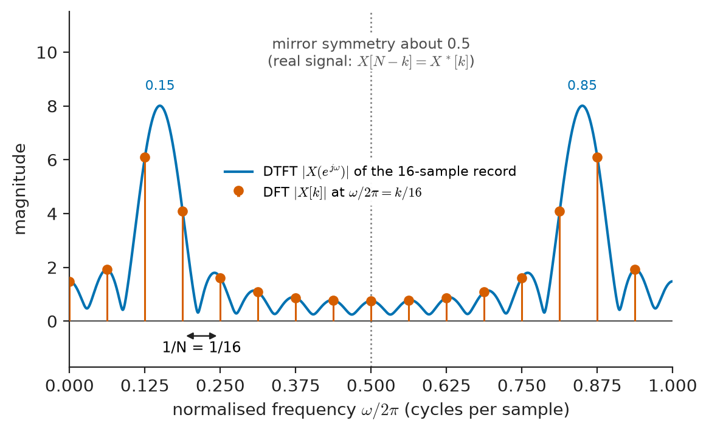
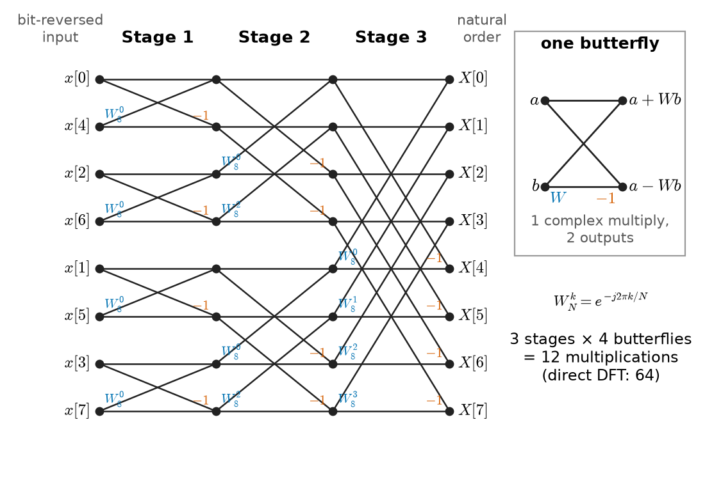
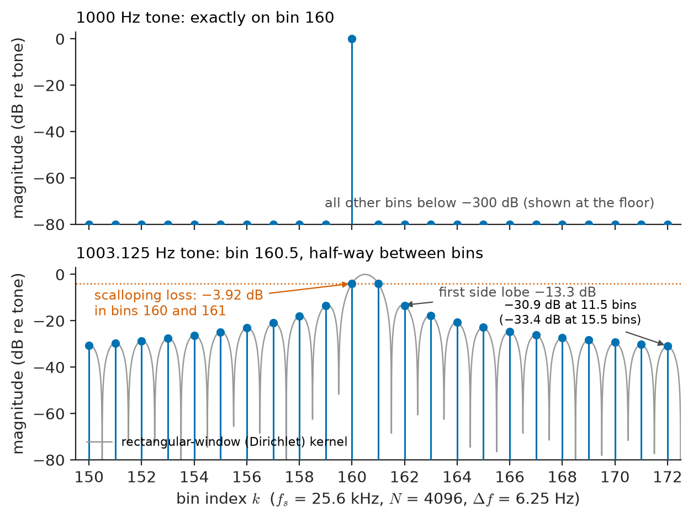
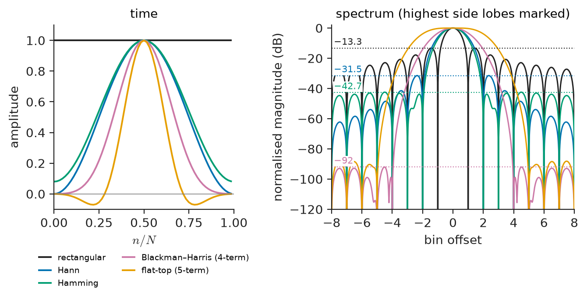
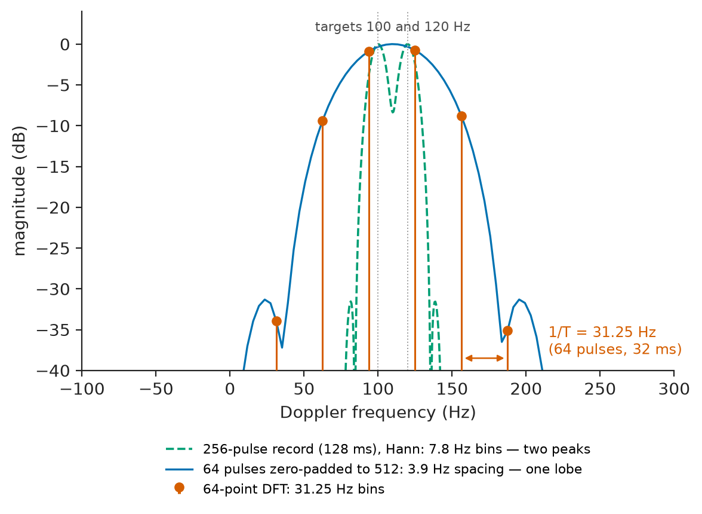
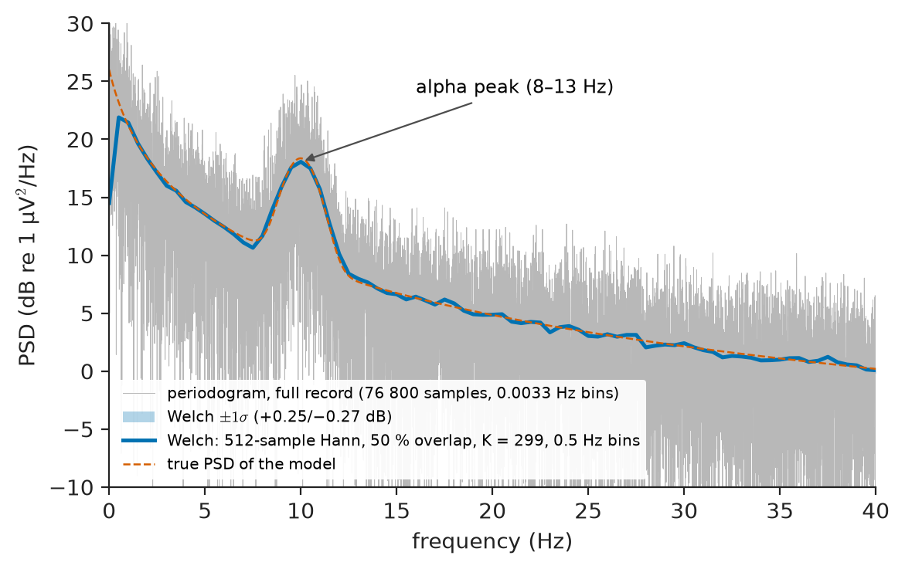

# Chapter 22 — Discrete Fourier Transform

*Part V · Digital Signal Processing*

A power-quality analyser is clipped onto the incoming feeder of a factory that has just installed a bank of variable-speed drives. The utility has complained about harmonic distortion, and the analyser must report the 5th, 7th and 11th harmonic voltages to a fraction of a percent. Inside the instrument there is no bank of tuned filters and no swept spectrum analyser: there is an ADC, a block of memory holding 2048 samples, and an algorithm that turns those samples into 2048 complex numbers in under a millisecond. When the mains frequency sits at exactly 50.00 Hz the numbers are perfect. When the grid sags to 49.8 Hz during an evening peak, the same algorithm under-reports the 11th harmonic by a quarter, and a careless engineer would conclude that the drives had become cleaner. Nothing in the hardware changed. What changed was the relation between the signal and the finite, sampled window through which the algorithm sees it.

That algorithm is the discrete Fourier transform (DFT), almost always computed by a fast Fourier transform (FFT). It is the most used numerical tool in electrical engineering: it sits inside spectrum analysers, vibration monitors, OFDM modems, radar Doppler processors, audio codecs, MRI scanners and every oscilloscope's "FFT" button. This chapter defines it, inverts it, shows how to read its output as a spectrum, explains why it can be computed fast, and then deals honestly with the three things that make its output differ from the "true" spectrum of Chapter 18: leakage, the grid of bins, and random fluctuation.

> **What exactly does the DFT compute, and how is it related to the continuous Fourier transform of the signal that was sampled?**
> **Why do tones leak into neighbouring bins, what does a window buy, and why does zero padding not improve resolution?**
> **How is a reliable power spectrum estimated from a finite, noisy record?**

| Concept | Engineering destination |
|---|---|
| DFT definition and bins | FFT spectrum analysers, oscilloscope FFT mode, harmonic analysers |
| Inverse DFT | OFDM transmitters (Wi-Fi, LTE, 5G NR, DVB-T), synthesis of test waveforms |
| Circular convolution | Fast FIR filtering, cyclic prefix in OFDM, correlation receivers |
| Spectral interpretation and scaling | Harmonic measurement (IEC 61000-4-7), audio THD+N, ADC testing |
| FFT algorithms | Real-time spectrum analysis, radar Doppler banks, software-defined radio |
| Spectral leakage | Vibration analysis of rotating machines, power-system harmonics, sonar |
| Windowing | Detecting weak tones beside strong ones, amplitude-accurate calibration |
| Zero padding | Peak interpolation, frequency estimation, display smoothing |
| Spectral estimation | Noise-floor measurement, EEG band power, PSD of sensor noise |

**Roadmap.** Definition of the DFT as samples of the DTFT (22.1) → its inverse and the circular properties that follow (22.2) → reading bins as physical frequencies and amplitudes (22.3) → the FFT and why it is fast (22.4) → leakage when the record is not periodic (22.5) → windows as the cure and their costs (22.6) → zero padding and what it does not do (22.7) → estimating power spectra of random signals (22.8).

---

## 22.1 DFT definition

### From the DTFT to a computable transform

Chapter 20 gave the discrete-time Fourier transform (DTFT) of a sequence $x[n]$,

$$
X(e^{j\omega})=\sum_{n=-\infty}^{\infty}x[n]\,e^{-j\omega n},
$$

a continuous, $2\pi$-periodic function of the normalised angular frequency $\omega$ (radians per sample). Two features make it unsuitable for a processor: it needs infinitely many samples, and it produces a function on a continuum of frequencies. A real instrument holds a finite record of $N$ samples, $x[0],\dots,x[N-1]$, and can store only a finite list of numbers. The natural compromise is to evaluate the DTFT of the finite record at $N$ equally spaced frequencies,

$$
\omega_k=\frac{2\pi k}{N},\qquad k=0,1,\dots,N-1 .
$$

This defines the **discrete Fourier transform**:

$$
X[k]=\sum_{n=0}^{N-1}x[n]\,e^{-j2\pi kn/N},\qquad k=0,1,\dots,N-1 .
$$

It is customary to write $W_N=e^{-j2\pi/N}$, the principal $N$-th root of unity, so that $X[k]=\sum_n x[n]W_N^{kn}$. Each output $X[k]$ is a correlation of the record with a complex exponential that completes exactly $k$ cycles in $N$ samples. The index $k$ is called the **bin** number, and the set of $N$ outputs is the spectrum on a grid.

<!-- FIGURE 22.1 | figures/ch22/fig-22-1-dtft-dft-samples.png | plot | The DFT samples the DTFT of a finite record at N equally spaced frequencies. | Content: x-axis normalised frequency omega/(2 pi) from 0 to 1, y-axis magnitude (linear). Solid continuous curve: DTFT magnitude of a 16-sample record of cos(2 pi 0.15 n) (peaks near 0.15 and 0.85 with sinc-like sidelobes). Stem markers at k/16, k = 0..15, lying exactly on the curve, labelled X[k]. Annotate bin spacing 1/N = 1/16 and the mirror symmetry about 0.5 for a real signal. -->

*Figure 22.1 — The DFT samples the DTFT of a finite record at N equally spaced frequencies.*

Figure 22.1 shows the relation for a 16-sample record of a cosine: the DTFT of the finite record is a smooth curve, and the DFT is that curve read off at 16 points. Everything that follows in this chapter is a consequence of this picture: the curve is not the spectrum of the infinitely long cosine (which would be two impulses), because the record was truncated; and the 16 points may or may not land on the curve's peaks.

### Matrix form

Because the DFT is a linear map from $N$ numbers to $N$ numbers, it can be written as a matrix–vector product, $\mathbf X=\mathbf F_N\mathbf x$, with $(\mathbf F_N)_{kn}=W_N^{kn}$. For $N=4$, $W_4=e^{-j\pi/2}=-j$ and

$$
\mathbf F_4=\begin{bmatrix}1&1&1&1\\1&-j&-1&j\\1&-1&1&-1\\1&j&-1&-j\end{bmatrix}.
$$

**Worked example — a four-point DFT by hand.** Take $x=[1,\;2,\;0,\;-1]$. Then

$$
X[0]=1+2+0-1=2,\qquad X[1]=1+2(-j)+0+(-1)(j)=1-3j,
$$

$$
X[2]=1-2+0+1=0,\qquad X[3]=1+2(j)+0+(-1)(-j)=1+3j .
$$

$X[0]$ is the sum of the samples, $N$ times the mean (the DC term). $X[3]$ is the complex conjugate of $X[1]$, as it must be for a real input (Section 22.3). $X[2]$, the bin at half the sampling rate, is real. Direct evaluation needed $N^2=16$ complex multiplications (most of them trivial here); Section 22.4 shows how to cut that cost. The energy check of the next section also works: $\sum|x[n]|^2=1+4+0+1=6$ and $\tfrac14\sum|X[k]|^2=\tfrac14(4+10+0+10)=6$.

### Periodicity built into the definition

Because $W_N^{kn}$ is periodic in both $k$ and $n$ with period $N$, the formula, if evaluated outside $0\le k\le N-1$, simply repeats: $X[k+N]=X[k]$. More importantly, the inverse (next section) returns a sequence that is also periodic in $n$. The DFT therefore does not really describe a finite record; it describes **one period of a periodic sequence** whose period is the record. Every peculiarity of the DFT, from circular convolution to leakage, follows from this hidden periodic extension.

> **Status of the principle: DFT as samples of the DTFT**
> *Derived.* For a sequence that is zero outside $0\le n\le N-1$, $X[k]=X(e^{j\omega})\vert_{\omega=2\pi k/N}$ exactly; this follows directly from the definitions and needs no approximation.

---

## 22.2 Inverse DFT

### The inversion formula

The $N$ complex exponentials $e^{j2\pi kn/N}$, $k=0,\dots,N-1$, are orthogonal over $N$ samples:

$$
\sum_{n=0}^{N-1}e^{j2\pi (k-m)n/N}=\begin{cases}N,& k=m \ (\mathrm{mod}\ N)\\0,&\text{otherwise,}\end{cases}
$$

because the sum of a geometric series of $N$ equally spaced points on the unit circle is zero unless every point is 1. Multiplying the DFT by $e^{j2\pi km/N}$ and summing over $k$ therefore isolates $x[m]$, giving the **inverse DFT**:

$$
x[n]=\frac1N\sum_{k=0}^{N-1}X[k]\,e^{j2\pi kn/N},\qquad n=0,1,\dots,N-1 .
$$

In matrix form $\mathbf F_N^{-1}=\tfrac1N\mathbf F_N^{*}$: the inverse is the complex-conjugate transpose divided by $N$. The scaled matrix $\tfrac1{\sqrt N}\mathbf F_N$ is unitary. The placement of the factor $1/N$ is a convention; numerical libraries (NumPy, MATLAB, FFTW) put it on the inverse as above, some textbooks split it as $1/\sqrt N$ on each side, and instrument firmware often applies its own amplitude scaling (Section 22.3). Mixing conventions is the commonest source of a wrong factor of $N$ or 2 in a measured spectrum.

The inverse can be read as a synthesis equation: any $N$-sample block is a sum of $N$ harmonically related complex exponentials with complex weights $X[k]/N$. This is how an OFDM transmitter works. In LTE or Wi-Fi, each subcarrier's data symbol (a QAM point, Chapter 27) is written into one bin $X[k]$, and an inverse FFT produces the time-domain block that is sent; the receiver's forward FFT recovers the symbols. Chapter 30 develops the scheme.

> **Status of the principle: DFT invertibility**
> *Derived.* Follows from the orthogonality of the $N$ discrete complex exponentials; the DFT pair is an exact, lossless change of basis for any finite sequence, with no band-limiting or periodicity assumption on the underlying analog signal.

### Parseval's relation

Orthogonality also gives energy conservation:

$$
\sum_{n=0}^{N-1}\lvert x[n]\rvert^2=\frac1N\sum_{k=0}^{N-1}\lvert X[k]\rvert^2 .
$$

This is the basis of every power reading taken from an FFT: the mean-square value of the record equals the sum of $\lvert X[k]\rvert^2/N^2$ over all bins. A total-harmonic-distortion meter, an RMS reading from an FFT analyser and the noise-power integration of Section 22.8 all rest on it.

### Properties and the meaning of "circular"

The DFT inherits most DTFT properties, with one systematic change: every shift is a **circular** shift, taken modulo $N$, because of the hidden periodic extension. Table 22.1 collects the properties used in practice.

| Property | Time domain ($N$-point) | DFT domain |
|---|---|---|
| Linearity | $a\,x[n]+b\,y[n]$ | $a\,X[k]+b\,Y[k]$ |
| Circular time shift | $x[(n-m)\bmod N]$ | $W_N^{km}X[k]$ |
| Modulation (frequency shift) | $W_N^{-ln}x[n]$ | $X[(k-l)\bmod N]$ |
| Conjugate symmetry (real $x$) | $x[n]$ real | $X[N-k]=X^*[k]$ |
| Time reversal | $x[(-n)\bmod N]$ | $X[(-k)\bmod N]$ |
| Circular convolution | $\sum_m x[m]\,h[(n-m)\bmod N]$ | $X[k]\,H[k]$ |
| Multiplication | $x[n]\,y[n]$ | $\tfrac1N\sum_l X[l]\,Y[(k-l)\bmod N]$ |
| Parseval | $\sum\lvert x[n]\rvert^2$ | $\tfrac1N\sum\lvert X[k]\rvert^2$ |

*Table 22.1 — DFT properties. All index arithmetic is modulo $N$.*

### Circular versus linear convolution

The convolution property is the reason the DFT is used for filtering, and also the reason it is easy to misuse. Multiplying two DFTs and inverting gives the **circular** convolution of the two records, in which samples that run off the end of the block wrap around to the beginning. A linear filter (Chapter 17) produces the **linear** convolution, of length $L+M-1$ for an input of length $L$ and an impulse response of length $M$.

The two agree if both sequences are zero-padded to a length $N\ge L+M-1$ before the DFT, because then nothing wraps. This is the principle of **fast convolution**: pad, transform, multiply, inverse-transform. For long signals the input is split into blocks and either the overlapping output tails are added (overlap-add) or the wrapped-around first $M-1$ outputs of each block are discarded (overlap-save). Section 22.4 shows when this is cheaper than direct convolution.

OFDM exploits circularity on purpose. Each transmitted block is preceded by a **cyclic prefix**, a copy of its last few samples. A multipath channel with a delay spread shorter than the prefix then acts on the block as a circular convolution, so the receiver's DFT sees each subcarrier multiplied by a single complex channel gain $H[k]$, and equalisation reduces to one complex division per bin.

> **Status of the principle: Circular convolution theorem**
> *Derived.* Exact consequence of the DFT's orthogonality and its modulo-$N$ indexing; it equals linear convolution only when the transform length is at least $L+M-1$ (or a cyclic prefix makes the channel act circularly).

---

## 22.3 Spectral interpretation

### Bins as physical frequencies

When $x[n]=x_a(nT_s)$ are samples of an analog signal taken at $f_s=1/T_s$ (Chapter 19), bin $k$ corresponds to the physical frequency

$$
f_k=k\,\frac{f_s}{N}=\frac{k}{NT_s}=\frac{k}{T_{\mathrm{rec}}},
$$

where $T_{\mathrm{rec}}=NT_s$ is the record duration. The bin spacing

$$
\Delta f=\frac{f_s}{N}=\frac1{T_{\mathrm{rec}}}
$$

depends only on how long the record lasts, not on the sampling rate. A spectrum analyser that needs 1 Hz bins must observe for 1 s, whatever its ADC speed. Bins $k=0,\dots,N/2$ cover $0$ to $f_s/2$; bins $k=N/2+1,\dots,N-1$ represent negative frequencies $-(N-k)\Delta f$, because $e^{-j2\pi kn/N}=e^{+j2\pi(N-k)n/N}$. Numerical libraries provide a "shift" function that reorders the output to run from $-f_s/2$ to $+f_s/2$.

Table 22.2 gives representative record parameters from several fields.

| Application | $f_s$ | $N$ | $T_{\mathrm{rec}}$ | $\Delta f$ |
|---|---|---|---|---|
| Power-quality harmonics (IEC 61000-4-7, 50 Hz) | 10.24 kHz | 2048 | 200 ms (10 cycles) | 5 Hz |
| Audio analyser, THD+N | 48 kHz | 65 536 | 1.365 s | 0.73 Hz |
| Machine vibration monitoring | 25.6 kHz | 4096 | 160 ms | 6.25 Hz |
| EEG band-power analysis | 256 Hz | 512 | 2 s | 0.5 Hz |
| LTE 20 MHz OFDM symbol | 30.72 MHz | 2048 | 66.7 µs | 15 kHz |
| Wi-Fi 802.11a/g, 20 MHz channel | 20 MHz | 64 | 3.2 µs | 312.5 kHz |
| Pulse-Doppler radar, 64 pulses | PRF 2 kHz | 64 | 32 ms | 31.25 Hz |

*Table 22.2 — Typical DFT record parameters. $\Delta f=1/T_{\mathrm{rec}}$ in every row.*

### Symmetry for real signals

For a real input, $X[N-k]=X^*[k]$: the negative-frequency half is the mirror image of the positive half, magnitudes symmetric and phases antisymmetric about $N/2$. Only $N/2+1$ bins carry independent information (bins 0 and $N/2$ are real). Instruments therefore display a **single-sided** spectrum from 0 to $f_s/2$, folding the negative-frequency energy onto the positive side.

### Amplitude scaling

A real sinusoid $x[n]=A\cos(2\pi k_0n/N+\phi)$ with an integer number of cycles $k_0$ in the record puts all of its energy in bins $k_0$ and $N-k_0$, each with magnitude

$$
\lvert X[k_0]\rvert=\frac{NA}{2}.
$$

So the peak amplitude is read as $A=2\lvert X[k_0]\rvert/N$, the RMS amplitude as $\sqrt2\lvert X[k_0]\rvert/N$, and the phase as $\phi=\arg X[k_0]$ (relative to the first sample). The DC bin is the exception: $X[0]=N\bar x$ with no factor of 2, and so is the Nyquist bin $X[N/2]$. When a window $w[n]$ multiplies the record (Section 22.6), the tone magnitude becomes $\tfrac A2\sum_n w[n]$, and the reading must be divided by the window's **coherent gain** $\mathrm{CG}=\tfrac1N\sum w[n]$.

**Worked example — harmonic analysis of a factory feeder.** A power-quality analyser samples a 230 V, 50 Hz phase voltage at $f_s=10.24$ kHz and transforms $N=2048$ samples (200 ms, ten cycles, as IEC 61000-4-7 prescribes for 50 Hz systems). The voltage contains a 5th harmonic of 5.0 %, a 7th of 3.5 % and an 11th of 1.5 % of the fundamental.

*Bins.* $\Delta f=10\,240/2048=5$ Hz. The fundamental falls in bin $50/5=10$, the 5th harmonic (250 Hz) in bin 50, the 7th (350 Hz) in bin 70 and the 11th (550 Hz) in bin 110. Each harmonic of order $h$ sits in bin $10h$, with nine empty "interharmonic" bins between successive harmonics.

*Magnitudes.* The fundamental has peak amplitude $230\sqrt2=325.27$ V, so $\lvert X[10]\rvert=2048\times325.27/2=3.331\times10^5$ (in volts, with no window). Converting back, $\sqrt2\,\lvert X[10]\rvert/N=230.0$ V RMS. Likewise bin 50 gives 11.50 V, bin 70 gives 8.05 V and bin 110 gives 3.45 V RMS, and every other bin is zero to rounding error.

*Distortion.* The total harmonic distortion is

$$
\mathrm{THD}=\frac{\sqrt{11.50^2+8.05^2+3.45^2}}{230.0}=\sqrt{0.05^2+0.035^2+0.015^2}=6.28\ \%.
$$

*The 49.8 Hz evening.* If the grid drifts to 49.8 Hz while the analyser keeps $f_s=10.24$ kHz, the 200 ms record holds 9.96 cycles instead of 10. Now the fundamental reads 228.85 V in bin 10 (−0.5 %), with 10.13 V and 8.30 V spilling into bins 9 and 11. The harmonics suffer more, because a harmonic of order $h$ is offset by $0.04h$ bins from its nominal bin: the 5th reads 10.75 V (−6.6 %), the 7th 7.20 V (−10.6 %) and the 11th 2.56 V (−25.7 %). The computed THD drops to 5.77 %. This is spectral leakage (Section 22.5). The standard's remedy is to lock the sampling clock to the measured mains frequency with a phase-locked loop, so that the record always contains exactly ten cycles; it also prescribes summing the energy of the neighbouring bins into "harmonic groups", which recovers most of the leaked power (the RMS of bins 9–11 is 229.2 V).

### What a bin is not

A DFT bin is not a measurement of the signal's spectrum at one frequency. It is the output of a bandpass filter, centred on $f_k$, whose frequency response is the transform of the (window-weighted) record shape. For an unwindowed record this filter has the response

$$
\lvert W_R(f)\rvert=\left\lvert\frac{\sin(\pi N f/f_s)}{N\sin(\pi f/f_s)}\right\rvert,
$$

the **Dirichlet kernel** (periodic sinc), with nulls at every other bin centre, a main lobe two bins wide between nulls and side lobes falling only slowly. Sections 22.5 to 22.7 are all about the shape of this filter.

> **Boundary.** The DFT analyses sampled data; it cannot recover what sampling destroyed. Components above $f_s/2$ that reached the ADC appear in the DFT at alias frequencies (Chapter 19), indistinguishable from genuine in-band components. The anti-aliasing filter and converter hardware are treated in *Electronics & Computing*.

---

## 22.4 FFT algorithms

### The cost of the definition

Computing every $X[k]$ directly from the definition needs $N$ complex multiplications and $N-1$ complex additions per bin, about $N^2$ complex multiply-accumulates in total. For $N=2048$ that is 4.2 million; for the $N=65\,536$ audio record of Table 22.2 it is 4.3 billion. The **fast Fourier transform** is a family of algorithms that produce exactly the same numbers with work proportional to $N\log_2N$. The modern form is due to Cooley and Tukey (1965), though Gauss used the idea in 1805 for asteroid orbits.

### Radix-2 decimation in time

Let $N$ be a power of 2. Split the sum into even- and odd-indexed samples:

$$
X[k]=\sum_{m=0}^{N/2-1}x[2m]\,W_N^{2mk}+W_N^{k}\sum_{m=0}^{N/2-1}x[2m+1]\,W_N^{2mk}.
$$

Since $W_N^{2}=W_{N/2}$, each sum is an $N/2$-point DFT: $G[k]$ of the even samples and $H[k]$ of the odd samples. Both are periodic in $k$ with period $N/2$, and $W_N^{k+N/2}=-W_N^k$, so

$$
X[k]=G[k]+W_N^kH[k],\qquad X[k+N/2]=G[k]-W_N^kH[k],\qquad k=0,\dots,\tfrac N2-1 .
$$

One complex multiplication by the **twiddle factor** $W_N^k$ produces two outputs. This two-input, two-output operation is the **butterfly**. Applying the split recursively, an $N$-point DFT becomes $\log_2N$ stages of $N/2$ butterflies each. The total is

$$
\tfrac N2\log_2N\ \text{complex multiplications},\qquad N\log_2N\ \text{complex additions}.
$$

<!-- FIGURE 22.2 | figures/ch22/fig-22-2-radix2-flowgraph.png | flowchart | Eight-point radix-2 decimation-in-time FFT: three stages of four butterflies, with bit-reversed input order. | Content: signal-flow graph, inputs x[0], x[4], x[2], x[6], x[1], x[5], x[3], x[7] on the left (bit-reversed order), outputs X[0] to X[7] in natural order on the right. Three columns of butterflies labelled Stage 1, Stage 2, Stage 3, with twiddle factors W8^0, W8^1, W8^2, W8^3 marked on the lower branches and -1 on the subtraction branches. Inset at top right: single butterfly, inputs a and b, outputs a + W b and a - W b. -->

*Figure 22.2 — Eight-point radix-2 decimation-in-time FFT: three stages of four butterflies, with bit-reversed input order.*

Figure 22.2 shows the eight-point flow graph. Because the recursion repeatedly separates even and odd indices, the inputs enter in **bit-reversed** order (index 1 = 001 binary goes to position 100 = 4), and the outputs emerge in natural order. Each stage can overwrite its inputs with its outputs, so the algorithm runs **in place** with no extra memory beyond the $N$ complex values and a table of $N/2$ twiddle factors.

> **Status of the principle: FFT complexity**
> *Derived.* The $O(N\log N)$ count is an exact algebraic consequence of the factorisation of $W_N^{kn}$ for composite $N$; the FFT returns the DFT exactly, apart from floating- or fixed-point rounding.

### Other members of the family

- **Decimation in frequency** (Sande–Tukey) splits the output index into even and odd instead; the butterfly multiplies after the subtraction, inputs are in natural order and outputs are bit-reversed. The cost is identical.
- **Radix-4 and split-radix** algorithms use the fact that multiplication by $\pm j$ is free (swap and negate), cutting the number of real multiplications by about 25 % and 33 % relative to radix 2.
- **Mixed-radix** FFTs handle $N=2^a3^b5^c$; LTE uses 1536-point transforms ($2^9\times3$) for 15 MHz channels. **Prime-factor** and **Bluestein (chirp-z)** algorithms extend $O(N\log N)$ to any $N$, including primes.
- **Real-input FFTs** exploit $X[N-k]=X^*[k]$: an $N$-point real transform can be computed as one $N/2$-point complex FFT plus a post-processing pass, halving the work.
- The **Goertzel algorithm** computes a single bin with a second-order recursive filter, about $N$ real multiplications per bin. When only a few bins are needed (the eight DTMF tones of a telephone keypad, or one harmonic in a protection relay) it is cheaper than a full FFT.

Table 22.3 compares the costs.

| $N$ | Direct DFT, $N^2$ complex mult. | Radix-2 FFT, $\tfrac N2\log_2N$ | Ratio |
|---|---|---|---|
| 64 | 4096 | 192 | 21 |
| 1024 | $1.05\times10^6$ | 5120 | 205 |
| 2048 | $4.19\times10^6$ | 11 264 | 372 |
| 65 536 | $4.29\times10^9$ | $5.24\times10^5$ | 8192 |

*Table 22.3 — Multiplication counts. Trivial multiplications by $\pm1$, $\pm j$ are not removed, so practical FFTs are somewhat faster still.*

**Worked example — the FFT budget of an LTE receiver.** A 20 MHz LTE carrier is sampled at 30.72 MHz and each OFDM symbol is demodulated with a 2048-point FFT, giving 2048 bins spaced 15 kHz apart (of which 1200 carry data). The normal cyclic-prefix configuration sends 14 symbols per millisecond, so the receiver must perform 14 000 FFTs per second per antenna.

*Direct DFT.* $2048^2=4.194\times10^6$ complex multiplications per symbol, i.e. $4.194\times10^6\times14\,000=5.87\times10^{10}$ complex multiplications per second, roughly $2.3\times10^{11}$ real multiplications per second. That is beyond a handset's power budget.

*Radix-2 FFT.* $\tfrac{2048}{2}\times\log_2 2048=1024\times11=11\,264$ complex multiplications per symbol, or $11\,264\times14\,000=1.58\times10^8$ per second, about $6.3\times10^8$ real multiplications per second. That is a small fraction of a modern baseband processor.

*Ratio.* $4.194\times10^6/11\,264=372$. The FFT is not a speed-up of a feasible computation; it is what makes OFDM feasible at all. With four receive antennas (Chapter 30) the FFT load still stays below $3\times10^9$ real multiplications per second.

### Fast convolution

Filtering a long signal through an $M$-tap FIR filter costs $M$ multiply-accumulates per output sample when done directly. With overlap-save using an $N$-point FFT, each block yields $N-M+1$ new outputs for one forward FFT, $N$ complex products and one inverse FFT, roughly $2\cdot\tfrac N2\log_2N+N$ complex multiplications, or about four times that in real multiplications. For $M=1024$ and $N=4096$, the direct method needs 1024 real multiplications per output, while the FFT method needs about $4(2\cdot2048\cdot12+4096)/3073\approx69$. The crossover usually lies between 32 and 128 taps, depending on the processor. Long room-reverberation filters in audio, acoustic echo cancellers and matched filters for long radar pulses (pulse compression) are implemented this way.

---

## 22.5 Spectral leakage

### The periodic extension seen by the DFT

Section 22.1 noted that the DFT treats the record as one period of a periodic sequence. If a sinusoid completes an integer number of cycles in the record, the periodic extension is seamless and the DFT shows exactly one bin per frequency (the 50.00 Hz case above). If it does not, the extension has a jump where the end of one copy meets the start of the next. That discontinuity has energy at all frequencies, and it appears in the DFT as **spectral leakage**: the tone's power spreads into every bin, falling off only slowly with distance.

The frequency-domain view is equivalent and more useful. Truncating to $N$ samples multiplies the infinite sequence by a rectangular window $w_R[n]$; multiplication in time is convolution in frequency, so the DTFT of the record is the true line spectrum convolved with $W_R(e^{j\omega})$, the Dirichlet kernel. A tone at frequency $f_0$ becomes a copy of the kernel centred on $f_0$. The DFT samples that copy at the bin centres. If $f_0$ is on a bin centre, all other samples fall on the kernel's nulls and the leakage is invisible; otherwise they sample its side lobes.

<!-- FIGURE 22.3 | figures/ch22/fig-22-3-leakage-on-off-bin.png | spectrum | Spectral leakage: a tone on a bin centre occupies one bin, while a tone half-way between bins spreads into every bin through the side lobes of the rectangular-window kernel. | Content: two panels, x-axis bin index 150 to 172, y-axis magnitude in dB relative to full tone amplitude from -80 to 0. Upper panel: 1000 Hz tone, fs = 25.6 kHz, N = 4096, exactly on bin 160, single stem at 0 dB, others below -300 dB (shown at the floor). Lower panel: 1003.125 Hz tone (bin 160.5), stems at -3.9 dB in bins 160 and 161 falling to about -33 dB at 15 bins away; the continuous Dirichlet kernel drawn faintly behind the stems. Annotate scalloping loss 3.92 dB and first side lobe -13.3 dB. -->

*Figure 22.3 — Spectral leakage: a tone on a bin centre occupies one bin, while a tone half-way between bins spreads into every bin through the side lobes of the rectangular-window kernel.*

### Two consequences: scalloping and masking

Figure 22.3 shows both effects.

**Scalloping loss.** A tone half-way between bins ($f_0=(k+\tfrac12)\Delta f$) is attenuated in the nearest bin by the kernel's value half a bin from its centre, $1/(N\sin(\pi/2N))\approx2/\pi$, i.e. 3.92 dB. An unwindowed FFT can therefore under-read a tone's amplitude by up to 36 %, depending only on where the tone happens to fall relative to the bin grid.

**Masking by side lobes.** The rectangular kernel's highest side lobe is −13.3 dB, and its side lobes decay as $1/(\pi\,\Delta k)$, i.e. only 6 dB per octave of bin offset. At 15.5 bins from an off-bin tone the leakage is still about −33 dB. Any weaker component further below than that is buried.

These are not numerical errors; they are exact properties of the finite observation. More bits, more processing or a faster FFT will not remove them. The only levers are the record length (which sets the kernel width) and the record shape, the window.

> **Status of the principle: Leakage as convolution with the window transform**
> *Derived.* Follows from the multiplication property of the Fourier transform applied to truncation; it holds exactly for any finite record, and it disappears only when every component is periodic in the record length.

---

## 22.6 Windowing

### Tapering the record

A **window** $w[n]$ multiplies the record before the DFT, tapering it smoothly to (near) zero at both ends. The periodic extension then has no jump, and the window's transform has much lower side lobes than the Dirichlet kernel. The price is a wider main lobe: tapering effectively shortens the record, so two tones must be further apart to be resolved, and the noise in each bin rises.

The most used windows belong to the generalised cosine family,

$$
w[n]=\sum_{m=0}^{M}(-1)^m a_m\cos\!\left(\frac{2\pi mn}{N}\right),\qquad n=0,\dots,N-1,
$$

with $a_0=a_1=0.5$ for the **Hann** window, $a_0=0.54$, $a_1=0.46$ for **Hamming**, $(0.42,\,0.5,\,0.08)$ for **Blackman** and $(0.35875,\,0.48829,\,0.14128,\,0.01168)$ for the four-term **Blackman–Harris**. The **Kaiser** window uses a modified Bessel function with a shape parameter $\beta$ that trades main-lobe width continuously against side-lobe level. **Flat-top** windows are designed for a flat main-lobe peak, so that amplitude is read correctly wherever the tone falls.

<!-- FIGURE 22.4 | figures/ch22/fig-22-4-window-shapes-spectra.png | plot | Common windows in time (left) and their spectra in dB versus bin offset (right): narrower main lobes come with higher side lobes. | Content: left panel, x-axis n/N from 0 to 1, y-axis amplitude 0 to 1.1, curves for rectangular, Hann, Hamming, Blackman-Harris 4-term and flat-top (flat-top dipping slightly negative near the ends). Right panel, x-axis bin offset from -8 to 8, y-axis normalised magnitude in dB from -120 to 0, the same windows; mark first side lobes at -13.3 dB (rectangular), -31.5 dB (Hann), -42.7 dB (Hamming), -92 dB (Blackman-Harris). Same colour per window on both panels. -->

*Figure 22.4 — Common windows in time (left) and their spectra in dB versus bin offset (right): narrower main lobes come with higher side lobes.*

### Figures of merit

Figure 22.4 shows the shapes and their spectra. Four numbers characterise a window for spectrum analysis:

- **Coherent gain** $\mathrm{CG}=\tfrac1N\sum w[n]$: the factor by which a bin-centred tone's DFT magnitude is reduced, used to correct amplitude readings.
- **Equivalent noise bandwidth**, $\mathrm{ENBW}=N\sum w^2[n]/\left(\sum w[n]\right)^2$ bins: the width of the rectangular filter that would pass the same white-noise power as the window's bin filter. It sets the noise floor per bin (Section 22.8).
- **Highest side lobe** and its **roll-off rate**: how far away, and how far down, a strong tone stops masking weaker ones.
- **Scalloping loss**: the worst-case amplitude error for a tone half-way between bins.

Table 22.4 gives these values, computed for $N=4096$; they are practically independent of $N$ for $N\ge64$.

| Window | CG | ENBW (bins) | 3 dB bandwidth (bins) | Main lobe, null to centre (bins) | Highest side lobe (dB) | Roll-off (dB/octave) | Scalloping loss (dB) |
|---|---|---|---|---|---|---|---|
| Rectangular | 1.00 | 1.00 | 0.89 | 1 | −13.3 | 6 | 3.92 |
| Hann | 0.50 | 1.50 | 1.44 | 2 | −31.5 | 18 | 1.42 |
| Hamming | 0.54 | 1.36 | 1.30 | 2 | −42.7 | 6 | 1.75 |
| Blackman | 0.42 | 1.73 | 1.64 | 3 | −58.1 | 18 | 1.10 |
| Kaiser, $\beta=9$ | 0.41 | 1.76 | 1.67 | 3.0 | −66 | 6 | 1.07 |
| Blackman–Harris (4-term) | 0.36 | 2.00 | 1.90 | 4 | −92.0 | 6 | 0.83 |
| Flat-top (5-term) | 0.22 | 3.77 | 3.73 | 5 | −93 | 6 | 0.01 |

*Table 22.4 — Window figures of merit (after F. J. Harris, 1978; values recomputed).*

The table shows the trade-off clearly. Moving down the list, side lobes fall from −13 dB to −93 dB and scalloping falls from 3.9 dB to 0.01 dB, but the noise bandwidth grows from one bin to almost four, and the main lobe widens from ±1 to ±5 bins. No window is best for every job:

| Measurement task | Usual choice | Reason |
|---|---|---|
| Transient or impact fully inside the record (hammer test, single pulse) | Rectangular | No leakage problem; tapering would discard signal |
| General-purpose spectrum, random signals | Hann | Good side-lobe roll-off, moderate ENBW |
| Two close tones of similar level | Hamming or Hann | Narrow main lobe |
| Weak tone near a strong one (ADC spurs, radar clutter, sonar) | Blackman–Harris or Kaiser with large $\beta$ | Side lobes below the dynamic range of interest |
| Accurate amplitude calibration of tones | Flat-top | Scalloping below 0.01 dB |

> **Status of the principle: Window trade-off**
> *Derived.* A window cannot have both a narrow main lobe and low side lobes, because a shorter effective duration widens the transform (the time–bandwidth relation of Chapter 18); the table values follow exactly from the window formulas.

**Worked example — finding a bearing defect beside a strong shaft tone.** A vibration monitor on a motor-driven pump samples an accelerometer at $f_s=25.6$ kHz and transforms $N=4096$ samples, giving $\Delta f=6.25$ Hz. A strong tone from blade-pass excitation lies at 1003.125 Hz, which is bin 160.5, the worst case for scalloping. An incipient bearing defect produces a tone 70 dB weaker at 1100 Hz, in bin 176, 15.5 bins away. Can the defect be seen?

*Rectangular window.* The strong tone reads 3.91 dB low in bins 160 and 161. Its leakage into bin 176 is $\approx1/(\pi\times15.5)$, computed exactly as −33.4 dB relative to its true level. The defect at −70 dB is buried 37 dB beneath the leakage.

*Hann window.* Scalloping falls to 1.42 dB. Because the Hann side lobes fall at 18 dB per octave, the leakage at 15.5 bins is −81.3 dB, so the defect tone at −70 dB now stands about 11 dB above the leakage skirt.

*Blackman–Harris window.* Scalloping is 0.83 dB and the leakage at bin 176 is −112.6 dB. The defect tone now stands more than 40 dB clear, and its level could be tracked as it grows over months of monitoring.

The record, the FFT and the sensor are identical in the three cases; the window alone decides whether the defect is visible. The cost of the Blackman–Harris choice is a noise floor 3 dB higher than the rectangular case (ENBW 2.00 instead of 1.00) and a main lobe ±4 bins wide, which would merge tones closer than about 25 Hz.

---

## 22.7 Zero padding

### What padding does

**Zero padding** appends zeros to an $N$-sample record to make it $N_{\mathrm{pad}}>N$ samples before the DFT. Because the extra samples are zero, the DTFT of the record is unchanged; the longer DFT simply samples the same curve at $N_{\mathrm{pad}}$ points instead of $N$. The bin spacing becomes $f_s/N_{\mathrm{pad}}$, finer than $1/T_{\mathrm{rec}}$, and the plot looks smoother.

Padding is used for four practical reasons:

1. to reach a convenient FFT length (pad 1000 samples to 1024);
2. to make linear convolution out of circular convolution (Section 22.2);
3. to **interpolate** the spectrum, so that the peak of a tone between bins can be located more accurately and its amplitude read with less scalloping;
4. to produce smoother displays.

### What padding does not do

Padding adds no information about the signal. The **resolution**, the ability to separate two nearby components, is set by the main-lobe width of the window transform, which depends on the record duration $T_{\mathrm{rec}}$ and the window shape, not on the number of DFT points. Two tones closer than roughly one main-lobe width (about $1/T_{\mathrm{rec}}$ for a rectangular window, $2/T_{\mathrm{rec}}$ for Hann) merge into one peak however finely that peak is sampled.

<!-- FIGURE 22.5 | figures/ch22/fig-22-5-zero-padding.png | spectrum | Zero padding samples the same spectrum more densely but cannot separate two Doppler tones closer than the resolution 1/T. | Content: x-axis Doppler frequency from -100 to 300 Hz, y-axis magnitude in dB from -40 to 0. Record of 64 pulses at PRF 2 kHz containing two equal targets at 100 Hz and 120 Hz, Hann window. Stems at 31.25 Hz spacing for the 64-point DFT; continuous thin line for the 512-point zero-padded DFT (3.9 Hz spacing) showing a single merged lobe; dashed line for a hypothetical 256-pulse record (7.8 Hz resolution) showing two distinct peaks. Annotate resolution 1/T = 31.25 Hz. -->

*Figure 22.5 — Zero padding samples the same spectrum more densely but cannot separate two Doppler tones closer than the resolution 1/T.*

**Worked example — Doppler resolution in a pulse radar.** An X-band pulse-Doppler radar at 10 GHz ($\lambda=c/f=0.03$ m) transmits pulses at a PRF of 2 kHz and forms a Doppler spectrum from $N=64$ pulses in each range cell. The radial velocity of a target is $v=f_D\lambda/2$.

*Bin spacing and resolution.* $\Delta f=2000/64=31.25$ Hz, corresponding to $\Delta v=31.25\times0.03/2=0.469$ m/s. The unambiguous Doppler span $\pm1$ kHz corresponds to $\pm15$ m/s.

*Zero padding to 512.* The bin spacing becomes $2000/512=3.91$ Hz, or 0.059 m/s. For a single target this helps: the interpolated peak locates its velocity to a small fraction of 0.469 m/s, limited by noise rather than by the grid, and the scalloping loss of up to 1.4 dB (Hann) disappears.

*Two targets.* Two aircraft at 1.50 m/s and 1.80 m/s produce Doppler tones at 100 Hz and 120 Hz, 20 Hz apart. This is less than one bin of the 64-pulse record, and with the Hann window's 3 dB width of $1.44\times31.25=45$ Hz the two tones produce a single lobe. Padding to 512 or to 8192 points draws that single lobe in finer detail; it never splits it (Figure 22.5). Separating them requires a dwell long enough that $1/T_{\mathrm{rec}}$ is well below 20 Hz: with Hann, more than about $2000\times1.44/20\approx144$ pulses, i.e. 72 ms on target. Parametric methods (Chapter 24) can do better from short records, at the price of a signal model.

> **Status of the principle: Resolution set by record length, not by DFT length**
> *Derived.* Zero padding samples the DTFT of the windowed record more finely but leaves that DTFT unchanged, so the main-lobe width, and hence classical resolution, is fixed by $T_{\mathrm{rec}}$ and the window.

---

## 22.8 Spectral estimation

### From deterministic tones to random signals

So far the signals were tones whose amplitudes the DFT should measure. Much of engineering practice deals instead with **random** signals: the noise floor of an ADC, the background EEG, thermal noise in a receiver, wind loading on a structure, a vibration that is broadband rather than tonal. Each record of such a signal is different, and its DFT is itself random. What is wanted is the **power spectral density** (PSD) $S_x(f)$, the distribution of the signal's mean power over frequency, defined for a wide-sense stationary process as the Fourier transform of its autocorrelation (the Wiener–Khinchin theorem). The probability theory of random processes belongs to *The Mathematics Universe*; Chapter 29 applies it to communication noise. Here the task is practical: how to estimate $S_x(f)$ from finite data.

### The periodogram

The most direct estimate is the **periodogram**,

$$
\hat S_x(f_k)=\frac{1}{f_s\sum_n w^2[n]}\left\lvert\sum_{n=0}^{N-1}w[n]\,x[n]\,e^{-j2\pi kn/N}\right\rvert^2,
$$

in units of (signal unit)$^2$/Hz, two-sided. Doubling the bins from 1 to $N/2-1$ gives the one-sided PSD that instruments display. The normalisation by $\sum w^2$ makes the estimate unbiased for white noise whatever the window, and it implies that integrating $\hat S_x$ over frequency returns the mean-square value of the record, which is Parseval again.

Two defects limit the periodogram:

- **Bias** through leakage: the expected periodogram is the true PSD convolved with $\lvert W(f)\rvert^2$. Steep spectra (a 1/f noise floor, a mains line above a quiet background) are smeared unless a low-side-lobe window is used.
- **Variance** that does not decrease with record length. For Gaussian noise, each periodogram bin is approximately the true PSD times an exponentially distributed random variable with two degrees of freedom (chi-squared, $\chi^2_2/2$), so its standard deviation equals its mean. A longer record gives more bins, finer resolution, but the same 100 % fluctuation per bin. That is why a single-FFT noise spectrum looks like grass.

> **Status of the principle: Periodogram variance**
> *Approximate.* For a stationary Gaussian process and bins away from 0 and $f_s/2$, the periodogram ordinates are asymptotically independent with standard deviation equal to their mean; non-Gaussian signals and very short records depart from this.

### Averaging: Bartlett and Welch

The fix is to trade resolution for stability by averaging. **Bartlett's method** divides the record into $K$ non-overlapping segments, computes a periodogram of each and averages them; the variance falls by $1/K$ and the resolution coarsens to $1/T_{\mathrm{seg}}$. **Welch's method** adds a window to each segment and overlaps the segments, typically by 50 % for Hann, which recovers data that the window would otherwise down-weight. For Hann segments with 50 % overlap the correlation between neighbouring segment estimates is small, and the variance is

$$
\mathrm{var}\left[\hat S_x\right]\approx\frac{S_x^2}{K}\left(1+2c^2\right),\qquad c=\frac{\sum_n w[n]\,w[n+L/2]}{\sum_n w^2[n]}=\tfrac16\ \text{for Hann},
$$

only 6 % worse than for independent segments. Welch's method is the default in every analysis package and in most spectrum and dynamic-signal analysers ("RMS averaging").

<!-- FIGURE 22.6 | figures/ch22/fig-22-6-periodogram-vs-welch.png | spectrum | A single periodogram of a 5-minute EEG record fluctuates by 100 percent per bin; Welch averaging of 299 two-second Hann segments gives a smooth estimate with a visible alpha peak. | Content: x-axis frequency 0 to 40 Hz, y-axis PSD in dB re 1 uV^2/Hz from -10 to 30. Thin grey line: periodogram of the full 76 800-sample record at fs = 256 Hz (very noisy, 0.0033 Hz bins). Thick line: Welch estimate with 512-sample Hann segments, 50 percent overlap, K = 299, 0.5 Hz bins, showing 1/f decline and an alpha peak near 10 Hz. Shaded band of plus or minus 0.26 dB around the Welch curve labelled 1-sigma. -->

*Figure 22.6 — A single periodogram of a 5-minute EEG record fluctuates by 100 percent per bin; Welch averaging of 299 two-second Hann segments gives a smooth estimate with a visible alpha peak.*

**Worked example — EEG band power by Welch's method.** A clinical EEG channel is sampled at 256 Hz for 5 minutes, giving 76 800 samples. The neurologist wants the power in the alpha band (8–13 Hz).

*Segmenting.* With 2 s Hann segments ($L=512$, 0.5 Hz bins) and 50 % overlap (hop 256 samples), the number of segments is $K=\lfloor(76\,800-512)/256\rfloor+1=299$. The effective resolution is the window's 3 dB bandwidth, $1.44\times0.5\approx0.72$ Hz (or its ENBW, $1.5\times0.5=0.75$ Hz), ample to separate the alpha and beta bands.

*Stability.* With $c=1/6$, the relative variance is $(1+2/36)/299=3.53\times10^{-3}$, a standard deviation of 5.9 % of the PSD in each bin, which is $+0.25/-0.27$ dB. A single periodogram of the whole record would have finer bins (0.0033 Hz), which are useless here, and a 100 % fluctuation in every bin (Figure 22.6).

*Band power.* The alpha power is the PSD summed over the bins from 8 to 13 Hz (11 bins) times the bin width. Because the sum spans many bins, its relative scatter is smaller still. Comparing the alpha power with the eyes open and closed is one of the most robust measurements in clinical neurophysiology.

### Noise floor and processing gain

When a tone sits on white noise, the DFT concentrates the tone in about one bin while the noise spreads over all $N/2$ bins of the one-sided spectrum. The tone-to-noise ratio in its bin therefore exceeds the wideband signal-to-noise ratio by the **FFT processing gain**

$$
G_{\mathrm{FFT}}=10\log_{10}\frac{N}{2\,\mathrm{ENBW}}\ \mathrm{dB}.
$$

The displayed noise floor of an FFT analyser drops 3 dB every time $N$ doubles, while the tone stays put. That is why an FFT display can show spurs far below the noise level that a wideband meter would report, and why the noise floor in an FFT plot must always be quoted together with its bin width.

**Worked example — measuring the noise floor of a 16-bit ADC.** An ideal 16-bit converter driven by a full-scale sine has quantisation-limited SNR $=6.02\times16+1.76=98.08$ dB (Chapter 21). An engineer tests it with a coherently sampled full-scale tone and a Hann-windowed FFT.

*N = 8192.* The processing gain is $10\log_{10}(8192/2)=36.12$ dB, less $10\log_{10}1.5=1.76$ dB for the Hann ENBW. The noise floor per bin is therefore $-98.08-36.12+1.76=-132.4$ dBFS (referred to the full-scale tone).

*N = 65 536.* The processing gain rises to 45.15 dB and the floor falls to $-141.5$ dBFS. A harmonic spur at −120 dBFS, invisible in a wideband SNR measurement, now stands more than 20 dB above the floor.

*Reading it back.* To recover the SNR from the plot, the engineer must sum the noise power over all bins (excluding the tone's main lobe and its harmonics) and divide by the ENBW, not read the floor level. Mistaking the per-bin floor for the SNR would overstate the converter by 34–44 dB. IEEE Std 1241 for ADC testing specifies this procedure.

### Representative noise and spectrum-analysis figures

| Quantity | Typical value |
|---|---|
| Ideal ADC SNR, 12 / 16 / 24 bit | 74.0 / 98.1 / 146.2 dB |
| Real 24-bit audio ADC SNR (A-weighted) | 110–125 dB |
| Thermal noise density at 290 K | −174 dBm/Hz |
| Hann ENBW / Blackman–Harris ENBW | 1.50 / 2.00 bins |
| Welch segments needed for ±0.5 dB (1σ) per bin (Hann, 50 %) | about 71 |
| Mains interference in EEG/ECG before filtering | 10–1000 µV at 50 or 60 Hz |

*Table 22.5 — Values used when interpreting FFT-based spectra.*

### Beyond the classical estimators

Periodogram-based methods make no assumption about the signal and their resolution is limited to about $1/T_{\mathrm{rec}}$. When the record is short (a few radar pulses, a brief speech frame) or when the spectrum is known to consist of a few sharp peaks, **parametric** estimators that fit an autoregressive model, and **subspace** methods such as MUSIC that fit a sum of sinusoids, can resolve components closer than $1/T_{\mathrm{rec}}$. **Multitaper** methods average several orthogonal windows over one record to reduce variance without segmenting. These, together with the time-varying spectrum of non-stationary signals, are the subject of Chapter 24.

> **Status of the principle: Welch averaging**
> *Approximate.* The $1/K$ variance reduction assumes stationarity over the whole record and nearly independent segments; non-stationary signals (a changing machine speed, sleep-stage changes in EEG) violate the first assumption and call for time-frequency methods.

---

## What remains open

| Open question | Where it is answered |
|---|---|
| How quantisation and finite word length affect FFT accuracy and the ADC noise floor | Chapter 21 (finite-precision effects); converter hardware in *Electronics & Computing* |
| How to design filters whose frequency response is specified on the DFT grid, and how to implement them by fast convolution | Chapter 23 |
| How to resolve components closer than $1/T_{\mathrm{rec}}$, and how to analyse spectra that change with time | Chapter 24 (parametric estimation, spectrograms, wavelets) |
| How the inverse FFT and cyclic prefix build an OFDM transmitter, and how the receiver equalises per bin | Chapter 30 |
| How noise PSD, noise bandwidth and noise figure determine detection performance | Chapter 29 |
| The probability theory behind PSD estimates and their confidence intervals | *The Mathematics Universe* (random processes) |
| Why the sampling rate and anti-aliasing filter limit what the DFT can see | Chapter 19 (back reference) |

**Next:** Chapter 23 uses the frequency-domain view built here to specify, design and implement digital filters, FIR and IIR, and to examine what finite word length does to them.
