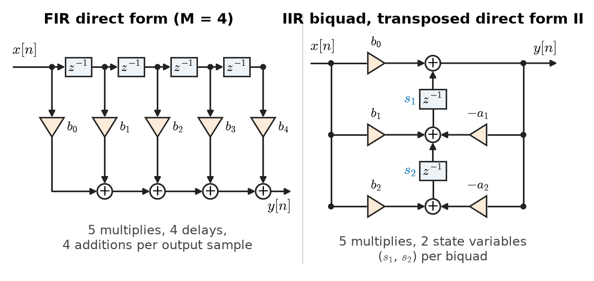
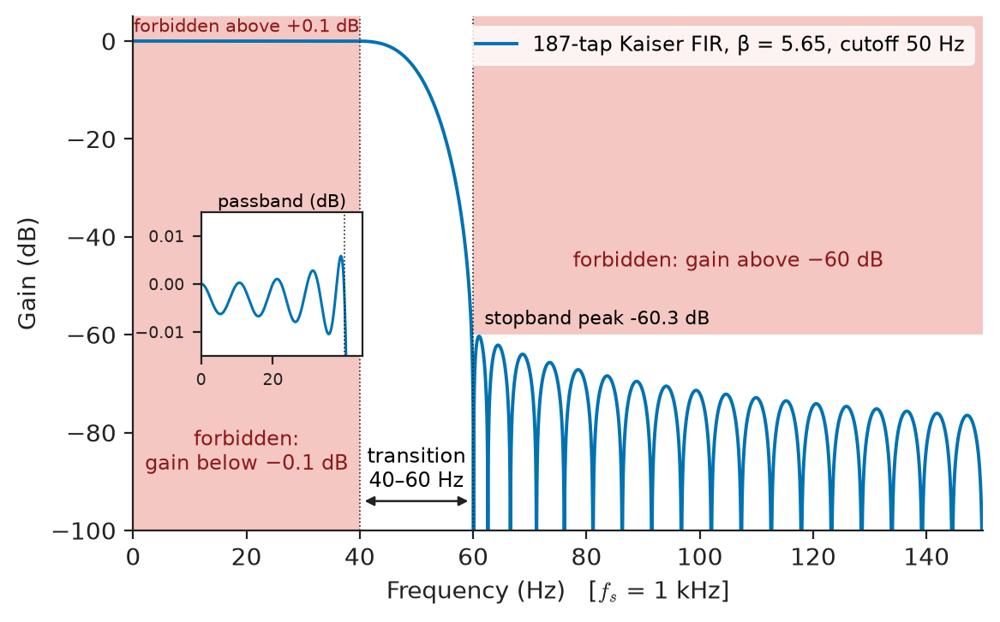
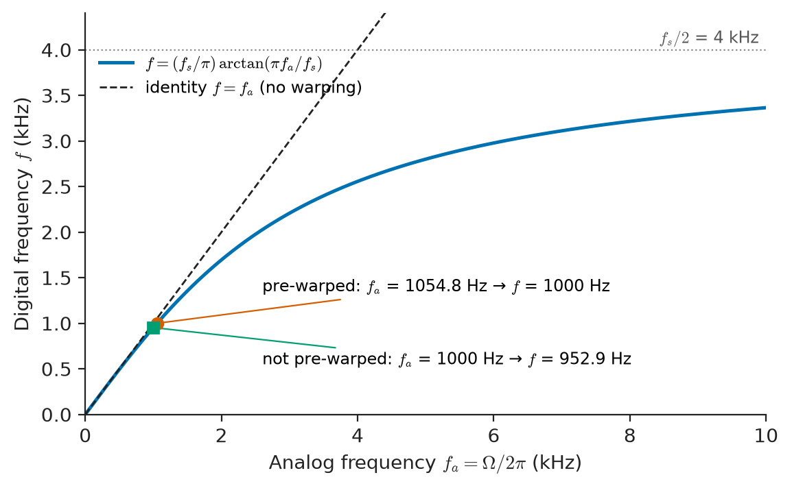
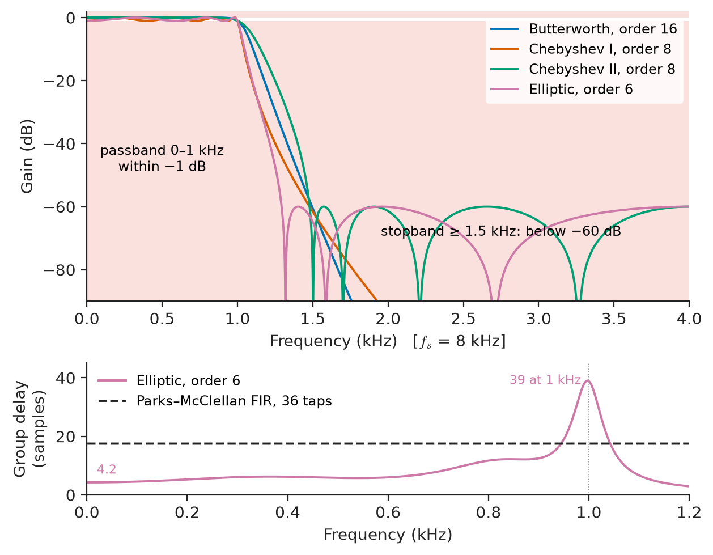
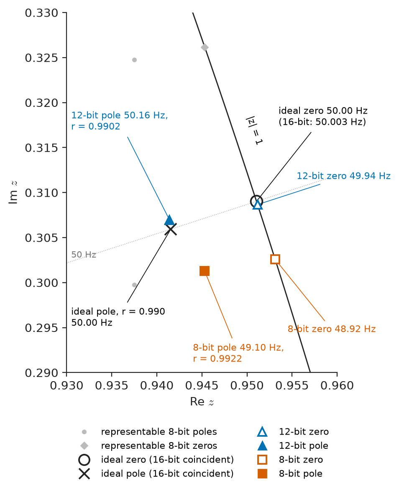

# Chapter 23 — Digital Filters

*Part V · Digital Signal Processing*

A portable ECG monitor is being certified. Its 50 Hz mains-rejection filter worked perfectly in the floating-point simulation on the designer's laptop: a sharp notch, 3 Hz wide, with more than 50 dB of rejection. On the production hardware, an 8-bit microcontroller storing filter coefficients as single bytes, the notch has moved to 48.9 Hz and rejects only 3 dB at 50 Hz. The trace is covered in hum. A second team member proposes replacing the notch with a 16th-order Butterworth lowpass written as one long difference equation; in 16-bit arithmetic that filter oscillates on its own, with no input at all. Neither failure is visible in a textbook transfer function. Both come from the step between a filter as mathematics and a filter as a program running on finite hardware.

A digital filter is a difference equation. Choosing its coefficients so that its frequency response meets a specification is **design**; arranging its arithmetic so that the specification survives finite word length and a real-time budget is **implementation**. This chapter treats both, for the two families that cover nearly all practice: finite-impulse-response (FIR) and infinite-impulse-response (IIR) filters.

> **When should a filter be FIR and when IIR, and how is each designed from a specification?**
> **Why do filters that are stable and correct on paper fail in fixed-point hardware, and how is the arithmetic arranged to prevent it?**

| Concept | Engineering destination |
|---|---|
| FIR filters, linear phase | ECG and EEG front ends, audio crossovers, data-converter decimation, channel filters in software radio |
| IIR filters | Audio equalisers, anti-hum notches, protection-relay filters, sensor smoothing in control loops |
| Difference-equation structures | Firmware on DSPs and microcontrollers, FPGA filter cores |
| Filter specifications | Requirements documents, standards (IEC 61000-4-7, audio codecs, 3GPP spectral masks) |
| Frequency transformations | Deriving highpass, bandpass and bandstop filters from one lowpass prototype |
| FIR design (window, Kaiser, Parks–McClellan) | Linear-phase channel and decimation filters |
| IIR design (bilinear transform) | Digital versions of Butterworth, Chebyshev and elliptic analog filters |
| Stability | Recursive filters, adaptive filters, digital controllers |
| Quantisation effects | Fixed-point DSP, low-cost microcontrollers, FPGA word-length choice |
| Implementation constraints | MAC budgets, latency limits in hearing aids and control loops, memory |

**Roadmap.** FIR filters (23.1) and IIR filters (23.2) as two kinds of difference equation → how each is implemented as a structure (23.3) → what a specification states (23.4) → FIR design (23.5) → IIR design via analog prototypes and the bilinear transform (23.6) → frequency transformations that turn a lowpass into any other type (23.7) → stability (23.8) → what quantisation does (23.9) → the engineering constraints that finally choose the design (23.10).

---

## 23.1 FIR filters

### Definition

A **finite-impulse-response** filter computes each output as a weighted sum of the present and $M$ past inputs:

$$
y[n]=\sum_{k=0}^{M}b_k\,x[n-k].
$$

Its impulse response is the coefficient list itself, $h[n]=b_n$ for $0\le n\le M$ and zero elsewhere, so it has $N=M+1$ **taps** and **order** $M$. Its transfer function (Chapter 20) is a polynomial in $z^{-1}$,

$$
H(z)=\sum_{k=0}^{M}b_k z^{-k},
$$

with $M$ zeros and all $M$ poles at the origin. Three properties follow immediately.

1. **Always stable.** A finite sum of bounded inputs is bounded; there is no feedback, so no coefficient choice can make the filter oscillate.
2. **Exact linear phase is possible.** If the coefficients are symmetric, $b_k=b_{M-k}$, or antisymmetric, $b_k=-b_{M-k}$, the frequency response factorises as $H(e^{j\omega})=A(\omega)\,e^{-j\omega M/2}$ (times $j$ for antisymmetric), where $A(\omega)$ is real. Every frequency is then delayed by the same $M/2$ samples: the group delay (Chapter 18) is constant and waveform shape is preserved.
3. **Selectivity costs taps.** Because there are no poles away from the origin to create sharp resonances, a narrow transition band needs a long impulse response. Section 23.5 quantifies this: the number of taps grows inversely with the transition width.

### The four linear-phase types

Symmetry and the parity of the length give four types with different built-in zeros:

| Type | Symmetry | Length $N$ | Forced zero at | Usable for |
|---|---|---|---|---|
| I | Symmetric | Odd | none | Any response (lowpass, highpass, bandpass, bandstop) |
| II | Symmetric | Even | $z=-1$ ($f_s/2$) | Lowpass, bandpass; not highpass |
| III | Antisymmetric | Odd | $z=1$ and $z=-1$ | Differentiators, Hilbert transformers, bandpass |
| IV | Antisymmetric | Even | $z=1$ (DC) | Differentiators, Hilbert transformers, highpass |

*Table 23.1 — Linear-phase FIR types.*

Linear phase matters wherever waveform shape carries information. In an ECG, a filter with non-constant group delay distorts the ST segment, which clinicians read to diagnose ischaemia; in a digital modem, it causes intersymbol interference; in a loudspeaker crossover, it smears transients. The price is latency: the 187-tap linear-phase ECG filter of Section 23.5, running at 1 kHz, delays everything by 93 ms.

> **Status of the principle: Linear phase from coefficient symmetry**
> *Derived.* Symmetric or antisymmetric real coefficients make $H(e^{j\omega})e^{j\omega M/2}$ purely real or purely imaginary, which is exactly constant group delay $M/2$; it holds for any coefficient values, before and after quantisation, because quantisation preserves symmetry.

---

## 23.2 IIR filters

### Definition

An **infinite-impulse-response** filter also feeds back past outputs:

$$
y[n]=\sum_{k=0}^{M}b_kx[n-k]-\sum_{k=1}^{P}a_ky[n-k],
\qquad
H(z)=\frac{\sum_{k=0}^{M}b_kz^{-k}}{1+\sum_{k=1}^{P}a_kz^{-k}} .
$$

The denominator places poles anywhere in the $z$-plane. A pole close to the unit circle at angle $\omega_0$ creates a sharp resonance near $\omega_0$; a zero on the unit circle creates an exact null. With a handful of coefficients an IIR filter achieves selectivity that would take an FIR filter tens or hundreds of taps. The impulse response decays geometrically but never ends, hence the name.

The properties are the mirror image of FIR:

1. **Efficient.** The 50 Hz notch of the opening needs five coefficients; an FIR filter with a comparable 3 Hz notch at 1 kHz sampling would need several hundred taps.
2. **Stability is a condition, not a guarantee.** All poles must lie strictly inside the unit circle (Section 23.8).
3. **Phase is nonlinear.** A causal IIR filter cannot have exactly linear phase (that would need its poles mirrored outside the unit circle). Group delay peaks near the band edges, where the poles are closest to the circle.
4. **Finite word length matters more**, because errors recirculate through the feedback (Section 23.9).

Most IIR filters are digital versions of classical analog filters, which is why the analog-filter knowledge of Chapter 13 carries over directly (Section 23.6).

**A common IIR example: the notch.** Placing zeros on the unit circle at $\pm\omega_0$ and poles just inside at radius $r$ gives

$$
H(z)=\frac{1-2\cos\omega_0\,z^{-1}+z^{-2}}{1-2r\cos\omega_0\,z^{-1}+r^2z^{-2}} .
$$

The zeros null $\omega_0$ exactly; the poles cancel the zeros' effect away from $\omega_0$, so the response is flat elsewhere. The 3 dB width of the notch is approximately $2(1-r)$ rad/sample, or $(1-r)f_s/\pi$ in hertz. For $f_0=50$ Hz at $f_s=1$ kHz with $r=0.99$: $\omega_0=2\pi\times0.05$, the denominator coefficients are $a_1=-2\times0.99\cos(0.1\pi)=-1.88309$ and $a_2=0.9801$, and the notch is about 3.2 Hz wide. At 49 Hz the attenuation is already only 5.4 dB, and at DC the gain is +0.08 dB. This is the filter whose 8-bit failure opened the chapter.

---

## 23.3 Difference-equation implementations

The transfer function fixes what a filter does; the **structure**, the arrangement of delays, multipliers and adders, fixes how the arithmetic is done. In exact arithmetic all structures with the same $H(z)$ are identical; in finite arithmetic they differ greatly.

<!-- FIGURE 23.1 | figures/ch23/fig-23-1-fir-and-biquad-structures.png | block-diagram | Two basic structures: an FIR tapped delay line and a second-order IIR section in transposed direct form II. | Content: left, FIR direct form with input x[n] feeding a chain of four z^-1 delays, taps multiplied by b0 to b4 and summed into y[n]. Right, transposed direct form II biquad: input x[n] multiplied by b0, b1, b2; output y[n] fed back through -a1 and -a2; two state registers s1 and s2 (each a z^-1) between adder nodes; labels on every coefficient. Annotate 5 multiplies and 2 state variables per biquad. -->

*Figure 23.1 — Two basic structures: an FIR tapped delay line and a second-order IIR section in transposed direct form II.*

### FIR structures

The **direct form** (tapped delay line, Figure 23.1, left) is the definition drawn as hardware: $M$ delays, $M+1$ multipliers, one accumulator. Digital signal processors are built around it: a single-cycle multiply–accumulate (MAC) unit, a circular buffer for the delay line and a zero-overhead loop. For a linear-phase filter, the symmetric structure adds $x[n-k]+x[n-M+k]$ before multiplying, halving the multiplications. The **transposed** form moves the delays to the output side, which suits FPGAs because every adder is followed by a register and the critical path is one multiply and one add, whatever the length. **Polyphase** decomposition, which splits the coefficients into interleaved sub-filters for decimation and interpolation, is developed in Chapter 24, and **fast convolution** via the FFT in Chapter 22.

### IIR structures

- **Direct form I** implements the numerator and denominator as two tapped delay lines, $M+P$ delays in total. Its single accumulator sees every product, which makes it robust in fixed point when the accumulator is wide.
- **Direct form II** reverses the order (poles first, then zeros) so that the two delay lines merge into one of length $\max(M,P)$: the canonical form with the fewest delays.
- **Transposed direct form II** (Figure 23.1, right) is the usual choice in floating-point code, because it adds numbers of similar size and has good numerical behaviour.
- **Cascade (second-order sections)**: factor $H(z)$ into biquads, $H(z)=g\prod_i H_i(z)$, each with two poles and two zeros, and run them one after another. This is the standard for any IIR filter above second order.
- **Parallel form**: expand $H(z)$ by partial fractions (Chapter 11) into a sum of biquads, run them side by side and add the outputs.
- **Lattice and wave-digital** structures use reflection coefficients and have very low coefficient sensitivity; they appear in speech coding (linear prediction) and in high-end audio.

The rule that matters in practice: **never implement an IIR filter above second order as a single direct-form difference equation.** The poles of a high-order polynomial are extremely sensitive to its coefficients (Section 23.9). Factor into second-order sections, pair each pole pair with the nearest zero pair, and order the sections from the lowest-$Q$ to the highest-$Q$ pole pair, or in the reverse order if the concern is noise rather than overflow.

---

## 23.4 Filter specifications

### The tolerance scheme

A filter requirement is not a single curve but a set of bounds (Figure 23.2):

- **passband** edge $f_p$ and ripple: the gain must stay within $1\pm\delta_p$, often given as a peak-to-peak ripple $A_p=20\log_{10}\frac{1+\delta_p}{1-\delta_p}$ dB;
- **stopband** edge $f_{st}$ and attenuation: the gain must stay below $\delta_s$, given as $A_s=-20\log_{10}\delta_s$ dB;
- the **transition band** between them, where the response is unconstrained;
- the **sampling rate** $f_s$, because a digital filter's response is defined on normalised frequency $f/f_s$;
- **phase** requirements: linear phase, a maximum group-delay variation, or a maximum total latency.

<!-- FIGURE 23.2 | figures/ch23/fig-23-2-lowpass-specification.png | plot | Lowpass tolerance scheme for the ECG filter of the worked examples, with the Kaiser-window FIR response threading the allowed region. | Content: x-axis frequency 0 to 150 Hz (fs = 1 kHz), y-axis gain in dB from -100 to +5. Shaded forbidden regions: above +0.1 dB and below -0.1 dB from 0 to 40 Hz, above -60 dB from 60 Hz to 150 Hz. Transition band 40 to 60 Hz labelled. Overlay: magnitude of the 187-tap Kaiser (beta = 5.65) FIR lowpass with cutoff 50 Hz; inset zoom of passband ripple at plus or minus 0.01 dB scale. -->

*Figure 23.2 — Lowpass tolerance scheme for the ECG filter of the worked examples, with the Kaiser-window FIR response threading the allowed region.*

A digital filter is a periodic function of frequency with period $f_s$, so a lowpass specification up to $f_s/2$ fully defines it. Table 23.2 lists representative specifications from practice.

| Application | $f_s$ | Passband | Stopband | Ripple / attenuation | Phase |
|---|---|---|---|---|---|
| Diagnostic ECG lowpass | 1 kHz | 0–40 Hz | > 60 Hz | ±0.1 dB / 60 dB | Linear |
| Audio ADC decimation filter | 48 kHz out | 0–20 kHz | > 24 kHz | ±0.005 dB / 100 dB | Linear |
| Telephone-band channel filter | 8 kHz | 300–3400 Hz | < 200 Hz, > 4 kHz | 0.5 dB / 40 dB | Not critical |
| Power-system protection relay (fundamental extraction) | 1–4 kHz | 50 or 60 Hz | DC offset and harmonics | 1 dB / 40–60 dB | Fixed delay within one cycle |
| Audio graphic-equaliser band | 48 kHz | Octave around centre | none (bell shape) | ±12 dB gain | Minimum phase acceptable |
| Seismic and vibration anti-alias decimation | 100 Hz–25.6 kHz | 0.4 $f_s$ | 0.5 $f_s$ | 0.1 dB / 120 dB | Linear |

*Table 23.2 — Representative digital-filter specifications. Values are typical, not normative.*

### Converting between units

The conversions are worth having at hand. A peak deviation $\delta_p=0.0115$ is a ripple of $\pm0.099$ dB, or 0.20 dB peak to peak. A 60 dB stopband means $\delta_s=0.001$; 100 dB means $10^{-5}$. A 1 dB peak-to-peak passband ripple corresponds to $\delta_p=(10^{1/20}-1)/(10^{1/20}+1)=0.0575$. A digital filter designer works with $\delta$ values, and a requirements document is written in decibels.

### What a specification implies

Three rules of thumb guide the choice before any design starts. The **transition width** relative to $f_s$ dominates cost: halving it doubles an FIR filter's length and adds about a third to an IIR filter's order. **Stopband attenuation** adds cost roughly linearly in decibels. And a **linear-phase** requirement effectively decides for FIR, unless the latency budget forbids it.

---

## 23.5 FIR design

### The ideal filter and the window method

The ideal lowpass with cutoff $\omega_c$ has the impulse response

$$
h_d[n]=\frac{\sin(\omega_c n)}{\pi n},\qquad -\infty<n<\infty ,
$$

which is infinitely long and non-causal. The **window method** truncates it to $N=M+1$ samples centred on $M/2$, multiplies by a window $w[n]$, and delays by $M/2$ to make it causal:

$$
h[n]=w[n]\;\frac{\sin\!\big(\omega_c(n-M/2)\big)}{\pi(n-M/2)},\qquad n=0,\dots,M .
$$

The frequency response is the ideal brick wall convolved with the window's transform (the same mechanism as leakage in Chapter 22). The window's main-lobe width sets the transition width; its side lobes set the passband ripple and stopband attenuation, which come out approximately equal ($\delta_p\approx\delta_s$). Rectangular truncation gives only 21 dB of stopband attenuation no matter how long the filter, because of the Gibbs phenomenon; Hann gives about 44 dB, Hamming 53 dB and Blackman 74 dB.

### The Kaiser window method

Kaiser's empirical formulas turn a specification straight into a design. With $A=-20\log_{10}\min(\delta_p,\delta_s)$ and transition width $\Delta\omega=2\pi(f_{st}-f_p)/f_s$,

$$
\beta=\begin{cases}0.1102(A-8.7),& A>50\\0.5842(A-21)^{0.4}+0.07886(A-21),& 21\le A\le50\\0,& A<21\end{cases}
\qquad
M\approx\frac{A-8}{2.285\,\Delta\omega}.
$$

> **Status of the principle: Kaiser design formulas**
> *Empirical.* Fitted by Kaiser (1974) to many computed designs; the order estimate is usually within a few taps, and the result must always be checked against the specification and lengthened if it falls short.

**Worked example — a linear-phase ECG lowpass.** A diagnostic ECG sampled at $f_s=1$ kHz must pass 0–40 Hz with negligible ripple, reject everything above 60 Hz (which includes the mains interference and most muscle noise) by 60 dB, and keep exactly linear phase so that the ST segment is not distorted.

*Parameters.* $A=60$ dB, $\delta=10^{-3}$. $\Delta\omega=2\pi\times20/1000=0.12566$ rad/sample. $\beta=0.1102\times(60-8.7)=5.653$.

*Length.* $M\approx(60-8)/(2.285\times0.12566)=181.1$, so $M=182$ and $N=183$ taps (odd, Type I). The cutoff is placed mid-transition, at 50 Hz.

*Check.* Evaluating the designed response shows the passband deviates by at most 0.011 dB and the stopband peaks at −59.4 dB, just short of the target, which is typical of the formula. Lengthening to $N=187$ taps gives −60.3 dB. Figure 23.2 shows the result.

*Cost.* With the symmetric structure the filter needs 94 multiplications per output sample, 94 000 per second, a trivial load. Its group delay is $186/2=93$ samples = 93 ms. For a bedside monitor that delay is invisible; in a closed-loop pacing or defibrillation-timing application it might not be acceptable.

### Optimal equiripple design (Parks–McClellan)

The window method wastes taps: its error is largest near the band edges and needlessly small elsewhere, and it cannot set $\delta_p$ and $\delta_s$ independently. The **Parks–McClellan** algorithm (the Remez exchange) finds the filter of given length that minimises the maximum weighted error,

$$
\min_{h}\ \max_{\omega\in\text{bands}}\ W(\omega)\,\big\lvert H(e^{j\omega})-D(\omega)\big\rvert,
$$

where $D$ is the desired response and $W$ the weighting. The result is **equiripple**: the error oscillates with equal amplitude across each band. Weighting the stopband by $\delta_p/\delta_s$ lets the designer ask for a loose passband and a tight stopband. Kaiser's estimate of the required length is

$$
N\approx\frac{-20\log_{10}\sqrt{\delta_p\delta_s}-13}{14.6\,(f_{st}-f_p)/f_s}+1 .
$$

For the ECG specification with a ±0.1 dB passband ($\delta_p=0.0115$) and $\delta_s=10^{-3}$, the estimate is 126 taps, and the actual minimum found by the algorithm is 135 taps, about 28 % fewer than the 187-tap Kaiser design. Parks–McClellan is the default in every filter-design package.

### Other FIR methods

- **Frequency sampling** specifies $H$ at the $N$ DFT frequencies and takes the inverse DFT; transition samples are optimised to lower the ripple. It suits filters with many narrow bands and implementations that already work in the DFT domain.
- **Least-squares** design minimises the integrated squared error instead of the peak error; the stopband energy is lower but the peak ripple is higher. Audio and image filters often prefer it.
- **Half-band** filters (cutoff at $f_s/4$, symmetric ripple) have almost every second coefficient exactly zero, which halves their cost; they are the workhorse of factor-of-2 decimation (Chapter 24).

---

## 23.6 IIR design

### Starting from analog prototypes

Decades of analog filter theory (Chapter 13) have produced closed-form lowpass prototypes. IIR design reuses them: design an analog filter $H_a(s)$ that meets a (warped) specification, then map it to $H(z)$. The four classical prototypes differ in where they put their error:

| Prototype | Passband | Stopband | Roll-off for given order | Phase / group delay |
|---|---|---|---|---|
| Butterworth | Maximally flat, monotonic | Monotonic | Slowest | Moderate group-delay peak |
| Chebyshev type I | Equiripple | Monotonic | Faster | Larger peak near the edge |
| Chebyshev type II (inverse) | Monotonic, flat | Equiripple | Faster | Moderate |
| Elliptic (Cauer) | Equiripple | Equiripple | Fastest (minimum order) | Largest group-delay variation |
| Bessel (analog) | Monotonic | Monotonic | Slow | Near-constant delay (not preserved by bilinear mapping) |

*Table 23.3 — Classical analog prototypes used for IIR design.*

### The bilinear transform

The standard mapping replaces $s$ by

$$
s=\frac{2}{T}\,\frac{1-z^{-1}}{1+z^{-1}},\qquad T=\frac1{f_s}.
$$

It maps the whole left half of the $s$-plane into the interior of the unit circle and the $j\Omega$ axis onto the unit circle, one to one. Two consequences follow. First, **stability is preserved**: a stable analog prototype always gives a stable digital filter. Second, **there is no aliasing**, since the infinite analog frequency axis is squeezed onto $0\le\omega<\pi$. The squeeze is nonlinear: analog frequency $\Omega$ and digital frequency $\omega$ are related by

$$
\Omega=\frac2T\tan\frac{\omega}{2}.
$$

This **frequency warping** is harmless for piecewise-constant magnitude specifications if the critical frequencies are **pre-warped**: compute the analog edge frequencies from the desired digital ones with this formula, design the analog prototype at those frequencies, then transform.

<!-- FIGURE 23.3 | figures/ch23/fig-23-3-bilinear-warping.png | plot | Frequency warping of the bilinear transform at fs = 8 kHz: digital frequencies are compressed toward fs/2, so band edges must be pre-warped. | Content: x-axis analog frequency Omega/(2 pi) from 0 to 10 kHz, y-axis digital frequency from 0 to 4 kHz. Curve f = (fs/pi) arctan(pi fa/fs) approaching 4 kHz asymptotically; dashed identity line f = fa for comparison. Mark the point fa = 1054.8 Hz mapping to f = 1000 Hz (pre-warped design), and fa = 1000 Hz mapping to 952.9 Hz (no pre-warping). -->

*Figure 23.3 — Frequency warping of the bilinear transform at fs = 8 kHz: digital frequencies are compressed toward fs/2, so band edges must be pre-warped.*

> **Status of the principle: Bilinear transform**
> *Derived.* An exact conformal map from the $s$-plane to the $z$-plane; it preserves stability, order and the magnitude values of the analog response, but relocates every frequency according to $\Omega=(2/T)\tan(\omega/2)$, so it preserves shapes only on a warped frequency axis and does not preserve the analog filter's phase or group-delay characteristics.

**Worked example — a second-order Butterworth lowpass by bilinear transform.** A protection relay samples current at $f_s=8$ kHz and needs a second-order Butterworth lowpass with a 1 kHz cutoff to remove switching noise before its phasor estimator.

*Pre-warp.* $K=\tan(\pi f_c/f_s)=\tan(\pi/8)=0.41421$. The analog prototype is therefore designed at $\Omega_c=2f_sK=6627.4$ rad/s (1054.8 Hz) rather than $2\pi\times1000=6283.2$ rad/s.

*Transform.* For a second-order lowpass $H_a(s)=\Omega_c^2/(s^2+(\Omega_c/Q)s+\Omega_c^2)$ with $Q=1/\sqrt2$, substituting the bilinear transform and dividing through gives, with $D=1+K/Q+K^2=1+0.58579+0.17157=1.75736$,

$$
b_0=b_2=\frac{K^2}{D}=0.097631,\quad b_1=2b_0=0.195262,\quad a_1=\frac{2(K^2-1)}{D}=-0.942809,\quad a_2=\frac{1-K/Q+K^2}{D}=0.333333 .
$$

*Check.* The poles are at $0.47140\pm j0.33333$, radius 0.5774, well inside the unit circle. The DC gain is $(b_0+b_1+b_2)/(1+a_1+a_2)=0.390524/0.390524=1$, and the gain at 1 kHz is exactly −3.01 dB. The double zero at $z=-1$ gives infinite attenuation at 4 kHz, the image of $\Omega=\infty$.

*Without pre-warping.* Had the analog prototype been designed at 1000 Hz and transformed directly, the digital cutoff would have landed at $(f_s/\pi)\arctan(\pi\times1000/8000)=952.9$ Hz, a 4.7 % error (Figure 23.3).

### Choosing the prototype and order

For a given specification, the four prototypes need very different orders. Figure 23.4 compares them for a lowpass at $f_s=8$ kHz with 1 dB passband ripple to 1 kHz and 60 dB attenuation from 1.5 kHz.

| Design | Order or length | Multiplications per sample (approx.) | Group delay in passband |
|---|---|---|---|
| Butterworth IIR | 16 | 40 (8 biquads) | Large peak near 1 kHz |
| Chebyshev I IIR | 8 | 20 (4 biquads) | Larger peak |
| Chebyshev II IIR | 8 | 20 (4 biquads) | Moderate |
| Elliptic IIR | 6 | 15 (3 biquads) | 4.2 to 39 samples |
| Parks–McClellan FIR | 36 taps | 18 (symmetric) | 17.5 samples, constant |

*Table 23.4 — Order needed by each design method for the same specification ($f_s=8$ kHz, 1 dB / 60 dB, 1.0–1.5 kHz transition).*

<!-- FIGURE 23.4 | figures/ch23/fig-23-4-iir-prototype-comparison.png | plot | Magnitude responses of order-16 Butterworth, order-8 Chebyshev I, order-8 Chebyshev II and order-6 elliptic filters meeting the same specification. | Content: x-axis frequency 0 to 4 kHz (fs = 8 kHz), y-axis gain in dB from -90 to +2. Shaded tolerance: passband 0 to 1 kHz within -1 dB, stopband from 1.5 kHz below -60 dB. Four curves, distinct colours, labelled with type and order. Second small panel below: group delay in samples from 0 to 45 versus frequency 0 to 1.2 kHz for the elliptic filter (rising from about 4 to 39 samples) and the 36-tap FIR (flat at 17.5 samples). -->

*Figure 23.4 — Magnitude responses of order-16 Butterworth, order-8 Chebyshev I, order-8 Chebyshev II and order-6 elliptic filters meeting the same specification.*

The elliptic filter is the cheapest in arithmetic, but its group delay varies by a factor of nine across the passband. The FIR filter with the same magnitude specification is only slightly more expensive here because the transition is relatively wide; for the narrow transition of the ECG example the gap is far larger.

### Impulse invariance and other mappings

**Impulse invariance** samples the analog impulse response, $h[n]=T\,h_a(nT)$, which maps each analog pole $s_i$ to $z_i=e^{s_iT}$. It preserves the time-domain shape exactly (useful when modelling a physical system's impulse response, for example a room or a sensor), but the frequency response is the aliased sum of the analog response, so it is unusable for highpass and bandstop filters and poor for lowpass filters unless the analog response is well attenuated by $f_s/2$. For a first-order RC lowpass with a 1 kHz cutoff at $f_s=8$ kHz, the impulse-invariant filter has an attenuation at 4 kHz of only 8.5 dB relative to DC, while the analog filter at 4 kHz has 12.3 dB: aliasing has filled in the stopband. The **matched-z** transform also maps poles and zeros by $z=e^{sT}$; it is simple but has similar aliasing errors. Direct **computer optimisation** of IIR coefficients against an arbitrary response is also possible, with stability enforced as a constraint.

---

## 23.7 Frequency transformations

A designer rarely starts from scratch for a highpass, bandpass or bandstop filter. A normalised lowpass prototype (cutoff 1 rad/s) is designed once and transformed. There are two routes.

### Analog transformations before the bilinear map

Substituting for $s$ in the lowpass prototype $H_{LP}(s)$:

| Target | Substitution | Order |
|---|---|---|
| Lowpass, cutoff $\Omega_c$ | $s\to s/\Omega_c$ | $n$ |
| Highpass, cutoff $\Omega_c$ | $s\to\Omega_c/s$ | $n$ |
| Bandpass, centre $\Omega_0$, width $B$ | $s\to\dfrac{s^2+\Omega_0^2}{Bs}$ | $2n$ |
| Bandstop, centre $\Omega_0$, width $B$ | $s\to\dfrac{Bs}{s^2+\Omega_0^2}$ | $2n$ |

*Table 23.5 — Analog frequency transformations. $\Omega_0=\sqrt{\Omega_1\Omega_2}$ (geometric centre) and $B=\Omega_2-\Omega_1$ for edges $\Omega_1,\Omega_2$.*

Each band edge must be pre-warped first and the transformed analog filter then mapped by the bilinear transform. Bandpass and bandstop transformations double the order: a second-order prototype becomes a fourth-order (two-biquad) bandpass.

### Digital (Constantinides) transformations

Alternatively, a digital lowpass with cutoff $\theta_p$ can be transformed directly by replacing $z^{-1}$ with an all-pass function of $z^{-1}$. For lowpass to lowpass with new cutoff $\omega_p$,

$$
z^{-1}\to\frac{z^{-1}-\alpha}{1-\alpha z^{-1}},\qquad \alpha=\frac{\sin\big((\theta_p-\omega_p)/2\big)}{\sin\big((\theta_p+\omega_p)/2\big)} ;
$$

lowpass to highpass uses $z^{-1}\to-(z^{-1}+\alpha)/(1+\alpha z^{-1})$ with a cosine ratio for $\alpha$, and lowpass to bandpass and bandstop use second-order all-pass substitutions. Because the substitution is all-pass, the unit circle maps onto itself and stability is preserved; the magnitude values (ripple, attenuation) are preserved and only the frequency axis is redrawn.

The practical value is **tunability**. An audio equaliser, a tracking filter that follows a machine's rotation speed, or a variable-cutoff synthesiser filter can recompute a single parameter $\alpha$ rather than redesigning the filter. The widely used "audio EQ cookbook" biquads (peaking, shelving, notch) are bilinear transforms of second-order analog prototypes with closed-form coefficients of exactly this kind.

> **Status of the principle: Frequency transformations**
> *Derived.* Analog substitutions are rational maps of the $j\Omega$ axis onto itself and Constantinides' maps are all-pass maps of the unit circle onto itself; both preserve the magnitude tolerance values and stability exactly, while bandpass and bandstop maps double the order.

---

## 23.8 Stability

### The pole condition

A causal LTI filter is bounded-input bounded-output stable if and only if its impulse response is absolutely summable (Chapter 17). For a rational $H(z)$ this is equivalent to:

$$
\lvert p_i\rvert<1\quad\text{for every pole } p_i .
$$

FIR filters satisfy it trivially. For IIR filters it must be checked, and the bilinear transform guarantees it for any stable analog prototype. For a second-order section $1+a_1z^{-1}+a_2z^{-2}$ the condition reduces to the **stability triangle**

$$
\lvert a_2\rvert<1,\qquad \lvert a_1\rvert<1+a_2 ,
$$

which is easy to verify for each biquad in a cascade. The notch of Section 23.2 ($a_1=-1.88309$, $a_2=0.9801$) lies inside the triangle with a margin of only 0.097 on the second inequality; its poles sit at radius 0.99, and a narrow notch or a sharp resonance always lives close to the edge.

### Where stability is lost in practice

A filter designed stable can become unstable in implementation in three ways.

1. **Coefficient quantisation** moves poles. In a high-order direct form the movement can carry a pole across the unit circle (Section 23.9).
2. **Nonlinear arithmetic**: overflow in two's complement wraps a large positive number to a large negative one, which can sustain large-amplitude oscillations; rounding can sustain small **limit cycles**. These are not instabilities of the linear model but behaviours of the nonlinear real system.
3. **Time variation**: adaptive filters (Chapter 24) and filters whose coefficients are retuned while running can go unstable even when every frozen-time version is stable. Smooth coefficient interpolation and lattice or state-variable structures mitigate this.

For the filters inside a control loop, stability of the filter itself is only part of the story; the stability of the closed loop that contains it is the subject of Chapters 34 and 35.

> **Status of the principle: Pole-radius stability criterion**
> *Derived.* Follows from partial-fraction expansion of a rational $H(z)$: each pole contributes a term $p_i^n$ to the impulse response, which is summable only if $\lvert p_i\rvert<1$; it applies to the linear model with exact arithmetic.

---

## 23.9 Quantization effects

A digital filter running in $B$-bit fixed point differs from its design in four ways, each of which can be analysed separately.

### Coefficient quantisation

Coefficients stored with a quantisation step $q$ are rounded by up to $q/2$. The filter that runs is a slightly different, but still linear, filter. Poles and zeros move, and the magnitude response changes. The sensitivity is greatest where roots are clustered: a pole pair at small angle $\omega_0$ near the unit circle, or many poles of a high-order filter near the passband edge.

**Worked example — the 50 Hz notch in 16, 12 and 8 bits.** Take the notch of Section 23.2 ($f_0=50$ Hz, $f_s=1$ kHz, $r=0.99$). Its coefficients lie between −2 and +2, so a fixed-point format with two integer bits is used, and a $B$-bit word has step $q=2^{-(B-2)}$. The numerator coefficients $1$ and $1$ are exact, so the zeros stay on the unit circle; only their angle can move.

| Word length | $b_1$ (ideal −1.902113) | $a_1$ (ideal −1.883092) | Notch (zero) frequency | Pole radius | Attenuation at 50 Hz |
|---|---|---|---|---|---|
| 16 bits ($q=2^{-14}$) | −1.902100 | −1.883118 | 50.003 Hz | 0.99000 | 53 dB |
| 12 bits ($q=2^{-10}$) | −1.902344 | −1.882813 | 49.94 Hz | 0.99019 | 28 dB |
| 8 bits ($q=2^{-6}$) | −1.906250 | −1.890625 | 48.92 Hz | 0.99216 | 3.1 dB |

*Table 23.6 — Effect of coefficient word length on a narrow 50 Hz notch (computed by rounding the coefficients and re-solving for roots).*

Figure 23.5 shows the root movements. At 8 bits the notch moves 1.08 Hz, which is a third of its own 3 Hz width, and the 50 Hz hum passes almost untouched: the opening failure. The poles also move to 49.10 Hz with a radius of 0.99216, narrowing the notch to 2.5 Hz. Sixteen-bit coefficients put the null within 0.003 Hz of 50 Hz. The structural lesson is that low-frequency, narrow features at a high sampling rate are hard in fixed point. Remedies are longer coefficients, a lower sampling rate for the filter (decimate first), or structures in which coefficients map more uniformly to pole positions (the coupled or Gold–Rader form, the lattice).

<!-- FIGURE 23.5 | figures/ch23/fig-23-5-notch-quantisation-poles.png | pole-zero | Pole and zero positions of the 50 Hz notch near z = 1 with 16-bit, 12-bit and 8-bit coefficients, showing the 8-bit null displaced to 48.9 Hz. | Content: zoomed z-plane, real axis 0.93 to 0.96, imaginary axis 0.29 to 0.33, unit-circle arc drawn. Ideal zero (at angle 0.1 pi) and pole (radius 0.99) as open marker, 16-bit (coincident), 12-bit and 8-bit positions as distinct markers with labels giving their frequency in Hz. Secondary grid of all representable 8-bit pole positions near the arc shown as faint dots. -->

*Figure 23.5 — Pole and zero positions of the 50 Hz notch near z = 1 with 16-bit, 12-bit and 8-bit coefficients, showing the 8-bit null displaced to 48.9 Hz.*

**High-order direct form.** The same mechanism ruins high-order filters. The 16th-order Butterworth of Table 23.4 has a largest pole radius of 0.931. Written as a single direct-form denominator, its coefficients reach magnitude 168; rounded to 24-bit words (scaled to that range) the largest pole radius becomes about 0.93–0.95 (the exact value depends on the scaling convention), already off design, and at 16 bits it moves outside the unit circle (about 1.1–1.25): the filter is unstable and oscillates without input. Implemented as eight second-order sections with 16-bit coefficients, every pole stays within 0.01 % of its designed radius. This is why the cascade rule of Section 23.3 is not a matter of style.

> **Status of the principle: Root sensitivity of high-order polynomials**
> *Derived.* The derivative of a root with respect to a polynomial coefficient is inversely proportional to the product of its distances to all other roots, so clustered roots of a high-order polynomial are extremely sensitive; factoring into low-order sections removes the cluster from each polynomial.

### Round-off noise

Every product of two $B$-bit numbers has $2B$ bits; storing it back in $B$ bits rounds it, with an error uniformly distributed over $\pm q/2$ under the usual assumptions (Chapter 21), of variance

$$
\sigma_e^2=\frac{q^2}{12}.
$$

For a Q15 word ($q=2^{-15}$) this is $7.76\times10^{-11}$, or −101.1 dB relative to a full-scale value of 1. In an FIR filter each such error reaches the output once. In an IIR filter it is injected inside the feedback loop and amplified by the **noise gain** of the path from the injection point to the output, $\sum_n h_e^2[n]$. For the notch's recursive part $1/A(z)$ that gain is 265.5 (24.2 dB), because poles at radius 0.99 ring for hundreds of samples. If two products are rounded separately before the feedback, the output noise is about $2\times265.5\times7.76\times10^{-11}=4.1\times10^{-8}$, or −73.8 dB: 27 dB, or four and a half bits, worse than the converter. The fix is the standard DSP practice of accumulating all products in a double-width (32- or 40-bit) accumulator and rounding once, and, for very narrow filters, using **error feedback** (noise shaping) or a higher-precision state.

### Overflow and scaling

Fixed-point numbers have a limited range, and internal nodes of a filter can exceed the input's range even when the output does not: a resonant section has internal gain approaching $1/(1-r)$. Overflow must be prevented by **scaling** the input to each section. The $L_1$ norm of the impulse response to a node guarantees no overflow for any input; the $L_\infty$ norm of the frequency response guarantees it for sinusoids; the $L_2$ norm controls it in an average sense for random inputs. Each choice trades overflow probability against signal-to-noise ratio. Where overflow cannot be excluded, **saturation arithmetic** (clamping at full scale) replaces two's-complement wraparound, which would otherwise produce large-amplitude oscillations.

### Limit cycles

Rounding inside a feedback loop is nonlinear, and it can sustain small oscillations with zero input. For a first-order section $y[n]=Q(a\,y[n-1])$, rounding cannot shrink the output once $\lvert y\rvert\le q/\big(2(1-\lvert a\rvert)\big)$, the **deadband**. With $a=0.9$ the deadband is $\pm5q$: the output can stick at a nonzero value (or alternate in sign if $a<0$) forever. In audio such a limit cycle is an audible idle tone in silence; in a control system it is a small steady oscillation of an actuator. Remedies are magnitude truncation instead of rounding, dither, or a wider internal word.

---

## 23.10 Implementation constraints

The final choice of filter is made against the hardware, not only the specification. Table 23.7 summarises the classical trade-off.

| Criterion | FIR | IIR |
|---|---|---|
| Arithmetic for sharp transitions | High (tens to thousands of taps) | Low (a few biquads) |
| Phase | Exactly linear possible | Nonlinear; group delay peaks at band edges |
| Latency | Half the length for linear phase | A few samples (minimum phase) |
| Stability | Always | Must be checked; can be lost in quantisation |
| Sensitivity to word length | Low | High for narrow or high-order designs |
| Round-off noise | Low, no recirculation | Amplified by the noise gain |
| Adaptation (Chapter 24) | Simple, well-behaved | Difficult (stability during update) |
| Multirate efficiency | Polyphase saves a factor $M$ or $L$ | No comparable saving |
| Memory | $N$ coefficients and $N$ states | 5 coefficients and 2 states per biquad |

*Table 23.7 — FIR versus IIR in implementation.*

### Arithmetic budget

The cost measure is multiply–accumulates per second: taps (or $5\times$ biquads) times sampling rate times channels. Representative capabilities are given in Table 23.8.

| Platform | Typical sustained MAC rate | Typical word length |
|---|---|---|
| 8-bit microcontroller (software multiply) | 0.5–2 M MAC/s | 8/16-bit |
| 32-bit Cortex-M4/M7 microcontroller | 50–500 M MAC/s | 16/32-bit fixed, 32-bit float |
| Audio DSP (SHARC, HiFi class) | 1–10 G MAC/s | 32/40-bit float or fixed |
| Mid-range FPGA (hundreds of DSP slices) | 50–500 G MAC/s | 18×27-bit multipliers |
| Hearing-aid DSP | 10–100 M MAC/s at milliwatt power | 16–24-bit fixed |

*Table 23.8 — Indicative processing capability. Actual figures depend on clock, memory bandwidth and code efficiency.*

**Worked example — choosing a crossover filter for an active loudspeaker.** An active two-way loudspeaker processes stereo audio at 48 kHz on a Cortex-M7 microcontroller budgeted for 60 M MAC/s for filtering. The woofer–tweeter crossover needs a steep lowpass and highpass at 2.5 kHz.

*FIR option.* A linear-phase design with 255 taps per filter gives good steepness and perfect phase alignment between drivers. Cost: $255\times48\,000=12.24$ M MAC/s per filter; two filters (low and high) per channel and two channels give 49 M MAC/s, which fits, using 82 % of the budget. Its latency is $127/48\,000=2.6$ ms, acceptable for playback but not for a live monitor where the performer hears both acoustic and amplified sound.

*IIR option.* A fourth-order Linkwitz–Riley crossover (two cascaded second-order Butterworth sections per output) costs $2\times5=10$ MACs per sample per output, so $10\times48\,000\times4=1.92$ M MAC/s in total, with less than 1 ms of delay. Its phase is not linear, but the low- and high-pass outputs remain in phase with each other at all frequencies, so the drivers sum flat in amplitude.

*Decision.* The IIR crossover uses 3 % of the budget and leaves room for room-correction filters; the FIR option is reserved for products that advertise phase linearity. Both meet the magnitude specification; the constraints decide.

### Latency, memory and word length

- **Latency** limits are tight in hearing aids (a few milliseconds before the delayed sound and direct sound comb-filter audibly), in active noise control (the filter must act before the sound arrives), in protection relays (a fault decision within one cycle) and in control loops (Chapter 35), where every sample of delay costs phase margin.
- **Memory** for a long FIR filter is $N$ coefficients plus $N$ delay-line samples per channel; on small microcontrollers this, not arithmetic, can be the binding constraint.
- **Word length** follows from the specification: stopband attenuation of $A$ dB needs coefficients of roughly $A/6+2$ bits for an FIR filter (a 100 dB decimation filter needs about 18-bit coefficients), and narrow IIR filters need more, as the notch example showed.
- **Floating point** removes most scaling and overflow concerns at the cost of power and silicon; single precision (24-bit mantissa) is adequate for most audio and instrumentation filters, but very low-frequency IIR sections at high sampling rates can still need double precision.

> **Boundary.** The processor architectures, MAC units, FPGA DSP slices and data converters on which filters run are treated in *Electronics & Computing*. This chapter treats the filter as an algorithm and its arithmetic.

---

## What remains open

| Open question | Where it is answered |
|---|---|
| How to change the sampling rate efficiently, and how polyphase filters exploit decimation and interpolation | Chapter 24 |
| How a filter can learn its own coefficients from data (adaptive and Wiener filters) | Chapter 24 |
| How matched filters and pulse-shaping filters (raised cosine) are designed for digital communication | Chapter 27 |
| How a digital filter inside a feedback loop affects closed-loop stability and phase margin | Chapters 34 and 35 |
| The underlying quantisation model and fixed-point number formats | Chapter 21 (back reference) |
| The analog prototypes and their pole positions | Chapter 13 (back reference) |
| Hardware realisation of filters in DSPs and FPGAs | *Electronics & Computing* |

**Next:** Chapter 24 lets filters change the sampling rate, adapt their coefficients to the data and resolve how a spectrum changes in time, and closes Part V with the fundamentals of image and audio processing.
