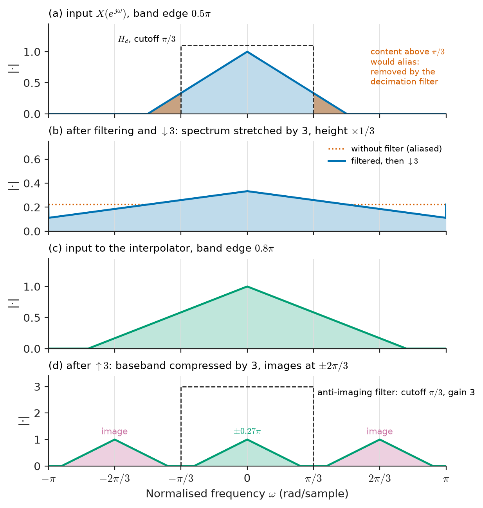
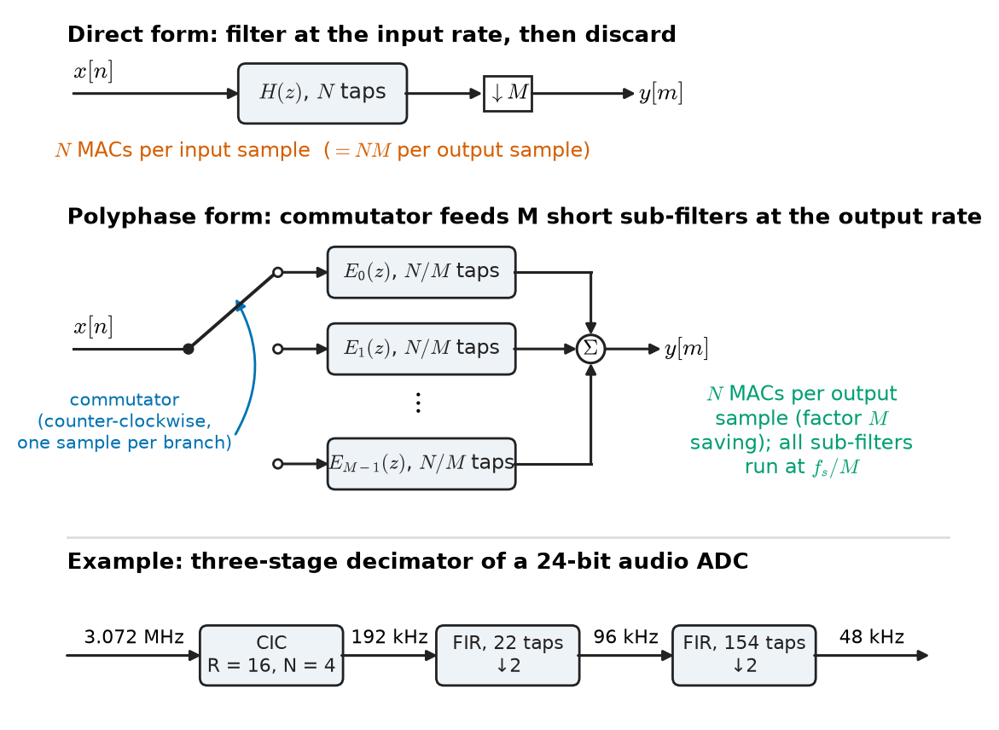
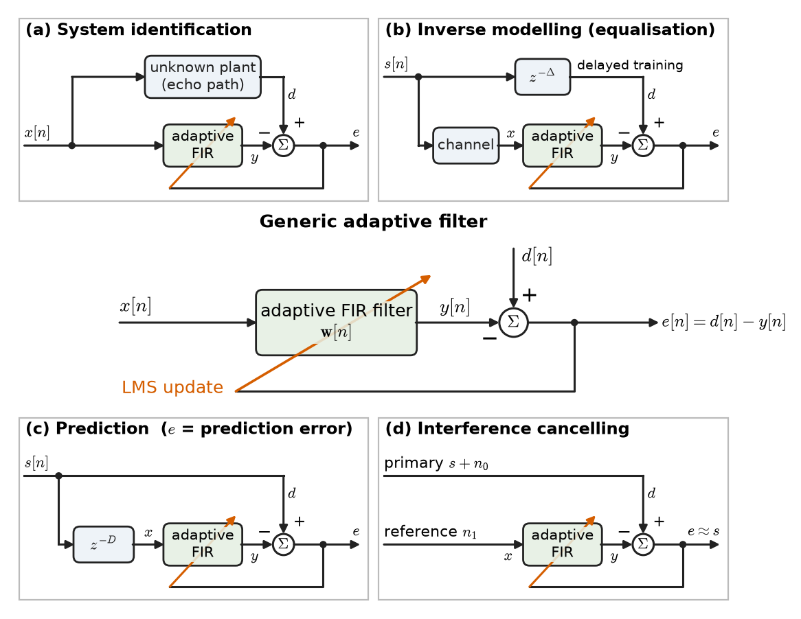
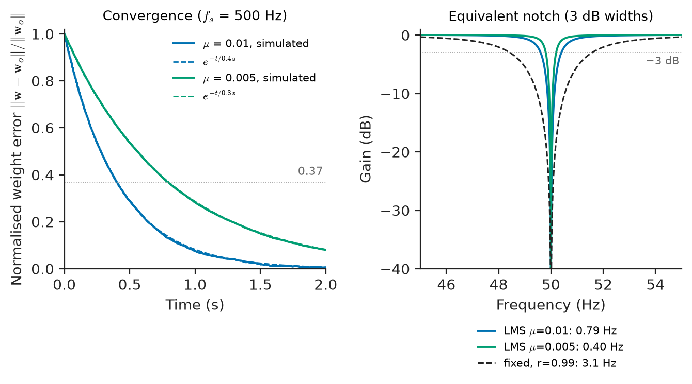
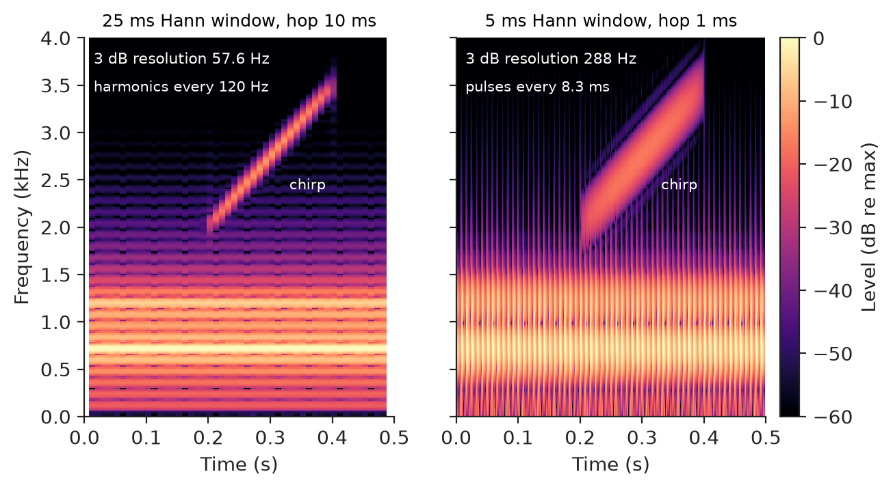
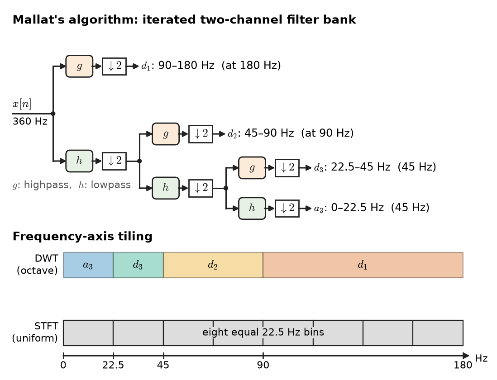

# Chapter 24 — Advanced Signal Processing

*Part V · Digital Signal Processing*

A wearable ECG patch has three problems its designers did not have on the bench. Its delta-sigma ADC produces a one-bit stream at several megahertz that must become clean 500 Hz samples without burning the battery. The 50 Hz interference it picks up changes in amplitude and phase every time the wearer walks past a different appliance, so no fixed notch is quite right. And the cardiologist does not want one spectrum of a 24-hour recording; she wants to see how the heart's rhythm, and the noise, change from minute to minute. None of these is solved by the fixed filter and single FFT of Chapters 22 and 23. The first needs filters that change the sampling rate; the second needs a filter that learns its own coefficients; the third needs a spectrum that is a function of time.

This chapter collects those techniques: multirate processing, adaptive and optimal (Wiener) filtering, model-based spectral estimation, time–frequency analysis and wavelets. It ends with the fundamentals of the two signal types that most people meet every day, images and audio, where all the tools of Part V come together.

> **How can the sampling rate be changed by any ratio without aliasing, and cheaply?**
> **What is the best linear filter for separating a signal from noise, and how can a filter find it from data alone?**
> **How can a spectrum be estimated from very short records, and how is a spectrum that changes in time represented?**

| Concept | Engineering destination |
|---|---|
| Multirate processing, polyphase filters | Audio sample-rate converters, delta-sigma ADC decimators, software-defined radio channelisers |
| Decimation and interpolation | Oversampling DACs, digital down-conversion in receivers, data reduction in instrumentation |
| Adaptive filters | Echo cancellers in telephony and conferencing, channel equalisers, active noise control |
| Wiener filtering | Noise reduction in speech and biomedical signals, image restoration, optimal smoothing of sensor data |
| LMS algorithm | Adaptive mains-interference cancellation, beamforming, hearing aids |
| Parametric spectral estimation | Short-record Doppler radar, EEG rhythm analysis, speech coding (linear prediction) |
| Time–frequency analysis | Speech spectrograms, machine run-up analysis, radar micro-Doppler, bat and whale acoustics |
| Wavelets | ECG QRS detection, signal denoising, JPEG 2000, transient detection in power systems |
| Image and audio fundamentals | Cameras, medical imaging, codecs (JPEG, MP3, AAC), audio effects |

**Roadmap.** Multirate systems (24.1) → decimation, interpolation and rational rate change (24.2) → filters that adapt (24.3) → the optimal Wiener filter they aim at (24.4) → the LMS algorithm that gets there from data (24.5) → spectral estimation beyond the periodogram (24.6) → time–frequency analysis (24.7) → wavelets (24.8) → images and audio (24.9).

---

## 24.1 Multirate processing

### Why change the sampling rate

A **multirate** system contains more than one sampling rate. The reasons are practical:

- **Interfacing standards.** Professional audio runs at 48 kHz, CD audio at 44.1 kHz, broadcast at 32 kHz, and telephone speech at 8 or 16 kHz. Every converter between them is a multirate system.
- **Oversampled converters.** Delta-sigma ADCs sample at 64–256 times the output rate to push quantisation noise out of band (*Electronics & Computing*); a digital decimator then removes the out-of-band noise and lowers the rate. Oversampling DACs do the reverse.
- **Efficiency.** A narrowband signal sampled at a high rate wastes arithmetic. A software radio that digitises 100 MHz of spectrum but needs one 200 kHz channel shifts the channel to baseband and reduces its rate by a factor of hundreds before doing anything else.
- **Multiresolution analysis.** Filter banks and wavelets (Section 24.8) split signals into bands at different rates.

### The two basic operations

**Downsampling** by an integer $M$ keeps every $M$-th sample: $y[n]=x[nM]$. **Upsampling** by an integer $L$ inserts $L-1$ zeros between samples: $y[n]=x[n/L]$ when $n$ is a multiple of $L$, and zero otherwise. In the $z$-domain,

$$
Y_{\downarrow M}(e^{j\omega})=\frac1M\sum_{k=0}^{M-1}X\!\left(e^{j(\omega-2\pi k)/M}\right),\qquad
Y_{\uparrow L}(e^{j\omega})=X(e^{j\omega L}).
$$

Downsampling stretches the spectrum by $M$ and overlays $M$ shifted copies: anything above the new Nyquist frequency $\pi/M$ (in the old normalised units) aliases, exactly as in analog sampling (Chapter 19). Upsampling compresses the spectrum by $L$ and creates $L-1$ **images** of the baseband between 0 and the new $f_s/2$. Figure 24.1 shows both effects. Both operations are linear but **time-varying**: shifting the input by one sample does not simply shift the output. That is why multirate systems need their own rules.

### Noble identities and polyphase decomposition

Two identities let filters be moved across rate changers:

$$
H(z^M)\ \text{followed by}\ {\downarrow}M\ \equiv\ {\downarrow}M\ \text{followed by}\ H(z),\qquad
{\uparrow}L\ \text{followed by}\ H(z^L)\ \equiv\ H(z)\ \text{followed by}\ {\uparrow}L .
$$

They are the key to efficiency. Any FIR filter can be split into $M$ **polyphase components**, each containing every $M$-th coefficient:

$$
H(z)=\sum_{m=0}^{M-1}z^{-m}E_m(z^M),\qquad e_m[n]=h[nM+m].
$$

Combining this with the noble identity, a filter followed by a downsampler becomes a commutator that deals input samples in turn to $M$ short sub-filters $E_m(z)$, all running at the low output rate (Figure 24.2). The arithmetic is the same as computing only the outputs that will be kept, which is a factor $M$ cheaper than filtering at the high rate and discarding $M-1$ of every $M$ outputs. The dual structure serves interpolation: the zeros inserted by upsampling are never multiplied.

> **Status of the principle: Noble identities and polyphase efficiency**
> *Derived.* Exact algebraic identities for LTI filters combined with integer rate changers; the factor-of-$M$ (or $L$) saving holds for FIR filters, and does not carry over to recursive IIR filters, whose feedback needs every high-rate output.

---

## 24.2 Decimation and interpolation

### Decimation

**Decimation** by $M$ is lowpass filtering followed by downsampling. The filter, the **anti-aliasing** filter of the digital domain, must remove everything above $\pi/M$ that would otherwise fold into the band of interest. Only the part of the spectrum that folds onto the wanted band needs strong attenuation; components that fold into a band that will later be discarded are harmless, which relaxes the filter in multistage designs.

### Interpolation

**Interpolation** by $L$ is upsampling followed by a lowpass **anti-imaging** filter with cutoff $\pi/L$ and gain $L$. The filter fills in the zeros with values consistent with a band-limited signal; with an ideal filter the result is exactly the sequence that would have been obtained by sampling the original analog signal at $L$ times the rate. Practical interpolators use polyphase FIR filters; simple ones use linear interpolation or a zero-order hold, which leave residual images (the $\mathrm{sinc}$ droop and imaging of Chapter 19).

<!-- FIGURE 24.1 | figures/ch24/fig-24-1-decimation-interpolation-spectra.png | spectrum | Spectra in decimation by 3 and interpolation by 3: aliasing if the input is not band-limited to pi/3, and images that the interpolation filter must remove. | Content: four stacked panels, x-axis normalised frequency omega from -pi to pi. (a) input spectrum, triangular baseband reaching 0.5 pi, with dashed ideal decimation filter cutoff at pi/3; (b) spectrum after filtering and downsampling by 3, stretched to fill -pi to pi; (c) baseband limited to 0.8 pi before upsampling; (d) after inserting two zeros per sample: compressed baseband up to 0.27 pi plus two images centred at plus and minus 2 pi/3, with ideal anti-imaging filter (cutoff pi/3, gain 3) drawn dashed. -->

*Figure 24.1 — Spectra in decimation by 3 and interpolation by 3: aliasing if the input is not band-limited to pi/3, and images that the interpolation filter must remove.*

### Rational sample-rate conversion

A change by a rational factor $L/M$ is interpolation by $L$ followed by decimation by $M$, with one lowpass filter whose cutoff is $\min(\pi/L,\pi/M)$ at the intermediate rate. Converting CD audio at 44.1 kHz to studio audio at 48 kHz needs

$$
\frac{48\,000}{44\,100}=\frac{160}{147},
$$

so $L=160$, $M=147$ and an intermediate rate of $44\,100\times160=7.056$ MHz. Nobody computes at that rate. In polyphase form, each output sample needs only one of the 160 polyphase branches, selected by a cycling index; if the prototype filter has $160\times32=5120$ taps, each output costs 32 multiply–accumulates, or $1.54$ M MAC/s per channel at 48 kHz. Converters between unrelated or drifting clocks (asynchronous sample-rate converters in digital audio receivers) compute the branch coefficients on the fly from an estimated ratio.

### Multistage decimation and CIC filters

A large factor $M$ is best done in stages. The early stages run at the highest rate but only need to protect the narrow band that will survive, so their transition bands are wide and their filters short. The final stage runs at the lowest rate and carries the sharp transition. Filters with no multiplications at all are used at the highest rate.

The **cascaded integrator–comb (CIC)** filter is the standard first stage. $N$ integrators at the input rate, a downsampler by $R$, and $N$ comb differentiators at the output rate implement

$$
H(z)=\left(\frac{1-z^{-R}}{1-z^{-1}}\right)^{N},\qquad
\lvert H(f)\rvert=\left\lvert\frac{\sin(\pi fR/f_{s,\mathrm{in}})}{R\sin(\pi f/f_{s,\mathrm{in}})}\right\rvert^{N}
$$

(normalised to unit DC gain). It needs only adders and registers, so it runs at hundreds of megahertz in an FPGA or ASIC. Its nulls fall exactly on the frequencies that alias onto DC after downsampling. Its drawbacks are passband droop, which a later compensation filter corrects, and a gain of $R^N$, which requires $N\log_2R$ extra bits in the integrators.

**Worked example — the decimator of a 24-bit audio ADC.** A delta-sigma audio ADC modulates at $f_{s,\mathrm{in}}=64\times48\ \mathrm{kHz}=3.072$ MHz. The output must be 48 kHz with a 0–20 kHz passband and 100 dB rejection of everything that would alias into it.

*Single stage.* A single FIR lowpass at 3.072 MHz with a 20–24 kHz transition needs, by Kaiser's formula (Chapter 23), $N\approx(100-8)/(2.285\times2\pi\times4000/3.072\times10^6)=4921$ taps. Even in polyphase form, computing only the outputs at 48 kHz, it costs $4921\times48\,000=236$ M MAC/s.

*Stage 1: CIC, $R=16$, $N=4$.* This takes the rate from 3.072 MHz to 192 kHz with no multiplications. The bands that fold onto 0–20 kHz are centred on multiples of 192 kHz; the nearest edge is $192-20=172$ kHz, where the CIC attenuates by 75.2 dB. The droop at 20 kHz is 0.62 dB, to be equalised later, and the integrators need 16 extra bits. If 75 dB is not enough, a fifth-order CIC gives 94.0 dB at 172 kHz with 0.77 dB of droop.

*Stage 2: FIR, 192 kHz to 96 kHz.* The band 76–116 kHz folds onto 0–20 kHz, so the transition can be 20 to 76 kHz: $N\approx92/(2.285\times2\pi\times56/192)\approx22$ taps, run at 96 kHz output: 2.1 M MAC/s (about half that as a half-band filter).

*Stage 3: FIR, 96 kHz to 48 kHz.* This carries the sharp 20–24 kHz transition: $N\approx92/(2.285\times2\pi\times4/96)\approx154$ taps at 48 kHz output: 7.4 M MAC/s, and it can include the CIC droop correction.

*Total.* About 9.5 M MAC/s against 236 M MAC/s, a factor of 25, with most of the hardware at the highest rate made of adders. Every audio ADC and every digital down-converter in a radio receiver is built this way.

<!-- FIGURE 24.2 | figures/ch24/fig-24-2-polyphase-decimator.png | block-diagram | Decimation by M: direct form (filter at the high rate, then discard samples) and the equivalent polyphase form (commutator feeding M short sub-filters at the low rate). | Content: top, x[n] into H(z) with N taps then down-arrow M, output y[m], annotated N MACs per input sample. Bottom, commutator switch rotating counter-clockwise distributing x[n] to M branches E0(z) ... E(M-1)(z), each with N/M taps, outputs summed into y[m], annotated N MACs per output sample. Side note: three-stage audio decimator chain 3.072 MHz to CIC (R = 16) to 192 kHz to FIR (22 taps) to 96 kHz to FIR (154 taps) to 48 kHz. -->

*Figure 24.2 — Decimation by M: direct form (filter at the high rate, then discard samples) and the equivalent polyphase form (commutator feeding M short sub-filters at the low rate).*

> **Status of the principle: Multistage decimation saving**
> *Approximate.* The cost estimates use Kaiser's empirical length formula and assume the stopband need only protect the band that finally survives; the order-of-magnitude saving is robust, the exact stage split is an optimisation that depends on the hardware.

---

## 24.3 Adaptive filters

### When fixed filters are not enough

The filters of Chapter 23 are designed once from a specification. Many signals violate the assumption that the specification is known in advance: the echo path from a loudspeaker to a microphone changes whenever someone moves in the room; the frequency response of a telephone line or a radio channel depends on the call; mains interference on a patient changes with posture and nearby equipment. An **adaptive filter** adjusts its coefficients continuously to minimise an error signal, tracking such changes.

The structure is always the same. An FIR filter with weight vector $\mathbf w[n]=[w_0,\dots,w_{M-1}]^{\mathsf T}$ processes an input vector $\mathbf x[n]=[x[n],\dots,x[n-M+1]]^{\mathsf T}$ to give $y[n]=\mathbf w^{\mathsf T}[n]\,\mathbf x[n]$. A **desired** signal $d[n]$ is available, the **error** is $e[n]=d[n]-y[n]$, and an algorithm updates $\mathbf w$ to make $e$ small in the mean-square sense. FIR (transversal) filters are used almost always, because their error surface is a simple quadratic bowl and they cannot become unstable through the filter itself.

### Four configurations

What counts as the input and desired signal defines the application (Figure 24.3):

1. **System identification.** The same input drives the unknown system and the adaptive filter; the desired signal is the system's output. When the error is minimised, the filter is a model of the system. *Example:* echo cancellation. The far-end speech drives both the echo path and the filter; the microphone signal is $d[n]$; the filter's output is the predicted echo, and the error is the near-end speech with the echo removed. A network echo canceller (ITU-T G.168) covers 64–128 ms of echo tail at 8 kHz, i.e. 512–1024 taps; an acoustic echo canceller for a conference room at 16 kHz covers 100–250 ms with 2048–4096 taps.
2. **Inverse modelling (equalisation).** The filter is placed after an unknown channel and trained to reproduce the transmitted signal (a known training sequence, or the receiver's own decisions). *Example:* channel equalisers in digital modems and wireline transceivers (Chapter 27).
3. **Prediction.** The input is a delayed version of the signal and the desired signal is the signal itself; the filter learns to predict the next sample. *Example:* linear-predictive speech coding in mobile phones, where only the prediction error is transmitted.
4. **Interference cancellation.** A primary sensor receives signal plus interference; a reference sensor receives interference correlated with that in the primary but not with the signal. The filter shapes the reference to match the interference, and the error is the cleaned signal. *Examples:* removing mains hum from ECG using a reference derived from the mains, removing maternal ECG from foetal ECG recorded on the abdomen, active noise-cancelling headphones.

<!-- FIGURE 24.3 | figures/ch24/fig-24-3-adaptive-filter-configurations.png | block-diagram | The adaptive filter and its four standard configurations: system identification, inverse modelling, prediction and interference cancellation. | Content: centre, generic block "adaptive FIR filter w[n]" with input x[n], output y[n], summing junction forming e[n] = d[n] - y[n], and a diagonal arrow from e[n] through the filter labelled "LMS update". Four small panels around it: (a) system identification with unknown plant (echo path) in parallel; (b) inverse modelling with channel in series and delayed training signal as d[n]; (c) prediction with z^-D delay before the filter; (d) interference canceller with primary input s + n0 as d[n] and reference n1 as x[n], output e[n] approximately s. -->

*Figure 24.3 — The adaptive filter and its four standard configurations: system identification, inverse modelling, prediction and interference cancellation.*

What the error converges to, and how fast, are separate questions: the first is answered by the Wiener filter, the second by the adaptation algorithm.

---

## 24.4 Wiener filtering

### The optimal linear filter

Suppose $x[n]$ and $d[n]$ are jointly wide-sense stationary with known second-order statistics. Which fixed FIR filter $\mathbf w$ minimises the mean-square error $J(\mathbf w)=E\{e^2[n]\}$? Expanding,

$$
J(\mathbf w)=\sigma_d^2-2\,\mathbf p^{\mathsf T}\mathbf w+\mathbf w^{\mathsf T}\mathbf R\,\mathbf w,
$$

where $\mathbf R=E\{\mathbf x\mathbf x^{\mathsf T}\}$ is the $M\times M$ input autocorrelation matrix (Toeplitz, entries $r_{xx}[i-j]$) and $\mathbf p=E\{d\,\mathbf x\}$ is the cross-correlation vector. $J$ is a quadratic bowl with a single minimum, found by setting the gradient to zero:

$$
\mathbf R\,\mathbf w_o=\mathbf p\qquad\text{(Wiener–Hopf equations)},\qquad
J_{\min}=\sigma_d^2-\mathbf p^{\mathsf T}\mathbf w_o .
$$

At the optimum the error is uncorrelated with every input sample used by the filter (the **orthogonality principle**): any remaining correlation could be used to reduce the error further.

### The frequency-domain Wiener filter

If the filter may be infinitely long and non-causal (offline processing of a recorded signal), the solution is simplest in the frequency domain. For a signal $s$ observed in additive noise $v$ uncorrelated with it, $x=s+v$ and $d=s$:

$$
H_o(e^{j\omega})=\frac{S_s(e^{j\omega})}{S_s(e^{j\omega})+S_v(e^{j\omega})},\qquad
J_{\min}=\frac1{2\pi}\int_{-\pi}^{\pi}\frac{S_sS_v}{S_s+S_v}\,d\omega .
$$

The interpretation is immediate: pass frequencies where the signal dominates (gain near 1), suppress those where noise dominates (gain near 0), and in between weight by the local signal fraction. Speech-enhancement algorithms in phones and hearing aids apply this gain per bin of a short-time FFT (Section 24.7), with $S_v$ estimated during speech pauses ("spectral subtraction" and its refinements). Image deblurring uses the same formula with the blur's frequency response included.

> **Status of the principle: Wiener filter**
> *Derived.* The Wiener–Hopf equations follow exactly from minimising mean-square error over linear filters for wide-sense stationary signals with known second-order statistics; the filter is optimal among all estimators only if the signals are jointly Gaussian, and it is only as good as the statistics assumed.

**Worked example — smoothing a noisy pressure sensor.** A pressure transducer on a hydraulic line produces a slowly varying signal modelled as a first-order autoregressive process with unit variance and correlation $\rho=0.9$ between successive samples ($r_{ss}[k]=0.9^{\lvert k\rvert}$). The ADC adds white noise of unit variance, so the input SNR is 0 dB. What is gained by Wiener filtering?

*One tap.* $\mathbf R=[2]$, $\mathbf p=[1]$, $w=0.5$, $J_{\min}=1-0.5=0.5$: a 3.0 dB improvement, by simple shrinkage.

*Two taps.* $\mathbf R=\begin{bmatrix}2&0.9\\0.9&2\end{bmatrix}$, $\mathbf p=\begin{bmatrix}1\\0.9\end{bmatrix}$. Solving, $\mathbf w_o=[0.3730,\;0.2821]^{\mathsf T}$ and $J_{\min}=1-(0.3730+0.9\times0.2821)=0.3730$: 4.28 dB.

*More taps.* With 5 taps $J_{\min}=0.3075$, with 10 taps 0.3036, and with 20 taps 0.3036 (5.18 dB). The causal filter has converged; a longer past does not help, because an AR(1) signal's dependence on the past decays as $0.9^k$.

*Non-causal.* Allowing the filter to use future samples as well (offline smoothing, using the frequency-domain formula) gives $J_{\min}=0.218$, a 6.62 dB improvement. The extra 1.4 dB is what a real-time controller gives up by having to act on the latest sample; a post-processing analysis of the same record can have it.

---

## 24.5 LMS algorithms

### Steepest descent without statistics

In practice $\mathbf R$ and $\mathbf p$ are unknown and may change. Widrow and Hoff (1960) proposed replacing the true gradient of $J$, $-2(\mathbf p-\mathbf R\mathbf w)$, by its instantaneous estimate $-2e[n]\mathbf x[n]$, and stepping downhill:

$$
\mathbf w[n+1]=\mathbf w[n]+\mu\,e[n]\,\mathbf x[n],\qquad e[n]=d[n]-\mathbf w^{\mathsf T}[n]\mathbf x[n].
$$

(The factor 2 is absorbed into the step size $\mu$; some texts keep it, which halves every $\mu$ below.) This is the **least-mean-squares (LMS)** algorithm: $2M$ multiplications per sample, no matrix inversion, no statistics. Its simplicity is why it, and its variants, run inside most echo cancellers, equalisers and noise cancellers.

### Convergence, step size and misadjustment

Averaged over the data, the weights follow the steepest-descent path toward $\mathbf w_o$. Decomposing along the eigenvectors of $\mathbf R$ with eigenvalues $\lambda_i$, each mode decays as $(1-\mu\lambda_i)^n$. Hence:

- **Stability in the mean** requires $0<\mu<2/\lambda_{\max}$. Since $\lambda_{\max}$ is rarely known, the safe practical bound uses $\lambda_{\max}\le\mathrm{tr}\,\mathbf R=M\sigma_x^2$: $0<\mu<2/(M\sigma_x^2)$, and for good behaviour of the mean-square error, $\mu$ is chosen an order of magnitude smaller.
- **Time constants**: mode $i$ converges with $\tau_i\approx1/(\mu\lambda_i)$ samples. The slowest mode, set by $\lambda_{\min}$, dominates; the ratio $\lambda_{\max}/\lambda_{\min}$ (the eigenvalue spread, large for coloured inputs such as speech) is the main weakness of LMS.
- **Misadjustment**: because the gradient estimate is noisy, the weights jitter about $\mathbf w_o$ and the steady-state error exceeds $J_{\min}$ by the fraction

$$
\mathcal M\approx\frac{\mu\,\mathrm{tr}\,\mathbf R}{2}.
$$

Small $\mu$ gives low misadjustment but slow convergence and tracking; large $\mu$ the reverse. Every LMS design is a choice on this trade-off.

> **Status of the principle: LMS convergence and misadjustment formulas**
> *Approximate.* Derived under the independence assumption (successive input vectors uncorrelated) and small $\mu$; they predict real behaviour well for small step sizes and stationary inputs, and less well near the stability limit or for strongly correlated tapped-delay-line inputs.

### Variants

- **Normalised LMS (NLMS)** divides the step by the input power, $\mathbf w\leftarrow\mathbf w+\tilde\mu\,e\,\mathbf x/(\epsilon+\lVert\mathbf x\rVert^2)$, with $0<\tilde\mu<2$. It is insensitive to the input level, which matters for speech whose level varies by 40 dB, and is the standard in echo cancellation.
- **Sign–error and sign–sign LMS** replace $e$ or $\mathbf x$ by their signs, removing multiplications for very-high-rate hardware (serial-link equalisers).
- **Frequency-domain (block) LMS** updates in the FFT domain, reducing the cost of very long filters and partly whitening the input.
- **Recursive least squares (RLS)** minimises an exponentially weighted sum of squared errors exactly at each step. It converges in about $2M$ samples regardless of eigenvalue spread, but costs $O(M^2)$ operations per sample and needs care with numerical stability; it is used for short filters where fast convergence is essential (fast-fading radio channels, Chapter 30).

**Worked example — an adaptive mains canceller for ECG.** An ECG is sampled at $f_s=500$ Hz. A reference is derived from the mains: $x_1[n]=\cos(2\pi\cdot50\,n/f_s)$ and $x_2[n]=\sin(2\pi\cdot50\,n/f_s)$, amplitude $C=1$. A two-weight LMS filter with $\mu=0.01$ shapes the reference to match the interference in the ECG, and its error output is the cleaned ECG (Widrow's adaptive noise canceller).

*Correlation matrix.* The two reference inputs are orthogonal with power $C^2/2=0.5$ each: $\mathbf R=\mathrm{diag}(0.5,0.5)$, $\mathrm{tr}\,\mathbf R=1$, $\lambda_{\max}=\lambda_{\min}=0.5$. The mean stability bound is $\mu<4$; no eigenvalue spread exists, so LMS behaves ideally.

*Convergence.* $\tau=1/(\mu\lambda)=1/(0.01\times0.5)=200$ samples $=0.4$ s. If the hum amplitude or phase changes (a patient turns over), the canceller re-converges in about $3\tau=1.2$ s. A direct simulation confirms that the weight error falls to 0.37 of its initial value after 200 samples.

*Equivalent filter.* Analysing the loop shows that, from primary input to error output, the canceller is a linear time-invariant notch,

$$
H(z)=\frac{1-2\cos\omega_0\,z^{-1}+z^{-2}}{1-2\big(1-\tfrac{\mu C^2}{2}\big)\cos\omega_0\,z^{-1}+(1-\mu C^2)z^{-2}},
$$

with zeros exactly at 50 Hz and poles at radius $\sqrt{1-\mu C^2}=0.99499$. Its 3 dB bandwidth is $\mu C^2f_s/(2\pi)=0.80$ Hz: far narrower than the fixed notch of Chapter 23, and centred exactly on the reference frequency by construction, so the coefficient-quantisation failure of that chapter cannot occur. If the mains drifts to 49.8 Hz, the reference (taken from the mains itself) drifts with it.

*Misadjustment.* $\mathcal M=\mu\,\mathrm{tr}\,\mathbf R/2=0.005$: the residual excess error is 0.5 % of the minimum, negligible. Halving $\mu$ would halve the notch width and double the convergence time; the clinical requirement (fast recovery after movement, no distortion of the ECG's low-frequency content) sets the choice.

<!-- FIGURE 24.4 | figures/ch24/fig-24-4-lms-mains-canceller.png | plot | Adaptive mains cancellation in ECG: weight convergence with time constant 0.4 s and the equivalent 0.8 Hz-wide notch at 50 Hz. | Content: left panel, x-axis time 0 to 2 s, y-axis normalised weight error from 0 to 1 on a linear scale, simulated curve for mu = 0.01 and dashed exp(-t/0.4 s) envelope; second curve for mu = 0.005 (tau = 0.8 s). Right panel, x-axis frequency 45 to 55 Hz, y-axis gain in dB from -40 to +1, equivalent notch responses for mu = 0.01 (3 dB width 0.80 Hz) and mu = 0.005 (0.40 Hz), with the fixed r = 0.99 notch of Chapter 23 (3.2 Hz) dashed for comparison. -->

*Figure 24.4 — Adaptive mains cancellation in ECG: weight convergence with time constant 0.4 s and the equivalent 0.8 Hz-wide notch at 50 Hz.*

Figure 24.4 shows both the convergence and the equivalent notch.

---

## 24.6 Spectral estimation

### Limits of the classical methods

Chapter 22 estimated spectra non-parametrically: windowed periodograms averaged by Welch's method. Such estimators make no assumption about the signal, but their resolution cannot be better than about $1/T_{\mathrm{rec}}$, and averaging for low variance costs further resolution. When records are short (a radar dwell of a few pulses, a 1 s EEG epoch before the brain state changes, a speech frame of 20 ms), the classical spectrum is either blurred or noisy. **Parametric** methods assume a model with few parameters, estimate the parameters, and compute the spectrum from the model. If the model fits, resolution and smoothness come from the model rather than from the record length.

### Autoregressive (AR) models

The most used model is the **autoregressive** process of order $p$: white noise $\varepsilon[n]$ of variance $\sigma^2$ driving an all-pole filter,

$$
x[n]=-\sum_{k=1}^{p}a_kx[n-k]+\varepsilon[n],\qquad
S_x(e^{j\omega})=\frac{\sigma^2}{\left\lvert1+\sum_{k=1}^{p}a_ke^{-j\omega k}\right\rvert^2}.
$$

Poles near the unit circle produce sharp spectral peaks, which suits resonant phenomena: vocal-tract formants, mechanical resonances, brain rhythms, clutter in radar. Multiplying the model equation by $x[n-m]$ and taking expectations gives the **Yule–Walker equations**,

$$
\sum_{k=1}^{p}a_k\,r[m-k]=-r[m],\quad m=1,\dots,p,\qquad
\sigma^2=r[0]+\sum_{k=1}^{p}a_kr[k],
$$

a Toeplitz system solved efficiently by the **Levinson–Durbin recursion** in $O(p^2)$ operations. The recursion's intermediate results, the **reflection coefficients**, are what speech codecs quantise and transmit (they guarantee a stable synthesis filter when each has magnitude below 1). **Burg's method** estimates the reflection coefficients directly from the data and behaves better on short records. Choosing $p$ is part of the problem: too low smooths away peaks, too high creates spurious ones; information criteria (AIC, MDL) automate the choice.

**Worked example — alpha rhythm from a one-second EEG epoch.** An EEG channel sampled at 128 Hz shows a dominant alpha rhythm. From a 1 s epoch (128 samples) the normalised autocorrelation estimates are $r[0]=1$, $r[1]=0.881$, $r[2]=0.573$. Fit an AR(2) model.

*Yule–Walker.* 

$$
\begin{bmatrix}1&0.881\\0.881&1\end{bmatrix}\begin{bmatrix}a_1\\a_2\end{bmatrix}=-\begin{bmatrix}0.881\\0.573\end{bmatrix}
\ \Rightarrow\ a_1=-1.6806,\quad a_2=0.9076 .
$$

The driving-noise variance is $\sigma^2=1+(-1.6806)(0.881)+(0.9076)(0.573)=0.0394$.

*Poles and peak.* The poles of $1+a_1z^{-1}+a_2z^{-2}$ have radius $\sqrt{a_2}=0.9527$ and angle $\arccos\big(-a_1/(2\sqrt{a_2})\big)=0.4906$ rad, i.e. $0.4906\times128/(2\pi)=10.0$ Hz. The model spectrum peaks at 9.95 Hz with a half-power width of about 2.0 Hz.

*Comparison.* A Hann-windowed periodogram of the same 1 s epoch has a 3 dB resolution of $1.44\times1=1.44$ Hz and a 100 % fluctuation per bin; the AR model gives a smooth spectrum and a peak frequency that can be tracked epoch by epoch, which is what sleep-staging and anaesthesia-depth monitors do. The price is model dependence: if the real spectrum has two close peaks (alpha and mu rhythms), an AR(2) model will merge them and a higher order is needed.

### Subspace and multitaper methods

When the signal is a sum of a few sinusoids in white noise (Doppler returns from several targets, multiple sources arriving at a sensor array), **subspace** methods such as **MUSIC** and **ESPRIT** split the eigenvectors of the estimated autocorrelation matrix into a signal subspace and a noise subspace and locate frequencies where the steering vector is orthogonal to the noise subspace. They resolve sinusoids much closer than $1/T_{\mathrm{rec}}$ at moderate SNR, and are standard in direction-of-arrival estimation for antenna arrays and automotive radar.

**Multitaper** estimation (Thomson) stays non-parametric but replaces the single window by several orthogonal **Slepian** tapers, each concentrating its energy in a band $\pm W$; averaging the resulting periodograms reduces variance without segmenting the record. It is widely used in neuroscience and geophysics.

| Method | Assumption | Resolution | Variance | Typical use |
|---|---|---|---|---|
| Periodogram / Welch | None (stationarity) | About $1/T$ (per segment) | Reduced by averaging | General-purpose, calibrated PSD |
| Multitaper | None (stationarity) | About $2W$ | Reduced by taper count | EEG, geophysics, climate |
| AR (Yule–Walker, Burg) | All-pole spectrum | Model-dependent, can beat $1/T$ | Low (few parameters) | Speech, EEG, radar clutter, vibration |
| MUSIC / ESPRIT | Few sinusoids in white noise | Well below $1/T$ at good SNR | Low, if model holds | Array direction finding, Doppler, frequency estimation |

*Table 24.1 — Spectral estimators compared.*

> **Status of the principle: Model-based super-resolution**
> *Approximate.* Resolution beyond $1/T_{\mathrm{rec}}$ comes from the assumed model, not from the data; it holds when the model order and structure are right and the SNR is adequate, and fails (spurious or merged peaks) when they are not.

---

## 24.7 Time-frequency analysis

### Spectra that change

A Fourier spectrum averages over the whole record and discards when each component occurred. Speech changes its spectrum every 10–20 ms; a motor run-up sweeps its vibration frequencies through the structure's resonances; a bat's echolocation call is a chirp lasting milliseconds; a fault in a power system produces a transient lasting a few cycles; a helicopter's rotor blades modulate a radar echo (micro-Doppler). These are **non-stationary** signals, and they need representations in time and frequency together.

### The short-time Fourier transform

The **short-time Fourier transform (STFT)** slides a window $w[n]$ along the signal and takes a DFT at each position $m$, spaced by a hop $H$:

$$
X[m,k]=\sum_{n=0}^{L-1}x[n+mH]\,w[n]\,e^{-j2\pi kn/L}.
$$

Its squared magnitude, displayed as an image of time against frequency, is the **spectrogram**. Each column is a windowed DFT (Chapter 22), so everything there applies: bin spacing $f_s/L$, the window's main-lobe width and side lobes, ENBW. With a hop of $L/2$ or $L/4$ and a suitable window (Hann at 50 % overlap sums to a constant), the STFT is invertible by **overlap-add**, which is how STFT-domain processing such as Wiener-gain noise suppression and time-stretching is done.

### The uncertainty trade-off

The window length fixes both resolutions at once: time resolution is about the window duration $T_w=L/f_s$, frequency resolution about $1/T_w$ times a window factor. They cannot both be improved. For any window, the root-mean-square durations in time and frequency satisfy

$$
\Delta t\,\Delta f\ \ge\ \frac{1}{4\pi},
$$

with equality only for a Gaussian window (the Gabor limit, the signal-processing form of the uncertainty relation; its proof belongs to Fourier analysis in *The Mathematics Universe*).

> **Status of the principle: Time–frequency uncertainty**
> *Derived.* A theorem of Fourier analysis (Cauchy–Schwarz applied to a function and its derivative); it limits every linear time–frequency representation built from one window, not the measurement equipment.

**Worked example — choosing the window for a speech spectrogram.** Speech is sampled at 16 kHz. A male speaker's voice has a pitch of about 120 Hz (harmonics every 120 Hz, glottal pulses every 8.3 ms), and formants that move over tens of milliseconds.

*Narrowband spectrogram, 25 ms Hann window ($L=400$).* Bin spacing $16\,000/400=40$ Hz; 3 dB width $1.44\times40=57.6$ Hz; ENBW 60 Hz. The 120 Hz harmonics, three bins apart and separated by more than twice the 3 dB width, appear as separate horizontal striations. Time resolution is about 25 ms, so individual glottal pulses are not seen. With a 10 ms hop (160 samples) there are 100 frames per second; this is the standard front end for speech recognition, whose mel-frequency features are computed from these frames.

*Wideband spectrogram, 5 ms Hann window ($L=80$).* Bin spacing 200 Hz and 3 dB width 288 Hz: the harmonics merge into broad formant bands, but each glottal pulse, 8.3 ms apart, appears as a separate vertical striation.

Neither picture is "right"; they answer different questions, and phoneticians routinely use both (Figure 24.5).

<!-- FIGURE 24.5 | figures/ch24/fig-24-5-spectrogram-window-tradeoff.png | plot | Spectrograms of the same signal with a 25 ms and a 5 ms Hann window: long windows resolve harmonics, short windows resolve pulses in time. | Content: two side-by-side panels, x-axis time 0 to 0.5 s, y-axis frequency 0 to 4 kHz, colour scale 0 to -60 dB. Signal: synthetic voiced sound with 120 Hz pulse train (period 8.3 ms) through two formant resonators at 700 Hz and 1200 Hz, plus a linear chirp from 2 kHz to 3.5 kHz between 0.2 and 0.4 s. Left: 25 ms window, hop 10 ms, horizontal harmonic lines at multiples of 120 Hz visible. Right: 5 ms window, hop 1 ms, vertical striations every 8.3 ms, harmonics smeared. Label window length and 3 dB frequency resolution on each panel (57.6 Hz and 288 Hz). -->

*Figure 24.5 — Spectrograms of the same signal with a 25 ms and a 5 ms Hann window: long windows resolve harmonics, short windows resolve pulses in time.*

### Other time–frequency representations

The **Wigner–Ville distribution** achieves better joint concentration than the spectrogram for a single chirp, but produces strong cross-terms between components; smoothed versions (Cohen's class) trade cross-terms against resolution. **Reassignment** sharpens a spectrogram by moving energy to its local centre of gravity. The **constant-Q transform**, whose bins are spaced logarithmically with bandwidth proportional to frequency, matches musical scales and human hearing. The most important alternative, however, is the wavelet transform, which builds the varying resolution into its basis.

---

## 24.8 Wavelet fundamentals

### Scaling instead of modulating

The STFT uses one window at all frequencies: the same time resolution for a 50 Hz rhythm and a 5 kHz click. Many signals combine long, low-frequency components with short, high-frequency transients: an ECG's slow T wave and sharp QRS complex, a power system's 50 Hz waveform and switching transients, an image's smooth regions and edges. Good analysis of such signals uses long windows at low frequencies and short windows at high frequencies. The **wavelet transform** does this by correlating the signal with scaled and shifted copies of one prototype, the **mother wavelet** $\psi(t)$:

$$
W_x(a,b)=\frac1{\sqrt{\lvert a\rvert}}\int_{-\infty}^{\infty}x(t)\,\psi^{*}\!\left(\frac{t-b}{a}\right)dt .
$$

Small scale $a$ means a compressed wavelet, good time resolution and a high centre frequency; large $a$ means a stretched wavelet and good frequency resolution at low frequency. The relative bandwidth $\Delta f/f$ is constant: wavelet analysis is constant-Q analysis. The wavelet must have zero mean (it is a bandpass function) and finite energy; common choices are the Morlet wavelet (a Gaussian-windowed sinusoid) for continuous analysis and the Daubechies family for discrete analysis.

### The discrete wavelet transform as a filter bank

For computation, scales are restricted to powers of two, $a=2^j$, and shifts to multiples of the scale. The resulting **discrete wavelet transform (DWT)** is implemented exactly by an iterated two-channel filter bank (Mallat's algorithm): a lowpass filter $h$ and a highpass filter $g$ split the signal into halves of the band, each output is decimated by 2, and the lowpass branch is split again (Figure 24.6). The highpass outputs at each level are the **detail** coefficients $d_j$; the final lowpass output is the **approximation** $a_J$. With **orthogonal** wavelets, the filters satisfy perfect-reconstruction conditions, the total number of coefficients equals the number of samples, and energy is preserved. The cost is $O(N)$, even cheaper than an FFT.

For a signal sampled at $f_s$, level $j$ details occupy roughly the band $f_s/2^{j+1}$ to $f_s/2^{j}$. For an ECG sampled at 360 Hz (the MIT-BIH arrhythmia database standard):

| Coefficients | Approximate band | ECG content |
|---|---|---|
| $d_1$ | 90–180 Hz | Mostly noise, EMG |
| $d_2$ | 45–90 Hz | Mains interference (50/60 Hz), EMG |
| $d_3$ | 22.5–45 Hz | QRS complex energy |
| $d_4$ | 11.25–22.5 Hz | QRS complex energy |
| $d_5$ | 5.6–11.25 Hz | P and T waves, QRS |
| $a_5$ | 0–5.6 Hz | P and T waves, baseline wander |

*Table 24.2 — Five-level DWT bands at $f_s=360$ Hz.*

QRS detectors look for coincident maxima in $d_3$ and $d_4$; baseline wander is removed by suppressing the deepest approximation.

<!-- FIGURE 24.6 | figures/ch24/fig-24-6-dwt-filter-bank.png | block-diagram | Three-level discrete wavelet transform as an iterated two-channel filter bank, with the resulting octave-band tiling of the frequency axis for an ECG sampled at 360 Hz. | Content: top, x[n] at 360 Hz into highpass g and lowpass h, each followed by down-arrow 2; the g branch outputs d1 (90 to 180 Hz); the h branch feeds an identical split producing d2 (45 to 90 Hz) and a further split producing d3 (22.5 to 45 Hz) and a3 (0 to 22.5 Hz). Bottom, frequency axis 0 to 180 Hz divided into octave bands labelled a3, d3, d2, d1, contrasted with a uniform STFT tiling drawn below it. -->

*Figure 24.6 — Three-level discrete wavelet transform as an iterated two-channel filter bank, with the resulting octave-band tiling of the frequency axis for an ECG sampled at 360 Hz.*

### A Haar example

The simplest orthogonal wavelet, the **Haar** wavelet, has filters $h=\tfrac1{\sqrt2}[1,\;1]$ and $g=\tfrac1{\sqrt2}[1,\;-1]$: scaled pairwise sums and differences.

**Worked example — a three-level Haar transform.** Take eight samples of a slowly rising and falling signal, $x=[4,6,10,12,8,6,5,5]$, with energy $\sum x^2=446$.

*Level 1.* Pairwise sums and differences divided by $\sqrt2$: approximation $a_1=[7.071,\;15.556,\;9.899,\;7.071]$ and detail $d_1=[-1.414,\;-1.414,\;1.414,\;0]$.

*Level 2.* Applied to $a_1$: $a_2=[16,\;12]$, $d_2=[-6,\;2]$.

*Level 3.* Applied to $a_2$: $a_3=19.799$, $d_3=2.828$.

*Result.* The transform is $[a_3;d_3;d_2;d_1]=[19.799;\;2.828;\;-6,\;2;\;-1.414,\;-1.414,\;1.414,\;0]$. Its energy is $19.799^2+2.828^2+36+4+3\times2+0=392+8+40+6=446$, unchanged as orthogonality requires. Most of the energy (88 %) sits in the single approximation coefficient, and the finest details are small: the sparsity that wavelet compression exploits. Setting $d_1$ to zero and inverting reproduces the pairwise means $[5,5,11,11,7,7,5,5]$, a smoothed signal from which only 6 units of energy (1.3 %) have been removed.

### Wavelet denoising

That example contains the idea of wavelet **denoising**. A smooth signal with occasional sharp features is represented by a few large coefficients; white noise spreads evenly over all coefficients. Shrinking small coefficients toward zero (soft thresholding) removes mostly noise while keeping edges sharp, which a linear lowpass filter cannot do. Donoho's **universal threshold** is $\lambda=\sigma\sqrt{2\ln N}$, where $\sigma$ is estimated robustly from the finest details as $\mathrm{median}(\lvert d_1\rvert)/0.6745$. For a 10 s ECG at 360 Hz ($N=3600$), $\lambda\approx4.05\sigma$. Wavelet coding is also the basis of JPEG 2000, used in digital cinema and medical imaging (DICOM).

> **Status of the principle: Perfect reconstruction of the orthogonal DWT**
> *Derived.* With filters satisfying the orthogonality (perfect-reconstruction) conditions, the iterated two-channel filter bank is an orthogonal change of basis, exactly invertible and energy-preserving; the band-to-level mapping in Table 24.2 is only approximate, because practical wavelet filters have finite transition bands.

---

## 24.9 Digital image and audio processing fundamentals

### Images as two-dimensional signals

A digital image is a two-dimensional sequence $x[m,n]$: a grid of samples (pixels) of a light-intensity field, with one value per pixel for grey-scale and three (red, green, blue) for colour, typically 8 bits each, and 10–16 bits in medical and scientific imaging. Every one-dimensional idea of Part IV and V extends:

- **2-D sampling and aliasing.** Spatial frequency is measured in cycles per pixel or per millimetre. Patterns finer than half the pixel pitch alias into moiré fringes, which is why cameras put an optical low-pass filter in front of the sensor.
- **2-D convolution.** A linear shift-invariant image filter is $y[m,n]=\sum_k\sum_l h[k,l]\,x[m-k,n-l]$, with a small **kernel** $h$. A 3×3 or 5×5 averaging or Gaussian kernel blurs and reduces noise; the **Sobel** kernels approximate horizontal and vertical derivatives and detect edges; a Laplacian kernel sharpens. A kernel that factorises as $h[k,l]=h_1[k]h_2[l]$ is **separable** and can be applied as a row pass and a column pass.
- **2-D DFT.** Computed by 1-D FFTs of all rows and then all columns. Its magnitude shows dominant orientations and periodic patterns; filtering by multiplication in the 2-D frequency domain removes periodic noise such as scan lines.
- **Nonlinear filters.** The **median** filter replaces each pixel by the median of its neighbourhood; it removes impulsive ("salt-and-pepper") noise while preserving edges, which no linear filter can do.

### Transform coding: the DCT and JPEG

Natural images are highly correlated between neighbouring pixels, so their energy concentrates in few low-frequency transform coefficients. The **discrete cosine transform (DCT)**, a real relative of the DFT that implicitly extends a block symmetrically and so avoids the edge discontinuities that cause leakage, compacts energy close to optimally for such signals. **JPEG** divides the image into 8×8 blocks, applies the 2-D DCT, quantises the 64 coefficients with steps that grow with spatial frequency (because the eye is less sensitive to fine detail), and entropy-codes the result (Chapter 28). Compression ratios of 10:1 are visually lossless for photographs. The same DCT block coding, with motion compensation between frames, underlies video standards from MPEG-2 to H.265.

**Worked example — the processing load of real-time video filtering.** A machine-vision camera produces 1920×1080 colour frames at 60 frames per second, 24 bits per pixel.

*Raw rate.* One frame is $1920\times1080\times24=49.77$ Mbit, and the stream is $49.77\times60=2.99$ Gbit/s. This is why video is almost never stored or transmitted uncompressed.

*Edge detection.* Two 3×3 Sobel kernels on the luminance channel cost $2\times9=18$ multiply–accumulates per pixel: $1920\times1080\times18\times60=2.24\times10^9$ MAC/s.

*Smoothing.* A 5×5 Gaussian kernel applied directly costs 25 MAC per pixel, $3.11\times10^9$ MAC/s; applied separably (a 5-tap row pass and a 5-tap column pass), it costs 10 MAC per pixel, $1.24\times10^9$ MAC/s, a 60 % saving.

*Platform.* Loads of a few giga-MAC per second point to an FPGA or a GPU rather than a general-purpose microcontroller (Table 23.8), and they explain why camera pipelines use separable and integer kernels wherever possible.

### Audio fundamentals

Audio processing works with signals defined by human hearing, roughly 20 Hz to 20 kHz and a dynamic range of about 120 dB. Sound pressure level is measured in dB SPL relative to $20\ \mu\mathrm{Pa}$; the threshold of hearing is near 0 dB SPL at 1–4 kHz, conversation is about 60 dB SPL, and the threshold of pain is 120–130 dB SPL. **Weighting** filters (A-weighting for low-level noise measurements) approximate the ear's frequency-dependent sensitivity.

| Format | Sampling rate | Word length | Bit rate (stereo) | Typical use |
|---|---|---|---|---|
| Narrowband telephony (G.711) | 8 kHz | 8-bit companded | 64 kbit/s (mono) | Fixed-line voice |
| Wideband speech (AMR-WB) | 16 kHz | coded | 6.6–23.85 kbit/s (mono) | Mobile voice |
| CD audio | 44.1 kHz | 16-bit | 1411.2 kbit/s | Music distribution |
| Studio / broadcast | 48 or 96 kHz | 24-bit | 2304–4608 kbit/s | Production |
| Perceptual codec (MP3, AAC) | 44.1/48 kHz | coded | 96–320 kbit/s | Streaming |

*Table 24.3 — Common audio formats.*

The core audio operations are the tools of this part:

- **Equalisation and crossovers** with biquad IIR filters (Chapter 23).
- **Dynamic-range processing**: compressors and limiters measure the signal envelope and apply a time-varying gain, which is a nonlinear, level-dependent system, and must be designed so that the gain changes do not themselves create audible distortion.
- **Reverberation and spatial audio**: long FIR filters (measured room impulse responses, seconds long) applied by fast convolution (Chapter 22), and head-related transfer functions for headphones.
- **Sample-rate conversion** (Section 24.2) between 44.1 and 48 kHz domains.
- **Noise reduction**: STFT-domain Wiener gains (Sections 24.4 and 24.7) and adaptive noise cancelling (Section 24.5).
- **Perceptual coding**: MP3 and AAC split the signal into about 32 subbands or a 1024-line modified DCT, estimate from a psychoacoustic model which components are masked by louder neighbours in time and frequency, and spend bits only on what is audible. A 128 kbit/s MP3 stream is 11 times smaller than CD audio ($1411.2/128=11.0$), and at that rate most listeners cannot reliably distinguish it from the original on most material.

> **Status of the principle: Perceptual masking models**
> *Empirical.* The masking thresholds used by audio codecs come from listening experiments and are fitted models of human hearing; they hold for typical listeners and material, and codec artefacts appear when signals (sharp transients, pure tones, unusual listeners) fall outside the conditions the models were fitted to.

> **Boundary.** Image sensors, optics, microphones, loudspeakers and the converters that connect them to processors belong to *Engineering Physics* and *Electronics & Computing*. This section covers the signal-processing operations performed on the resulting samples.

---

## What remains open

| Open question | Where it is answered |
|---|---|
| How a delta-sigma converter shapes quantisation noise so that decimation can remove it | Chapter 21 (back reference); converter circuits in *Electronics & Computing* |
| How adaptive equalisers and matched filters recover symbols from a dispersive channel | Chapter 27 |
| How entropy coding compresses the quantised DCT and wavelet coefficients of images and audio | Chapter 28 |
| The statistics of noise and random processes on which Wiener and LMS theory rest | Chapter 29; the probability theory itself in *The Mathematics Universe* |
| How OFDM, MIMO and array processing use multirate filter banks, adaptive filters and subspace methods | Chapter 30 |
| How digital filters, sample rates and delays enter the design of digital controllers | Chapter 35 |
| The windowed DFT and Welch estimator that the spectrogram and the classical estimators build on | Chapter 22 (back reference) |

**Next:** Chapter 25 opens Part VI by placing these signal-processing tools inside a complete communication system of source, transmitter, channel, noise and receiver.
