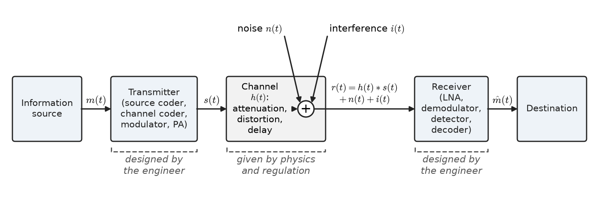
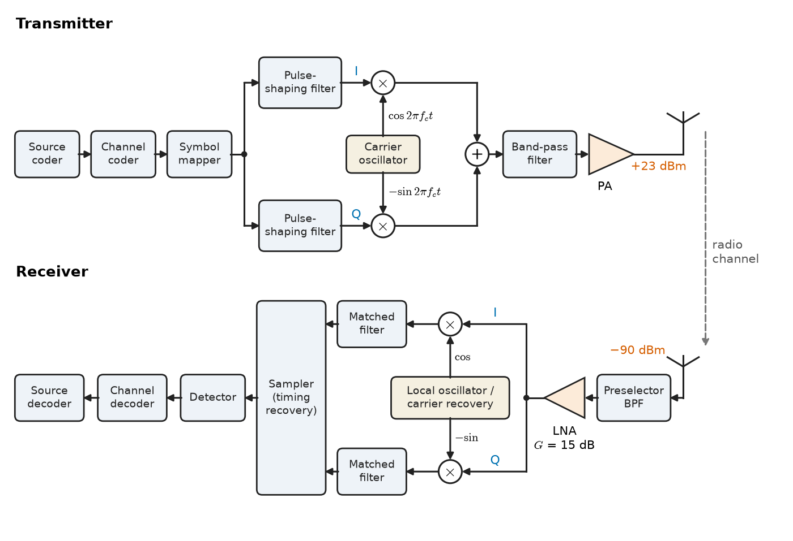
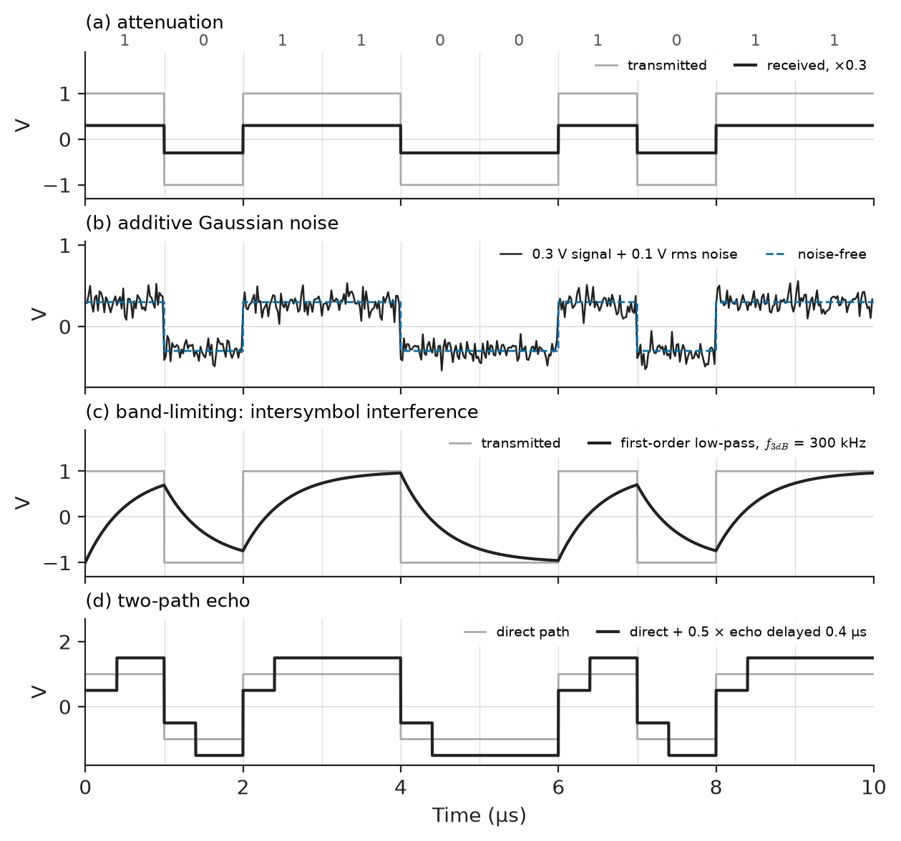
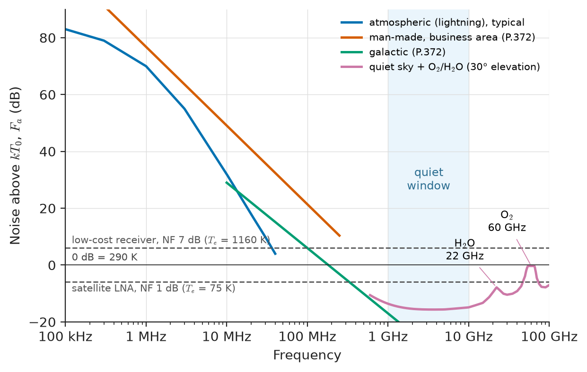
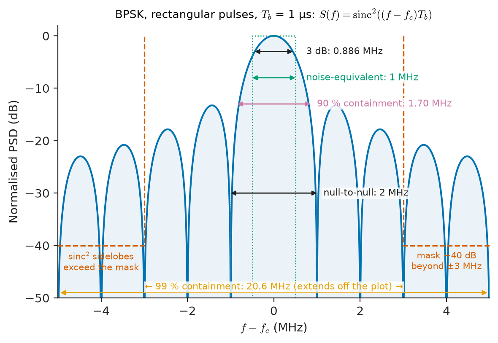
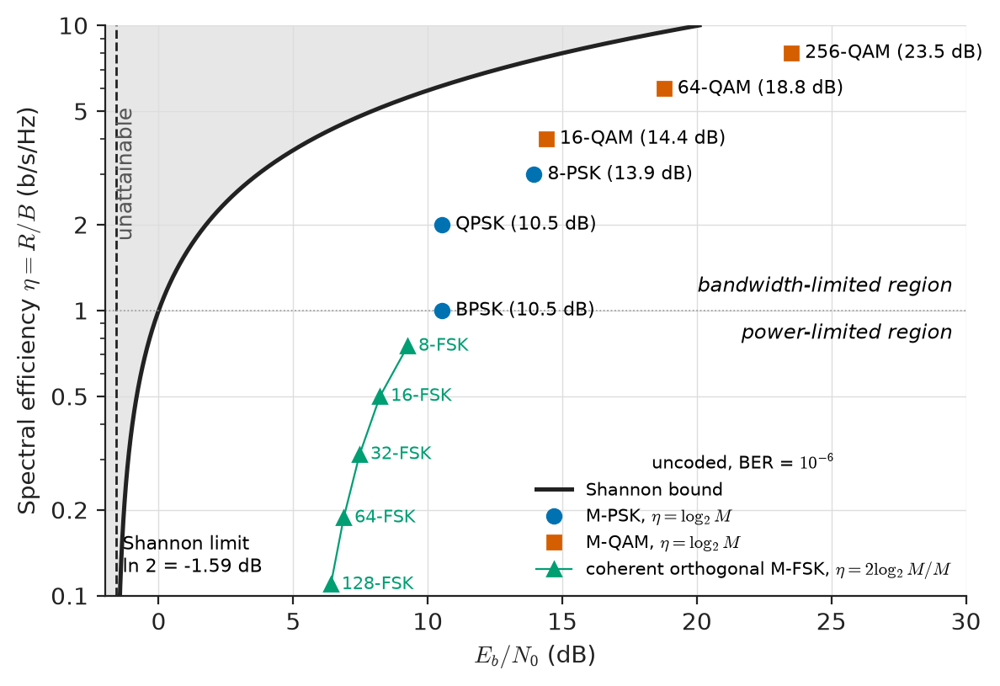

# Chapter 25 — Communication-System Fundamentals

*Part VI · Communication Theory*

A hospital installs wireless telemetry so that cardiac patients can walk the corridors while their ECG is watched from the nursing station. On the bench the system is flawless. On the ward, three things go wrong. Near the lift shaft the trace drops out for a few seconds at a time. Beside a bank of infusion pumps it shows a fuzz of spikes that the arrhythmia software reads as ventricular beats. And when a second ward installs the same system, both begin to lose packets whenever the two transmitters happen to be on adjacent channels. Nothing is broken. Each failure is a different face of the same problem: a message of a few hundred hertz of bandwidth has to cross a channel that attenuates it, adds noise, admits interference from other users and other machines, and does all of this at a power level and in a bandwidth that a regulator and a battery have fixed in advance.

This chapter builds the vocabulary for that problem. It treats a communication system as a chain of signal-processing blocks, each of which the earlier parts of this book already know how to analyse, and introduces the quantities used to decide whether the chain works: bandwidth, signal-to-noise ratio, energy per bit, error probability, spectral and power efficiency.

> **What is a communication system made of, and which properties of the source, the channel and the noise decide how well it can work?**
> **How are bandwidth, signal power and noise traded against one another, and what single numbers summarise a link's performance?**

| Concept | Engineering destination |
|---|---|
| Block model of a communication system | Architecture of radio, cable, fibre, telemetry and storage links |
| Information sources and their bandwidths | Codec choice, sampling rates, channel sizing for voice, audio, video, biosignals |
| Transmitter and receiver functions | RF front ends, modems, software-defined radios |
| Channel models | Link design for twisted pair, coax, fibre, radio and power-line carriers |
| Thermal noise $kTB$ | Receiver sensitivity, radar range, instrumentation amplifier noise floors |
| Interference | Frequency planning, EMC, co-channel reuse in cellular networks |
| Bandwidth definitions | Spectrum licensing, filter specifications, regulatory masks |
| SNR, $E_b/N_0$, $C/N_0$ | Link budgets, modem fallback rates, satellite and deep-space links |
| Performance measures and the Shannon limit | Comparing modulation and coding schemes, setting design targets |

**Roadmap.** The generic system model (25.1) → what the source delivers (25.2) → what transmitters and receivers do (25.3) → what the channel does (25.4) → noise and interference (25.5) → bandwidth (25.6) → signal-to-noise ratio and its variants (25.7) → the performance measures that tie them together, bounded by Shannon's capacity formula (25.8).

---

## 25.1 Communication-system models

### The generic chain

Every communication system, from a 19th-century telegraph to a 5G handset, can be drawn as the same chain (Figure 25.1). An **information source** produces a message: a voltage from a microphone, an ECG electrode or a strain gauge; a stream of characters; the samples of a video frame. A **transmitter** converts the message into a signal suited to the channel. The **channel** is the physical medium — a pair of copper wires, a coaxial cable, an optical fibre, the radio path between two antennas, the magnetic surface of a disk — together with everything that happens to the signal on the way. The **receiver** processes what arrives and produces an estimate of the original message for the **destination**: a loudspeaker, a display, a protection relay, a computer.

<!-- FIGURE 25.1 | figures/ch25/fig-25-1-communication-system-model.png | block-diagram | The generic communication-system model: source, transmitter, channel with additive noise and interference, receiver and destination. | Content: left-to-right chain of five boxes labelled "Information source", "Transmitter (source coder, channel coder, modulator, PA)", "Channel (attenuation, distortion, delay)", "Receiver (LNA, demodulator, detector, decoder)", "Destination". A summing junction inside the channel box receives two downward arrows labelled "noise n(t)" and "interference i(t)". Signals annotated on the arrows: m(t) after source, s(t) after transmitter, r(t) = h(t) * s(t) + n(t) + i(t) after channel, estimate m-hat(t) after receiver. A dashed bracket under transmitter and receiver labelled "designed by the engineer"; under the channel "given by physics and regulation". -->

*Figure 25.1 — The generic communication-system model: source, transmitter, channel with additive noise and interference, receiver and destination.*

The division in Figure 25.1 between what the engineer designs (transmitter and receiver) and what is given (the channel) is the organising idea of communication engineering. The channel is not chosen freely: the physics of propagation, the noise temperature of the environment, the transmit power permitted by regulation or by a battery, and the bandwidth allocated by a licence are all constraints. The transmitter and receiver are then designed to deliver the best fidelity possible within those constraints.

Mathematically the chain is a sequence of systems in the sense of Chapter 16. Most blocks are linear and time-invariant (filters, cables, amplifiers in their linear range); some are linear but time-varying (mixers, modulators — Chapter 26 shows that multiplying by a carrier is linear but not time-invariant); a few are deliberately nonlinear (quantizers, detectors, limiters). The analysis tools of Parts III–V — impulse response and convolution (Chapter 17), Fourier transforms and transfer functions (Chapter 18), sampling (Chapter 19) and the DFT (Chapter 22) — therefore apply block by block.

### The simplest useful channel model

The channel in Figure 25.1 is described by the received signal

$$
r(t)=\int_{-\infty}^{\infty} h(\tau)\,s(t-\tau)\,d\tau+n(t)+i(t)
$$

where $h(t)$ is the channel's impulse response (attenuation, delay and linear distortion), $n(t)$ is random noise and $i(t)$ is interference from other transmitters or machines. Three special cases recur through Part VI:

1. **Additive white Gaussian noise (AWGN) channel**: $h(t)=\alpha\,\delta(t-t_0)$, a pure gain and delay, plus white Gaussian noise. It models a short cable, a line-of-sight microwave link or a satellite link well, and it is the reference against which every modulation scheme is compared.
2. **Linear filter channel**: $h(t)$ has memory, so different frequencies are attenuated and delayed differently. It models telephone loops, long coaxial cables, DSL and backplanes; the result is intersymbol interference (Chapter 27).
3. **Time-varying (fading) channel**: $h(t)$ changes with time because the transmitter, receiver or scatterers move. It models mobile radio (Chapter 30).

> **Status of the principle: The additive-noise linear channel model**
> *Approximate.* Valid when the medium is linear at the signal levels used and noise is independent of the signal; it fails for power amplifiers driven into compression, for fibre at high launch power (Chapter 31), and for quantization noise that is correlated with the signal.

### Classifications of systems

Several classifications help locate a system before analysing it.

- **Analog and digital.** An analog system delivers a continuous waveform whose fidelity is judged by SNR and distortion (Chapter 26). A digital system delivers symbols from a finite alphabet whose fidelity is judged by error probability (Chapter 27). Many modern systems carry analog messages digitally: the voice is sampled and coded, transmitted as bits, and reconstructed.
- **Baseband and passband.** A baseband signal occupies frequencies from near zero up to some maximum (an Ethernet line code, the signal on an ECG lead wire). A passband signal is centred on a carrier frequency $f_c$ far above its bandwidth (an FM broadcast at 98.1 MHz, Wi-Fi at 2.437 GHz). Radio requires passband signals because antennas are efficient only when their size is comparable to a wavelength and because the spectrum must be shared by frequency.
- **Simplex, half-duplex and full-duplex.** Broadcast radio is simplex. A walkie-talkie is half-duplex (push to talk). A telephone is full-duplex, achieved either by separate frequencies (frequency-division duplex) or alternating time slots (time-division duplex).
- **Point-to-point, broadcast and multiple access.** A microwave backhaul link joins two points; a TV transmitter serves an unlimited audience; a cellular cell serves many users who share the channel by frequency, time, code or space (Chapter 30).

### Layering

Practical networks divide the chain of Figure 25.1 into layers. The **physical layer** — the subject of this part of the book — is responsible for turning bits into waveforms and back. Above it, link-layer protocols frame bits into packets and retransmit lost ones, and network and transport layers route and deliver them end to end. The layered view explains why the telemetry system of the opening paragraph "loses packets": the physical layer delivered errors, and the link layer discarded the corrupted frames. Here we stay at the physical layer, where the questions are about waveforms, spectra, noise and probability.

---

## 25.2 Information sources

### Analog and digital sources

The source sets what the system must carry. An **analog source** produces a waveform $m(t)$ characterised by its amplitude range, its spectrum (usually summarised as a bandwidth $W$), and the fidelity the destination needs. A **digital source** produces a sequence of symbols drawn from a finite alphabet at some rate; it is characterised by its symbol rate and by the statistics of the symbols. An analog source becomes digital after sampling at a rate of at least $2W$ (Chapter 19) and quantizing each sample to $n$ bits (Chapter 27), giving a raw bit rate

$$
R_b=n\,f_s\geq 2nW
$$

Table 25.1 collects the sources that appear most often in electrical engineering.

**Table 25.1 — Representative information sources (typical values).**

| Source | Baseband bandwidth | Typical digital form | Bit rate |
|---|---|---|---|
| Telephone speech | 300–3400 Hz | 8 kHz × 8 bit companded PCM (G.711) | 64 kb/s |
| Speech, mobile codec | 300–3400 Hz | AMR, EVS speech codecs | 4.75–24.4 kb/s |
| Wideband speech | 50–7000 Hz | 16 kHz sampling | 16–64 kb/s (coded) |
| High-fidelity audio | 20 Hz–20 kHz | 44.1 kHz × 16 bit × 2 channels (CD) | 1.411 Mb/s raw; 128–320 kb/s (AAC/MP3) |
| Diagnostic ECG | 0.05–150 Hz | 500 Hz × 12 bit per lead | 6 kb/s per lead |
| EEG | 0.5–100 Hz | 256–512 Hz × 16–24 bit per channel | 4–12 kb/s per channel |
| Surface EMG | 10–500 Hz | 1–2 kHz × 16 bit | 16–32 kb/s |
| Power-system sampled values (IEC 61850-9-2) | up to ~2 kHz | 80 samples per 50 Hz cycle, 8 channels | ~5 Mb/s per merging unit (with framing) |
| Analog composite video (historic) | 4.2 MHz (525-line), 5–6 MHz (625-line) | — | — |
| HD video 1080p60 | ~30 MHz luminance equivalent | Uncompressed 4:2:2, 10 bit (3G-SDI) | 2.97 Gb/s raw; 3–10 Mb/s (H.265/H.264) |
| Telemetry from slow sensors | < 1 Hz | 1 sample/s × 16 bit | tens of b/s |

Two lessons follow from the table. First, bandwidths span nine orders of magnitude, from sensor data at a fraction of a hertz to video at tens of megahertz, so there is no single "right" system. Second, the raw digital rate is usually far larger than what is actually sent: speech at 64 kb/s is routinely compressed to 12 kb/s, and HD video by a factor of several hundred, because real sources are redundant. How far a source can be compressed without loss is governed by its **entropy**, the subject of Chapter 28. For now it is enough to know that the relevant measure of a source is the rate at which it produces *information*, not the rate at which it produces samples.

### Source statistics that matter to the transmitter

Beyond bandwidth, three statistical properties of an analog source affect the design of the transmitter.

- **Peak-to-average ratio (crest factor).** Speech has a crest factor of 15–20 dB; a sinusoidal test tone only 3 dB. A modulator or quantizer must accommodate the peaks without clipping, which means the average power is far below the maximum the hardware can handle. Companding in telephone PCM (Chapter 27) and pre-emphasis in FM broadcasting (Chapter 26) are both responses to this.
- **Spectral shape.** Most of the power of speech lies below 1 kHz, while intelligibility depends on 1–3 kHz. Audio and video spectra fall steeply with frequency. Systems that add flat noise therefore damage the high-frequency content most, which is why emphasis networks exist.
- **DC and low-frequency content.** An ECG must preserve frequencies down to 0.05 Hz to show the ST segment faithfully; a voice channel need not pass anything below 300 Hz. A channel that cannot pass DC (transformer-coupled lines, AC-coupled amplifiers) forces the use of modulation or of DC-free line codes (Chapter 27).

**Worked example — the ECG telemetry stream.** A 12-lead diagnostic ECG recorder samples each lead at 500 Hz with 12-bit resolution. The raw payload rate is

$$
R_b=12\ \text{leads}\times 500\ \mathrm{s^{-1}}\times 12\ \text{bit}=72\ \mathrm{kb/s}.
$$

With 25 % protocol overhead (headers, sequence numbers, a cyclic redundancy check), the link must carry about 90 kb/s. The ward telemetry radio in the opening paragraph uses a channel of 25 kHz; to carry 90 kb/s in 25 kHz requires a spectral efficiency of $90/25=3.6$ b/s/Hz. Section 25.8 shows that this demands an SNR of at least $2^{3.6}-1\approx 11$, or 10.4 dB, even for an ideal system — and practical modems need several decibels more. The design team therefore has three options: a wider channel, lossless compression of the ECG (typically 2–3:1, since successive samples are highly correlated), or sending fewer leads. The source analysis has already shaped the system before any modulation is chosen.

---

## 25.3 Transmitters and receivers

### The transmitter

A digital transmitter performs, in order, the operations shown in the top half of Figure 25.2.

1. **Source coding** removes redundancy: speech, audio and video codecs; lossless compression of data (Chapter 28).
2. **Channel coding** adds controlled redundancy so that the receiver can detect or correct errors (Chapter 28).
3. **Modulation** maps bits to waveforms: line codes on a cable, phase or amplitude states on a carrier (Chapter 27). Analog transmitters skip the coding steps and impress the message directly on the carrier by amplitude, frequency or phase modulation (Chapter 26).
4. **Pulse shaping and filtering** confine the spectrum to the allocated channel.
5. **Up-conversion** moves the signal from baseband or a low intermediate frequency to the carrier frequency.
6. **Power amplification** raises the signal to the transmitted power, which ranges from microwatts (a capsule endoscope) through 0.2 W (a mobile handset), 1–40 W (a cellular base-station sector) and 50 kW (a medium-wave broadcaster) to megawatts of peak power in a radar.

<!-- FIGURE 25.2 | figures/ch25/fig-25-2-transmitter-receiver-architecture.png | block-diagram | Generic digital transmitter and superheterodyne-style receiver, showing the coding, modulation and frequency-conversion stages and the I/Q representation. | Content: top row (transmitter) blocks: "Source coder" -> "Channel coder" -> "Symbol mapper" -> split into I and Q branches each with "Pulse-shaping filter", I multiplied by cos(2 pi fc t), Q multiplied by -sin(2 pi fc t), summed, then "Band-pass filter" -> "Power amplifier" -> antenna. Bottom row (receiver) mirror image: antenna -> "Preselector BPF" -> "LNA" -> split to two mixers with cos and -sin from a shared "Local oscillator / carrier recovery" block -> "Matched filter" on each branch -> "Sampler (timing recovery)" -> "Detector" -> "Channel decoder" -> "Source decoder". Annotate typical levels: PA output +23 dBm, received level -90 dBm, LNA gain 15 dB. -->

*Figure 25.2 — Generic digital transmitter and superheterodyne-style receiver, showing the coding, modulation and frequency-conversion stages and the I/Q representation.*

### Complex-baseband representation

The I/Q branches in Figure 25.2 reflect the standard mathematical representation of a passband signal. Any real signal confined to a band around $f_c$ can be written as

$$
s(t)=s_I(t)\cos(2\pi f_c t)-s_Q(t)\sin(2\pi f_c t)=\operatorname{Re}\left\{\tilde s(t)\,e^{j2\pi f_c t}\right\},\qquad \tilde s(t)=s_I(t)+j\,s_Q(t)
$$

where $s_I$ and $s_Q$ are real baseband signals — the **in-phase** and **quadrature** components — and $\tilde s(t)$ is the **complex envelope**. The amplitude and phase of the carrier are $\lvert\tilde s(t)\rvert$ and $\arg\tilde s(t)$. The representation is exact for any bandpass signal whose bandwidth is less than $2f_c$, and it is how every modern modem and software-defined radio works internally: the carrier is applied or removed in a single mixing stage, and all the signal processing happens on the complex envelope at a sample rate set by the bandwidth, not by the carrier. A 20 MHz Wi-Fi channel at 5.2 GHz is processed with complex samples at a few tens of megasamples per second, not at the 10 GS/s that direct sampling of the carrier would require.

> **Status of the principle: Complex-envelope (I/Q) representation**
> *Derived.* A mathematical identity for real bandpass signals, following from the Fourier-transform symmetry of real signals (Chapter 18); it requires only that the signal's spectrum vanish near zero frequency, which holds whenever the bandwidth is less than twice the carrier.

### The receiver

The receiver must undo the transmitter's operations, but it faces three problems the transmitter does not.

- **The signal is weak.** A transmitter operates at watts; the receiver input of a cellular phone at the cell edge is around $-100$ dBm (0.1 pW), and that of a GPS receiver about $-130$ dBm, below the thermal noise in its bandwidth. The first stage must therefore be a **low-noise amplifier** (LNA), because noise added later is amplified less than noise added first (the cascade formula is derived in Chapter 29).
- **The wanted signal is surrounded by unwanted ones.** A receiver tuned to one FM station has dozens of others, some 80 dB stronger, within a few megahertz. **Selectivity** — the ability to reject adjacent and distant signals — is provided by filters, and the superheterodyne architecture of Chapter 26 was invented precisely to make selectivity independent of tuning.
- **The receiver does not know the carrier phase, frequency or symbol timing exactly.** It must estimate them from the received signal (**synchronization**): carrier recovery loops, phase-locked loops and timing-recovery loops. A 1 ppm error in a 2.4 GHz crystal oscillator is a 2.4 kHz frequency offset, which rotates a QPSK constellation through a full turn in 0.4 ms.

After amplification, filtering, down-conversion and synchronization, the receiver applies a **detector**. For analog signals this is a demodulator (envelope detector, frequency discriminator) whose output is the estimated message. For digital signals it is a matched filter followed by a decision device that chooses the most likely transmitted symbol (Chapter 27).

> **Boundary.** The circuits that implement LNAs, mixers, oscillators and power amplifiers — transistor biasing, matching networks, linearity of real devices — belong to *Electronics & Computing*. This chapter treats them as blocks with a gain, a noise contribution and a frequency response.

---

## 25.4 Channels

### Physical media

The channel is where the signal suffers. Table 25.2 compares the guided media used in practice; Chapter 14 analysed them as transmission lines, and Chapter 31 treats fibre in detail.

**Table 25.2 — Attenuation of common guided media (typical values).**

| Medium | Frequency | Attenuation | Typical use |
|---|---|---|---|
| Telephone twisted pair, 0.5 mm (24 AWG) | 1 kHz | ~0.6 dB/km (with loading) to 1.5 dB/km | Voice-band local loop |
| Same pair | 1 MHz | ~20 dB/km | ADSL |
| Cat 5e/6 UTP | 1 MHz / 100 MHz | 2 / 22 dB per 100 m | Ethernet |
| RG-58 coax | 100 MHz / 1 GHz | ~16 / ~55 dB per 100 m | Lab and short RF runs |
| RG-6 coax | 100 MHz / 1 GHz | ~6.5 / ~20 dB per 100 m | Cable TV drops |
| 7/8-inch foam coax | 2 GHz | ~6 dB per 100 m | Base-station feeders |
| Single-mode fibre | 1310 nm / 1550 nm | 0.33 / 0.20 dB/km | Long-haul and access networks |
| Power-line carrier (MV line) | 50–500 kHz | 0.1–1 dB/km plus coupling losses | Utility protection signalling |

Attenuation in decibels grows linearly with distance on a guided medium: 10 km of fibre at 1550 nm loses 2 dB, 100 km loses 20 dB. In free space, by contrast, the power spreads over a sphere and the loss grows only with the square of distance. Between isotropic antennas,

$$
\frac{P_R}{P_T}=G_TG_R\left(\frac{\lambda}{4\pi d}\right)^2,\qquad L_{fs}=20\log_{10}\frac{4\pi d}{\lambda}\ \mathrm{dB}
$$

the **Friis transmission formula**, where $G_T$ and $G_R$ are the antenna gains (Chapter 32). Each doubling of distance adds 6 dB of loss, and each factor of ten adds 20 dB. This difference is why a few hundred metres of coax is enough to lose a 2 GHz signal completely, whereas a radio link reaches a geostationary satellite 36 000 km away: at long distances, logarithmic growth beats linear growth. Terrestrial radio paths deviate from free space because of ground reflection, obstruction and multipath; Chapter 30 replaces the exponent 2 by empirical values between about 2 and 5.

> **Status of the principle: Friis free-space transmission formula**
> *Derived.* Follows from energy conservation over a spherical wavefront and the definition of antenna gain and effective aperture; valid in the far field of both antennas with an unobstructed path and no ground reflection.

### The decibel bookkeeping

Because the chain of Figure 25.1 multiplies gains and losses, link calculations are done in decibels, where they add. Power levels are expressed in dBm (decibels relative to 1 mW) or dBW. The conversions to remember are: 0 dBm = 1 mW, 30 dBm = 1 W, $-30$ dBm = 1 µW, $-100$ dBm = 0.1 pW; and 3 dB is a factor 2, 10 dB a factor 10.

**Worked example — a 2.4 GHz link budget.** An industrial monitoring link transmits $P_T=1$ W (30 dBm) at 2.4 GHz between two antennas of 2 dBi gain, 100 m apart in a clear line of sight. The wavelength is $\lambda=c/f=0.125$ m, so

$$
L_{fs}=20\log_{10}\frac{4\pi\times 100}{0.125}=20\log_{10}(10\,053)=80.05\ \mathrm{dB}.
$$

The received power is

$$
P_R=30+2+2-80.05=-46.05\ \mathrm{dBm}\approx 25\ \mathrm{nW}.
$$

At 1 km the free-space loss rises by exactly 20 dB to 100.05 dB, and $P_R=-66.05$ dBm. Whether either level is "enough" cannot be decided yet: it depends on the noise in the receiver's bandwidth, which Section 25.5 supplies, and the example continues in Section 25.7.

### Linear and nonlinear distortion

Attenuation alone is harmless: an amplifier can restore the level. What damages the signal is distortion. A channel is **distortionless** if its output is a scaled, delayed copy of its input, which requires (Chapter 18) a flat magnitude response and a linear phase response — constant group delay — across the signal's band. Real channels violate both:

- A telephone loop attenuates 3 kHz more than 300 Hz and has a group delay that rises sharply near the band edges; voice survives, but a fast data signal smears into its neighbours (intersymbol interference).
- A long coax has loss that grows as $\sqrt f$ because of the skin effect, so a fast digital edge arrives with a slow tail. Cable equalizers invert this response.
- A radio path with two routes of different lengths has a frequency response with periodic notches (Chapter 30).

**Nonlinear distortion** occurs when the channel includes a device whose output is not proportional to its input: a power amplifier near saturation, a fibre at high launch power, a mixer driven too hard. A nonlinearity creates new frequencies. Two tones at $f_1$ and $f_2$ passing through a cubic nonlinearity produce third-order intermodulation products at $2f_1-f_2$ and $2f_2-f_1$, which fall close to the original tones and cannot be filtered out. This is why multi-carrier transmitters must be backed off from saturation by several decibels, sacrificing efficiency for linearity.

<!-- FIGURE 25.3 | figures/ch25/fig-25-3-channel-impairments.png | plot | Four channel impairments acting on the same 1 Mb/s NRZ bit pattern: attenuation, additive noise, band-limiting (intersymbol interference) and a two-path echo. | Content: four stacked panels, common time axis 0 to 10 microseconds, bit pattern 1 0 1 1 0 0 1 0 1 1 at 1 microsecond per bit, amplitude +/-1 V. Panel a: transmitted (thin grey) and received scaled by 0.3 (black). Panel b: received 0.3 V signal plus Gaussian noise of 0.1 V rms. Panel c: output of a first-order low-pass channel with 3-dB bandwidth 300 kHz showing rounded edges and bits spilling into neighbours. Panel d: sum of direct path and an echo of relative amplitude 0.5 delayed 0.4 microseconds. Y-axes in volts, x-axis in microseconds. -->

*Figure 25.3 — Four channel impairments acting on the same 1 Mb/s NRZ bit pattern: attenuation, additive noise, band-limiting (intersymbol interference) and a two-path echo.*

Figure 25.3 shows the four impairments side by side. Attenuation (a) alone would be harmless; noise (b) and band-limiting (c) both make the received waveform ambiguous, and an echo (d) is a band-limiting filter in disguise, since its frequency response has notches.

### Storage as a channel

A hard disk, a flash memory or an optical disc is a channel in time rather than space: data written now is read later, after degradation. The same models apply. A flash cell's stored charge leaks and is disturbed by reads of neighbouring cells, giving a noisy channel whose error rate rises with age; a disk read head sees intersymbol interference from neighbouring magnetic transitions. Error-correcting codes (Chapter 28) are as essential in storage as in radio.

---

## 25.5 Noise and interference

### Thermal noise

Every resistor at absolute temperature $T$ generates a random voltage from the thermal agitation of its electrons. Over a bandwidth $B$ small compared with $kT/h$ (about 6 THz at room temperature), the available noise power — the power delivered into a matched load — is

$$
N=kTB
$$

where $k=1.380\,649\times 10^{-23}$ J/K is Boltzmann's constant. The power is independent of the resistance and proportional to bandwidth: thermal noise is **white**, with a one-sided power spectral density $N_0=kT$. At the standard reference temperature $T_0=290$ K,

$$
kT_0=4.00\times 10^{-21}\ \mathrm{W/Hz}=-174.0\ \mathrm{dBm/Hz}.
$$

This single number underlies every link budget. Table 25.3 gives the thermal noise floor for common channel bandwidths.

**Table 25.3 — Thermal noise power $kT_0B$ at 290 K.**

| Bandwidth | System | $kT_0B$ |
|---|---|---|
| 1 Hz | reference | $-174.0$ dBm |
| 3.1 kHz | telephone channel | $-139.1$ dBm |
| 25 kHz | narrowband telemetry/PMR | $-130.0$ dBm |
| 200 kHz | GSM carrier, FM broadcast | $-121.0$ dBm |
| 1 MHz | — | $-114.0$ dBm |
| 6 MHz | cable TV channel | $-106.2$ dBm |
| 20 MHz | Wi-Fi channel, LTE carrier | $-101.0$ dBm |
| 400 MHz | 5G mmWave carrier | $-88.0$ dBm |

> **Status of the principle: Thermal noise power $kTB$ (Johnson–Nyquist)**
> *Fundamental.* Follows from statistical thermodynamics (equipartition of energy among the modes of a transmission line in equilibrium); the classical form $kTB$ is accurate when $hf\ll kT$, which holds up to hundreds of gigahertz at room temperature but fails for cryogenic receivers at millimetre-wave frequencies.

A real receiver adds noise of its own on top of the thermal noise of its source. This is summarised by its **noise figure** $NF$: the ratio, in decibels, of the SNR at its input to the SNR at its output, when the input is at 290 K. A receiver with $NF=7$ dB behaves as if its input noise were 7 dB above $kT_0B$. Typical values: 0.5–1.5 dB for a satellite or GPS LNA, 3–5 dB for a Wi-Fi or LTE receiver, 6–9 dB for a low-cost receiver chip. The theory of noise figure and of noise in cascades is the subject of Chapter 29.

**Worked example — receiver sensitivity.** A GSM-type receiver with a 200 kHz channel has a noise figure of 7 dB and needs an SNR of 9 dB at the detector to meet its error-rate target. Its noise floor referred to the input is

$$
N=-174.0+10\log_{10}(2\times10^5)+7=-174.0+53.0+7=-114.0\ \mathrm{dBm}.
$$

The **sensitivity**, the smallest input that meets the target, is $-114.0+9=-105.0$ dBm, or about 32 fW. Every dB of noise figure removed and every dB of required SNR saved through better modulation or coding lowers this figure one-for-one, which, through the path-loss law, extends range. With a free-space exponent of 2, 6 dB doubles the range; with the exponent of 3.5 typical of urban radio (Chapter 30), 6 dB extends range by a factor $10^{6/35}=1.48$.

### Other internal noise sources

Thermal noise is not the only noise generated inside the receiver.

- **Shot noise** arises because current in a diode, transistor or photodetector consists of discrete charges crossing a barrier at random times. Its power spectral density is $2qI$ (A²/Hz), white up to very high frequencies. It dominates optical receivers (Chapter 31) and some radiation detectors.
- **Flicker (1/f) noise** has a power spectral density inversely proportional to frequency. It matters below about 1–10 kHz in semiconductor devices and is the reason precision instrumentation amplifiers and ECG front ends use chopper stabilisation, and why direct-conversion radio receivers struggle with signals near DC.
- **Phase noise** of oscillators spreads a pure carrier into a skirt of noise, which mixes strong adjacent signals into the wanted channel (reciprocal mixing) and rotates constellation points randomly.
- **Quantization noise** is introduced deliberately by analog-to-digital conversion (Chapters 19, 21, 27).

### External noise

The antenna collects noise from its surroundings as well as signal. Below about 30 MHz, atmospheric noise from lightning worldwide dominates and can exceed thermal noise by 40–60 dB; at VHF and low UHF, man-made noise from ignition systems, switch-mode power supplies, LED drivers and power-line corona is the limit in urban areas; between roughly 1 and 10 GHz the sky is quiet, with a background of only a few kelvin, which is why satellite navigation, satellite communication and radio astronomy cluster there. Above 10 GHz, absorption by water vapour and oxygen adds noise and attenuation. Figure 25.4 summarises the frequency dependence.

<!-- FIGURE 25.4 | figures/ch25/fig-25-4-noise-sources-vs-frequency.png | plot | Typical external noise levels relative to kT0B versus frequency, compared with receiver noise figures. | Content: log x-axis frequency 100 kHz to 100 GHz; y-axis "noise above kT0, dB" from -20 to 90 dB. Curves (typical, after ITU-R P.372 style): atmospheric noise falling from ~70 dB at 1 MHz to ~10 dB at 30 MHz; man-made noise (business area, 76.8 - 27.7 log f) falling from ~90 dB at 300 kHz through ~30 dB at 30 MHz to ~10 dB at 300 MHz; galactic noise (52 - 23 log f) falling from ~29 dB at 10 MHz to ~0 dB near 200 MHz; quiet-sky minimum below 0 dB (a few kelvin) between 1 and 10 GHz; rising oxygen and water-vapour noise above 10 GHz with peaks at 22 GHz and 60 GHz. Horizontal dashed lines at the receiver noise levels 10 log(F - 1) for NF 1 dB and 7 dB, labelled "satellite LNA" and "low-cost receiver". Shaded band 1-10 GHz labelled "quiet window". -->

*Figure 25.4 — Typical external noise levels relative to kT0B versus frequency, compared with receiver noise figures.*

The consequence for design is that a low receiver noise figure is wasted at HF, where the antenna noise is already far above thermal, but is decisive at microwave frequencies, where the antenna sees cold sky. A medium-wave AM receiver with a 10 dB noise figure is perfectly adequate; a GPS receiver with the same noise figure would lose nearly 10 dB of margin.

### Interference

Interference is unwanted signal with structure — another transmitter, a harmonic, a switching transient — rather than random noise. Its main forms are:

- **Co-channel interference**: another transmitter on the same frequency. Cellular systems reuse frequencies in distant cells, so co-channel interference, not noise, usually limits them; their figure of merit is the signal-to-interference ratio (SIR) or SINR.
- **Adjacent-channel interference**: energy spilling from a neighbouring channel because of imperfect transmitter spectra (sidebands, spectral regrowth from nonlinear amplifiers) or imperfect receiver selectivity. This is the failure in the ward-telemetry story.
- **Intermodulation**: products of two or more strong signals mixing in a nonlinear receiver stage, appearing in the wanted channel.
- **Crosstalk**: coupling between adjacent pairs in a cable. In DSL, near-end and far-end crosstalk from other subscribers' pairs in the same binder limit the data rate more than thermal noise does.
- **Power-line and switching interference**: 50/60 Hz and its harmonics coupled into biomedical and instrumentation leads; broadband impulses from switch-mode converters, motor drives and relays. A typical ECG signal of 1 mV can be accompanied by 50 Hz common-mode pickup of tens of millivolts; it is the differential amplifier's common-mode rejection (often 100 dB or more) and the right-leg drive circuit, not filtering alone, that make the ECG readable.

Noise and interference differ in what can be done about them. Noise is unpredictable and can only be overcome by more signal energy or by averaging over more time. Interference has structure that can be exploited: it may be filtered (if spectrally separate), cancelled (if it can be measured, as with adaptive mains-hum cancellation, Chapter 24), spatially rejected by directional antennas, or avoided by frequency planning.

---

## 25.6 Bandwidth

### Why there is more than one definition

Strictly time-limited signals have spectra that extend to infinite frequency (Chapter 18), so "bandwidth" always means "the frequency range that contains most of what matters". Several definitions are in use, and they give different numbers for the same signal (Figure 25.5).

- **Absolute bandwidth**: the range outside which the spectrum is exactly zero. Only strictly band-limited signals have one; it is a theoretical idealisation.
- **3-dB (half-power) bandwidth**: the range over which the power spectral density stays within 3 dB of its peak. Standard for filters and amplifiers.
- **Null-to-null bandwidth**: the width of the main lobe of the spectrum, convenient for rectangular-pulse modulation.
- **Equivalent noise bandwidth**: the width of a rectangular filter with the same peak gain that passes the same white-noise power (Chapter 29). It is the $B$ that belongs in $kTB$.
- **Occupied (power-containment) bandwidth**: the range containing a specified fraction of the power, usually 99 %. This is the regulatory definition.
- **Bounded-spectrum (mask) bandwidth**: the range outside which the spectrum is below a specified level, such as $-50$ dB relative to the peak. Regulators publish emission masks of this type.

<!-- FIGURE 25.5 | figures/ch25/fig-25-5-bandwidth-definitions.png | spectrum | Different bandwidth definitions applied to the power spectral density of a rectangular-pulse BPSK signal at 1 Mb/s. | Content: one-sided-around-carrier PSD S(f) = sinc^2((f-fc)Tb) with Tb = 1 microsecond, x-axis f - fc from -5 MHz to +5 MHz, y-axis normalised PSD in dB from -50 to 0. Horizontal arrows marking: 3-dB bandwidth 0.886 MHz, null-to-null 2 MHz, noise-equivalent 1 MHz, 90 % containment ~1.7 MHz, 99 % containment ~20.6 MHz (arrow running off-plot, annotated with value). A dashed regulatory mask at -40 dB beyond +/-3 MHz. -->

*Figure 25.5 — Different bandwidth definitions applied to the power spectral density of a rectangular-pulse BPSK signal at 1 Mb/s.*

For the rectangular-pulse BPSK spectrum in Figure 25.5 the definitions give widely different answers: about 0.89 MHz (3 dB), 1 MHz (noise-equivalent), 2 MHz (null-to-null), and roughly 20 MHz for 99 % containment, because the $\mathrm{sinc}^2$ sidelobes decay only as $1/f^2$. This large ratio is exactly why practical transmitters shape their pulses (Chapter 27): a raised-cosine pulse with 35 % excess bandwidth confines essentially all the power to 1.35 MHz for the same 1 Mb/s BPSK signal.

### Bandwidth of the message and of the transmitted signal

Two bandwidths must be distinguished. The **message bandwidth** $W$ belongs to the source (3.4 kHz for telephone speech, 15 kHz for FM broadcast audio). The **transmission bandwidth** $B_T$ is what the modulated signal occupies on the channel. Their ratio depends on the modulation: single-sideband AM gives $B_T=W$, conventional AM $B_T=2W$, and broadcast FM $B_T\approx 12W$ (Chapter 26). For digital signals the relevant ratio is between the bit rate $R_b$ and $B_T$, the **spectral efficiency** $\eta=R_b/B_T$ in b/s/Hz (Section 25.8).

### Time–bandwidth duality

Bandwidth and time are reciprocal (Chapter 18): a pulse of duration $T$ occupies a bandwidth of order $1/T$. A system that sends $R_s$ symbols per second therefore needs bandwidth proportional to $R_s$. Nyquist showed (Chapter 27) that the minimum baseband bandwidth for $R_s$ independent pulses without intersymbol interference is $R_s/2$; passband transmission of the same complex symbols needs $R_s$. Radar is governed by the same reciprocity: a pulse compressed to 1 µs resolves targets 150 m apart in range, and resolving 15 m requires a bandwidth of about 10 MHz.

### Bandwidth as a regulated resource

Radio spectrum is allocated by national regulators under the international framework of the ITU Radio Regulations. Table 25.4 gives representative channel widths; they set the $B$ that every subsequent calculation in a given service must use.

**Table 25.4 — Representative channel bandwidths (typical; regional variations apply).**

| Service | Band | Channel width |
|---|---|---|
| AM broadcast (medium wave) | 531–1602 kHz (ITU Regions 1, 3); 530–1700 kHz (Region 2) | 9 kHz; 10 kHz |
| FM broadcast | 87.5–108 MHz | 200 kHz (Region 2 spacing); 100 kHz raster elsewhere |
| Narrowband private mobile radio | VHF/UHF | 12.5 kHz, 6.25 kHz |
| Medical telemetry (WMTS, USA) | 608–614, 1395–1432 MHz | up to 6 MHz blocks |
| GSM | 900/1800 MHz | 200 kHz |
| LTE | 0.45–3.8 GHz | 1.4–20 MHz |
| 5G NR | FR1 / FR2 | up to 100 MHz / 400 MHz |
| Wi-Fi | 2.4, 5, 6 GHz | 20–320 MHz |
| Analog/digital TV | VHF/UHF | 6, 7 or 8 MHz |
| Cable TV (DOCSIS 3.0 downstream) | 54–1002 MHz | 6 MHz (USA), 8 MHz (Europe) |

---

## 25.7 Signal-to-noise ratio

### Definition

The **signal-to-noise ratio** is the ratio of average signal power to average noise power at a specified point in the system:

$$
\mathrm{SNR}=\frac{S}{N},\qquad \mathrm{SNR_{dB}}=10\log_{10}\frac SN
$$

Both powers must be measured at the same point and in the same bandwidth. Three points matter in practice. The **input SNR** (or **carrier-to-noise ratio**, CNR) is measured at the receiver input or IF, in the transmission bandwidth $B_T$. The **detection SNR** is measured at the input to the demodulator. The **output SNR** is measured at the destination, in the message bandwidth $W$. For analog systems the ratio between output SNR and a reference input SNR is the figure of merit of the modulation (Chapter 26).

Table 25.5 lists SNR values that mark useful quality levels.

**Table 25.5 — Output SNR for acceptable quality (typical).**

| Application | Output SNR |
|---|---|
| Intelligible speech, emergency radio | 10–15 dB |
| Commercial-quality telephone speech | 25–40 dB |
| AM broadcast (good reception) | ~40 dB |
| FM broadcast (stereo, good reception) | 50–70 dB |
| Analog television picture (good) | 40–50 dB (weighted) |
| CD audio (16-bit) | ~96–98 dB dynamic range |
| Diagnostic ECG (1 mV R wave) | 30–40 dB above input-referred noise of a few µV |

### Energy per bit and $C/N_0$

For digital systems, the SNR in a bandwidth is less fundamental than the energy available per bit. If the received power is $S$ and the bit rate $R_b$, each bit carries energy $E_b=S/R_b$. With noise spectral density $N_0$, the ratio

$$
\frac{E_b}{N_0}=\frac{S}{N_0R_b}=\frac{S}{N}\cdot\frac{B}{R_b}
$$

is independent of the bandwidth chosen to measure the noise. It is the quantity in which error-probability formulas are written (Chapter 27), and it makes systems of different rates and bandwidths comparable. Its companion, the **carrier-to-noise-density ratio** $C/N_0=S/N_0$ (in dB-Hz), describes the link alone, before a bit rate is chosen: a GPS receiver typically sees $C/N_0$ of 35–50 dB-Hz.

**Worked example — the 2.4 GHz link, completed.** Continue the link of Section 25.4 with $P_R=-46.05$ dBm at 100 m, a receiver noise figure of 6 dB and a 20 MHz channel. The noise floor is

$$
N=-174.0+10\log_{10}(2\times10^7)+6=-174.0+73.0+6=-95.0\ \mathrm{dBm},
$$

so $\mathrm{SNR}=-46.05-(-94.96)=48.9$ dB. At 1 km, $P_R=-66.05$ dBm and $\mathrm{SNR}=28.9$ dB. Suppose the modem transmits $R_b=40$ Mb/s in the 20 MHz channel. At 1 km,

$$
\frac{E_b}{N_0}=28.9+10\log_{10}\frac{20\times 10^6}{40\times10^6}=28.9-3.0=25.9\ \mathrm{dB}.
$$

Chapter 27 shows that QPSK needs about 10.5 dB and 64-QAM about 19 dB of $E_b/N_0$ for a bit-error rate of $10^{-6}$, so the link has a comfortable margin at 1 km in free space — but Chapter 30 will show that a realistic multipath path loses 20–30 dB more and that fading margins of 10–20 dB are needed.

### SINR

When interference matters, it is added to the noise power in the denominator:

$$
\mathrm{SINR}=\frac{S}{N+I}
$$

The approximation that treats interference as additional Gaussian noise is reasonable when there are many interferers or when the interferer is itself a wideband digitally modulated signal; it is pessimistic for a single narrowband interferer that a receiver could notch out. In a well-designed cellular network, $I\gg N$ over most of the cell, and increasing every transmitter's power improves nothing: the system is **interference-limited**.

### How SNR degrades along a chain

Every lossy element or noisy amplifier lowers the SNR, and the SNR can never be increased by processing that only filters or amplifies within the signal band. What can be done is to remove out-of-band noise by filtering (raising SNR measured in a wide bandwidth to SNR measured in the signal bandwidth), to integrate over a longer time (averaging), or to exploit structure in the signal (correlation, matched filtering, coding). An ECG averaged over 64 heartbeats synchronised to the R wave improves SNR by $10\log_{10}64=18$ dB for uncorrelated noise; a radar that integrates 100 pulses coherently gains 20 dB. These are examples of the general principle, made precise in Chapters 27 and 29, that SNR at a decision is set by signal *energy* relative to noise density, and energy grows with observation time.

---

## 25.8 Communication performance measures

### Measures of fidelity

The first question about any link is how faithfully the message arrives.

- For analog systems: **output SNR**, **distortion** (total harmonic distortion, intermodulation) and frequency response flatness over the message band.
- For digital systems: the **bit-error rate** (BER, or bit-error probability $P_b$), the **symbol-error rate** (SER), and at higher layers the **packet** or **frame-error rate** and the residual error rate after decoding. A BER of $10^{-3}$ is tolerable for coded speech, $10^{-6}$ is a common uncoded design point, $10^{-12}$ is required of optical transport networks, and $10^{-15}$ of storage after error correction.
- For both: **availability**, the fraction of time a target fidelity is met. A microwave backhaul link may be specified for 99.999 % availability (about 5 minutes of outage per year), which is set by rain fading, not by average SNR.

### Measures of resource use

The second question is what the link costs in the two resources the channel limits.

- **Spectral (bandwidth) efficiency** $\eta=R_b/B$ in b/s/Hz: how many bits each hertz carries.
- **Power (energy) efficiency**: the $E_b/N_0$ needed to reach a target BER. A scheme that reaches $10^{-6}$ at 10.5 dB is 4 dB more power-efficient than one that needs 14.5 dB, meaning it can use 2.5 times less power, or reach 1.58 times farther in free space.
- **Latency**: the delay from source to destination. It includes propagation (5 µs/km in fibre, about 240 ms up and down through a geostationary satellite at the subsatellite point), processing, buffering and coding delay. Power-system protection signalling must deliver a trip command in a few milliseconds; a phone call tolerates about 150 ms one way.
- **Complexity, cost and power consumption** of the transmitter and receiver: a capsule endoscope or a coin-cell sensor cannot afford the processing of a base station.

Table 25.6 gives representative spectral efficiencies.

**Table 25.6 — Representative spectral efficiencies of deployed systems (typical, including overheads where noted).**

| System | Modulation | Approximate $\eta$ (b/s/Hz) |
|---|---|---|
| Bluetooth basic rate | GFSK, 1 Mb/s in 1 MHz | 1 |
| GSM | GMSK, 270.8 kb/s in 200 kHz | 1.35 |
| DVB-S2 satellite TV | QPSK–32APSK with LDPC | 1–4.5 |
| V.34 telephone modem | up to 33.6 kb/s in ~3.4 kHz | ~10 |
| DOCSIS 3.0 downstream | 256-QAM, 42.88 Mb/s in 6 MHz | 7.1 |
| LTE, 20 MHz, 2×2 MIMO (peak) | 64-QAM | ~7.5 |
| Wi-Fi 6, 80 MHz, 1 stream | 1024-QAM, rate 5/6 | ~7.5 |

### The power–bandwidth trade-off and the Shannon limit

The two resources can be traded. FM broadcasting spends bandwidth to save power (Chapter 26). M-ary FSK does the same for digital data; QAM spends power to save bandwidth (Chapter 27). The limit of what any trade can achieve was found by Shannon in 1948. For a channel of bandwidth $B$ with additive white Gaussian noise and average received SNR $S/N$, no system can transmit error-free faster than

$$
C=B\log_2\!\left(1+\frac SN\right)\ \mathrm{b/s}
$$

and for any rate below $C$ there exist codes that make the error probability as small as desired. This is the **Shannon–Hartley capacity formula**; its derivation from mutual information belongs to Chapter 28. Here we use it as a ceiling.

> **Status of the principle: Shannon–Hartley channel capacity**
> *Derived.* A theorem of information theory for the band-limited AWGN channel with an average power constraint; it bounds every possible modulation and code but does not say how to achieve the bound, and it does not apply directly to fading, interference-limited or non-Gaussian channels without modification.

**Worked example — the telephone channel.** A voice-band telephone channel passes roughly 300–3400 Hz, $B\approx 3.1$ kHz, and a good end-to-end connection has an SNR of about 35 dB ($S/N=3162$). Its capacity is

$$
C=3100\log_2(1+3162)=3100\times 11.63\approx 36\ \mathrm{kb/s}.
$$

The V.34 modem standard of 1994 reached 33.6 kb/s, within 7 % of this limit, which is why dial-up modems stopped improving there. The later 56 kb/s V.90 modems did not beat Shannon: they exploited the fact that in the downstream direction the "channel" was a digital 64 kb/s PCM link with only the final analog loop, whose SNR is much higher than 35 dB.

Writing $S=E_bR_b$ and $N=N_0B$ and setting $R_b=C$ gives a relation between spectral efficiency $\eta=C/B$ and the minimum $E_b/N_0$:

$$
\frac{E_b}{N_0}\geq\frac{2^{\eta}-1}{\eta}
$$

Figure 25.6 plots this bound. As $\eta\to0$ (unlimited bandwidth) the right-hand side tends to $\ln 2=0.693$, or $-1.59$ dB: no system, however much bandwidth it uses, can communicate reliably with less energy per bit than this. At $\eta=1$ the bound is 0 dB; at $\eta=4$ it is $15/4=3.75$, or 5.7 dB; at $\eta=8$ it is $255/8$, or 15.0 dB. Each additional b/s/Hz at high efficiency costs about 3 dB more energy per bit.

<!-- FIGURE 25.6 | figures/ch25/fig-25-6-shannon-bound.png | plot | The Shannon bound on spectral efficiency versus Eb/N0, with uncoded modulation schemes at a bit-error rate of 1e-6 for comparison. | Content: x-axis Eb/N0 from -2 to 30 dB, y-axis spectral efficiency R/B from 0.1 to 10 b/s/Hz on a log scale. Solid curve: eta = log2(1 + eta Eb/N0) bound, i.e. Eb/N0 = (2^eta - 1)/eta. Vertical dashed asymptote at -1.59 dB labelled "Shannon limit, ln 2". Shaded region to the left labelled "unattainable". Markers at BER 1e-6, uncoded, with eta = log2 M for passband Nyquist signalling: BPSK (10.5 dB, 1), QPSK (10.5 dB, 2), 8-PSK (14.0 dB, 3), 16-QAM (14.4 dB, 4), 64-QAM (18.8 dB, 6), 256-QAM (23.5 dB, 8); orthogonal FSK points below eta = 1 trending left. Labels "bandwidth-limited region" above eta = 1 and "power-limited region" below. -->

*Figure 25.6 — The Shannon bound on spectral efficiency versus Eb/N0, with uncoded modulation schemes at a bit-error rate of 1e-6 for comparison.*

The gap between a marker in Figure 25.6 and the curve is the room left for improvement by coding. Uncoded QPSK at $10^{-6}$ sits about 9 dB to the right of the bound at $\eta=2$ (1.76 dB); modern LDPC and turbo codes close most of that gap, operating within about 1 dB of capacity (Chapter 28).

### Two regimes

The bound divides practical systems into two families.

- **Power-limited systems** have bandwidth to spare but little received energy: deep-space probes, GPS, satellite telemetry, low-power sensor networks, implanted medical devices. They operate at $\eta<1$, use robust modulations (BPSK, orthogonal FSK, spread spectrum) and strong codes, and are judged by $E_b/N_0$.
- **Bandwidth-limited systems** have expensive spectrum but adequate SNR: cable modems, microwave backhaul, telephone modems, Wi-Fi close to the access point. They operate at $\eta$ from 4 to 10, use dense QAM, and are judged by b/s/Hz.

A single system can move between regimes as conditions change. Wi-Fi, LTE and DSL all measure SNR continuously and adapt their modulation and code rate — this is the "modem that falls back to a lower rate" of everyday experience, and the telemetry radio that should have done so beside the infusion pumps.

### Choosing a performance measure

No single number captures a link. A practical specification states the target fidelity (output SNR, or BER after decoding) at a specified availability, the data rate, the allowed bandwidth and transmit power, the latency limit, and the environment (noise, interference, fading). The rest of Part VI supplies the tools to meet such a specification: Chapters 26 and 27 relate modulation to bandwidth and SNR, Chapter 28 relates coding to capacity, Chapter 29 sharpens the noise models, and Chapters 30–32 supply the channels.

> **Status of the principle: The power–bandwidth trade-off**
> *Derived.* A direct consequence of the Shannon–Hartley formula; practical modulation schemes realise it only partially, and in interference-limited or fading channels the effective trade-off is set by SINR statistics rather than by thermal noise.

---

## What remains open

| Open question | Where it is answered |
|---|---|
| How are AM, FM and PM signals generated, demodulated and compared in noise? | Chapter 26 |
| How are bits mapped to waveforms, and what BER does each modulation achieve at a given $E_b/N_0$? | Chapter 27 |
| What is information, and why is the Shannon–Hartley formula the capacity? How do codes approach it? | Chapter 28 |
| How are random noise processes, noise bandwidth and cascaded noise figure described? | Chapter 29 |
| How do real radio paths differ from free space (path-loss exponents, fading, multipath)? | Chapter 30 |
| How do fibre attenuation and dispersion limit optical links? | Chapter 31 |
| Where do antenna gain and impedance matching come from? | Chapters 14 and 32 |
| How are Fourier transforms, power spectral densities and the statistics of noise defined mathematically? | Chapter 18; *The Mathematics Universe* |

**Next:** Chapter 26 puts a message onto a carrier by varying its amplitude, frequency or phase, and asks what each choice costs in bandwidth and buys in noise immunity.
