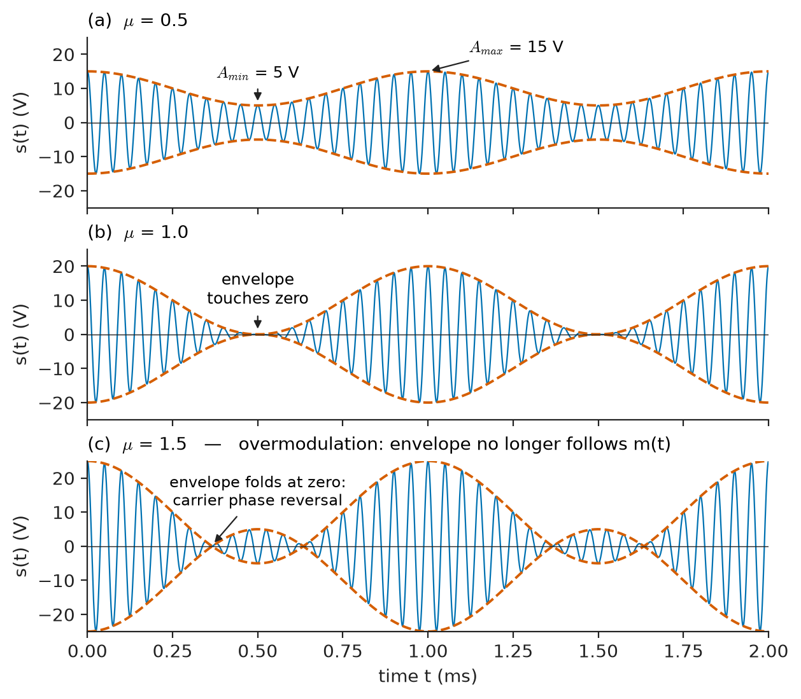
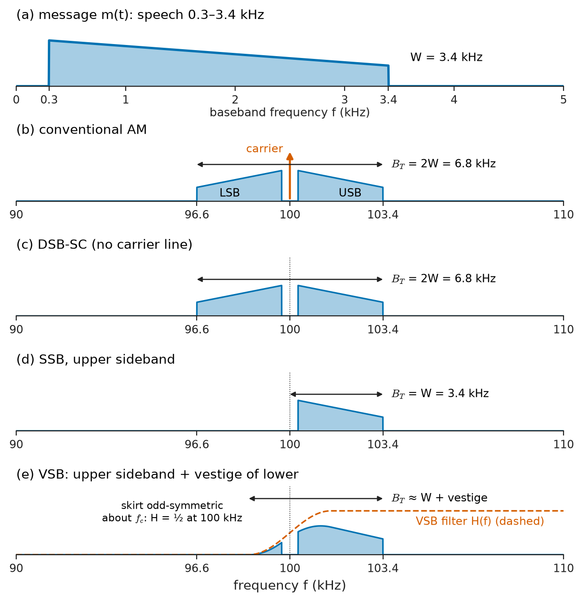
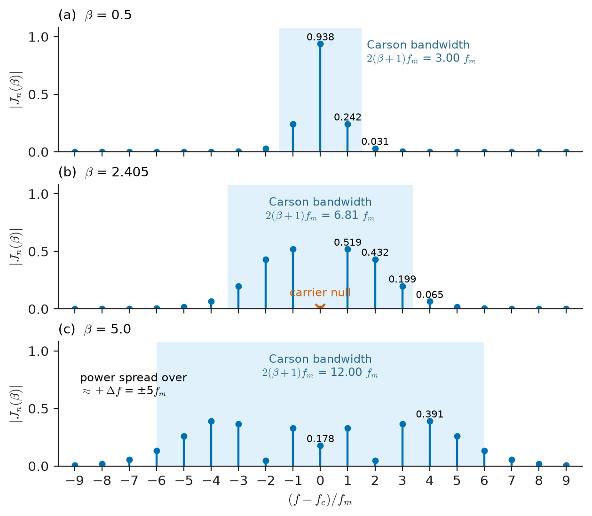
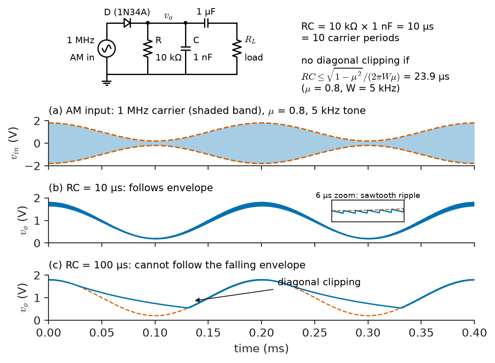
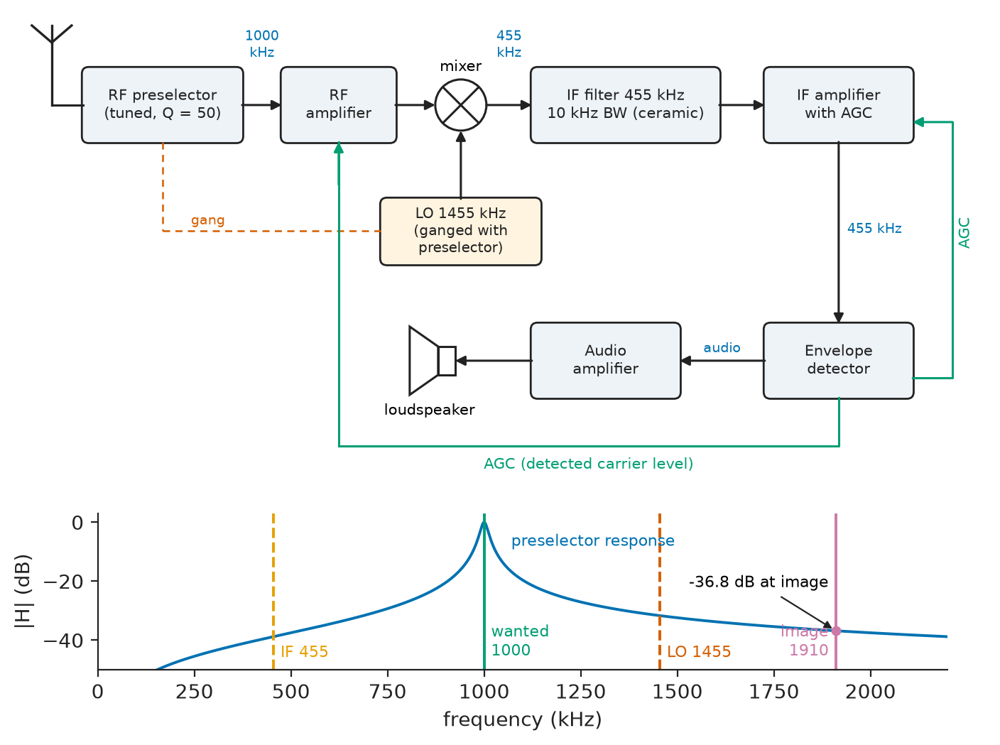
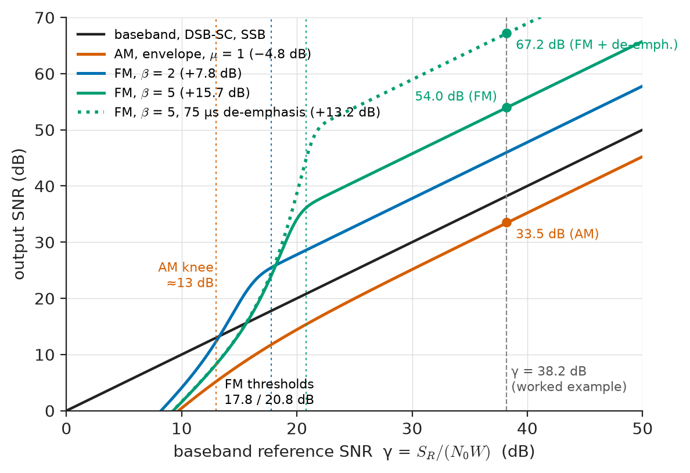

# Chapter 26 — Analog Communication

*Part VI · Communication Theory*

On a summer evening a listener in a farmhouse tunes a medium-wave AM station 300 km away. The voice is clear but carries a steady hiss and, every few seconds, the crackle of a distant thunderstorm. Switching to an FM station only 60 km away, the music is clean and quiet — until the car drives behind a hill, when the FM signal does not fade gently like the AM one did but collapses abruptly into bursts of clicks and then into roaring noise. In the control tower of the nearby airport, meanwhile, two pilots transmit at the same instant on the same VHF channel, and the controller hears both voices, garbled together, with a whistling heterodyne between them; had the channel used FM, the controller would have heard only the stronger pilot and been unaware of the other.

Every one of these effects — the hiss, the crackle, the clean FM sound, the abrupt FM collapse, the capture of one signal by another — follows from how the message is impressed on the carrier. This chapter develops the three ways of doing so for an analog message: varying the carrier's amplitude, its frequency or its phase.

> **How is an analog message placed on a high-frequency carrier, and how is it recovered?**
> **What does each method cost in bandwidth and transmitter power, and how well does each resist noise?**

| Concept | Engineering destination |
|---|---|
| Conventional AM, envelope detection | Medium- and short-wave broadcasting, aviation VHF voice |
| DSB-SC and coherent detection | LVDT and strain-bridge carrier amplifiers, lock-in amplifiers, FM stereo subcarrier |
| SSB and VSB | HF marine and amateur voice, historic carrier telephony, analog TV video |
| Frequency modulation | FM broadcasting, two-way radio, analog instrumentation and biotelemetry |
| Phase modulation | Indirect FM transmitters, phase-modulated sensors, the bridge to digital PSK |
| Modulation index, Bessel spectra, Carson's rule | Channel spacing, transmitter mask compliance, deviation measurement |
| Superheterodyne receiver | Almost every radio receiver, spectrum analysers, radar receivers |
| Noise performance, threshold, pre-emphasis | Broadcast coverage planning, choice between AM and FM |

**Roadmap.** Amplitude modulation and its variants (26.1) → frequency modulation (26.2) and phase modulation (26.3) → the modulation index and the spectra it produces (26.4) → how modulators and demodulators work (26.5) → the superheterodyne receiver (26.6) → noise performance of each scheme (26.7) → complete analog systems in use (26.8).

---

## 26.1 Amplitude modulation

### Why modulate at all

A message such as speech occupies 300–3400 Hz. Sent directly by radio it would need an antenna comparable to its wavelength of about 100 km, and every transmitter in a region would interfere with every other. **Modulation** solves both problems by shifting the message to a band around a **carrier** frequency $f_c$ chosen to suit the channel and to separate users. The carrier is

$$
c(t)=A_c\cos(2\pi f_c t+\phi_c)
$$

and the message $m(t)$, of bandwidth $W\ll f_c$, may vary its amplitude, its frequency or its phase. Modulation also permits **frequency-division multiplexing**: many messages share one channel on different carriers.

### Conventional AM

In conventional amplitude modulation (AM, also "double-sideband with carrier", DSB-LC) the envelope of the carrier follows the message:

$$
s(t)=A_c\left[1+k_a m(t)\right]\cos(2\pi f_c t)
$$

where $k_a$ is the amplitude sensitivity of the modulator. For a single tone $m(t)=A_m\cos(2\pi f_m t)$ the **modulation index** (or modulation depth) is $\mu=k_aA_m$, and

$$
s(t)=A_c\cos(2\pi f_c t)+\frac{\mu A_c}{2}\cos\big(2\pi(f_c+f_m)t\big)+\frac{\mu A_c}{2}\cos\big(2\pi(f_c-f_m)t\big)
$$

The spectrum consists of the carrier and two **sidebands**, an upper and a lower, each a frequency-shifted copy of the message spectrum. For a general message of bandwidth $W$ the transmission bandwidth is

$$
B_T=2W
$$

so a 5 kHz audio channel needs 10 kHz; medium-wave broadcasting uses 9 kHz or 10 kHz channel spacing and band-limits audio accordingly.

The modulation index can be read from the envelope on an oscilloscope (Figure 26.1). If the envelope swings between $A_{\max}$ and $A_{\min}$,

$$
\mu=\frac{A_{\max}-A_{\min}}{A_{\max}+A_{\min}}
$$

An envelope swinging between 15 V and 5 V corresponds to $\mu=10/20=0.5$. For $\mu\leq1$ the envelope $A_c[1+\mu\cos 2\pi f_m t]$ is never negative and is an exact copy of the message plus a constant. For $\mu>1$ (**overmodulation**) the bracket changes sign, the envelope folds at zero, an envelope detector produces a distorted output, and the clipped transmitter spreads splatter into adjacent channels. Broadcasters limit negative peaks to $\mu$ slightly below 1 for this reason.

<!-- FIGURE 26.1 | figures/ch26/fig-26-1-am-waveforms.png | plot | Conventional AM waveforms for modulation indices 0.5, 1.0 and 1.5, with the envelope drawn dashed. | Content: three stacked panels, carrier 20 kHz and tone 1 kHz (scaled for visibility), Ac = 10 V, time axis 0 to 2 ms, amplitude axis -25 to +25 V. Panel a mu = 0.5: envelope between 5 V and 15 V, annotations Amax = 15 V and Amin = 5 V. Panel b mu = 1.0: envelope touching zero. Panel c mu = 1.5: envelope 10 abs(1 + 1.5 cos) shown dashed folding at zero with phase reversal of the carrier visible, labelled "overmodulation: envelope no longer follows m(t)". -->

*Figure 26.1 — Conventional AM waveforms for modulation indices 0.5, 1.0 and 1.5, with the envelope drawn dashed.*

### Power and efficiency

The average power of the tone-modulated AM signal into a resistance $R$ is the sum of the carrier and sideband powers:

$$
P_t=P_c\left(1+\frac{\mu^2}{2}\right),\qquad P_c=\frac{A_c^2}{2R}
$$

The carrier carries no information; only the sidebands do. The **power efficiency** is

$$
\eta_{AM}=\frac{\mu^2/2}{1+\mu^2/2}=\frac{\mu^2}{2+\mu^2}
$$

which is at most 1/3 (at $\mu=1$). Real programme material has a crest factor of 10 dB or more, so the average modulation depth is around 0.3 and the efficiency is about 4 %.

**Worked example — a 10 kW AM transmitter.** A medium-wave transmitter delivers a carrier power of 10 kW into a 50 Ω antenna feed and is modulated to $\mu=0.8$ by a test tone. The total power is

$$
P_t=10\left(1+\frac{0.64}{2}\right)=13.2\ \mathrm{kW},
$$

of which the two sidebands carry 3.2 kW (1.6 kW each), an efficiency of $3.2/13.2=24.2$ %. The RMS feed current rises from $\sqrt{10\,000/50}=14.14$ A unmodulated to $\sqrt{13\,200/50}=16.25$ A modulated — a 15 % rise that broadcast engineers use as a quick check of modulation depth. With ordinary programme at an average $\mu\approx0.3$, only $0.09/2.09=4.3$ % of the radiated power is in the sidebands. The attraction that compensates for this waste is the receiver: an envelope detector (Section 26.5) costs a diode, a resistor and a capacitor.

> **Status of the principle: AM spectrum and power relations**
> *Derived.* Follow from the product of a carrier with $1+k_am(t)$ and the modulation theorem of the Fourier transform (Chapter 18); they assume an ideal linear modulator and an unmodulated carrier of constant amplitude.

### Double-sideband suppressed carrier (DSB-SC)

Removing the carrier gives

$$
s(t)=A_c\,m(t)\cos(2\pi f_c t)
$$

All transmitted power is now in the sidebands, but the envelope is $\lvert m(t)\rvert$, not $m(t)$: an envelope detector produces a full-wave-rectified message. Recovery requires **coherent (synchronous) detection**: multiplying by a local carrier of the same frequency and phase and low-pass filtering,

$$
s(t)\cos(2\pi f_ct+\phi)=\tfrac12A_cm(t)\cos\phi+\tfrac12A_cm(t)\cos(4\pi f_ct+\phi)\ \xrightarrow{\text{LPF}}\ \tfrac12A_cm(t)\cos\phi
$$

A phase error $\phi$ attenuates the output by $\cos\phi$ and a frequency error $\Delta f$ multiplies it by a beat $\cos(2\pi\Delta f\,t)$, which is unacceptable. The receiver must therefore recover the carrier, for example with a Costas loop or by squaring the signal and dividing by two (Section 26.5).

DSB-SC is the natural modulation of instrumentation. An LVDT position sensor or a strain-gauge bridge excited at 5 kHz produces an output that is the excitation multiplied by the displacement or strain — DSB-SC with the excitation as carrier. Because the excitation is available at the receiver, coherent detection is trivial, and the sign of the displacement is preserved by the phase. A lock-in amplifier applies the same principle to dig a signal 60 dB below the noise out of an optical or biomedical measurement.

### Single sideband (SSB)

Both sidebands of AM or DSB-SC carry the same information. **Single-sideband** modulation transmits only one, halving the bandwidth to

$$
B_T=W
$$

An SSB signal can be written using the Hilbert transform $\hat m(t)$ of the message (a 90° phase shift of every frequency component):

$$
s(t)=\frac{A_c}{2}\left[m(t)\cos(2\pi f_c t)\mp\hat m(t)\sin(2\pi f_c t)\right]
$$

with the minus sign for the upper and the plus sign for the lower sideband. SSB is generated by filtering one sideband from a DSB-SC signal (feasible when the message has no energy near DC, as speech has none below 300 Hz) or by the phasing method suggested by the equation above. It is demodulated coherently; a small frequency error does not cancel the output as in DSB-SC but shifts every audio frequency by $\Delta f$, which for speech is tolerable up to about 50 Hz (a "Donald Duck" voice). SSB is the standard voice mode of HF marine, military and amateur radio, and was the basis of analog carrier telephony, in which 4 kHz SSB channels were stacked into groups of 12 between 60 and 108 kHz.

### Vestigial sideband (VSB)

Signals with significant low-frequency content, such as television video, cannot be split into sidebands by a realisable filter. **Vestigial sideband** transmits one sideband in full and a gradual vestige of the other. If the VSB filter's response has odd symmetry about the carrier, the vestige exactly compensates for the partial suppression of the wanted sideband near $f_c$, and coherent detection returns the message undistorted. Analog television used VSB for its 4.2–5 MHz video in a 6–8 MHz channel, and the ATSC digital television standard uses 8-level VSB.

<!-- FIGURE 26.2 | figures/ch26/fig-26-2-amplitude-modulation-spectra.png | spectrum | Spectra of a 300-3400 Hz speech message and of the corresponding AM, DSB-SC, SSB (upper sideband) and VSB signals on a 100 kHz carrier. | Content: five stacked panels sharing a frequency axis. Top: baseband message spectrum trapezoid from 0.3 to 3.4 kHz, labelled W = 3.4 kHz. Panels 2-5 with x-axis 90 to 110 kHz: AM shows carrier line at 100 kHz plus mirrored sidebands 96.6-99.7 and 100.3-103.4 kHz, B_T = 2W = 6.8 kHz; DSB-SC same sidebands without carrier line; SSB-USB only 100.3-103.4 kHz, B_T = W; VSB upper sideband plus a vestige of the lower sideband shaped by a filter whose skirt is odd-symmetric about 100 kHz (dashed filter curve). Arrows indicate bandwidths. -->

*Figure 26.2 — Spectra of a 300-3400 Hz speech message and of the corresponding AM, DSB-SC, SSB (upper sideband) and VSB signals on a 100 kHz carrier.*

Figure 26.2 summarises the family. Conventional AM spends power on the carrier to make the receiver cheap; DSB-SC removes the carrier at the price of a coherent receiver; SSB halves the bandwidth at the price of a coherent receiver and a sharper filter; VSB is the compromise for signals with low-frequency content.

---

## 26.2 Frequency modulation

### Instantaneous frequency

AM keeps the carrier's angle fixed and varies its amplitude. **Angle modulation** keeps the amplitude fixed and varies the angle:

$$
s(t)=A_c\cos\theta(t),\qquad f_i(t)=\frac{1}{2\pi}\frac{d\theta}{dt}
$$

where $f_i(t)$ is the **instantaneous frequency**. In **frequency modulation** (FM) the instantaneous frequency follows the message:

$$
f_i(t)=f_c+k_f\,m(t)
$$

with $k_f$ the frequency sensitivity in Hz/V. Integrating gives the phase and hence the signal:

$$
s(t)=A_c\cos\!\left[2\pi f_ct+2\pi k_f\int_0^t m(\tau)\,d\tau\right]
$$

The **peak frequency deviation** is $\Delta f=k_f\max\lvert m(t)\rvert$. In FM broadcasting $\Delta f=75$ kHz at 100 % modulation; in narrowband two-way radio on 12.5 kHz channels, $\Delta f=2.5$ kHz.

### Properties that distinguish FM from AM

Three properties of the FM signal follow immediately from the constant amplitude, and they explain much of the opening story.

1. **Constant envelope.** The transmitted power $A_c^2/(2R)$ does not depend on the message. The power amplifier can run in saturation (class C), with efficiencies of 60–80 %, since amplitude nonlinearity does not distort a constant-envelope signal. This is why FM dominated mobile radio, where battery life and heat matter.
2. **Amplitude noise is irrelevant.** The information is in the zero crossings, not the amplitude, so a receiver can clip (limit) the signal and remove amplitude noise and fading before demodulating.
3. **Capture effect.** When two FM signals share a channel, the demodulator output is dominated by the stronger one once the ratio exceeds a few decibels; the weaker one is suppressed almost completely. Aviation VHF voice deliberately uses AM so that simultaneous transmissions remain audible and are not silently lost.

The price is bandwidth. FM is a nonlinear modulation: the spectrum of an FM signal is not a shifted copy of the message spectrum, and it is in general much wider (Section 26.4).

> **Status of the principle: Instantaneous frequency of an angle-modulated signal**
> *Derived.* A definition consistent with the Fourier spectrum only when the frequency varies slowly compared with the carrier ($W\ll f_c$); the quasi-static picture fails when the modulating frequency approaches the deviation, where the Bessel-function spectrum of Section 26.4 is needed.

---

## 26.3 Phase modulation

In **phase modulation** (PM) the phase, rather than the frequency, follows the message:

$$
s(t)=A_c\cos\left[2\pi f_ct+k_p\,m(t)\right]
$$

where $k_p$ is the phase sensitivity in rad/V and the **peak phase deviation** is $\Delta\phi=k_p\max\lvert m(t)\rvert$. Its instantaneous frequency is

$$
f_i(t)=f_c+\frac{k_p}{2\pi}\frac{dm}{dt}
$$

So PM is FM driven by the derivative of the message, and FM is PM driven by the integral of the message. A phase modulator preceded by an integrator is a frequency modulator; this "indirect" method (Armstrong's) produces FM from a crystal-stable carrier and was used in early broadcast transmitters. Conversely, an FM signal can be demodulated as PM followed by differentiation.

The distinction is visible in the dependence of deviation on modulating frequency. For a tone $m(t)=A_m\cos 2\pi f_m t$:

- FM: $\Delta f=k_fA_m$, independent of $f_m$; phase deviation $\Delta f/f_m$ falls with $f_m$.
- PM: $\Delta\phi=k_pA_m$, independent of $f_m$; frequency deviation $k_pA_mf_m$ rises with $f_m$.

**Worked example — PM versus FM deviation.** A phase modulator has $k_p=0.8$ rad/V and is driven by a 1 V tone. At $f_m=1$ kHz the peak phase deviation is 0.8 rad and the peak frequency deviation is $0.8\times1\ \mathrm{kHz}=0.8$ kHz. At $f_m=3$ kHz the phase deviation is still 0.8 rad, but the frequency deviation is 2.4 kHz. A PM transmitter fed with speech therefore deviates most on the high-frequency components, which is equivalent to FM with a 6 dB/octave pre-emphasis — precisely the property exploited in Section 26.7. In narrowband two-way radio the transmitted signal is in practice somewhere between the two: FM with pre-emphasis, which behaves like PM over the speech band.

Phase modulation is also the analog ancestor of the digital phase-shift keying of Chapter 27: when $m(t)$ takes only discrete values, PM becomes PSK. Analog PM appears in its own right in phase-modulated fibre sensors, in some deep-space telemetry carriers (where a residual carrier is kept for tracking) and in the measurement of oscillator phase noise.

> **Status of the principle: FM–PM equivalence**
> *Derived.* Exact identity following from the definition of instantaneous frequency: FM of $m(t)$ equals PM of $2\pi k_f\int m\,dt$; it holds for any message, so every result about one transfers to the other through an integrator or differentiator.

---

## 26.4 Modulation index

### Three indices, one idea

Each modulation has a dimensionless index that sets both its spectrum and its noise performance.

- **AM:** $\mu=k_aA_m$, the fractional change of the envelope. It must stay at or below 1 for envelope detection.
- **FM:** $\beta=\Delta f/f_m$ for a tone; more generally the **deviation ratio** $D=\Delta f/W$, the peak deviation divided by the highest message frequency.
- **PM:** $\beta_p=\Delta\phi=k_pA_m$, the peak phase deviation in radians.

For a tone, the FM and PM signals have the same form, $A_c\cos(2\pi f_ct+\beta\sin 2\pi f_m t)$ with $\beta$ the peak phase deviation, so their spectra are identical for equal $\beta$.

### The Bessel spectrum

Expanding the tone-modulated angle signal in a Fourier series (the Jacobi–Anger expansion) gives

$$
s(t)=A_c\sum_{n=-\infty}^{\infty}J_n(\beta)\cos\big(2\pi(f_c+nf_m)t\big)
$$

where $J_n$ is the Bessel function of the first kind of order $n$, with $J_{-n}=(-1)^nJ_n$. The spectrum is a carrier line of amplitude $A_cJ_0(\beta)$ and an infinite set of sidebands at $f_c\pm nf_m$ with amplitudes $A_c\lvert J_n(\beta)\rvert$. Since $\sum J_n^2=1$, the total power is always $A_c^2/(2R)$: modulation does not add power, it redistributes it from the carrier into the sidebands. Table 26.1 lists the values.

**Table 26.1 — Bessel coefficients $J_n(\beta)$ (amplitudes relative to the unmodulated carrier).**

| $\beta$ | $J_0$ | $J_1$ | $J_2$ | $J_3$ | $J_4$ | $J_5$ | $J_6$ | $J_7$ | $J_8$ |
|---|---|---|---|---|---|---|---|---|---|
| 0.25 | 0.984 | 0.124 | 0.008 | — | — | — | — | — | — |
| 0.5 | 0.938 | 0.242 | 0.031 | 0.003 | — | — | — | — | — |
| 1.0 | 0.765 | 0.440 | 0.115 | 0.020 | 0.002 | — | — | — | — |
| 2.0 | 0.224 | 0.577 | 0.353 | 0.129 | 0.034 | 0.007 | 0.001 | — | — |
| 2.405 | 0.000 | 0.519 | 0.432 | 0.199 | 0.065 | 0.016 | 0.003 | 0.001 | — |
| 5.0 | $-0.178$ | $-0.328$ | 0.047 | 0.365 | 0.391 | 0.261 | 0.131 | 0.053 | 0.018 |

Two regimes emerge. For $\beta\ll1$ (**narrowband FM**, NBFM) only $J_0\approx1$ and $J_1\approx\beta/2$ matter: the spectrum looks like AM, with bandwidth $2f_m$, except that one sideband is inverted so that the sidebands add in quadrature to the carrier — they modulate its phase, not its amplitude. For $\beta\gg1$ (**wideband FM**) many sidebands are significant, and the spectrum spreads over roughly $\pm\Delta f$ about the carrier. The carrier line vanishes at $\beta=2.405$, 5.520, 8.654, …, the zeros of $J_0$; measuring the drive level at which the carrier disappears on a spectrum analyser is the classic method of calibrating deviation (the **Bessel-null method**).

<!-- FIGURE 26.3 | figures/ch26/fig-26-3-fm-bessel-spectra.png | spectrum | Line spectra of a tone-modulated FM signal for modulation indices 0.5, 2.405 and 5, showing the redistribution of power from the carrier into sidebands. | Content: three stacked stem plots, x-axis (f - fc)/fm from -9 to +9, y-axis abs(Jn(beta)) from 0 to 1. Panel a beta = 0.5: carrier 0.938, first sidebands 0.242, second 0.031. Panel b beta = 2.405: carrier absent (labelled "carrier null"), sidebands 0.519, 0.432, 0.199, 0.065. Panel c beta = 5: carrier 0.178, sidebands peaking at n = 4 (0.391), significant out to n = 6. Shaded band on each panel of width 2(beta + 1) fm labelled "Carson bandwidth". -->

*Figure 26.3 — Line spectra of a tone-modulated FM signal for modulation indices 0.5, 2.405 and 5, showing the redistribution of power from the carrier into sidebands.*

### Carson's rule

Figure 26.3 shows that the sidebands become negligible beyond $n\approx\beta+1$. Keeping these gives **Carson's rule** for the transmission bandwidth:

$$
B_T\approx2(\Delta f+W)=2W(D+1)
$$

It reduces correctly to $2W$ for narrowband FM and to $2\Delta f$ for very wideband FM. For a tone, the sidebands up to $n=\beta+1$ contain about 98 % of the power or more. A more conservative rule, used where adjacent-channel interference is critical, counts sidebands down to 1 % of the carrier amplitude and gives roughly $2(\Delta f+2W)$.

> **Status of the principle: Carson's rule**
> *Empirical.* A rule of thumb based on the observed decay of Bessel coefficients beyond $n=\beta+1$; it captures about 98 % of the power for tone modulation and is somewhat generous for real programme material, but it underestimates the bandwidth needed to keep distortion very low or to meet strict adjacent-channel masks.

**Worked example — FM broadcast bandwidth.** A broadcast FM station transmits a 15 kHz test tone at full deviation $\Delta f=75$ kHz. The modulation index is $\beta=75/15=5$. Carson's rule gives

$$
B_T\approx2(75+15)=180\ \mathrm{kHz},
$$

which fits the 200 kHz channel spacing used in the Americas. From Table 26.1, the carrier now carries $J_0^2(5)=0.178^2=3.2$ % of the power, and the carrier plus the six pairs of sidebands inside $\pm90$ kHz carry

$$
J_0^2+2\sum_{n=1}^{6}J_n^2(5)=0.9936,
$$

that is, 99.4 % of the total. For comparison, a narrowband two-way radio with $\Delta f=2.5$ kHz and $W=3$ kHz has $D=0.83$ and $B_T\approx2(2.5+3)=11$ kHz, which fits a 12.5 kHz channel. A stereo FM broadcast whose baseband (Section 26.8) extends to 53 kHz needs, by Carson, $2(75+53)=256$ kHz — wider than the channel. In practice the deviation contributed by the stereo subcarrier is smaller than the total and the real occupied bandwidth stays near 200 kHz, which illustrates the limited precision of the rule.

---

## 26.5 Modulator and demodulator concepts

### Generating AM and DSB-SC

All amplitude modulators multiply the carrier by something. The ways of doing so fall into three families.

- **Product (multiplier) modulators**: an analog multiplier, or a Gilbert-cell mixer, forms $m(t)\cos(2\pi f_ct)$ directly — DSB-SC. Adding a DC offset to $m(t)$ gives conventional AM.
- **Switching modulators**: the carrier switches the message on and off (multiplying it by a square wave at $f_c$), and a band-pass filter at $f_c$ keeps the fundamental. The **diode ring (double-balanced) modulator** switches the polarity of the message, giving DSB-SC with high carrier suppression (typically 30–50 dB). In high-power broadcast AM the final stage itself is the switch: its supply voltage is varied by the audio (plate or collector modulation), and modern transmitters use pulse-duration or digital modulation of a switching supply, reaching overall efficiencies above 85 %.
- **Nonlinear (square-law) modulators**: a device with $i=a_1v+a_2v^2$, driven by carrier plus message, produces a term $2a_2m(t)\cos(2\pi f_ct)$ which a band-pass filter extracts. Simple but inefficient; useful for understanding where mixer products come from.

### Envelope detection

The conventional AM receiver uses an **envelope detector** (Figure 26.4): a diode charges a capacitor to the peaks of the carrier, and a resistor lets it discharge slowly enough to bridge the carrier cycles but fast enough to follow the envelope. The time constant must satisfy

$$
\frac{1}{f_c}\ll RC\ll\frac1W
$$

More precisely, to avoid **diagonal clipping** — the capacitor failing to discharge as fast as the envelope falls — for a tone of frequency $W$ and depth $\mu$,

$$
RC\leq\frac{\sqrt{1-\mu^2}}{2\pi W\mu}
$$

<!-- FIGURE 26.4 | figures/ch26/fig-26-4-envelope-detector.png | circuit | Diode envelope detector for AM with its input and output waveforms, showing carrier ripple and diagonal clipping when RC is too large. | Content: left, circuit: AM source (1 MHz carrier) -> diode D (1N34A germanium or Schottky) -> node with R = 10 kOhm and C = 1 nF in parallel to ground -> coupling capacitor 1 uF -> load. Right, three stacked plots over 0 to 0.4 ms with 5 kHz tone, mu = 0.8: (a) AM input with envelope; (b) detector output with RC = 10 us following envelope with small sawtooth ripple; (c) detector output with RC = 100 us, showing the output failing to follow the falling envelope, labelled "diagonal clipping". -->

*Figure 26.4 — Diode envelope detector for AM with its input and output waveforms, showing carrier ripple and diagonal clipping when RC is too large.*

**Worked example — envelope-detector time constant.** An AM receiver's detector sees a 1 MHz carrier modulated to $\mu=0.8$ at audio frequencies up to 5 kHz. The upper limit is

$$
RC\leq\frac{\sqrt{1-0.64}}{2\pi\times5000\times0.8}=\frac{0.6}{25\,133}=23.9\ \mu\mathrm{s},
$$

and the lower limit requires $RC$ to be many carrier periods of 1 µs. Choosing $R=10$ kΩ and $C=1$ nF gives $RC=10$ µs: ten carrier periods, so the carrier ripple is about $1\ \mu\mathrm{s}/10\ \mu\mathrm{s}=10$ % of the peak and is removed by the band-limited audio stage that follows, and the choice sits comfortably inside the clipping limit (Figure 26.4b). With $C=10$ nF ($RC=100$ µs) the output cannot follow the troughs of the envelope (Figure 26.4c). In a superheterodyne receiver the detector works at the intermediate frequency of 455 kHz, where $1/455\ \mathrm{kHz}=2.2$ µs: the same $RC=10$ µs still satisfies both limits, though it spans only about 4.5 IF periods and the ripple roughly doubles.

The envelope detector works only if the carrier is strong compared with the noise. When noise dominates, the envelope is mostly noise, and the message is lost not gradually but abruptly — the **threshold effect** of AM, discussed in Section 26.7.

### Coherent detection and carrier recovery

DSB-SC, SSB and VSB need a local carrier synchronised to the transmitted one. Three ways to obtain it are standard.

- **Transmitted pilot**: send a small carrier or a tone related to it. FM stereo sends a 19 kHz pilot from which the receiver doubles the frequency to regenerate the 38 kHz subcarrier.
- **Squaring loop**: squaring a DSB-SC signal produces $m^2(t)\cos^2(2\pi f_ct)$, which contains a component at $2f_c$ because $m^2$ has a nonzero mean. A phase-locked loop at $2f_c$ followed by a divide-by-two recovers the carrier (with a 180° ambiguity).
- **Costas loop**: two mixers driven by the local oscillator in phase and in quadrature; the product of their outputs is proportional to $\sin 2\phi$, the phase error, which drives the oscillator to lock. The Costas loop is also the standard carrier-recovery circuit for BPSK (Chapter 27).

### The phase-locked loop

A **phase-locked loop** (PLL) consists of a phase detector, a loop filter and a voltage-controlled oscillator (VCO), connected in a feedback loop that forces the VCO to track the phase of the input. Linearised around lock, it is a feedback control system (Chapter 34) whose closed-loop transfer function from input phase to VCO phase is low-pass. When the input is FM, the VCO control voltage needed to keep lock is proportional to the instantaneous frequency deviation — so the control voltage *is* the demodulated message. PLL demodulators also lower the FM threshold by a few decibels, because the loop bandwidth is narrower than the Carson bandwidth.

### FM demodulators

Every FM demodulator converts frequency variations into amplitude variations and then detects them.

- **Slope detector and discriminator**: a tuned circuit operated on its skirt converts frequency into amplitude; the balanced discriminator (Foster–Seeley, ratio detector) uses two such circuits for linearity.
- **Differentiator plus envelope detector**: differentiating $A_c\cos\theta(t)$ gives an amplitude $A_c\,d\theta/dt=2\pi A_cf_i(t)$, an AM signal whose envelope is the instantaneous frequency. A limiter before the differentiator removes amplitude variations.
- **Quadrature detector**: the signal is multiplied by a copy of itself phase-shifted by a network whose phase depends on frequency; common in FM receiver integrated circuits.
- **PLL demodulator**, as above.
- **Digital demodulator**: in a software-defined receiver the complex envelope $\tilde s=s_I+js_Q$ is sampled and the instantaneous frequency is computed as the rate of change of $\arg\tilde s$, for example from $\operatorname{Im}\{\tilde s[n]\tilde s^*[n-1]\}$.

> **Boundary.** The transistor-level design of mixers, VCOs, limiters and detectors belongs to *Electronics & Computing*; the PLL as a control loop is analysed in Chapters 33–34. Here they are treated through their input–output functions.

---

## 26.6 Superheterodyne receivers

### The tuning problem

An early **tuned-radio-frequency** receiver amplified the signal at its own frequency with a chain of tuned stages, all of which had to be retuned together. Its selectivity changes with frequency: a tuned circuit with a fixed $Q$ has bandwidth $f/Q$, so a $Q$ that gives 10 kHz bandwidth at 540 kHz gives 32 kHz at 1700 kHz. Armstrong's **superheterodyne** (1918) solved this by converting every incoming signal to a fixed **intermediate frequency** (IF), where all the selectivity and most of the gain can be provided by fixed filters (Figure 26.5).

<!-- FIGURE 26.5 | figures/ch26/fig-26-5-superheterodyne-receiver.png | block-diagram | Superheterodyne AM broadcast receiver tuned to 1000 kHz, with the frequencies at each point and the image frequency. | Content: chain: antenna -> "RF preselector (tuned, Q = 50)" -> "RF amplifier" -> mixer (circle with X) -> "IF filter 455 kHz, 10 kHz bandwidth (ceramic)" -> "IF amplifier with AGC" -> "Envelope detector" -> "Audio amplifier" -> loudspeaker. Local oscillator below mixer labelled "LO 1455 kHz (ganged with preselector)". AGC feedback arrow from detector to RF and IF amplifiers. Inset spectrum strip: frequency axis 0 to 2.2 MHz with wanted signal at 1000 kHz, LO at 1455 kHz, image at 1910 kHz, IF at 455 kHz, and the preselector response curve centred on 1000 kHz showing attenuation of the image. -->

*Figure 26.5 — Superheterodyne AM broadcast receiver tuned to 1000 kHz, with the frequencies at each point and the image frequency.*

### Frequency conversion and the image

A mixer multiplies the incoming RF signal at $f_{RF}$ by a local oscillator (LO) at $f_{LO}$, producing sum and difference frequencies. The IF filter selects the difference:

$$
f_{IF}=\lvert f_{LO}-f_{RF}\rvert
$$

With high-side injection, $f_{LO}=f_{RF}+f_{IF}$. But a second input frequency also produces the same difference: the **image frequency**

$$
f_{im}=f_{LO}+f_{IF}=f_{RF}+2f_{IF}
$$

Once a signal at the image has reached the mixer, it is indistinguishable from the wanted one. It must be removed before the mixer by the **preselector**, a tuned RF filter. A single tuned circuit of loaded quality factor $Q$ tuned to $f_{RF}$ attenuates the image by

$$
\alpha=\sqrt{1+Q^2\rho^2},\qquad \rho=\frac{f_{im}}{f_{RF}}-\frac{f_{RF}}{f_{im}}
$$

the result from the frequency response of a resonant circuit (Chapter 13).

**Worked example — image rejection in AM and FM receivers.** An AM broadcast receiver with $f_{IF}=455$ kHz is tuned to 1000 kHz. The LO runs at 1455 kHz and the image is at $1000+910=1910$ kHz, inside the broadcast band. With a preselector of $Q=50$,

$$
\rho=\frac{1910}{1000}-\frac{1000}{1910}=1.910-0.524=1.386,\qquad \alpha=\sqrt{1+(50\times1.386)^2}=69.3,
$$

an image rejection of $20\log_{10}69.3=36.8$ dB, adequate for broadcast. An FM receiver with the standard $f_{IF}=10.7$ MHz tuned to 100 MHz has its image at 121.4 MHz, outside the FM band (it falls in the aeronautical band). There, $\rho=1.214-0.824=0.390$, and a single $Q=50$ circuit gives only $20\log_{10}\sqrt{1+19.5^2}=25.8$ dB; FM tuners therefore use two or three tuned RF stages. The general lesson is that the image rejection depends on the ratio $f_{IF}/f_{RF}$: a high IF eases image rejection, a low IF eases adjacent-channel selectivity. Receivers that need both use **double conversion** — a high first IF for image rejection followed by a low second IF for selectivity. Communication receivers commonly use first IFs of 45–70 MHz and a second IF of 455 kHz; spectrum analysers convert up to a first IF of several gigahertz.

> **Status of the principle: Superheterodyne frequency conversion and the image response**
> *Derived.* Follows from the product of two sinusoids generating sum and difference frequencies; it assumes an ideal multiplier, and real mixers add spurious responses at $\lvert mf_{LO}\pm nf_{RF}\rvert=f_{IF}$ for small integers $m,n$ that must also be filtered.

### Tracking, AGC and other functions

The LO and the preselector are tuned together (ganged). For an AM receiver covering 530–1700 kHz with high-side injection, the LO covers 985–2155 kHz, a frequency ratio of 2.19 against 3.21 for the signal, so the capacitance ratios needed are $2.19^2=4.8$ and $3.21^2=10.3$. Low-side injection would require the LO to span 75–1245 kHz, a ratio of 16.6 — impractical with a variable capacitor, which is why AM receivers use high-side injection. Modern receivers tune with a synthesiser, and the preselector is replaced by switched band filters.

The IF stage also provides **automatic gain control** (AGC): the detected carrier level reduces the gain of the RF and IF amplifiers, so that a signal varying over 80–100 dB at the antenna produces a nearly constant level at the detector. AGC is what makes the farmhouse AM listener's distant station fade only gradually.

### Beyond the superheterodyne

Two alternatives have become common with integrated circuits. The **direct-conversion (zero-IF)** receiver mixes straight to baseband with I and Q mixers; it has no image (the image is the signal itself, separated by I/Q processing) but suffers from DC offsets, flicker noise and LO leakage. The **low-IF** receiver uses an IF of a few hundred kilohertz with I/Q image rejection. Both depend on the complex-envelope representation of Chapter 25, and both are now the standard architectures of mobile handsets and Wi-Fi chips. The superheterodyne remains the reference architecture for high-performance receivers, spectrum analysers and radar.

---

## 26.7 Noise performance

### The comparison framework

To compare modulations fairly, all are given the same received signal power $S_R$, the same noise spectral density $N_0$ at the receiver input, and the same message bandwidth $W$. The reference is the **baseband SNR**

$$
\gamma=\frac{S_R}{N_0W}
$$

which is what a baseband system sending the message directly would achieve. Each modulation then yields an output SNR $\mathrm{SNR}_o$, and the ratio $\mathrm{SNR}_o/\gamma$ is its **figure of merit**. The detailed derivations, which treat the bandpass noise as $n_I(t)\cos2\pi f_ct-n_Q(t)\sin2\pi f_ct$ with independent Gaussian components, belong to Chapter 29; the results are summarised in Table 26.2, with $m(t)$ normalised so that $\lvert m(t)\rvert\leq1$ and $P_m$ its average power.

**Table 26.2 — Noise performance of analog modulations (above threshold).**

| Modulation | $B_T$ | $\mathrm{SNR}_o/\gamma$ | Tone value | Detector |
|---|---|---|---|---|
| Baseband | $W$ | 1 | 1 | — |
| DSB-SC | $2W$ | 1 | 1 | Coherent |
| SSB | $W$ | 1 | 1 | Coherent |
| AM, envelope | $2W$ | $\dfrac{\mu^2P_m}{1+\mu^2P_m}$ | $\dfrac{\mu^2}{2+\mu^2}\leq\tfrac13$ | Envelope (above threshold) |
| PM | $\approx2(\beta_p+1)W$ | $\beta_p^2P_m$ | $\beta_p^2/2$ | Phase |
| FM | $\approx2(D+1)W$ | $3D^2P_m$ | $\tfrac32\beta^2$ | Discriminator (above threshold) |

The table carries three messages.

1. **Linear modulations cannot beat baseband.** DSB-SC and SSB both achieve $\mathrm{SNR}_o=\gamma$. DSB-SC uses twice the bandwidth of SSB and thus admits twice the noise, but the coherent detector adds the two sidebands' signal voltages coherently and their noise powers incoherently, which exactly compensates.
2. **Conventional AM wastes at least 4.8 dB** (factor 3) at full tone modulation and about 14 dB at the typical programme depth of $\mu=0.3$, because the carrier carries most of the power.
3. **FM trades bandwidth for SNR.** The figure of merit grows as the square of the deviation ratio, while the bandwidth grows only linearly. Doubling the deviation quadruples the output SNR (+6 dB).

### Why FM noise has a triangular spectrum

The FM advantage has a physical explanation. Additive noise of amplitude $n$ on a carrier of amplitude $A_c$ perturbs the phase by about $n/A_c$; a phase perturbation at frequency $f$ from the carrier produces a frequency perturbation proportional to $f$. The noise power spectral density at the output of an FM discriminator therefore rises as $f^2$ — the "triangular" noise spectrum (triangular in amplitude) — while the signal is unaffected. The large deviation scales the signal up; the strong carrier scales the noise down. For PM the output noise spectrum is flat.

The rising noise spectrum suggests a refinement. Since the message spectrum of audio falls at high frequencies while the FM noise rises, the transmitter boosts high frequencies before modulation (**pre-emphasis**) and the receiver cuts them correspondingly after detection (**de-emphasis**), attenuating the noise where it is strongest. Broadcast FM uses a first-order network with a time constant of 75 µs (Americas, Korea) or 50 µs (Europe and elsewhere), corner frequencies of 2.12 kHz and 3.18 kHz. For a 15 kHz audio band, the improvement in output SNR for white message spectra is

$$
I=\frac{(W/f_1)^3}{3\left[W/f_1-\arctan(W/f_1)\right]}
$$

which evaluates to 13.2 dB for 75 µs and 10.2 dB for 50 µs. The Dolby noise-reduction systems of analog tape and the RIAA equalisation of vinyl records are the same idea applied to other channels.

### The threshold effect

Table 26.2 holds only when the carrier is much stronger than the noise in the transmission bandwidth. When it is not, both the envelope detector and the FM discriminator fail abruptly. For FM, the noise occasionally drives the resultant phasor around the origin, adding a full $2\pi$ to the phase; each such event produces an impulse — a click — at the discriminator output. The click rate rises steeply as the carrier-to-noise ratio in $B_T$ falls below about 10 dB, and the output SNR collapses (Figure 26.6). This is the car-behind-the-hill experience of the opening paragraph.

The **FM threshold** occurs approximately when

$$
\frac{S_R}{N_0B_T}\approx10\ (10\ \mathrm{dB}),\qquad\text{i.e.}\qquad\gamma_{th}\approx20(D+1)
$$

so wideband FM, with its larger $B_T$, reaches threshold at a higher $\gamma$. This is the hidden cost of the FM trade: above threshold the advantage grows with deviation; below it, the system fails at higher signal levels the more deviation it uses. PLL and feedback demodulators lower the threshold by 2–5 dB by tracking the signal with a bandwidth narrower than $B_T$.

> **Status of the principle: Above-threshold noise formulas for AM and FM**
> *Approximate.* Derived under a high carrier-to-noise assumption (noise small compared with the carrier inside $B_T$); they fail below a carrier-to-noise ratio of roughly 10 dB, where envelope detectors and discriminators exhibit threshold and the output SNR falls much faster than the input.

<!-- FIGURE 26.6 | figures/ch26/fig-26-6-analog-noise-performance.png | plot | Output SNR versus baseband reference SNR gamma for baseband/DSB-SC/SSB, AM with mu = 1, and FM with beta = 2 and beta = 5, showing the FM threshold. | Content: x-axis gamma = S_R/(N0 W) from 0 to 50 dB, y-axis output SNR from 0 to 70 dB. Lines: baseband, DSB-SC, SSB (single line, slope 1, 0 dB offset); AM tone mu = 1 (offset -4.8 dB, with a threshold knee near gamma = 13 dB); FM beta = 2 (offset +7.8 dB, threshold knee near gamma = 17.8 dB); FM beta = 5 (offset +15.7 dB, threshold knee near gamma = 20.8 dB); dotted FM beta = 5 with 75 us pre-emphasis (+13.2 dB further). Below each knee the FM curves fall steeply. Mark the operating point gamma = 38.2 dB from the worked example with output values 33.5 dB (AM), 54.0 dB (FM), 67.2 dB (FM with pre-emphasis). -->

*Figure 26.6 — Output SNR versus baseband reference SNR gamma for baseband/DSB-SC/SSB, AM with mu = 1, and FM with beta = 2 and beta = 5, showing the FM threshold.*

**Worked example — AM versus FM at the same received power.** A broadcast receiver with a noise figure of 4 dB ($N_0=-174+4=-170$ dBm/Hz) receives $S_R=-90$ dBm, and the audio bandwidth is $W=15$ kHz. The reference SNR is

$$
\gamma=-90-\left(-170+10\log_{10}15\,000\right)=-90-(-170+41.76)=38.2\ \mathrm{dB}.
$$

- **AM**, full tone modulation $\mu=1$: $\mathrm{SNR}_o=38.2+10\log_{10}(1/3)=38.2-4.8=33.5$ dB. With typical programme modulation $\mu=0.3$: $38.2+10\log_{10}(0.09/2.09)=24.6$ dB — audible hiss.
- **FM**, $\beta=5$: $\mathrm{SNR}_o=38.2+10\log_{10}(1.5\times25)=38.2+15.7=54.0$ dB. With 75 µs de-emphasis, about $54.0+13.2=67.2$ dB.
- **Threshold check**: the carrier-to-noise ratio in the Carson bandwidth of 180 kHz is $-90-(-170+52.55)=27.4$ dB, well above 10 dB. The threshold value of $\gamma$ is $10\log_{10}(20\times6)=20.8$ dB, so the signal can fade by about 17 dB before the FM output collapses.

The FM system gives 20.5 dB more output SNR than full-modulation AM, and more than 40 dB more than AM with real programme and de-emphasis — at the cost of 18 times the bandwidth (180 kHz against 10 kHz for 5 kHz AM audio). The same calculation for narrowband FM with $D=0.83$ gives a figure of merit of only $1.5\times0.83^2=1.04$ (0.2 dB): narrowband two-way radio chooses FM for its constant envelope, its immunity to amplitude fading and its capture property, not for an SNR gain.

### Interference performance

The capture effect is the interference-domain counterpart of the FM noise advantage. An interfering carrier of relative amplitude $\rho<1$ at offset $f_d$ produces an output at frequency $f_d$ with amplitude proportional to $\rho f_d$ in FM, compared with $\rho$ in AM. Interference close to the wanted carrier is strongly suppressed, and as $\rho$ approaches 1 the receiver switches abruptly to whichever signal is stronger. FM broadcast planning requires a co-channel protection ratio of roughly 37–45 dB for high-quality stereo, but mobile FM voice systems work with co-channel ratios of 12–18 dB, far less than AM would need for comparable intelligibility.

---

## 26.8 Analog communication systems

Although most new systems are digital, analog modulation remains in service where its simplicity, robustness or installed base matters, and it lives on inside digital systems as the carrier-handling stage. Table 26.3 surveys the main systems.

**Table 26.3 — Representative analog communication systems (typical parameters).**

| System | Modulation | Carrier range | Message bandwidth | Channel | Notes |
|---|---|---|---|---|---|
| Long/medium-wave broadcast | AM, $\mu\approx0.3$ average | 148–283 kHz, 526.5–1606.5 kHz (Region 1); 530–1700 kHz (Region 2) | 4.5–5 kHz | 9 or 10 kHz | Ground-wave by day, sky-wave by night |
| Short-wave broadcast | AM | 3.9–26.1 MHz | 4.5 kHz | 5 kHz raster | Ionospheric, worldwide |
| HF marine, military, amateur voice | SSB | 2–30 MHz | 300–2700 Hz | 3 kHz | Power-efficient long range |
| Aviation VHF voice | AM | 118–137 MHz | 300–3000 Hz | 25 or 8.33 kHz | No capture: overlapping calls are heard |
| FM broadcast | WBFM, $\Delta f=75$ kHz | 87.5–108 MHz | 15 kHz per channel (stereo baseband to 53 kHz, RDS at 57 kHz) | 200 kHz | Pre-emphasis 50 or 75 µs |
| Land mobile and PMR | NBFM, $\Delta f=2.5$–5 kHz | 30–960 MHz | 300–3000 Hz | 12.5–25 kHz | Being replaced by digital (DMR, TETRA, P25) |
| Analog TV (legacy) | VSB video, FM sound | VHF/UHF | 4.2–6 MHz video | 6–8 MHz | Replaced by digital in most countries |
| Instrumentation telemetry | FM/FM subcarriers (IRIG 106) | VHF, L/S band | tens of Hz to tens of kHz per subcarrier | 0.5–several MHz | Flight testing, historical biotelemetry |
| LVDT and bridge carrier amplifiers | DSB-SC, coherent | 1–20 kHz excitation | DC to ~1/10 of carrier | — | Position, force and pressure sensors |
| Power-line carrier (utility) | AM/SSB, FSK | 30–500 kHz | Voice and protection tones | 4 kHz | Teleprotection over HV lines |

### FM stereo: a multiplex inside a modulation

FM stereo is a compact demonstration of most of this chapter. The left and right audio channels L and R, each limited to 15 kHz, are combined into a composite baseband:

- L + R from 30 Hz to 15 kHz (heard by mono receivers);
- a 19 kHz pilot tone at about 10 % of deviation;
- L − R as DSB-SC on a 38 kHz subcarrier, occupying 23–53 kHz;
- RDS data at 57 kHz (3 × 19 kHz) on many stations.

This composite signal then frequency-modulates the carrier. A stereo receiver demodulates the FM, doubles the 19 kHz pilot to recover the 38 kHz carrier, demodulates the L − R subcarrier coherently, and forms L and R by sum and difference. Because the L − R channel lies at the top of the composite baseband where FM noise is highest, stereo reception is noisier than mono by roughly 20 dB, and receivers blend to mono when the signal is weak.

### Where analog modulation survives in digital systems

The analog modulation concepts of this chapter are not only historical. Every digital radio uses I/Q modulators that are DSB-SC modulators on quadrature carriers; QAM (Chapter 27) is two DSB-SC signals sharing one channel. GSM's GMSK and Bluetooth's GFSK are constant-envelope frequency modulations chosen for amplifier efficiency, exactly the FM argument of Section 26.2. The superheterodyne and PLL are in every receiver. And the analog figures of merit introduced here — power efficiency, bandwidth expansion, threshold — reappear in Chapter 27 as $E_b/N_0$, spectral efficiency and the cliff-like BER curve of a digital link.

---

## What remains open

| Open question | Where it is answered |
|---|---|
| How are the noise formulas of Table 26.2 derived from a bandpass Gaussian noise model? | Chapter 29 |
| How does a phase-locked loop behave as a feedback system, and when does it lose lock? | Chapters 33 and 34 |
| How does modulation of a carrier by discrete symbols (PSK, FSK, QAM) differ, and how is it detected? | Chapter 27 |
| How do fading and multipath affect AM and FM reception on mobile paths? | Chapter 30 |
| How are resonant preselectors, IF filters and their Q factors designed? | Chapter 13 |
| How are the mixers, oscillators and limiters built from transistors? | *Electronics & Computing* |
| What is the ultimate limit on the SNR–bandwidth trade-off that FM only partially exploits? | Chapters 25 and 28 |

**Next:** Chapter 27 replaces the continuous message with a stream of bits, and asks how to map them onto pulses and carriers, how many can be sent per hertz, and how often the receiver will guess wrong.
