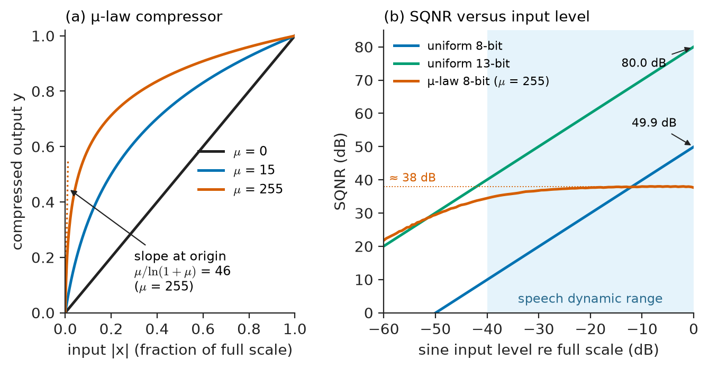
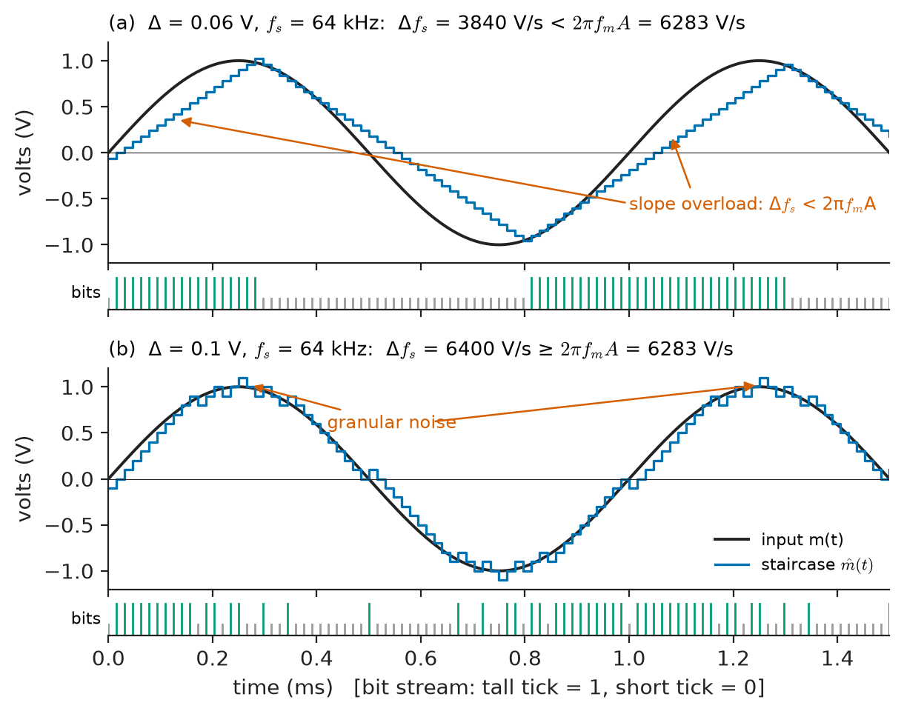
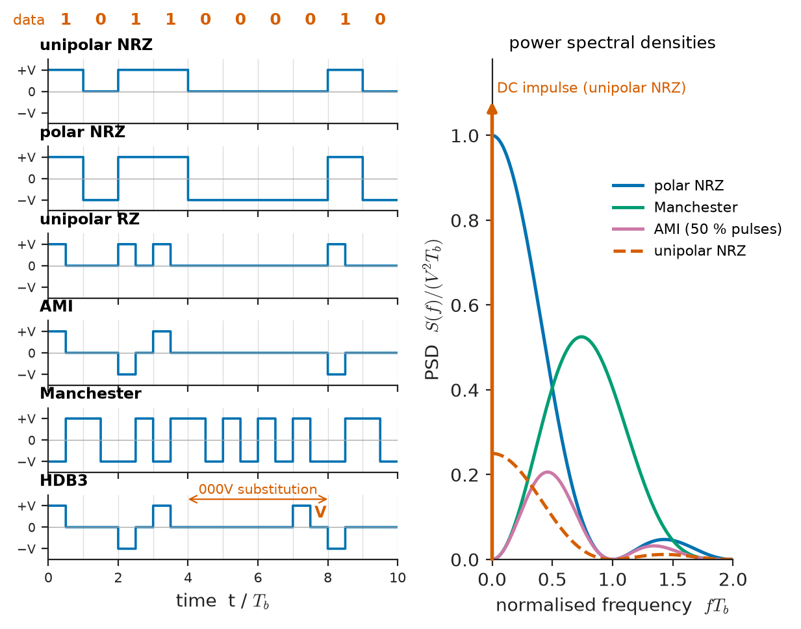
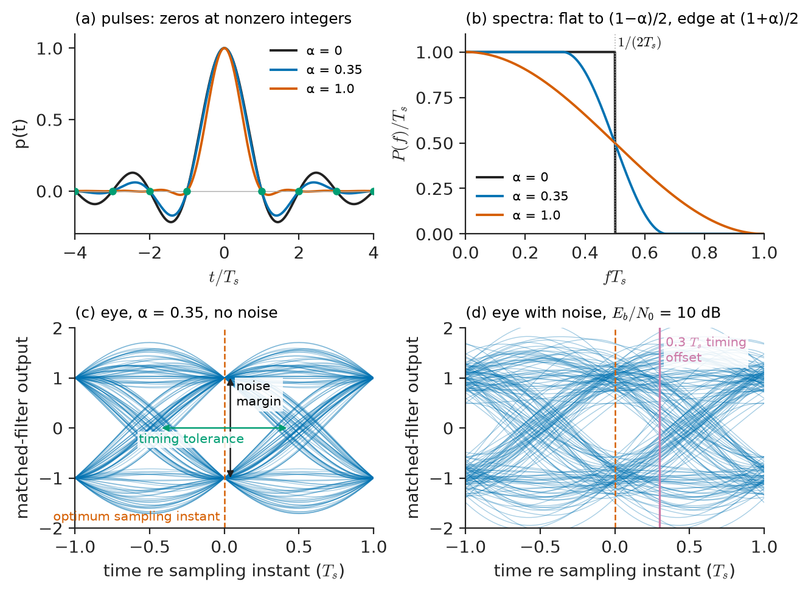
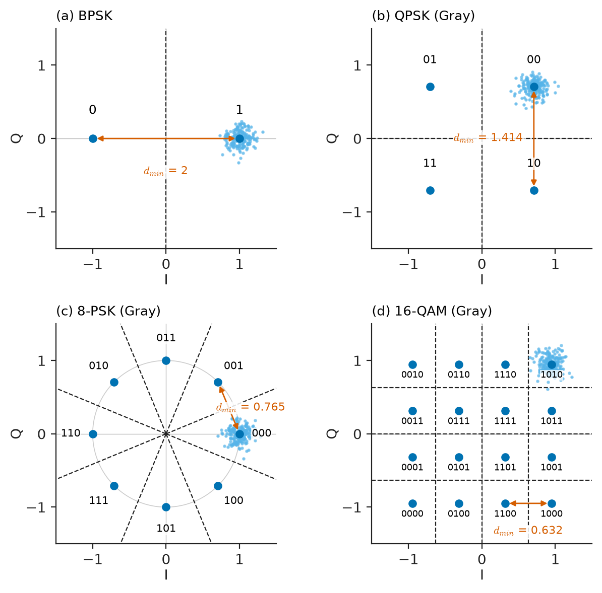
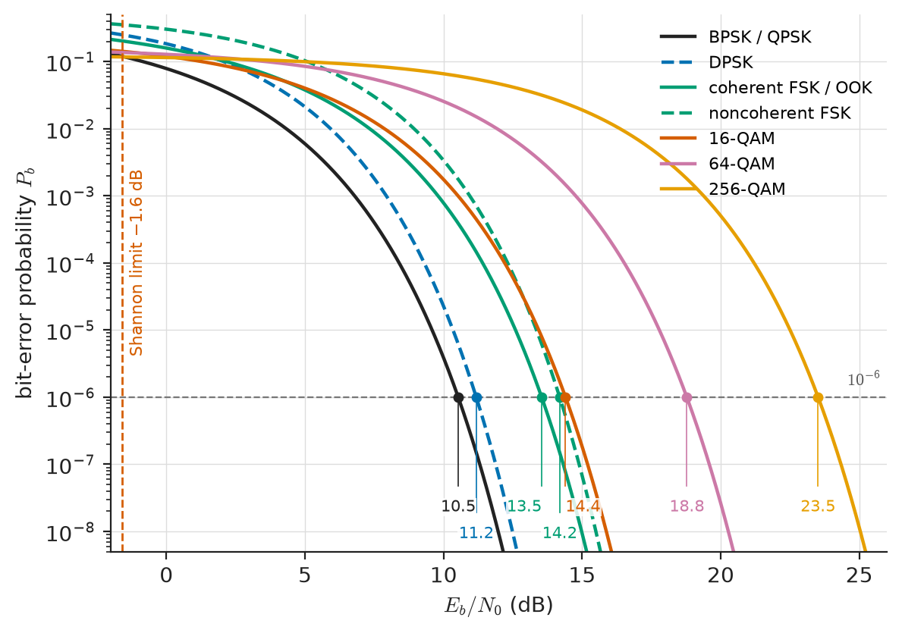

# Chapter 27 — Digital Communication

*Part VI · Communication Theory*

A cable-modem customer complains that downloads are fast in the morning and slow every evening. The technician's meter tells the story in three numbers. In the morning the downstream channel shows a modulation error ratio of 36 dB, and the modem runs 256-QAM. In the evening, as the temperature of the street amplifiers rises and a neighbour's faulty connector lets in ingress from a nearby FM transmitter, the ratio falls to 29 dB, the uncorrected codeword errors climb, and the system falls back to 64-QAM — losing a quarter of its throughput. Nothing in the network has failed; the link has simply crossed the boundary at which one modulation stops being reliable and a more robust one must take over.

An analog link degrades gracefully: a little more noise gives a little more hiss. A digital link behaves differently. Its error rate is negligible over a wide range of conditions and then rises by orders of magnitude over a few decibels. Understanding where that cliff lies — for each way of turning bits into waveforms — is the central task of this chapter.

> **How are analog messages turned into bits, and how are bits turned into waveforms for a cable or a radio channel?**
> **How many bits can each symbol carry, how should the receiver filter and decide, and how often will it decide wrongly?**

| Concept | Engineering destination |
|---|---|
| Pulse-code modulation, companding | Digital telephony (E1/T1), CD audio, ECG and instrumentation data acquisition |
| Delta and sigma-delta modulation | Low-cost voice links, audio and precision ADCs |
| Line coding | Ethernet, USB, CAN, E1/T1 trunks, optical links |
| Bit and symbol rates, Nyquist pulse shaping | Channel sizing, roll-off filters, eye-diagram testing |
| ASK, FSK, PSK | RFID, garage-door and tyre-pressure sensors, Bluetooth, satellite telemetry |
| QPSK and QAM | Satellite TV, cable modems, Wi-Fi, LTE and 5G, microwave backhaul |
| Constellation diagrams | Transmitter and receiver testing with vector signal analysers (EVM, MER) |
| Matched filtering | Every digital receiver, radar pulse compression, ultrasound |
| Error probability versus $E_b/N_0$ | Link budgets, adaptive modulation thresholds |

**Roadmap.** Digitising the message by PCM (27.1) and delta modulation (27.2) → putting bits on a wire by line coding (27.3) → symbol and bit rates and the bandwidth they need (27.4) → the geometric picture of constellations (27.5) → carrier modulations ASK, FSK, PSK (27.6), QPSK (27.7) and QAM (27.8) → the optimum receiver filter (27.9) → detection and error probability (27.10).

---

## 27.1 Pulse-code modulation

### Sample, quantize, encode

**Pulse-code modulation** (PCM) turns an analog message into bits in three steps.

1. **Sampling** at $f_s\geq2W$ after an anti-aliasing filter (Chapter 19). Telephone speech, band-limited to 3.4 kHz, is sampled at 8 kHz; audio at 44.1 or 48 kHz; a diagnostic ECG at 500 Hz to 1 kHz.
2. **Quantization**: each sample is rounded to one of $L=2^n$ levels.
3. **Encoding**: each level is represented by an $n$-bit binary word.

The bit rate is $R_b=nf_s$: $8\times8000=64$ kb/s for a telephone channel, $16\times44\,100\times2=1.4112$ Mb/s for stereo CD audio.

### Quantization noise

A uniform quantizer with step $\Delta$ over a full-scale range $\pm V$ has $\Delta=2V/2^n$. If the signal is busy enough that the rounding error $e$ is uniformly distributed over $\pm\Delta/2$ and uncorrelated with the signal, its mean-square value is

$$
\overline{e^2}=\frac{\Delta^2}{12}
$$

For a full-scale sinusoid of power $V^2/2$, the **signal-to-quantization-noise ratio** is

$$
\mathrm{SQNR}=\frac{V^2/2}{\Delta^2/12}=\frac32\,2^{2n},\qquad \mathrm{SQNR_{dB}}=6.02n+1.76
$$

Each extra bit buys 6 dB. Table 27.1 shows the consequences.

**Table 27.1 — PCM parameters of common systems (typical).**

| Application | $f_s$ | $n$ (bits) | Bit rate per channel | Full-scale SQNR (sine) |
|---|---|---|---|---|
| Telephone, G.711 | 8 kHz | 8 (companded) | 64 kb/s | ~38 dB over a 40 dB range |
| Diagnostic ECG | 500 Hz–1 kHz | 12–16 | 6–16 kb/s | 74–98 dB |
| Power-quality and protection recorders | 4–20 kHz | 16 | 64–320 kb/s | 98 dB |
| CD audio | 44.1 kHz | 16 | 705.6 kb/s | 98.1 dB |
| Studio audio | 48–192 kHz | 24 | 1.15–4.6 Mb/s | ~146 dB theoretical, 110–120 dB achieved |
| Seismic recorders | 100–1000 Hz | 24 | 2.4–24 kb/s | limited to ~120–140 dB by analog noise |

> **Status of the principle: The 6 dB-per-bit quantization rule**
> *Approximate.* Rests on modelling quantization error as uniform, white and independent of the signal; accurate for busy signals spanning many levels, but it fails for small or slowly varying signals (where the error is correlated and appears as distortion) and is corrected in practice by dither.

### Companding

The full-scale SQNR is reached only by a signal that fills the quantizer. Speech varies over 40 dB between quiet and loud talkers, and a uniform 8-bit quantizer that gives 50 dB for a loud talker gives only 20 dB for a talker 30 dB quieter. Telephony instead uses **companding**: compressing the signal logarithmically before uniform quantization and expanding it after decoding. The **µ-law** characteristic (North America, Japan) is

$$
y=\operatorname{sgn}(x)\,\frac{\ln(1+\mu\lvert x\rvert)}{\ln(1+\mu)},\qquad \lvert x\rvert\leq1,\ \mu=255
$$

and the **A-law** characteristic (Europe and elsewhere, $A=87.6$) is similar. For small inputs the slope of the µ-law curve is $\mu/\ln(1+\mu)=46$, so quiet signals are amplified by 33 dB before quantization; for large inputs the steps are large. The SQNR becomes almost independent of signal level,

$$
\mathrm{SQNR}\approx6.02n+4.77-20\log_{10}\ln(1+\mu)\ \mathrm{dB}=38\ \mathrm{dB}\ \text{for}\ n=8,
$$

over a range of about 40 dB (Figure 27.1). A uniform quantizer would need about 13 bits to match this over the same range.

<!-- FIGURE 27.1 | figures/ch27/fig-27-1-pcm-companding.png | plot | Mu-law companding: compression characteristic and the resulting SQNR versus input level compared with uniform 8-bit and 13-bit quantization. | Content: left panel, compressor characteristic y versus x for 0 to 1, curves for mu = 0 (straight line), mu = 15, mu = 255; slope at origin 46 marked for mu = 255. Right panel, x-axis input sine level relative to full scale from -60 dB to 0 dB, y-axis SQNR in dB from 0 to 80: uniform 8-bit line rising with slope 1 to 49.9 dB at 0 dB; uniform 13-bit line to 80 dB; mu-law 8-bit curve roughly flat at about 38 dB from -40 dB to 0 dB and falling below -40 dB. Shaded band -40 to 0 dB labelled "speech dynamic range". -->

*Figure 27.1 — Mu-law companding: compression characteristic and the resulting SQNR versus input level compared with uniform 8-bit and 13-bit quantization.*

### PCM in telephony and instrumentation

PCM channels are multiplexed in time. The European **E1** carrier interleaves 32 time slots of 64 kb/s (30 voice channels plus framing and signalling) into 2.048 Mb/s; the North American **T1** carries 24 channels plus 8 kb/s of framing at 1.544 Mb/s. The same structure underlies the IEC 61850 sampled-value streams in digital substations, where merging units sample current and voltage transformers at 80 samples per cycle and send them as packets to protection relays.

PCM's decisive advantage over analog transmission is **regeneration**. An analog repeater amplifies noise along with signal, so noise accumulates over every hop. A digital repeater decides each bit afresh and transmits a clean pulse; as long as each hop's error probability is small, errors accumulate only additively ($k$ hops at $P_b$ each give about $kP_b$), while the noise does not accumulate at all. Transcontinental digital links therefore deliver the same quality as local ones.

**Worked example — PCM for a multichannel biomedical recorder.** A sleep laboratory records 8 EEG channels and 2 ECG leads, each sampled at 500 Hz with 16-bit resolution, plus 3 auxiliary channels (respiration, oximetry, body position) at 50 Hz and 12 bits. The bit rate is

$$
R_b=10\times500\times16+3\times50\times12=80\,000+1800=81.8\ \mathrm{kb/s}.
$$

The full-scale SQNR of the 16-bit channels is $6.02\times16+1.76=98.1$ dB. An EEG signal of 50 µV peak recorded on an input range of ±5 mV sits 40 dB below full scale, so its SQNR is about 58 dB — still well above the analog noise floor of a good EEG amplifier (about 0.5–1 µV rms), which means 16 bits is enough and the analog front end, not the quantizer, limits the recording. A 12-bit converter would give only 34 dB on the same EEG signal, comparable to the analog noise; this is why biopotential ADCs moved from 12 to 16–24 bits.

---

## 27.2 Delta modulation

### One bit per sample

**Delta modulation** (DM) quantizes not the sample but the change from a running estimate, using one bit. The encoder keeps a staircase approximation $\hat m(t)$; at each sampling instant it sends 1 if $m>\hat m$ (and steps the staircase up by $\Delta$) or 0 otherwise (and steps it down). The decoder rebuilds the same staircase and low-pass filters it. The hardware is a comparator, a flip-flop and an integrator — far simpler than a multi-bit ADC. In exchange, DM must sample many times faster than the Nyquist rate so that successive samples are strongly correlated and a single step can follow the signal.

### Slope overload and granular noise

DM has two distinct error mechanisms (Figure 27.2).

- **Slope overload**: the staircase can rise at most $\Delta f_s$ per second. If the message rises faster, the staircase falls behind. For a tone $A\sin(2\pi f_mt)$, whose maximum slope is $2\pi f_mA$, overload is avoided if

$$
\Delta f_s\geq2\pi f_mA
$$

- **Granular noise**: when the signal is flat, the staircase hunts up and down by $\pm\Delta$ around it. This error behaves like quantization noise of power about $\Delta^2/3$ spread over $0$ to $f_s$, of which the fraction $W/f_s$ survives the output filter.

Large steps reduce overload but increase granular noise; small steps do the reverse. The optimum step lies at the overload limit. For a tone at that limit the SQNR is

$$
\mathrm{SQNR}_{DM}\approx\frac{3f_s^3}{8\pi^2f_m^2W}
$$

growing as $f_s^3$: 9 dB per doubling of sampling rate, compared with 6 dB per bit (per doubling of $L$) in PCM.

<!-- FIGURE 27.2 | figures/ch27/fig-27-2-delta-modulation.png | plot | Delta modulation of a 1 kHz tone showing the staircase approximation, slope overload where the step is too small, and granular noise on the flat portions. | Content: time axis 0 to 1.5 ms; input sine 1 V peak at 1 kHz (smooth curve); staircase for fs = 64 kHz with Delta = 0.06 V (slope overload visible on steep parts, labelled "slope overload: Delta fs < 2 pi fm A") in panel a; panel b same with Delta = 0.1 V tracking correctly with small granular hunting at peaks labelled "granular noise"; bit stream of 1s and 0s shown as a tick row under each panel. Y-axis volts from -1.2 to 1.2. -->

*Figure 27.2 — Delta modulation of a 1 kHz tone showing the staircase approximation, slope overload where the step is too small, and granular noise on the flat portions.*

**Worked example — designing a delta modulator for speech.** A delta modulator for a voice channel ($W=4$ kHz) runs at $f_s=64$ kb/s, the same bit rate as PCM telephony, and must handle a 1 kHz tone of 1 V peak without overload. The minimum step is

$$
\Delta\geq\frac{2\pi\times1000\times1}{64\,000}=98.2\ \mathrm{mV}.
$$

At this step, the SQNR is

$$
\mathrm{SQNR}=\frac{3\times(64\,000)^3}{8\pi^2\times1000^2\times4000}=2490\ \ (34.0\ \mathrm{dB}).
$$

Doubling the rate to 128 kb/s raises it to 43.0 dB. At equal bit rate, 8-bit uniform PCM gives 49.9 dB for the same full-scale tone, so plain DM is inferior for a constant-level signal. Its practical forms make up for this. **Adaptive delta modulation** (continuously variable slope delta modulation, CVSD) enlarges the step during runs of identical bits and shrinks it otherwise, extending the dynamic range; CVSD at 16–64 kb/s was used in military and Bluetooth voice links because it degrades gracefully under bit errors. **Differential PCM** generalises DM to multi-bit quantization of a prediction error, and underlies ADPCM speech coding at 32 kb/s.

### Sigma-delta conversion

Placing the integrator before the quantizer, inside the loop, gives the **sigma-delta** (ΔΣ) modulator. Its quantization noise is pushed toward high frequencies (noise shaping), and a digital decimation filter (Chapter 24) removes it. A second-order sigma-delta converter oversampling by 64 reaches 16 bits from a 1-bit quantizer. Nearly all audio ADCs and DACs, and many precision instrumentation ADCs for strain gauges, thermocouples and ECG, work this way.

> **Boundary.** The circuit design of ADCs, DACs and sigma-delta modulators belongs to *Electronics & Computing*; this chapter uses their input–output behaviour.

---

## 27.3 Line coding

### What a line code must do

To send bits over a cable or fibre without a carrier, each bit (or group of bits) is represented by a pulse shape. The choice — the **line code** — must satisfy several requirements at once:

- **Spectrum** matched to the channel: little or no DC content for transformer- or capacitor-coupled lines; little energy at high frequencies where cable loss and crosstalk are large.
- **Timing content**: enough transitions for the receiver to recover the clock, even in long runs of identical bits.
- **Error monitoring**: some codes have redundancy that lets violations be detected without decoding.
- **Efficiency**: bandwidth needed per bit, and transmit power needed for a given error rate.

### The common codes

Figure 27.3 shows the main binary line codes for the same bit sequence, and Table 27.2 compares their properties.

- **Unipolar NRZ (on–off)**: 1 = $+V$ for the whole bit, 0 = 0 V. Simple; has a DC component and a spectral line at DC; long runs of 1s or 0s carry no timing.
- **Polar NRZ**: 1 = $+V$, 0 = $-V$. No DC on average for balanced data, best noise performance for a given peak voltage, but still no timing in long runs. Used inside chips, on RS-232 and (as differential NRZ with bit stuffing) on CAN and USB.
- **Return-to-zero (RZ)**: the pulse occupies only half the bit. Doubles the bandwidth but gives a transition in every 1.
- **Bipolar or alternate mark inversion (AMI)**: 0 = 0 V, successive 1s alternate between $+V$ and $-V$. No DC; a violation of the alternation reveals an error. Long runs of 0s lose timing, which **HDB3** (E1) and **B8ZS** (T1) cure by substituting deliberate violation patterns for runs of four or eight zeros.
- **Manchester (biphase)**: each bit has a transition in the middle (by the IEEE 802.3 convention, low-to-high for 1). No DC, guaranteed timing, but twice the bandwidth of NRZ. Used by 10 Mb/s Ethernet and many RFID and industrial links.
- **Block codes**: **4B5B** (100 Mb/s Ethernet, with MLT-3 three-level signalling), **8b/10b** (Gigabit Ethernet, Fibre Channel, PCIe 1–2) and **64b/66b** or **128b/130b** (10 Gb/s Ethernet, PCIe 3+) map groups of bits to longer code words with guaranteed transitions and bounded running disparity (DC balance), at an overhead of 25 %, 25 %, 3.1 % and 1.6 % respectively.
- **Multilevel codes**: **2B1Q** (ISDN), **PAM-4** (25/50 Gb/s per lane links, 400G Ethernet) and **PAM-5** (1000BASE-T) send more than one bit per symbol to reduce the symbol rate.

<!-- FIGURE 27.3 | figures/ch27/fig-27-3-line-codes.png | plot | Common binary line codes for the bit sequence 1 0 1 1 0 0 0 0 1 0 and their power spectral densities. | Content: left, six stacked waveform rows over 10 bit periods (time axis in units of Tb): unipolar NRZ (0/+V), polar NRZ (+V/-V), unipolar RZ (half-width pulses), AMI (alternating +V/-V for 1s, 0 for 0s), Manchester (IEEE 802.3 convention, mid-bit transition), and HDB3 showing the 000V substitution for the run of four zeros. Right, PSDs versus normalised frequency f Tb from 0 to 2: polar NRZ sinc-squared with first null at 1; Manchester zero at DC peaking near 0.75 with first null at 2; AMI zero at DC and at 1 peaking near 0.5; unipolar NRZ with a DC impulse arrow. -->

*Figure 27.3 — Common binary line codes for the bit sequence 1 0 1 1 0 0 0 0 1 0 and their power spectral densities.*

**Table 27.2 — Properties of binary line codes (data rate $R_b$, equiprobable bits).**

| Code | DC component | First spectral null | Timing in long runs | Error monitoring | Typical use |
|---|---|---|---|---|---|
| Unipolar NRZ | Yes | $R_b$ | No | No | Logic-level links, optical OOK |
| Polar NRZ | No (on average) | $R_b$ | No | No | RS-232, CAN, PCIe lanes after block coding |
| Unipolar RZ | Yes | $2R_b$ | For 1s only | No | Some optical and IR links |
| AMI / HDB3 / B8ZS | No | $R_b$ | Yes with HDB3/B8ZS | Yes (bipolar violations) | E1, T1 trunks |
| Manchester | No | $2R_b$ | Yes | Limited | 10BASE-T Ethernet, RFID, MIL-STD-1553 |
| 8b/10b | No (bounded disparity) | $1.25R_b$ | Yes | Yes (invalid words) | Gigabit Ethernet, SATA, Fibre Channel |

> **Status of the principle: Line-code power spectral densities**
> *Derived.* Obtained from the autocorrelation of the coded symbol sequence and the Fourier transform of the pulse shape; valid for equiprobable, independent data bits, and altered by scramblers, framing patterns or long-run statistics of real traffic.

---

## 27.4 Symbol and bit rates

### Definitions

A digital modulator sends **symbols**, each chosen from an alphabet of $M$ possibilities, at a **symbol rate** $R_s$ (in baud, symbols per second). Each symbol carries $k=\log_2M$ bits, so the **bit rate** is

$$
R_b=R_s\log_2M
$$

A modem sending 2400 symbols per second with 16 possible symbols delivers 9600 b/s; a cable modem sending 5.36 Msymbol/s with 256-QAM delivers $5.36\times8=42.9$ Mb/s. Correspondingly, the **energy per symbol** is $E_s=kE_b$, and the symbol duration is $T_s=1/R_s=kT_b$. The distinction matters because the bandwidth depends on the symbol rate, while the information delivered depends on the bit rate: raising $M$ increases the bits per hertz without increasing the bandwidth — but, as later sections show, at a cost in power.

### Intersymbol interference and the Nyquist criterion

Rectangular pulses have $\mathrm{sinc}$ spectra with slowly decaying sidelobes, which waste bandwidth and violate spectral masks (Chapter 25, Figure 25.5). If the pulses are band-limited instead, they spread in time and overlap their neighbours, causing **intersymbol interference** (ISI). Nyquist showed that a pulse $p(t)$ causes no ISI at the sampling instants if

$$
p(nT_s)=\begin{cases}1, & n=0\\ 0, & n\neq0\end{cases}
\quad\Longleftrightarrow\quad
\sum_{k=-\infty}^{\infty}P\!\left(f-\frac{k}{T_s}\right)=T_s
$$

The narrowest spectrum satisfying this is a rectangle of width $R_s/2$ (the $\mathrm{sinc}$ pulse), so the **minimum baseband bandwidth** for $R_s$ symbols per second is

$$
B_{\min}=\frac{R_s}{2}
$$

> **Status of the principle: Nyquist's zero-ISI criterion**
> *Derived.* Follows from sampling the pulse train and applying the Poisson summation formula (Chapters 18–19); it guarantees zero ISI only at ideal sampling instants on a channel whose overall response (transmit filter, channel, receive filter) has the specified form, and it says nothing about noise or timing jitter.

### Raised-cosine pulses

The ideal $\mathrm{sinc}$ pulse needs a brick-wall filter and decays as $1/t$, so a small timing error causes large ISI. The practical family is the **raised-cosine** spectrum, whose transition band is a half-cosine of width set by the **roll-off factor** $\alpha$ ($0\leq\alpha\leq1$):

$$
B=\frac{R_s}{2}(1+\alpha)\ \ \text{(baseband)},\qquad B_T=R_s(1+\alpha)\ \ \text{(passband)}
$$

Its pulse decays as $1/t^3$, so tails are tamed. Typical values: $\alpha=0.22$ in UMTS, 0.35 in DVB-S, 0.20–0.05 in DVB-S2X, 0.12–0.18 in DOCSIS. In practice the filtering is split equally between transmitter and receiver as a pair of **root-raised-cosine** filters, which together form a raised cosine and — as Section 27.9 shows — make the receive filter matched to the transmitted pulse.

The quality of the pulse shaping is checked with the **eye diagram**: the received baseband waveform is displayed on an oscilloscope triggered by the symbol clock, so that all symbol periods are overlaid (Figure 27.4). The vertical opening of the eye at the sampling instant is the noise margin; the horizontal opening is the tolerance to timing error; the thickness of the traces at the crossing is jitter.

<!-- FIGURE 27.4 | figures/ch27/fig-27-4-raised-cosine-eye.png | plot | Raised-cosine pulse shaping: pulse shapes and spectra for roll-off 0, 0.35 and 1, and eye diagrams of polar binary data with and without noise. | Content: top-left, pulses p(t) versus t/Ts from -4 to 4 for alpha = 0, 0.35, 1, all with zeros at nonzero integers. Top-right, spectra P(f) versus f Ts from 0 to 1, flat to (1-alpha)/2 then half-cosine to (1+alpha)/2. Bottom-left, eye diagram for alpha = 0.35, two symbol periods, 200 random bits, no noise, wide-open eye with annotations "noise margin", "timing tolerance", "optimum sampling instant". Bottom-right, same with Gaussian noise at Eb/N0 = 10 dB and a 0.3 Ts timing offset marker. -->

*Figure 27.4 — Raised-cosine pulse shaping: pulse shapes and spectra for roll-off 0, 0.35 and 1, and eye diagrams of polar binary data with and without noise.*

### Spectral efficiency of digital modulation

With raised-cosine shaping, a passband signal of $M$-ary symbols achieves

$$
\eta=\frac{R_b}{B_T}=\frac{\log_2M}{1+\alpha}\ \ \mathrm{b/s/Hz}
$$

**Worked example — a QPSK satellite carrier and a QAM cable channel.** A satellite modem must send $R_b=2$ Mb/s using QPSK ($M=4$, $k=2$) with roll-off $\alpha=0.35$. The symbol rate is $R_s=2/2=1$ Msymbol/s and the occupied bandwidth $B_T=1\times1.35=1.35$ MHz, a spectral efficiency of 1.48 b/s/Hz. A DOCSIS 3.0 cable channel of 6 MHz runs 64-QAM at 5.057 Msymbol/s with $\alpha=0.18$, so $B_T=5.057\times1.18=5.97$ MHz and $R_b=5.057\times6=30.34$ Mb/s; with 256-QAM it runs 5.361 Msymbol/s at $\alpha=0.12$, occupying $6.00$ MHz and delivering $5.361\times8=42.88$ Mb/s. The step from 64- to 256-QAM gains 41 % in throughput in the same bandwidth — and, as Section 27.10 shows, costs about 6 dB in required SNR, which is exactly the margin the evening customer of the opening paragraph lost.

---

## 27.5 Constellation diagrams

### Signal space

Most digital modulations can be described with two orthonormal basis functions over a symbol period,

$$
\phi_1(t)=\sqrt{\frac{2}{T_s}}\cos(2\pi f_ct),\qquad \phi_2(t)=-\sqrt{\frac{2}{T_s}}\sin(2\pi f_ct),\qquad 0\leq t<T_s
$$

(with pulse shaping, the rectangular window is replaced by the shaping pulse). Each transmitted symbol is $s_i(t)=a_i\phi_1(t)+b_i\phi_2(t)$ and is fully described by the point $(a_i,b_i)$ in a plane — its **constellation point**. The energy of a symbol is the squared distance of its point from the origin, $E_i=a_i^2+b_i^2$, and the energy of the difference between two symbols is the squared distance between their points. The plane is exactly the complex-envelope plane of Chapter 25: $a_i$ is the in-phase and $b_i$ the quadrature component.

This geometric picture turns the design of a modulation into a packing problem. Additive white Gaussian noise adds a circularly symmetric Gaussian cloud of variance $N_0/2$ per dimension to each point. Errors occur when the cloud around one point reaches into the decision region of another, so the error probability is governed by the **minimum distance** $d_{\min}$ between points relative to $\sqrt{N_0}$, while the transmitted power is governed by the **average energy** $E_s$. A good constellation places its points as far apart as possible for a given average energy.

<!-- FIGURE 27.5 | figures/ch27/fig-27-5-constellations.png | constellation | Gray-coded constellations of BPSK, QPSK, 8-PSK and 16-QAM, all normalised to unit average symbol energy, with decision boundaries and minimum distances. | Content: four square panels, axes I and Q from -1.5 to 1.5. BPSK points at +/-1 with labels 1 and 0, d_min = 2. QPSK points at (+/-0.707, +/-0.707) labelled 00, 01, 11, 10 in Gray order, d_min = 1.414. 8-PSK points on unit circle at multiples of 45 degrees with 3-bit Gray labels, d_min = 0.765. 16-QAM grid at (+/-1, +/-3)/sqrt(10) with 4-bit Gray labels, d_min = 0.632. Decision boundaries dashed. A noise cloud (scatter of 200 points, sigma = 0.1) drawn around one point in each panel. -->

*Figure 27.5 — Gray-coded constellations of BPSK, QPSK, 8-PSK and 16-QAM, all normalised to unit average symbol energy, with decision boundaries and minimum distances.*

### Reading a constellation on an instrument

A vector signal analyser demodulates a real signal and plots the received points. Each impairment has a recognisable signature: additive noise gives circular clouds; phase noise smears points along arcs; a carrier-frequency offset rotates the whole constellation; I/Q gain imbalance stretches it into a rectangle; quadrature error skews it into a parallelogram; amplifier compression pulls the outer points inward. The spread is summarised by the **error-vector magnitude** (EVM), the rms distance between received and ideal points relative to the rms ideal amplitude, or equivalently by the **modulation error ratio** $\mathrm{MER}=-20\log_{10}(\mathrm{EVM})$. Standards specify maximum EVM per modulation: roughly 17.5 % for QPSK, 8 % for 64-QAM and 3.5 % for 256-QAM in LTE base stations, and about 1.3 % ($-38$ dB) for 4096-QAM in Wi-Fi 7. The cable technician's "MER of 36 dB" in the opening paragraph is this measurement.

> **Status of the principle: Signal-space (constellation) representation**
> *Derived.* Exact for any set of finite-energy signals by Gram–Schmidt orthogonalisation; the two-dimensional form covers all linear carrier modulations, and its use for error analysis assumes additive white Gaussian noise and a receiver that projects onto the same basis.

---

## 27.6 ASK, FSK and PSK

The three binary carrier modulations vary the amplitude, frequency or phase of the carrier between two values per bit, exactly as the analog modulations of Chapter 26 vary them continuously.

### Amplitude-shift keying

**Binary ASK**, in its usual form **on–off keying** (OOK), transmits the carrier for a 1 and nothing for a 0:

$$
s(t)=\begin{cases}A_c\cos(2\pi f_ct), & \text{bit }1\\ 0, & \text{bit }0\end{cases}
$$

It is the passband version of unipolar NRZ: its constellation is two points on the I axis at 0 and $\sqrt{2E_b}$ (average energy $E_b$). OOK can be detected with an envelope detector, so receivers are cheap; it is used in garage-door and car-key fobs, tyre-pressure sensors at 315/433 MHz, RFID backscatter, infrared remote controls and, as intensity modulation, in most short-reach optical links (Chapter 31). Its drawbacks are poor power efficiency, sensitivity to amplitude fading, and a decision threshold that depends on the received signal level.

### Frequency-shift keying

**Binary FSK** sends one of two frequencies:

$$
s_i(t)=A_c\cos(2\pi f_it),\qquad i\in\{0,1\}
$$

If the tones are separated by a multiple of $1/(2T_b)$ for coherent detection, or of $1/T_b$ for noncoherent detection, the two signals are **orthogonal**: their constellation points lie on two different axes, $\sqrt{E_b}$ apart from the origin in perpendicular directions. **Minimum-shift keying** (MSK) uses the minimum spacing $1/(2T_b)$ with continuous phase; filtered by a Gaussian low-pass filter it becomes **GMSK**, the modulation of GSM ($BT=0.3$) and, as **GFSK**, of Bluetooth and many industrial telemetry radios. FSK can be detected noncoherently with a pair of filters and envelope detectors, or with an FM discriminator, and has a constant envelope, so the transmitter amplifier can run saturated. The occupied bandwidth is roughly $B_T\approx\lvert f_1-f_0\rvert+2R_b$ for rectangular pulses, much less with Gaussian shaping. The classic Bell 103 modem used 1070/1270 Hz tones at 300 b/s; HART instrumentation signalling still superimposes 1200/2200 Hz FSK at 1200 b/s on 4–20 mA loops.

**$M$-ary orthogonal FSK** uses $M$ tones. Its bandwidth grows in proportion to $M/\log_2M$ while its required $E_b/N_0$ falls — it is the power-limited end of the Shannon trade-off (Chapter 25), used in deep-space links, LoRa-type chirp systems and paging.

### Phase-shift keying

**Binary PSK** (BPSK) transmits the carrier with phase 0 or $\pi$:

$$
s(t)=\pm A_c\cos(2\pi f_ct)=\pm\sqrt{\frac{2E_b}{T_b}}\cos(2\pi f_ct)
$$

Its constellation is two points at $\pm\sqrt{E_b}$: antipodal signals, as far apart as possible for a given energy. BPSK is the passband version of polar NRZ and has the best error performance of any binary modulation. It requires coherent detection with a recovered carrier (Costas or squaring loop, Chapter 26), which has an inherent 180° ambiguity; **differential PSK** (DPSK) resolves this by encoding each bit as a change, or no change, of phase relative to the previous symbol, and allows a simple receiver that compares consecutive symbols. BPSK is used in GPS (on the C/A code), deep-space telemetry, RFID and as the most robust mode of Wi-Fi and LTE.

The error performance of each of the three binary schemes is derived in Section 27.10; in summary, for the same $E_b/N_0$, coherent BPSK is 3 dB better than coherent FSK or OOK (on an average-energy basis), and noncoherent detection costs about 1 dB more at useful error rates.

---

## 27.7 QPSK

### Two BPSK signals in quadrature

**Quadrature PSK** sends two bits per symbol by choosing one of four carrier phases. Equivalently — and this is how it is built — it sends two independent BPSK signals on the cosine and the sine carriers:

$$
s(t)=a_I\sqrt{\frac{E_s}{T_s}}\cos(2\pi f_ct)-a_Q\sqrt{\frac{E_s}{T_s}}\sin(2\pi f_ct),\qquad a_I,a_Q\in\{\pm1\}
$$

so that $E_s=2E_b$. Because the cosine and sine are orthogonal, the receiver separates them with the I and Q mixers of Figure 25.2 and detects each independently. Each branch is a BPSK link with energy $E_b$ per bit; therefore QPSK has **the same bit-error probability as BPSK at the same $E_b/N_0$**, while sending twice as many bits in the same bandwidth. This "free" doubling is why QPSK, not BPSK, is the workhorse of satellite TV (DVB-S), early cellular data, and the control channels of LTE and 5G.

### Gray coding

The four points are labelled so that neighbours differ in only one bit — **Gray coding** (00, 01, 11, 10 around the circle; Figure 27.5). The most likely error, to an adjacent point, then produces one bit error rather than two, and the bit-error probability is close to the symbol-error probability divided by $\log_2M$. All practical PSK and QAM constellations are Gray-coded.

### Variants for amplifier efficiency

When the data on both branches change at once, the phase jumps by 180° and, after pulse shaping, the envelope passes through zero. A nonlinear amplifier then spreads the spectrum. **Offset QPSK** (OQPSK) delays the Q branch by half a symbol, so only one branch changes at a time and phase jumps are limited to ±90°; it was used in IS-95 CDMA uplinks and is used in IEEE 802.15.4 (Zigbee). **π/4-QPSK** alternates between two QPSK constellations rotated by 45°, limiting jumps to ±135° and allowing differential detection; it was used in North American TDMA and TETRA. These variants have the same BER as QPSK in AWGN and differ only in their envelope behaviour.

> **Status of the principle: QPSK as two independent BPSK channels**
> *Derived.* Follows from the orthogonality of cosine and sine carriers over a symbol interval; it requires accurate carrier phase and I/Q balance, and a phase error $\phi$ couples the branches, reducing each branch's useful amplitude by $\cos\phi$ and adding crosstalk proportional to $\sin\phi$.

---

## 27.8 QAM

### Amplitude and phase together

Quadrature amplitude modulation extends QPSK by letting each branch take more than two levels. With $\sqrt M$ levels per branch in a square grid, $M$-QAM carries $\log_2M$ bits per symbol: 16-QAM carries 4, 64-QAM 6, 256-QAM 8, 1024-QAM 10 and 4096-QAM 12. With levels $\pm1,\pm3,\ldots,\pm(\sqrt M-1)$ times a spacing parameter $d/2$, the minimum distance is $d$ and the average symbol energy is

$$
E_s=\frac{(M-1)d^2}{6}
$$

so for a fixed $E_s$ the distance between points shrinks as $1/\sqrt{M-1}$. Each quadrupling of $M$ (two more bits per symbol) halves the distance and costs about 6 dB of SNR at the same symbol-error rate — the cost the cable modem of the opening paragraph pays for 256- versus 64-QAM.

QAM is far more efficient than $M$-PSK for $M>4$. In $M$-PSK all points lie on a circle, and their spacing $2\sqrt{E_s}\sin(\pi/M)$ shrinks almost as $1/M$; QAM fills the plane. At $10^{-6}$, 16-QAM needs about 14.4 dB of $E_b/N_0$, while 16-PSK needs about 18.4 dB. Only 8-PSK survives in practice (EDGE, DVB-S2), where its constant amplitude suits saturated satellite amplifiers; DVB-S2 also uses amplitude-and-phase rings (16- and 32-APSK) as a compromise.

### Where QAM is used

Table 27.3 lists representative uses and the SNR each needs. The pattern is consistent across media: QAM order is chosen to match the available SNR, and adaptive systems change it continuously.

**Table 27.3 — QAM and PSK orders in deployed systems (typical uncoded requirements at a BER of $10^{-6}$ in AWGN).**

| Modulation | Bits/symbol | $E_b/N_0$ required | $E_s/N_0$ required | Representative use |
|---|---|---|---|---|
| BPSK | 1 | 10.5 dB | 10.5 dB | GPS, deep space, most robust Wi-Fi/LTE modes |
| QPSK | 2 | 10.5 dB | 13.5 dB | DVB-S, LTE/5G control channels, satellite telemetry |
| 8-PSK | 3 | 14.0 dB | 18.7 dB | EDGE, DVB-S2 |
| 16-QAM | 4 | 14.4 dB | 20.4 dB | LTE, Wi-Fi, microwave backhaul |
| 64-QAM | 6 | 18.8 dB | 26.6 dB | DOCSIS, DVB-C, LTE, Wi-Fi |
| 256-QAM | 8 | 23.5 dB | 32.5 dB | DOCSIS 3.0, 5G, Wi-Fi 5, backhaul |
| 1024–4096-QAM | 10–12 | ~28.5–33.7 dB | ~38.5–44.5 dB | DOCSIS 3.1, Wi-Fi 6/7, high-capacity backhaul |

Coding (Chapter 28) reduces these requirements by several decibels, and practical receivers lose 1–3 dB to implementation effects (phase noise, finite-precision arithmetic, imperfect equalisation), which is why EVM limits are set tighter than the table alone would suggest.

> **Status of the principle: The 6-dB-per-two-bits rule for square QAM**
> *Derived.* Follows from $E_s=(M-1)d^2/6$ for square constellations; exact for the minimum-distance relation and approximate for error rates, and it assumes a linear channel and amplifier — compression of the outer points makes dense QAM degrade faster than the rule predicts.

---

## 27.9 Matched filtering

### The problem

A known pulse $p(t)$ of duration $T$ arrives in white Gaussian noise of two-sided spectral density $N_0/2$. The receiver passes the signal through a linear filter $h(t)$ and samples the output at $t=T$ to decide. Which filter makes the decision most reliable? Since the error probability falls as the SNR at the sampling instant rises, the question is which $h(t)$ maximises

$$
\mathrm{SNR}_{out}=\frac{\left\lvert\int_{-\infty}^{\infty}H(f)P(f)e^{j2\pi fT}\,df\right\rvert^2}{\dfrac{N_0}{2}\int_{-\infty}^{\infty}\lvert H(f)\rvert^2\,df}
$$

### The solution

By the Cauchy–Schwarz inequality the numerator is at most $\int\lvert H\rvert^2df\cdot\int\lvert P\rvert^2df$, with equality when $H(f)$ is proportional to $P^*(f)e^{-j2\pi fT}$. In the time domain,

$$
h(t)=p(T-t)
$$

the **matched filter** is the time-reversed, delayed copy of the pulse it expects. The maximum output SNR is

$$
\mathrm{SNR}_{\max}=\frac{2E}{N_0},\qquad E=\int_0^T p^2(t)\,dt
$$

Two facts stand out. The best achievable SNR depends only on the pulse *energy*, not on its shape, bandwidth or peak amplitude. And the matched filter is equivalent to a **correlator**: multiplying the received signal by $p(t)$ and integrating over the symbol, $\int_0^Tr(t)p(t)\,dt$, produces the same sample at $t=T$. For a rectangular pulse the correlator is an **integrate-and-dump** circuit.

> **Status of the principle: The matched-filter theorem**
> *Derived.* A consequence of the Cauchy–Schwarz inequality for a known signal in additive white noise; it maximises the SNR at one sampling instant, and for coloured noise the optimum filter becomes a whitening filter followed by a matched filter.

### Consequences across EEE

- **Digital receivers**: the root-raised-cosine receive filter is matched to the root-raised-cosine transmit pulse, so the standard Nyquist pair gives both zero ISI and maximum SNR.
- **Radar**: a long transmitted chirp of 100 µs with a bandwidth of 10 MHz has the energy of a long pulse; its matched filter compresses it to the 0.1 µs resolution of a short pulse (pulse compression), a gain of $100\times10=1000$ (30 dB) in time–bandwidth product.
- **Ultrasound, sonar and seismic exploration** use the same pulse compression with coded excitations.
- **Biomedical signal detection**: QRS detectors in ECG monitors correlate the signal with a QRS template; GPS receivers correlate with the satellite's spreading code and recover signals 20 dB below the thermal noise in the receiver bandwidth.

**Worked example — matched versus simple filtering.** A baseband polar link sends rectangular pulses of amplitude $\pm0.3$ mV and duration $T=1$ µs into a receiver whose input noise has one-sided density $N_0=10^{-14}$ V²/Hz (referred to a 1 Ω normalisation). The pulse energy is $E_b=A^2T=(0.3\times10^{-3})^2\times10^{-6}=9\times10^{-14}$ V²s, so

$$
\frac{E_b}{N_0}=9\ (9.54\ \mathrm{dB}),\qquad \mathrm{SNR}_{\max}=\frac{2E_b}{N_0}=18\ (12.55\ \mathrm{dB}).
$$

An integrate-and-dump receiver deciding by sign gives (Section 27.10) $P_b=Q(\sqrt{18})=Q(4.24)=1.1\times10^{-5}$. If the integrator is replaced by a simple RC low-pass filter, the best time constant ($RC\approx0.8T$) gives an output SNR only 0.81 times the matched value — a loss of 0.89 dB — and the error probability rises to $Q(\sqrt{18\times0.81})=6.7\times10^{-5}$, about six times worse. The matched filter is not a refinement; it is worth almost a decibel of transmitter power for free.

---

## 27.10 Detection and error probability

### The decision rule

After the matched filter, the receiver holds one number per dimension per symbol and must decide which symbol was sent. The **maximum a posteriori** (MAP) rule picks the symbol with the largest posterior probability given the observation; with equally likely symbols it becomes the **maximum-likelihood** (ML) rule, and in additive white Gaussian noise ML is the **minimum-distance** rule: choose the constellation point nearest to the received point. The decision boundaries are the perpendicular bisectors between neighbouring points (the dashed lines in Figure 27.5).

> **Status of the principle: Minimum-distance detection in AWGN**
> *Derived.* The ML rule for equiprobable symbols in additive white Gaussian noise, since the likelihood decreases monotonically with Euclidean distance; it is not optimal for unequal priors, non-Gaussian (impulsive) noise or channels with ISI, which need weighted thresholds or sequence detection.

### Binary signals in Gaussian noise

For two signals separated by distance $d$ in signal space, the noise component along the line joining them is Gaussian with variance $N_0/2$, and an error occurs when it exceeds $d/2$. The error probability is

$$
P_b=Q\!\left(\frac{d}{\sqrt{2N_0}}\right),\qquad Q(x)=\frac{1}{\sqrt{2\pi}}\int_x^\infty e^{-u^2/2}\,du
$$

where $Q$ is the tail of the standard Gaussian distribution (its properties are developed in *The Mathematics Universe*). Applying this to the three binary schemes:

- **Antipodal (BPSK, polar NRZ)**: $d=2\sqrt{E_b}$, so

$$
P_b=Q\!\left(\sqrt{\frac{2E_b}{N_0}}\right)
$$

- **Orthogonal (coherent FSK)**: $d=\sqrt{2E_b}$, giving $P_b=Q\!\left(\sqrt{E_b/N_0}\right)$, 3 dB worse.
- **On–off (coherent OOK, unipolar NRZ)** with average energy $E_b$: points at 0 and $\sqrt{2E_b}$, also $d=\sqrt{2E_b}$, so $P_b=Q\!\left(\sqrt{E_b/N_0}\right)$ — 3 dB worse than BPSK on average energy, 6 dB worse on peak energy.

Noncoherent receivers cannot exploit the carrier phase and pay a penalty:

- **Noncoherent FSK**: $P_b=\tfrac12e^{-E_b/(2N_0)}$
- **DPSK**: $P_b=\tfrac12e^{-E_b/N_0}$

Table 27.4 gives representative values, and Figure 27.6 plots the curves.

**Table 27.4 — Bit-error probability of binary modulations in AWGN.**

| $E_b/N_0$ | BPSK / QPSK | DPSK | Coherent FSK, OOK | Noncoherent FSK |
|---|---|---|---|---|
| 0 dB | $7.9\times10^{-2}$ | $1.8\times10^{-1}$ | $1.6\times10^{-1}$ | $3.0\times10^{-1}$ |
| 4 dB | $1.3\times10^{-2}$ | $4.1\times10^{-2}$ | $5.6\times10^{-2}$ | $1.4\times10^{-1}$ |
| 6 dB | $2.4\times10^{-3}$ | $9.3\times10^{-3}$ | $2.3\times10^{-2}$ | $6.8\times10^{-2}$ |
| 8 dB | $1.9\times10^{-4}$ | $9.1\times10^{-4}$ | $6.0\times10^{-3}$ | $2.1\times10^{-2}$ |
| 10 dB | $3.9\times10^{-6}$ | $2.3\times10^{-5}$ | $7.8\times10^{-4}$ | $3.4\times10^{-3}$ |
| 12 dB | $9.0\times10^{-9}$ | $6.5\times10^{-8}$ | $3.4\times10^{-5}$ | $1.8\times10^{-4}$ |
| Required for $10^{-6}$ | 10.5 dB | 11.2 dB | 13.5 dB | 14.2 dB |

<!-- FIGURE 27.6 | figures/ch27/fig-27-6-ber-curves.png | plot | Bit-error probability versus Eb/N0 in AWGN for binary and M-ary modulations, with the Shannon limit for reference. | Content: x-axis Eb/N0 from -2 to 26 dB, y-axis BER log scale from 1e-8 to 0.5. Curves: BPSK/QPSK Q(sqrt(2Eb/N0)); DPSK 0.5 exp(-Eb/N0); coherent FSK/OOK Q(sqrt(Eb/N0)); noncoherent FSK 0.5 exp(-Eb/2N0); 16-QAM, 64-QAM, 256-QAM (Gray-coded approximations, SER/log2 M). Horizontal dashed line at 1e-6 with crossing points labelled 10.5, 11.2, 13.5, 14.2, 14.4, 18.8, 23.5 dB. Vertical dashed line at -1.6 dB labelled "Shannon limit". -->

*Figure 27.6 — Bit-error probability versus Eb/N0 in AWGN for binary and M-ary modulations, with the Shannon limit for reference.*

> **Status of the principle: BER formulas for binary modulation in AWGN**
> *Derived.* Exact for ideal coherent (or ideal noncoherent) detection of equiprobable binary signals in additive white Gaussian noise with perfect timing and carrier recovery; they ignore ISI, phase noise, fading and interference, each of which raises the error rate and can create an error floor that no increase in $E_b/N_0$ removes.

### M-ary error probability

For $M$-ary constellations the symbol-error probability is dominated by errors to nearest neighbours. A useful **nearest-neighbour approximation** is

$$
P_s\approx N_{nn}\,Q\!\left(\frac{d_{\min}}{\sqrt{2N_0}}\right)
$$

where $N_{nn}$ is the average number of nearest neighbours. For square $M$-QAM, treating each branch as a $\sqrt M$-level PAM signal,

$$
P_s=1-\left(1-p\right)^2,\qquad p=2\left(1-\frac{1}{\sqrt M}\right)Q\!\left(\sqrt{\frac{3E_s}{(M-1)N_0}}\right)
$$

With Gray coding, $P_b\approx P_s/\log_2M$.

**Worked example — a QPSK link budget and a 16-QAM upgrade.** A point-to-point telemetry link for a remote substation sends $R_b=2$ Mb/s with QPSK. The receiver has a noise figure of 3 dB, so $N_0=-174+3=-171$ dBm/Hz. At a received power of $P_R=-100$ dBm,

$$
\frac{E_b}{N_0}=P_R-N_0-10\log_{10}R_b=-100+171-63.0=8.0\ \mathrm{dB},
$$

giving $P_b=Q(\sqrt{2\times10^{0.8}})=1.9\times10^{-4}$ — about 380 errors per second, too many for protection signalling. For $10^{-6}$ the link needs 10.5 dB, that is $P_R\geq-171+63.0+10.5=-97.5$ dBm, 2.5 dB more than it has. If instead the received power falls by 5 dB in a rain fade to $-105$ dBm, $E_b/N_0=3.0$ dB and $P_b=2.3\times10^{-2}$: the link is useless. The 5 dB fade has increased the error rate by a factor of 120, which is the "cliff" of digital communication.

Now suppose the operator wants to double the rate to 4 Mb/s in the same 1.35 MHz bandwidth by changing to 16-QAM at the same symbol rate of 1 Msymbol/s, and improves the antennas so that $P_R=-90$ dBm. Then $E_s/N_0=P_R-N_0-10\log_{10}R_s=-90+171-60.0=21.0$ dB. The QAM formula above gives a symbol-error rate of $7.8\times10^{-7}$ and a bit-error rate of about $2.0\times10^{-7}$ (at 20 dB the figures would be $1.2\times10^{-5}$ and $2.9\times10^{-6}$, showing again how steep the curve is). The 16-QAM link therefore needs roughly 7 dB more received power than the 2 Mb/s QPSK link ($20.4$ dB against $13.5$ dB of $E_s/N_0$ for $10^{-6}$, Table 27.3) to double the throughput — the power-for-bandwidth trade of Chapter 25 in concrete form.

### Power-limited and bandwidth-limited choices

Putting the results together, Figure 27.6 and Table 27.3 show the two directions in which a designer can move from QPSK:

- toward **more bits per symbol** (16-, 64-, 256-QAM): more b/s/Hz, at about 3 dB more $E_b/N_0$ per extra bit at high order;
- toward **orthogonal signalling** ($M$-FSK) or **coding** (Chapter 28): less $E_b/N_0$ needed, at the cost of bandwidth or complexity.

Both trades are bounded by the Shannon curve of Figure 25.6, and uncoded modulations at $10^{-6}$ all sit about 8.5–10.5 dB to its right. Closing that gap is the job of error-control coding, the subject of the next chapter.

### Bit-error rate in practice

Error probabilities are measured with a **bit-error-rate tester** that sends a known pseudo-random sequence and counts errors. To measure $P_b$ with reasonable confidence, about 100 errors must be observed, so verifying $10^{-12}$ on a 10 Gb/s optical link takes $100/(10^{10}\times10^{-12})=10^4$ s, nearly three hours; engineers therefore measure at deliberately degraded SNR and extrapolate along the theoretical curve, or use the Q-factor of the eye diagram. In fading channels (Chapter 30) the average BER falls only inversely with average $E_b/N_0$ rather than exponentially, and diversity and coding are needed to restore the steep curves of this section.

---

## What remains open

| Open question | Where it is answered |
|---|---|
| How much can a source be compressed, and how do error-correcting codes approach the Shannon limit? | Chapter 28 |
| How are bandpass Gaussian noise, noise bandwidth, BER and SER treated as random-process problems? | Chapter 29 |
| How do fading, multipath and Doppler change error probability, and how do OFDM and MIMO restore it? | Chapter 30 |
| How are OOK and coherent QAM used on optical fibre, and what limits them? | Chapter 31 |
| How are equalisers designed to remove ISI on dispersive channels? | Chapters 23 and 24 (adaptive filters) |
| What sets the quantization and finite-precision limits of the ADCs that feed PCM systems? | Chapters 19 and 21; *Electronics & Computing* |
| What are the properties of the Gaussian distribution and the Q-function used in the error formulas? | *The Mathematics Universe* |

**Next:** Chapter 28 asks what information actually is, how much of it a channel can carry, and how codes let a link approach that limit.
