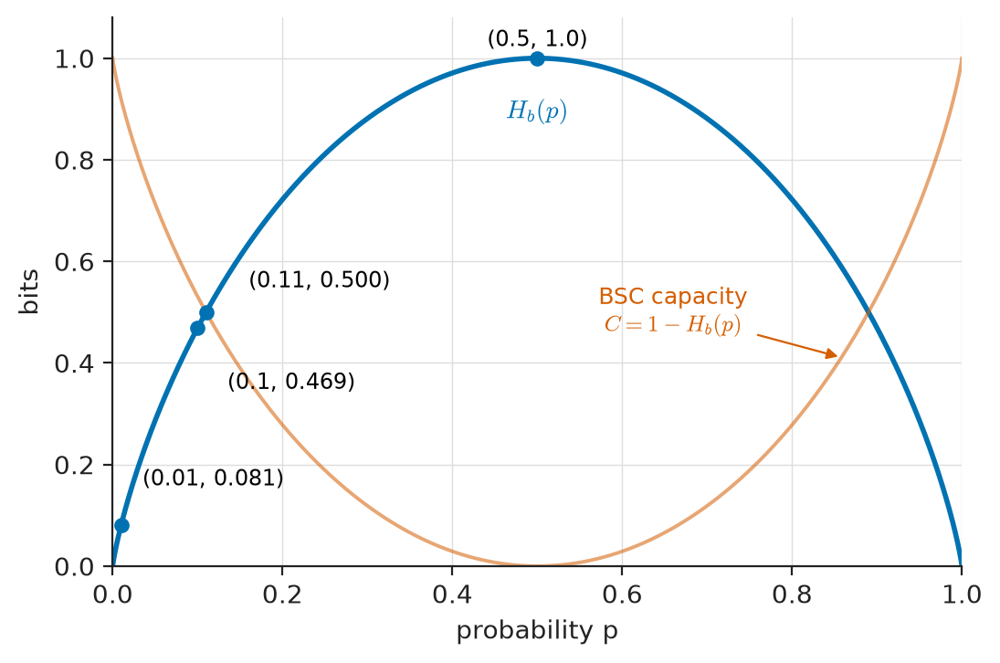
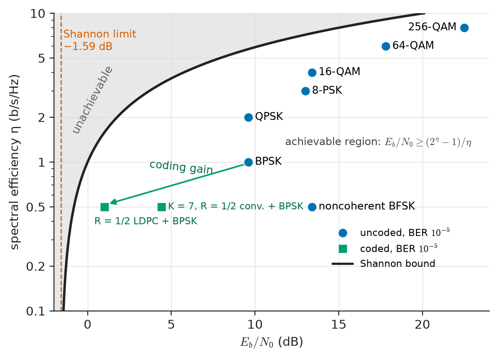
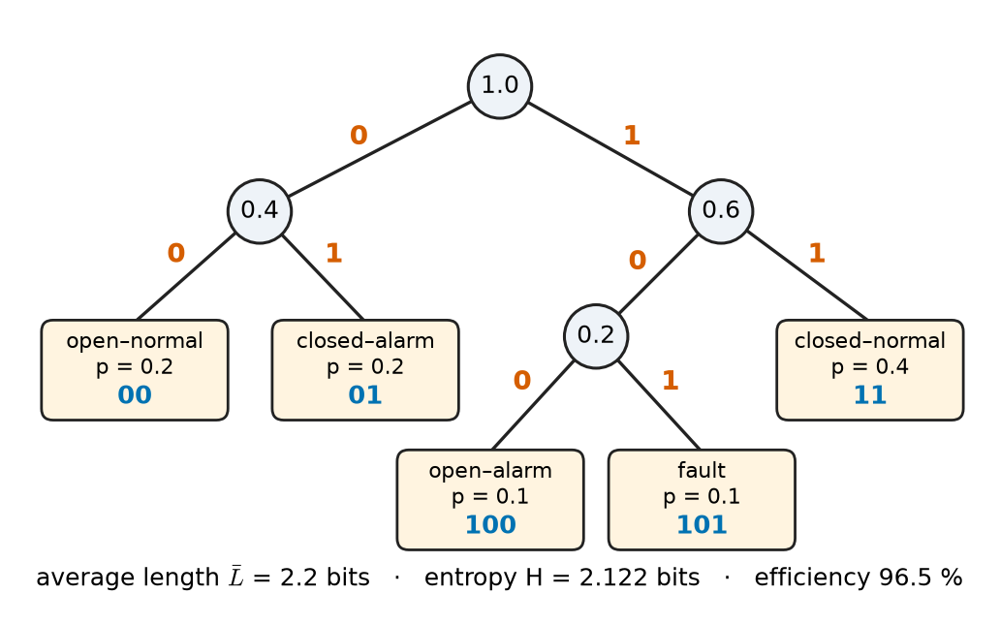
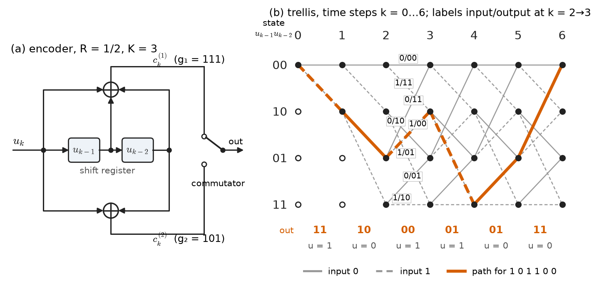
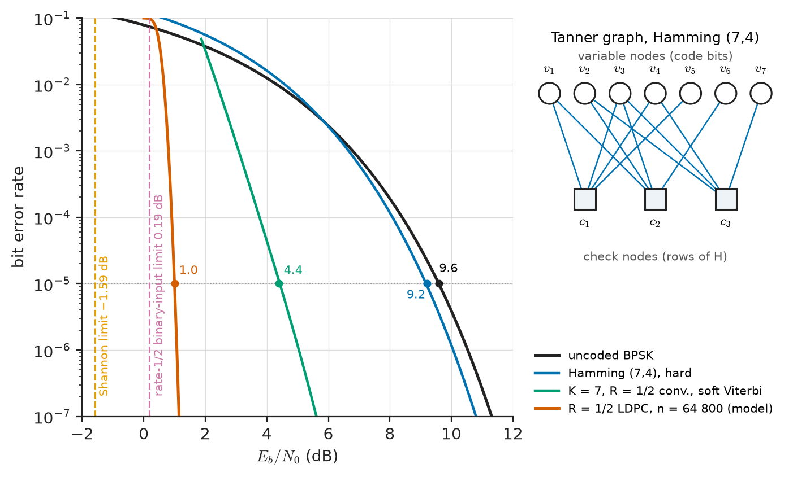

# Chapter 28 — Information Theory and Coding

*Part VI · Communication Theory*

Voyager 1 is more than 24 billion kilometres from Earth. Its transmitter radiates about 23 W at 8.4 GHz from a 3.7 m dish; by the time the signal reaches a 70 m antenna of the Deep Space Network, the received power is below an attowatt ($10^{-18}$ W), far beneath the thermal noise in any bandwidth wide enough to carry the signal comfortably. Yet engineering telemetry still arrives with bit errors so rare that the mission does not notice them. Nothing in Chapter 27 explains how this is possible. The link is operated at an energy per bit only a few decibels above the noise density, where uncoded BPSK would make several errors in every hundred bits. What saves the link is *coding*: a convolutional code of constraint length 7, decoded by the Viterbi algorithm, wrapped in a Reed–Solomon code that cleans up what the Viterbi decoder misses. The redundancy costs bandwidth, but it buys a factor of hundreds in required signal power.

At the other end of the scale, a smartphone downloads a 30 MB software update that would occupy 90 MB uncompressed, over a 5G link whose data channel is protected by a low-density parity-check code that operates within about a decibel of a theoretical limit computed in 1948. Both stories rest on the same two ideas. Information can be *measured*, and a source can be compressed down to that measure and no further. A noisy channel has a *capacity*, and below that rate errors can be made arbitrarily rare by coding, while above it they cannot.

> **How much information does a source produce, and how far can it be compressed without loss?**
> **What is the largest rate a noisy channel can carry reliably, and which codes approach it in practice?**

| Concept | Engineering destination |
|---|---|
| Entropy | Compression limits for audio, images, telemetry and logged sensor data |
| Mutual information | Rate a given channel and modulation can actually deliver; feature selection in measurement |
| Channel capacity (Shannon–Hartley) | Ceiling for modem, Wi-Fi, cellular and satellite throughput; link planning |
| Source coding, Huffman, arithmetic coding | JPEG, MP3/AAC entropy stages, fax, H.264/H.265 |
| Lossless compression (LZ, DEFLATE) | ZIP, PNG, FLAC, firmware images, smart-meter logs |
| Error detection (parity, CRC) | Ethernet, CAN bus, USB, Modbus, storage sectors, ARQ protocols |
| Block codes (Hamming, BCH, Reed–Solomon) | ECC memory, QR codes, CDs and DVDs, DVB, deep-space links |
| Convolutional codes, Viterbi decoding | GSM, satellite modems, legacy Wi-Fi, space telemetry |
| Turbo, LDPC and polar codes | 3G/4G, 5G NR, DVB-S2, Wi-Fi 6, 10GBASE-T, flash memory |

**Roadmap.** Information and entropy (28.1) → mutual information (28.2) → channel capacity (28.3) → source coding and lossless compression (28.4–28.5) → error detection (28.6) → error correction in general (28.7) → block codes (28.8) → convolutional codes (28.9) → modern near-capacity codes (28.10).

---

## 28.1 Information and entropy

### Measuring surprise

The engineering question behind information theory is concrete: how many binary digits must be sent, on average, to tell a receiver which of several possible messages a source produced? If a pressure sensor on a gas pipeline reports "normal" 999 times in 1000, a message saying "normal" tells the control room almost nothing it did not already expect, while "alarm" tells it a great deal. Information must therefore depend on probability, and it should add for independent events: learning the outcomes of two independent sensors should give the sum of the two amounts. The only function with both properties (up to the choice of base) is the logarithm. The **self-information** of an outcome $x$ with probability $p(x)$ is

$$
I(x)=-\log_2 p(x)\quad \text{bits}.
$$

A fair coin flip carries 1 bit; one of 256 equally likely byte values carries 8 bits; the pipeline "alarm" with probability $10^{-3}$ carries $\log_2 1000\approx 9.97$ bits, while "normal" carries only $-\log_2 0.999\approx 0.0014$ bits. With the natural logarithm the unit is the *nat* (1 nat $=1.443$ bits).

### Entropy of a discrete source

A **discrete memoryless source** emits symbols from an alphabet $\{x_1,\dots,x_M\}$, independently, with probabilities $p_i$. Its **entropy** is the average self-information per symbol:

$$
H(X)=-\sum_{i=1}^{M}p_i\log_2 p_i\quad\text{bits/symbol}.
$$

The entropy obeys

$$
0\le H(X)\le\log_2 M,
$$

with $H=0$ only when one symbol is certain, and $H=\log_2 M$ only when all symbols are equally likely. Entropy is a property of the probability distribution, not of the symbols' names or values: a source emitting $\{-5\ \mathrm{V},+5\ \mathrm{V}\}$ equiprobably and one emitting $\{\text{red},\text{green}\}$ equiprobably both have 1 bit per symbol.

For a binary source with $P(1)=p$ the entropy is the **binary entropy function**

$$
H_b(p)=-p\log_2 p-(1-p)\log_2(1-p),
$$

which rises from 0 at $p=0$ to 1 bit at $p=\tfrac12$ and falls symmetrically (Figure 28.1). It reappears throughout the chapter, because the capacity of the binary symmetric channel and the limits of binary compression are both written with it. A few values are worth remembering: $H_b(0.1)=0.469$, $H_b(0.11)=0.500$, $H_b(0.01)=0.081$, $H_b(10^{-3})=0.0114$.

<!-- FIGURE 28.1 | figures/ch28/fig-28-1-binary-entropy.png | plot | The binary entropy function: a biased binary source carries less than one bit per symbol. | Content: H_b(p) in bits versus p from 0 to 1, smooth concave curve peaking at 1 bit at p = 0.5. Mark points (0.01, 0.081), (0.1, 0.469), (0.11, 0.500) and (0.5, 1.0) with small dots and labels. Second faint curve on the same axes: BSC capacity 1 - H_b(p), annotated "BSC capacity". Axes: x "probability p", y "bits", both 0 to 1. -->

*Figure 28.1 — The binary entropy function: a biased binary source carries less than one bit per symbol.*

### Joint entropy and sources with memory

For two random variables the **joint entropy** is $H(X,Y)=-\sum_{x,y}p(x,y)\log_2 p(x,y)$, and the **conditional entropy** $H(Y\mid X)=-\sum_{x,y}p(x,y)\log_2 p(y\mid x)$ is the average uncertainty that remains about $Y$ once $X$ is known. They are linked by the chain rule

$$
H(X,Y)=H(X)+H(Y\mid X)\le H(X)+H(Y),
$$

with equality only for independent variables. Real sources have memory: in English text "q" is almost always followed by "u", successive ECG samples are strongly correlated, and neighbouring pixels in a photograph resemble each other. The relevant measure for such a source is the **entropy rate**

$$
\mathcal H=\lim_{n\to\infty}\frac1n H(X_1,X_2,\dots,X_n),
$$

which is never larger than the single-symbol entropy and is often much smaller. Exploiting memory, by prediction, transforms or dictionaries, is what turns a modest single-symbol compressor into a powerful one.

**Table 28.1 — Representative entropies and information rates (typical values).**

| Source | Raw representation | Approximate information content |
|---|---|---|
| Fair die | 3 bits/symbol (fixed-length) | $\log_2 6=2.585$ bits/symbol |
| English text, single letters (27 symbols) | 8 bits/character ASCII | about 4.1 bits/character |
| English text, long context (Shannon's estimates) | 8 bits/character | roughly 1–1.5 bits/character |
| Telephone speech, 8 kHz × 8 bit A-law | 64 kb/s | coded at 8–13 kb/s by speech codecs with good quality (lossy) |
| CD audio, 44.1 kHz × 16 bit × 2 | 1411 kb/s | FLAC lossless typically 700–1000 kb/s |
| 12-lead ECG, 500 Hz × 12 bit | 72 kb/s | lossless typically 2–3:1 reduction |
| Greyscale photograph, 8 bit/pixel | 8 bits/pixel | lossless typically 3.5–5 bits/pixel (PNG, JPEG-LS) |

The lossy entries are included only for scale: they discard information deliberately (rate–distortion theory, outside this chapter's scope), whereas the lossless entries are bounded below by the entropy rate.

> **Status of the principle: Entropy as the measure of information**
> *Derived.* Entropy is the unique (up to scale) measure satisfying continuity, monotonic growth with the number of equiprobable outcomes, and additivity for independent events; its operational meaning comes from the source coding theorem of Section 28.4.

**Worked example — Entropy of a telemetry status word.** A substation monitoring unit reports one of five breaker states every second: *closed–normal* (probability 0.4), *open–normal* (0.2), *closed–alarm* (0.2), *open–alarm* (0.1) and *fault* (0.1). Its entropy is

$$
H=-\left[0.4\log_2 0.4+2(0.2\log_2 0.2)+2(0.1\log_2 0.1)\right]=0.529+0.929+0.664=2.122\ \text{bits/symbol}.
$$

A fixed-length code needs $\lceil\log_2 5\rceil=3$ bits per report. The entropy says that, on average, no lossless code can use fewer than 2.122 bits, so up to 29 % of the fixed-length bit budget is redundant. Section 28.4 shows how to recover most of it.

---

## 28.2 Mutual information

### What the output tells about the input

A channel maps an input $X$ to an output $Y$ according to a set of transition probabilities $p(y\mid x)$. Before seeing $Y$, the receiver's uncertainty about $X$ is $H(X)$; after seeing it, the remaining uncertainty is $H(X\mid Y)$, called the **equivocation**. The reduction is the **mutual information**

$$
I(X;Y)=H(X)-H(X\mid Y)=H(Y)-H(Y\mid X)=\sum_{x,y}p(x,y)\log_2\frac{p(x,y)}{p(x)\,p(y)}.
$$

Mutual information is symmetric, non-negative, and zero only when $X$ and $Y$ are independent. It is the number of bits per channel use that actually get through: $H(X)$ bits are sent, $H(X\mid Y)$ of them are lost in the noise.

The second form, $H(Y)-H(Y\mid X)$, is usually the easier to compute, because $H(Y\mid X)$ is fixed by the channel: it is the entropy the noise adds, independent of the message.

### The binary symmetric and erasure channels

Two discrete channels serve as standard models for a hard-decision digital link.

- **Binary symmetric channel (BSC).** Each bit is flipped with crossover probability $p$, independently. It models a BPSK demodulator followed by a hard decision, with $p=Q\!\left(\sqrt{2E_b/N_0}\right)$ from Chapter 27. Here $H(Y\mid X)=H_b(p)$ for any input distribution.
- **Binary erasure channel (BEC).** Each bit is either received correctly or marked as erased (lost, with known position) with probability $\varepsilon$. It models packet loss in a network where a CRC flags corrupted packets, and lost symbols in a storage array.

**Worked example — Mutual information of a biased link.** A remote-terminal unit sends a binary "valve open" flag with $P(X=0)=0.7$ over a BSC with $p=0.1$. The output probability is $P(Y=0)=0.7(0.9)+0.3(0.1)=0.66$, so

$$
H(Y)=H_b(0.66)=0.925\ \text{bit},\qquad H(Y\mid X)=H_b(0.1)=0.469\ \text{bit},
$$

$$
I(X;Y)=0.925-0.469=0.456\ \text{bit per channel use}.
$$

The source entropy is $H(X)=H_b(0.7)=0.881$ bit, so the equivocation is $0.881-0.456=0.425$ bit: almost half of what is sent is lost. If the input were equiprobable, $I(X;Y)=1-H_b(0.1)=0.531$ bit, higher. The input distribution matters, and maximizing over it is exactly what defines capacity.

### Mutual information beyond communications

Mutual information measures statistical dependence in general. It quantifies coupling between EEG channels where correlation would miss non-linear relationships, and medical image registration (aligning an MRI with a CT scan) chooses the alignment that maximizes the mutual information between pixel intensities.

> **Status of the principle: Data-processing inequality**
> *Derived.* For any chain $X\to Y\to Z$ in which $Z$ depends on $X$ only through $Y$, $I(X;Z)\le I(X;Y)$: no processing of a received signal, however clever, can create information about the transmitted message. Hard decisions, quantization and filtering can only lose it, which is why soft-decision decoding (Section 28.7) outperforms hard-decision decoding.

---

## 28.3 Channel capacity

### Definition and the coding theorem

The **capacity** of a channel is the largest mutual information obtainable by choosing the input distribution:

$$
C=\max_{p(x)}I(X;Y)\quad\text{bits per channel use}.
$$

Its meaning is given by Shannon's **noisy-channel coding theorem**: for every rate $R<C$ there exist codes of sufficiently long block length whose probability of decoding error is as small as desired; for $R>C$ the error probability is bounded away from zero for every code. Capacity is therefore a sharp boundary between possible and impossible, not a soft guideline. The theorem is non-constructive: Shannon proved that randomly chosen long codes work on average, without saying how to build or decode one efficiently. The 60-year search for practical codes that approach capacity is the subject of Sections 28.7–28.10.

> **Status of the principle: Noisy-channel coding theorem**
> *Derived.* A mathematical theorem about memoryless channels with known statistics; it assumes unbounded block length (hence unbounded delay and complexity) and gives no construction. Practical codes approach the limit within fractions of a decibel only at block lengths of thousands of bits.

### Capacity of the discrete channels

For the BSC the uniform input is optimal and

$$
C_{\text{BSC}}=1-H_b(p).
$$

At $p=0.01$, $C=1-0.081=0.919$ bit per channel use: a rate-0.9 code can, in principle, make a link with 1 % raw bit errors essentially error-free. At $p=0.11$, $C\approx0.5$: a rate-1/2 code is the most that can be supported. At $p=0.5$, $C=0$: the output is independent of the input. For the BEC, $C=1-\varepsilon$, an intuitively satisfying result: the fraction of bits not erased is the fraction of capacity left.

### The AWGN channel and the Shannon–Hartley law

For a band-limited channel of bandwidth $B$ with additive white Gaussian noise of one-sided power spectral density $N_0$ (Chapter 29) and average received signal power $S$, the capacity is

$$
C=B\log_2\!\left(1+\frac{S}{N}\right)=B\log_2\!\left(1+\frac{S}{N_0B}\right)\quad\text{bit/s}.
$$

It is achieved by a Gaussian-distributed input. Two regimes follow directly:

- **Bandwidth-limited regime** ($S/N\gg1$): $C\approx B\log_2(S/N)$. Every doubling of signal power (+3 dB) adds only 1 bit/s/Hz. Doubling bandwidth nearly doubles capacity.
- **Power-limited regime** ($S/N\ll1$): $C\approx (S/N_0)\log_2 e$, independent of bandwidth. Adding bandwidth no longer helps; only power does.

Writing $S=E_bR$ and the spectral efficiency $\eta=R/B$, operation at capacity ($R=C$) requires

$$
\frac{E_b}{N_0}\ge\frac{2^{\eta}-1}{\eta}.
$$

As $\eta\to0$ this tends to $\ln 2=0.693$, or $-1.59$ dB, the **Shannon limit**: no communication system of any kind can work reliably with less energy per bit than this, relative to the noise density. At $\eta=1$ the bound is 0 dB, at $\eta=2$ it is 1.76 dB, at $\eta=4$ it is 5.74 dB and at $\eta=6$ it is 10.2 dB. Figure 28.2 places practical modulation schemes on this plane. Uncoded BPSK needs 9.6 dB for a bit error rate of $10^{-5}$ at $\eta=1$, about 9.6 dB above the bound for that spectral efficiency; this gap is what coding exists to close.

<!-- FIGURE 28.2 | figures/ch28/fig-28-2-bandwidth-efficiency-plane.png | plot | The bandwidth-efficiency plane: the Shannon bound separates achievable from impossible operating points. | Content: x axis Eb/N0 in dB from -2 to 24, y axis spectral efficiency eta in b/s/Hz on log scale from 0.1 to 10. Solid curve Eb/N0 = (2^eta - 1)/eta, with vertical asymptote at -1.59 dB labelled "Shannon limit". Shade the region left of the curve "unachievable". Points for uncoded schemes at BER 1e-5: BPSK (9.6 dB, 1), QPSK (9.6 dB, 2), 8-PSK (13.0 dB, 3), 16-QAM (13.4 dB, 4), 64-QAM (17.8 dB, 6), 256-QAM (22.5 dB, 8), noncoherent BFSK (13.4 dB, 0.5). Points for coded schemes: rate-1/2 K=7 convolutional code with BPSK (4.4 dB, 0.5), rate-1/2 LDPC with BPSK (about 1.0 dB, 0.5). Arrow from uncoded BPSK to the LDPC point labelled "coding gain". -->

*Figure 28.2 — The bandwidth-efficiency plane: the Shannon bound separates achievable from impossible operating points.*

> **Status of the principle: Shannon–Hartley capacity**
> *Derived.* Follows from the coding theorem applied to a band-limited channel with additive white Gaussian noise and an average power constraint. It does not hold as stated for fading channels, interference that is not Gaussian, peak-power-limited transmitters, or channels with memory; Chapter 30 extends it to fading and multi-antenna channels.

**Worked example — Capacity of a telephone line and of a cellular carrier.** A voice-band telephone channel passes roughly 300–3400 Hz, so $B\approx3.1$ kHz, with a signal-to-noise ratio around 35 dB ($S/N=3162$). Then

$$
C=3100\log_2(1+3162)=3100\times11.63=36.0\ \text{kb/s}.
$$

This is why V.34 analog modems topped out at 33.6 kb/s: they ran at about 93 % of capacity. (V.90's 56 kb/s downstream exploited the fact that the downstream path was digital up to the subscriber's line card, removing most of the quantization noise; it does not violate the bound.) A 20 MHz cellular carrier at a cell-centre SNR of 20 dB has $C=20\times10^6\log_2 101=133$ Mb/s for one antenna; a single-antenna LTE carrier peaks near 75–100 Mb/s after overheads, again within sight of the limit. Higher rates require more bandwidth or more antennas (Chapter 30), not cleverer modulation alone.

---

## 28.4 Source coding

### The task

**Source coding** maps source symbols to binary codewords so that the average number of bits per symbol is as small as possible, while still allowing exact recovery. It is the theoretical core of compression. Fixed-length codes waste bits whenever the symbol probabilities are unequal; **variable-length codes** give frequent symbols short codewords and rare symbols long ones, as Morse code did in the 1840s (E is a single dot, Q is dash-dash-dot-dash).

A variable-length code must be **uniquely decodable**: a concatenated bit stream must parse into codewords in only one way. The most useful subclass is **prefix codes** (also called instantaneous codes), in which no codeword is the beginning of another. A prefix code can be decoded bit by bit, emitting a symbol as soon as a codeword is complete, which is exactly what a hardware decoder or a firmware routine wants.

### The Kraft inequality

A prefix code with codeword lengths $\ell_1,\dots,\ell_M$ exists if and only if

$$
\sum_{i=1}^{M}2^{-\ell_i}\le1.
$$

The inequality expresses that short codewords are a scarce resource: a codeword of length 1 uses up half of all possible binary strings as prefixes. McMillan showed the same inequality holds for every uniquely decodable code, so nothing is lost by restricting attention to prefix codes.

### The source coding theorem

Minimizing the average length $\bar L=\sum p_i\ell_i$ subject to the Kraft inequality gives the ideal lengths $\ell_i=-\log_2 p_i$, whose average is exactly $H(X)$. Because lengths must be integers, the optimum satisfies

$$
H(X)\le\bar L<H(X)+1.
$$

Coding blocks of $n$ symbols at a time spreads the "+1" over $n$ symbols, so $\bar L/n\to H(X)$ as $n$ grows. This is Shannon's **source coding theorem**: a source can be compressed losslessly to its entropy rate, and no further. The efficiency of a code is $H/\bar L$; its redundancy is $\bar L-H$.

> **Status of the principle: Source coding theorem**
> *Derived.* A theorem about sources with known, stationary statistics. Practical compressors must estimate the statistics (or adapt to them), and they meet the bound only asymptotically; for non-stationary sources such as mixed text and binary files the "entropy" itself is model-dependent.

### Huffman coding

Huffman's 1952 algorithm builds an optimal prefix code (minimum $\bar L$ among all symbol-by-symbol prefix codes):

1. List the symbols with their probabilities.
2. Merge the two least probable entries into a node whose probability is their sum; label the two branches 0 and 1.
3. Repeat until one node (the root) remains.
4. Read each codeword from the root to its leaf.

**Worked example — Huffman code for the status word.** For the five-state breaker monitor of Section 28.1 ($0.4, 0.2, 0.2, 0.1, 0.1$), the algorithm proceeds:

- merge *open–alarm* (0.1) and *fault* (0.1) → node 0.2;
- merge *open–normal* (0.2) and *closed–alarm* (0.2) → node 0.4;
- merge the 0.2 node from step 1 with *closed–normal* (0.4) → node 0.6;
- merge 0.4 and 0.6 → root.

One valid set of codewords is: *closed–normal* 11, *open–normal* 00, *closed–alarm* 01, *open–alarm* 100, *fault* 101 (Figure 28.3). The Kraft sum is $3\times2^{-2}+2\times2^{-3}=1$, a complete code. The average length is

$$
\bar L=0.4(2)+0.2(2)+0.2(2)+0.1(3)+0.1(3)=2.2\ \text{bits/symbol},
$$

against an entropy of 2.122 bits: an efficiency of 96.5 %, and a saving of 27 % relative to the 3-bit fixed-length code. Across thousands of monitors on a narrowband utility radio network, that saving is significant.

<!-- FIGURE 28.3 | figures/ch28/fig-28-3-huffman-tree.png | schematic | Huffman code tree for the five-state breaker monitor. | Content: binary tree drawn root at top. Leaves (left to right): open-normal 0.2 (codeword 00), closed-alarm 0.2 (01), open-alarm 0.1 (100), fault 0.1 (101), closed-normal 0.4 (11). Internal nodes labelled with summed probabilities 0.4 (parent of 00 and 01), 0.2 (parent of 100 and 101), 0.6 (parent of the 0.2 node and closed-normal), root 1.0. Branches labelled 0 (left) and 1 (right). Footer text: average length 2.2 bits, entropy 2.122 bits, efficiency 96.5 %. -->

*Figure 28.3 — Huffman code tree for the five-state breaker monitor.*

Huffman codes have two weaknesses: a very probable symbol ($p=0.95$, information 0.074 bit) still costs at least one bit, and the probability model must be known in advance. The next section addresses both.

---

## 28.5 Lossless compression

### Lossless versus lossy

**Lossless compression** reconstructs the input bit for bit. It is mandatory for executable code, financial records, protection-relay settings, medical images used for diagnosis in many jurisdictions, and any data that will be further processed numerically. **Lossy compression** (JPEG, MP3, AAC, H.265, speech codecs) discards information the human eye or ear does not miss and achieves far higher ratios; its theory is rate–distortion theory, and its practice belongs to Chapter 24's audio and image processing. Every lossy codec, however, ends with a lossless entropy-coding stage, so the techniques below are inside every media file.

Two principles organize lossless compressors: **modelling**, which predicts the next symbol and assigns it a probability, and **coding**, which turns probabilities into bits as close to $-\log_2 p$ as possible. Good compressors separate the two.

### Run-length coding

The simplest model: runs of identical symbols are sent as (symbol, count) pairs. Fax machines (ITU-T T.4) Huffman-code the run lengths of white and black pixels along each scan line and achieve 10:1 or more on typed pages; JPEG run-length codes the long runs of zero coefficients after quantization.

### Arithmetic coding

Arithmetic coding represents an entire message by a single number in $[0,1)$. Starting with the unit interval, each symbol narrows the current interval in proportion to its probability; the final interval has width equal to the product of all symbol probabilities, $\prod p(x_k)$, and a binary fraction identifying a point inside it needs about $-\sum\log_2p(x_k)$ bits, plus at most two. The overhead is therefore two bits per *message*, not per symbol, and a symbol with probability 0.95 costs close to its true 0.074 bit. Arithmetic coding also separates model and coder cleanly: the probabilities can change for every symbol, driven by an adaptive context model. The context-adaptive binary arithmetic coder (CABAC) of H.264 and H.265 video saves roughly 10–15 % of bit rate over the Huffman-style alternative for the same quality. Range coding and asymmetric numeral systems (ANS, used in Zstandard) are engineering variants with the same efficiency and faster integer implementations.

### Dictionary methods: Lempel–Ziv

When the statistics are unknown, a compressor can learn them from the data itself. **LZ77** (Lempel and Ziv, 1977) replaces a repeated string by a pointer (distance back, length) into a sliding window of recently seen data; **LZ78** and its variant **LZW** build an explicit dictionary of phrases. Lempel–Ziv coding is **universal**: for any stationary ergodic source, its compression ratio approaches the entropy rate as the input grows, without the compressor knowing the source statistics in advance. DEFLATE (ZIP, gzip, PNG) combines LZ77 with Huffman coding of the pointers and literals; LZW is used in GIF and TIFF.

### Prediction and transforms for signals

For sampled signals, the best lossless coders first remove the predictable part. FLAC fits a linear predictor (up to order 32) to each audio block and entropy-codes the small-variance residual with Rice codes; JPEG-LS predicts each pixel from its neighbours; lossless ECG compressors use prediction or integer wavelets (Chapter 24). The ratio achieved depends on predictability: white noise does not compress at all.

**Table 28.2 — Typical lossless compression ratios.**

| Data | Method | Typical ratio |
|---|---|---|
| English text, source code | gzip (DEFLATE) / Zstandard / xz | 2.5–4 : 1 |
| SCADA or smart-meter logs (repetitive) | DEFLATE, Zstandard | 5–20 : 1 |
| CD-quality music | FLAC | 1.4–2 : 1 |
| ECG, 12 bit samples | Linear prediction + entropy coding | 2–3 : 1 |
| Typed fax page | T.4 modified Huffman run-length | 10–20 : 1 |
| Photographs | PNG / JPEG-LS | 1.5–2.5 : 1 |
| Encrypted or already-compressed data | Any | about 1 : 1 (may expand slightly) |

The last row is a direct consequence of the source coding theorem: well-encrypted data is designed to look like independent, equiprobable bits, whose entropy equals their length. A counting argument shows that no lossless compressor can shorten *every* input; any that shortens some must lengthen others.

---

## 28.6 Error detection

### Detection and retransmission

Many links do not need to *correct* errors, only to *detect* them: if a corrupted packet is recognized, the receiver discards it and the protocol asks for a retransmission (**automatic repeat request**, ARQ). Ethernet, Wi-Fi, USB, CAN bus and TCP all rely on detection plus retransmission at some layer. Detection needs far less redundancy than correction, and an undetected error is usually much more harmful than a detected one: a frame flagged as bad costs a few milliseconds; a corrupted circuit-breaker trip command accepted as valid can black out a feeder.

### Parity and checksums

A single **parity bit** makes the number of 1s in a word even (or odd). It detects every odd number of bit errors and no even number, so it catches every single error. On a BSC with $p=10^{-4}$ and 8-bit bytes plus parity, the probability of an undetected error is dominated by double errors, $\binom92p^2\approx3.6\times10^{-7}$ per byte. Parity is still used in UART framing and in memory buses where errors are rare and independent.

**Checksums** add the data words (in one's-complement arithmetic for IP, TCP and UDP, or with Fletcher and Adler variants) and append the sum. They are cheap in software but weak against some error patterns, such as reordered words, which leave a simple sum unchanged.

### Cyclic redundancy checks

The workhorse of error detection is the **cyclic redundancy check (CRC)**. The $k$ message bits are treated as the coefficients of a polynomial $m(x)$ over the binary field (where addition is XOR), and an $r$-bit check is the remainder

$$
c(x)=\big[x^{r}m(x)\big]\bmod g(x),
$$

where $g(x)$ is a generator polynomial of degree $r$. The transmitted word $x^rm(x)+c(x)$ is exactly divisible by $g(x)$; the receiver divides what it receives and declares an error if the remainder is non-zero. In hardware the division is a shift register with XOR feedback taps at the positions of the non-zero coefficients of $g(x)$, processing one bit per clock cycle; table-driven software versions process a byte at a time.

A well-chosen degree-$r$ generator guarantees detection of all single and double errors (within a design length), all odd numbers of errors if $(x+1)$ divides $g(x)$, all burst errors of length $\le r$, and all but a fraction of about $2^{-r}$ of longer random error patterns.

**Worked example — Computing a CRC-4.** Take the generator $g(x)=x^4+x+1$ (binary 10011) and the 10-bit message 1101011011. Append four zeros and divide by 10011 using XOR long division:

$$
11010110110000\ \bmod\ 10011=1110.
$$

The transmitted word is 1101011011 1110. At the receiver, dividing the full 14-bit word by 10011 leaves remainder 0000, so it is accepted. If a burst corrupts any 4 or fewer consecutive bits, the remainder is non-zero and the error is detected, guaranteed; a random multi-bit corruption escapes detection with probability of roughly $2^{-4}=1/16$, which is why real protocols use 16 or 32 check bits.

**Table 28.3 — CRCs in common use.**

| CRC | Check bits | Used in | Undetected fraction of random errors |
|---|---|---|---|
| CRC-8 (various) | 8 | SMBus, 1-Wire, automotive sensors | $\approx4\times10^{-3}$ |
| CRC-15-CAN | 15 | CAN bus frames | $\approx3\times10^{-5}$ |
| CRC-16-CCITT | 16 | HDLC, Bluetooth, X.25 | $\approx1.5\times10^{-5}$ |
| CRC-16 (Modbus) | 16 | Modbus RTU in industrial control | $\approx1.5\times10^{-5}$ |
| CRC-24A | 24 | LTE and 5G NR transport blocks | $\approx6\times10^{-8}$ |
| CRC-32 | 32 | Ethernet, ZIP, PNG, SATA | $\approx2.3\times10^{-10}$ |

> **Status of the principle: CRC detection guarantees**
> *Derived.* The burst-detection and odd-weight guarantees follow from polynomial algebra over GF(2); the $2^{-r}$ figure for random patterns is an average that assumes errors are "random enough" and the frame is within the design length of the polynomial.

### ARQ in brief

**Stop-and-wait** ARQ idles the channel during each round trip (about 0.5 s on a geostationary hop); **go-back-N** and **selective-repeat** ARQ keep a window of frames in flight. Modern cellular systems use **hybrid ARQ** (HARQ): each transmission is protected by a forward error-correcting code, and if decoding fails the receiver keeps the soft information and combines it with the retransmission, which may carry additional parity bits (incremental redundancy). HARQ adapts the effective code rate to the channel actually experienced, one of the reasons LTE and 5G throughput degrades gracefully rather than collapsing at the cell edge.

---

## 28.7 Error-correcting codes

### Forward error correction

When retransmission is impossible or too slow, the receiver must correct errors itself: **forward error correction (FEC)**. Deep-space probes cannot wait hours for a repeat; a broadcast receiver has no return channel; a storage medium may be read years after it was written; a voice call cannot tolerate the delay. FEC adds $n-k$ redundant bits to every $k$ information bits, giving a **code rate**

$$
R=\frac kn<1.
$$

The cost is bandwidth expansion by $1/R$ at a fixed information rate (or a lower information rate at fixed bandwidth), plus decoder complexity and latency.

### Hamming distance and the power of a code

The **Hamming distance** $d(\mathbf u,\mathbf v)$ between two binary words is the number of positions in which they differ; the **weight** $w(\mathbf u)$ is the number of 1s. The **minimum distance** $d_{\min}$ of a code is the smallest distance between any two distinct codewords. A code with minimum distance $d_{\min}$ can

- detect any pattern of up to $d_{\min}-1$ errors, and
- correct any pattern of up to $t=\lfloor(d_{\min}-1)/2\rfloor$ errors,

because spheres of radius $t$ around the codewords do not overlap; a received word inside a sphere is decoded to its centre. Some of the distance can be traded between the two jobs: a code with $d_{\min}=4$ can correct one error and simultaneously detect two.

### Coding gain, hard and soft decisions

The benefit of a code is quoted as **coding gain**: the reduction in $E_b/N_0$ (energy per *information* bit) needed to reach a target bit error rate, compared with uncoded transmission. Each coded bit carries energy $E_c=RE_b$, so the raw channel bits are *noisier* than uncoded bits would be; the code must recover more than it loses.

A **hard-decision** decoder receives the demodulator's 0/1 decisions, turning the channel into a BSC. A **soft-decision** decoder receives the unquantized (or finely quantized, typically 3–6 bits) matched-filter outputs, which carry the reliability of each bit. By the data-processing inequality hard decisions throw away information; for the AWGN channel the loss is about 2 dB at low rates. At high SNR the asymptotic coding gain is approximately

$$
G_{\text{soft}}\approx10\log_{10}(R\,d_{\min})\ \mathrm{dB},\qquad G_{\text{hard}}\approx10\log_{10}\!\left(R\,(t+1)\right)\ \mathrm{dB}.
$$

### Bounds on codes

No code can have every desirable property at once. The **Hamming (sphere-packing) bound** limits how many correctable patterns fit in the space:

$$
2^{n-k}\ge\sum_{i=0}^{t}\binom ni.
$$

Codes that meet it with equality are **perfect**; the Hamming codes and the binary Golay (23,12) code are the only non-trivial binary examples. The **Singleton bound** $d_{\min}\le n-k+1$ is met with equality by Reed–Solomon codes, which are therefore called maximum-distance-separable.

> **Status of the principle: Minimum-distance correction rule**
> *Derived.* Correction of $t=\lfloor(d_{\min}-1)/2\rfloor$ errors is guaranteed by geometry for bounded-distance decoding; maximum-likelihood decoders often correct many patterns beyond $t$, so $d_{\min}$ sets a worst-case, not an average, performance.

---

## 28.8 Block codes

### Linear block codes

An $(n,k)$ **linear block code** is a $k$-dimensional subspace of the space of binary $n$-tuples: the sum (XOR) of any two codewords is a codeword. Linearity makes encoding and decoding matrix operations over GF(2). Encoding is multiplication of the message row vector $\mathbf m$ by a $k\times n$ **generator matrix**:

$$
\mathbf c=\mathbf m\mathbf G,\qquad \mathbf G=[\mathbf I_k\ \ \mathbf P]
$$

in **systematic** form, where the first $k$ code bits are the message itself and the last $n-k$ are parity bits. The $(n-k)\times n$ **parity-check matrix** $\mathbf H=[\mathbf P^{T}\ \ \mathbf I_{n-k}]$ satisfies $\mathbf c\mathbf H^{T}=\mathbf 0$ for every codeword. For a linear code, $d_{\min}$ equals the smallest weight of a non-zero codeword, and also equals the smallest number of columns of $\mathbf H$ that sum to zero.

### Syndrome decoding

If $\mathbf r=\mathbf c+\mathbf e$ is received, with $\mathbf e$ the error pattern, the **syndrome**

$$
\mathbf s=\mathbf r\mathbf H^{T}=\mathbf e\mathbf H^{T}
$$

depends only on the error, not on the codeword. A decoder precomputes a table from each syndrome to the most likely (lowest-weight) error pattern, adds that pattern to $\mathbf r$, and recovers $\mathbf c$. For a single error in position $i$, the syndrome is simply the $i$-th column of $\mathbf H$.

### Hamming codes

For any $m\ge2$, the **Hamming code** has $n=2^m-1$, $k=n-m$, and a parity-check matrix whose columns are all the distinct non-zero $m$-bit patterns. Since no two columns are equal, no two columns sum to zero, so $d_{\min}=3$ and $t=1$. The syndrome of a single error *is* the column of $\mathbf H$ at the error position, so correction is a direct lookup.

**Worked example — Hamming (7,4) encoding and correction.** Take

$$
\mathbf P=\begin{bmatrix}1&1&0\\0&1&1\\1&1&1\\1&0&1\end{bmatrix},\qquad
\mathbf H=\begin{bmatrix}1&0&1&1&1&0&0\\1&1&1&0&0&1&0\\0&1&1&1&0&0&1\end{bmatrix}.
$$

For the message $\mathbf m=(1,0,1,1)$, the parity bits are $\mathbf m\mathbf P=(1\oplus0\oplus1\oplus1,\ 1\oplus0\oplus1\oplus0,\ 0\oplus0\oplus1\oplus1)=(1,0,0)$, so $\mathbf c=(1,0,1,1,1,0,0)$. Suppose bit 3 is flipped in a noisy memory cell: $\mathbf r=(1,0,0,1,1,0,0)$. The syndrome is

$$
s_1=r_1\oplus r_3\oplus r_4\oplus r_5=1,\qquad s_2=r_1\oplus r_2\oplus r_3\oplus r_6=1,\qquad s_3=r_2\oplus r_3\oplus r_4\oplus r_7=1,
$$

so $\mathbf s=\mathbf r\mathbf H^{T}=(1,1,1)$, which matches the third column of $\mathbf H$. Flipping bit 3 restores $\mathbf c$, and the message is read from the first four bits.

On a BSC with $p=10^{-3}$, an uncoded 4-bit word is wrong with probability $1-(1-p)^4=3.99\times10^{-3}$. The (7,4) code fails only if two or more of its seven bits are wrong:

$$
P_{\text{word}}=1-(1-p)^7-7p(1-p)^6=2.09\times10^{-5},
$$

a 190-fold improvement for 75 % more bits. At $p=10^{-2}$ the improvement shrinks to about 19-fold ($3.94\times10^{-2}$ to $2.03\times10^{-3}$): the advantage of a code grows rapidly as the raw channel improves. But on an AWGN channel at equal energy per information bit, the coded bits are 2.4 dB noisier ($R=4/7$), and the net hard-decision coding gain of the (7,4) code at a bit error rate of $10^{-5}$ is only about 0.4 dB. Short codes help little against Gaussian noise; they are valuable where errors are rare and isolated.

That is exactly the situation in computer memory. **SEC-DED** (single-error-correcting, double-error-detecting) ECC memory uses an extended Hamming code, (72,64), with $d_{\min}=4$: eight check bits per 64-bit word correct any single-bit upset caused by an alpha particle or cosmic-ray neutron, and flag any double error.

### Cyclic codes, BCH and Reed–Solomon codes

A **cyclic code** is a linear code in which every cyclic shift of a codeword is a codeword. Cyclic codes are generated by a polynomial $g(x)$, exactly like the CRC of Section 28.6, and encoded by the same shift-register hardware; a CRC is simply a cyclic code used for detection only.

**BCH codes** (Bose, Chaudhuri, Hocquenghem) are cyclic codes designed for a chosen error-correcting capability $t$, with $n=2^m-1$ and $n-k\le mt$. Algebraic decoders (Berlekamp–Massey, then Chien search) correct up to $t$ errors efficiently. A (255,239) BCH code corrects $t=2$; the outer code of DVB-S2 is a BCH code correcting 8–12 errors in frames of up to about 58,000 bits. BCH codes also protect NAND flash pages, where tens of bit errors per kilobyte must be corrected as the cells wear.

**Reed–Solomon (RS) codes** are non-binary BCH codes over GF($2^m$): each symbol is an $m$-bit byte, and an $(n,k)$ RS code with $n\le2^m-1$ corrects any $t=(n-k)/2$ symbol errors. Because one symbol error covers up to $m$ consecutive bit errors, RS codes are excellent against **bursts**. The (255,223) code used in deep space and the CCSDS standards corrects 16 byte errors, or any burst up to 121 bits. CDs use two interleaved shortened RS codes (cross-interleaved Reed–Solomon coding), which together with interleaving correct bursts of about 4000 bits, a scratch of 2.5 mm along the track. QR codes use RS codes with four selectable levels, recovering from about 7 %, 15 %, 25 % or 30 % of damaged codewords, which is why a QR code with a logo printed over its centre still scans.

**Table 28.4 — Block codes and their parameters.**

| Code | $(n,k)$ | Rate | $d_{\min}$ | Corrects | Typical use |
|---|---|---|---|---|---|
| Single parity | $(k+1,k)$ | $k/(k+1)$ | 2 | detection only | UART, buses |
| Hamming | (7,4) | 0.571 | 3 | 1 bit | Teaching, small links |
| Extended Hamming | (72,64) | 0.889 | 4 | 1 bit, detects 2 | ECC DRAM |
| Golay | (23,12) | 0.522 | 7 | 3 bits | Early space links, radio paging |
| BCH | (255,239) | 0.937 | 5 | 2 bits | Optical and storage links |
| Reed–Solomon | (255,223) bytes | 0.875 | 33 symbols | 16 bytes | CCSDS deep space, DVB |
| Reed–Solomon | (204,188) bytes | 0.922 | 17 symbols | 8 bytes | DVB-T, DVB-C |
| Reed–Solomon (CD) | (32,28) and (28,24) | 0.75 overall | 5 symbols each | 2 bytes each, plus erasures | Compact Disc |

### Interleaving

Real channels produce errors in bursts: a fade on a radio link, a scratch on a disc, an impulsive noise spike on a power-line communication link from a switching motor. Most codes are designed for scattered errors. An **interleaver** permutes the coded bits before transmission (for example, writing into a matrix by rows and reading out by columns) and the deinterleaver restores the order, so a burst of $b$ channel errors is spread across $b$ different codewords, each of which sees only one or two. The price is latency: an interleaver spanning a fade of 20 ms delays every bit by at least that much, a real constraint for voice and control loops.

---

## 28.9 Convolutional codes

### The encoder

A **convolutional code** does not cut the data into independent blocks. Instead, each group of input bits produces output bits that depend on the current input and on the previous $K-1$ inputs held in a shift register, where $K$ is the **constraint length**. A rate-$1/n$ encoder has $n$ modulo-2 adders, each tapping a subset of the register stages; the tap patterns are written as **generator polynomials**, usually in octal.

The standard teaching example has $R=1/2$, $K=3$ and generators $(7,5)_8$, that is, $g_1=111$ and $g_2=101$:

$$
c^{(1)}_k=u_k\oplus u_{k-1}\oplus u_{k-2},\qquad c^{(2)}_k=u_k\oplus u_{k-2}.
$$

Each output bit is a discrete-time convolution, over GF(2), of the input with a generator sequence, which is where the name comes from (compare the convolution sum of Chapter 20). The encoder is a finite-state machine with $2^{K-1}=4$ states, the contents of the two memory cells (Figure 28.4).

**Worked example — Encoding with the (7,5) code.** Encode the message 1011, followed by two zero "tail" bits that return the encoder to the all-zero state. Starting from state 00:

| Step | Input $u_k$ | State $(u_{k-1},u_{k-2})$ before | $c^{(1)}=u_k\oplus u_{k-1}\oplus u_{k-2}$ | $c^{(2)}=u_k\oplus u_{k-2}$ | Output |
|---|---|---|---|---|---|
| 1 | 1 | 00 | 1 | 1 | 11 |
| 2 | 0 | 10 | 1 | 0 | 10 |
| 3 | 1 | 01 | 0 | 0 | 00 |
| 4 | 1 | 10 | 0 | 1 | 01 |
| 5 | 0 (tail) | 11 | 0 | 1 | 01 |
| 6 | 0 (tail) | 01 | 1 | 1 | 11 |

The transmitted sequence is 11 10 00 01 01 11: twelve channel bits for four information bits. The tail makes the effective rate $4/12$ here; for realistic frames of hundreds or thousands of bits, the two tail bits are negligible and $R\approx1/2$.

### The trellis and free distance

Unrolling the state diagram in time gives the **trellis**: four state nodes at each time step, two branches leaving each node (input 0 or 1), each branch labelled with its two output bits. Every codeword is a path through the trellis. The relevant distance measure is the **free distance** $d_{\text{free}}$, the minimum Hamming weight of any path that leaves the all-zero state and later returns to it. For the (7,5) code, $d_{\text{free}}=5$ (the path driven by a single 1 produces 11 10 11, weight 5). The asymptotic soft-decision coding gain is about $10\log_{10}(R\,d_{\text{free}})=10\log_{10}2.5=4.0$ dB.

<!-- FIGURE 28.4 | figures/ch28/fig-28-4-convolutional-encoder-trellis.png | schematic | The rate-1/2, K = 3, (7,5) convolutional encoder and its trellis. | Content: left panel: input u_k feeding a two-cell shift register (cells u_k-1 and u_k-2), two XOR adders: upper adder taps u_k, u_k-1, u_k-2 giving c1; lower adder taps u_k and u_k-2 giving c2; commutator interleaving c1 c2 to the output. Right panel: trellis over 6 time steps with states 00, 10, 01, 11 as rows; solid branches for input 0, dashed for input 1, each branch labelled with its output pair (from state 00: 0/00 and 1/11; from 10: 0/10 and 1/01; from 01: 0/11 and 1/00; from 11: 0/01 and 1/10). Highlight in bold the path for input 1 0 1 1 0 0 producing 11 10 00 01 01 11. -->

*Figure 28.4 — The rate-1/2, K = 3, (7,5) convolutional encoder and its trellis.*

### Viterbi decoding

**Maximum-likelihood** decoding chooses the trellis path closest to the received sequence: in Hamming distance for hard decisions, in Euclidean distance for soft decisions. The **Viterbi algorithm** (1967) does this with effort that grows linearly with the message length rather than exponentially. At each time step, for each state, it keeps only the best path (the *survivor*) entering that state, because any continuation will add the same future metric to all paths that meet there. Per step the work is $2^{K-1}$ add–compare–select operations. After a decoding depth of about 5–7 constraint lengths the survivors almost always share a common history, which is output. With $K=7$ (64 states), the decoder is a few tens of thousands of gates and runs at hundreds of megabits per second.

The same trellis search, an instance of dynamic programming, reappears in maximum-likelihood equalization of intersymbol interference and in hard-disk read channels.

### The industry-standard code and puncturing

The $K=7$, $R=1/2$ code with generators $(171,133)_8$ has $d_{\text{free}}=10$ and an asymptotic gain of $10\log_{10}5=7.0$ dB. In practice, with 3-bit soft decisions, it reaches a bit error rate of $10^{-5}$ at about 4.4 dB, a coding gain of roughly 5.2 dB over uncoded BPSK. It has been used on Voyager and many later space missions, GSM speech channels (with $K=5$), 802.11a/g Wi-Fi and countless satellite modems.

Higher rates are obtained by **puncturing**: periodically deleting some coded bits according to a known pattern. Deleting one of every four bits from the rate-1/2 code gives rate 2/3; the decoder inserts neutral (zero-confidence) values at the deleted positions and runs the same Viterbi algorithm. 802.11a/g uses this to derive rates 2/3 and 3/4 from the single $K=7$ mother code, adapting protection to channel quality without new hardware.

> **Status of the principle: Viterbi decoding is maximum-likelihood**
> *Derived.* The Viterbi algorithm finds the maximum-likelihood path exactly for a finite-state encoder in memoryless noise, given unlimited decoding depth. The truncated depth and finite soft-decision quantization used in practice cost typically 0.1–0.3 dB.

---

## 28.10 Fundamentals of modern coding methods

### The gap that remained

By 1990 the best practical systems, such as the $K=7$ convolutional code concatenated with a (255,223) Reed–Solomon outer code, reached a bit error rate of $10^{-5}$ at about 2.3–2.5 dB for an overall rate near 0.44. The Shannon limit for that rate with binary inputs is close to 0 dB: a gap of about 2.5 dB remained. Many coding theorists considered it practically unclosable. Three ideas closed it within a decade: long codes built from simple components, iterative decoding that exchanges soft information, and decoders that operate on a sparse graph.

### Concatenated codes

**Concatenation** (Forney, 1966) puts two codes in series: an *inner* code close to the channel cleans up most errors, and an *outer* code removes the residual errors, which arrive in bursts from the inner decoder and are therefore well suited to a Reed–Solomon outer code with an interleaver between the two. This was the deep-space standard for decades and is still used in DVB-S and DVB-T.

### Turbo codes

**Turbo codes** (Berrou, Glavieux and Thitimajshima, 1993) encode the data with two simple recursive convolutional encoders in parallel, the second fed through a long pseudo-random interleaver, and transmit the systematic bits plus both parity streams. The decoder runs two soft-input soft-output component decoders (using the BCJR, or MAP, algorithm, which computes a posterior probability for every bit rather than one best path). Each decoder passes its **extrinsic information**, the new information it has inferred about each bit, to the other as prior knowledge, and the process iterates 6–10 times. With block lengths of several thousand bits, a rate-1/2 turbo code reaches $10^{-5}$ within about 0.5–0.7 dB of the Shannon limit. Turbo codes were adopted for 3G (UMTS, CDMA2000), 4G LTE data channels and the CCSDS deep-space standard.

### Low-density parity-check codes

**LDPC codes**, invented by Gallager in 1962 and largely forgotten until rediscovered in the mid-1990s, are linear block codes whose parity-check matrix $\mathbf H$ is very sparse: each column and each row contains only a few 1s, regardless of a block length of thousands of bits. The code is represented by a bipartite **Tanner graph** with one *variable node* per code bit and one *check node* per parity equation, connected wherever $\mathbf H$ has a 1 (Figure 28.5). Decoding is **belief propagation** (also called message passing or the sum–product algorithm): variable nodes send their current bit probabilities to the checks they participate in; each check node computes, for each connected bit, what the other bits imply about it; and the process repeats, typically 10–50 iterations, until all parity checks are satisfied. Because every node does a small local computation, the decoder parallelizes naturally, giving throughputs of tens of gigabits per second in hardware.

Well-designed irregular LDPC codes come within 0.1 dB of capacity at very long block lengths, and within about 0.5–1 dB at practical lengths. They are used in DVB-S2 (satellite television), 802.11n/ac/ax Wi-Fi, 10GBASE-T Ethernet, the data channels of 5G NR, and the read channels of hard disks and solid-state drives.

<!-- FIGURE 28.5 | figures/ch28/fig-28-5-coded-ber-and-tanner-graph.png | plot | Coded performance on the AWGN channel, with the Tanner graph of a small parity-check code. | Content: left panel (main): bit error rate on log scale 1e-1 to 1e-7 versus Eb/N0 in dB from -2 to 12. Curves: uncoded BPSK (reaches 1e-5 at 9.6 dB); Hamming (7,4) hard decision (1e-5 at about 9.2 dB); K = 7 rate-1/2 convolutional with soft Viterbi (1e-5 at about 4.4 dB); rate-1/2 LDPC with block length about 64800 (steep waterfall reaching 1e-5 near 1.0 dB). Vertical dashed lines at 0.19 dB labelled "rate-1/2 binary-input limit" and -1.59 dB labelled "Shannon limit". Right inset: Tanner graph for the Hamming (7,4) parity-check matrix in the text, 7 circular variable nodes on top, 3 square check nodes below, edges where H has a 1. -->

*Figure 28.5 — Coded performance on the AWGN channel, with the Tanner graph of a small parity-check code.*

### Polar codes

**Polar codes** (Arıkan, 2009) are the first codes *proved* to achieve the capacity of binary-input symmetric channels with an explicit construction and low-complexity encoding and decoding ($O(n\log n)$). A recursive transform, built from the 2×2 kernel $\begin{bmatrix}1&0\\1&1\end{bmatrix}$, converts $n$ uses of the channel into synthetic bit-channels that *polarize*: as $n$ grows, a fraction $C$ of them become nearly perfect and the rest nearly useless. Information is sent on the good bit-channels; the bad ones are "frozen" to known values. With successive-cancellation list decoding and an embedded CRC, polar codes perform very well at short block lengths, which is why 5G NR uses them for its control channels while LDPC protects the data channels.

**Table 28.5 — Channel codes in current standards.**

| System | Data channel code | Control or other code | Note |
|---|---|---|---|
| GSM (2G) | Convolutional, $K=5$, $R=1/2$ | Fire code, convolutional | Viterbi decoding |
| UMTS / LTE (3G/4G) | Turbo, $R=1/3$ mother code | Convolutional (tail-biting) | HARQ with incremental redundancy |
| 5G NR | LDPC (two base graphs) | Polar with CRC | Rates from about 1/5 to 0.95 |
| 802.11a/g Wi-Fi | Convolutional $K=7$, punctured | — | Rates 1/2, 2/3, 3/4 |
| 802.11n/ac/ax Wi-Fi | LDPC (optional in n, standard later) or convolutional | — | Codeword lengths 648–1944 bits |
| DVB-S2 | LDPC inner, BCH outer | — | Within about 0.7–1 dB of capacity |
| CCSDS deep space | Turbo, LDPC, or conv + RS | — | Frame lengths up to thousands of bits |
| ECC DRAM | Extended Hamming (72,64) | — | SEC-DED |
| NAND flash SSD | LDPC or BCH | — | Soft reads for LDPC as cells wear |

### What modern codes cost

Near-capacity codes are not free. They need long blocks, and therefore latency: a 64,800-bit DVB-S2 frame at 10 Mb/s takes 6.5 ms to fill before decoding can start. Iterative decoders consume power proportional to the number of iterations. And they exhibit an **error floor**: below a certain error rate, typically $10^{-6}$ to $10^{-10}$, the steep "waterfall" of the BER curve flattens because of low-weight codewords or graph structures, which is why DVB-S2 adds an outer BCH code. Choosing a code is therefore an engineering trade among rate, block length, latency, decoder power and the error rate the application needs, not a search for the code closest to capacity.

> **Status of the principle: Near-capacity performance of iterative codes**
> *Empirical.* Turbo and LDPC performance within a fraction of a decibel of capacity is established by simulation and density-evolution analysis rather than by closed-form proof (except for polar codes asymptotically), and holds for the long block lengths, good interleavers and AWGN-like channels for which they are designed.

> **Boundary.** The algebra of finite fields used by BCH and Reed–Solomon codes, and the probability theory behind entropy, are part of *The Mathematics Universe*; this chapter quotes the results it needs. Hardware implementation of encoders and decoders (shift registers, LDPC decoder ASICs, memory controllers) belongs to *Electronics & Computing*.

---

## What remains open

| Open question | Where it is answered |
|---|---|
| Where does the AWGN model, and the noise density $N_0$, come from physically, and how is it measured in a receiver? | Chapter 29 (random signals, white noise, noise figure) |
| How are bit and symbol error rates of each modulation computed, which feed the coding-gain comparisons here? | Chapter 29 (BER and SER); Chapter 27 for the modulations themselves |
| What is the capacity of a fading channel and of a multi-antenna channel? | Chapter 30 (fading, diversity, MIMO capacity) |
| How do coding and interleaving interact with fading, OFDM and link budgets in a real cellular system? | Chapter 30 |
| How do fibre-optic links use FEC to run close to their noise limits? | Chapter 31 (optical receivers and link budgets) |
| How are the convolution, z-transform and trellis ideas used in the decoders tied to discrete-time systems? | Chapters 20 and 23 (discrete-time systems, digital filters) |
| How are prediction and transforms used in lossy audio and image compression? | Chapter 24 (digital image and audio processing fundamentals) |
| What are the probability theory and finite-field algebra behind these results? | *The Mathematics Universe* |

**Next:** Chapter 29 examines the noise itself, the random processes that make every channel imperfect, and turns the AWGN model into concrete bit and symbol error rates, noise figures and detection thresholds.
