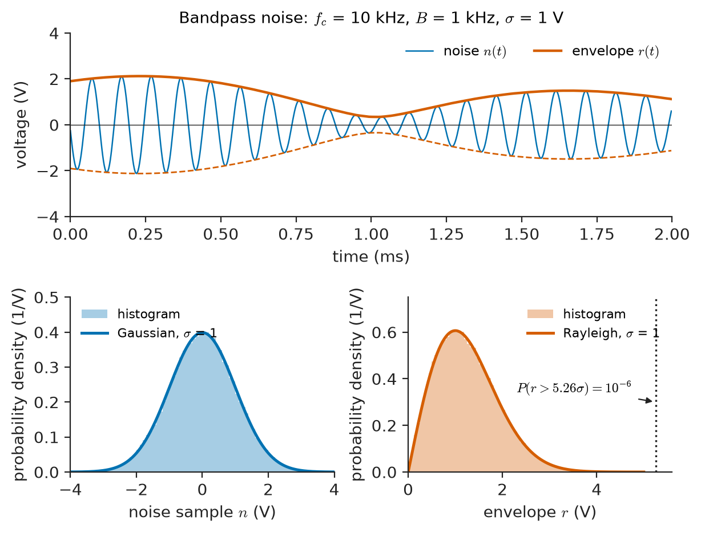
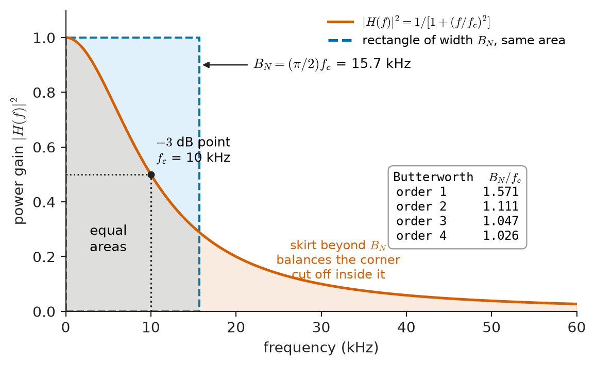
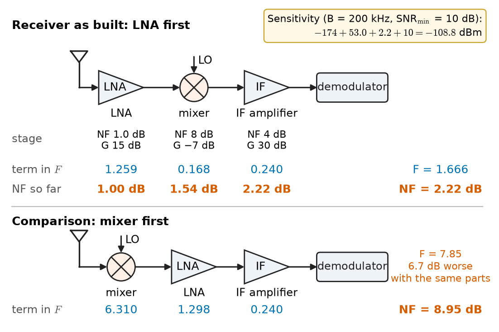
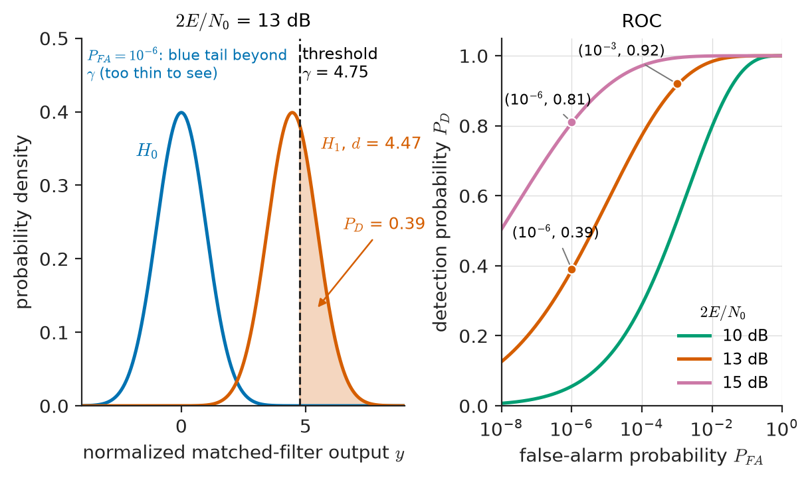
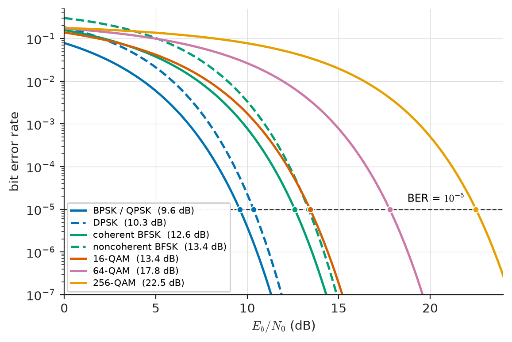

# Chapter 29 — Random Signals and Communication Noise

*Part VI · Communication Theory*

A GPS satellite 20,200 km overhead delivers about $-130$ dBm to a phone's antenna, $10^{-16}$ W. In the 2 MHz bandwidth the signal occupies, the thermal noise generated by the receiver itself is about $-109$ dBm, so the signal arrives 21 dB *below* the noise: on a spectrum analyser it is invisible. Yet the phone computes its position to a few metres within seconds. A weather radar listens for echoes from raindrops that return a femtowatt; an EEG amplifier must resolve microvolt brain rhythms against the thermal noise of the electrode resistance; a 5G handset must decide whether a received symbol was one of 256 constellation points while the noise jostles it. In each case the engineering limit is not the signal's absolute size but its size *relative to the noise*, and in each case the noise is a random signal that can only be described statistically.

Chapter 28 assumed an additive white Gaussian noise channel and computed its capacity. This chapter explains where that model comes from, how noise is characterized and measured in real receivers, and how it turns into the bit and symbol error rates that decide whether a link works.

> **What kind of random signal is receiver noise, and how much of it does a given bandwidth and amplifier chain admit?**
> **How should a receiver decide between possible signals in noise, and what error rate results?**

| Concept | Engineering destination |
|---|---|
| Random processes, autocorrelation, PSD | Spectrum analysers, interference analysis, vibration and seismic monitoring |
| Gaussian noise, Q-function | Error-rate prediction, false-alarm rates, measurement uncertainty |
| White noise, $kT$ | Receiver sensitivity, EEG/ECG front ends, ADC driver design |
| Noise bandwidth | Comparing filters, integrating detectors, specifying spectrum-analyser RBW |
| Noise figure and temperature, Friis | LNA placement, satellite ground stations, radio-telescope receivers |
| Detection in noise, matched filter, Neyman–Pearson | Radar and sonar thresholds, ECG QRS detection, digital receivers |
| BER and SER | Link specifications, modem rate adaptation, test equipment |
| Performance trade-offs | Choosing modulation, coding, bandwidth and power for a system |

**Roadmap.** Random processes in communication (29.1) → Gaussian noise (29.2) → white-noise models (29.3) → noise bandwidth (29.4) → noise figure (29.5) → detection in noise (29.6) → BER and SER (29.7) → performance trade-offs (29.8).

---

## 29.1 Random processes in communication

### Why randomness is the right model

A message is unknown to the receiver in advance; if it were known, it would carry no information (Chapter 28). Noise is the superposition of an enormous number of microscopic events, the thermal agitation of electrons, the arrival of individual photons, the discharges of distant lightning, which cannot be predicted individually. Interference from other users, fading of a radio path and the jitter of a clock are random as well. A deterministic waveform model of any of these is useless; what can be modelled and measured are their statistical regularities: average values, power, spectra, and the probability of large excursions.

A **random process** $X(t)$ is a family of random variables indexed by time. Each experiment produces one **sample function** (one recorded noise waveform); the collection of all possible sample functions is the **ensemble**. At a fixed instant $t_1$, $X(t_1)$ is an ordinary random variable with a probability density $f_X(x;t_1)$.

### Mean and autocorrelation

The two most useful descriptors are the **mean** and the **autocorrelation function**:

$$
\mu_X(t)=E[X(t)],\qquad R_X(t_1,t_2)=E[X(t_1)X(t_2)].
$$

The autocorrelation says how strongly the process at one instant resembles itself at another. For noise from a wide-band amplifier it falls to zero within nanoseconds; for slowly drifting baseline wander in an ECG it stays high for seconds.

### Stationarity and ergodicity

A process is **wide-sense stationary (WSS)** if its mean is constant and its autocorrelation depends only on the time difference $\tau=t_2-t_1$:

$$
\mu_X(t)=\mu_X,\qquad R_X(t,t+\tau)=R_X(\tau).
$$

Thermal noise in a receiver at constant temperature is stationary; the noise in a switched-mode power supply, which varies with the switching phase, is *cyclostationary* (its statistics repeat periodically); the noise floor of a radio channel over a whole day is not stationary at all. The value $R_X(0)=E[X^2]$ is the average power (in watts into $1\ \Omega$, or in $\mathrm{V^2}$), a fact used constantly.

In the laboratory there is only one sample function, recorded over a finite time. A process is **ergodic** (in the mean and autocorrelation) if time averages of a single sample function converge to the ensemble averages:

$$
\lim_{T\to\infty}\frac1{T}\int_{-T/2}^{T/2}x(t)\,dt=\mu_X,\qquad \lim_{T\to\infty}\frac1{T}\int_{-T/2}^{T/2}x(t)x(t+\tau)\,dt=R_X(\tau).
$$

Ergodicity is what justifies measuring noise with a voltmeter, an oscilloscope or a spectrum analyser. It is an assumption; it fails, for instance, for a process whose mean depends on a random but fixed initial condition, such as the DC offset of one particular amplifier drawn from a production batch.

### Power spectral density and the Wiener–Khinchin theorem

For a WSS process the **power spectral density (PSD)** $S_X(f)$ is the Fourier transform of the autocorrelation:

$$
S_X(f)=\int_{-\infty}^{\infty}R_X(\tau)\,e^{-j2\pi f\tau}\,d\tau,\qquad R_X(\tau)=\int_{-\infty}^{\infty}S_X(f)\,e^{j2\pi f\tau}\,df.
$$

This is the **Wiener–Khinchin theorem**. $S_X(f)$ has units of $\mathrm{W/Hz}$ (or $\mathrm{V^2/Hz}$), is real, even and non-negative, and its integral is the total power $R_X(0)$. It tells how the noise power is distributed over frequency, which is what a spectrum analyser displays and what a filter acts upon. A random signal has no Fourier transform in the ordinary sense (its energy is infinite), so the PSD, not the amplitude spectrum, is the correct frequency-domain description of noise.

> **Status of the principle: Wiener–Khinchin theorem**
> *Derived.* A mathematical result for wide-sense stationary processes; it gives the PSD meaning as the Fourier transform of the autocorrelation. For non-stationary signals (speech, radar returns, fading channels) it applies only over intervals short enough to be treated as stationary, which motivates the short-time spectral methods of Chapter 24.

### Random processes through LTI systems

When a WSS process with PSD $S_X(f)$ passes through a stable LTI system with frequency response $H(f)$, the output is WSS with

$$
\mu_Y=\mu_X H(0),\qquad S_Y(f)=\lvert H(f)\rvert^{2}S_X(f).
$$

Phase does not matter for the output power, only the magnitude response. This one formula underlies every noise calculation in this chapter: the noise power at a filter output is the integral of $\lvert H(f)\rvert^2$ times the input PSD. Moreover, if the input is Gaussian, so is the output, because a linear system forms weighted sums of its input and any linear combination of jointly Gaussian variables is Gaussian.

> **Boundary.** The general theory of random processes, ensembles and stochastic integrals belongs to *The Mathematics Universe*. This chapter uses the second-order (mean, autocorrelation, PSD) description, which is all that linear noise analysis requires.

---

## 29.2 Gaussian noise

### Why noise is Gaussian

The voltage across a resistor is the sum of tiny contributions from a vast number of electrons moving independently. By the **central limit theorem**, the sum of many independent small contributions tends to a Gaussian distribution, whatever the distribution of each. Thermal noise, shot noise at reasonably high current, and the aggregate of many weak interferers are all very nearly Gaussian. The Gaussian density with mean $\mu$ and variance $\sigma^2$ is

$$
f(x)=\frac{1}{\sqrt{2\pi}\,\sigma}\exp\!\left[-\frac{(x-\mu)^2}{2\sigma^2}\right].
$$

For a zero-mean noise voltage, $\sigma$ is the RMS value, and $\sigma^2$ is the average power in a $1\ \Omega$ reference.

### The Q-function

Error rates are governed by the probability that Gaussian noise exceeds a threshold. The **Q-function** is the tail probability of a standard Gaussian:

$$
Q(x)=\frac1{\sqrt{2\pi}}\int_x^{\infty}e^{-u^2/2}\,du=\tfrac12\operatorname{erfc}\!\left(\frac{x}{\sqrt2}\right).
$$

A zero-mean Gaussian of standard deviation $\sigma$ exceeds a level $a$ with probability $Q(a/\sigma)$. The tail falls extremely fast: for large $x$, $Q(x)\approx e^{-x^2/2}/(x\sqrt{2\pi})$, so each additional $\sigma$ of margin reduces the probability by roughly an order of magnitude or more.

**Table 29.1 — Values of the Gaussian tail probability.**

| $x$ | $Q(x)$ | Where this matters |
|---|---|---|
| 1.0 | 0.159 | Noise exceeds its RMS value about 16 % of the time in one direction |
| 2.0 | $2.28\times10^{-2}$ | |
| 3.0 | $1.35\times10^{-3}$ | Radar false-alarm probability $10^{-3}$ needs a threshold of $3.09\sigma$ |
| 4.0 | $3.17\times10^{-5}$ | |
| 4.27 | $1.0\times10^{-5}$ | BPSK at a BER of $10^{-5}$ |
| 4.75 | $1.0\times10^{-6}$ | Threshold for $P_{FA}=10^{-6}$ |
| 6.0 | $9.9\times10^{-10}$ | |
| 7.0 | $1.3\times10^{-12}$ | Serial links specified at BER $10^{-12}$ |

The table explains the "crest factor" engineers use for Gaussian noise: although the peak of Gaussian noise is unbounded, a peak-to-RMS ratio of 4 to 5 is exceeded only a tiny fraction of the time, so an ADC or amplifier sized for about 4.5 times the RMS noise rarely clips on noise alone.

### Narrowband noise and the Rayleigh envelope

After a bandpass filter of bandwidth $B$ centred at $f_c\gg B$, Gaussian noise looks like a sinusoid at $f_c$ whose amplitude and phase wander slowly, at a rate set by $B$. It can be written in **in-phase and quadrature** form:

$$
n(t)=n_I(t)\cos 2\pi f_ct-n_Q(t)\sin 2\pi f_ct=r(t)\cos\!\left[2\pi f_ct+\phi(t)\right].
$$

The baseband components $n_I$ and $n_Q$ are independent, zero-mean Gaussian processes, each with the same variance $\sigma^2$ as $n(t)$ itself. The **envelope** $r=\sqrt{n_I^2+n_Q^2}$ then has the **Rayleigh** density and the phase $\phi$ is uniform on $[0,2\pi)$:

$$
f_R(r)=\frac{r}{\sigma^2}\exp\!\left(-\frac{r^2}{2\sigma^2}\right),\qquad r\ge0.
$$

If a sinusoid of amplitude $A$ is present as well, the envelope follows the **Rician** density, which approaches a Gaussian centred at $A$ when $A\gg\sigma$. These two distributions govern every envelope (non-coherent) detector: AM receivers, radar detectors, the noncoherent FSK demodulators of Section 29.7, and, as Chapter 30 shows, the fading of radio signals, which is mathematically the same phenomenon. Figure 29.1 shows a Gaussian noise record, its histogram and the envelope distribution.

<!-- FIGURE 29.1 | figures/ch29/fig-29-1-gaussian-noise-and-envelope.png | plot | Gaussian noise and its Rayleigh envelope. | Content: three panels. Top: 2 ms of simulated bandpass Gaussian noise centred at 10 kHz with 1 kHz bandwidth, RMS sigma = 1 V, with its envelope r(t) overlaid in a contrasting colour; y axis "voltage (V)" from -4 to 4, x axis "time (ms)" from 0 to 2. Bottom left: histogram of 100000 noise samples with the Gaussian pdf (sigma = 1) overlaid, x from -4 to 4. Bottom right: histogram of the envelope with the Rayleigh pdf (sigma = 1) overlaid, x from 0 to 5, with vertical line at r = 5.26 labelled "P(r > 5.26 sigma) = 1e-6". -->

*Figure 29.1 — Gaussian noise and its Rayleigh envelope.*

> **Status of the principle: Gaussian model of receiver noise**
> *Approximate.* It follows from the central limit theorem applied to many independent microscopic contributions, and fits thermal and shot noise closely. It fails for impulsive noise (ignition, switching transients, power-line communication channels, lightning), for a few strong interferers, and for quantization error in a coarse ADC, whose tails are lighter or heavier than Gaussian.

---

## 29.3 White-noise models

### Thermal noise

In 1928 Johnson measured, and Nyquist explained, the random voltage across any resistor in thermal equilibrium. A resistor $R$ at absolute temperature $T$ behaves as a noiseless resistor in series with a noise voltage source whose mean-square value in a bandwidth $B$ is

$$
\overline{v_n^2}=4kTRB,
$$

or, equivalently, a noiseless resistor in parallel with a noise current source of mean-square value $4kTB/R$, where $k=1.381\times10^{-23}\ \mathrm{J/K}$ is Boltzmann's constant. The **available noise power**, delivered to a matched load, is independent of $R$:

$$
P_n=kTB.
$$

At the standard reference temperature $T_0=290$ K, $kT_0=4.00\times10^{-21}\ \mathrm{W/Hz}$, which is the most important number in receiver design:

$$
kT_0=-174\ \mathrm{dBm/Hz}.
$$

**Table 29.2 — Thermal noise in practical bandwidths ($T_0=290$ K).**

| Bandwidth | Example | Noise power $kT_0B$ |
|---|---|---|
| 1 Hz | Reference | $-174$ dBm |
| 1 kHz | Narrowband telemetry | $-144$ dBm |
| 25 kHz | Land-mobile FM voice channel | $-130$ dBm |
| 200 kHz | GSM carrier | $-121$ dBm |
| 1 MHz | — | $-114$ dBm |
| 20 MHz | Wi-Fi or LTE carrier | $-101$ dBm |
| 100 MHz | 5G NR carrier (FR1) | $-94$ dBm |

Noise voltages for representative sources:

| Source | Conditions | RMS noise voltage $\sqrt{4kTRB}$ |
|---|---|---|
| 1 kΩ resistor | 290 K, 20 kHz audio band | 0.57 μV |
| 50 Ω source | 290 K, 1 MHz | 0.89 μV |
| 10 kΩ electrode–skin impedance | 310 K, 1 kHz EEG/ECG band | 0.41 μV |

The last row is the floor that a biopotential amplifier cannot beat by any electronic design: EEG rhythms of 10–100 μV are well above it, but evoked potentials of 1 μV or less must be extracted by averaging hundreds of stimulus-locked responses, which reduces uncorrelated noise by the square root of the number of averages.

### White noise as a model

A process with a flat PSD is called **white**, by analogy with white light. The standard model of receiver noise is **additive white Gaussian noise (AWGN)** with two-sided PSD

$$
S_n(f)=\frac{N_0}{2},\qquad -\infty<f<\infty,
$$

so that the one-sided density is $N_0$ (W/Hz) and the noise power in a bandwidth $B$ is $N_0B$. The autocorrelation is an impulse,

$$
R_n(\tau)=\frac{N_0}{2}\,\delta(\tau),
$$

which means samples at any two distinct instants are uncorrelated. For thermal noise referred to a matched input, $N_0=kT$.

White noise is an idealization: its total power $\int S_n\,df$ is infinite. Real thermal noise is flat only up to frequencies where $hf$ approaches $kT$, about 6 THz at 290 K, where the quantum correction cuts it off. For every electronic system that is effectively infinite bandwidth, which is why the model is used without apology. What matters is that the noise is flat over the band of the system that receives it; outside that band, the receiver's own filters determine what gets through, so the shape of the noise there is irrelevant.

### White noise through a filter: $kT/C$

Passing white noise through a filter produces **coloured** noise with PSD $\lvert H(f)\rvert^2N_0/2$. A classic result follows for a resistor $R$ in parallel with a capacitor $C$: the noise voltage across the capacitor has mean-square value

$$
\overline{v_C^2}=\frac{kT}{C},
$$

independent of $R$. A larger resistor produces more noise density but a narrower bandwidth, and the two effects cancel exactly. At 300 K, a 1 pF sampling capacitor carries 64 μV RMS of noise and a 10 pF capacitor 20 μV. This "$kT/C$ noise" sets the minimum capacitor size in the sample-and-hold of a high-resolution ADC and in CMOS image-sensor pixels, independent of how clever the switch design is.

### Other noise mechanisms

- **Shot noise.** Current made of discrete charges crossing a barrier (a pn junction, a photodiode, a vacuum tube) fluctuates with mean-square value $\overline{i_n^2}=2qI_{DC}B$. It is white up to very high frequencies and Gaussian at practical currents. A 1 mA diode current in 1 MHz carries 17.9 nA RMS of shot noise; a photodiode current of 10 μA in 1 GHz carries 57 nA. Shot noise sets the quantum limit of optical receivers (Chapter 31).
- **Flicker ($1/f$) noise.** A PSD rising as $1/f^{\alpha}$ (with $\alpha\approx1$) at low frequencies, found in all active devices and in carbon resistors. Below the **corner frequency**, from a few hertz for precision bipolar op-amps to tens of kilohertz or more for small MOSFETs, it dominates white noise. It limits DC-coupled instrumentation such as strain-gauge bridges and thermocouple amplifiers, and is the reason chopper-stabilized amplifiers exist.
- **Quantization noise.** The error of an ideal $N$-bit ADC with a full-scale sine input behaves, under suitable conditions, like white noise with an SNR of $6.02N+1.76$ dB (74 dB for 12 bits); see Chapter 21.
- **External noise.** Atmospheric noise (dominant below about 30 MHz), man-made noise from vehicles and switching equipment (strong in urban areas up to several hundred megahertz), galactic noise and the sky temperature seen by an antenna (Section 29.5).

> **Status of the principle: Johnson–Nyquist thermal noise, $\overline{v_n^2}=4kTRB$**
> *Fundamental.* Follows from thermodynamic equilibrium (the fluctuation–dissipation theorem) and holds for any dissipative element at temperature $T$. It is white only for $hf\ll kT$, and it applies to the resistive part of an impedance; ideal reactances generate no noise.

---

## 29.4 Noise bandwidth

### Definition

Filters do not have rectangular responses, so "the noise in bandwidth $B$" needs a precise meaning. The **equivalent noise bandwidth** $B_N$ of a filter is the width of a rectangular filter, with the same peak power gain $\lvert H_{\max}\rvert^2$, that passes the same white-noise power:

$$
B_N=\frac{1}{\lvert H_{\max}\rvert^{2}}\int_0^{\infty}\lvert H(f)\rvert^{2}\,df.
$$

The output noise power from white noise of one-sided density $N_0$ is then exactly $N_0\lvert H_{\max}\rvert^2B_N$. The noise bandwidth is always larger than the $-3$ dB bandwidth, because real skirts pass extra noise.

### First-order RC filter

For $H(f)=1/(1+jf/f_c)$, with $f_c=1/(2\pi RC)$,

$$
B_N=\int_0^{\infty}\frac{df}{1+(f/f_c)^2}=\frac{\pi}{2}f_c=\frac{1}{4RC}.
$$

The noise bandwidth is 57 % wider than the 3 dB bandwidth (Figure 29.2). Steeper filters approach their 3 dB bandwidth: the ratio $B_N/f_c$ is 1.571 for first-order, 1.111 for second-order, 1.047 for third-order, 1.026 for fourth-order and 1.006 for eighth-order Butterworth low-pass filters. For a bandpass response, the same ratios apply to the half-bandwidth on each side of centre.

<!-- FIGURE 29.2 | figures/ch29/fig-29-2-noise-bandwidth.png | plot | Equivalent noise bandwidth of a first-order RC low-pass filter. | Content: x axis frequency from 0 to 60 kHz (linear), y axis power gain (squared magnitude of H) from 0 to 1.1. Curve 1/(1+(f/10 kHz)^2) for f_c = 10 kHz. Dashed rectangle of height 1 extending from 0 to B_N = 15.7 kHz, shaded lightly. Vertical dotted line at the -3 dB point 10 kHz (gain 0.5). Annotations: "equal areas", "f_c = 10 kHz", "B_N = (pi/2) f_c = 15.7 kHz". Inset table or small labels: B_N/f_c = 1.571, 1.111, 1.047, 1.026 for Butterworth orders 1 to 4. -->

*Figure 29.2 — Equivalent noise bandwidth of a first-order RC low-pass filter.*

### Integrators and averaging

A detector that averages its input over a time $T$ (a moving-average or integrate-and-dump filter) has $\lvert H(f)\rvert=\lvert\operatorname{sinc}(fT)\rvert$ and a noise bandwidth $B_N=1/(2T)$. Averaging for 1 s therefore gives a noise bandwidth of 0.5 Hz: the basis of lock-in amplifiers that recover nanovolt signals buried in noise, and of the long coherent integrations in GPS and radio astronomy. Halving the noise bandwidth halves the noise power, gaining 3 dB, at the cost of doubling the measurement time.

In communication receivers, the noise bandwidth of the receive filter is what turns a noise density $N_0$ into a noise power $N$. For a matched filter with a root-raised-cosine response at symbol rate $R_s$, $B_N=R_s$ exactly, independent of the roll-off factor: this is why $E_s/N_0$ and the SNR in the "symbol-rate bandwidth" are numerically equal.

**Worked example — Noise of an instrumentation front end.** A vibration-monitoring accelerometer on a gas turbine has a 1 kΩ source resistance and feeds an amplifier followed by a first-order anti-aliasing filter with $f_c=10$ kHz. The amplifier's own input voltage noise is $4\ \mathrm{nV/\sqrt{Hz}}$ (flat above its 1/f corner). The noise bandwidth is

$$
B_N=\frac{\pi}{2}\times10\ \mathrm{kHz}=15.7\ \mathrm{kHz}.
$$

Thermal noise of the source: $\sqrt{4kTR}=\sqrt{4(1.381\times10^{-23})(290)(1000)}=4.00\ \mathrm{nV/\sqrt{Hz}}$, the same density as the amplifier. Uncorrelated noises add in power, so the total input-referred density is $\sqrt{4.00^2+4^2}=5.66\ \mathrm{nV/\sqrt{Hz}}$ and the RMS input noise is

$$
v_n=5.66\ \mathrm{nV/\sqrt{Hz}}\times\sqrt{15\,700\ \mathrm{Hz}}=0.71\ \mu\mathrm{V}.
$$

Using the 3 dB bandwidth instead of $B_N$ would have underestimated this as 0.57 μV. With a 100 mV/g sensor, the noise floor corresponds to about 7 μg RMS, comfortably below the vibration levels of interest; if it were not, the remedy would be a narrower filter, not a quieter amplifier, since the amplifier contributes only half the noise power.

---

## 29.5 Noise figure

### Noise factor and noise figure

Every amplifier, mixer and cable adds noise to what it receives. The **noise factor** $F$ measures how much a two-port degrades the signal-to-noise ratio when its input is driven from a source at the reference temperature $T_0=290$ K:

$$
F=\frac{(S/N)_{\text{in}}}{(S/N)_{\text{out}}}\ \Bigg\rvert_{T_{\text{source}}=290\ \mathrm{K}},\qquad \mathrm{NF}=10\log_{10}F\ \ \mathrm{dB}.
$$

A noiseless device has $F=1$ (NF $=0$ dB). Equivalently, if the device has available gain $G$ and adds noise power $N_a$ at its output, $F=1+N_a/(GkT_0B)$.

A passive lossy element at temperature $T_0$, such as a cable or filter with loss $L$ (power ratio, $L>1$), has $F=L$: a 2 dB cable loss before an amplifier is a 2 dB noise figure.

### Noise temperature

For low-noise systems the noise factor is an awkward scale (0.5 dB and 0.6 dB look nearly equal but differ by 8 K). The **effective input noise temperature** $T_e$ is the temperature of a source resistor that would generate the device's added noise:

$$
T_e=(F-1)T_0,\qquad F=1+\frac{T_e}{T_0}.
$$

**Table 29.3 — Typical noise figures and temperatures.**

| Device | NF (dB) | $T_e$ (K) |
|---|---|---|
| Cryogenic HEMT LNA (radio astronomy, deep space) | 0.05–0.1 | 3–7 |
| Satellite-TV LNB at 11–12 GHz | 0.5–0.8 | 35–58 |
| GaAs/GaN pHEMT LNA, 1–6 GHz | 0.5–1.2 | 35–92 |
| Smartphone receiver front end (after switches and filters) | 3–6 | 290–865 |
| Wi-Fi access point receiver | 4–7 | 440–1160 |
| Passive diode mixer | 6–9 (≈ conversion loss) | 865–2010 |
| Spectrum analyser without preamplifier | 20–30 | $2.9\times10^4$–$2.9\times10^5$ |

### Cascades: the Friis formula

For stages in cascade, with noise factors $F_1,F_2,\dots$ and available power gains $G_1,G_2,\dots$ (as ratios), the overall noise factor is

$$
F=F_1+\frac{F_2-1}{G_1}+\frac{F_3-1}{G_1G_2}+\cdots,\qquad
T_e=T_{e1}+\frac{T_{e2}}{G_1}+\frac{T_{e3}}{G_1G_2}+\cdots.
$$

The noise of each stage is divided by the total gain ahead of it. The first stage therefore dominates, provided its gain is reasonable, which is the whole design principle of receivers: put a **low-noise amplifier (LNA)** with enough gain as close to the antenna as possible, and avoid loss in front of it.

> **Status of the principle: Friis noise cascade formula**
> *Derived.* Follows from adding independent noise powers referred to the input of a chain of linear stages, each specified by available gain and noise factor. It assumes linear operation, uncorrelated stage noise, and gains defined for the actual source and load impedances; mismatch between stages changes both $G$ and $F$.

**Worked example — Receiver noise figure and sensitivity.** A GSM-band base-station receiver consists of an LNA (NF 1.0 dB, gain 15 dB), a passive mixer (NF 8 dB, gain $-7$ dB) and an IF amplifier (NF 4 dB, gain 30 dB), as in Figure 29.3. As ratios: $F_1=1.259$, $G_1=31.62$; $F_2=6.310$, $G_2=0.1995$; $F_3=2.512$. Then

$$
F=1.259+\frac{6.310-1}{31.62}+\frac{2.512-1}{31.62\times0.1995}=1.259+0.168+0.240=1.666,
$$

so NF $=2.22$ dB. Placing the mixer first instead gives $F=7.85$, NF $=8.95$ dB: 6.7 dB worse for the same components. Inserting a 2 dB lossy cable between the antenna and the LNA (as when the LNA is at the bottom of the mast instead of the top) adds exactly 2 dB, giving 4.22 dB; this is why tower-mounted amplifiers exist.

The **sensitivity** is the input level that produces the minimum SNR the demodulator needs. In dBm,

$$
P_{\text{sens}}=-174+10\log_{10}B+\mathrm{NF}+\mathrm{SNR}_{\min}.
$$

For a 200 kHz GSM carrier, NF $=2.22$ dB and a required SNR of 10 dB: $P_{\text{sens}}=-174+53.0+2.2+10=-108.8$ dBm. Each decibel of noise figure saved is a decibel of sensitivity gained, worth about 12 % of range in free space and more in terms of cell coverage area.

<!-- FIGURE 29.3 | figures/ch29/fig-29-3-receiver-cascade.png | block-diagram | Noise-figure budget of a three-stage receiver. | Content: block chain antenna -> LNA (NF 1.0 dB, G 15 dB) -> mixer with LO input (NF 8 dB, G -7 dB) -> IF amplifier (NF 4 dB, G 30 dB) -> demodulator. Under each block print its contribution to the total noise factor: 1.259, 0.168, 0.240; cumulative NF after each stage: 1.00 dB, 1.54 dB, 2.22 dB. Below, a second chain for comparison with mixer first: total NF 8.95 dB. Side note: sensitivity -108.8 dBm for B = 200 kHz, SNR_min = 10 dB. -->

*Figure 29.3 — Noise-figure budget of a three-stage receiver.*

### System noise temperature and G/T

At microwave frequencies an antenna pointed at the cold sky picks up little noise: its **antenna temperature** $T_A$ may be 20–60 K for a satellite ground antenna at high elevation, rising toward 290 K when it looks at the ground or into rain. The **system noise temperature** is $T_{\text{sys}}=T_A+T_e$, and the noise density is $N_0=kT_{\text{sys}}$. A satellite ground station is rated by its **figure of merit** $G/T$, the antenna gain divided by the system temperature.

For example, a 60 cm satellite-TV dish (gain about 36 dBi at 12 GHz) with $T_A=50$ K and an LNB of NF 0.7 dB ($T_e=50.7$ K) has $T_{\text{sys}}=100.7$ K and $G/T=36-10\log_{10}100.7=16.0$ dB/K. If the LNB were replaced by one with NF 2 dB ($T_e=170$ K), $T_{\text{sys}}$ would rise to 220 K and $G/T$ would fall by 3.4 dB, roughly halving the margin against rain fade. For cold-sky receivers the noise temperature, not the noise figure, is the natural language.

> **Status of the principle: Noise factor referred to $T_0=290$ K**
> *Approximate.* The noise factor is defined with a 290 K source; so it predicts the SNR degradation exactly only when the actual source is at 290 K. For a cold antenna the degradation is larger than NF suggests (an amplifier with $T_e=50$ K doubles the noise of a 50 K sky, a 3 dB loss, although its NF is only 0.7 dB); use $T_{\text{sys}}=T_A+T_e$ instead.

---

## 29.6 Detection in noise

### The decision problem

A receiver observes a noisy signal and must decide which of several hypotheses is true: was a 0 or a 1 sent; is there a target in this range cell or only noise; is this deflection in an ECG a QRS complex or a muscle artefact? In the simplest case there are two hypotheses, and after the receiver's front-end processing (Chapter 27's matched filter) the evidence is reduced to one number $y$:

$$
H_0:\ y=n,\qquad H_1:\ y=s+n,
$$

with $n$ Gaussian of variance $\sigma^2$. The two conditional densities $f(y\mid H_0)$ and $f(y\mid H_1)$ are Gaussian curves centred at 0 and $s$ (Figure 29.4). Any decision rule amounts to choosing a threshold $\gamma$: decide $H_1$ if $y>\gamma$.

### Likelihood-ratio tests

All optimal detectors compare the **likelihood ratio** with a threshold:

$$
\Lambda(y)=\frac{f(y\mid H_1)}{f(y\mid H_0)}\ \underset{H_0}{\overset{H_1}{\gtrless}}\ \eta.
$$

Different design criteria differ only in the choice of $\eta$:

- **Maximum a posteriori (MAP)**, which minimizes the probability of error, uses $\eta=P(H_0)/P(H_1)$.
- **Maximum likelihood (ML)** uses $\eta=1$; it equals MAP for equiprobable hypotheses, the normal case for data bits after scrambling or source coding.
- **Bayes** detection with unequal costs of the two errors scales $\eta$ by the cost ratio.
- **Neyman–Pearson** detection, used when prior probabilities are meaningless (a radar does not know how likely a target is), maximizes the detection probability subject to a fixed false-alarm probability.

For Gaussian noise the log-likelihood ratio is linear in $y$, so every one of these rules is a threshold on the matched-filter output; only the threshold changes.

> **Status of the principle: Likelihood-ratio detection (Neyman–Pearson lemma)**
> *Derived.* The likelihood-ratio test is optimal for each of these criteria, a theorem of statistical decision theory. Its practical performance depends on knowing the noise statistics; if the noise level drifts, a fixed threshold no longer gives the designed false-alarm rate, which is why radars use constant-false-alarm-rate (CFAR) processors that estimate the noise from neighbouring cells.

### The matched filter as the optimum front end

For a known pulse $s(t)$ of energy $E$ in white noise of density $N_0/2$, the matched filter (impulse response $s(T-t)$) maximizes the output SNR at the sampling instant, giving

$$
\left(\frac SN\right)_{\max}=\frac{2E}{N_0},
$$

independent of pulse shape (Chapter 27). For coherent detection of a known signal, the normalized separation between the two hypotheses, the **deflection**, is therefore $d=\sqrt{2E/N_0}$. Everything in the rest of this chapter depends on the signal only through its energy, which is why pulse shape can be chosen for spectral reasons without any penalty in noise performance.

### False alarm and detection probabilities

With the matched-filter output normalized so that the noise has unit variance, a threshold $\gamma$ gives

$$
P_{FA}=Q(\gamma),\qquad P_D=Q(\gamma-d).
$$

Raising the threshold reduces false alarms and detections together; the trade-off is shown by the **receiver operating characteristic (ROC)**, a plot of $P_D$ against $P_{FA}$ for fixed $d$. Only more signal energy, less noise or longer integration moves the ROC curve towards the ideal corner.

For noncoherent detection, where the carrier phase is unknown (most radars, on–off keyed links), the detector forms the envelope. Under $H_0$ the envelope is Rayleigh, so $P_{FA}=\exp(-\gamma^2/2\sigma^2)$, and for $P_{FA}=10^{-6}$ the threshold is $\gamma=\sqrt{2\ln10^6}\,\sigma=5.26\sigma$. Noncoherent detection costs typically 0.5–1 dB of SNR relative to coherent detection at radar operating points.

**Worked example — Radar detection threshold.** A surveillance radar must keep false alarms rare: with about $10^6$ range–azimuth cells examined per second, $P_{FA}=10^{-6}$ gives about one false alarm per second, which a tracker can tolerate. For coherent detection, the threshold is $\gamma=Q^{-1}(10^{-6})=4.75$ (in units of the noise RMS). Then:

- With $2E/N_0=13$ dB, $d=\sqrt{19.95}=4.47$, so $P_D=Q(4.75-4.47)=Q(0.29)=0.39$.
- With $2E/N_0=15$ dB, $d=5.62$, so $P_D=Q(-0.87)=0.81$.
- To reach $P_D=0.9$, $d=4.75+1.28=6.03$, so $2E/N_0=36.4$, or 15.6 dB, that is, $E/N_0=12.6$ dB.

If the operator relaxed the false-alarm requirement to $10^{-3}$, the threshold would fall to 3.09 and the 13 dB echo would be detected with $P_D=Q(3.09-4.47)=0.92$. The example shows how steep the trade is: 2 dB of extra SNR doubles the detection probability at a fixed false-alarm rate. It also shows why radar designers integrate many pulses: coherently integrating $n$ pulses multiplies $E$ by $n$.

<!-- FIGURE 29.4 | figures/ch29/fig-29-4-detection-threshold-roc.png | plot | Binary detection in Gaussian noise: threshold, false alarm and detection probabilities, and the ROC. | Content: left panel: two unit-variance Gaussian pdfs, H0 centred at 0 and H1 centred at d = 4.47 (2E/N0 = 13 dB), x axis "normalized matched-filter output" from -4 to 9. Vertical threshold line at 4.75; shade the H0 tail beyond the threshold (P_FA = 1e-6, label it) and the H1 area beyond it (P_D = 0.39). Right panel: ROC curves P_D versus P_FA (P_FA on log scale 1e-8 to 1) for 2E/N0 = 10, 13 and 15 dB; mark points (1e-6, 0.39) and (1e-3, 0.92) on the 13 dB curve and (1e-6, 0.81) on the 15 dB curve. -->

*Figure 29.4 — Binary detection in Gaussian noise: threshold, false alarm and detection probabilities, and the ROC.*

### Detection beyond communications

The same structure appears throughout signal processing. An ECG QRS detector band-pass filters the signal to the 5–15 Hz range where QRS energy concentrates (an approximate matched filter), then thresholds it, with an adaptive threshold that tracks the noise level, a CFAR idea in medical guise. A GPS receiver correlates the received signal against a local replica of each satellite's code: the despreading gain of the 1023-chip code is $10\log_{10}1023=30$ dB. At a carrier-to-noise density of $C/N_0=-130-(-174+2)=42$ dB-Hz (receiver NF 2 dB), integrating for 1 ms gives an SNR of $C/N_0-10\log_{10}1000=42-30=12$ dB in the 1 kHz post-correlation bandwidth (the despreading gain is what collapses the 1 MHz spread signal into that 1 kHz bandwidth), enough to detect the satellite; longer integration in weak-signal receivers adds roughly 3 dB per doubling. This is how the signal 21 dB below the noise at the antenna becomes detectable.

---

## 29.7 BER and SER

### Definitions

The **bit error rate (BER)**, or bit error probability $P_b$, is the probability that a delivered bit differs from the transmitted bit. The **symbol error rate (SER)** $P_s$ is the probability that a received $M$-ary symbol is decided wrongly. They are related through the mapping of bits to symbols. With **Gray coding**, adjacent constellation points differ in one bit, and since at reasonable SNR almost all symbol errors are to a nearest neighbour,

$$
P_b\approx\frac{P_s}{\log_2M}.
$$

Performance is compared at equal **energy per bit** $E_b$ relative to $N_0$, so that schemes carrying different numbers of bits per symbol are compared fairly: $E_s=E_b\log_2M$. In terms of measured SNR in the noise bandwidth $B_N$, $\mathrm{SNR}=(E_b/N_0)(R_b/B_N)$.

### Binary schemes

For coherent binary signalling with equiprobable symbols and ML detection, the error probability depends only on the Euclidean distance $d_{12}$ between the two signal points: $P_b=Q\!\left(\sqrt{d_{12}^2/2N_0}\right)$. This gives the standard results:

$$
P_{b,\text{BPSK}}=Q\!\left(\sqrt{\frac{2E_b}{N_0}}\right),\qquad
P_{b,\text{coh.\ BFSK}}=Q\!\left(\sqrt{\frac{E_b}{N_0}}\right).
$$

Antipodal BPSK has $d_{12}^2=4E_b$; orthogonal FSK has $d_{12}^2=2E_b$, a 3 dB penalty. On–off keying with the same *average* energy also performs like orthogonal signalling. Noncoherent schemes, which need no carrier-phase reference, give exponential rather than Q-function forms:

$$
P_{b,\text{DPSK}}=\tfrac12e^{-E_b/N_0},\qquad P_{b,\text{nc.\ BFSK}}=\tfrac12e^{-E_b/2N_0}.
$$

### M-ary schemes

**QPSK** is two independent BPSK channels in quadrature, so its *bit* error rate equals BPSK's at the same $E_b/N_0$ while using half the bandwidth; its symbol error rate is $P_s=1-(1-P_b)^2\approx2P_b$.

For **M-PSK** with $M\ge4$, the nearest-neighbour approximation gives

$$
P_s\approx2Q\!\left(\sqrt{\frac{2E_s}{N_0}}\sin\frac{\pi}{M}\right).
$$

For square **M-QAM** with $\sqrt M$ levels on each axis,

$$
P_s=1-\left[1-2\left(1-\frac1{\sqrt M}\right)Q\!\left(\sqrt{\frac{3E_s}{(M-1)N_0}}\right)\right]^2.
$$

Every additional bit per symbol beyond QPSK costs roughly 2–3 dB more $E_b/N_0$ for square QAM and 3.5–5 dB for PSK, because the points are packed closer together for the same average energy.

**Table 29.4 — Required $E_b/N_0$ (dB) for given bit error rates in AWGN (uncoded, Gray-coded).**

| Scheme | b/s/Hz (Nyquist) | $P_b=10^{-3}$ | $P_b=10^{-5}$ | $P_b=10^{-6}$ |
|---|---|---|---|---|
| BPSK | 1 | 6.8 | 9.6 | 10.5 |
| QPSK | 2 | 6.8 | 9.6 | 10.5 |
| DPSK (binary) | 1 | 7.9 | 10.3 | 11.2 |
| Coherent BFSK | 0.5–1 | 9.8 | 12.6 | 13.5 |
| Noncoherent BFSK | 0.5 | 10.9 | 13.4 | 14.2 |
| 8-PSK | 3 | 10.0 | 13.0 | 14.0 |
| 16-QAM | 4 | 10.5 | 13.4 | 14.4 |
| 64-QAM | 6 | 14.8 | 17.8 | 18.8 |
| 256-QAM | 8 | 19.4 | 22.5 | 23.5 |

Figure 29.5 plots the corresponding curves. Their characteristic "waterfall" shape is the Q-function: at high SNR, each decibel buys about an order of magnitude in BER.

<!-- FIGURE 29.5 | figures/ch29/fig-29-5-ber-curves.png | plot | Bit error rate versus Eb/N0 for common modulations in AWGN. | Content: y axis BER log scale 1e-7 to 0.5, x axis Eb/N0 from 0 to 24 dB. Curves: BPSK/QPSK Q(sqrt(2Eb/N0)); DPSK 0.5 exp(-Eb/N0); coherent BFSK Q(sqrt(Eb/N0)); noncoherent BFSK 0.5 exp(-Eb/2N0); 16-QAM (3/4) Q(sqrt(0.8 Eb/N0)); 64-QAM (7/12) Q(sqrt((2/7) Eb/N0)); 256-QAM (15/32) Q(sqrt((8/85) Eb/N0)). Horizontal dashed line at 1e-5 with markers at 9.6, 10.3, 12.6, 13.4, 13.4, 17.8, 22.5 dB. Legend at lower left. -->

*Figure 29.5 — Bit error rate versus Eb/N0 for common modulations in AWGN.*

> **Status of the principle: Error-rate formulas for AWGN**
> *Derived.* Exact or tightly approximate consequences of Gaussian noise statistics and ML detection with perfect synchronization. Real receivers lose typically 0.5–2 dB to imperfect carrier and timing recovery, phase noise, amplifier non-linearity and finite ADC resolution, which are quoted as "implementation loss" in link budgets.

**Worked example — 16-QAM on a microwave backhaul link.** A point-to-point microwave link uses 16-QAM at 50 Mbaud, giving 200 Mb/s before coding. The demodulator measures $E_s/N_0=18$ dB, so $E_s/N_0=63.1$ and

$$
\sqrt{\frac{3E_s}{15N_0}}=\sqrt{12.62}=3.55,\qquad Q(3.55)=1.92\times10^{-4},
$$

$$
P_s=1-\left[1-2(0.75)(1.92\times10^{-4})\right]^2=5.73\times10^{-4},\qquad P_b\approx\frac{P_s}{4}=1.43\times10^{-4}.
$$

The corresponding $E_b/N_0$ is $18-10\log_{10}4=12.0$ dB. At 200 Mb/s that is about 29,000 bit errors per second before error correction, but well within the correcting power of the link's LDPC code, which for a rate-0.9 code tolerates a raw BER of a few times $10^{-3}$. If rain fade reduced $E_s/N_0$ by 2 dB to 16 dB, the raw BER would rise to $1.8\times10^{-3}$, still correctable; at around 14 dB the code fails, and adaptive modulation would step down to QPSK. This is why modern links quote throughput as a function of SNR rather than a single BER.

### The union bound and error floors

For constellations without a closed-form result, the **union bound** sums pairwise error probabilities:

$$
P_s\le\frac1M\sum_{i}\sum_{j\ne i}Q\!\left(\frac{d_{ij}}{\sqrt{2N_0}}\right),
$$

which at high SNR is dominated by the nearest neighbours, giving the familiar form $P_s\approx N_{\min}Q\!\left(d_{\min}/\sqrt{2N_0}\right)$, where $N_{\min}$ is the average number of nearest neighbours. When a non-random impairment such as phase noise or intersymbol interference is present, the BER curve flattens into an **error floor** that no increase of transmit power removes; the cure is to remove the impairment, not to add power.

---

## 29.8 Performance trade-offs

### The design variables

A communication link is specified by a handful of quantities that cannot all be optimized together:

- **Power** (or $E_b/N_0$): limited by battery life, regulations, amplifier cost, interference to others and, in satellites, solar-panel area.
- **Bandwidth**: licensed spectrum is expensive and finite; for a given data rate, the spectral efficiency $\eta=R_b/B$ is the measure.
- **Error rate**: the reliability the application needs, from $10^{-3}$ for voice to $10^{-12}$ or better for computer interconnects.
- **Complexity and power consumption of the receiver**: coherent detection, equalizers and iterative decoders consume energy and silicon.
- **Latency**: interleavers, long codes and retransmissions add delay that voice, control loops and protection signalling cannot tolerate.

### Power-limited and bandwidth-limited regimes

The Shannon bound $E_b/N_0\ge(2^{\eta}-1)/\eta$ (Chapter 28) divides systems into two families. **Power-limited** systems (deep space, GNSS, low-power IoT, sensor networks) have bandwidth to spare and use low-order modulation, low code rates, spread spectrum or orthogonal signalling: M-ary FSK even improves with increasing $M$ in $E_b/N_0$ terms, at the cost of bandwidth. **Bandwidth-limited** systems (cellular, cable modems, microwave backhaul, Wi-Fi near the access point) have SNR to spare and use dense constellations with high-rate codes.

**Table 29.5 — Typical operating points of real systems.**

| System | Modulation and coding | Spectral efficiency (b/s/Hz) | Operating SNR or $E_b/N_0$ | Regime |
|---|---|---|---|---|
| Deep-space telemetry | BPSK, turbo or LDPC, $R\approx1/6$–$1/2$ | 0.1–0.5 | $E_b/N_0\approx0.5$–2 dB | Power-limited |
| GPS L1 C/A | BPSK, DSSS 1.023 Mchip/s, 50 b/s | $2.5\times10^{-5}$ | $C/N_0\approx35$–50 dB-Hz | Extremely power-limited |
| LoRa (IoT) | Chirp spread spectrum | 0.01–0.3 | SNR down to $-20$ dB | Power-limited |
| DVB-S2 satellite TV | QPSK to 32APSK, LDPC | 1–4.5 | SNR about 1–16 dB | Intermediate |
| LTE / 5G at cell edge | QPSK, low-rate LDPC/turbo | 0.1–1 | SINR $-5$ to 5 dB | Interference-limited |
| LTE / 5G at cell centre | 64- to 256-QAM, high-rate code | 4–7.5 per layer | SINR 20–30 dB | Bandwidth-limited |
| Microwave backhaul | Up to 4096-QAM, LDPC | 8–11 | SNR 25–40 dB | Bandwidth-limited |
| DOCSIS 3.1 cable | Up to 4096-QAM OFDM, LDPC | 8–10 | SNR 35–41 dB | Bandwidth-limited |

### Trading power for bandwidth and complexity

Three instructive comparisons follow from the formulas of Section 29.7 and Chapter 28.

1. **QPSK versus BPSK.** Same $E_b/N_0$ for the same BER, half the bandwidth: a free lunch made possible by using both quadrature dimensions. It is why BPSK survives only where simplicity or robustness to phase error matters.
2. **16-QAM versus QPSK.** Twice the spectral efficiency for about 3.8 dB more $E_b/N_0$ at $P_b=10^{-5}$ (13.4 versus 9.6 dB). At high SNR this is a good trade; near the noise floor it is not.
3. **Coded versus uncoded.** A rate-1/2 LDPC code with QPSK needs about 1 dB for $P_b=10^{-5}$ at 1 b/s/Hz, versus 9.6 dB for uncoded BPSK at the same spectral efficiency. The 8.6 dB saved is paid for in decoder complexity and latency, now cheap enough that almost no modern link runs uncoded.

Adding coherent detection saves roughly 1 dB over differential detection but requires carrier recovery; noncoherent FSK is still chosen for the cheapest radios (key fobs, many sub-GHz sensors) because a 3–4 dB penalty is acceptable when it saves a phase-locked loop. Equalization, diversity and adaptive modulation, discussed in Chapter 30, extend the same trade-offs to channels that are not simply additive noise.

### Adaptive operation

Because the channel SNR changes, modern links select their operating point continuously. Wi-Fi rate adaptation, LTE and 5G link adaptation (driven by channel-quality reports from the terminal), DOCSIS profile management and adaptive microwave radios all pick the modulation and code rate that maximize throughput while keeping the block error rate near a target (typically 10 % before HARQ in cellular systems). The result is a throughput curve that tracks the Shannon bound with a gap of a few decibels across a wide range of SNR, rather than a single fixed operating point that is either wasteful or fragile.

> **Status of the principle: Power–bandwidth trade-off**
> *Derived.* The ultimate trade-off is set by the Shannon bound for the AWGN channel; the positions of practical schemes relative to it come from the error-rate formulas above. In fading and interference-limited channels the trade-off shifts, and diversity and multiple antennas become additional design variables.

---

## What remains open

| Open question | Where it is answered |
|---|---|
| How do multipath fading and Doppler change the error-rate curves derived here for AWGN? | Chapter 30 (fading, diversity) |
| How are noise figure, path loss and fade margins combined into a complete link budget? | Chapter 30 (link budgets) |
| What limits optical receivers, where shot noise and amplifier noise compete? | Chapter 31 (optical receivers) |
| How is noise figure measured at RF and microwave frequencies, and how do impedance mismatches alter it? | Chapter 32 (RF measurements) |
| How do quantization and finite word length add noise in digital receivers? | Chapters 21 and 23 |
| How are the PSDs of non-stationary signals estimated in practice? | Chapters 22 and 24 (spectral estimation, time–frequency analysis) |
| How do coding and capacity move the operating points in Table 29.4 toward the Shannon bound? | Chapter 28 |
| How are low-noise amplifiers and their transistors designed? | *Electronics & Computing* |
| What is the probability and random-process theory behind the results quoted here? | *The Mathematics Universe* |

**Next:** Chapter 30 takes these noise and detection results onto real radio channels, where path loss, multipath fading, Doppler and interference from other users dominate, and shows how diversity, OFDM, MIMO and cellular design overcome them.
