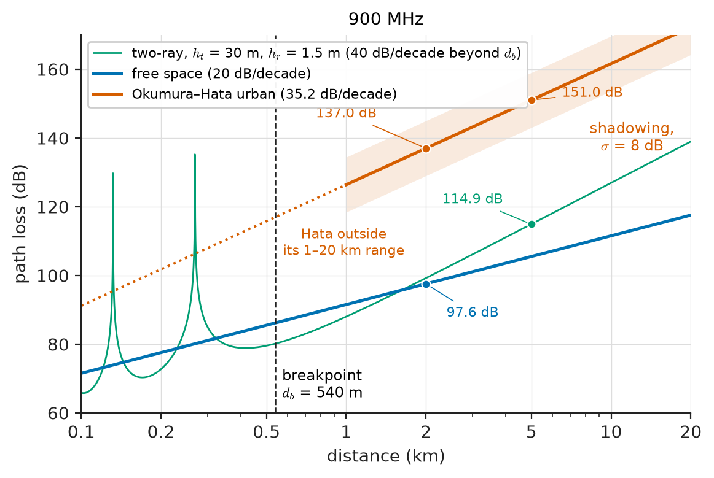
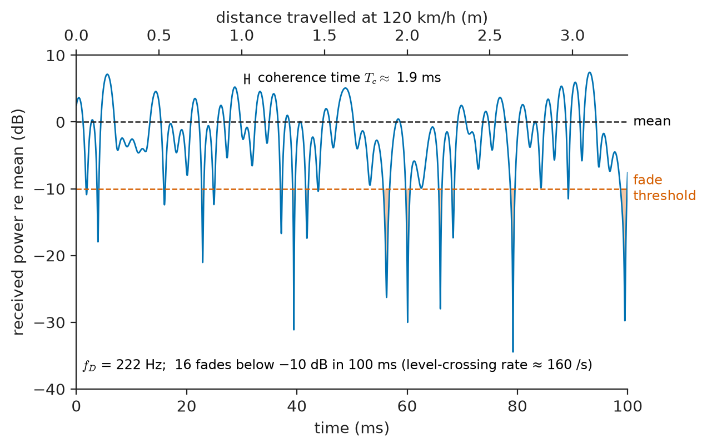
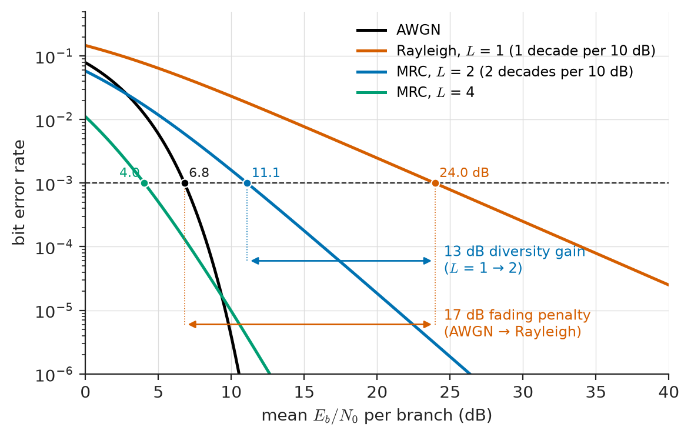
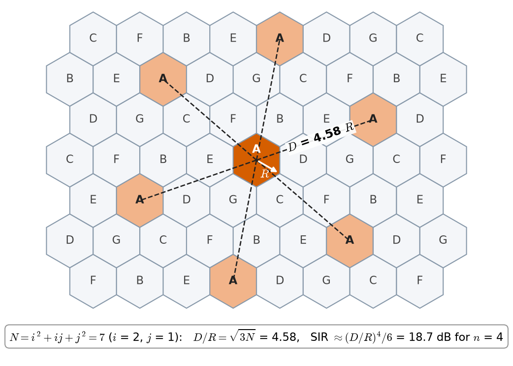
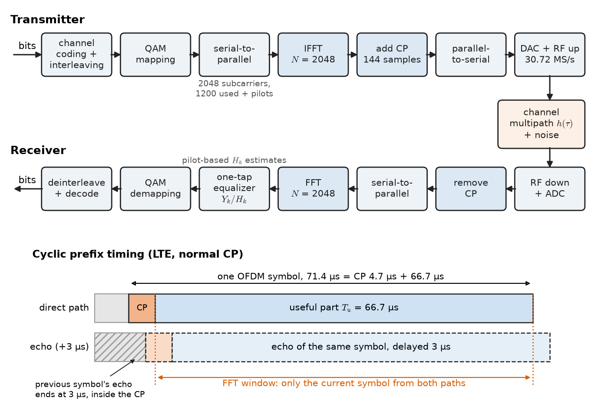
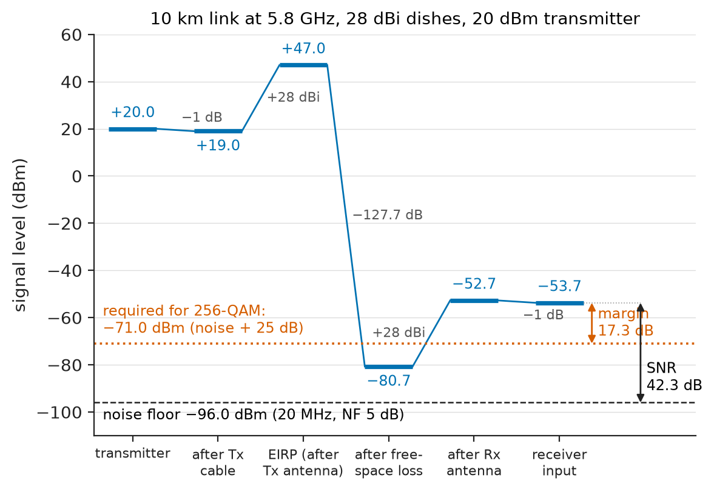

# Chapter 30 — Wireless and Mobile Communications

*Part VI · Communication Theory*

A passenger on a train at 120 km/h is on a video call. The phone is 2 km from the nearest base station, behind the steel and glass of the carriage, and the radio signal arriving at it is not one wave but dozens: reflections from buildings, scattered from trees and lamp posts, each with its own delay and Doppler shift. Every few centimetres of travel the reflections add up differently, so the received power plunges by 20 or 30 dB several hundred times a second and recovers just as fast. The average signal reaching it is more than a million million times weaker than what the base station transmitted. And the base station is serving hundreds of other users on the same frequencies, while neighbouring cells reuse those frequencies a kilometre away. The call still works.

The AWGN channel of Chapters 28 and 29 is a gentle idealization of this. Real radio channels lose power with distance far faster than free space predicts, fade randomly in time and frequency, smear symbols over one another, and are shared by many users who interfere with one another. This chapter builds the models for these effects and the techniques (diversity, cellular reuse, multiple access, OFDM, MIMO) that turned them from obstacles into resources.

> **How does a radio signal lose power and fluctuate between transmitter and receiver, and how much margin must a link carry?**
> **How do cellular systems, OFDM and multiple antennas deliver high, reliable throughput to many moving users over such channels?**

| Concept | Engineering destination |
|---|---|
| Radio propagation, Fresnel zones | Siting microwave links, antenna mast heights, indoor coverage |
| Path loss models (free space, two-ray, Hata) | Cell planning, Wi-Fi coverage, IoT gateway range, drone control links |
| Multipath, delay spread, Doppler | Equalizer and OFDM design, high-speed-rail and vehicle communications |
| Fading statistics, outage | Fade margins, reliability of SCADA radio and emergency services |
| Diversity, MRC | Base-station receive antennas, Wi-Fi, satellite radio, hearing-aid links |
| Cellular architecture, reuse, Erlang B | Network dimensioning, capacity planning |
| Multiple access (FDMA, TDMA, CDMA, OFDMA) | 2G–5G standards, Wi-Fi, satellite networks |
| OFDM | LTE, 5G NR, Wi-Fi, DVB-T, DAB, DSL, power-line communication |
| MIMO | 4G/5G throughput, Wi-Fi 5/6/7, massive-MIMO base stations, beamforming |
| Link budgets | Every radio link: cellular, satellite, telemetry, radar, IoT |

**Roadmap.** Radio propagation (30.1) → path loss (30.2) → multipath (30.3) → fading (30.4) → diversity (30.5) → cellular architecture (30.6) → multiple access (30.7) → OFDM (30.8) → MIMO (30.9) → link budgets (30.10) → wireless-system performance (30.11).

---

## 30.1 Radio propagation

### Mechanisms

Between two antennas, a radio wave reaches the receiver by four basic mechanisms, each the subject of field theory in *Engineering Physics* and modelled here by its consequences:

- **Free-space propagation** along a clear line of sight: power density falls with the square of distance because the same power spreads over a sphere of growing area.
- **Reflection** from surfaces large compared with the wavelength: the ground, building walls, the sea, the ionosphere at HF. The reflected wave has a magnitude and phase set by the surface's permittivity, conductivity and the angle of incidence.
- **Diffraction** around edges and over obstacles (rooftops, hilltops, the curvature of the earth), which lets signals reach shadowed regions with additional loss, more at higher frequency.
- **Scattering** from objects comparable to or smaller than the wavelength (foliage, lamp posts, rough surfaces, rain), which redistributes energy in many directions.

The relative importance of these mechanisms depends strongly on frequency. Table 30.1 shows the bands and their typical uses.

**Table 30.1 — Radio bands and their propagation character.**

| Band | Frequency | Wavelength | Dominant propagation | Typical uses |
|---|---|---|---|---|
| LF/MF | 30 kHz–3 MHz | 10 km–100 m | Ground wave, diffraction over earth | Time signals, AM broadcasting, navigation |
| HF | 3–30 MHz | 100–10 m | Ionospheric reflection (sky wave) | Long-distance broadcasting, aviation, amateur radio |
| VHF | 30–300 MHz | 10–1 m | Line of sight with diffraction | FM, DAB, aircraft, land-mobile radio |
| UHF | 300 MHz–3 GHz | 1 m–10 cm | Line of sight, reflection, building penetration | Cellular (700 MHz–2.6 GHz), GNSS, Wi-Fi 2.4 GHz, TV |
| SHF (lower) | 3–6 GHz | 10–5 cm | Line of sight, strong reflection, weaker penetration | 5G n77/n78, Wi-Fi 5/6 GHz, point-to-point links |
| SHF (upper) | 6–30 GHz | 5–1 cm | Line of sight, rain attenuation above ~10 GHz | Satellite TV (Ku), backhaul, radar |
| EHF (mm-wave) | 30–300 GHz | 10–1 mm | Short-range LOS, blocked by bodies, oxygen absorption at 60 GHz | 5G FR2 (24–48 GHz), automotive radar 77 GHz, 60 GHz WiGig |

### Line of sight and Fresnel zones

A radio "line of sight" is not a ray but a volume. The **first Fresnel zone** is the ellipsoid around the direct path within which reflected or diffracted paths differ in length by less than half a wavelength. At a point that is $d_1$ from one end and $d_2$ from the other, its radius is

$$
r_1=\sqrt{\frac{\lambda d_1d_2}{d_1+d_2}}.
$$

Obstacles intruding into this zone cause measurable extra loss even if the direct optical path is clear. The usual planning rule keeps at least 60 % of $r_1$ clear. For a 10 km link at 5.8 GHz ($\lambda=5.17$ cm), the radius at mid-path is $\sqrt{0.0517\times5000\times5000/10\,000}=11.4$ m, so 6.8 m of clearance is needed above trees and buildings at the midpoint, in addition to the earth's bulge. This, not optical visibility, sets microwave mast heights.

---

## 30.2 Path loss

### Free space

The **Friis transmission equation** gives the received power between two antennas in free space, separated by $d$ in the far field:

$$
P_r=P_tG_tG_r\left(\frac{\lambda}{4\pi d}\right)^{2}.
$$

The **free-space path loss** is the factor $(4\pi d/\lambda)^2$; in decibels, with $d$ in kilometres and $f$ in megahertz,

$$
\mathrm{FSPL}=20\log_{10}d_{\mathrm{km}}+20\log_{10}f_{\mathrm{MHz}}+32.44\ \ \mathrm{dB}.
$$

Loss grows by 20 dB per decade of distance and 20 dB per decade of frequency. The frequency dependence is a statement about antennas, not about space: an isotropic antenna's effective aperture $\lambda^2/4\pi$ shrinks with frequency. At fixed antenna *size*, gain rises as $f^2$ and the frequency dependence reverses, which is why high-frequency links use dishes and why 5G mm-wave equipment uses arrays with many elements.

Representative values: at 2.4 GHz, 1 m gives 40.0 dB and 100 m gives 80.0 dB; a 10 km link at 5.8 GHz has 127.7 dB; a geostationary satellite downlink at 12 GHz over 35,786 km has 205.1 dB.

> **Status of the principle: Friis free-space equation**
> *Derived.* Follows from energy conservation for a spherical wave and the reciprocity relation between antenna gain and effective aperture. It holds in the far field ($d\gg2D^2/\lambda$ for an antenna of size $D$) with an unobstructed first Fresnel zone and no reflections; it is accurate for satellite and many microwave links, and optimistic for almost every terrestrial mobile link.

### The two-ray ground-reflection model

Over flat ground the receiver sees the direct wave plus a ground-reflected wave with nearly $180°$ phase reversal at grazing incidence. When the path difference becomes small compared with $\lambda$, the two nearly cancel, and beyond the **breakpoint distance**

$$
d_b\approx\frac{4h_th_r}{\lambda}
$$

the received power falls as $d^{-4}$ and becomes independent of frequency:

$$
P_r\approx P_tG_tG_r\frac{h_t^2h_r^2}{d^4},\qquad L\approx40\log_{10}d-20\log_{10}(h_th_r)\ \ \mathrm{dB}.
$$

For a 30 m base-station antenna and a 1.5 m handset at 900 MHz, $d_b=540$ m; at 5 km the two-ray loss is 114.9 dB, against 105.5 dB in free space. The model explains why raising an antenna extends coverage so effectively ($+6$ dB per doubling of either height) and why mobile path loss falls faster than free space.

### Log-distance models and shadowing

Real environments are summarized by a **path-loss exponent** $n$ and a reference loss at distance $d_0$:

$$
L(d)=L(d_0)+10n\log_{10}\frac{d}{d_0}+X_\sigma,
$$

where $X_\sigma$ is a zero-mean Gaussian random variable (in dB) with standard deviation $\sigma$: **log-normal shadowing**, caused by buildings, hills and foliage that differ from one location to another at the same distance. Its correlation distance is tens of metres outdoors.

**Table 30.2 — Path-loss exponents and shadowing (typical values).**

| Environment | Exponent $n$ | Shadowing $\sigma$ (dB) |
|---|---|---|
| Free space | 2 | 0 |
| Rural macrocell, flat terrain | 3–3.5 | 6–8 |
| Urban macrocell | 3.5–4 | 8–10 |
| Dense urban, shadowed | 4–5 | 8–12 |
| Indoor, line of sight (corridor) | 1.6–1.8 | 3–5 |
| Indoor office, obstructed | 3–4 | 6–10 |
| Factory floor, obstructed | 2–3 | 6–8 |

To guarantee coverage at the cell edge with 90 % probability despite shadowing, the link needs a **shadow margin** of $1.28\sigma$: 10.3 dB for $\sigma=8$ dB.

### Empirical models: Okumura–Hata

For macrocell planning, path loss is predicted by models fitted to extensive measurements. The **Hata model**, a curve fit to Okumura's 1960s Tokyo measurements, gives the median urban loss for $150\le f\le1500$ MHz, base-station height $30\le h_b\le200$ m, mobile height $1\le h_m\le10$ m and $1\le d\le20$ km:

$$
L_{\text{urban}}=69.55+26.16\log_{10}f-13.82\log_{10}h_b-a(h_m)+\left(44.9-6.55\log_{10}h_b\right)\log_{10}d,
$$

with $f$ in MHz, $d$ in km, and, for a small or medium city, $a(h_m)=(1.1\log_{10}f-0.7)h_m-(1.56\log_{10}f-0.8)$. The COST-231 extension covers 1500–2000 MHz; suburban and rural corrections subtract several decibels to tens of decibels. Figure 30.1 compares the three models.

> **Status of the principle: Okumura–Hata path-loss model**
> *Empirical.* A regression fit to measurements in a particular city and frequency range; it predicts the median loss with a typical error of several decibels and must not be extrapolated outside its stated parameter ranges, to microcells with antennas below rooftop height, or to indoor coverage.

**Worked example — Macrocell coverage at 900 MHz.** A base station radiates 43 dBm (20 W) into a 15 dBi antenna at 30 m height through 3 dB of feeder loss. A handset at 1.5 m height, 2 km away in an urban area, has a 0 dBi antenna and 3 dB body loss. The Hata correction is $a(1.5)=0.016$ dB, the distance slope is $44.9-6.55\log_{10}30=35.2$ dB/decade (exponent $n=3.52$), and

$$
L=69.55+26.16(2.954)-13.82(1.477)-0.016+35.2(0.301)=137.0\ \mathrm{dB},
$$

against 97.6 dB in free space at the same distance. The median received power is

$$
P_r=43+15-3-137.0+0-3=-85.0\ \mathrm{dBm}.
$$

With $\sigma=8$ dB shadowing, coverage at 90 % of edge locations requires planning for $-85.0-10.3=-95.3$ dBm. A handset with NF 7 dB in a 10 MHz carrier has a noise floor of $-174+70+7=-97$ dBm, leaving an SNR of only 1.7 dB at that 90th-percentile point, before multipath fading or interference are considered. At 5 km the median loss rises to 151.0 dB: the cell radius is limited, and to cover more area the operator must add sites, raise antennas or lower the frequency.

<!-- FIGURE 30.1 | figures/ch30/fig-30-1-path-loss-models.png | plot | Path loss versus distance at 900 MHz for free-space, two-ray and Okumura-Hata urban models. | Content: x axis distance from 0.1 to 20 km on log scale, y axis path loss from 60 to 170 dB. Curves: free-space loss (slope 20 dB/decade, 97.6 dB at 2 km); two-ray model with h_t = 30 m and h_r = 1.5 m (follows free space with oscillations up to the 540 m breakpoint, then slope 40 dB/decade, 114.9 dB at 5 km); Hata urban with h_b = 30 m, h_m = 1.5 m (137.0 dB at 2 km, 151.0 dB at 5 km, slope 35.2 dB/decade). Light band of plus/minus 8 dB around the Hata curve labelled "shadowing, sigma = 8 dB". Vertical marker at the breakpoint 540 m. -->

*Figure 30.1 — Path loss versus distance at 900 MHz for free-space, two-ray and Okumura-Hata urban models.*

---

## 30.3 Multipath

### Delay spread and coherence bandwidth

In a typical mobile channel, the signal arrives over many paths of different lengths. The channel's impulse response is a set of delayed, attenuated and phase-rotated copies:

$$
h(t,\tau)=\sum_{i}a_i(t)\,e^{-j\phi_i(t)}\,\delta(\tau-\tau_i).
$$

The spread of the delays is measured by the **RMS delay spread** $\sigma_\tau$, the standard deviation of the delays weighted by path power. Its frequency-domain counterpart is the **coherence bandwidth** $B_c$, the range of frequencies over which the channel response is strongly correlated. A common rule of thumb is

$$
B_c\approx\frac{1}{5\sigma_\tau}
$$

(for correlation 0.5; $1/(50\sigma_\tau)$ for correlation 0.9).

**Table 30.3 — Typical RMS delay spreads.**

| Environment | $\sigma_\tau$ | Coherence bandwidth $1/(5\sigma_\tau)$ |
|---|---|---|
| Indoor office or home | 10–50 ns | 4–20 MHz |
| Factory hall (metal) | 50–200 ns | 1–4 MHz |
| Urban microcell | 0.1–0.5 μs | 0.4–2 MHz |
| Urban macrocell | 0.5–3 μs | 70–400 kHz |
| Hilly terrain | 3–10 μs | 20–70 kHz |

The comparison between signal bandwidth $B_s$ (roughly the symbol rate) and $B_c$ classifies the channel:

- **Flat fading** ($B_s\ll B_c$, symbol period $\gg\sigma_\tau$): all frequency components fade together; the channel is a single complex gain. A 200 kHz GSM carrier in a 1 μs macrocell is close to this boundary.
- **Frequency-selective fading** ($B_s>B_c$): different parts of the band fade differently and, in the time domain, symbols overlap (intersymbol interference, ISI). A single-carrier 20 MHz signal in a 1 μs channel spans about 20 symbols of ISI and needs a long equalizer, or OFDM (Section 30.8).

### Doppler spread and coherence time

A receiver moving at speed $v$ sees each path shifted in frequency by up to the **maximum Doppler shift**

$$
f_D=\frac{v}{\lambda}=\frac{vf_c}{c}.
$$

Paths arriving from different directions have different shifts between $-f_D$ and $+f_D$, so the received spectrum of a pure tone is spread over $2f_D$. For uniformly distributed arrival angles this gives the classic U-shaped **Jakes (Clarke) Doppler spectrum**. The time-domain counterpart is the **coherence time** $T_c$, over which the channel stays roughly constant; one common definition is

$$
T_c\approx\frac{0.423}{f_D}.
$$

At 120 km/h and 2 GHz, $f_D=33.3\times2\times10^9/(3\times10^8)=222$ Hz and $T_c\approx1.9$ ms. A pedestrian at 1.4 m/s at 2.4 GHz gives $f_D=11$ Hz and $T_c\approx38$ ms; a high-speed train at 300 km/h at 2.6 GHz gives 723 Hz and 0.59 ms. If $T_c$ is much longer than a symbol the fading is **slow** (the channel can be estimated and tracked); if comparable, it is **fast**, and channel estimates go stale before they can be used.

> **Status of the principle: Coherence bandwidth and coherence time rules**
> *Approximate.* $B_c\approx1/(5\sigma_\tau)$ and $T_c\approx0.423/f_D$ are rules of thumb tied to a chosen correlation level and to the shapes of the delay and Doppler profiles (exponential delay profile, uniform scattering in azimuth). They give order-of-magnitude guidance for system design, not exact values.

---

## 30.4 Fading

### Rayleigh fading

When there is no dominant path and many scattered components of comparable size arrive with independent random phases, the in-phase and quadrature components of the received signal are sums of many random terms. By the central limit theorem they are Gaussian, exactly as for narrowband noise (Chapter 29), and the received envelope is **Rayleigh** distributed. The instantaneous received power $\gamma$ (or SNR) is then exponentially distributed about its mean $\bar\gamma$:

$$
f(\gamma)=\frac1{\bar\gamma}e^{-\gamma/\bar\gamma},\qquad P(\gamma<\gamma_0)=1-e^{-\gamma_0/\bar\gamma}.
$$

The probability that power falls 10 dB below the mean is $1-e^{-0.1}=9.5\ \%$; 20 dB below, about 1 %; 30 dB below, about 0.1 %. Deep fades are short: their duration scales with $1/f_D$, typically a few milliseconds for vehicles. Successive fades occur about every half wavelength, which is 7.5 cm at 2 GHz (Figure 30.2).

<!-- FIGURE 30.2 | figures/ch30/fig-30-2-rayleigh-fading-envelope.png | plot | Simulated Rayleigh fading envelope for a vehicle at 120 km/h at 2 GHz. | Content: x axis time from 0 to 100 ms, y axis received power relative to the mean, from -40 to +10 dB. Rayleigh-faded envelope generated with a Jakes Doppler spectrum, f_D = 222 Hz, showing about 16 fades below -10 dB in 100 ms (level-crossing rate about 160 per second). Horizontal dashed lines at 0 dB (mean) and -10 dB labelled "fade threshold". Secondary x axis on top: distance travelled from 0 to 3.3 m. Annotation: coherence time about 1.9 ms. -->

*Figure 30.2 — Simulated Rayleigh fading envelope for a vehicle at 120 km/h at 2 GHz.*

### Rician fading

When a line-of-sight or dominant specular path is present, the envelope follows the **Rician** distribution, characterized by the **K-factor**, the ratio of power in the dominant component to the power in the scattered components. $K=0$ is Rayleigh; $K\to\infty$ is no fading. Typical values are 3–10 dB for line-of-sight microcells and indoor links, higher for fixed links with good clearance. **Nakagami-$m$** fading is a flexible alternative fitted to measurements.

### The three scales of variation

A received signal level therefore varies on three scales, which are modelled separately and combined in link planning:

1. **Path loss**, the median versus distance (Section 30.2), varying over kilometres.
2. **Shadowing**, log-normal around the median, varying over tens of metres.
3. **Multipath fading** (small-scale), Rayleigh or Rician, varying over fractions of a wavelength.

### Error rate in fading

Fading changes the error-rate behaviour dramatically. Averaging the BPSK error probability $Q(\sqrt{2\gamma})$ over the exponential distribution of $\gamma$ gives

$$
\bar P_b=\frac12\left(1-\sqrt{\frac{\bar\gamma}{1+\bar\gamma}}\right)\approx\frac{1}{4\bar\gamma}\quad(\bar\gamma\gg1).
$$

In AWGN, BER falls *exponentially* with SNR; in Rayleigh fading only *inversely*. At a mean $E_b/N_0$ of 10 dB, AWGN gives $3.9\times10^{-6}$ while Rayleigh fading gives $2.3\times10^{-2}$. To reach $10^{-3}$, AWGN needs 6.8 dB and Rayleigh fading 24.0 dB: a penalty of 17 dB. The errors come almost entirely from the deep fades, not from the average conditions. Adding power is a very expensive cure; the efficient cures are diversity and coding with interleaving, which break the dependence on any single fade.

> **Status of the principle: Rayleigh and Rician fading models**
> *Approximate.* They follow from the central limit theorem when many independent scattered paths of comparable strength are present (Rayleigh), or such paths plus one fixed component (Rician). They fit urban mobile measurements well, but fail for channels dominated by a few strong paths (sparse mm-wave channels), and the independence of successive fades assumed in analysis depends on motion and bandwidth.

### Outage and fade margin

For a link that must work most of the time rather than achieve an average BER, the relevant measure is the **outage probability**: the fraction of time (or locations) where the SNR drops below the minimum $\gamma_0$ the receiver needs. With Rayleigh fading, $P_{\text{out}}=1-e^{-\gamma_0/\bar\gamma}$; to keep outage at $P_{\text{out}}$ the mean SNR must exceed $\gamma_0$ by a **fade margin** of $-10\log_{10}[-\ln(1-P_{\text{out}})]$: 9.8 dB for 10 %, 20.0 dB for 1 %, and 30.0 dB for 0.1 %. Each additional "nine" of availability costs 10 dB, a factor of ten in power.

**Worked example — Outage of a telemetry radio.** A water-utility SCADA radio needs an instantaneous SNR of 5 dB to decode a packet. The mean SNR at a remote pumping station is 20 dB, and the channel is Rayleigh. The outage probability is

$$
P_{\text{out}}=1-\exp\!\left(-\frac{10^{0.5}}{10^{2}}\right)=1-e^{-0.0316}=3.1\ \%.
$$

About one packet in 32 is lost to fades. With two receive antennas spaced far enough apart for independent fading, and selection of the stronger, outage requires both to fade: $P_{\text{out}}=(0.0311)^2=9.7\times10^{-4}$, a 32-fold improvement without any extra transmitted power. To reach the same 0.1 % outage with one antenna, the mean SNR would have to rise from 20 dB to $5+30.0=35.0$ dB: 15 dB more power. This is the case for diversity.

---

## 30.5 Diversity

### The principle

**Diversity** provides the receiver with several replicas of the same information that fade independently. The probability that all of them fade at once is the product of the individual probabilities, so deep fades become rare. The number of independent branches, $L$, is the **diversity order**; at high SNR the error probability falls as $\bar\gamma^{-L}$ instead of $\bar\gamma^{-1}$.

### Sources of diversity

- **Space diversity**: several antennas separated enough for independent fading. At a handset surrounded by scatterers, about $\lambda/2$ suffices (7.5 cm at 2 GHz); at an elevated base station, which sees scatterers in a narrow angle, 10–20 wavelengths are needed.
- **Polarization diversity**: two orthogonally polarized antennas in one housing, the standard for cellular base-station panels.
- **Time diversity**: repetition or coding plus interleaving over an interval longer than the coherence time. It fails for slow users: a stationary handset has an effectively infinite $T_c$, which is why interleaving alone does not protect pedestrians.
- **Frequency diversity**: transmitting over frequencies separated by more than $B_c$, as in frequency hopping, or by coding across the subcarriers of OFDM.
- **Multipath diversity**: a RAKE receiver (CDMA) resolves paths separated by more than one chip and combines them, turning multipath into diversity.

### Combining methods

- **Selection combining (SC)**: use the branch with the highest SNR. Simple, needs only one receiver chain plus switching.
- **Maximal-ratio combining (MRC)**: co-phase the branches and weight each by its amplitude (divided by its noise power), then add. The output SNR is the sum of the branch SNRs, $\gamma_{\text{MRC}}=\sum_i\gamma_i$; this is optimal for independent noise.
- **Equal-gain combining (EGC)**: co-phase and add with equal weights; within about 1 dB of MRC.

For BPSK with $L$-branch MRC in independent Rayleigh fading, with mean SNR $\bar\gamma$ per branch and $\mu=\sqrt{\bar\gamma/(1+\bar\gamma)}$,

$$
\bar P_b=\left(\frac{1-\mu}{2}\right)^{L}\sum_{k=0}^{L-1}\binom{L-1+k}{k}\left(\frac{1+\mu}{2}\right)^{k}\approx\binom{2L-1}{L}\frac{1}{(4\bar\gamma)^{L}}.
$$

At $\bar\gamma=10$ dB per branch, the BER is $2.3\times10^{-2}$ for $L=1$, $1.6\times10^{-3}$ for $L=2$, and $9.7\times10^{-6}$ for $L=4$. The SNR needed for $10^{-3}$ falls from 24.0 dB ($L=1$) to 11.1 dB ($L=2$) and 4.0 dB ($L=4$) per branch, approaching the AWGN value of 6.8 dB in total combined SNR (Figure 30.3).

<!-- FIGURE 30.3 | figures/ch30/fig-30-3-ber-fading-diversity.png | plot | BPSK bit error rate in AWGN and in Rayleigh fading with maximal-ratio diversity. | Content: x axis mean Eb/N0 per branch from 0 to 40 dB, y axis BER log scale 1e-6 to 0.5. Curves: AWGN Q(sqrt(2 gamma)) reaching 1e-3 at 6.8 dB; Rayleigh L = 1 (1e-3 at 24.0 dB, slope one decade per 10 dB); MRC L = 2 (1e-3 at 11.1 dB, two decades per 10 dB); MRC L = 4 (1e-3 at 4.0 dB). Dashed horizontal line at 1e-3. Annotation arrow between L = 1 and AWGN labelled "17 dB fading penalty", and between L = 1 and L = 2 labelled "13 dB diversity gain". -->

*Figure 30.3 — BPSK bit error rate in AWGN and in Rayleigh fading with maximal-ratio diversity.*

### Transmit diversity: the Alamouti code

Handsets are small, so it is often easier to add antennas at the base station and transmit from them. Transmitting the same symbol from two antennas simply produces another fading sum, with no diversity. The **Alamouti scheme** (1998) sends two symbols $s_1,s_2$ over two symbol periods from two antennas as

$$
\begin{array}{ccc}
 & \text{antenna 1} & \text{antenna 2}\\
\text{time 1} & s_1 & s_2\\
\text{time 2} & -s_2^{*} & s_1^{*}
\end{array}
$$

With a single receive antenna and channel gains $h_1,h_2$ constant over the two periods, simple linear processing separates the symbols and gives each the SNR $(\lvert h_1\rvert^2+\lvert h_2\rvert^2)E_s/(2N_0)$, the full second-order diversity of two-branch MRC, at full rate, with a 3 dB power penalty because the transmit power is split. It is used in LTE's transmit-diversity mode and in Wi-Fi.

> **Status of the principle: Diversity gain**
> *Derived.* The $\bar\gamma^{-L}$ behaviour follows from the probability that $L$ independent fades coincide, and MRC's SNR summation from Cauchy–Schwarz. The full gain requires independent branches with accurate channel estimates; correlated branches (closely spaced antennas in a narrow angular spread) yield less, and estimation errors at low SNR erode MRC's advantage.

---

## 30.6 Cellular architecture

### Frequency reuse

Spectrum is scarce, and a single high-power transmitter covering a city can serve only as many simultaneous users as it has channels. The **cellular concept** (Bell Labs, 1947, deployed from the late 1970s) divides the coverage area into cells, each served by a base station of modest power, and reuses the same frequencies in cells far enough apart that their mutual interference is tolerable. Capacity then grows with the number of cells, not with spectrum.

In the hexagonal model, cells are grouped into **clusters** of $N$ cells, each using a different set of channels; possible cluster sizes satisfy $N=i^2+ij+j^2$ for integers $i,j$ (1, 3, 4, 7, 9, 12, ...). The distance between co-channel cells, relative to the cell radius $R$, is the **reuse ratio**

$$
\frac DR=\sqrt{3N}.
$$

With six first-tier co-channel interferers at distance $D$ and path-loss exponent $n$, a mobile at the cell edge experiences a signal-to-interference ratio of approximately

$$
\frac SI\approx\frac{(D/R)^{n}}{6}=\frac{(\sqrt{3N})^{n}}{6}.
$$

**Table 30.4 — Cluster size and edge SIR (six interferers).**

| $N$ | $D/R$ | SIR, $n=3$ | SIR, $n=4$ |
|---|---|---|---|
| 3 | 3.00 | 6.5 dB | 11.3 dB |
| 4 | 3.46 | 8.4 dB | 13.8 dB |
| 7 | 4.58 | 12.1 dB | 18.7 dB |
| 12 | 6.00 | 15.6 dB | 23.3 dB |

First-generation analog FM (AMPS) needed about 18 dB, hence $N=7$; GSM tolerates about 9 dB and used $N=3$ or 4 with sectoring and frequency hopping. CDMA, LTE and 5G use **universal frequency reuse** ($N=1$), accepting low SINR at the cell edge and managing interference by coding, power control, scheduling and coordination between cells. **Sectoring**, dividing each site into three 120° sectors with directional antennas, cuts the number of first-tier interferers from six to about two, raising SIR by roughly 4.8 dB. Figure 30.4 shows a seven-cell reuse pattern.

<!-- FIGURE 30.4 | figures/ch30/fig-30-4-hexagonal-reuse-n7.png | schematic | Hexagonal cell layout with a cluster size of 7. | Content: tiled hexagonal cells covering about 3 clusters in each direction, each cell labelled with its channel group A to G in the standard N = 7 pattern (i = 2, j = 1). One reference cell A in the centre highlighted; the six first-tier co-channel A cells highlighted with the same colour, with dashed lines of length D = 4.58 R from the centre cell to each. Cell radius R marked on the centre hexagon. Caption box: D/R = sqrt(3N) = 4.58, SIR about 18.7 dB for n = 4. -->

*Figure 30.4 — Hexagonal cell layout with a cluster size of 7.*

### Cell types and the network

Real networks are heterogeneous: **macrocells** with antennas above rooftops covering 1–30 km, **microcells** below rooftop level covering a few hundred metres, and **small cells** (pico and femto) indoors or on street furniture covering tens of metres, all overlaid. A mobile network also has a core: base stations connect over backhaul (fibre or microwave) to the core network, which handles authentication, mobility management, routing to the internet and the telephone network. As a user moves, the network performs **handover** from one cell to the next, deciding on the basis of measured signal strengths with hysteresis to prevent ping-ponging at a boundary, and the core tracks idle users by location area so that they can be paged.

### Traffic and trunking: Erlang B

The number of channels a cell needs depends on the offered traffic in **erlangs** (average number of simultaneous calls: 1 erlang is one channel continuously occupied). For blocked-calls-cleared systems with random arrivals, the **Erlang B formula** gives the blocking probability with $C$ channels and offered traffic $A$:

$$
P_B=\frac{A^{C}/C!}{\sum_{k=0}^{C}A^{k}/k!}.
$$

At 2 % blocking, 10 channels carry 5.08 erlangs (51 % utilization), 30 channels carry 21.9 erlangs (73 %) and 100 channels carry 88.0 erlangs (88 %). This **trunking efficiency** is why large pools of channels are more efficient than small ones, and one reason why sectoring, which splits the pool, has a capacity cost as well as an interference benefit. Packet-switched data networks replace Erlang B with queueing and scheduling models, but the principle of statistical multiplexing is the same.

> **Status of the principle: Hexagonal reuse and SIR formula**
> *Approximate.* It assumes identical hexagonal cells, a single path-loss exponent, equal transmit powers and only first-tier interferers, and ignores shadowing. Real cell layouts follow terrain and demand; the formula guides reuse choice but planning tools use measured or ray-traced propagation.

---

## 30.7 Multiple access

**Multiple access** shares a channel among many users; **duplexing** separates the two directions of one link, either by frequency (FDD, paired bands) or by time (TDD, one band alternating).

### FDMA and TDMA

**Frequency-division multiple access (FDMA)** gives each user a separate carrier: first-generation analog systems used 25–30 kHz channels. It needs guard bands and a separate radio chain per carrier at the base station, but each user's narrowband signal sees flat fading.

**Time-division multiple access (TDMA)** gives each user a time slot on a shared carrier. GSM combines both: 200 kHz carriers (FDMA), each carrying eight time slots of 577 μs (TDMA), with frequency hopping for diversity. TDMA requires accurate timing, including **timing advance** to compensate for propagation delay (3.3 μs per km each way), and the bursty transmission causes the familiar 217 Hz audio buzz in nearby loudspeakers.

### CDMA

**Code-division multiple access (CDMA)** lets all users transmit simultaneously over the same wide band, each spreading its data with a distinct high-rate code. The receiver correlates with the desired user's code: that signal is despread back to its narrow bandwidth, while the others remain spread and appear as noise. The **processing gain** is the ratio of chip rate to data rate; for UMTS voice, $3.84\ \mathrm{Mchip/s}$ over 12.2 kb/s gives $10\log_{10}(3.84\times10^6/12\,200)=25.0$ dB. CDMA naturally supports $N=1$ reuse, soft handover (connection to several base stations at once) and RAKE multipath diversity, but needs fast, accurate power control (1500 updates per second in UMTS) to solve the **near–far problem**: an uncontrolled nearby user could swamp distant ones by tens of decibels.

### OFDMA, SC-FDMA and random access

**Orthogonal frequency-division multiple access (OFDMA)**, used in LTE and 5G downlinks and in Wi-Fi 6, assigns users different sets of OFDM subcarriers and time slots (resource blocks of 12 subcarriers × 1 slot in LTE), and the scheduler can give each user the subcarriers where its channel is currently strong, turning frequency-selective fading into a source of gain (**multi-user diversity**). The LTE uplink uses **SC-FDMA** (DFT-spread OFDM), which keeps the subcarrier allocation flexibility but lowers the peak-to-average power ratio of the handset's transmitter. Unlicensed systems such as classical Wi-Fi use **carrier-sense multiple access with collision avoidance (CSMA/CA)**: listen, wait a random back-off, and transmit if the channel is free.

**Table 30.5 — Multiple access in major systems.**

| System | Multiple access | Duplex | Channel bandwidth |
|---|---|---|---|
| AMPS (1G) | FDMA | FDD | 30 kHz |
| GSM (2G) | TDMA/FDMA, frequency hopping | FDD | 200 kHz, 8 slots |
| IS-95 (2G) | CDMA, 1.2288 Mchip/s | FDD | 1.25 MHz |
| UMTS (3G) | Wideband CDMA, 3.84 Mchip/s | FDD (TDD option) | 5 MHz |
| LTE (4G) | OFDMA downlink, SC-FDMA uplink | FDD or TDD | 1.4–20 MHz per carrier |
| 5G NR | OFDMA (DFT-s-OFDM option on uplink) | Mostly TDD above 3 GHz | Up to 100 MHz (FR1), 400 MHz (FR2) |
| Wi-Fi 6 (802.11ax) | OFDMA plus CSMA/CA | TDD | 20–160 MHz |

---

## 30.8 OFDM fundamentals

### Why many slow carriers beat one fast one

A single carrier at 20 Msymbol/s in a channel with 1–5 μs delay spread suffers ISI across 20–100 symbols; equalizing it in the time domain is costly and sensitive. **Orthogonal frequency-division multiplexing (OFDM)** divides the data into $N$ parallel streams on closely spaced subcarriers, each at $1/N$ of the rate. Each subcarrier is so narrow that it sees flat fading, and each symbol is so long that the delay spread is only a small fraction of it.

### Orthogonality and the FFT

Subcarriers spaced by $\Delta f=1/T_u$, where $T_u$ is the useful symbol duration, are **orthogonal** over $T_u$: the integral of the product of any two distinct subcarriers over one symbol is zero. Their spectra (sinc-shaped) overlap, but at the centre of each subcarrier all others pass through zero, so no guard bands are needed between them. The baseband OFDM symbol

$$
x(t)=\sum_{k=0}^{N-1}X_k\,e^{j2\pi k\Delta f t},\qquad 0\le t<T_u,
$$

sampled at $N$ points, is exactly an inverse DFT of the complex data symbols $X_k$. Modulation is therefore an **IFFT** and demodulation an **FFT** (Chapter 22), which is what made OFDM practical in cheap silicon (Figure 30.5).

### The cyclic prefix

Multipath still smears each symbol into the next. OFDM prepends a **cyclic prefix (CP)**, a copy of the last $T_{\text{CP}}$ of the symbol, to its beginning. If $T_{\text{CP}}$ exceeds the channel's maximum excess delay:

1. ISI from the previous symbol falls entirely within the prefix, which the receiver discards;
2. the channel's linear convolution with the symbol becomes a **circular** convolution over the FFT window, so in the frequency domain each subcarrier is simply multiplied by the channel's frequency response $H_k$:

$$
Y_k=H_kX_k+N_k.
$$

Equalization reduces to one complex division per subcarrier ($\hat X_k=Y_k/H_k$), using pilot subcarriers to estimate $H_k$. The cost is overhead: the CP carries no new data.

<!-- FIGURE 30.5 | figures/ch30/fig-30-5-ofdm-transceiver.png | block-diagram | OFDM transmitter and receiver with cyclic prefix. | Content: transmitter row: bits -> channel coding and interleaving -> QAM mapping -> serial-to-parallel (N = 2048 subcarriers, 1200 used plus pilots) -> IFFT -> add cyclic prefix (144 samples) -> parallel-to-serial -> DAC and RF upconversion at 30.72 Msample/s. Channel block: multipath h(tau) plus noise. Receiver row (mirror): RF downconversion and ADC -> remove CP -> serial-to-parallel -> FFT -> one-tap equalizer Y_k / H_k using pilot-based channel estimates -> QAM demapping -> deinterleaving and decoding -> bits. Inset timing diagram: one OFDM symbol of 71.4 us shown as CP 4.7 us plus useful part 66.7 us, with a delayed multipath echo of 3 us ending inside the CP. -->

*Figure 30.5 — OFDM transmitter and receiver with cyclic prefix.*

### Numbers from real systems

**LTE (20 MHz carrier).** Subcarrier spacing 15 kHz, so $T_u=1/15\,000=66.7$ μs. 1200 subcarriers are used (100 resource blocks of 12) within a 2048-point FFT sampled at 30.72 MHz. The normal CP is 144 samples, $144/30.72\times10^{6}=4.69$ μs (160 samples in the first symbol of each slot), enough for typical urban delay spreads, at an overhead of $144/(2048+144)=6.6$ %. Fourteen symbols fit in each 1 ms subframe; with 64-QAM, the raw resource-element rate is $1200\times14\times6/10^{-3}=100.8$ Mb/s per antenna layer, before control, pilot and coding overheads.

**Wi-Fi (802.11a/g, 20 MHz).** A 64-point FFT with 312.5 kHz spacing gives $T_u=3.2$ μs; a 0.8 μs guard interval makes a 4 μs symbol. Of 52 used subcarriers, 48 carry data and 4 are pilots. With 64-QAM and rate-3/4 coding, the data rate is $48\times6\times0.75/4\ \mu\mathrm{s}=54$ Mb/s, the familiar top rate of 802.11a/g. Indoor delay spreads of tens of nanoseconds fit comfortably within 0.8 μs.

**5G NR** uses scalable numerology: spacings of $15\times2^{\mu}$ kHz (15, 30, 60, 120 kHz), shortening symbols and CPs in proportion, so that wide mm-wave carriers with large phase noise use wide spacings and short symbols, while sub-6 GHz macrocells use 15 or 30 kHz.

### OFDM's weaknesses

- **Peak-to-average power ratio (PAPR).** The sum of many independent subcarriers is nearly Gaussian; its peaks reach 10–12 dB above the average with non-negligible probability. The power amplifier must back off to stay linear, wasting efficiency, which matters most in battery-powered handsets, hence SC-FDMA on the LTE uplink.
- **Frequency-offset and phase-noise sensitivity.** A carrier frequency error of a fraction of $\Delta f$, from oscillator tolerance or Doppler, destroys orthogonality and causes inter-carrier interference. A 15 kHz spacing tolerates offsets of a few hundred hertz.
- **Faded subcarriers.** Subcarriers in a spectral null are lost; OFDM relies on coding and interleaving across subcarriers (*coded* OFDM) to recover them, which converts frequency selectivity into frequency diversity.

> **Status of the principle: OFDM with cyclic prefix diagonalizes the channel**
> *Derived.* If the CP is longer than the channel impulse response and the channel is constant over one symbol, the DFT exactly converts linear convolution into per-subcarrier multiplication. Delay spreads exceeding the CP, or Doppler shifts that are a significant fraction of the subcarrier spacing, break the result and cause inter-symbol and inter-carrier interference.

---

## 30.9 MIMO fundamentals

### The channel matrix

With $N_t$ transmit and $N_r$ receive antennas, the narrowband channel is described by an $N_r\times N_t$ complex matrix $\mathbf H$, whose element $h_{ij}$ is the gain from transmit antenna $j$ to receive antenna $i$:

$$
\mathbf y=\mathbf H\mathbf x+\mathbf n.
$$

In an OFDM system there is one such matrix per subcarrier. In a rich scattering environment the entries are roughly independent complex Gaussian variables; with line of sight and closely spaced antennas they are strongly correlated.

### Three uses of multiple antennas

1. **Diversity** (Section 30.5): sending or receiving the same information over independently fading paths, improving reliability. The maximum diversity order is $N_tN_r$.
2. **Beamforming (array gain)**: weighting the antennas so their signals add coherently in the desired direction, increasing average SNR by up to a factor $N_tN_r$ and reducing interference to and from other directions. Massive-MIMO base stations with 64 or more elements use it to serve several users simultaneously in different directions.
3. **Spatial multiplexing**: transmitting independent data streams from different antennas at the same frequency and time, and separating them at the receiver using their different spatial signatures. Up to $\min(N_t,N_r)$ streams (layers) can be supported.

### MIMO capacity

With equal power on each transmit antenna and the channel known at the receiver, the capacity of a fixed channel at total SNR $\rho$ is

$$
C=\log_2\det\!\left(\mathbf I_{N_r}+\frac{\rho}{N_t}\mathbf H\mathbf H^{H}\right)=\sum_{i=1}^{r}\log_2\!\left(1+\frac{\rho}{N_t}\lambda_i\right)\ \ \mathrm{b/s/Hz},
$$

where $\lambda_i$ are the eigenvalues of $\mathbf H\mathbf H^{H}$ (the squared singular values of $\mathbf H$) and $r$ is its rank. The channel behaves as $r$ parallel independent channels, the **eigenmodes**, each with its own gain. At high SNR in rich scattering, capacity grows as $\min(N_t,N_r)\log_2\rho$: linearly with the number of antennas, not logarithmically with power. This is why every recent generation of Wi-Fi and cellular systems has multiplied its antenna count.

> **Status of the principle: MIMO capacity formula**
> *Derived.* Follows from Shannon capacity applied to a vector Gaussian channel with receiver channel knowledge and equal power allocation (with transmitter knowledge, water-filling over eigenmodes does slightly better). The linear growth with $\min(N_t,N_r)$ requires a well-conditioned channel matrix, which needs rich scattering or adequate antenna spacing; a line-of-sight channel between compact arrays may have effective rank 1.

**Worked example — Capacity of a 2×2 link.** A 2×2 Wi-Fi link at a total SNR of 20 dB ($\rho=100$) has the measured channel

$$
\mathbf H=\begin{bmatrix}1.0&0.6-0.3j\\0.4+0.5j&0.9\end{bmatrix}.
$$

The eigenvalues of $\mathbf H\mathbf H^{H}$ are $\lambda_1=2.556$ and $\lambda_2=0.114$. With $\rho/N_t=50$:

$$
C=\log_2(1+50\times2.556)+\log_2(1+50\times0.114)=7.01+2.75=9.76\ \mathrm{b/s/Hz}.
$$

A single-antenna link with unit gain at the same SNR would give $\log_2101=6.66$ b/s/Hz. The second eigenmode is 13.5 dB weaker than the first, so it contributes less, but the total is still 47 % above the single-antenna value. Averaged over independent Rayleigh-fading 2×2 channels at 20 dB, simulation gives an ergodic capacity of about 11.3 b/s/Hz, against 5.9 b/s/Hz for a single Rayleigh-faded antenna pair: close to the factor of two that $\min(N_t,N_r)=2$ promises.

### Practical MIMO

Receivers separate spatial streams with linear detectors (zero-forcing or MMSE) or near-ML detectors; transmitters with channel knowledge (from feedback in FDD, or from reciprocity in TDD) **precode** onto the eigenmodes. LTE supports up to 4 layers to a handset (8 in later releases), 5G NR up to 8 on the downlink, Wi-Fi 6 up to 8 spatial streams. **Multi-user MIMO** sends different streams to different single- or dual-antenna users from a many-antenna base station, so that spatial multiplexing is limited by the number of base-station antennas rather than by the handset.

---

## 30.10 Link budgets

### The bookkeeping

A **link budget** tallies all gains and losses between transmitter and receiver, in decibels, to find the received power, the SNR, and the margin left over for fading and uncertainty:

$$
P_r\ (\mathrm{dBm})=P_t+G_t-L_t-L_p+G_r-L_r-L_{\text{misc}},
$$

where $L_t$ and $L_r$ are feeder losses, $L_p$ is the path loss and $L_{\text{misc}}$ covers polarization mismatch, body loss, building penetration, rain and atmospheric absorption. The noise power is $N=-174+10\log_{10}B+\mathrm{NF}$ dBm, the SNR is $P_r-N$, and the **link margin** is the excess over the SNR the modem requires. The margin must cover the fading and shadowing allowances of Sections 30.2–30.4 plus implementation losses.

**Worked example — A 5.8 GHz point-to-point backhaul link.** A wireless internet provider links a hilltop tower to a village 10 km away using two 28 dBi dishes. The radio transmits 20 dBm into 1 dB of cable loss at each end; the receiver has NF 5 dB in a 20 MHz channel, and its 256-QAM mode with rate-5/6 coding needs an SNR of about 25 dB. Fresnel clearance has been checked (Section 30.1). The budget, shown in Table 30.6 and Figure 30.6:

**Table 30.6 — Link budget for a 10 km, 5.8 GHz link.**

| Item | Value |
|---|---|
| Transmit power | +20.0 dBm |
| Transmit cable loss | −1.0 dB |
| Transmit antenna gain | +28.0 dBi |
| EIRP | +47.0 dBm |
| Free-space path loss, 10 km at 5.8 GHz | −127.7 dB |
| Receive antenna gain | +28.0 dBi |
| Receive cable loss | −1.0 dB |
| **Received power** | **−53.7 dBm** |
| Noise floor: $-174+10\log_{10}(2\times10^{7})+5$ | −96.0 dBm |
| **SNR** | **42.3 dB** |
| Required SNR, 256-QAM rate 5/6 | 25.0 dB |
| **Link margin** | **17.3 dB** |

The EIRP of 47 dBm (50 W) must also be checked against the regulatory limit for the band, which varies by country. The 17.3 dB margin protects against multipath fading on the link (which over a clear, fixed path is Rician with high K-factor, so the margin needed is much less than the Rayleigh values) and some antenna misalignment caused by wind. At 5.8 GHz rain attenuation over 10 km is small, roughly 1–3 dB in heavy rain; on a 23 GHz or 38 GHz link the same budget would be dominated by a rain allowance of 10–30 dB. When the margin is eaten into, adaptive modulation steps down to 64-QAM or 16-QAM, trading throughput for continued operation (Chapter 29).

<!-- FIGURE 30.6 | figures/ch30/fig-30-6-link-budget-levels.png | plot | Signal-level diagram for the 10 km, 5.8 GHz link budget. | Content: step plot of signal level in dBm (y axis -110 to +60) along the link, x axis categorical stages: transmitter (+20), after Tx cable (+19), EIRP after Tx antenna (+47), after free-space loss (-80.7), after Rx antenna (-52.7), at receiver input after Rx cable (-53.7). Horizontal dashed line at noise floor -96.0 dBm and dotted line at -71.0 dBm labelled "required for 256-QAM (noise + 25 dB)". Vertical arrows: SNR 42.3 dB between -53.7 and -96.0; margin 17.3 dB between -53.7 and -71.0. -->

*Figure 30.6 — Signal-level diagram for the 10 km, 5.8 GHz link budget.*

### Cellular and satellite budgets

A mobile link budget differs mainly in the allowances. The macrocell example of Section 30.2 left an SNR of only 1.7 dB at the 90 % shadowing point before multipath; a real budget adds penetration loss (10–20 dB into buildings, 5–15 dB into vehicles), interference margin (3–6 dB in loaded networks), and diversity and coding gains on the other side of the ledger. The cell edge is set where the remaining SINR just supports the lowest-rate modulation and coding scheme, typically around $-5$ dB with QPSK and low-rate codes plus HARQ repetition. Satellite budgets, by contrast, have enormous path losses (205 dB for GEO at 12 GHz) offset by high antenna gains and cold-sky noise temperatures, use $G/T$ as the receiving figure of merit (Chapter 29), and reserve their margins for rain.

> **Status of the principle: Link budget**
> *Derived.* A link budget is energy conservation and noise accounting in decibels; it is exact for its inputs. Its accuracy is limited entirely by the propagation model and margins chosen, which are approximate or empirical, so budgets are always quoted with an availability or coverage percentage.

---

## 30.11 Wireless-system performance

### Measures of performance

A wireless system is judged by several measures at once:

- **Throughput** per user and per cell, in Mb/s, and **spectral efficiency** in b/s/Hz per cell or per user; for an area, **area spectral efficiency** in b/s/Hz/km².
- **Coverage and outage**: the fraction of locations and time with acceptable service, often expressed through the cell-edge (5th-percentile) user throughput.
- **Reliability and latency**: block error rate after HARQ and delay; 5G ultra-reliable low-latency service targets a packet error rate of $10^{-5}$ within 1 ms for industrial control and protection signalling.
- **Capacity**: the number of users or erlangs per cell, or the aggregate traffic served.
- **Energy efficiency**: bits per joule at the base station and battery life at the terminal, critical for IoT sensors that must run for ten years on a coin cell.

### Fading and capacity

Combining Shannon's formula with fading gives the **ergodic capacity** $E[\log_2(1+\gamma)]$, the long-term average achievable rate when coding spans many fades, and the **outage capacity**, the rate supported except for a given fraction of time when coding cannot span fades. For a single-antenna Rayleigh channel at a mean SNR of 20 dB, the ergodic capacity is about 5.9 b/s/Hz against 6.66 in AWGN, a modest loss once coding and interleaving average over the fades; the outage capacity at 1 % is far lower, because a 1 % outage requires backing off by about 20 dB. Diversity and MIMO raise both.

### How the techniques combine

A modern cellular link uses every technique of this chapter at once: OFDM to convert the frequency-selective channel into flat subchannels; a scheduler that gives each user its best resource blocks (multi-user diversity); MIMO for spatial multiplexing at the cell centre and diversity or beamforming at the edge; adaptive modulation and coding that tracks SINR from QPSK at rate 0.1 to 256-QAM at rate 0.93; HARQ that absorbs residual errors; and $N=1$ reuse with interference coordination. Their combined effect is a throughput that tracks the Shannon bound with a gap of roughly 2–4 dB across the usable SINR range.

**Table 30.7 — Evolution of cellular performance (typical peak and practical figures).**

| Generation | Key technologies | Peak downlink (per carrier or configuration) | Typical user throughput | Cell spectral efficiency |
|---|---|---|---|---|
| 2G GSM/EDGE | TDMA, GMSK/8-PSK | 0.2–0.5 Mb/s (EDGE) | 0.05–0.2 Mb/s | ≈0.2 b/s/Hz |
| 3G HSPA | WCDMA, 16/64-QAM, HARQ | 14–42 Mb/s | 1–5 Mb/s | ≈0.5–1 b/s/Hz |
| 4G LTE-A | OFDMA, 2×2–4×4 MIMO, carrier aggregation | 150 Mb/s–1 Gb/s | 10–50 Mb/s | ≈1.5–3 b/s/Hz |
| 5G NR (FR1) | OFDMA, massive MIMO, 100 MHz carriers | 1–4 Gb/s | 100–500 Mb/s | ≈5–10 b/s/Hz |
| 5G NR (FR2 mm-wave) | 400 MHz carriers, beamforming arrays | up to ~10 Gb/s (aggregated) | 0.5–2 Gb/s, short range | depends on beam management |

Most of the improvement in throughput per site has come from three sources: more spectrum (wider carriers, aggregation), more antennas (MIMO, beamforming), and more sites (densification). Improvements in modulation and coding, which brought systems from about 10 dB from the Shannon bound to 1–2 dB, are nearly exhausted; the remaining capacity lies in space and spectrum, consistent with the capacity formulas of Chapter 28 and Section 30.9.

### Limits of the models

Everything in this chapter treats the channel as a random process with known statistics. Real deployments add effects these models handle poorly: correlated shadowing between nearby cells, non-Gaussian interference from bursty users, blockage of mm-wave beams by a hand or a passing bus, and hardware impairments (phase noise, amplifier non-linearity, ADC resolution) that put an error floor under high-order QAM. Field measurement and system-level simulation with standardized channel models (3GPP and ITU) remain essential complements to the formulas.

> **Boundary.** Electromagnetic propagation physics (reflection coefficients, diffraction theory, atmospheric absorption) belongs to *Engineering Physics*; RF power amplifiers, low-noise amplifiers and transceiver integrated circuits belong to *Electronics & Computing*. Antenna gain and patterns are introduced in Chapter 32 of this book.

---

## What remains open

| Open question | Where it is answered |
|---|---|
| How are antenna gain, directivity and radiation patterns, used throughout the link budgets here, defined and measured? | Chapter 32 (antenna fundamentals, gain and directivity) |
| How are RF components such as filters, mixers and matching networks in a radio front end characterized? | Chapter 32 (S-parameters, RF components) |
| How do fibre-optic links, which carry the backhaul behind every cell, budget their power and dispersion? | Chapter 31 (optical link budgets) |
| How are the FFTs and filters inside OFDM transceivers implemented digitally? | Chapters 22 and 23 |
| How do adaptive equalizers and channel estimators track a time-varying channel? | Chapter 24 (adaptive filters, LMS) |
| Where do the error-rate and noise-figure results used in link budgets come from? | Chapter 29 |
| How close can coded systems get to the capacity limits quoted here? | Chapter 28 |
| How are power control and other feedback loops in a radio network analysed for stability? | Chapters 34 and 35 |
| What is the electromagnetic physics of reflection, diffraction and scattering? | *Engineering Physics* |

**Next:** Chapter 31 moves from radio to light, where the channel is a glass fibre whose attenuation and dispersion, rather than fading and interference, set the limits of the links that carry most of the world's traffic.
