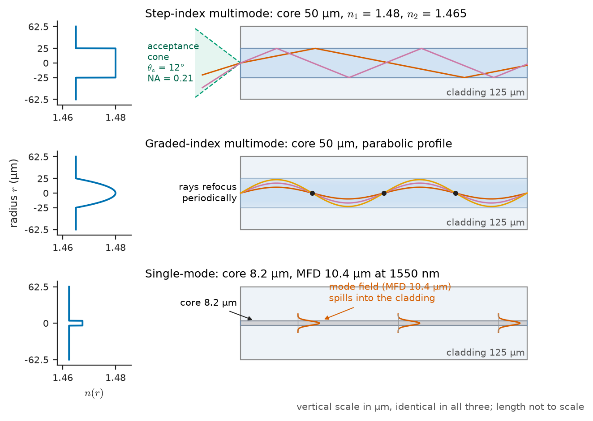
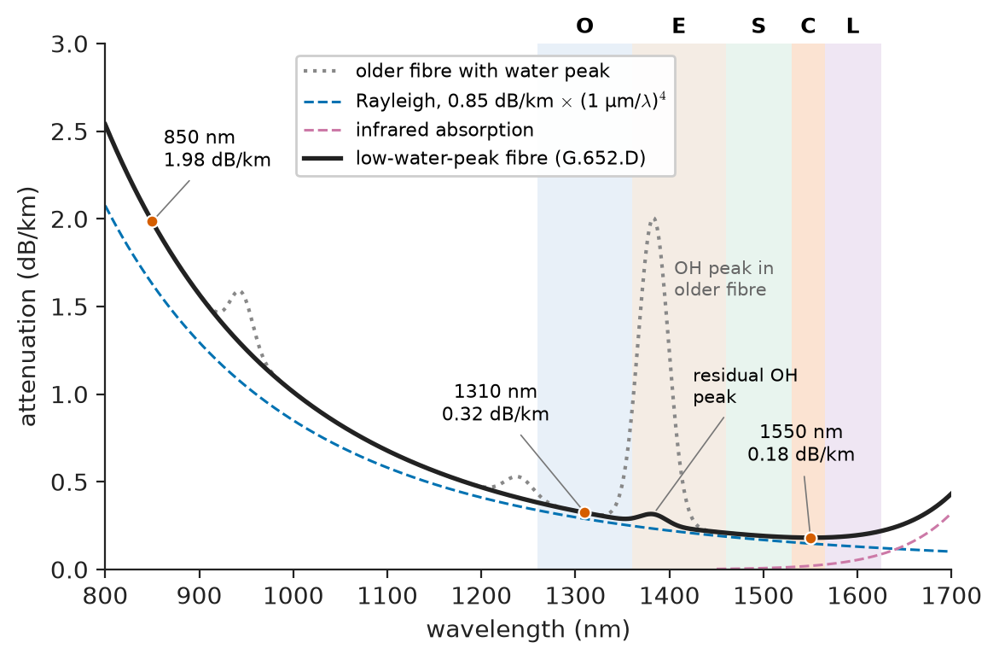
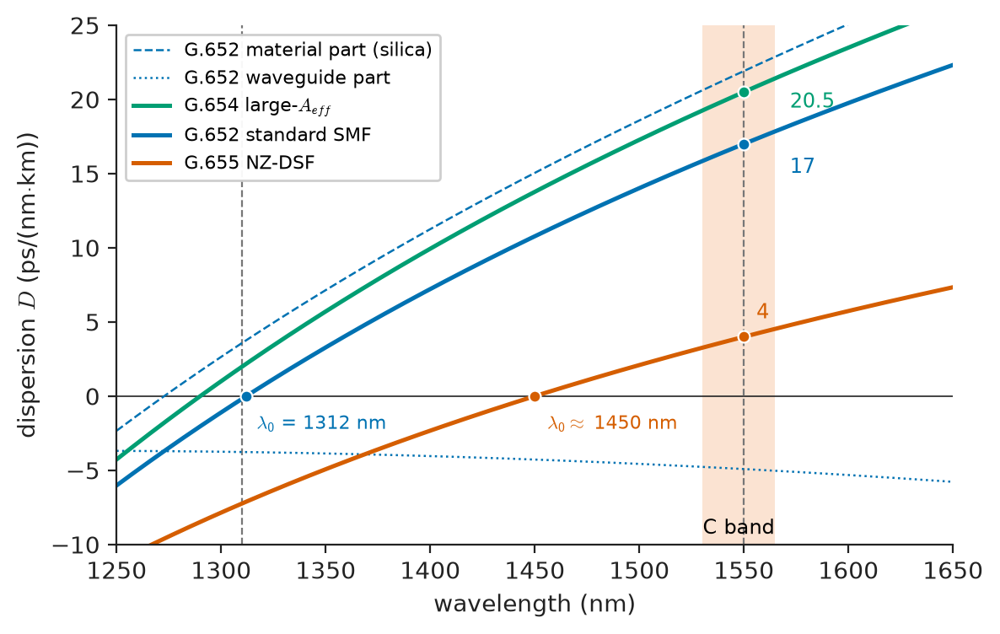
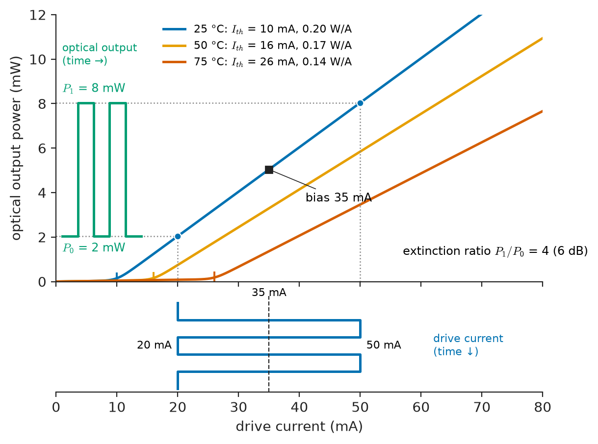
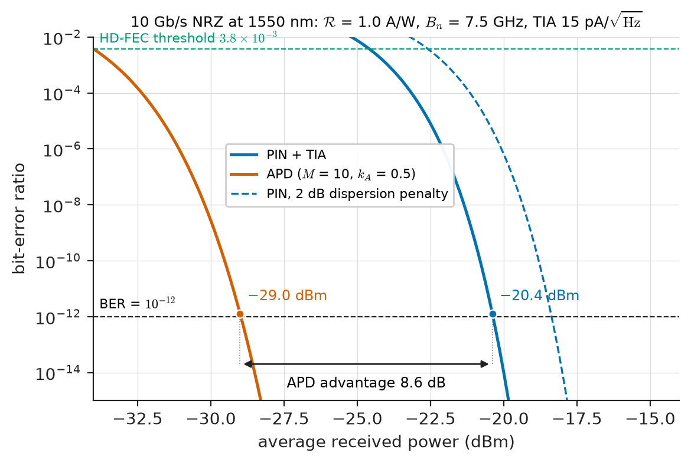
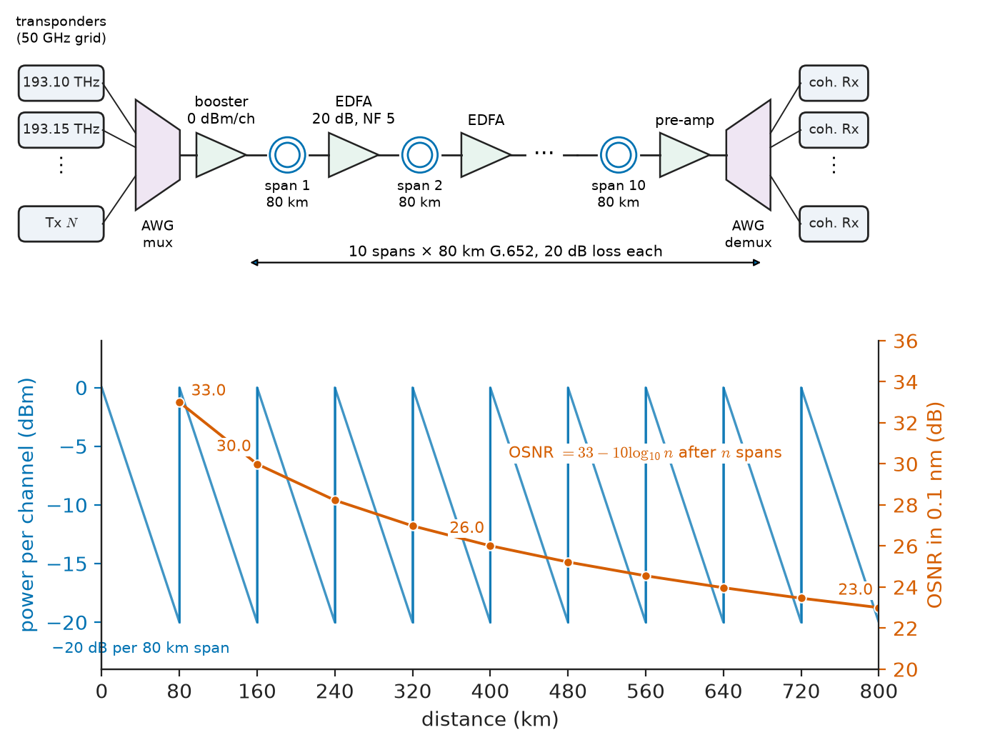

# Chapter 31 — Optical Communications

*Part VI · Communication Theory*

A regional operator lights a new 80 km fibre between two exchanges. The transceivers are standard 10 Gb/s plug-in modules, the fibre is new, the connectors have been cleaned and inspected, and the link comes up error-free on the first day. Three months later a second operator, using the same fibre type and the same distance, swaps in cheaper modules with directly modulated lasers. The received power is identical, well above the receiver's quoted sensitivity, yet the link runs at a bit-error ratio near $10^{-6}$ and the forward-error-correction counters never stop climbing. Nothing is broken. The light arrives in sufficient quantity; it simply arrives *smeared*, because each wavelength component of a chirped laser pulse travels the 80 km at a slightly different speed. The second link is dispersion-limited.

This chapter treats optical fibre as a communication channel in the sense of Chapter 25. The mathematics is that of a cable or radio link; what changes are the numbers — carriers near 200 THz, losses of 0.2 dB/km, bandwidths of terahertz — and the physics that sets them.

> **Why can a hair-thin glass fibre carry tens of terabits per second over thousands of kilometres, when copper cable struggles past a few hundred metres at 10 Gb/s?**
> **What limits an optical link — the light that is lost, the shape that is smeared, or the noise added on the way — and how does an engineer tell which one?**

| Concept | Engineering destination |
|---|---|
| Total internal reflection, numerical aperture, modes | Choosing single-mode or multimode fibre, connector and splice tolerances |
| Fibre attenuation spectrum | Choosing 1310 or 1550 nm, span lengths between amplifiers, PON reach |
| Modal, chromatic and polarization dispersion | Data-centre reach limits, 10–400 Gb/s long-haul design, dispersion compensation |
| Laser and LED transmitters | Transceiver choice: VCSEL, Fabry–Perot, DFB, externally modulated laser |
| PIN and APD receivers, Q factor | Receiver sensitivity, BER specifications, FEC thresholds |
| Wavelength-division multiplexing and EDFAs | Backbone and submarine capacity, OSNR budgets |
| Optical link budget | Acceptance testing of a new route, margin for repairs and ageing |
| Nonlinearity and system limits | Launch-power optimisation, capacity of a fibre pair |

**Roadmap.** Why light and how a fibre guides it (31.1) → the families of fibre and their parameters (31.2) → loss (31.3) and delay spread (31.4) as the two channel impairments → the transmitter (31.5) and receiver (31.6) at the ends → multiplying capacity with many wavelengths (31.7) → putting the numbers together in a link budget (31.8) → what finally limits a fibre system (31.9).

---

## 31.1 Optical transmission fundamentals

### Why an optical carrier

The capacity of any channel scales with its usable bandwidth (Shannon, Chapter 28). A carrier at frequency $f_c$ can, in practice, be modulated over a bandwidth that is some fraction of $f_c$ before the components that generate, guide and detect it stop behaving. At 2 GHz that fraction gives tens of megahertz; at the optical carrier frequency

$$
f_c=\frac{c}{\lambda}=\frac{2.998\times10^8\ \mathrm{m/s}}{1550\ \mathrm{nm}}\approx193.4\ \mathrm{THz}
$$

even a fraction of a percent is tens of terahertz. The low-loss window of silica fibre around 1550 nm is about 35 nm wide in the conventional amplifier band alone, which converts to

$$
\Delta f=\frac{c\,\Delta\lambda}{\lambda^{2}}=\frac{2.998\times10^{8}\times35\times10^{-9}}{(1547.5\times10^{-9})^{2}}\approx4.4\ \mathrm{THz}
$$

— more than all the radio spectrum below 100 GHz put together, in a single strand of glass. The second reason is loss. A good coaxial cable loses about 20 dB per 100 m at 1 GHz (Chapter 14), and the loss rises as $\sqrt f$ because of the skin effect. A modern single-mode fibre loses about 0.2 dB per *kilometre*, and that loss is essentially independent of the modulation rate. The third reason is immunity: glass picks up no 50 Hz field, forms no ground loops, and can run inside the earth wire of a transmission line (OPGW cable).

### Photons and power

Light comes in quanta of energy $E=hc/\lambda$: at 1550 nm one photon carries $1.28\times10^{-19}$ J (0.80 eV), so 1 µW is about $7.8\times10^{12}$ photons per second. The granularity is irrelevant for power budgets but sets the ultimate floor on receiver noise (Section 31.6). Optical power is quoted in dBm as in RF work (Chapter 25): a data-centre VCSEL launches −2 to +2 dBm, a long-haul DFB 0 to +5 dBm per channel, and a 10 Gb/s receiver needs roughly −18 to −28 dBm.

### Guiding light: total internal reflection and numerical aperture

A step-index fibre is a glass core of refractive index $n_1$ surrounded by a cladding of slightly lower index $n_2$, both usually silica, with the core doped (typically with germanium dioxide) to raise its index by a fraction of a percent. The relative index difference

$$
\Delta=\frac{n_1-n_2}{n_1}
$$

is about 0.35 % for standard single-mode fibre and about 1 % for multimode fibre (Figure 31.1). A ray inside the core striking the core–cladding interface at an angle (from the normal) greater than the critical angle $\theta_c=\arcsin(n_2/n_1)$ is totally reflected and stays in the core. Tracing that condition back through the end face of the fibre gives the largest launch angle $\theta_a$ (in air) that is guided:

$$
\mathrm{NA}=\sin\theta_a=\sqrt{n_1^{2}-n_2^{2}}\approx n_1\sqrt{2\Delta}
$$

For $n_1=1.48$ and $\Delta=0.01$ the numerical aperture is 0.21 and the acceptance half-angle about 12°; for single-mode fibre the NA is about 0.12 (7°). The NA sets how easily light can be coupled in: a large-area, wide-angle source such as an LED couples only to large-NA multimode fibre, whereas single-mode fibre needs a laser whose beam is focused onto a spot only a few micrometres across.

> **Status of the principle: Ray guiding by total internal reflection**
> *Approximate.* Geometrical optics is valid when the core is many wavelengths across (multimode fibre, core 50–62.5 µm); for single-mode cores of 8–10 µm the guided field must be found from Maxwell's equations as a waveguide mode, and the ray picture gives only qualitative insight.

<!-- FIGURE 31.1 | figures/ch31/fig-31-1-fibre-guiding-modes.png | schematic | Light guiding in step-index multimode, graded-index multimode and single-mode fibre, with the acceptance cone set by the numerical aperture. | Content: three stacked longitudinal cross-sections, each with a refractive-index profile n(r) drawn at the left. Top: step-index multimode, core 50 µm, n1 = 1.48, n2 = 1.465, zig-zag rays at two angles plus acceptance cone of half-angle 12 degrees labelled NA = 0.21. Middle: graded-index multimode, parabolic profile, sinusoidal ray paths that refocus periodically. Bottom: single-mode, core 8.2 µm, cladding 125 µm, a single Gaussian-like field profile with mode-field diameter 10.4 µm at 1550 nm shown spilling into the cladding. Cladding diameter 125 µm in all three, drawn to a consistent vertical scale. -->

*Figure 31.1 — Light guiding in step-index multimode, graded-index multimode and single-mode fibre, with the acceptance cone set by the numerical aperture.*

### Modes and the V number

Because the core is a waveguide, only discrete field patterns — modes — propagate, each with its own propagation constant, exactly as in the rectangular waveguides of Chapter 32. How many modes a step-index fibre supports is set by the normalised frequency

$$
V=\frac{2\pi a}{\lambda}\,\mathrm{NA}
$$

where $a$ is the core radius. For $V<2.405$ (the first zero of the Bessel function $J_0$) only the fundamental mode, $\mathrm{LP}_{01}$, propagates, and the fibre is **single-mode**. For large $V$ the number of modes is approximately $V^2/2$. With $a=4.1\ \mu\mathrm{m}$ and $\mathrm{NA}=0.12$, $V=2.36$ at 1310 nm and 1.99 at 1550 nm: single-mode at both, with cutoff wavelength

$$
\lambda_c=\frac{2\pi a\,\mathrm{NA}}{2.405}\approx1285\ \mathrm{nm}
$$

A multimode fibre with a 50 µm core and NA 0.2 has $V\approx37$ at 850 nm and so carries several hundred modes.

> **Status of the principle: Single-mode condition $V<2.405$**
> *Derived.* Follows from solving the weakly guiding wave equation in a step-index cylinder; exact for the ideal step profile, while real profiles and cabled bends shift the effective cutoff by tens of nanometres, which is why standards specify a *cable* cutoff wavelength below 1260 nm.

The fundamental mode is roughly Gaussian and extends into the cladding, with a **mode-field diameter** (MFD) of about 9.2 µm at 1310 nm and 10.4 µm at 1550 nm; the MFD sets splice loss and laser coupling, and is why single-mode connectors align fibres to about a micrometre.

---

## 31.2 Fiber characteristics

### The fibre families

Practically all telecommunications fibre is silica with a 125 µm cladding and a 250 µm (or 200 µm) polymer coating. What distinguishes the families is the core design and therefore the modal and dispersion behaviour. Table 31.1 collects the types an engineer meets.

**Table 31.1 — Common fibre types (typical specified values).**

| Fibre | Core / MFD | Main window | Loss (dB/km) | Dispersion / bandwidth | Typical use |
|---|---|---|---|---|---|
| ITU-T G.652.D standard single-mode | 8.2 µm core; MFD 9.2 µm at 1310 nm | 1310 and 1550 nm | ≤0.35 at 1310, ≤0.22 at 1550 (typ. 0.32 and 0.19) | Zero dispersion 1300–1324 nm; about 17 ps/(nm·km) at 1550 nm | Access, metro, long haul — the bulk of installed fibre |
| G.657 bend-insensitive single-mode | As G.652, trench-assisted | 1310–1625 nm | As G.652 | As G.652 | Fibre-to-the-home drops, tight cabinets |
| G.655 non-zero dispersion-shifted | MFD 8–9 µm at 1550 nm | 1530–1625 nm | ≤0.22 at 1550 | 2–6 ps/(nm·km) at 1550 nm | Older DWDM long haul (limits four-wave mixing) |
| G.654 cut-off-shifted, large effective area | Aeff 110–125 µm² | 1550 nm | 0.15–0.17 | ≈20–21 ps/(nm·km) | Submarine and coherent terrestrial long haul |
| OM3 / OM4 laser-optimised multimode | 50 µm graded index | 850 nm | ≈2.5–3.0 at 850, ≈0.7–1.0 at 1300 | Effective modal bandwidth 2000 / 4700 MHz·km at 850 nm | Data-centre links up to 100–400 m |
| OM1 legacy multimode | 62.5 µm graded index | 850 / 1300 nm | ≈3.0 / 1.0 | ≈200 / 500 MHz·km | Older building backbones |
| Polymer optical fibre (PMMA) | ≈1 mm step index | 650 nm | ≈150–200 | Tens of MHz over 50 m | Automotive (MOST), short industrial links |

### Parameters that matter to a link designer

For a link designer a fibre is described by five numbers: the attenuation $\alpha$ in dB/km (Section 31.3); the chromatic dispersion $D$ in ps/(nm·km) and its slope $S=dD/d\lambda$ (Section 31.4); the modal bandwidth of multimode fibre in MHz·km; the PMD coefficient in ps/√km; and the effective area $A_\mathrm{eff}$, about 80 µm² for G.652 at 1550 nm, which governs nonlinearity (Section 31.9). Bend radius, proof strain and ageing enter the link calculation only as extra attenuation.

> **Boundary.** The manufacture of preforms, the doping chemistry that sets $n_1$ and $n_2$, and the glass physics behind Rayleigh scattering belong to *The Materials Core*; the electromagnetic solution for guided modes belongs to *Engineering Physics*. Here the fibre is a channel described by $\alpha$, $D$, bandwidth and $A_\mathrm{eff}$.

### Fibre as a linear channel

For powers below a few milliwatts per channel, a single-mode fibre is a linear, time-invariant system for the optical field (Chapter 17). Its transfer function at an offset $\omega$ from the carrier is, to second order,

$$
H(\omega)=e^{-\alpha_n L/2}\,e^{-j\beta(\omega)L},\qquad \beta(\omega)\approx\beta_0+\beta_1\omega+\tfrac12\beta_2\omega^{2}
$$

where $\alpha_n$ is the power attenuation in nepers per unit length. The three terms in $\beta$ have direct meanings: $\beta_0$ is a phase that does not matter, $\beta_1=1/v_g$ is the group delay per unit length (about 4.9 µs/km for a group index of 1.468), and $\beta_2$ is **group-velocity dispersion**, the frequency dependence of group delay that Chapter 18 identified as the cause of distortion. Loss and dispersion are therefore exactly the magnitude and phase of an all-pass-with-loss filter. The difference from a copper line is that the loss is almost flat over the signal bandwidth and the phase is almost purely quadratic.

---

## 31.3 Attenuation

### Loss in decibels per kilometre

Power decays exponentially along the fibre:

$$
P(L)=P(0)\,10^{-\alpha L/10}
$$

with $\alpha$ in dB/km. At 0.2 dB/km a 100 km span loses 20 dB — a factor of 100 — which is why unrepeated links of 80–120 km are routine and why amplifiers in long-haul systems are spaced 50–100 km apart.

> **Status of the principle: Exponential attenuation with constant $\alpha$**
> *Approximate.* Holds for a uniform fibre in the linear regime; splices, connectors and bends add discrete losses that are budgeted separately, and $\alpha$ itself is wavelength dependent and rises slowly with hydrogen exposure and radiation.

### The mechanisms

**Rayleigh scattering** dominates in the low-loss windows. Glass is frozen liquid; its density fluctuates on a scale far below a wavelength, and each fluctuation scatters a little light in all directions. The scattering coefficient scales as $\lambda^{-4}$, so moving from 1310 to 1550 nm reduces it by $(1550/1310)^4\approx1.96$ — almost exactly the ratio of the specified losses (0.32 against 0.17–0.19 dB/km). Rayleigh scattering also returns a tiny fraction of the light backwards, which is what an optical time-domain reflectometer (OTDR) measures to map loss along an installed fibre.

**Infrared absorption** by the vibrations of Si–O bonds rises steeply beyond about 1600 nm and sets the long-wavelength edge of the window. **Ultraviolet absorption** by electronic transitions is negligible at telecom wavelengths but contributes at 850 nm and below. **Impurity absorption** used to be dominated by hydroxyl (OH) ions, with an overtone peak near 1383 nm; "low water peak" fibre (G.652.D) has removed it to below 0.35 dB/km, opening the whole range from 1260 to 1625 nm for coarse WDM. **Bending loss** occurs when a fibre is curved tightly enough that part of the mode would have to travel faster than light in the cladding; it is radiated. Macrobends of radius below about 15 mm cause measurable loss in G.652 fibre, especially at 1550 and 1625 nm, which is why technicians test at the longest wavelength to find bends; G.657 fibre tolerates radii down to 5–7.5 mm.

<!-- FIGURE 31.2 | figures/ch31/fig-31-2-attenuation-spectrum.png | plot | Attenuation spectrum of low-water-peak single-mode silica fibre with the Rayleigh and infrared contributions and the conventional transmission bands. | Content: x-axis wavelength 800 to 1700 nm, y-axis attenuation 0 to 3 dB/km (linear). Total loss curve: about 2.0 dB/km at 850 nm, 0.33 at 1310, small residual bump to 0.31 at 1383, minimum 0.18 near 1560, rising to 0.25 at 1650 and steeply beyond. Dashed curve Rayleigh = 0.85 dB/km × (1 µm / lambda)^4. Dashed curve infrared absorption rising beyond 1600 nm. Dotted grey curve showing an old fibre with water peak 2 dB/km at 1383 nm. Shaded bands labelled O (1260–1360), E (1360–1460), S (1460–1530), C (1530–1565), L (1565–1625). Markers at 850, 1310, 1550 nm. -->

*Figure 31.2 — Attenuation spectrum of low-water-peak single-mode silica fibre with the Rayleigh and infrared contributions and the conventional transmission bands.*

Figure 31.2 shows the result: three historical windows at 850, 1310 and 1550 nm, now merged into a continuous low-loss region labelled by ITU bands O, E, S, C and L. Table 31.2 gives representative values for the discrete losses that are added to the distributed loss.

**Table 31.2 — Representative attenuation contributions.**

| Item | Typical loss | Notes |
|---|---|---|
| G.652.D fibre at 1310 nm | 0.32–0.35 dB/km | Cabled values about 0.03 dB/km higher |
| G.652.D fibre at 1550 nm | 0.18–0.22 dB/km | Design value 0.22–0.25 dB/km cabled |
| Ultra-low-loss pure-silica-core fibre, 1550 nm | 0.15–0.16 dB/km | Submarine and premium long haul |
| OM3/OM4 multimode at 850 nm | 2.3–3.0 dB/km | Short reach only |
| Fusion splice | 0.02–0.1 dB | Mean about 0.05 dB with modern splicers |
| Mechanical splice | 0.1–0.3 dB | Field repairs |
| Connector pair (single-mode, PC/APC) | 0.2–0.5 dB | Budget 0.5 dB; 0.75 dB worst case in some standards |
| 1:2 passive splitter | 3.5–3.8 dB | 3.01 dB ideal plus excess loss |
| 1:32 passive splitter (PON) | 16–17.5 dB | $10\log_{10}32=15.05$ dB ideal |
| Repair margin on a long route | 2–3 dB | For future splices after cable cuts |

**Worked example — span loss of an 80 km route.** A route of 80 km uses cabled G.652.D fibre with a design attenuation of 0.22 dB/km at 1550 nm. The cable is delivered on 4 km drums, so there are $80/4-1=19$ fusion splices at 0.05 dB each, and a connector at each end at 0.5 dB. The span loss is

$$
L_\mathrm{span}=80\times0.22+19\times0.05+2\times0.5=17.6+0.95+1.0=19.55\ \mathrm{dB}
$$

The fibre itself accounts for 90 % of the loss. At 1310 nm, with 0.35 dB/km, the same route would lose $28+0.95+1.0\approx30$ dB — beyond the reach of most 10 Gb/s receivers — which is why long unamplified links operate at 1550 nm even though dispersion is worse there.

---

## 31.4 Dispersion

Attenuation reduces the energy of a pulse; dispersion spreads it in time. When a pulse spreads into its neighbours' bit slots, it causes intersymbol interference (Chapter 27) that no amount of extra power can cure. Three mechanisms spread a pulse in fibre.

### Modal dispersion

In a multimode fibre each mode — each ray angle in the geometrical picture — travels a different path length. In a step-index fibre the axial ray and the ray at the critical angle differ in transit time by

$$
\Delta\tau_\mathrm{mod}\approx\frac{L\,n_1\Delta}{c}
$$

For $n_1=1.48$, $\Delta=0.01$: $\Delta\tau/L\approx49$ ns/km. Keeping the spread below about a quarter of a bit period limits the bit rate–distance product to roughly 5 Mb/s·km — fine for an industrial sensor link, useless for data. A **graded-index** profile, with the index falling parabolically from the axis, makes the oblique rays travel faster in the lower-index outer region so that they arrive almost together; the ideal profile reduces the spread to

$$
\Delta\tau_\mathrm{GI}\approx\frac{L\,n_1\Delta^{2}}{8c}\approx62\ \mathrm{ps/km}
$$

an improvement of $8/\Delta=800$. Real profiles never achieve the ideal, and the industry instead specifies an **effective modal bandwidth** measured with standardised laser launches: 2000 MHz·km for OM3 and 4700 MHz·km for OM4 at 850 nm. That is why a 10 Gb/s short-reach link (10GBASE-SR) is specified to 300 m on OM3 and 400 m on OM4, and 100 Gb/s links over four 25 Gb/s lanes to 70–100 m.

> **Status of the principle: Modal-dispersion estimates**
> *Approximate.* The ray formulas give the scale and the improvement from grading; real multimode bandwidth depends on profile imperfections and on which modes the laser excites, so link design uses measured effective modal bandwidth, not the formula.

### Chromatic dispersion

Single-mode fibre removes modal dispersion, but the group velocity of the single mode still depends on wavelength, for two reasons. **Material dispersion** arises because the refractive index of silica varies with wavelength (the same effect that makes a prism separate colours); **waveguide dispersion** arises because the fraction of the mode in the cladding, and hence its effective index, changes with wavelength. Their sum is described by the dispersion parameter

$$
D=\frac{1}{L}\frac{d\tau_g}{d\lambda}=-\frac{2\pi c}{\lambda^{2}}\beta_2\qquad[\mathrm{ps/(nm\cdot km)}]
$$

A source of spectral width $\Delta\lambda$ produces a delay spread

$$
\Delta\tau_\mathrm{chr}=\lvert D\rvert\,L\,\Delta\lambda
$$

For G.652 fibre the material and waveguide contributions cancel near 1310 nm (zero-dispersion wavelength $\lambda_0$ between 1300 and 1324 nm), and $D$ rises to about +17 ps/(nm·km) at 1550 nm with a slope of about 0.056 ps/(nm²·km) there. Dispersion-shifted fibres move $\lambda_0$ by enlarging the waveguide contribution with a more complex index profile; non-zero dispersion-shifted fibres (G.655) deliberately leave $D$ at 2–6 ps/(nm·km) at 1550 nm, because zero dispersion lets WDM channels stay in phase and generate strong four-wave-mixing products (Section 31.9).

> **Status of the principle: Linear delay-spread formula $\Delta\tau=\lvert D\rvert L\Delta\lambda$**
> *Approximate.* Valid when the source spectrum is wider than the modulation bandwidth (LEDs, Fabry–Perot lasers) and $\lambda$ is far from $\lambda_0$; for narrow-linewidth lasers the signal's own modulation spectrum sets the spreading, and near $\lambda_0$ the dispersion slope (third-order term) takes over.

<!-- FIGURE 31.3 | figures/ch31/fig-31-3-chromatic-dispersion.png | plot | Chromatic dispersion versus wavelength for standard, non-zero dispersion-shifted and large-effective-area single-mode fibres. | Content: x-axis wavelength 1250 to 1650 nm, y-axis D from -10 to +25 ps/(nm km). Curves: G.652 crossing zero at 1312 nm, D = 17 at 1550 nm; G.655 crossing zero near 1450 nm, D = 4 at 1550 nm; G.654 with D = 20.5 at 1550 nm. Shaded C-band 1530–1565 nm. Dashed vertical lines at 1310 and 1550 nm. Inset or annotation: material-dispersion and waveguide-dispersion contributions for G.652 as thin dashed curves summing to the total. -->

*Figure 31.3 — Chromatic dispersion versus wavelength for standard, non-zero dispersion-shifted and large-effective-area single-mode fibres.*

Figure 31.3 shows how the three fibre designs place their dispersion relative to the C band.

**Worked example — the bit-rate limit of a Fabry–Perot laser at 1550 nm.** A low-cost Fabry–Perot (FP) laser emits several longitudinal modes with an rms spectral width of 2 nm. Used at 1550 nm over 40 km of G.652 fibre ($D=17$ ps/(nm·km)), it produces a spread

$$
\Delta\tau=17\times40\times2=1360\ \mathrm{ps}
$$

With the usual rule that the rms spread must stay below a quarter of a bit period, $B<1/(4\Delta\tau)=184$ Mb/s. The same laser at 1310 nm, near $\lambda_0$, would be limited by the dispersion slope instead and can run at 1–2.5 Gb/s over tens of kilometres — which is why early single-mode systems and today's short-reach O-band transceivers use FP lasers at 1310 nm, and why 1550 nm systems need single-frequency DFB lasers.

### Dispersion with single-frequency lasers

When the laser linewidth is far narrower than the modulation bandwidth, the spectral width of the signal is set by the bit rate itself: a 10 Gb/s NRZ signal occupies about $\Delta f\approx10$ GHz, equivalent to

$$
\Delta\lambda=\frac{\lambda^{2}\Delta f}{c}=\frac{(1550\times10^{-9})^{2}\times10^{10}}{2.998\times10^{8}}\approx0.080\ \mathrm{nm}
$$

The spread now grows as $DL\Delta\lambda\propto DLB$, and it is spread relative to a bit period $1/B$ that matters, so the reach scales as $1/B^{2}$. Using $\beta_2=-D\lambda^2/(2\pi c)\approx-21.7$ ps²/km and the criterion $B\sqrt{\lvert\beta_2\rvert L}<1/4$ gives:

**Table 31.3 — Approximate chromatic-dispersion reach of chirp-free NRZ on G.652 fibre at 1550 nm.**

| Bit rate | $B\sqrt{\lvert\beta_2\rvert L}<1/4$ estimate | Industry dispersion tolerance (≈1–2 dB penalty) | Equivalent length at 17 ps/(nm·km) |
|---|---|---|---|
| 2.5 Gb/s | ≈460 km | ≈16 000 ps/nm | ≈900 km |
| 10 Gb/s | ≈29 km | ≈1000 ps/nm (up to 1600 with negative-chirp EML) | ≈60 km (≈95 km) |
| 40 Gb/s | ≈1.8 km | ≈60 ps/nm | ≈4 km |

The two columns differ because the criterion is conservative and receivers tolerate some intersymbol interference at a power penalty; the scaling with $1/B^2$ is the robust result. The factor 16 between 10 and 40 Gb/s is why the move to 40 Gb/s in the 2000s was so difficult with direct detection, and why coherent receivers (Section 31.6) took over.

**Chirp** makes matters worse. A directly modulated laser shifts its frequency by several gigahertz as the drive current changes, broadening the spectrum and, on standard fibre at 1550 nm, compressing or expanding the pulse edges in a way that closes the eye after 20–40 km at 10 Gb/s. That is the failure in this chapter's opening: the cheap modules were directly modulated and the 80 km route accumulated $80\times17=1360$ ps/nm, beyond what they tolerate.

### Dispersion compensation

Because chromatic dispersion is a linear, deterministic all-pass phase $e^{-j\beta_2\omega^2L/2}$, it can be undone by its inverse: with **dispersion-compensating fibre** ($D\approx-100$ ps/(nm·km); about 13 km compensates 80 km of G.652 at 6–8 dB extra loss), with chirped **fibre Bragg gratings**, or **electronically** — in a coherent receiver an FIR filter (Chapter 23) applies the inverse quadratic phase to the sampled field and removes tens of thousands of ps/nm.

### Polarization-mode dispersion

A real fibre is not perfectly circular, and stresses make it slightly birefringent, so the two polarisations of the "single" mode travel at slightly different speeds. The birefringence axes change randomly along the fibre and with temperature, so the differential group delay (DGD) is a random variable whose mean grows as $\sqrt L$:

$$
\langle\Delta\tau_\mathrm{PMD}\rangle=\mathrm{PMD_Q}\sqrt{L}
$$

Modern fibre has a link-design value $\mathrm{PMD_Q}\le0.1$ ps/√km (typically 0.02–0.05), giving 1 ps over 100 km and 3 ps over 1000 km — harmless at 10 Gb/s (bit period 100 ps) but a real constraint on older fibre with 0.5–1 ps/√km at 40 Gb/s. Because PMD is statistical and time-varying, it is budgeted as an outage probability rather than a fixed penalty — the same logic as fading margins in Chapter 30.

> **Status of the principle: $\sqrt L$ growth of PMD**
> *Empirical.* Follows from modelling the fibre as many randomly oriented birefringent sections and is confirmed by field measurements; the PMD coefficient itself is a measured property of each cable, and the instantaneous DGD follows an approximately Maxwellian distribution.

---

## 31.5 Optical transmitters

An optical transmitter converts an electrical data signal into a modulated optical power (or, for coherent systems, a modulated optical field). Four source types cover nearly all practice.

### Light-emitting diodes

An LED emits by spontaneous recombination in a forward-biased junction. The light is incoherent, spectrally broad (30–150 nm) and spread over a wide angle, so only microwatts couple into multimode fibre and essentially nothing into single-mode fibre; carrier lifetime limits modulation to roughly 50–200 MHz. LEDs survive in plastic-fibre links and optocouplers because they are cheap and robust.

### Laser diodes: threshold and slope efficiency

A semiconductor laser adds optical feedback (cleaved facets or gratings) so that stimulated emission dominates once the gain overcomes the losses. Its light–current (L–I) characteristic, shown in Figure 31.4, has two regimes: below the **threshold current** $I_\mathrm{th}$ the output is weak spontaneous emission; above it the output power rises linearly,

$$
P_\mathrm{out}\approx\eta_s\,(I-I_\mathrm{th})
$$

with slope efficiency $\eta_s$ in W/A. Typical values for a 1550 nm DFB laser are $I_\mathrm{th}=8$–15 mA and $\eta_s=0.1$–0.3 W/A at 25 °C. The threshold rises roughly exponentially with temperature (characteristic temperature $T_0$ of 50–100 K for InGaAsP lasers), and the slope efficiency falls, so laser drivers either regulate temperature with a thermoelectric cooler or use automatic power control from a monitor photodiode. The **extinction ratio** $r_e=P_1/P_0$ between "1" and "0" levels, typically 6–10 dB (4–10 linear), is a design compromise: biasing well above threshold for the "0" level gives speed and low chirp but wastes power in the zero, which costs receiver sensitivity.

<!-- FIGURE 31.4 | figures/ch31/fig-31-4-laser-li-curve.png | plot | Light–current characteristic of a 1550 nm DFB laser at three temperatures, with the bias point and modulation swing for on-off keying. | Content: x-axis drive current 0 to 80 mA, y-axis optical output power 0 to 12 mW. Three curves for 25, 50 and 75 degrees C with thresholds 10, 16 and 26 mA and slope efficiencies 0.20, 0.17 and 0.14 W/A; small spontaneous-emission tail below threshold. On the 25 degree curve mark bias 35 mA, modulation 20 to 50 mA giving P0 = 2 mW and P1 = 8 mW (extinction ratio 6 dB), with the input current waveform drawn below the x-axis and the output optical waveform drawn to the right of the y-axis. -->

*Figure 31.4 — Light–current characteristic of a 1550 nm DFB laser at three temperatures, with the bias point and modulation swing for on-off keying.*

### Laser structures

**Fabry–Perot (FP) lasers** use the cleaved facets as mirrors and oscillate on several longitudinal modes; their 1–3 nm spectral width restricts them to 1310 nm or to short distances at 1550 nm (Section 31.4). **Distributed-feedback (DFB) lasers** etch a Bragg grating along the active region so that only one mode oscillates (side-mode suppression 35–50 dB, linewidth 1–10 MHz); they are the workhorse at 1310 and 1550 nm and the source for DWDM. **VCSELs** emit perpendicular to the wafer, with sub-milliampere thresholds and circular beams that couple well into multimode fibre; 850 nm VCSELs over OM3/OM4 carry almost every short data-centre link. Coherent systems need **tunable external-cavity lasers** with 10–300 kHz linewidth so that phase noise does not swamp the symbols.

**Table 31.4 — Representative optical sources.**

| Source | Wavelength | Spectral width | Coupled power | Modulation | Typical application |
|---|---|---|---|---|---|
| LED | 650, 850, 1300 nm | 30–150 nm | −30 to −15 dBm (MMF/POF) | ≤200 MHz | POF, industrial, optocouplers |
| VCSEL | 850 nm (also 940, 1310) | <0.45 nm rms | −3 to +2 dBm | Direct, 10–50 Gb/s | Data-centre short reach over OM3/OM4 |
| Fabry–Perot laser | 1310 nm | 1–3 nm rms | −3 to +3 dBm | Direct, ≤10 Gb/s | Short single-mode links, PON upstream |
| DFB laser | 1270–1610 nm | 1–10 MHz linewidth, 35–50 dB SMSR | 0 to +10 dBm | Direct ≤25 Gb/s or external | Metro and long haul, CWDM, DWDM |
| Electro-absorption modulated laser (EML) | 1310 / 1550 nm | DFB plus small chirp | −2 to +3 dBm | 10–100 Gb/s | 10G ZR, 100G/400G PAM-4 |
| Tunable laser + Mach–Zehnder IQ modulator | C and L band | 10–300 kHz linewidth | 0 to +3 dBm per channel | 30–130 GBd QAM | Coherent 100G–1.2T |

### Direct and external modulation

Direct current modulation is limited by the laser's relaxation-oscillation bandwidth and by chirp. **External modulation** keeps the laser running continuously and modulates its output afterwards, either with an **electro-absorption modulator** integrated with the DFB (the EML) or with a **Mach–Zehnder modulator** (MZM), which splits the light into two arms whose phases are shifted by an applied voltage (via the electro-optic effect in lithium niobate, indium phosphide or silicon) and recombines them; the output field is proportional to $\cos(\pi V/2V_\pi)$, where $V_\pi$ is the voltage for a $\pi$ phase shift (typically 2–5 V). Biased at the null and driven between $\pm V_\pi$, the MZM produces a chirp-free field that takes both positive and negative values — the optical equivalent of a balanced modulator (Chapter 26). Two MZMs in quadrature, one for each of I and Q, and two such pairs on orthogonal polarisations, form the dual-polarisation IQ modulator that generates the QPSK and QAM constellations of Chapter 27 at optical frequencies.

> **Boundary.** Laser-driver and modulator-driver circuits, their transistor stages and the thermoelectric control loop are the subject of *Electronics & Computing*; the semiconductor physics of gain, recombination and the electro-optic effect belongs to *Engineering Physics* and *The Materials Core*. This chapter uses their measured characteristics.

### Intensity modulation and noise

Most short-reach links use **intensity modulation with direct detection** (IM/DD): the transmitted *power* carries the information, as NRZ on-off keying or four-level PAM-4 at 50–100 Gb/s per lane. The laser adds **relative intensity noise** (RIN, typically −140 to −155 dB/Hz for a DFB), which matters only at high received power. Reflections into the laser worsen RIN and linewidth, which is why transmitters contain isolators and PON and video systems use angled (APC) connectors.

---

## 31.6 Optical receivers

### Photodetectors and responsivity

A photodiode absorbs photons and generates electron–hole pairs; reverse bias sweeps them out as a photocurrent proportional to the optical power,

$$
I_p=\mathcal{R}P,\qquad \mathcal{R}=\frac{\eta q}{hf}=\frac{\eta\,\lambda[\mu\mathrm{m}]}{1.24}\ \ \mathrm{A/W}
$$

where $\eta$ is the quantum efficiency. Silicon absorbs well below about 1000 nm and is used at 850 nm ($\mathcal R\approx0.5$ A/W). Indium gallium arsenide (InGaAs) covers 1000–1650 nm; with $\eta=0.8$ at 1550 nm, $\mathcal R=0.8\times1.55/1.24=1.0$ A/W. A **PIN photodiode** inserts an intrinsic region between the p and n layers so that absorption happens in a depleted zone; its bandwidth is set by transit time and capacitance (tens of gigahertz for small-area devices). An **avalanche photodiode** (APD) adds a high-field region in which carriers gain enough energy to ionise further pairs, multiplying the photocurrent by a mean gain $M$, typically 5–20 for InGaAs APDs.

The photocurrent drives a **transimpedance amplifier** (TIA) that converts microamperes into millivolts with low noise, followed by a limiting amplifier or an ADC, a clock-and-data-recovery circuit and a decision circuit.

> **Status of the principle: Linear photodetection $I_p=\mathcal R P$**
> *Fundamental.* Each absorbed photon releases at most one electron–hole pair (before avalanche gain), so current is proportional to photon flux; it is a square-law detector of the optical *field*, which is why intensity-modulated systems lose the optical phase and need coherent detection to recover it.

### Noise sources

Three noise currents compete with the signal in a direct-detection receiver.

**Shot noise** arises because photoelectrons arrive at random (Poisson statistics). Its variance in a noise bandwidth $B_n$ is

$$
\sigma_\mathrm{shot}^{2}=2q\,I_p\,B_n
$$

**Thermal (circuit) noise** is the Johnson noise of the load or feedback resistor plus the amplifier's own noise (Chapter 29). For a simple load resistor $R_L$ it is $4kTB_n/R_L$; for a TIA it is specified as an input-referred noise current density $i_n$ in pA/√Hz, giving $\sigma_\mathrm{th}^2=i_n^2B_n$.

**APD excess noise.** Avalanche multiplication is itself random, so the shot noise is multiplied by $M^2$ and by an excess-noise factor

$$
F_A=k_AM+(1-k_A)\left(2-\frac1M\right)
$$

where $k_A$ is the ratio of hole to electron ionisation coefficients (about 0.02–0.05 for silicon, 0.4–0.5 for InGaAs/InP). The signal grows as $M$, the shot noise as $M\sqrt{F_A}$, the thermal noise not at all: there is an optimum gain at which the APD's growing shot noise starts to outweigh its advantage over the fixed thermal noise.

> **Status of the principle: Shot-noise formula $\sigma^2=2qIB$**
> *Derived.* Follows from Poisson photon (or electron) statistics in the limit of many events per bit period; with fewer than a few hundred photons per bit the Gaussian approximation degrades and exact Poisson statistics are needed.

### Q factor and BER

For on-off keying with Gaussian noise of standard deviation $\sigma_1$ on the "1" level and $\sigma_0$ on the "0" level, and the decision threshold placed optimally, the bit-error ratio is (Chapter 29)

$$
\mathrm{BER}=\frac12\,\mathrm{erfc}\!\left(\frac{Q}{\sqrt2}\right),\qquad Q=\frac{I_1-I_0}{\sigma_1+\sigma_0}
$$

Q = 6 gives $\mathrm{BER}\approx1.0\times10^{-9}$ and Q = 7 gives $1.3\times10^{-12}$. Optical engineers often quote Q in decibels as $20\log_{10}Q$: 15.6 dB and 16.9 dB for those two values. Modern links rarely need such low raw error rates because forward error correction (Chapter 28) cleans up the stream: a hard-decision FEC threshold of $3.8\times10^{-3}$ corresponds to $Q=2.67$ (8.5 dB), and soft-decision FECs operate at pre-FEC BERs of $10^{-2}$ or higher. The receiver **sensitivity** is the minimum average received power for a specified BER.

<!-- FIGURE 31.5 | figures/ch31/fig-31-5-ber-vs-received-power.png | plot | Bit-error ratio versus average received power for a 10 Gb/s InGaAs PIN–TIA receiver and an APD receiver with gain 10, at 1550 nm. | Content: x-axis received average power from -34 to -14 dBm, y-axis BER on a log scale from 1e-15 to 1e-2. Two waterfall curves computed with R = 1.0 A/W, noise bandwidth 7.5 GHz, TIA noise 15 pA per root Hz, APD k_A = 0.5, M = 10. PIN curve passes BER 1.3e-12 (Q = 7) at -20.4 dBm; APD curve passes it at -29.0 dBm. Horizontal dashed lines at 1e-12 and at the HD-FEC threshold 3.8e-3. Annotation of the 8.6 dB APD advantage. Optional third dashed curve shifted 2 dB right labelled "with 2 dB dispersion penalty". -->

*Figure 31.5 — Bit-error ratio versus average received power for a 10 Gb/s InGaAs PIN–TIA receiver and an APD receiver with gain 10, at 1550 nm.*

**Worked example — sensitivity of a 10 Gb/s PIN and APD receiver.** A 10 Gb/s NRZ receiver at 1550 nm uses an InGaAs photodiode with $\mathcal R=1.0$ A/W and a TIA with input noise density 15 pA/√Hz; the noise bandwidth is $B_n=7.5$ GHz. The received average power is $-20$ dBm $=10\ \mu$W with infinite extinction ratio, so $P_1=20\ \mu$W and $P_0=0$.

*Thermal noise:* $\sigma_\mathrm{th}=15\times10^{-12}\sqrt{7.5\times10^{9}}=1.30\ \mu$A.

*Signal:* $I_1=\mathcal R P_1=20\ \mu$A, $I_0=0$.

*Shot noise on the "1":* $\sigma_\mathrm{shot}=\sqrt{2\times1.602\times10^{-19}\times20\times10^{-6}\times7.5\times10^{9}}=0.22\ \mu$A, so $\sigma_1=\sqrt{1.30^2+0.22^2}=1.32\ \mu$A and $\sigma_0=1.30\ \mu$A.

$$
Q=\frac{20}{1.32+1.30}=7.64,\qquad \mathrm{BER}=\tfrac12\mathrm{erfc}(7.64/\sqrt2)\approx1\times10^{-14}
$$

The receiver is thermal-noise limited: shot noise adds only 1.4 % to $\sigma_1$. Solving for Q = 7 gives a sensitivity of $-20.4$ dBm. Replacing the PIN with an APD of gain $M=10$ and $k_A=0.5$ ($F_A=0.5\times10+0.5\times1.9=5.95$) multiplies the signal current by ten while the APD shot noise grows only as $M\sqrt{F_A}$; repeating the calculation gives a Q = 7 sensitivity of $-29.0$ dBm, an improvement of 8.6 dB (Figure 31.5). Raising the gain further helps little: $M=15$ gives $-29.6$ dBm, $M=20$ gives $-29.6$ dBm. Commercial modules quote about $-18$ dBm (PIN) and $-26$ dBm (APD) at 10 Gb/s, 2–3 dB worse than these ideal figures, because of finite extinction ratio, intersymbol interference in the receiver filter and design margin.

The quantum limit for ideal on-off keying, about 10 photons per bit for BER $10^{-9}$, is $12.8$ nW ($-49$ dBm) at 10 Gb/s; practical direct-detection receivers sit 20–30 dB above it because the electronics, not the photons, set the noise.

### Coherent detection

A **coherent receiver** mixes the incoming signal with a local-oscillator laser in a 90° optical hybrid and detects the beat products on balanced photodiodes, giving photocurrents proportional to the in-phase and quadrature components of the received *field* in each polarisation — the baseband I/Q of a radio receiver (Chapter 26). ADCs sample them and a DSP chip compensates chromatic dispersion, separates polarisations with an adaptive 2×2 MIMO equaliser (Chapter 24), recovers carrier phase and decodes the FEC. The strong local oscillator lifts the signal above circuit noise, phase recovery permits QPSK and QAM, and linear impairments become digital problems. Long-haul links above 100 Gb/s per wavelength are now coherent.

**Table 31.5 — Representative receiver figures (1550 nm unless stated).**

| Receiver | Responsivity | Multiplication | Typical sensitivity | Notes |
|---|---|---|---|---|
| Si PIN, 850 nm | ≈0.5 A/W | 1 | −12 to −10 dBm at 10–25 Gb/s | VCSEL short reach (stressed sensitivity) |
| InGaAs PIN + TIA | 0.8–1.0 A/W | 1 | ≈−18 dBm at 10 Gb/s | 10GBASE-LR, metro |
| InGaAs APD + TIA | 0.8–1.0 A/W (unity gain) | 5–15 ($k_A\approx0.4$–0.5) | ≈−26 to −28 dBm at 10 Gb/s | 10G ER/ZR, PON |
| EDFA pre-amplified PIN | 1.0 A/W | Optical gain 20–30 dB | ≈−30 to −35 dBm at 10 Gb/s | Long unrepeated links |
| Coherent DP-QPSK 100 Gb/s | Balanced PIN pairs | LO gain | OSNR-limited: ≈11–12 dB required OSNR (0.1 nm) | Metro / long haul |

---

## 31.7 Wavelength-division multiplexing

### The idea

Each laser–receiver pair uses only a small part of the fibre's 4–10 THz of low-loss bandwidth. **Wavelength-division multiplexing** (WDM) sends many independently modulated carriers at different wavelengths down the same fibre — frequency-division multiplexing (Chapter 25) with optical carriers. A passive multiplexer combines them (arrayed-waveguide gratings or thin-film filters) and a demultiplexer separates them at the far end. Because the fibre is linear at moderate powers, the channels do not interact and each behaves as an independent link.

> **Status of the principle: Independence of WDM channels**
> *Approximate.* Holds while the total power is low enough that fibre nonlinearity (cross-phase modulation, four-wave mixing, stimulated Raman scattering) is negligible and filter crosstalk is below about −25 dB; at high channel counts and launch powers the channels do interact, which sets the optimum launch power (Section 31.9).

### Grids and families

**Coarse WDM** (CWDM, ITU-T G.694.2) uses 18 channels at 20 nm spacing from 1271 to 1611 nm, wide enough for uncooled lasers to drift without leaving their channel; it serves metro access and mobile front-haul but cannot be amplified across its whole range.

**Dense WDM** (DWDM, ITU-T G.694.1) places channels on a frequency grid anchored at 193.1 THz with spacings of 100, 50 or 25 GHz, or on a flexible grid of 12.5 GHz slots for coherent super-channels. A spacing of 100 GHz corresponds to 0.80 nm at 1550 nm, 50 GHz to 0.40 nm. Lasers must be temperature-stabilised to a few gigahertz.

### Optical amplifiers

What made DWDM dominant is the **erbium-doped fibre amplifier** (EDFA): a few metres of fibre doped with erbium ions, pumped by a 980 or 1480 nm laser, which amplifies all wavelengths across the C band (1530–1565 nm) — or the L band (1565–1625 nm) with a longer doped fibre — simultaneously and without converting them to electrical form. One amplifier replaces dozens of electronic regenerators. Typical gain is 20–30 dB, output power +17 to +23 dBm total, and noise figure 4.5–6 dB (the quantum limit for a high-gain phase-insensitive amplifier is 3 dB). **Raman amplification**, which uses the fibre itself as the gain medium pumped about 100 nm below the signal, provides distributed gain with lower effective noise figure and is used on long spans.

### Capacity

**Worked example — DWDM channel count and the OSNR budget.** The C band from 1530 to 1565 nm covers 4.38 THz (Section 31.1): about 44 channels at 100 GHz spacing and 88 at 50 GHz. At 10 Gb/s per channel the 50 GHz grid carries about 0.9 Tb/s; with 200 Gb/s coherent channels it carries 12–17 Tb/s, and C+L-band systems with 800 Gb/s wavelengths reach 40–60 Tb/s per fibre pair.

Every EDFA adds amplified spontaneous emission (ASE) noise, and the ratio of signal to ASE power in a reference bandwidth of 0.1 nm (12.5 GHz) is the **optical signal-to-noise ratio** (OSNR). For a chain of $N$ identical spans, each with loss $L_\mathrm{span}$ exactly compensated by an amplifier of noise figure $NF$, a widely used design rule is

$$
\mathrm{OSNR}_{0.1\,\mathrm{nm}}\,[\mathrm{dB}]\approx58+P_\mathrm{ch}\,[\mathrm{dBm}]-L_\mathrm{span}\,[\mathrm{dB}]-NF\,[\mathrm{dB}]-10\log_{10}N
$$

where 58 dB is $-10\log_{10}(hf\,B_\mathrm{ref})$ in dBm at 1550 nm. With $P_\mathrm{ch}=0$ dBm, $L_\mathrm{span}=20$ dB, $NF=5$ dB and $N=10$ spans (about 800 km of 80 km spans):

$$
\mathrm{OSNR}\approx58+0-20-5-10=23\ \mathrm{dB}
$$

A 100 Gb/s DP-QPSK transceiver needs about 11–12 dB at its FEC threshold, so this link has some 11 dB of margin; a 400 Gb/s DP-16QAM channel needs about 20–22 dB and would barely close. The OSNR rule exposes the levers: every 3 dB more launch power or 3 dB less span loss buys 3 dB of OSNR, and every doubling of the number of spans costs 3 dB. Shorter spans and lower-loss fibre are therefore worth more than better amplifiers, whose noise figure cannot go below 3 dB.

> **Status of the principle: The "58 dB" OSNR rule**
> *Approximate.* Assumes identical spans with loss fully compensated, ASE-limited noise, a 0.1 nm reference bandwidth at 1550 nm and no nonlinear noise; it overestimates OSNR at high launch powers where nonlinear interference adds noise of its own.

<!-- FIGURE 31.6 | figures/ch31/fig-31-6-dwdm-link.png | block-diagram | A DWDM line system: transponders, multiplexer, booster amplifier, fibre spans with in-line EDFAs, pre-amplifier, demultiplexer and receivers, with the power and OSNR evolution along the route. | Content: top row block diagram: N transmitters at 193.1, 193.15, ... THz (50 GHz grid) into an AWG multiplexer, booster EDFA (+0 dBm per channel), then 10 spans of 80 km G.652 fibre (20 dB loss each) separated by in-line EDFAs (gain 20 dB, NF 5 dB), pre-amplifier, AWG demultiplexer and coherent receivers. Bottom panel: per-channel power in dBm versus distance 0 to 800 km as a saw-tooth between 0 and -20 dBm; second y-axis OSNR (0.1 nm) falling from 33 dB after the first span to 23 dB after the tenth, following 33 - 10 log10(n) after n spans. -->

*Figure 31.6 — A DWDM line system: transponders, multiplexer, booster amplifier, fibre spans with in-line EDFAs, pre-amplifier, demultiplexer and receivers, with the power and OSNR evolution along the route.*

Figure 31.6 shows the saw-tooth of signal power along such a line and the steady decline of OSNR as ASE accumulates.

---

## 31.8 Optical link budgets

### The power budget

An optical link budget is the same bookkeeping as the radio link budget of Chapter 30, with simpler propagation and different margins:

$$
P_\mathrm{rx}=P_\mathrm{tx}-\alpha L-n_s\,a_s-n_c\,a_c-L_\mathrm{other}
$$

$$
M=P_\mathrm{rx}-S_\mathrm{rx}-P_\mathrm{penalty}
$$

where $S_\mathrm{rx}$ is the receiver sensitivity, $n_s a_s$ and $n_c a_c$ the splice and connector losses, $L_\mathrm{other}$ splitters or passive filters, and $P_\mathrm{penalty}$ the power penalties from dispersion, extinction ratio, reflections and ageing. A margin $M$ of 3 dB is a common minimum for a new link; operators of long routes reserve more for future cable repairs. Very short links may instead exceed the receiver's **overload** level and need an attenuator.

### The rise-time (dispersion) budget

The second budget asks whether the link is fast enough. The 10–90 % rise times of transmitter, fibre and receiver add approximately in quadrature,

$$
t_\mathrm{sys}=\sqrt{t_\mathrm{tx}^{2}+t_\mathrm{mod}^{2}+t_\mathrm{chr}^{2}+t_\mathrm{rx}^{2}}
$$

and must stay below about 70 % of the bit period for NRZ (35 % for RZ). In modern single-mode systems the rise-time budget has been replaced by the dispersion-tolerance specification of the transceiver (in ps/nm) and a power penalty, but the logic is the same: a link must close in *both* power and bandwidth.

> **Status of the principle: Quadrature addition of rise times**
> *Approximate.* Exact for cascaded Gaussian impulse responses; acceptable for most practical responses, but it misrepresents strongly chirped or non-Gaussian dispersion, which is why modern specifications use measured dispersion penalties instead.

**Worked example — closing an 80 km, 10 Gb/s link.** Take the 80 km span of Section 31.3 (19.55 dB loss) and a transmitter launching +2 dBm.

$$
P_\mathrm{rx}=2-19.55=-17.55\ \mathrm{dBm}
$$

*Option A: PIN receiver,* datasheet sensitivity −18 dBm. The raw margin is only 0.45 dB before any dispersion penalty. The route accumulates $80\times17=1360$ ps/nm, beyond the ≈1000 ps/nm tolerance of a chirp-free 10 Gb/s receiver, so the link fails on dispersion as well as on power — the opening scenario.

*Option B: EML transmitter and APD receiver,* datasheet sensitivity −26 dBm, dispersion tolerance 1600 ps/nm with a 2 dB penalty budgeted.

$$
M=-17.55-(-26)-2=6.45\ \mathrm{dB}
$$

The link closes with more than 3 dB to spare. This is essentially the 10GBASE-ZR "80 km" module class: an externally modulated laser that tolerates the dispersion and an APD that supplies the sensitivity.

*Option C: 1310 nm,* where dispersion is near zero. The loss at 0.35 dB/km is about 30 dB; with a +2 dBm source and a −26 dBm APD the margin is $2-30-(-26)=-2$ dB. The link fails on power. At 80 km, 1550 nm with an EML is the only direct-detection option that closes.

**Table 31.6 — Link-budget template for the 80 km example (Option B).**

| Item | Value | Running total |
|---|---|---|
| Transmitter launch power | +2.0 dBm | +2.0 dBm |
| Fibre, 80 km × 0.22 dB/km | −17.6 dB | −15.6 dBm |
| 19 fusion splices × 0.05 dB | −0.95 dB | −16.55 dBm |
| 2 connectors × 0.5 dB | −1.0 dB | −17.55 dBm |
| Received power | | −17.55 dBm |
| Receiver sensitivity (APD, BER $10^{-12}$) | −26.0 dBm | |
| Dispersion penalty (1360 ps/nm) | 2.0 dB | |
| **Margin** | **6.45 dB** | |

### Passive optical networks

Fibre-to-the-home uses **passive optical networks** (PONs): one exchange transceiver serves 32 or 64 homes through a passive splitter whose loss is $10\log_{10}N$ plus excess — 15.05 dB ideal, about 17 dB in practice for 1:32 — so a 20 km PON budget is dominated by the split, not the fibre. GPON Class B+ allows 28 dB between transceivers. Downstream data is broadcast and encrypted; upstream uses time-division multiple access (Chapter 30).

---

## 31.9 System limitations

A designer who has closed the power and dispersion budgets still faces limits that are not captured by either. They divide naturally by the regime in which they bite.

### Power-limited versus dispersion-limited regimes

The loss limit $L_\alpha=(P_\mathrm{tx}-S_\mathrm{rx}-M)/\alpha$ falls only slowly with bit rate (thermal-limited sensitivity worsens by roughly 1.5 dB per doubling), whereas the dispersion limit falls as $1/B$ for broad sources and $1/B^2$ for narrow ones. Low-rate links are therefore **power-limited** and high-rate links **dispersion-limited**; for G.652 at 1550 nm with a DFB laser the crossover lies around 2.5–10 Gb/s over 50–100 km. Amplifiers remove the power limit and compensation the dispersion limit; what remains is noise and nonlinearity.

### Fibre nonlinearity

The refractive index of silica depends slightly on optical intensity, $n=n_0+n_2I$, with $n_2\approx2.6\times10^{-20}$ m²/W. The resulting nonlinear coefficient is

$$
\gamma=\frac{2\pi n_2}{\lambda A_\mathrm{eff}}=\frac{2\pi\times2.6\times10^{-20}}{1.55\times10^{-6}\times80\times10^{-12}}\approx1.3\ \mathrm{W^{-1}km^{-1}}
$$

Because the power decays along the span, nonlinear effects accumulate over an **effective length** $L_\mathrm{eff}=(1-e^{-\alpha_nL})/\alpha_n$, about 21 km for an 80 km span at 0.2 dB/km. A channel at 10 mW acquires a nonlinear phase $\gamma P L_\mathrm{eff}\approx1.3\times0.01\times21.2\approx0.28$ rad per span — small in one span, significant after twenty. The resulting effects are:

- **Self-phase modulation (SPM):** each channel modulates its own phase in proportion to its own power, broadening the spectrum and interacting with dispersion.
- **Cross-phase modulation (XPM):** the power of neighbouring WDM channels modulates a channel's phase.
- **Four-wave mixing (FWM):** three channels beat to produce new frequencies $f_i+f_j-f_k$ that fall on other channels of an equally spaced grid. FWM is efficient only when the channels stay in phase, i.e. near zero dispersion — the reason G.655 fibre retains a small non-zero $D$.
- **Stimulated Brillouin scattering (SBS):** a narrow-linewidth carrier above a threshold of roughly +5 to +10 dBm is reflected back by an acoustic wave it generates; it limits the power of unmodulated or analogue-video carriers and is countered by dithering the laser frequency.
- **Stimulated Raman scattering (SRS):** transfers power from short-wavelength to long-wavelength channels across tens of terahertz, tilting the spectrum of wideband C+L systems.

> **Status of the principle: Kerr nonlinearity of silica**
> *Approximate.* The intensity-dependent index is the leading term of the third-order nonlinear susceptibility, accurate at the powers used in telecommunications (milliwatts to around a watt total); its effects on a system are captured by perturbation models (the Gaussian-noise model) that treat nonlinear interference as an extra additive noise growing as the cube of launch power.

### The optimum launch power and the capacity of a fibre

The interplay between ASE and nonlinearity gives every long-haul system an **optimum launch power**. Raising $P_\mathrm{ch}$ improves OSNR one-for-one (Section 31.7) but the nonlinear interference power grows as $P_\mathrm{ch}^3$; the total signal-to-noise ratio peaks where the nonlinear noise is half the ASE noise, typically at 0 to +3 dBm per 50 GHz channel on G.652 fibre. Beyond that, adding power makes the link *worse*. This means that, unlike the additive-white-Gaussian-noise channel of Chapter 28, the capacity of a fibre does not grow without limit as power increases — the "nonlinear Shannon limit", estimated at roughly 6–8 b/s/Hz per polarisation over transoceanic distances and higher over shorter links. Commercial coherent systems now operate within 1–2 dB of it.

### Other limits

Laser phase noise limits constellation density in coherent systems; connector reflections cause multipath interference in IM/DD links; PMD and polarisation-dependent loss become outage limits on old routes; and the bandwidth of modulators and of the ADCs and DACs in coherent DSP sets the symbol rate (presently 130–200 GBd).

> **Boundary.** Fibre amplifiers, nonlinear propagation and the full Gaussian-noise model are treated in specialised optical-networking texts; the DSP algorithms of coherent receivers use the equalisation and adaptive-filtering methods of Chapters 23 and 24, and the coding of Chapter 28.

---

## What remains open

| Open question | Where it is answered |
|---|---|
| How are the QPSK and QAM constellations used on coherent wavelengths generated and detected, and what is their error probability? | Chapter 27 (digital modulation, matched filtering, detection) |
| How close can a coded system get to Shannon capacity, and how do soft-decision FECs work? | Chapter 28 (information theory and coding) |
| Where do the Gaussian noise and Q-factor results come from? | Chapter 29 (random signals and communication noise) |
| How are the adaptive equalisers in a coherent DSP designed? | Chapters 23 and 24 (digital filters, LMS adaptive filtering) |
| How does a waveguide support discrete modes, and how are high-frequency electrical interconnects in a transceiver designed? | Chapter 32 (RF and microwave fundamentals); Chapter 14 (transmission lines) |
| How are laser drivers, TIAs and photodiode bias circuits built? | *Electronics & Computing* |
| Why does silica scatter as $\lambda^{-4}$, and how is a low-loss preform made? | *The Materials Core*; *Engineering Physics* |
| How does a laser's automatic power control or a wavelength locker keep its output stable? | Chapters 34–35 (feedback and control design) |

**Next:** Chapter 32 returns from optical frequencies to the radio and microwave bands, where circuits become distributed, impedance matching and S-parameters replace Ohm's law, and antennas launch signals into free space.
