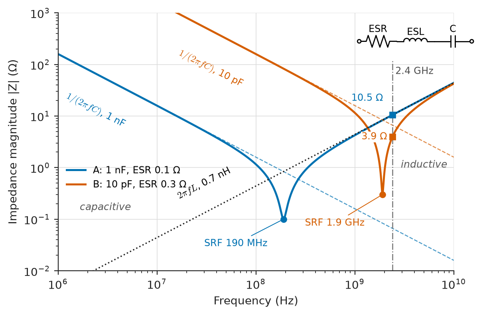
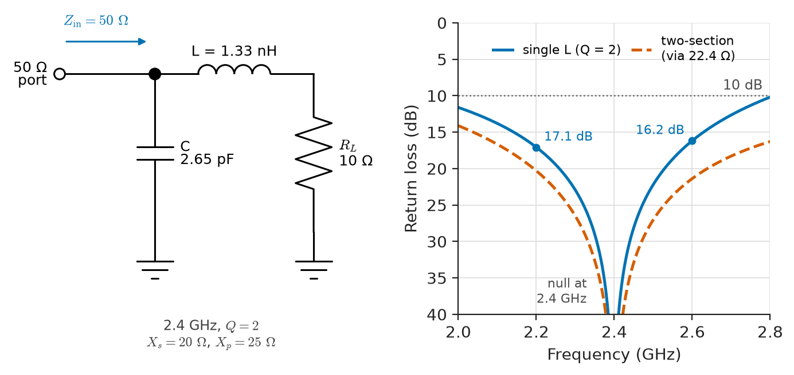
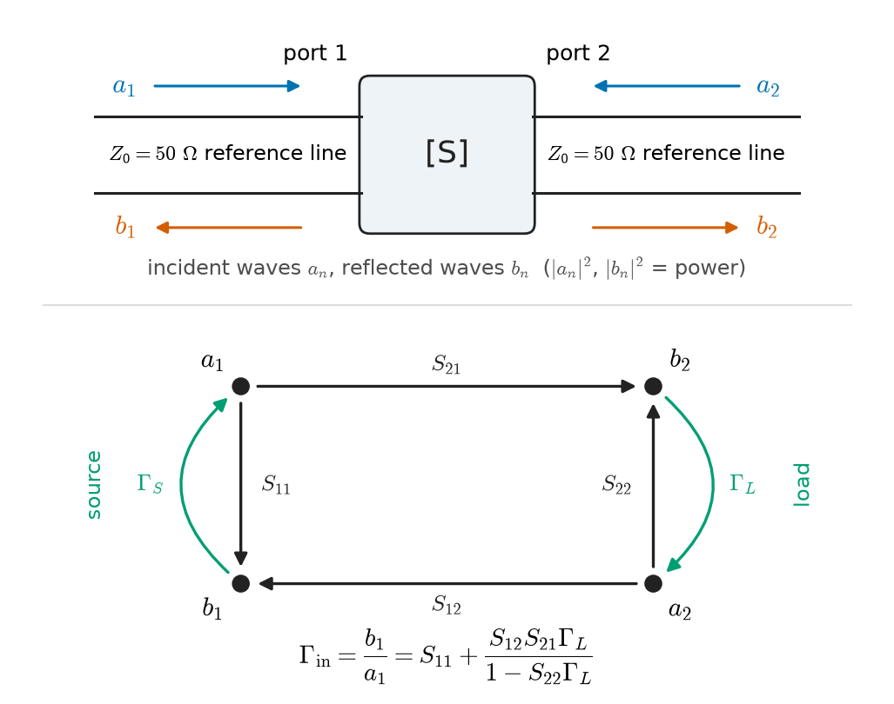
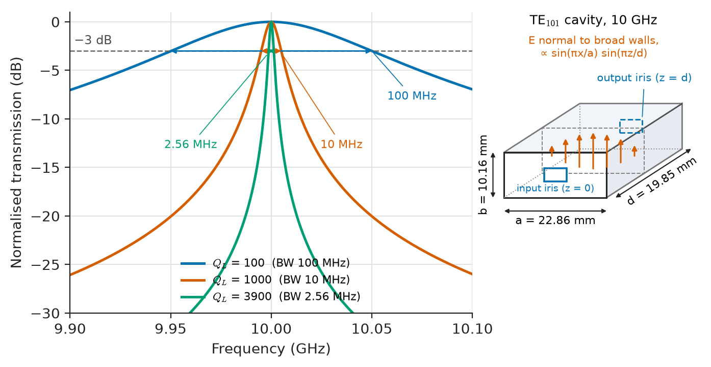
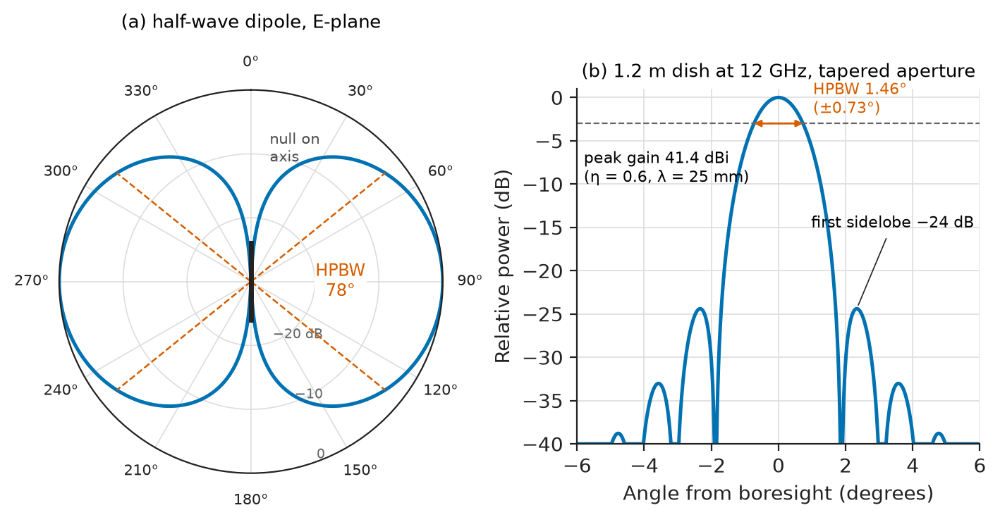
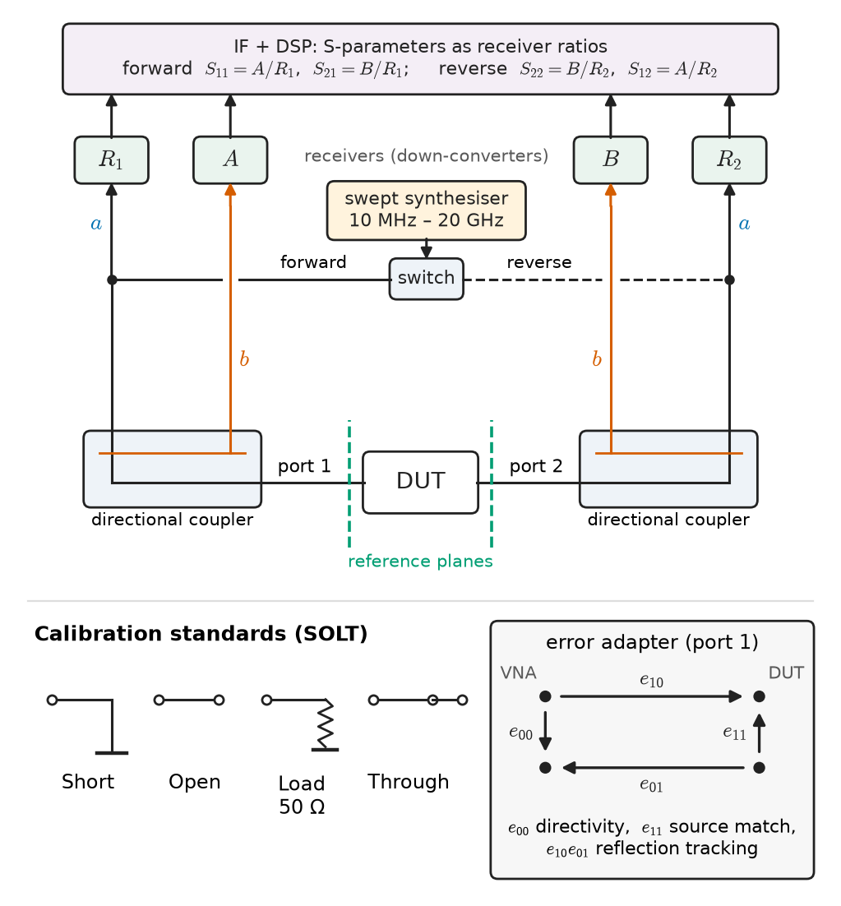

# Chapter 32 — RF and Microwave Fundamentals

*Part VI · Communication Theory*

A team builds a 2.4 GHz sensor board. The power amplifier, taken from a reference design, should deliver +20 dBm into the antenna. On the bench, with a power meter on the output connector, it delivers +14 dBm and runs hot. Every component value matches the schematic. The difference is the layout: the matching network was moved 8 mm further from the amplifier pin to make room for a connector, the 1 nF "DC block" capacitor is a size that resonates with its own lead inductance at 190 MHz and looks like a small inductor at 2.4 GHz, and the ground return of the shunt capacitor runs through a via whose inductance is a significant fraction of the capacitor's reactance. At 2.4 GHz, 8 mm of microstrip on FR-4 is more than a tenth of a wavelength; a capacitor is a resonator; a via is an inductor. The circuit on the schematic and the circuit on the board are different circuits.

This chapter is about the frequency range — roughly 30 MHz to 300 GHz — where that happens. The laws of Parts I–III still hold, but the lumped-element assumption of Chapter 1 fails, power flows as waves along transmission lines (Chapter 14), and voltages and currents become hard to define and harder to measure. Engineers respond by changing their variables: from voltages and currents to incident and reflected waves, from impedance matrices to scattering matrices, and from wires to antennas that launch the waves into space.

> **Why does a circuit that works at 10 MHz stop working at 2 GHz with the same component values?**
> **How do RF engineers describe, match, measure and radiate signals when voltage and current are no longer the natural variables?**

| Concept | Engineering destination |
|---|---|
| Electrical length, skin effect, parasitics | PCB layout of radios, choosing capacitors and inductors, high-speed digital interconnect |
| Impedance matching | Power-amplifier output networks, LNA inputs, antenna feeds |
| S-parameters | Datasheets of every RF part, network-analyser measurements, circuit simulation |
| RF components | Receiver and transmitter front ends: filters, LNAs, mixers, couplers, isolators |
| Resonators and Q | Oscillators, filters, frequency references, MRI coils, particle accelerators |
| Microwave networks and waveguides | Radar feeds, satellite ground stations, high-power transmitters |
| Antennas, radiation patterns, gain | Wi-Fi and cellular links, radar, satellite dishes, RFID |
| RF measurements | Production test, EMC pre-compliance, link troubleshooting |

**Roadmap.** What changes at radio frequencies (32.1) → matching source to load (32.2) → describing networks by waves: S-parameters (32.3) → the components of an RF chain (32.4) and the resonators inside them (32.5) → waveguides and networks of S-parameter blocks (32.6) → leaving the circuit: antennas (32.7), their patterns (32.8) and gain (32.9) → how all of this is measured (32.10).

---

## 32.1 RF signal behavior

### The bands

Radio frequencies are conventionally divided into decades (ITU) and, above 1 GHz, into the letter bands inherited from radar. Table 32.1 lists them with representative uses and wavelengths.

**Table 32.1 — Radio-frequency bands and representative applications.**

| Band | Frequency | Free-space wavelength | Representative uses |
|---|---|---|---|
| HF | 3–30 MHz | 100–10 m | Shortwave broadcast, over-the-horizon radar, 13.56 MHz RFID/NFC |
| VHF | 30–300 MHz | 10–1 m | FM broadcast (88–108 MHz), air-band, MRI at 64 and 128 MHz |
| UHF | 300 MHz–1 GHz | 1 m–30 cm | TV, 433/868/915 MHz ISM, cellular 700–900 MHz |
| L band | 1–2 GHz | 30–15 cm | GNSS (1.575 GHz), cellular 1.8 GHz, L-band radar |
| S band | 2–4 GHz | 15–7.5 cm | Wi-Fi and Bluetooth 2.4 GHz, 5G 3.5 GHz, weather radar |
| C band | 4–8 GHz | 7.5–3.75 cm | Wi-Fi 5–6 GHz, satellite downlinks |
| X band | 8–12 GHz | 3.75–2.5 cm | Marine and military radar, satellite links |
| Ku / K / Ka | 12–40 GHz | 25–7.5 mm | Satellite TV (10.7–12.75 GHz), 5G mm-wave 26–28 GHz |
| V / W | 40–110 GHz | 7.5–2.7 mm | 60 GHz short-range links, 77 GHz automotive radar |

### Electrical length and the end of the lumped model

The lumped-element model treats every connection as instantaneous. It is accurate when every dimension of the circuit is small compared with the wavelength in the medium. On FR-4 microstrip the effective permittivity is about 3.3, so the guided wavelength is $\lambda_g=c/(f\sqrt{\varepsilon_\mathrm{eff}})$; a common rule says a trace longer than $\lambda_g/10$ must be treated as a transmission line.

**Table 32.2 — When an FR-4 microstrip trace stops being a wire ($\varepsilon_\mathrm{eff}\approx3.3$).**

| Frequency | Free-space $\lambda_0$ | $\lambda_g/10$ on FR-4 |
|---|---|---|
| 100 MHz | 3.0 m | 165 mm |
| 1 GHz | 300 mm | 16.5 mm |
| 2.4 GHz | 125 mm | 6.9 mm |
| 10 GHz | 30 mm | 1.65 mm |
| 28 GHz | 10.7 mm | 0.59 mm |

At 2.4 GHz the 8 mm move in the opening story crosses this threshold: the trace adds a phase shift of $360°\times8/68.8\approx42°$, which rotates the impedance seen by the amplifier around the Smith chart (Chapter 14) and wrecks the match. For digital engineers the same table applies with $f$ replaced by the knee frequency $0.35/t_r$ of an edge with rise time $t_r$: a 100 ps edge behaves like a 3.5 GHz signal.

> **Status of the principle: The lumped-element approximation**
> *Approximate.* Kirchhoff's laws hold when the circuit is electrically small (largest dimension below about $\lambda/10$) so that propagation delay and radiation can be neglected; beyond that the distributed model of Chapter 14, ultimately Maxwell's equations, must be used.

### Skin effect

At high frequency the current in a conductor crowds into a thin layer at the surface, of thickness

$$
\delta=\frac{1}{\sqrt{\pi f\mu\sigma}}
$$

For copper ($\sigma=5.8\times10^{7}$ S/m) this is 9.3 mm at 50 Hz, 66 µm at 1 MHz, 6.6 µm at 100 MHz, 2.1 µm at 1 GHz and 0.66 µm at 10 GHz. The resistance of a conductor of perimeter $p$ therefore rises as $\sqrt f$ — the surface resistance is $R_s=1/(\sigma\delta)$, 26 mΩ per square for copper at 10 GHz — and surface finish matters: copper roughness of 1–2 µm, normal for PCB foil, raises loss noticeably above a few gigahertz, and the plating (nickel is magnetic and lossy) can dominate. Silver plating of waveguide interiors and smooth "low-profile" copper for 28 GHz boards are both responses to the skin effect.

### Components are not what they seem

Every real component has parasitics that become important once their reactances approach those of the intended element. A capacitor has an equivalent series inductance (ESL) of 0.3–1 nH for small surface-mount sizes, plus mounting inductance, and an equivalent series resistance (ESR) of tens to hundreds of milliohms. It is a series RLC circuit with a **self-resonant frequency**

$$
f_\mathrm{SRF}=\frac{1}{2\pi\sqrt{L_\mathrm{ESL}C}}
$$

A 1 nF capacitor with 0.7 nH has $f_\mathrm{SRF}=190$ MHz; above it the "capacitor" is an inductor. A 10 pF part with the same ESL resonates at 1.9 GHz — which is why RF designers pick DC-blocking capacitors whose SRF lies near, or just below, the operating frequency, where the series impedance is lowest. Inductors have inter-winding capacitance and a parallel self-resonance; resistors have lead inductance and shunt capacitance. A via through a 1.6 mm board has roughly 0.5–1 nH, which at 2.4 GHz is 8–15 Ω of reactance — comparable to the impedances being matched.

<!-- FIGURE 32.1 | figures/ch32/fig-32-1-capacitor-srf.png | plot | Impedance magnitude of real surface-mount capacitors versus frequency, showing capacitive, self-resonant and inductive regions. | Content: log-log axes, frequency 1 MHz to 10 GHz, impedance 0.01 to 1000 ohm. Curve A: 1 nF with ESL 0.7 nH and ESR 0.1 ohm, SRF at 190 MHz. Curve B: 10 pF with ESL 0.7 nH and ESR 0.3 ohm, SRF at 1.9 GHz. Dashed ideal 1/(2 pi f C) lines for both and a dashed 2 pi f L line for 0.7 nH. Vertical marker at 2.4 GHz with annotation of each part's impedance there. Inset: series R-L-C equivalent circuit. -->

*Figure 32.1 — Impedance magnitude of real surface-mount capacitors versus frequency, showing capacitive, self-resonant and inductive regions.*

Figure 32.1 shows the result: below SRF the impedance follows $1/\omega C$, above it $\omega L$, with a minimum equal to the ESR at resonance.

### Power, decibels and the 50 Ω world

At RF, power is the robust quantity: voltage depends on where along a line it is measured, but power flowing in a matched line does not. Levels are quoted in dBm, gains in dB, and the reference impedance is almost always 50 Ω (75 Ω in video and cable TV). 0 dBm into 50 Ω is 224 mV rms or 0.63 V peak-to-peak. The choice of 50 Ω is a compromise for air-dielectric coaxial line between minimum loss (about 77 Ω) and maximum power handling (about 30 Ω).

---

## 32.2 Impedance matching

### Why match

Matching serves three different purposes, which do not always agree:

1. **Maximum power transfer.** A source of impedance $Z_S$ delivers the most power to a load $Z_L=Z_S^{*}$ (Chapter 4). For a power amplifier the "source impedance" is replaced by the optimum load impedance found from load-pull measurements, which is chosen for output power or efficiency rather than conjugate match.
2. **No reflections.** A line terminated in its characteristic impedance carries no reflected wave (Chapter 14); a mismatched load reflects a fraction $\lvert\Gamma\rvert^2$ of the incident power back to the source, where it may cause instability, heating or ripple in frequency response.
3. **Minimum noise.** An LNA has an optimum source impedance $Z_\mathrm{opt}$ that minimises its noise figure (Chapter 29); it generally differs from the conjugate match, so LNA designers trade gain against noise.

The reflection coefficient, return loss, VSWR and mismatch loss are four ways of expressing the same thing:

$$
\Gamma=\frac{Z_L-Z_0}{Z_L+Z_0},\quad \mathrm{RL}=-20\log_{10}\lvert\Gamma\rvert,\quad \mathrm{VSWR}=\frac{1+\lvert\Gamma\rvert}{1-\lvert\Gamma\rvert},\quad \mathrm{ML}=-10\log_{10}(1-\lvert\Gamma\rvert^{2})
$$

**Table 32.3 — Return loss, reflection coefficient, VSWR and mismatch loss.**

| Return loss | $\lvert\Gamma\rvert$ | VSWR | Reflected power | Mismatch loss | Typical meaning |
|---|---|---|---|---|---|
| 6 dB | 0.50 | 3.0 | 25 % | 1.26 dB | Poor antenna at band edge |
| 10 dB | 0.32 | 1.92 | 10 % | 0.46 dB | Common minimum for antennas |
| 14 dB | 0.20 | 1.50 | 4 % | 0.18 dB | Good amplifier port |
| 20 dB | 0.10 | 1.22 | 1 % | 0.04 dB | Good cable assembly, attenuator |
| 30 dB | 0.032 | 1.07 | 0.1 % | 0.004 dB | Calibration-grade load |

Table 32.3 makes a useful point: a 10 dB return loss, which looks bad, wastes only 0.46 dB of power. Matching is often more about stability, filter response and repeatability than about lost power.

### The L-network

The simplest lossless matching network uses two reactances: one in series with the smaller resistance and one in shunt with the larger. To match a load resistance $R_L$ to a larger source resistance $R_0$, the series reactance raises the load to $R_L(1+Q^2)$ in parallel form, which must equal $R_0$:

$$
Q=\sqrt{\frac{R_0}{R_L}-1},\qquad X_s=QR_L,\qquad X_p=\frac{R_0}{Q}
$$

The **Q** of the network is fixed by the resistance ratio and sets its bandwidth: a large ratio forces a high Q and a narrow match. When more bandwidth is needed, two or more L-sections in cascade step through intermediate resistances; when a specific Q is wanted (for harmonic filtering), a π or T network adds a third element.

> **Status of the principle: L-network matching equations**
> *Derived.* Exact at the design frequency for ideal lossless reactances, from equating real and imaginary parts of the transformed impedance; component Q, parasitics and layout inductance shift the match, so practical networks are tuned on the board.

<!-- FIGURE 32.2 | figures/ch32/fig-32-2-l-network-match.png | circuit | L-network matching a 10 ohm amplifier output to a 50 ohm antenna feed at 2.4 GHz, and the resulting return loss versus frequency. | Content: left panel schematic: source 50 ohm port, shunt capacitor C = 2.65 pF to ground, series inductor L = 1.33 nH, load resistor 10 ohm, arrows marking Zin = 50 ohm. Right panel plot: x-axis 2.0 to 2.8 GHz, y-axis return loss 0 to 40 dB (inverted so better match is lower); curve with null at 2.4 GHz, about 17 dB at 2.2 and 16.3 dB at 2.6 GHz; dashed curve for a two-section L match (via 22.4 ohm) showing wider bandwidth; horizontal line at 10 dB. -->

*Figure 32.2 — L-network matching a 10 ohm amplifier output to a 50 ohm antenna feed at 2.4 GHz, and the resulting return loss versus frequency.*

**Worked example — L-network for a 2.4 GHz power amplifier.** A power-amplifier stage presents an optimum load of 10 Ω (real) at 2.4 GHz and must drive a 50 Ω antenna feed. Then

$$
Q=\sqrt{\frac{50}{10}-1}=2,\qquad X_s=2\times10=20\ \Omega,\qquad X_p=\frac{50}{2}=25\ \Omega
$$

Choosing a series inductor and shunt capacitor (a low-pass form that also attenuates harmonics), with $\omega=2\pi\times2.4\times10^{9}=1.508\times10^{10}$ rad/s:

$$
L=\frac{20}{1.508\times10^{10}}=1.33\ \mathrm{nH},\qquad C=\frac{1}{1.508\times10^{10}\times25}=2.65\ \mathrm{pF}
$$

*Check:* the series branch is $10+j20\ \Omega$; in parallel with $-j25\ \Omega$,

$$
Z_\mathrm{in}=\frac{(10+j20)(-j25)}{10+j20-j25}=\frac{500-j250}{10-j5}=50\ \Omega
$$

Because $Q=2$ the match is broad: computed return loss is better than 16 dB from 2.2 to 2.6 GHz (Figure 32.2). Two lessons from the opening story follow directly. A via of 0.8 nH in the capacitor's ground return adds $+j12\ \Omega$ in series with $-j25\ \Omega$, nearly halving the shunt reactance's magnitude and moving the match far from 50 Ω. And 1.33 nH is less than the inductance of 2 mm of thin trace, so at these values the "inductor" is often a printed line.

### Transmission-line matching

At microwave frequencies, line sections replace lumped elements. A **quarter-wave transformer** of characteristic impedance

$$
Z_T=\sqrt{Z_0R_L}
$$

matches a real load $R_L$ to $Z_0$ at the frequency where it is a quarter wavelength long (Chapter 14). For the example above, $Z_T=\sqrt{50\times10}=22.4\ \Omega$, a wide microstrip about 17 mm long on FR-4 at 2.4 GHz. A **single-stub** match uses a length of line to rotate the load onto the unit-conductance circle of the Smith chart and a short- or open-circuited stub in shunt to cancel the remaining susceptance. Multi-section binomial or Chebyshev transformers trade length for bandwidth, exactly as multi-section filters trade order for flatness (Chapter 23).

> **Status of the principle: Bode–Fano limit on matching bandwidth**
> *Derived.* For a load with reactive storage (for example a parallel $RC$), the integral of $\ln(1/\lvert\Gamma\rvert)$ over frequency is bounded by $\pi/(RC)$, so no lossless network can match it perfectly over a wide band; a matching network can only redistribute the reflections in frequency.

---

## 32.3 S-parameters

### Why waves instead of voltages

The Z, Y, h and ABCD parameters of Chapter 12 are defined by open-circuit or short-circuit terminations. At microwave frequencies those terminations are hard to realise (an "open" radiates and has fringing capacitance), and many active devices oscillate when presented with them. Moreover, voltage and current are not uniquely defined in a waveguide. **Scattering parameters** avoid all three problems: they are defined with every port terminated in the reference impedance $Z_0$ (usually 50 Ω), which is easy to realise and keeps devices stable, and they relate power waves that a directional coupler can separate and measure.

At each port $n$ define the incident and reflected waves, normalised so that $\lvert a_n\rvert^2$ and $\lvert b_n\rvert^2$ are powers:

$$
a_n=\frac{V_n+Z_0I_n}{2\sqrt{Z_0}},\qquad b_n=\frac{V_n-Z_0I_n}{2\sqrt{Z_0}}
$$

For a two-port,

$$
\begin{bmatrix}b_1\\ b_2\end{bmatrix}=\begin{bmatrix}S_{11}&S_{12}\\ S_{21}&S_{22}\end{bmatrix}\begin{bmatrix}a_1\\ a_2\end{bmatrix}
$$

<!-- FIGURE 32.3 | figures/ch32/fig-32-3-two-port-waves.png | schematic | Incident and reflected waves at a two-port and the signal-flow graph of S-parameters with source and load reflections. | Content: top: a box labelled [S] with port 1 on the left and port 2 on the right, each fed by a 50 ohm reference line; arrows a1 into port 1, b1 out, a2 into port 2, b2 out. Bottom: signal-flow graph with nodes a1, b1, b2, a2; branches S21 (a1 to b2), S11 (a1 to b1), S22 (a2 to b2), S12 (a2 to b1), plus source reflection Gamma_S (b1 to a1) and load reflection Gamma_L (b2 to a2). Annotation of Gamma_in = S11 + S12 S21 Gamma_L / (1 - S22 Gamma_L). -->

*Figure 32.3 — Incident and reflected waves at a two-port and the signal-flow graph of S-parameters with source and load reflections.*

Each parameter has a measurable meaning when the other port is matched ($a_2=0$ or $a_1=0$), as Figure 32.3 shows:

- $S_{11}=b_1/a_1$ — input reflection coefficient; $-20\log_{10}\lvert S_{11}\rvert$ is the input return loss.
- $S_{21}=b_2/a_1$ — forward transmission; $20\log_{10}\lvert S_{21}\rvert$ is the gain of an amplifier, or minus the insertion loss of a passive part.
- $S_{12}=b_1/a_2$ — reverse transmission (isolation of an amplifier).
- $S_{22}=b_2/a_2$ — output reflection coefficient.

Each is a complex number at each frequency, so a datasheet gives tables or Touchstone (.s2p) files of magnitude and phase from, say, 100 MHz to 20 GHz. S-parameters are linear: they describe small-signal behaviour, and for a power amplifier they say nothing about compression or harmonics.

> **Status of the principle: The scattering-matrix description**
> *Derived.* An exact, complete description of any linear time-invariant $N$-port at each frequency, equivalent to its impedance matrix through $\mathbf S=(\mathbf Z-Z_0\mathbf I)(\mathbf Z+Z_0\mathbf I)^{-1}$; it does not describe nonlinear or time-varying behaviour.

### Properties

**Reciprocity:** a network of linear, isotropic materials (no ferrites, no active devices) has $\mathbf S=\mathbf S^{T}$, i.e. $S_{12}=S_{21}$. **Losslessness:** a lossless network conserves power, so $\mathbf S$ is unitary, $\mathbf S^{H}\mathbf S=\mathbf I$; for a two-port this means $\lvert S_{11}\rvert^2+\lvert S_{21}\rvert^2=1$. **Symmetry:** a physically symmetric two-port has $S_{11}=S_{22}$. These properties are quick checks on measurements and on simulator output: a passive part whose measured $\lvert S_{11}\rvert^2+\lvert S_{21}\rvert^2$ exceeds 1 indicates a calibration error.

### Two simple networks

**Worked example — S-parameters of a series element.** A series impedance $Z$ between two 50 Ω ports has, by direct circuit analysis with port 2 terminated in $Z_0$,

$$
S_{11}=S_{22}=\frac{Z}{Z+2Z_0},\qquad S_{21}=S_{12}=\frac{2Z_0}{Z+2Z_0}
$$

*(a) Series 50 Ω resistor:* $S_{11}=50/150=0.333$ (return loss 9.5 dB) and $S_{21}=100/150=0.667$ (insertion loss 3.52 dB). Then $\lvert S_{11}\rvert^2+\lvert S_{21}\rvert^2=0.111+0.444=0.556$: 44 % of the incident power is dissipated in the resistor, as expected for a lossy network.

*(b) Series 1 pF capacitor at 2.4 GHz:* $Z=1/(j\omega C)=-j66.3\ \Omega$. Then

$$
S_{11}=\frac{-j66.3}{100-j66.3}=0.306-j0.461=0.553\angle{-56.4°},\qquad S_{21}=\frac{100}{100-j66.3}=0.695+j0.461=0.833\angle{33.6°}
$$

The insertion loss is $-20\log_{10}0.833=1.58$ dB, and $\lvert S_{11}\rvert^2+\lvert S_{21}\rvert^2=0.306+0.694=1.000$: the capacitor is lossless, so all the "lost" power was reflected, not absorbed. A 1 pF DC block is far too small at 2.4 GHz — a reflection of 31 % of the power — which is the arithmetic behind choosing DC blocks of tens of picofarads.

### Connecting S-parameters to the rest of the system

When port 2 is terminated in a load with reflection coefficient $\Gamma_L$ instead of $Z_0$, the signal-flow graph of Figure 32.3 (solved with Mason's rule, Chapter 33) gives the input reflection

$$
\Gamma_\mathrm{in}=S_{11}+\frac{S_{12}S_{21}\Gamma_L}{1-S_{22}\Gamma_L}
$$

and, with a matched source, the transducer power gain

$$
G_T=\frac{\lvert S_{21}\rvert^{2}(1-\lvert\Gamma_L\rvert^{2})}{\lvert1-S_{22}\Gamma_L\rvert^{2}}
$$

**Worked example — an amplifier driving a mismatched filter.** An LNA has $S_{11}=0.2$, $S_{21}=5.62$ (15 dB), $S_{12}=0.056$ (−25 dB) and $S_{22}=0.25$ at the frequency of interest (phases taken as zero for simplicity). It drives a filter whose input has $\Gamma_L=0.2$. Then

$$
\Gamma_\mathrm{in}=0.2+\frac{0.056\times5.62\times0.2}{1-0.25\times0.2}=0.2+\frac{0.0630}{0.95}=0.267
$$

$$
G_T=\frac{31.6\times(1-0.04)}{(0.95)^{2}}=33.6\quad(15.27\ \mathrm{dB})
$$

The load mismatch has changed the input return loss from 14.0 dB to 11.5 dB through the amplifier's reverse transmission, and changed the gain by +0.27 dB. With other phases the gain change could just as easily be negative; this is the origin of gain ripple in cascaded RF chains and of the **mismatch uncertainty** in measurements (Section 32.10). An amplifier with $S_{12}=0$ — a **unilateral** one — would isolate its input from its load completely.

---

## 32.4 RF components

An RF chain is assembled from a small vocabulary of building blocks, each specified by S-parameters plus a few nonlinear and noise figures.

### Passive components

**Attenuators** are resistive networks matched at both ports; they set levels and, because they improve the return loss seen through them by twice their attenuation, are used as "pads" to tame mismatches. **Power dividers** split a signal; the **Wilkinson divider** — two quarter-wave lines of $\sqrt2Z_0$ with a $2Z_0$ resistor between the outputs — splits equally with all ports matched and 20–30 dB isolation between outputs. **Directional couplers** sample a fixed fraction (e.g. −10 or −20 dB) of the wave travelling in one direction only; their **directivity** (typically 20–40 dB) measures how well they reject the opposite direction, and they are the heart of every network analyser and power-amplifier output monitor. **Hybrids** (90° branch-line, 180° rat-race) split into two equal outputs with defined phase and underlie balanced amplifiers and IQ modulators. **Circulators** use magnetised ferrite to route power 1→2→3→1; they are non-reciprocal, so $S_{21}\ne S_{12}$. Terminating one port gives an **isolator**, which protects a power amplifier or laser from reflected power. **Filters** — lumped, microstrip, cavity, ceramic, SAW and BAW — select bands; their synthesis follows Chapters 13 and 23, with resonators (Section 32.5) as building blocks.

### Active components

A **low-noise amplifier** (LNA) sets the receiver noise figure (Chapter 29) and must be the first gain stage. A **power amplifier** (PA) delivers output power efficiently and is characterised by output power at 1 dB compression ($P_\mathrm{1dB}$), saturated power and power-added efficiency. A **mixer** multiplies the signal by a local oscillator to translate it in frequency (Chapter 26), with conversion loss, LO-to-RF isolation and image rejection as key figures. An **oscillator** — a resonator plus a gain element — generates the LO; its phase noise (dBc/Hz at an offset) limits adjacent-channel selectivity and constellation density.

Nonlinearity is specified by two figures. The **1 dB compression point** is the input or output power at which gain has fallen 1 dB below its small-signal value. The **third-order intercept point** (IP3) is the extrapolated power at which the third-order intermodulation products of a two-tone test would equal the fundamental; because those products grow at 3 dB per dB of input, the intermodulation level falls by 2 dB for every 1 dB reduction in drive. For many amplifiers the output IP3 lies roughly 10 dB above $P_\mathrm{1dB}$.

> **Status of the principle: OIP3 ≈ $P_\mathrm{1dB}$ + 10 dB**
> *Empirical.* Follows from a pure cubic nonlinearity, which predicts 9.6 dB, and is observed within a few decibels for many class-A amplifiers; it fails for devices with higher-order or memory nonlinearity and for linearised or class-AB power amplifiers.

**Table 32.4 — Representative RF component specifications (1–6 GHz, typical).**

| Component | Key figures | Typical values |
|---|---|---|
| LNA (GaAs pHEMT or SiGe) | Gain; NF; OIP3 | 15–20 dB; 0.5–1.5 dB; +20 to +35 dBm |
| Driver amplifier | Gain; $P_\mathrm{1dB}$ | 15–25 dB; +20 to +27 dBm |
| Cellular base-station PA (GaN) | Saturated output; efficiency | 40–50 dBm; 40–60 % (Doherty) |
| Passive double-balanced mixer | Conversion loss; LO drive; IIP3 | 6–8 dB; +7 to +17 dBm; +15 to +25 dBm |
| Wilkinson divider | Split loss; isolation | 3.0 dB + 0.2–0.5 dB; 20–30 dB |
| Directional coupler | Coupling; directivity | 10 or 20 dB; 20–40 dB |
| Ferrite isolator | Insertion loss; isolation | 0.2–0.5 dB; 20–25 dB |
| SAW/BAW band filter | Insertion loss; rejection | 1–3 dB; 30–50 dB |
| Coaxial cable, RG-58 / low-loss ½-inch | Loss at 1 GHz | ≈0.6 dB/m / ≈0.07 dB/m |
| SMA connector | Upper frequency; return loss | 18–26.5 GHz; >20 dB |

> **Boundary.** Transistor-level LNA, PA and oscillator design — bias networks, stability circles, load-pull, device models — belongs to *Electronics & Computing*. This chapter treats components through their S-parameters and figures of merit.

---

## 32.5 Resonators

### Lumped resonators and Q

A resonator stores energy that oscillates between two forms — electric and magnetic in an LC circuit (Chapter 7) — at a natural frequency $f_0$. Its quality factor

$$
Q=2\pi\frac{\text{energy stored}}{\text{energy lost per cycle}}=\frac{f_0}{\Delta f_{3\,\mathrm{dB}}}
$$

measures both how slowly it rings down and how narrow its response is (Chapter 13). For a series RLC, $Q=\omega_0L/R$. A 10 nH inductor and 1 pF capacitor resonate at 1.59 GHz; if the inductor has $Q=50$ its loss resistance is $\omega_0L/Q=2\ \Omega$, and the circuit's Q can be no higher than 50. At RF, lumped inductors are the weak point: their Q is limited to 30–100 by skin-effect resistance and substrate loss, which is why high-Q microwave resonators abandon lumped elements altogether.

### Unloaded and loaded Q

A resonator in a circuit is coupled to external ports, which also remove energy. The **unloaded Q** $Q_0$ counts only internal losses; the **external Q** $Q_e$ counts the energy leaving through the coupling; the **loaded Q** combines them,

$$
\frac1{Q_L}=\frac1{Q_0}+\frac1{Q_e},\qquad \beta=\frac{Q_0}{Q_e}
$$

where $\beta$ is the coupling coefficient. At **critical coupling** ($\beta=1$) the resonator is matched to the feed and $Q_L=Q_0/2$. A filter designer sets the external Q to obtain the desired bandwidth; an oscillator designer keeps $Q_L$ high to minimise phase noise.

### Distributed resonators

A transmission line short-circuited at one end and a quarter wavelength long, or open-circuited and a half wavelength long, behaves near resonance like a parallel LC circuit (Chapter 14). **Microstrip resonators** reach $Q_0$ of 100–300, limited by conductor and dielectric loss and radiation. **Coaxial resonators** with ceramic filling reach 500–2000 at 1–3 GHz and form the duplexers in cellular base stations. **Cavity resonators** — closed metal boxes — and **dielectric resonators** — pucks of high-permittivity, low-loss ceramic — reach thousands to tens of thousands. Quartz crystals exploit mechanical resonance coupled through piezoelectricity and reach $10^4$–$10^6$.

**Table 32.5 — Representative unloaded Q of resonators.**

| Resonator | Frequency | Unloaded $Q_0$ | Typical use |
|---|---|---|---|
| Lumped chip LC | 0.1–3 GHz | 30–100 | Matching networks, simple filters |
| Microstrip line | 1–30 GHz | 100–300 | PCB filters, VCOs |
| Ceramic coaxial | 0.8–6 GHz | 500–2000 | Handset and base-station duplexers |
| Copper waveguide cavity | 10 GHz | 5000–12 000 | Radar filters, frequency discriminators |
| Dielectric resonator | 2–30 GHz | 10 000–40 000 (at about 5 GHz) | Low-phase-noise oscillators, satellite filters |
| SAW / BAW resonator | 0.1–6 GHz | 500–3000 | Mobile-phone band filters |
| Quartz crystal | 1–100 MHz | $10^4$–$10^6$ | Clock and frequency references |
| Superconducting niobium cavity | 1.3 GHz | $10^{9}$–$10^{10}$ | Particle accelerators |

<!-- FIGURE 32.4 | figures/ch32/fig-32-4-resonator-response.png | plot | Transmission response of resonators with different loaded Q around a 10 GHz centre frequency. | Content: x-axis frequency 9.9 to 10.1 GHz, y-axis normalised transmission 0 to -30 dB. Three Lorentzian curves centred on 10 GHz for loaded Q = 100 (3 dB bandwidth 100 MHz), Q = 1000 (10 MHz) and Q = 3900 (2.56 MHz). Horizontal dashed line at -3 dB with bandwidth arrows. Inset: TE101 rectangular cavity 22.86 x 10.16 x 19.85 mm with coupling irises at both ends and electric field sketched across the broad wall. -->

*Figure 32.4 — Transmission response of resonators with different loaded Q around a 10 GHz centre frequency.*

**Worked example — a 10 GHz waveguide cavity.** A section of WR-90 waveguide (internal dimensions $a=22.86$ mm, $b=10.16$ mm) closed at both ends forms a rectangular cavity. Its lowest mode, $\mathrm{TE}_{101}$, resonates at

$$
f_{101}=\frac c2\sqrt{\frac1{a^2}+\frac1{d^2}}
$$

For $f=10$ GHz the required length is $d=\left[(2f/c)^2-1/a^2\right]^{-1/2}=19.85$ mm. The copper walls have surface resistance $R_s=\sqrt{\pi f\mu_0/\sigma}=26.1$ mΩ at 10 GHz, and the standard cavity-loss formula then gives an unloaded Q of about 7800. Critically coupled, $Q_L=3900$ and the 3 dB bandwidth is $10\ \mathrm{GHz}/3900=2.6$ MHz (Figure 32.4). In practice surface roughness and joint losses lower $Q_0$ by 10–30 %, and silver plating raises it by about 3 %.

---

## 32.6 Microwave networks

### Waveguides

Above about 3 GHz, and at powers beyond what coaxial cable can handle, hollow metal **waveguides** carry microwave energy. A rectangular guide supports transverse-electric (TE) and transverse-magnetic (TM) modes, each with a **cutoff frequency** below which it does not propagate:

$$
f_{c,mn}=\frac{c}{2}\sqrt{\left(\frac{m}{a}\right)^{2}+\left(\frac{n}{b}\right)^{2}}
$$

The dominant mode is $\mathrm{TE}_{10}$ with $f_c=c/2a$. For WR-90 ($a=22.86$ mm, $b=10.16$ mm) this is 6.56 GHz; the next modes are $\mathrm{TE}_{20}$ at 13.1 GHz and $\mathrm{TE}_{01}$ at 14.8 GHz, so the recommended single-mode band is 8.2–12.4 GHz (X band). Above cutoff the guide is dispersive, with guided wavelength

$$
\lambda_g=\frac{\lambda_0}{\sqrt{1-(f_c/f)^{2}}}
$$

At 10 GHz, $\lambda_0=30.0$ mm and $\lambda_g=39.7$ mm: the guide wavelength is longer than in free space, and the group velocity is $c\sqrt{1-(f_c/f)^2}=0.755c$. This group-delay dispersion is the microwave counterpart of chromatic dispersion in fibre (Chapter 31). Waveguide loss is low — about 0.1 dB/m for copper WR-90 — and power handling is hundreds of kilowatts peak, which is why radar transmitters and satellite ground-station feeds use it.

> **Status of the principle: Waveguide cutoff**
> *Fundamental.* Follows from Maxwell's equations with the boundary condition of zero tangential electric field on perfectly conducting walls; finite wall conductivity adds loss but does not shift the cutoff appreciably.

### Planar lines

Most microwave circuits are printed. **Microstrip** (a strip over a ground plane) is cheap and easy to mount components on, but its field is partly in air, so it is slightly dispersive and radiates at discontinuities. **Stripline** (a strip between two grounds) is non-radiating and non-dispersive. **Coplanar waveguide** puts the grounds beside the strip on the same layer, which suits wafer probing and millimetre-wave integrated circuits. Their characteristic impedance and effective permittivity follow from geometry (Chapter 14); a 50 Ω microstrip on 1.6 mm FR-4 is about 3 mm wide, on 0.25 mm high-frequency laminate about 0.55 mm.

### Networks of networks

A microwave system is a network of S-parameter blocks. For a chain of two-ports the scattering parameters do not multiply directly, but the **transfer (T) parameters**, which relate the waves at port 1 to those at port 2, do; equivalently each block can be converted to ABCD parameters (Chapter 12), cascaded by matrix multiplication and converted back. Circuit simulators do this at every frequency point. For arbitrary topologies — a balanced amplifier with two hybrids, a diplexer with a common port — the waves at every connection form a signal-flow graph, and Mason's gain formula (Chapter 33) or direct matrix solution gives any transfer of interest. The same graphs show how errors propagate, which is the basis of network-analyser calibration (Section 32.10).

**Worked example — a two-way radar feed.** An X-band radar transmitter (10 GHz, 50 kW peak) feeds an antenna through 6 m of WR-90 (0.11 dB/m), a ferrite circulator (0.3 dB insertion loss, 23 dB isolation) and a rotary joint (0.2 dB). The forward loss is $6\times0.11+0.3+0.2=1.16$ dB, so the antenna receives $50\times10^{-0.116}=38.3$ kW. If the antenna presents a 14 dB return loss, $10^{-1.4}=4\%$ of that power — about 1.5 kW — is reflected; after returning through the joint and guide (another 0.86 dB) the remaining 1.25 kW reaches the circulator, which routes it to the receiver arm, where a limiter protects the LNA; only $1.25\ \mathrm{kW}\times10^{-2.3}\approx6.3$ W leaks back toward the transmitter. The same network diagram, with echoes arriving at microwatt levels, carries the received echo; the radar equation of Section 32.9 takes over from there.

---

## 32.7 Antenna fundamentals

### From guided to radiated waves

An antenna is a transducer between a guided wave on a transmission line and a free-space wave. Any accelerated charge radiates; a structure becomes an efficient antenna when its size is comparable to a wavelength and its current distribution does not cancel its own field at a distance. Seen from its feed terminals, an antenna is a load impedance

$$
Z_A=R_\mathrm{rad}+R_\mathrm{loss}+jX_A
$$

where the **radiation resistance** $R_\mathrm{rad}$ represents power carried away to space, $R_\mathrm{loss}$ represents ohmic and dielectric loss, and $X_A$ is stored reactive energy. The **radiation efficiency** is $\eta_r=R_\mathrm{rad}/(R_\mathrm{rad}+R_\mathrm{loss})$.

> **Boundary.** The derivation of radiated fields from currents (retarded potentials, the Hertzian dipole) belongs to *Engineering Physics*. Here an antenna is characterised by its impedance, pattern, directivity and gain, and treated as a component in a link.

### Reciprocity

For antennas made of linear, isotropic materials, the transmitting and receiving patterns, impedances and gains are identical. This **reciprocity** is the antenna form of the network reciprocity of Section 32.3 and Chapter 4, and it allows an antenna to be measured in whichever direction is more convenient.

> **Status of the principle: Antenna reciprocity**
> *Derived.* A consequence of the Lorentz reciprocity theorem for Maxwell's equations in linear, isotropic, time-invariant media; it fails for antennas containing ferrites, plasmas or active circuits.

### Basic antenna types

**Short dipole.** A dipole much shorter than a wavelength, of length $l$, has $R_\mathrm{rad}=80\pi^2(l/\lambda)^2\ \Omega$; for $l=\lambda/10$ this is only 7.9 Ω, against a large capacitive reactance. Electrically small antennas — car-radio whips at AM frequencies, implant antennas, 433 MHz key fobs — are therefore inefficient and narrowband: a few ohms of conductor and matching loss compete with a few ohms of radiation resistance.

**Half-wave dipole.** A centre-fed conductor $\lambda/2$ long — 1.5 m at 100 MHz, 62 mm at 2.4 GHz — has $R_\mathrm{rad}\approx73\ \Omega$ and, cut slightly short (about $0.47\lambda$), no reactance; it matches 50–75 Ω cable well and has a directivity of 1.64 (2.15 dBi).

**Monopole over a ground plane.** By image theory a $\lambda/4$ whip over a large ground behaves as half a dipole: $R_\mathrm{rad}\approx36.5\ \Omega$ and twice the dipole's directivity (5.15 dBi over an infinite ground). The mobile-phone and vehicle antenna is a monopole whose "ground plane" is the phone's circuit board or the car roof.

**Patch antenna.** A rectangular conductor about $\lambda_g/2$ long over a ground plane, printed on a laminate; at 2.45 GHz on FR-4 ($\varepsilon_\mathrm{eff}\approx4.1$) the length is about 30 mm. Patches radiate broadside with 6–8 dBi gain, are thin and cheap, and form the elements of phased arrays — but their bandwidth is only a few percent.

**Aperture antennas.** Horns and parabolic reflectors radiate from an aperture many wavelengths across; their gain is set by aperture area (Section 32.9).

**Arrays.** Several elements fed with controlled amplitudes and phases form an array whose pattern is the element pattern multiplied by an **array factor**. Steering the phases steers the beam electronically: the basis of phased-array radar, 5G base stations with 64 elements and the MIMO systems of Chapter 30.

### Near and far field

Close to an antenna the reactive near field dominates; far away the fields decay as $1/r$, are transverse, and have a fixed angular shape. For an antenna of largest dimension $D$ the far field begins at roughly the **Fraunhofer distance**

$$
r_\mathrm{ff}=\frac{2D^{2}}{\lambda}
$$

For a 1.2 m dish at 12 GHz ($\lambda=25$ mm) this is 115 m, which is why large antennas are measured on long outdoor ranges or with near-field scanners whose data are transformed mathematically to the far field.

---

## 32.8 Radiation patterns

### Describing a pattern

The **radiation pattern** gives the radiated power density (or field) as a function of direction $(\theta,\phi)$ at a fixed far-field distance, usually normalised to its maximum and plotted in decibels. Two principal-plane cuts are used: the **E-plane**, containing the electric field and the direction of maximum radiation, and the **H-plane**, perpendicular to it. A pattern is characterised by:

- the **main lobe** and its **half-power beamwidth** (HPBW), the angle between the −3 dB points;
- **sidelobes**, especially the first sidelobe level relative to the main lobe (−13.2 dB for a uniformly illuminated aperture, −20 to −30 dB for tapered illumination);
- **nulls** between lobes;
- the **front-to-back ratio** for directional antennas;
- **polarisation** — the orientation of the electric field (linear vertical or horizontal, circular right- or left-handed) — and the cross-polar level.

A half-wave dipole's pattern is a doughnut: $\cos(\tfrac\pi2\cos\theta)/\sin\theta$ in field, with nulls along the wire axis, omnidirectional in the plane perpendicular to it, and an E-plane HPBW of 78°. A parabolic dish produces a pencil beam whose HPBW in degrees is approximately

$$
\theta_{3\,\mathrm{dB}}\approx70\frac{\lambda}{D}
$$

for typical edge-tapered illumination.

> **Status of the principle: $\theta_{3\,\mathrm{dB}}\approx70\lambda/D$**
> *Empirical.* A rule fitted to typical reflector illuminations (the uniform aperture gives about $51\lambda/D$, heavily tapered ones up to $80\lambda/D$); it is used for first estimates of beamwidth and pointing tolerance.

<!-- FIGURE 32.5 | figures/ch32/fig-32-5-radiation-patterns.png | plot | Radiation patterns of a half-wave dipole and of a 1.2 m parabolic dish at 12 GHz. | Content: left panel polar plot of the half-wave dipole E-plane field pattern cos((pi/2)cos theta)/sin theta in dB (0 to -30 dB rings), nulls along the dipole axis at 0 and 180 degrees, half-power points marked giving 78 degree beamwidth; dipole drawn vertically at the centre. Right panel Cartesian plot of the dish pattern in dB versus angle from -6 to +6 degrees, 0 to -40 dB, computed from a tapered circular aperture: main lobe with -3 dB points at +/-0.73 degrees (HPBW 1.46 degrees), first sidelobes near -20 to -25 dB, and annotation of peak gain 41.4 dBi. -->

*Figure 32.5 — Radiation patterns of a half-wave dipole and of a 1.2 m parabolic dish at 12 GHz.*

Figure 32.5 compares the broad dipole pattern with the pencil beam of a dish.

### Patterns and the link

Patterns matter in three ways. They set **coverage**: a sector antenna on a cellular mast with 65° horizontal HPBW serves a third of the circle. They set **interference**: sidelobes of an earth-station antenna pointing at one satellite illuminate its neighbours spaced 2° away along the geostationary arc, so regulators specify a sidelobe envelope ($29-25\log_{10}\theta$ dBi). And they set **pointing tolerance**: a 1.46° beam must be aimed within about a fifth of its beamwidth to lose less than 0.5 dB. Polarisation also matters: a linearly polarised antenna receiving a circularly polarised wave loses 3 dB, and two orthogonal linear polarisations can carry independent signals — the frequency-reuse trick of satellite TV and of dual-polarised MIMO.

---

## 32.9 Gain and directivity

### Definitions

The **directivity** of an antenna is the ratio of the radiation intensity in a given direction to the intensity averaged over all directions:

$$
D(\theta,\phi)=\frac{4\pi\,U(\theta,\phi)}{P_\mathrm{rad}}
$$

Its maximum value is "the directivity". An isotropic radiator has $D=1$ (0 dBi). The **gain** includes the radiation efficiency, $G=\eta_rD$, and is what a link uses; realized gain additionally includes the mismatch loss $1-\lvert\Gamma\rvert^2$. For a pencil beam, directivity can be estimated from the two principal-plane beamwidths in degrees,

$$
D\approx\frac{41\,253}{\theta_E\,\theta_H}
$$

where 41 253 is the number of square degrees in a sphere.

### Effective aperture

A receiving antenna collects power as if it presented an area $A_e$ to the incoming wave: $P_r=S\,A_e$ for incident power density $S$. Gain and effective aperture are linked by a universal relation:

$$
G=\frac{4\pi A_e}{\lambda^{2}}
$$

For aperture antennas $A_e=\eta_a A_\mathrm{phys}$, with aperture efficiency $\eta_a$ of 0.5–0.75 for reflectors and horns. Hence the gain of a dish of diameter $D$:

$$
G=\eta_a\left(\frac{\pi D}{\lambda}\right)^{2}
$$

> **Status of the principle: $G=4\pi A_e/\lambda^2$**
> *Derived.* Follows from reciprocity and thermodynamic equilibrium of an antenna with a matched load in a black-body enclosure; it holds for every lossless, matched antenna regardless of type.

### Friis transmission and EIRP

Combining the gain of a transmitting antenna with the effective aperture of a receiving one gives the Friis equation for a free-space link of length $R$,

$$
P_r=P_tG_tG_r\left(\frac{\lambda}{4\pi R}\right)^{2}
$$

or in decibels $P_r=P_t+G_t+G_r-\mathrm{FSPL}$ with $\mathrm{FSPL}=20\log_{10}(4\pi R/\lambda)$, the free-space path loss used in the link budgets of Chapter 30. The product $P_tG_t$ is the **effective isotropic radiated power** (EIRP), the quantity regulators limit — 20 dBm (100 mW) EIRP for 2.4 GHz Wi-Fi in Europe, for example.

A monostatic radar applies Friis twice — out to a target of radar cross-section $\sigma$, which reradiates, and back to the same antenna:

$$
P_r=\frac{P_tG^{2}\lambda^{2}\sigma}{(4\pi)^{3}R^{4}}
$$

The $R^4$ law is brutal: an X-band radar with $P_t=1$ kW, $G=30$ dBi and $\lambda=3$ cm receives only $-103$ dBm from a 1 m² target at 10 km, and doubling the range costs 12 dB.

**Table 32.6 — Representative antenna gains.**

| Antenna | Gain | Beamwidth | Application |
|---|---|---|---|
| Isotropic (reference) | 0 dBi | — | Link-budget reference |
| Short dipole | 1.76 dBi | 90° | Small-antenna limit |
| Half-wave dipole | 2.15 dBi | 78° (E-plane) | FM, reference antenna |
| Quarter-wave monopole on large ground | 5.15 dBi | 39° elevation | Vehicles, base whips |
| Phone or IoT chip antenna | −5 to +2 dBi | Near omnidirectional | Handsets, sensors |
| Microstrip patch | 6–8 dBi | 60–80° | GNSS, Wi-Fi access points, array elements |
| Yagi–Uda (6–15 elements) | 9–15 dBi | 30–50° | TV reception, point-to-point UHF |
| Cellular sector panel | 15–18 dBi | 65° horizontal | Base stations |
| Standard-gain horn | 10–25 dBi | 10–50° | Calibration, feeds |
| 1.2 m dish at 12 GHz | ≈41 dBi | ≈1.5° | Satellite earth station |
| 70 m deep-space dish at 8.4 GHz | ≈74 dBi | ≈0.04° | Deep-space network |

**Worked example — a satellite dish and a Wi-Fi link.** *(a) Dish.* A 1.2 m reflector at 12 GHz ($\lambda=2.998\times10^8/12\times10^9=25.0$ mm) with aperture efficiency 0.6:

$$
G=0.6\left(\frac{\pi\times1.2}{0.0250}\right)^{2}=0.6\times(150.9)^{2}=1.37\times10^{4}\quad(41.4\ \mathrm{dBi})
$$

The beamwidth is $70\times0.025/1.2=1.46°$, and the beamwidth formula for directivity gives $41\,253/1.46^2=1.9\times10^4$ (42.9 dBi) — about 1.5 dB above the gain, as expected, since the beamwidth estimate ignores sidelobe power and efficiency. The effective aperture is $0.6\times\pi\times0.6^2=0.68$ m². The free-space loss to a geostationary satellite at a slant range of 38 000 km is $20\log_{10}(4\pi\times3.8\times10^{7}/0.025)=205.6$ dB — the 41 dB of dish gain is what makes a satellite signal receivable at all.

*(b) Wi-Fi.* An access point at 2.4 GHz transmits 20 dBm into a 2 dBi antenna; a laptop 50 m away in open space also has 2 dBi. With $\lambda=0.125$ m,

$$
\mathrm{FSPL}=20\log_{10}\frac{4\pi\times50}{0.125}=74.0\ \mathrm{dB},\qquad P_r=20+2+2-74.0=-50.0\ \mathrm{dBm}
$$

A receiver needing −70 dBm for its highest rates has 20 dB of margin in free space — margin that walls, bodies and multipath fading (Chapter 30) consume indoors.

---

## 32.10 RF measurements

### The vector network analyser

The **vector network analyser** (VNA, Figure 32.6) measures S-parameters directly. A swept source drives one port of the device under test (DUT); directional couplers at each port separate incident and reflected waves; receivers down-convert them and measure amplitude and phase ratios. Modern VNAs cover 10 MHz to 67 GHz or beyond in coaxial form and reach 1 THz with waveguide extenders, with dynamic range of 100–140 dB.

A VNA measures not the DUT alone but the DUT embedded in imperfect couplers, cables and connectors. **Calibration** removes these systematic errors. In the 12-term error model for a two-port measurement, each port has directivity, source-match and reflection-tracking errors, plus load-match, transmission-tracking and isolation terms — all obtained by measuring known standards. **SOLT** calibration uses short, open, load and through standards with known (modelled) responses; **TRL** uses a through, a reflect and a line of known length and is preferred on printed circuits and wafers where good loads are hard to make. After calibration the **reference plane** sits at the DUT's terminals, and **de-embedding** can move it further to remove test fixtures.

> **Status of the principle: Error-model calibration**
> *Derived.* Because the test set is linear, its errors form a linear network whose S-parameters can be solved from measurements of known standards; the accuracy is then limited by how well the standards are known and by drift and connector repeatability.

<!-- FIGURE 32.6 | figures/ch32/fig-32-6-vna-setup.png | block-diagram | Two-port vector network analyser with its directional couplers, receivers and calibration standards. | Content: block diagram: swept synthesiser 10 MHz to 20 GHz feeding a switch to port 1 or port 2; at each port a directional coupler sampling incident wave a and reflected wave b into receivers R1, A (port 1) and R2, B (port 2); IF and DSP block computing S11 = A/R1, S21 = B/R1 etc. Device under test between port 1 and port 2 with reference planes marked as dashed lines. Separate inset showing the four calibration standards Short, Open, Load (50 ohm) and Through, and a flow-graph box labelled "error adapter: e00 directivity, e11 source match, e10e01 reflection tracking". -->

*Figure 32.6 — Two-port vector network analyser with its directional couplers, receivers and calibration standards.*

### Mismatch uncertainty

Even after calibration, residual source and load mismatches create uncertainty. With a source match $\Gamma_S$ and DUT reflection $\Gamma_L$, the multiple reflection between them gives a power uncertainty of

$$
\Delta P_\mathrm{dB}=20\log_{10}(1\pm\lvert\Gamma_S\rvert\lvert\Gamma_L\rvert)
$$

A power sensor with 20 dB return loss ($\lvert\Gamma\rvert=0.1$) measuring a source with 10 dB return loss (0.316) has uncertainty of +0.27/−0.28 dB from this term alone — often the largest item in an RF power-measurement budget, and the reason attenuator pads are placed at measurement ports.

### Spectrum analysis and power measurement

The **spectrum analyser** displays power versus frequency, by a swept superheterodyne (Chapter 26) or an FFT of digitised IF (Chapter 22). Its **resolution bandwidth** (RBW) sets frequency resolution and noise floor: the displayed average noise level is

$$
\mathrm{DANL}\approx-174\ \mathrm{dBm/Hz}+10\log_{10}(\mathrm{RBW})+NF
$$

so an analyser with a 24 dB noise figure at 1 kHz RBW shows a floor of about −120 dBm; reducing RBW to 10 Hz lowers it by 20 dB at the cost of a 100× slower sweep. Analysers measure harmonics, spurious emissions, adjacent-channel power, phase noise and EMC emissions. **Power meters** (thermistor, thermocouple or diode sensors) give the most accurate absolute power, ±0.1–0.2 dB; **noise-figure analysers** use the Y-factor method with a calibrated noise source switched between two temperatures (Chapter 29). **Time-domain reflectometry** — sending a fast edge and observing reflections — locates impedance discontinuities in cables and PCB traces, and VNAs offer the same view by inverse-transforming $S_{11}(f)$.

### Antenna measurements

Antenna gain and pattern are measured in **anechoic chambers**, lined with absorber, on far-field ranges longer than $2D^2/\lambda$, in compact ranges that use a reflector to create a plane wave, or with **near-field scanners** that sample the field close to the antenna and transform to the far field. Gain is obtained by comparison with a calibrated standard-gain horn or by the three-antenna method, which uses Friis' equation for three pairs to solve for three unknown gains. Over-the-air (OTA) testing of phones and base stations extends these methods to complete radios with integrated antennas.

**Table 32.7 — Representative RF measurement instruments.**

| Instrument | Measures | Typical performance |
|---|---|---|
| Vector network analyser | S-parameters vs frequency | 100–140 dB dynamic range; ±0.05–0.1 dB, ±0.5° after calibration |
| Spectrum / signal analyser | Spectrum, ACP, EVM, phase noise | DANL −150 to −165 dBm/Hz with preamplifier; ±0.3–0.5 dB amplitude |
| Thermocouple / diode power sensor | Average or peak power | −70 to +20 dBm; ±0.1–0.2 dB |
| Noise-figure analyser | NF and gain | ±0.05–0.2 dB NF uncertainty |
| TDR / TDT | Impedance vs distance | 15–35 ps rise time; mm resolution |
| Anechoic chamber / near-field scanner | Pattern, gain, EIRP | ±0.3–0.5 dB gain uncertainty |

---

## What remains open

| Open question | Where it is answered |
|---|---|
| How do reflection coefficient, standing waves and the Smith chart follow from the telegrapher's equations? | Chapter 14 (transmission lines) |
| How are Z, Y, h and ABCD parameters defined and converted? | Chapter 12 (two-port networks) |
| How do noise figure and cascaded noise determine receiver sensitivity? | Chapter 29 (random signals and communication noise) |
| How are mixers and superheterodyne receivers used in analog modulation? | Chapter 26 (analog communication) |
| How do path loss, fading and MIMO arrays enter a wireless link budget? | Chapter 30 (wireless and mobile communications) |
| How do waveguide modes appear at optical frequencies in fibre? | Chapter 31 (optical communications) |
| How is Mason's gain formula, used here for wave-flow graphs, derived? | Chapter 33 (dynamic-system modeling) |
| How do oscillators and power amplifiers stay stable, and how is automatic gain or power control designed? | Chapters 34–35 (feedback, stability and control design); *Electronics & Computing* |
| How do Maxwell's equations produce radiation, and why does a waveguide have cutoff? | *Engineering Physics* |

**Next:** Chapter 33 opens Part VII by turning the same mathematics — differential equations, transfer functions and flow graphs — toward modelling physical systems that are to be controlled.
