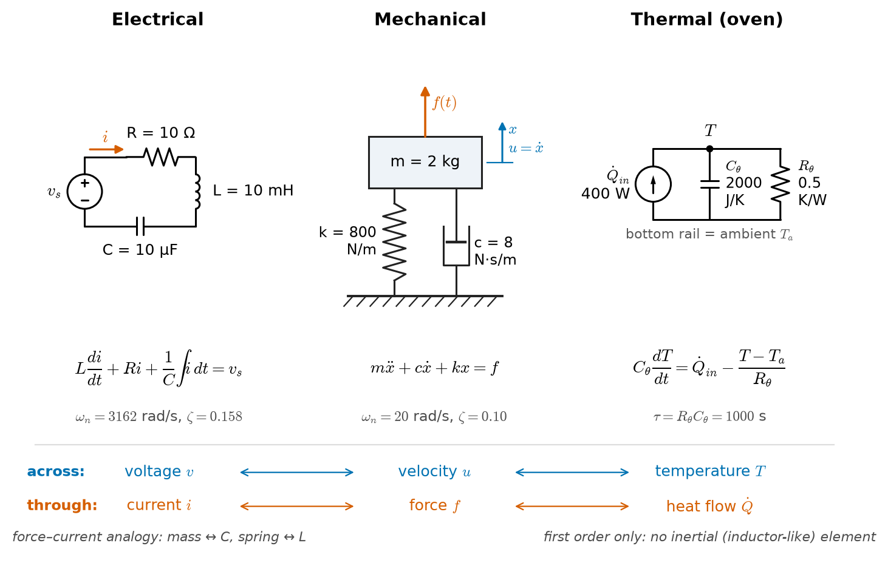
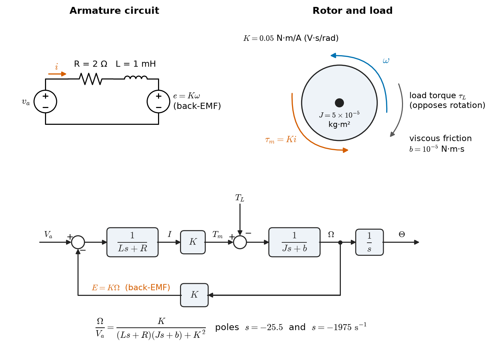
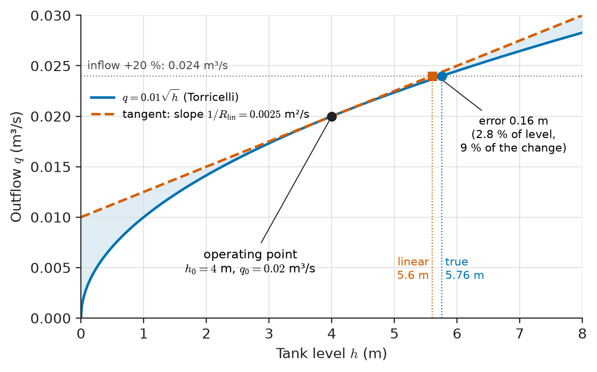
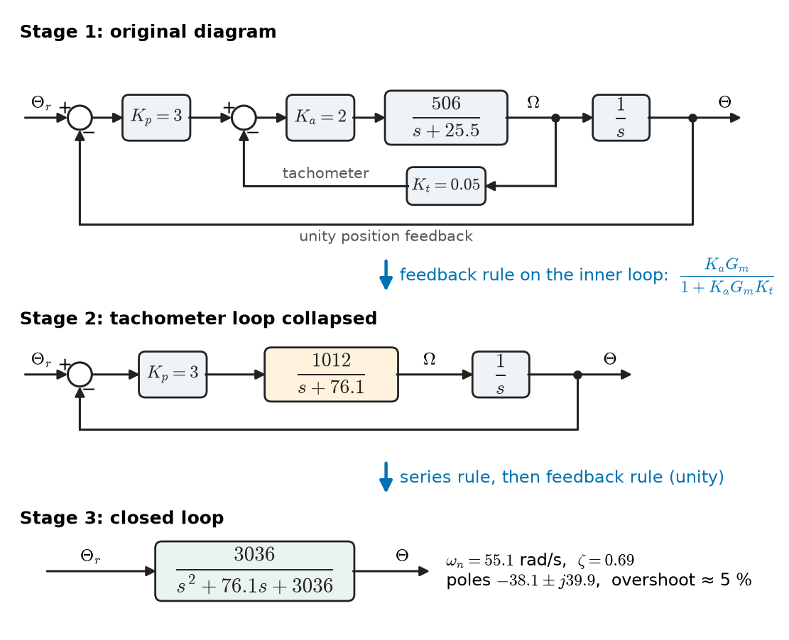
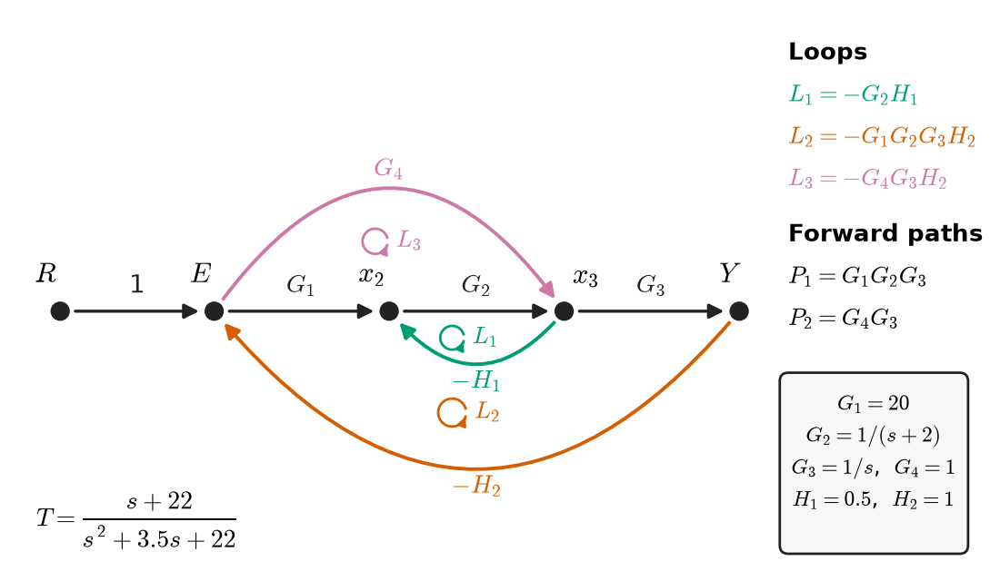
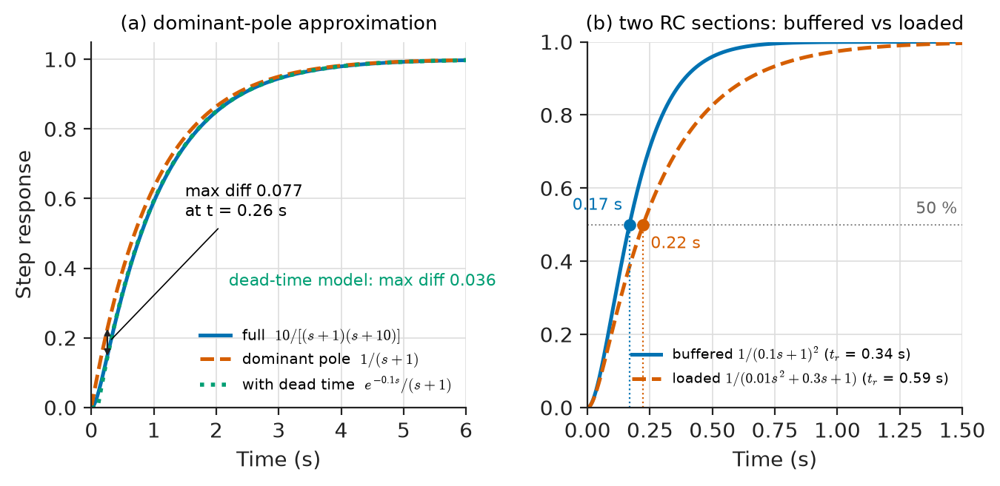

# Chapter 33 — Dynamic-System Modeling

*Part VII · Control-System Fundamentals*

A camera gimbal on a small drone holds the horizon steady while the airframe pitches and rolls. Its designer raises the gain of the pitch loop to make it stiffer against wind gusts, and at a certain gain the gimbal starts to buzz at about 40 Hz. Raising the gain further makes the buzz louder until the camera image is useless. Nothing is broken: the motor, the sensor and the controller each do exactly what their datasheets say. The buzz comes from how they interact — the motor's electrical lag, the gimbal's inertia, the flexible mount, the filter on the gyro signal and the controller's sampling delay add up to a phase lag that turns negative feedback into positive feedback at one particular frequency. To predict that frequency before building the hardware, and to choose a gain that avoids it, the designer needs a **model**: a set of equations that describes how each part turns its inputs into outputs over time, and how the parts are connected.

Part VII is about such models and what feedback does to them. This first chapter builds the models. It uses no new mathematics: the differential equations of Chapters 6–7, the Laplace transform of Chapter 11 and the LTI-system ideas of Chapters 16–17 are applied to motors, tanks, ovens, vehicles and generators as well as circuits. What is new is the point of view — the model exists to be *controlled*, so it must be simple enough to design with and accurate enough, in the right frequency range, to be trusted.

> **How do we turn a physical device — electrical, mechanical, thermal, fluid — into equations that predict its response to an input?**
> **How are the models of separate parts combined into one system model, and how far can that model be simplified before it stops being useful?**

| Concept | Engineering destination |
|---|---|
| Lumped physical models and analogies | Motor drives, suspensions, thermal management, process tanks |
| Differential equations and linearisation | Operating-point models of generators, valves, converters and aircraft |
| Transfer functions | Controller design, frequency-response analysis, simulation |
| Block diagrams | Control-system documentation, Simulink-type simulation, drive specifications |
| Signal-flow graphs and Mason's rule | Closed-form transfer functions of multi-loop systems, RF wave graphs |
| System interconnections and loading | Cascaded filters, converter–filter interaction, sensor and actuator chains |
| Model simplification | Dominant-pole approximations, controller tuning from step tests, real-time models |

**Roadmap.** Physical system models and their analogies (33.1) → the differential equations they produce, and linearisation (33.2) → transfer functions (33.3) → block diagrams (33.4) and signal-flow graphs (33.5) as two pictures of the same algebra → how interconnected parts behave (33.6) → how and when a model can be simplified (33.7).

---

## 33.1 Physical system models

### What a model is for

A model is a mathematical description of a system that predicts its outputs from its inputs, accurate enough for a stated purpose. The same motor may be described by a static torque–speed curve (for sizing), a second-order transfer function (for speed-loop design), a nonlinear model with saturation and friction (for simulation of large moves), or a finite-element thermal model (for overload rating). None of these is "the" model; each is good for one question. Control engineers usually want the simplest model that reproduces the dynamics in the frequency band where the controller acts.

Models are classified along a few axes, all of which recur in this Part:

- **Static or dynamic:** whether outputs depend only on present inputs, or also on stored energy (Chapter 16).
- **Linear or nonlinear:** whether superposition holds. Almost every real system is nonlinear; almost every design method in Chapters 34–35 assumes linearity, so linearisation (Section 33.2) is central.
- **Lumped or distributed:** whether a finite number of state variables suffices (ordinary differential equations) or the state varies continuously in space (partial differential equations — a transmission line, a heated slab, a flexible beam).
- **Time-invariant or time-varying**, **continuous or discrete-time**, **deterministic or stochastic.**
- **White-box, grey-box or black-box:** derived from physical laws, physical structure with fitted parameters, or fitted entirely from input–output data.

### Lumped elements in every energy domain

A lumped model divides a system into elements that each store, dissipate or supply energy, connected at points where a single value of each variable is meaningful. In every physical domain two kinds of variable appear. An **across variable** is measured between two points: voltage, velocity, angular velocity, pressure, temperature. A **through variable** flows through an element: current, force, torque, volumetric flow, heat flow. Their product is power (except in the thermal domain, where heat flow is already a power). Each domain has elements that store energy in one of two ways, and elements that dissipate it, which produces the **analogies** of Table 33.1.

**Table 33.1 — Analogous lumped elements (force–current analogy).**

| Domain | Across variable | Through variable | Dissipative element | Through-storage (inertia-like) | Across-storage (compliance-like) |
|---|---|---|---|---|---|
| Electrical | Voltage $v$ (V) | Current $i$ (A) | Resistor: $v=Ri$ | Inductor: $v=L\,di/dt$ | Capacitor: $i=C\,dv/dt$ |
| Mechanical translation | Velocity $u$ (m/s) | Force $f$ (N) | Damper: $f=c\,u$ | Spring: $f=k\int u\,dt$ | Mass: $f=m\,du/dt$ |
| Mechanical rotation | Angular velocity $\omega$ (rad/s) | Torque $\tau$ (N·m) | Rotary damper: $\tau=b\,\omega$ | Torsional spring: $\tau=k_\theta\int\omega\,dt$ | Inertia: $\tau=J\,d\omega/dt$ |
| Fluid | Pressure $p$ (Pa) | Flow $q$ (m³/s) | Restriction: $p=R_fq$ | Inertance: $p=I_f\,dq/dt$ | Tank: $q=C_f\,dp/dt$ |
| Thermal | Temperature $T$ (K) | Heat flow $\dot Q$ (W) | Thermal resistance: $T=R_\theta\dot Q$ | — (none) | Heat capacity: $\dot Q=C_\theta\,dT/dt$ |

In this "mobility" or force–current analogy, a mass is the analogue of a capacitor (both store energy proportional to the square of an across variable: $\tfrac12mu^2$, $\tfrac12Cv^2$) and a spring is the analogue of an inductor. The older force–voltage analogy pairs mass with inductance instead; both give correct equations, but the force–current form preserves the topology — elements in parallel mechanically appear in parallel electrically. The thermal domain has no inductance analogue: heat does not have inertia, which is why purely thermal systems never oscillate on their own. Figure 33.1 sets three analogous systems side by side.

> **Status of the principle: Lumped-parameter modelling**
> *Approximate.* Valid when the system's spatial extent is small compared with the wavelength (or diffusion length) of the fastest dynamics of interest; a shaft becomes a distributed torsional line at its resonant frequencies, a heated slab a diffusion PDE at short times, exactly as a circuit becomes a transmission line at high frequency (Chapter 14).

<!-- FIGURE 33.1 | figures/ch33/fig-33-1-analogous-systems.png | schematic | Three analogous lumped systems: a series RLC circuit, a mass–spring–damper and a first-order thermal RC network, with the variables that correspond. | Content: three side-by-side panels. Left: series RLC driven by voltage source v_s, R = 10 ohm, L = 10 mH, C = 10 µF, current i. Middle: mass m = 2 kg on spring k = 800 N/m and damper c = 8 N s/m, driving force f(t), displacement x upward. Right: thermal network of an oven: heater power Q_in = 400 W into heat capacity C_theta = 2000 J/K, thermal resistance R_theta = 0.5 K/W to ambient. Beneath each panel its governing equation; labels pairing the corresponding across variables (v, u, T) and through variables (i, f, Q) in the force-current analogy. Note under the thermal panel: first order only, no inertial element. -->

*Figure 33.1 — Three analogous lumped systems: a series RLC circuit, a mass–spring–damper and a first-order thermal RC network, with the variables that correspond.*

### Representative parameter values

**Table 33.2 — Representative parameters of dynamic systems met in EEE.**

| System | Parameter | Typical value |
|---|---|---|
| Small permanent-magnet servo motor (100–200 W) | Rotor inertia $J$; torque constant $K_t$; armature $R$, $L$ | $2\times10^{-5}$–$10^{-4}$ kg·m²; 0.03–0.1 N·m/A; 0.5–3 Ω, 0.5–3 mH |
| Quarter-car suspension | Sprung mass; spring rate; damping ratio | 250–450 kg; 15–35 kN/m; 0.2–0.4 |
| Hard-disk or optical pickup actuator | Moving mass; resonance | Grams; 1–10 kHz structural modes |
| Synchronous generator | Inertia constant $H$ | 2–9 s (thermal and hydro units) |
| Electromechanical oscillation of a power system | Frequency | 0.1–0.8 Hz inter-area; 0.8–2.5 Hz local mode |
| Thermocouple in a sheath | Time constant | 0.1–10 s |
| Domestic oven or heated enclosure | Time constant | 10–60 min |
| Building heating zone | Time constant | Hours |
| Process tank (1–10 m³) | Level time constant | Minutes to tens of minutes |
| MEMS accelerometer | Proof-mass resonance | 1–30 kHz |

The spread of time constants — microseconds in an armature, hours in a building — already says something about modelling: in any given loop, many dynamics are either too fast to matter or too slow to change during the response, and Section 33.7 will exploit that.

---

## 33.2 Differential equations

### Writing the equations

The equations of a lumped model come from two kinds of law. **Element laws** relate across and through variables of each element (Table 33.1). **Interconnection laws** express conservation at nodes and compatibility around loops: Kirchhoff's current and voltage laws in circuits (Chapter 2), Newton's second law and d'Alembert's principle in mechanics, mass and energy balances in fluid and thermal systems. Combining them yields one differential equation per energy-storing element.

> **Status of the principle: Conservation laws as interconnection rules**
> *Fundamental.* Newton's second law, conservation of charge, mass and energy are physical laws; their lumped forms (KCL at a node, force balance on a rigid body, energy balance on a well-mixed volume) inherit the lumped approximation above.

**Series RLC circuit.** KVL around the loop with source $v_s$:

$$
L\frac{di}{dt}+Ri+\frac1C\int i\,dt=v_s
\quad\Longleftrightarrow\quad
LC\frac{d^{2}v_C}{dt^{2}}+RC\frac{dv_C}{dt}+v_C=v_s
$$

With $R=10\ \Omega$, $L=10$ mH, $C=10\ \mu$F: $\omega_n=1/\sqrt{LC}=3162$ rad/s (503 Hz) and $\zeta=\tfrac R2\sqrt{C/L}=0.158$, an underdamped response (Chapter 7).

**Mass–spring–damper.** Newton's law on a mass $m$ with spring $k$, damper $c$ and applied force $f$:

$$
m\ddot x+c\dot x+kx=f
$$

For $m=2$ kg, $k=800$ N/m, $c=8$ N·s/m: $\omega_n=\sqrt{k/m}=20$ rad/s (3.18 Hz), $\zeta=c/(2\sqrt{km})=0.10$, and the static deflection is $1/k=1.25$ mm per newton. Both systems have the standard form $\ddot y+2\zeta\omega_n\dot y+\omega_n^2y=\omega_n^2\,u$, so everything learned about the RLC circuit in Chapter 7 — overshoot, ringing frequency, settling — transfers directly to vehicle suspensions, machine mounts and seismometers.

**Thermal oven.** An oven of heat capacity $C_\theta=2000$ J/K, losing heat to ambient $T_a$ through $R_\theta=0.5$ K/W, heated by power $P$:

$$
C_\theta\frac{dT}{dt}=P-\frac{T-T_a}{R_\theta}\quad\Longrightarrow\quad \tau\frac{dT}{dt}+(T-T_a)=R_\theta P,\qquad \tau=R_\theta C_\theta=1000\ \mathrm{s}
$$

A 400 W step raises the steady temperature by $R_\theta P=200$ K with a time constant of about 17 minutes — first order, like the RC circuit of Chapter 6.

### An electromechanical example: the DC motor

<!-- FIGURE 33.2 | figures/ch33/fig-33-2-dc-motor-model.png | block-diagram | Permanent-magnet DC motor: armature circuit, mechanical load and the resulting block diagram with back-EMF feedback. | Content: top-left: armature circuit with source v_a, R = 2 ohm, L = 1 mH, back-EMF source e = K omega. Top-right: rotor inertia J = 5e-5 kg m^2 with viscous friction b = 1e-5 N m s and load torque tau_L. Bottom: block diagram: v_a into summing junction (minus e), block 1/(Ls + R) giving current i, gain K giving torque, summing junction (minus tau_L), block 1/(Js + b) giving omega, integrator 1/s giving theta; feedback path from omega through K back to the first junction labelled "back-EMF". Numerical poles annotated: -25.5 and -1975 s^-1. -->

*Figure 33.2 — Permanent-magnet DC motor: armature circuit, mechanical load and the resulting block diagram with back-EMF feedback.*

**Worked example — transfer function of a servo motor.** A permanent-magnet DC motor has armature resistance $R=2\ \Omega$, inductance $L=1$ mH, torque and back-EMF constant $K=0.05$ N·m/A (= V·s/rad), rotor-plus-load inertia $J=5\times10^{-5}$ kg·m² and viscous friction $b=1\times10^{-5}$ N·m·s. Its equations couple the electrical and mechanical domains (Figure 33.2):

$$
L\frac{di}{dt}+Ri=v_a-K\omega,\qquad J\frac{d\omega}{dt}+b\omega=Ki-\tau_L
$$

Taking Laplace transforms with zero initial conditions and $\tau_L=0$, eliminating $I(s)$:

$$
\frac{\Omega(s)}{V_a(s)}=\frac{K}{(Ls+R)(Js+b)+K^{2}}=\frac{0.05}{5\times10^{-8}s^{2}+1.0001\times10^{-4}s+2.52\times10^{-3}}
$$

The denominator roots are $s=-25.5$ and $s=-1975\ \mathrm{s^{-1}}$: a slow **mechanical** pole (time constant 39 ms) and a fast **electrical** pole (0.51 ms). The DC gain is $0.05/2.52\times10^{-3}=19.8$ rad/s per volt (189 rpm/V), so 12 V gives about 238 rad/s (2270 rpm) at no load. Note how the back-EMF term $K^2$ couples the domains: without it the poles would be at $-R/L=-2000$ and $-b/J=-0.2$; the electrical damping of the back-EMF moves the mechanical pole from $-0.2$ to $-25.5$, which is why a motor driven from a voltage source stops quickly and one driven from a current source coasts.

> **Boundary.** The construction, magnetic design and power electronics of motors belong to *Electrical Energy & Machines* and *Electronics & Computing*; practical drive controllers to the robotics and automation books. Here the motor is a two-state linear model with measured constants.

### State-variable form

The same equations can be written as first-order equations in the energy-storage variables. With state $\mathbf x=[i\ \ \omega]^T$:

$$
\dot{\mathbf x}=\begin{bmatrix}-R/L&-K/L\\ K/J&-b/J\end{bmatrix}\mathbf x+\begin{bmatrix}1/L\\0\end{bmatrix}v_a
$$

Every lumped linear model can be written as $\dot{\mathbf x}=\mathbf A\mathbf x+\mathbf Bu$, $y=\mathbf C\mathbf x+\mathbf Du$, with one state per independent energy store; the eigenvalues of $\mathbf A$ are the poles. This form is the starting point for computer simulation and for the state-space methods of Chapter 35.

### Linearisation about an operating point

Real systems are nonlinear: valve flow depends on the square root of pressure drop, aerodynamic drag on the square of speed, generator power on the sine of rotor angle. Linear methods remain usable because control systems normally hold a system near an **operating point** (an equilibrium), and small deviations from it obey linear equations. For $\dot x=f(x,u)$ with equilibrium $f(x_0,u_0)=0$, a first-order Taylor expansion in the deviations $\delta x=x-x_0$, $\delta u=u-u_0$ gives

$$
\dot{\delta x}\approx\left.\frac{\partial f}{\partial x}\right|_{0}\delta x+\left.\frac{\partial f}{\partial u}\right|_{0}\delta u
$$

> **Status of the principle: Small-signal linearisation**
> *Approximate.* Accurate when deviations are small enough that second-order Taylor terms are negligible; it fails at large excursions, near hard nonlinearities (saturation, backlash, Coulomb friction, switching), and where the Jacobian vanishes — the same small-signal idea as transistor models in electronics.

<!-- FIGURE 33.3 | figures/ch33/fig-33-3-tank-linearisation.png | plot | Nonlinear outflow of a gravity-drained tank and its tangent-line linearisation about a 4 m operating level. | Content: x-axis tank level h from 0 to 8 m, y-axis outflow q from 0 to 0.03 m^3/s. Solid curve q = 0.01 sqrt(h). Operating point marked at h = 4 m, q = 0.02 m^3/s. Dashed tangent line with slope 1/R_lin = 0.0025 m^2/s (R_lin = 400 s/m^2). Shaded band between curve and tangent; markers at h = 5.6 m (linear prediction for +20 % inflow) and h = 5.76 m (true equilibrium), labelled with the 2.8 % error. -->

*Figure 33.3 — Nonlinear outflow of a gravity-drained tank and its tangent-line linearisation about a 4 m operating level.*

**Worked example — linearising a draining tank.** A tank of cross-section $A=2$ m² is fed with inflow $q_\mathrm{in}$ and drains through an orifice with outflow $q_\mathrm{out}=k\sqrt h$ (Torricelli's law). At the operating point $h_0=4$ m, $q_0=0.02$ m³/s, so $k=q_0/\sqrt{h_0}=0.01$ m$^{2.5}$/s. The mass balance is

$$
A\frac{dh}{dt}=q_\mathrm{in}-k\sqrt h
$$

Linearising $k\sqrt h$ about $h_0$: $\partial q_\mathrm{out}/\partial h=k/(2\sqrt{h_0})=0.0025$ m²/s, i.e. a linearised outlet resistance $R_\mathrm{lin}=2\sqrt{h_0}/k=400$ s/m². Hence

$$
A\frac{d\,\delta h}{dt}=\delta q_\mathrm{in}-\frac{\delta h}{R_\mathrm{lin}}\quad\Longrightarrow\quad \frac{\delta H(s)}{\delta Q_\mathrm{in}(s)}=\frac{R_\mathrm{lin}}{AR_\mathrm{lin}s+1}=\frac{400}{800s+1}
$$

a first-order lag with time constant 800 s (13 minutes). *Check of validity:* a 20 % increase of inflow ($\delta q=0.004$ m³/s) gives a linear prediction of $\delta h=400\times0.004=1.6$ m, i.e. $h=5.6$ m; the true new equilibrium is $h=(0.024/0.01)^2=5.76$ m. The 0.16 m discrepancy, 9 % of the true change, is the price of linearity at a 20 % excursion (Figure 33.3); for a 5 % step it falls to about 2.5 %. Note also that the time constant depends on the operating point ($\tau=2A\sqrt{h_0}/k$ grows with level), so a controller tuned at 4 m behaves differently at 1 m.

**Worked example — the swing equation of a generator.** A synchronous generator connected to a large grid obeys, in per unit, the nonlinear swing equation

$$
\frac{2H}{\omega_s}\frac{d^{2}\delta}{dt^{2}}=P_m-P_{\max}\sin\delta-D\frac{d\delta}{dt}
$$

where $\delta$ is the rotor angle relative to the grid, $H$ the inertia constant, $\omega_s=2\pi\times50$ rad/s, and $P_{\max}\sin\delta$ the electrical power. Linearising about $\delta_0$ gives the **synchronising power coefficient** $P_s=P_{\max}\cos\delta_0$ and a second-order model

$$
M\,\Delta\ddot\delta+D\,\Delta\dot\delta+P_s\,\Delta\delta=\Delta P_m,\qquad M=\frac{2H}{\omega_s}
$$

With $H=5$ s, $M=10/314.16=0.0318$ s²/rad; with $P_s=1.5$ pu/rad the natural frequency is $\omega_n=\sqrt{P_s/M}=6.86$ rad/s, or 1.09 Hz — the "local mode" of Table 33.2. The inherent damping is small (with $D=0.02$ pu·s/rad, $\zeta=D/(2\sqrt{P_sM})=0.046$), which is why generators carry power-system stabilisers. The linear model is valid for small disturbances; a fault that swings $\delta$ past 90° needs the nonlinear equation and leads to the transient-stability problem studied in power-system texts.

---

## 33.3 Transfer functions

### Definition

For a linear time-invariant system described by

$$
a_n\frac{d^{n}y}{dt^{n}}+\dots+a_1\frac{dy}{dt}+a_0y=b_m\frac{d^{m}u}{dt^{m}}+\dots+b_0u
$$

the Laplace transform with **all initial conditions zero** gives the **transfer function**

$$
G(s)=\frac{Y(s)}{U(s)}=\frac{b_ms^{m}+\dots+b_0}{a_ns^{n}+\dots+a_0}=K\frac{\prod_i(s-z_i)}{\prod_k(s-p_k)}
$$

It is the Laplace transform of the impulse response (Chapter 17) and, evaluated at $s=j\omega$, the frequency response (Chapter 18). The roots of the denominator are the **poles** — the natural modes $e^{p_kt}$ that appear in every response — and the roots of the numerator are the **zeros**, which shape how strongly each mode is excited. The denominator set to zero is the **characteristic equation**. Physical systems are **proper** ($m\le n$): no physical system has gain rising without limit at high frequency.

> **Status of the principle: Transfer-function representation**
> *Derived.* Follows from the linearity and differentiation property of the Laplace transform applied to a linear constant-coefficient ODE; it describes only the zero-state input–output behaviour, so initial conditions must be added separately and any modes cancelled between numerator and denominator are hidden (Chapter 35, controllability and observability).

### Standard forms and their parameters

Control engineers read transfer functions through a handful of standard forms (Table 33.3), each tied to a measurable property of the step response (Chapters 6–7).

**Table 33.3 — Standard transfer-function forms.**

| Form | $G(s)$ | Parameters | Example |
|---|---|---|---|
| Gain | $K$ | Static sensitivity | Tachogenerator, 0.05 V·s/rad |
| Integrator | $K/s$ | Rate of rise per unit input | Motor angle from speed; tank level from net flow |
| First-order lag | $K/(\tau s+1)$ | DC gain $K$, time constant $\tau$ | Oven ($\tau=1000$ s), RC filter, thermocouple |
| Second order | $K\omega_n^2/(s^2+2\zeta\omega_ns+\omega_n^2)$ | $\omega_n$, $\zeta$ | Suspension, RLC, generator swing |
| Lead / lag | $K(\tau_zs+1)/(\tau_ps+1)$ | Zero and pole time constants | Compensators, sensor networks |
| Dead time | $e^{-sT_d}$ | Delay $T_d$ | Conveyor transport, network latency, ADC/DSP latency |
| First order plus dead time | $Ke^{-sT_d}/(\tau s+1)$ | $K$, $\tau$, $T_d$ | Process plant fitted from step tests |

The dead time $e^{-sT_d}$ is not a rational function: it has unit magnitude and phase $-\omega T_d$ that grows without bound with frequency. It is the model of transport delay (fluid in a pipe, material on a belt) and of computation and sampling delay in digital controllers (Chapter 35), and it is one of the main reasons the drone gimbal in the opening story oscillated.

### Poles, zeros and the shape of the response

Pole locations translate directly into time-domain behaviour. A real pole at $-a$ contributes $e^{-at}$; a complex pair $-\sigma\pm j\omega_d$ contributes a decaying oscillation $e^{-\sigma t}\cos(\omega_dt+\phi)$; a pole in the right half-plane grows without bound (Chapter 34). Zeros do not create modes but change the weighting: a left-half-plane zero near the dominant pole adds overshoot; a **right-half-plane zero** makes the step response start in the wrong direction — the "inverse response" of a boiler drum level when feedwater is increased, or the initial dip in output voltage of a boost converter when its duty cycle is increased. Such non-minimum-phase zeros limit achievable control bandwidth no matter how the controller is designed.

### Multiple inputs and outputs

Most systems have more than one input — a motor has voltage and load torque; an oven has heater power and ambient temperature. By superposition, the output is the sum of each input's contribution through its own transfer function. For the motor,

$$
\Omega(s)=\frac{K}{(Ls+R)(Js+b)+K^{2}}V_a(s)-\frac{Ls+R}{(Ls+R)(Js+b)+K^{2}}T_L(s)
$$

Both transfer functions share the denominator — the poles are properties of the system, not of the input — while the numerators differ. With several outputs as well, the transfer functions form a **transfer matrix** $\mathbf G(s)$, with $\mathbf G(s)=\mathbf C(s\mathbf I-\mathbf A)^{-1}\mathbf B+\mathbf D$ in state-space terms.

---

## 33.4 Block diagrams

### Elements and rules

A **block diagram** draws a system as blocks (each a transfer function from its input arrow to its output arrow), **summing junctions** (which add or subtract signals) and **pick-off points** (which copy a signal to several destinations). Unlike a circuit diagram, a block diagram shows signal flow, not physical connection: each block is unidirectional, and connecting two blocks assumes the second does not load the first (Section 33.6). Block diagrams are the lingua franca of control: drive manufacturers specify their speed and current loops with them, and simulation tools are built on them.

Three connection rules generate all the others.

**Table 33.4 — Block-diagram algebra.**

| Connection | Equivalent single block |
|---|---|
| Series (cascade) $G_1$ then $G_2$ | $G_1G_2$ |
| Parallel $G_1$ and $G_2$ summed | $G_1\pm G_2$ |
| Negative feedback: forward $G$, feedback $H$ | $\dfrac{G}{1+GH}$ |
| Positive feedback | $\dfrac{G}{1-GH}$ |
| Moving a summing junction ahead of a block $G$ | Divide the moved input by $G$ |
| Moving a pick-off point behind a block $G$ | Multiply the picked-off branch by $1/G$ |
| Moving a pick-off point ahead of a block $G$ | Multiply the picked-off branch by $G$ |

> **Status of the principle: Block-diagram reduction rules**
> *Derived.* Each rule is an algebraic identity for linear operators in the Laplace domain (the feedback formula follows from $E=R-HY$, $Y=GE$); they apply to LTI blocks with no loading between them, and not to nonlinear blocks such as saturations.

The closed-loop formula $G/(1+GH)$ is the most important single result of Part VII; Chapter 34 is largely a study of what it implies. The term $GH$ is the **loop gain** (open-loop transfer function), and $1+GH=0$ is the closed-loop characteristic equation.

### Reducing a multi-loop diagram

<!-- FIGURE 33.4 | figures/ch33/fig-33-4-servo-block-reduction.png | block-diagram | Reduction of a cascaded position servo with an inner tachometer loop to a single closed-loop transfer function. | Content: three stacked stages. Stage 1: reference theta_r into summing junction, gain Kp = 3, summing junction, amplifier Ka = 2, motor block 506/(s + 25.5) giving omega, integrator 1/s giving theta; inner feedback from omega through tachometer Kt = 0.05 to the second junction; outer unity feedback from theta to the first junction. Stage 2: inner loop collapsed to 1012/(s + 76.1). Stage 3: single block 3036/(s^2 + 76.1 s + 3036) with annotation omega_n = 55.1 rad/s, zeta = 0.69, overshoot about 5 %. Arrows between stages labelled "feedback rule" and "series + feedback rule". -->

*Figure 33.4 — Reduction of a cascaded position servo with an inner tachometer loop to a single closed-loop transfer function.*

**Worked example — reducing a position servo.** The motor of Section 33.2, simplified to its dominant pole (Section 33.7), has speed response $G_m(s)=506/(s+25.5)$ rad/s per volt. It is driven by a power amplifier of gain $K_a=2$, with a tachometer of $K_t=0.05$ V·s/rad feeding speed back to the amplifier input, an integrator $1/s$ from speed to angle, and an outer position loop with proportional gain $K_p=3$ and unity position feedback (Figure 33.4).

*Step 1 — inner loop.* By the feedback rule,

$$
G_\mathrm{in}(s)=\frac{K_aG_m}{1+K_aG_mK_t}=\frac{1012/(s+25.5)}{1+50.6/(s+25.5)}=\frac{1012}{s+76.1}
$$

The tachometer loop has moved the speed pole from $-25.5$ to $-76.1$ — three times faster — while reducing the DC speed gain from 39.7 to 13.3 rad/s per volt.

*Step 2 — series.* The outer forward path is $K_pG_\mathrm{in}(s)/s=3036/[s(s+76.1)]$.

*Step 3 — outer loop.* With unity feedback,

$$
\frac{\Theta(s)}{\Theta_r(s)}=\frac{3036}{s^{2}+76.1s+3036}
$$

which is the standard second-order form with $\omega_n=\sqrt{3036}=55.1$ rad/s and $\zeta=76.1/(2\times55.1)=0.69$. The closed-loop poles are $-38.1\pm j39.9$, and the step response overshoots by about 5 % (Chapter 7). Reduction has turned a diagram with two loops into one transfer function whose parameters can be read off directly — and shows that the inner tachometer loop supplies the damping that the outer loop needs.

---

## 33.5 Signal-flow graphs

### Nodes and branches

A **signal-flow graph** carries the same information as a block diagram in a sparser form. Each **node** is a signal (a variable); each directed **branch** carries a gain (a transfer function) from one node to another; the value of a node is the sum of all signals entering it. Summing junctions disappear into nodes, and blocks become branches. The vocabulary:

- A **path** is a connected sequence of branches in the arrow direction that visits no node twice; a **forward path** runs from the input node to the output node.
- A **loop** is a closed path returning to its starting node; its **loop gain** is the product of its branch gains.
- Two loops are **non-touching** if they share no node.

Signal-flow graphs come from S. J. Mason (1953), who used them for electronic feedback circuits; they reappear as wave-flow graphs for S-parameters in microwave networks (Chapter 32).

### Mason's gain formula

The transfer function from an input node to an output node is

$$
T=\frac{1}{\Delta}\sum_kP_k\Delta_k
$$

where $P_k$ is the gain of the $k$-th forward path, and the **graph determinant** is

$$
\Delta=1-\sum L_i+\sum L_iL_j-\sum L_iL_jL_k+\cdots
$$

with $\sum L_i$ the sum of all loop gains, $\sum L_iL_j$ the sum of products of all pairs of non-touching loops, and so on. $\Delta_k$ is $\Delta$ evaluated with all loops that touch the $k$-th forward path removed.

> **Status of the principle: Mason's gain formula**
> *Derived.* A closed-form solution, by Cramer's rule, of the linear simultaneous equations that the graph represents; it is exact for any linear graph but becomes error-prone by hand when there are many non-touching loop combinations, where direct matrix solution is safer.

<!-- FIGURE 33.5 | figures/ch33/fig-33-5-signal-flow-graph.png | block-diagram | Signal-flow graph with two forward paths and three loops used to illustrate Mason's gain formula. | Content: nodes in a horizontal line R, E, x2, x3, Y. Branches: R to E gain 1; E to x2 gain G1; x2 to x3 gain G2; x3 to Y gain G3; feedforward branch E to x3 gain G4 drawn as an arc above; local feedback x3 to x2 gain -H1 drawn as an arc below; outer feedback Y to E gain -H2 drawn as a long arc below. Loops highlighted in three colours: L1 = -G2 H1, L2 = -G1 G2 G3 H2, L3 = -G4 G3 H2. Numerical values in a side box: G1 = 20, G2 = 1/(s + 2), G3 = 1/s, G4 = 1, H1 = 0.5, H2 = 1. -->

*Figure 33.5 — Signal-flow graph with two forward paths and three loops used to illustrate Mason's gain formula.*

**Worked example — a two-path, three-loop system.** Figure 33.5 shows a system with nodes $R,E,x_2,x_3,Y$: forward branches $G_1$ ($E\to x_2$), $G_2$ ($x_2\to x_3$), $G_3$ ($x_3\to Y$), a feedforward branch $G_4$ ($E\to x_3$), a local feedback $-H_1$ ($x_3\to x_2$) and an outer feedback $-H_2$ ($Y\to E$).

*Forward paths:* $P_1=G_1G_2G_3$ and $P_2=G_4G_3$.

*Loops:* $L_1=-G_2H_1$ (between $x_2$ and $x_3$), $L_2=-G_1G_2G_3H_2$, $L_3=-G_4G_3H_2$. Every pair shares a node ($L_1$ and $L_3$ share $x_3$), so there are no non-touching pairs.

*Determinants:* $\Delta=1+G_2H_1+G_1G_2G_3H_2+G_4G_3H_2$. Both forward paths touch all three loops, so $\Delta_1=\Delta_2=1$.

$$
T=\frac{G_1G_2G_3+G_4G_3}{1+G_2H_1+G_1G_2G_3H_2+G_4G_3H_2}
$$

With $G_1=20$, $G_2=1/(s+2)$, $G_3=1/s$, $G_4=1$, $H_1=0.5$, $H_2=1$, multiply numerator and denominator by $s(s+2)$:

$$
T(s)=\frac{20+(s+2)}{s(s+2)+0.5s+20+(s+2)}=\frac{s+22}{s^{2}+3.5s+22}
$$

The poles are $-1.75\pm j4.35$ ($\omega_n=4.69$ rad/s, $\zeta=0.37$), the DC gain is $22/22=1$, and the feedforward branch has introduced a zero at $-22$. Solving the four node equations directly ($E=R-H_2Y$, $x_2=G_1E-H_1x_3$, $x_3=G_2x_2+G_4E$, $Y=G_3x_3$) gives the same result, as it must.

### When to use which picture

Block diagrams are better for communicating structure — they mirror the hardware and show where sensors and actuators sit. Signal-flow graphs are better for computing a transfer function by hand in a multi-loop system, and for wave problems where each node is a travelling-wave amplitude. Software tools do neither: they assemble the state-space matrices of all components and solve numerically.

---

## 33.6 System interconnections

### The three basic connections

Every interconnection of LTI systems is built from **series**, **parallel** and **feedback** connections (Table 33.4), and every one of them produces a new LTI system whose poles are determined by the interconnection: series and parallel connections keep the poles of the parts (unless cancelled), whereas feedback moves them. That single fact is why feedback is so powerful and so dangerous — it can make slow systems fast and unstable systems stable, or the reverse (Chapter 34).

> **Status of the principle: Poles of interconnected systems**
> *Derived.* For series and parallel connections the denominator is the product of the component denominators; for feedback it is $D_GD_H+N_GN_H$, so the closed-loop poles are new roots that depend on the loop gain — a direct consequence of the algebra in Table 33.4.

### Loading: when blocks are not independent

Block-diagram multiplication assumes that connecting block 2 to block 1 does not change block 1's behaviour — that block 1 has zero output impedance or block 2 infinite input impedance. Physical subsystems rarely satisfy this, and ignoring it is one of the commonest modelling errors.

**Worked example — two RC sections in cascade.** One RC low-pass section with $R=10\ \mathrm{k\Omega}$ and $C=10\ \mu$F has $G(s)=1/(\tau s+1)$ with $\tau=0.1$ s. Two identical sections connected through an ideal buffer amplifier give $1/(\tau s+1)^2$: a double pole at $-10\ \mathrm{s^{-1}}$. Connected directly, the second section draws current from the first capacitor, and nodal analysis (Chapter 3) gives

$$
\frac{V_2(s)}{V_1(s)}=\frac{1}{\tau^{2}s^{2}+3\tau s+1}=\frac{1}{0.01s^{2}+0.3s+1}
$$

whose poles are $-3.82$ and $-26.2\ \mathrm{s^{-1}}$. The loaded network is markedly slower: its step response reaches 50 % at 0.22 s instead of 0.17 s, and its 10–90 % rise time is 0.59 s against 0.34 s. Multiplying the individual transfer functions would have been wrong by almost a factor of two in speed. The cure is either to model the connection at the level of the underlying physics (writing the equations for the combined network) or to insert a buffer.

The same issue appears across EEE. A sensor with significant output impedance is loaded by the input of its amplifier; a mechanical gearbox reflects the load inertia back to the motor as $J_L/N^2$; and a **switched-mode converter with an input filter** is the classic power-electronics example. A tightly regulated converter draws constant power, so its input current falls as its input voltage rises: a small-signal input resistance of $-V^2/P$ — for a 100 W load at 48 V, $-23$ Ω. Connected to an LC input filter whose characteristic impedance is higher than 23 Ω, this negative resistance cancels the filter's damping and the combination oscillates, although each part is stable alone. Middlebrook's criterion — keep the filter's output impedance well below the converter's input impedance magnitude — is an interconnection rule derived from exactly this loading analysis.

### Two-port and impedance-based modelling

A systematic way to handle loading is to model each subsystem as a two-port (Chapter 12) with effort and flow variables at each port, rather than as a one-way block. Cascading then uses ABCD (transmission) matrices, which multiply correctly regardless of loading; the one-way block diagram is recovered only when one port's impedance is negligible. Bond graphs and object-oriented modelling languages (Modelica and the "acausal" component libraries of modern simulators) are built on this idea: components are connected by physical ports, and the software works out the direction of computation.

### Disturbances, sensors and actuators

A model of a controlled system interconnects at least four kinds of subsystem: the **plant** to be controlled, the **actuator** (amplifier, valve, heater driver) that converts controller output into plant input, the **sensor** that measures the output (with its own dynamics, gain and noise), and the **controller**. External signals enter at defined points: the reference, **disturbances** (load torque, ambient temperature, wind gusts, grid voltage dips) and **measurement noise**. The generic arrangement, with each of these as a block, is the starting point of Chapter 34; its value lies in making explicit *where* each disturbance enters, because a disturbance entering before a slow plant pole is filtered by it, whereas one entering at the output is not.

<!-- FIGURE 33.6 | figures/ch33/fig-33-6-model-reduction-step.png | plot | Step responses of full and simplified models: a two-pole plant versus its dominant-pole and dead-time approximations, and loaded versus buffered RC sections. | Content: two panels. Left: x-axis time 0 to 6 s, y-axis 0 to 1.05. Curves: full model 10/((s+1)(s+10)) solid; dominant-pole model 1/(s+1) dashed (maximum difference 0.077 at t = 0.26 s); dominant pole plus 0.1 s dead time e^{-0.1 s}/(s+1) dotted (maximum difference 0.036). Right: x-axis time 0 to 1.5 s, y-axis 0 to 1. Curves: buffered RC cascade 1/(0.1 s + 1)^2 (rise time 0.34 s) and loaded RC cascade 1/(0.01 s^2 + 0.3 s + 1) (rise time 0.59 s), with the 50 % times 0.17 s and 0.22 s marked. -->

*Figure 33.6 — Step responses of full and simplified models: a two-pole plant versus its dominant-pole and dead-time approximations, and loaded versus buffered RC sections.*

---

## 33.7 Model simplification

### Why simplify

A detailed model contains every pole the physics produces: the motor's electrical pole, the shaft's torsional mode, the sensor filter, the amplifier bandwidth, the load's structural resonances. Most of them lie far outside the frequency range in which the controller acts. Keeping them makes the model harder to understand, harder to design with, and — when parameters are uncertain — not necessarily more accurate. Simplification keeps what matters at the frequencies of interest and replaces the rest by gains or small delays.

### Dominant poles

If one pole (or complex pair) is much closer to the imaginary axis than all others, its mode decays slowest and dominates the response after a short initial interval. Removing the faster poles **while preserving the DC gain** gives a lower-order model. For $G(s)=10/[(s+1)(s+10)]$ the pole at $-10$ is ten times faster than the one at $-1$, and

$$
G(s)=\frac{10}{(s+1)(s+10)}=\frac{1}{(s+1)(0.1s+1)}\approx\frac{1}{s+1}
$$

The fast pole must be written in time-constant form $(0.1s+1)$ before it is dropped, so that the DC gain is kept; dropping $(s+10)$ from the first form would change the gain by a factor of ten — a common error.

> **Status of the principle: Dominant-pole approximation**
> *Approximate.* Reliable when the neglected poles are at least about five to ten times further from the imaginary axis than the dominant ones and no zeros lie near the dominant poles; it fails when feedback with high gain moves the "fast" poles toward the slow ones — the reason a neglected pole often reappears as the cause of oscillation at high gain.

**Worked example — how good is the dominant-pole model?** Comparing the step responses of the full model $10/[(s+1)(s+10)]$ and the approximation $1/(s+1)$ (Figure 33.6): the largest difference is 0.077 (7.7 % of the final value) at $t=0.26$ s, where the full model lags because of its second pole. The 10–90 % rise times are 2.21 s and 2.20 s, and the 2 % settling times 4.02 s and 3.91 s. For the purpose of designing a slow outer loop, the first-order model is entirely adequate.

A better approximation replaces the neglected lag by an equal **dead time**: $1/(0.1s+1)\approx e^{-0.1s}$, since both have phase $\approx-0.1\omega$ at low frequency. The model $e^{-0.1s}/(s+1)$ reduces the largest step-response error to 0.036. This "lump the small lags into a delay" rule is the basis of the first-order-plus-dead-time models used throughout process control.

For the servo motor of Section 33.2, the same reasoning gives $G_m(s)=19.8/(0.0392s+1)=506/(s+25.5)$, keeping the mechanical pole and the DC gain and neglecting the electrical pole at $-1975$, which is 77 times faster. The step responses of the full and reduced models differ by at most 1.2 % of the final speed. The reduced model was used in Section 33.4 — legitimately, because the closed-loop poles at $-38\pm j40$ are still more than 30 times slower than the neglected pole.

### Pole–zero cancellation and near-cancellation

A zero close to a pole nearly cancels it: the mode is present but weakly excited. For $(s+2.1)/[(s+2)(s+20)]$, the residue of the pole at $-2$ is $0.1/18\approx0.006$, so the model is well approximated by $1.05/(s+20)$ — the factor $2.1/2=1.05$ preserving DC gain. But near-cancellation of an *unstable* or lightly damped pole is never acceptable: the mode is still there, and any disturbance entering inside the cancelled loop excites it (Chapter 35 calls this a loss of controllability or observability).

### Neglecting fast dynamics and very slow ones

Two systematic simplifications follow from separating time scales:

- **Fast dynamics** (time constants much shorter than the loop's response) become static: the amplifier becomes a gain, the motor's current loop becomes a unit gain, the sensor filter a small delay. Formally, this is a singular-perturbation approximation: set $\epsilon\dot x_\mathrm{fast}=0$.
- **Very slow dynamics** (time constants much longer than the response) become constants or slowly varying parameters: the temperature drift of a motor's winding resistance during a 50 ms positioning move; the slow thermal time constant of a power transistor during a 1 ms current-loop transient.

### Data-driven simplification: step-test models

Many plants — boilers, ovens, chemical reactors, building zones — are too complex to model from first principles but easy to test. Applying a step to the actuator and recording the output gives a **process reaction curve**, to which a first-order-plus-dead-time model $Ke^{-sT_d}/(\tau s+1)$ is fitted. A common two-point method uses the times $t_{28}$ and $t_{63}$ at which the response reaches 28.3 % and 63.2 % of its final change:

$$
\tau=1.5\,(t_{63}-t_{28}),\qquad T_d=t_{63}-\tau
$$

> **Status of the principle: First-order-plus-dead-time step-test models**
> *Empirical.* The FOPDT form is fitted to observed reaction curves; it captures the low-frequency behaviour of many overdamped processes well enough for PID tuning (Chapter 35) but misrepresents oscillatory, integrating or inverse-response plants.

**Worked example — fitting a heater from a step test.** An electric heater on a test chamber is stepped from 0 to 2 kW. The chamber temperature rises from 20 °C and settles at 80 °C, so $K=60/2=30$ K/kW. The response reaches 28.3 % of its change (37.0 °C) at $t_{28}=140$ s and 63.2 % (57.9 °C) at $t_{63}=290$ s. Then

$$
\tau=1.5\times(290-140)=225\ \mathrm{s},\qquad T_d=290-225=65\ \mathrm{s}
$$

and the model is $G(s)=30\,e^{-65s}/(225s+1)$ K/kW. The apparent dead time of 65 s is not a true transport delay; it is the sum of the heater element's, the air's and the sensor's small lags lumped into a delay, exactly as in the dominant-pole example. The ratio $T_d/\tau\approx0.29$ already tells a control engineer that a PID loop on this chamber can be reasonably fast without oscillating; a ratio above 1 would signal a delay-dominated process that is hard to control tightly.

### Validating a model

A simplified model is accepted only after it has been compared with data the fitting did not use: a step of a different size (to check linearity), a step at a different operating point (to check parameter variation, as in the tank example), and, where possible, a frequency response measured around the expected crossover frequency (Chapter 34). The model must be good *where the controller will use it* — near the loop's crossover frequency — and may be poor elsewhere. A model that is accurate at DC and at the crossover but misses a lightly damped structural resonance at ten times crossover is still dangerous, because high controller gain there can excite it: that is precisely the drone gimbal of the opening paragraph.

**Table 33.5 — Simplification methods and their limits.**

| Method | What it keeps | When it fails |
|---|---|---|
| Dominant pole | Slow modes and DC gain | High loop gain moves fast poles inward |
| Lumping small lags into a dead time | Low-frequency phase | Above about $1/T_d$, where the delay's phase keeps growing |
| Pole–zero cancellation | Input–output response | Cancelled mode is unstable or lightly damped |
| Singular perturbation (fast states static) | Slow subsystem | Fast and slow time scales not well separated |
| FOPDT step-test fit | Low-frequency gain and phase | Oscillatory, integrating or inverse-response plants |
| Linearisation | Small-signal behaviour at one operating point | Large excursions, saturation, friction, switching |

---

## What remains open

| Open question | Where it is answered |
|---|---|
| What does feedback do to the poles of a model, and when does a closed loop become unstable? | Chapter 34 (feedback and stability) |
| How can stability be decided without computing the roots, and how do the poles move as gain changes? | Chapter 34 (Routh–Hurwitz, root locus) |
| How large is the steady-state error of a loop, and how do Bode and Nyquist plots of the loop gain predict stability? | Chapter 34 (steady-state error, frequency-domain stability) |
| How are PID controllers tuned from a step-test model, and how is a state-space model used for control? | Chapter 35 (control design fundamentals) |
| What do controllability and observability say about cancelled modes? | Chapter 35 |
| How are continuous models turned into discrete-time models for a digital controller? | Chapter 35 (digital control); Chapter 20 (Z-transform) |
| Where do the Laplace-domain circuit methods and second-order step responses come from? | Chapters 6, 7 and 11 |
| How are motors, generators and converters built, and how are robot controllers implemented? | *Electrical Energy & Machines*; *Electronics & Computing*; robotics and automation books |

**Next:** Chapter 34 closes the loop around these models, asking what feedback does to their poles, how stability is tested, and how the Bode and Nyquist plots of the loop gain predict the behaviour of the closed-loop system.
