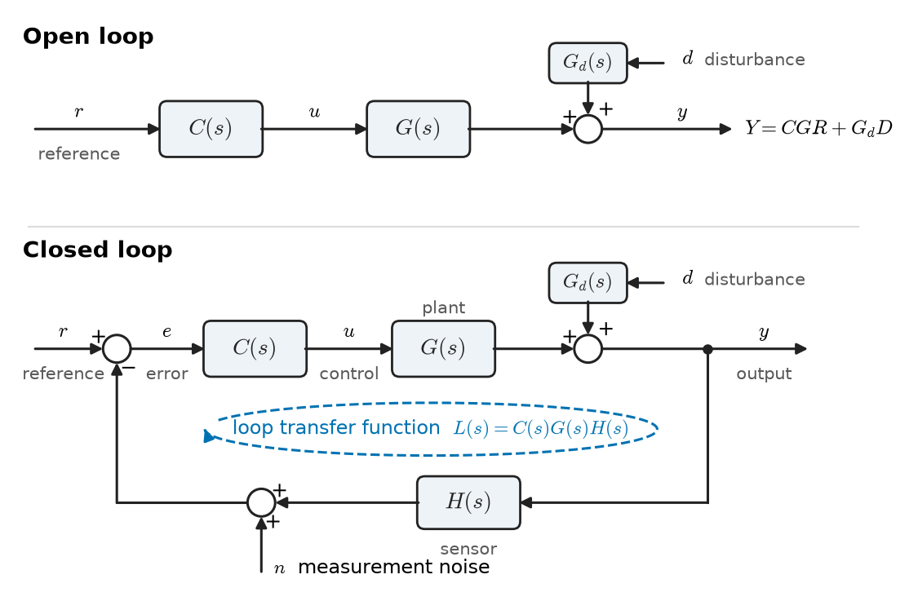
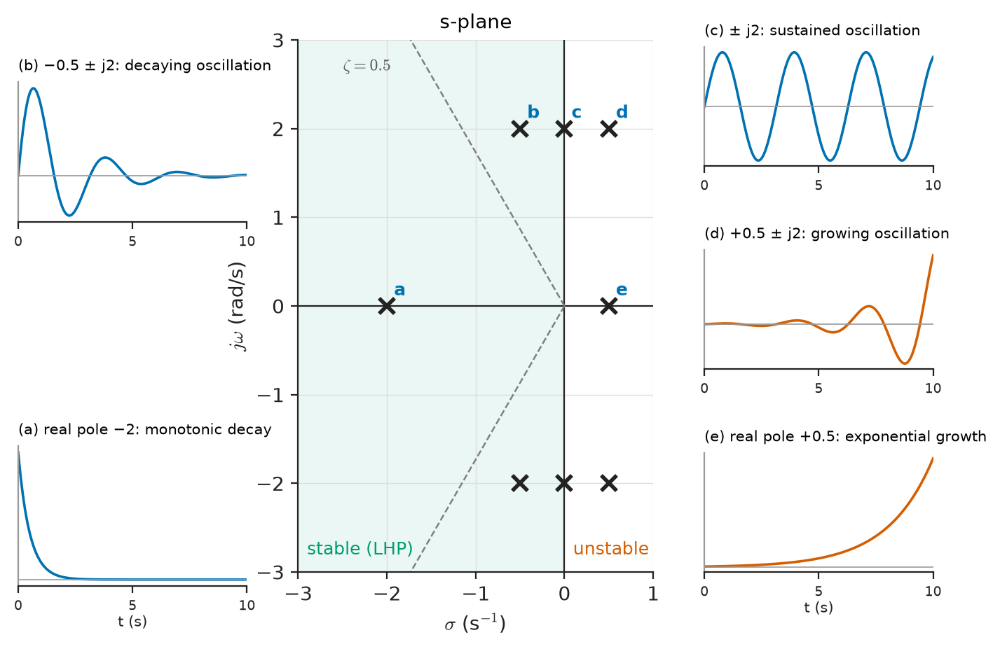
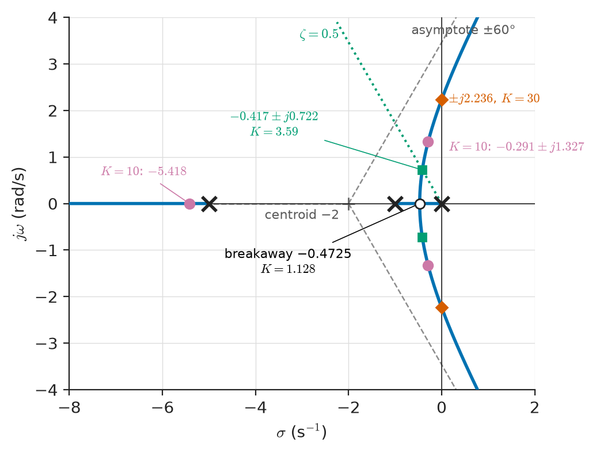
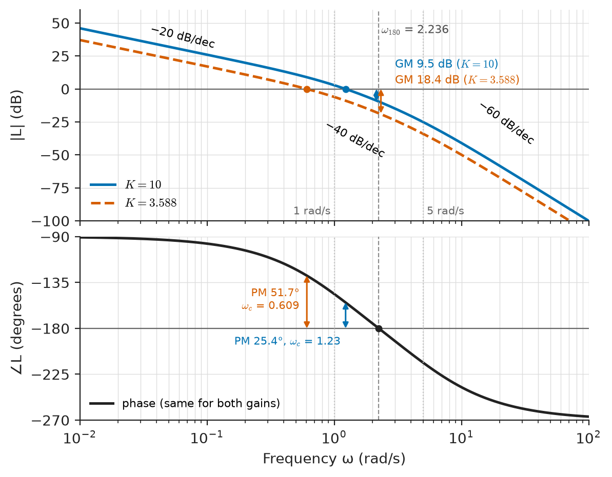
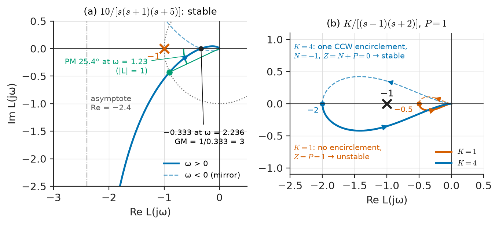
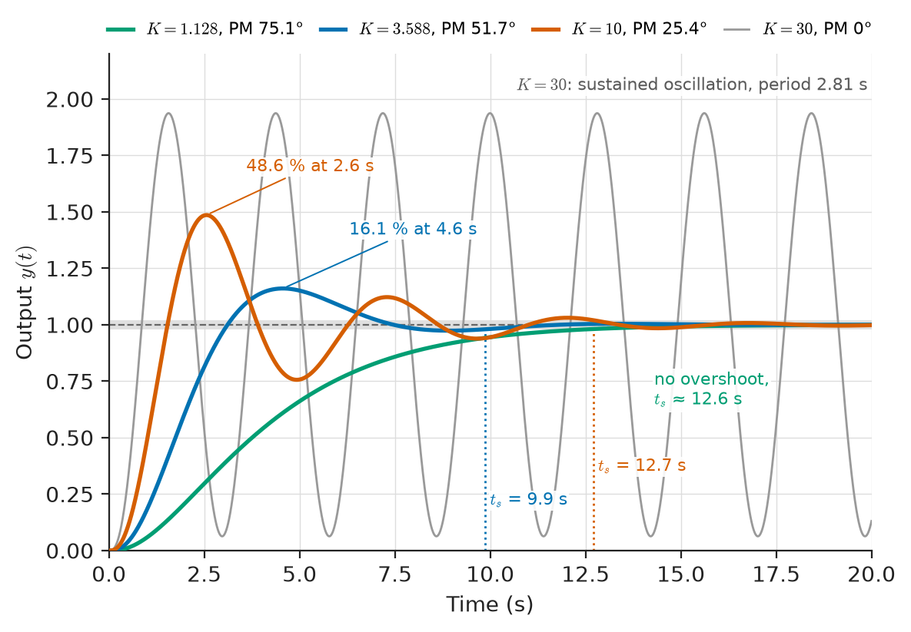

# Chapter 34 — Feedback and Stability

*Part VII · Control-System Fundamentals*

A small quadcopter hovers well on its factory settings, but it drifts in gusts, so its owner raises the attitude-loop gain. At twice the original gain the drone holds its angle more tightly and recovers from a push faster. At three times the gain it starts to buzz: a fast, growing wobble of the arms appears a fraction of a second after take-off, and within two seconds the craft flips. Nothing broke. The motors, propellers and sensors were exactly the same in all three flights. What changed was the *loop*: the gain around the path sensor → controller → motor → airframe → sensor. Raising the gain made the loop correct errors more forcefully, and above a certain value the corrections arrived late enough, and large enough, to feed the error instead of cancelling it.

The same story is told by a power-system operator whose generator voltage regulator hunts after a retrofit, by an audio designer whose feedback amplifier sings at 2 MHz when a long cable is connected, and by a process engineer whose reactor temperature swings $\pm 5\ ^\circ\mathrm{C}$ around its set point after a valve was replaced with a faster one. Feedback is the most powerful idea in engineering for making imprecise hardware behave precisely; it is also the easiest way to turn a stable piece of hardware into an oscillator. This chapter builds the tools that tell the two apart.

> **Why does closing a loop make a system insensitive to its own imperfections, and what does that cost?**
> **How can we decide, from a model of the open loop alone, whether the closed loop will be stable, how far it is from instability, and how accurately it will follow its command?**

| Concept | Engineering destination |
|---|---|
| Open-loop and closed-loop structure | Thermostats, cruise control, voltage regulators, automatic gain control |
| Loop gain and sensitivity | Feedback amplifiers, generator AVRs, precision instruments |
| Characteristic equation | Every closed-loop design: poles of the loop decide its behaviour |
| Stability (BIBO, asymptotic, marginal) | Drones, power converters, phase-locked loops, grid oscillations |
| Routh–Hurwitz criterion | Gain limits from a polynomial, without solving for roots |
| Root locus | How closed-loop poles move as a gain is raised |
| Steady-state error and system type | Position servos, radar tracking, temperature and pressure regulation |
| Nyquist criterion | Stability of loops with delays, open-loop unstable plants, measured responses |
| Bode-plot margins | Day-to-day design of amplifiers, SMPS loops, motor drives, PLLs |

**Roadmap.** Open and closed loops (34.1) → why feedback works and what it costs (34.2) → the characteristic equation (34.3) → what stability means (34.4) → the algebraic test: Routh–Hurwitz (34.5) → the geometric picture: root locus (34.6) → accuracy: steady-state error (34.7) → stability from the frequency response: the Nyquist criterion (34.8) → Bode and Nyquist methods in practice (34.9).

---

## 34.1 Open-loop and closed-loop systems

### Two ways to make a system do what we want

An electric kettle with a timer is an **open-loop** system: the heater runs for a fixed time computed from what the designer expects the water, the kettle and the room to be. Nothing measures the result. If the kettle holds less water than assumed, it boils dry; if the mains voltage is 10 % low, the heater delivers 19 % less power ($P\propto V^2$) and the water is not hot enough. A kettle with a thermostat that cuts the heater at boiling is a **closed-loop** system: the action depends on a measurement of the result.

Chapter 33 described both structures as block diagrams. In the open loop (Figure 34.1, top) a reference $r$ drives a controller $C(s)$, which drives the plant $G(s)$ to give the output

$$
Y(s)=C(s)G(s)R(s)+G_d(s)D(s)
$$

where $D(s)$ is a disturbance entering through its own path $G_d(s)$. In the closed loop (Figure 34.1, bottom) a sensor $H(s)$ measures the output, the comparator forms the error $E=R-HY$, and the controller acts on the error:

$$
Y(s)=\frac{C(s)G(s)}{1+C(s)G(s)H(s)}R(s)+\frac{G_d(s)}{1+C(s)G(s)H(s)}D(s)
$$

The product

$$
L(s)=C(s)G(s)H(s)
$$

is the **loop transfer function** (also called the open-loop transfer function or the return ratio): it is what a signal experiences if we break the loop at any point and follow it once round. Almost everything in this chapter is a statement about $L(s)$.

<!-- FIGURE 34.1 | figures/ch34/fig-34-1-open-closed-loop.png | block-diagram | Open-loop (top) and closed-loop (bottom) control structures with reference, controller, plant, disturbance and sensor; the closed loop defines the loop transfer function L = CGH. | Content: top row: r -> block C(s) -> u -> summing junction with d entering through Gd(s) -> block G(s) -> y. Bottom row: r -> summing junction (+ on r, minus on feedback) -> e -> C(s) -> u -> G(s) -> plus disturbance d through Gd(s) -> y, with y fed back through block H(s) (sensor) to the minus input; sensor noise n added at the sensor output. A dashed loop arrow around the bottom diagram labelled L(s) = C(s)G(s)H(s). Labels: reference, error, control signal, output, disturbance, measurement noise. -->

*Figure 34.1 — Open-loop (top) and closed-loop (bottom) control structures with reference, controller, plant, disturbance and sensor; the closed loop defines the loop transfer function L = CGH.*

Figure 34.1 also shows the measurement noise $n$ added at the sensor. It enters the loop exactly where the reference does (with the opposite sign), which is the first hint of the price of feedback developed in Section 34.2.

### Where each structure is used

Open-loop control is not obsolete. It is cheap, it cannot become unstable through the loop (a stable plant driven open loop stays stable), and it is fast because it does not wait for an error to appear. A stepper motor driven by counted pulses, a traffic light on a timer, a feedforward term that cancels a measured disturbance before it reaches the output, and the volume control of an amplifier are all open-loop. Their weakness is that every unknown, every drift and every disturbance passes straight to the output.

Closed-loop control pays for its accuracy with a sensor, with complexity, and with the possibility of instability. Table 34.1 lists typical loops across EEE and the speed at which each is designed to act; the **crossover frequency** (where $\lvert L(j\omega)\rvert=1$, defined in Section 34.9) is a convenient measure of how fast a loop responds.

**Table 34.1 — Representative feedback loops and typical loop crossover frequencies.**

| Loop | Measured variable | Actuator | Typical crossover |
|---|---|---|---|
| Op-amp non-inverting amplifier | Output voltage (divider) | Output stage | 0.1–100 MHz (gain–bandwidth limited) |
| Phase-locked loop (RF synthesiser) | Phase error | VCO | 10 kHz–1 MHz |
| Switched-mode supply, voltage loop | Output voltage | PWM duty cycle | 1/20–1/5 of switching frequency (e.g. 5–50 kHz) |
| Motor drive, current loop | Phase current | Inverter voltage | 0.5–5 kHz |
| Motor drive, speed loop | Shaft speed | Current reference | 20–200 Hz |
| Servo position loop (robot joint, disk head) | Angle | Speed or current reference | 5–2000 Hz |
| Generator automatic voltage regulator | Terminal voltage | Field excitation | 0.5–5 rad/s (0.1–1 Hz) |
| Building or furnace temperature | Temperature | Heater, valve | $10^{-4}$–$10^{-2}$ Hz |

> **Boundary.** The hardware in these loops (op-amp stages, PWM modulators, inverters, excitation systems, valves) belongs to *Electronics & Computing* and *Electrical Energy & Machines*; practical embedded controllers belong to the robotics and automation books. Here they appear only as transfer functions.

---

## 34.2 Feedback principles

### Loop gain buys insensitivity

Consider the feedback amplifier that H. S. Black patented in 1928 to make telephone repeaters precise. A forward amplifier of large but poorly controlled gain $A$ is wrapped in a feedback network of accurately known attenuation $\beta$ (a resistor divider). With $C=A$, $G=1$, $H=\beta$:

$$
T=\frac{Y}{R}=\frac{A}{1+A\beta}=\frac{1}{\beta}\cdot\frac{A\beta}{1+A\beta}
$$

When the loop gain $A\beta\gg 1$, $T\approx 1/\beta$: the closed-loop gain depends on the passive divider, not on the active device. How strongly it depends on $A$ is measured by the **sensitivity**, the ratio of relative changes:

$$
S^{T}_{A}=\frac{\partial T/T}{\partial A/A}=\frac{1}{1+A\beta}
$$

The same function appears for any loop. Writing $L=CGH$ and taking the plant $G$ as the uncertain element,

$$
S(s)=\frac{1}{1+L(s)},\qquad T(s)=\frac{L(s)}{1+L(s)}
$$

$S$ is the **sensitivity function** and $T$ the **complementary sensitivity**. They obey the identity

$$
S(s)+T(s)=1
$$

at every frequency.

> **Status of the principle: Feedback sensitivity reduction**
> *Derived.* $S=1/(1+L)$ follows algebraically from the block diagram of a linear time-invariant loop; it holds for small parameter changes and at each frequency separately, so its benefit exists only where $\lvert L(j\omega)\rvert$ is large.

**Worked example — Black's amplifier.** An amplifier with open-loop gain $A=2\times10^{5}$ is used with a divider $\beta=0.01$. The loop gain is $A\beta=2000$, so

$$
T=\frac{2\times10^{5}}{1+2000}=99.950,\qquad S=\frac{1}{2001}=5.0\times10^{-4}.
$$

If the open-loop gain falls by 20 % to $1.6\times10^{5}$ (a hot day, a different batch of transistors), the closed-loop gain becomes $1.6\times10^{5}/1601=99.938$, a change of $-0.0125\ \%$. The 20 % change was divided by roughly 1600, close to the loop gain, as $S$ predicts for a large change ($20\ \%/1601$). The precise value $T\approx 1/\beta=100$ is set by two resistors, and the 0.05 % shortfall ($1/(1+A\beta)$) is itself predictable.

### Disturbance rejection

The second term of the closed-loop equation shows that a disturbance reaching the output is multiplied by $S$:

$$
Y_d(s)=S(s)\,G_d(s)D(s)
$$

A generator **automatic voltage regulator** (AVR) is a power-system example. Without regulation, the terminal voltage of a synchronous generator falls substantially between no load and full load because of the armature reaction and synchronous reactance; take a drop of 8 % for a small machine with a fixed field. With an AVR whose steady-state loop gain is 50, the remaining drop is $8\ \%/(1+50)=0.16\ \%$. The regulator does not know why the voltage fell; it only sees the error. That is the essential virtue of feedback: it corrects disturbances that were never modelled.

### Linearisation, bandwidth and speed

Feedback also linearises. If the forward gain of an audio power stage varies with signal level (crossover distortion), the closed-loop distortion is reduced by approximately the loop gain at the frequency of the distortion product. And feedback speeds up a slow plant: a first-order plant $G=K/(\tau s+1)$ under proportional feedback $C=K_c$ gives

$$
T(s)=\frac{K_cK}{\tau s+1+K_cK}=\frac{K_cK/(1+K_cK)}{\dfrac{\tau}{1+K_cK}s+1}
$$

whose time constant is shorter by the factor $1+K_cK$. A heater with $\tau=300$ s under a loop gain of 9 responds with a 30 s time constant, at the price of a heater that must briefly deliver ten times its final power, which it usually cannot (actuator saturation, Chapter 35).

### The costs of feedback

1. **Sensor noise is passed to the output.** From Figure 34.1, the output response to measurement noise is $-T(s)N(s)$. Where $T\approx 1$ (inside the loop bandwidth) the loop follows the noise as faithfully as it follows the reference. A loop cannot be more accurate than its sensor.
2. **$S$ and $T$ cannot both be small.** Since $S+T=1$, good disturbance rejection (small $S$) at a frequency means noise passes ($T\approx1$) at that frequency. Designers therefore make $\lvert L\rvert$ large at low frequency, where disturbances and references live, and small at high frequency, where sensor noise and model errors live.
3. **Stability can be lost.** A loop that contains lags (time constants, delays, sampling) returns the correction late. If, at some frequency, the signal comes back round the loop inverted in phase (an extra $180^\circ$ beyond the negative sign of the comparator) and not attenuated, it reinforces itself. This is the drone of the opening paragraph.
4. **Sensitivity cannot be pushed down everywhere.** For a stable loop whose $L$ falls off at high frequency at least as fast as $1/s^2$ (relative degree two or more), Bode's sensitivity integral states that $\int_0^\infty\ln\lvert S(j\omega)\rvert\,d\omega=0$ (more if $L$ has right-half-plane poles): pushing $\lvert S\rvert$ below 1 in one band forces it above 1 somewhere else. This "waterbed effect" is why every real loop has a sensitivity peak, usually near crossover.

> **Status of the principle: Bode sensitivity integral**
> *Derived.* A consequence of complex-function theory applied to a stable, rational loop with relative degree at least two; it sets a hard limit on what any controller can achieve and is independent of the design method.

---

## 34.3 Characteristic equations

### The denominator decides

Every closed-loop transfer function of the single loop in Figure 34.1 (reference to output, disturbance to output, noise to output, reference to error) has the same denominator, $1+L(s)$. Writing $L(s)=N_L(s)/D_L(s)$ as a ratio of polynomials,

$$
1+L(s)=0\quad\Longleftrightarrow\quad D_L(s)+N_L(s)=0
$$

is the **characteristic equation** of the loop, and its roots are the **closed-loop poles**. Chapter 11 showed that the poles of a transfer function fix the modes $e^{p_it}$ of its natural response; Chapter 7 showed what the two poles of an RLC circuit mean physically. Closing a loop moves the poles from the roots of $D_L$ (the open-loop poles) to the roots of $D_L+N_L$. The zeros of the reference-to-output transfer function, by contrast, are mostly those of $C$ and $G$ (plus the poles of $H$): feedback moves poles, not zeros.

**Worked example — the running example of this chapter.** A position servo (an antenna drive, a robot joint, a disk-drive actuator, a radar pedestal) is modelled by a motor with an integrator from speed to angle, a mechanical time constant of 1 s and an amplifier/current-loop lag of 0.2 s, normalised so that

$$
G(s)=\frac{1}{s(s+1)(s+5)}
$$

with a proportional controller $C=K$ and a unity-gain sensor $H=1$. Then

$$
L(s)=\frac{K}{s(s+1)(s+5)},\qquad
1+L(s)=0\ \Longleftrightarrow\ s^3+6s^2+5s+K=0 .
$$

For $K=10$ the roots are $s=-5.418$ and $s=-0.291\pm j1.327$. The closed loop is stable (all real parts negative), but the complex pair has damping ratio $\zeta=0.291/\sqrt{0.291^2+1.327^2}=0.214$, so the step response will overshoot by roughly half (48.6 % from simulation, Figure 34.6). The rest of this chapter asks how these roots move as $K$ changes, without solving the cubic each time.

### Physical origin of a characteristic equation

The characteristic equation is not a mathematical artefact of block diagrams. In a feedback amplifier it is the condition under which a nonzero output can exist with zero input, i.e. the oscillation condition (the **Barkhausen condition** $L(j\omega_0)=-1$ is the special case of a root on the imaginary axis). In a power system, the roots of the linearised machine–network–regulator equations are the electromechanical modes (0.1–2 Hz) seen in grid oscillation studies. In a biomedical context, the baroreflex that regulates blood pressure is a loop whose characteristic roots produce the slow Mayer waves (about 0.1 Hz) seen in blood-pressure records. Each is a closed loop whose natural modes are the roots of $1+L=0$.

---

## 34.4 Stability concepts

### Three definitions

Chapter 16 introduced **bounded-input bounded-output (BIBO) stability**: every bounded input produces a bounded output. For an LTI system this is equivalent to an absolutely integrable impulse response, $\int_0^\infty\lvert h(t)\rvert\,dt<\infty$, which for a rational transfer function means that all poles have strictly negative real parts.

**Asymptotic (internal) stability** is the state-space version: with zero input, every initial condition decays to zero. It concerns the natural modes of all internal states, including any that do not appear in the input–output transfer function (Chapter 35 shows how modes can hide). For a loop with no hidden pole–zero cancellations, the two definitions coincide.

**Marginal stability** describes non-repeated poles on the imaginary axis and none in the right half-plane: the natural response neither decays nor grows (an undamped oscillator, an integrator). A marginally stable system is not BIBO-stable: a bounded input at the resonant frequency, or a step into an integrator, produces an unbounded output.

> **Status of the principle: Stability from pole locations**
> *Derived.* For a linear time-invariant system with a rational transfer function, BIBO stability is equivalent to all poles lying in the open left half of the s-plane; the result follows from partial-fraction expansion of the impulse response (Chapter 11).

### Pole location and response

Figure 34.2 summarises the link between pole position and impulse response. A pole at $s=\sigma\pm j\omega_d$ contributes $e^{\sigma t}\cos(\omega_d t+\phi)$: the real part sets the decay (or growth) rate and the imaginary part the ringing frequency. Lines of constant damping ratio are rays from the origin at angle $\cos^{-1}\zeta$ to the negative real axis.

<!-- FIGURE 34.2 | figures/ch34/fig-34-2-pole-locations.png | pole-zero | Pole positions in the s-plane and the impulse responses they produce: decaying, oscillatory, sustained and growing modes. | Content: centre panel: s-plane with sigma axis from -3 to +1 and j omega axis from -3 to +3; pole pairs marked x at -2 (real), -0.5 plus/minus j2, 0 plus/minus j2, +0.5 plus/minus j2, +0.5 (real). Dashed rays at 60 degrees from the negative real axis labelled zeta = 0.5. Shaded left half-plane labelled stable. Small inset plots of impulse response versus time (0 to 10 s) placed next to each pole: monotonic decay, decaying oscillation, constant oscillation, growing oscillation, exponential growth. -->

*Figure 34.2 — Pole positions in the s-plane and the impulse responses they produce: decaying, oscillatory, sustained and growing modes.*

**Relative stability** asks not only whether the poles are in the left half-plane but how far inside. Two systems that are both stable can behave very differently: the servo above with $K=10$ has a pole pair at $\zeta=0.21$ and rings for over 12 s; with $K=1.13$ it barely overshoots. Engineering specifications are always about relative stability: damping ratio, decay rate, gain and phase margins.

### Nonlinear and time-varying caution

Real loops saturate: an amplifier clips, a valve opens fully, an inverter reaches its current limit. The linear stability of $1+L=0$ is a statement about small deviations around an operating point. A loop that is linearly stable can still develop a **limit cycle** (a sustained oscillation of fixed amplitude) through saturation, backlash or relay action, and a linearly unstable loop can be held in a bounded oscillation by saturation, as in every electronic oscillator.

> **Status of the principle: Linearised stability**
> *Approximate.* Pole locations of the linearised model decide stability for small deviations about an operating point (Lyapunov's indirect method); large signals, saturation, backlash and parameter changes with operating point lie outside it.

---

## 34.5 Routh–Hurwitz criterion

### Why a test without roots

Before cheap computing, solving a fifth-order polynomial for each trial gain was impractical; today it is trivial for numbers but still impractical for *symbols*. The question "for which values of $K$ (or of a time constant, or of a line length) is the loop stable?" requires conditions on the coefficients. E. J. Routh (1877) and A. Hurwitz (1895) independently supplied them.

### Necessary condition

For a polynomial

$$
a_ns^n+a_{n-1}s^{n-1}+\dots+a_1s+a_0,\qquad a_n>0,
$$

to have all roots in the open left half-plane, all coefficients must be present and positive. A missing or negative coefficient proves instability (or marginal stability) at once. The condition is sufficient only for $n\le 2$.

### The Routh array

Arrange the coefficients in two rows, alternating:

$$
\begin{array}{c|cccc}
s^n & a_n & a_{n-2} & a_{n-4} & \cdots\\
s^{n-1} & a_{n-1} & a_{n-3} & a_{n-5} & \cdots\\
s^{n-2} & b_1 & b_2 & b_3 & \cdots\\
s^{n-3} & c_1 & c_2 & \cdots &\\
\vdots & & & &\\
s^0 & \cdot & & &
\end{array}
$$

with each new entry formed from the two rows above it,

$$
b_1=\frac{a_{n-1}a_{n-2}-a_na_{n-3}}{a_{n-1}},\qquad
b_2=\frac{a_{n-1}a_{n-4}-a_na_{n-5}}{a_{n-1}},\qquad
c_1=\frac{b_1a_{n-3}-a_{n-1}b_2}{b_1},\ \dots
$$

The **Routh–Hurwitz criterion**: the number of roots in the right half-plane equals the number of sign changes in the first column. The polynomial is stable if and only if every first-column entry is positive.

> **Status of the principle: Routh–Hurwitz criterion**
> *Derived.* An algebraic consequence of the argument principle and Sturm-sequence theory for real polynomials; it is exact for any polynomial with real coefficients, but says nothing about how well damped the stable roots are, and it does not apply directly to time delays (which are not polynomial).

**Worked example — gain limit of the servo.** For $s^3+6s^2+5s+K$:

$$
\begin{array}{c|cc}
s^3 & 1 & 5\\
s^2 & 6 & K\\
s^1 & \dfrac{30-K}{6} & 0\\
s^0 & K &
\end{array}
$$

Stability requires $K>0$ and $30-K>0$, so $0<K<30$. At $K=30$ the $s^1$ row vanishes entirely. A row of zeros means a pair of roots symmetric about the origin; the **auxiliary polynomial** formed from the row above, $6s^2+30=0$, gives them: $s=\pm j\sqrt5=\pm j2.236$. At $K=30$ the servo oscillates at $2.236$ rad/s (period 2.81 s). The current design with $K=10$ therefore has a gain margin of $30/10=3$; that number returns in Section 34.9 from a Bode plot and in Chapter 35 as the starting point of Ziegler–Nichols tuning.

**Worked example — counting unstable roots.** For $s^4+2s^3+3s^2+4s+5$ every coefficient is positive, so the necessary condition gives no warning. The array:

$$
\begin{array}{c|ccc}
s^4 & 1 & 3 & 5\\
s^3 & 2 & 4 & \\
s^2 & \dfrac{2\cdot3-1\cdot4}{2}=1 & 5 &\\
s^1 & \dfrac{1\cdot4-2\cdot5}{1}=-6 & &\\
s^0 & 5 & &
\end{array}
$$

The first column $1,2,1,-6,5$ changes sign twice, so two roots lie in the right half-plane. Numerically the roots are $-1.288\pm j0.858$ and $+0.288\pm j1.416$, confirming the count.

### Special cases and uses

If a first-column element is zero but its row is not, replace it by a small positive $\varepsilon$ and continue; the signs as $\varepsilon\to0^+$ give the count. If a whole row is zero, use the derivative of the auxiliary polynomial as the replacement row; the auxiliary roots are the symmetric (often imaginary-axis) roots.

Routh's array is the fastest way to obtain a **stability region in a parameter**. Shifting $s\to s-\sigma_0$ before forming the array counts roots to the right of $-\sigma_0$, which turns it into a test of minimum decay rate. Its limits are equally clear: it says nothing about damping, needs a polynomial (a transport delay must be approximated, e.g. by a Padé approximant), and becomes unwieldy above about sixth order with several parameters.

---

## 34.6 Root-locus fundamentals

### The idea

W. R. Evans (1948) asked a geometric question: as a single gain $K$ in $L(s)=KF(s)$ increases from 0 to $\infty$, what paths do the roots of $1+KF(s)=0$ trace in the s-plane? The answer, the **root locus**, shows the whole design trade-off on one picture. A point $s$ lies on the locus when

$$
KF(s)=-1\quad\Longleftrightarrow\quad
\angle F(s)=\pm180^\circ(2k+1),\qquad K=\frac{1}{\lvert F(s)\rvert}.
$$

The **angle condition** decides *where* the locus is; the **magnitude condition** then gives the gain at any point on it.

### Construction rules

With $F(s)=\prod(s-z_i)/\prod(s-p_j)$, $n$ poles and $m$ zeros ($n\ge m$):

1. The locus has $n$ branches. They start ($K=0$) at the open-loop poles and end ($K\to\infty$) at the open-loop zeros or at infinity ($n-m$ branches).
2. On the real axis, the locus occupies segments that have an odd number of real poles plus zeros to their right.
3. The $n-m$ branches that go to infinity follow straight-line asymptotes at angles $\pm180^\circ(2k+1)/(n-m)$, radiating from the **centroid**
$$
\sigma_a=\frac{\sum p_j-\sum z_i}{n-m}.
$$
4. Breakaway and break-in points on the real axis are among the roots of $dK/ds=0$, with $K=-1/F(s)$.
5. Imaginary-axis crossings follow from the Routh array (or from substituting $s=j\omega$).
6. The locus is symmetric about the real axis; departure angles from complex poles follow from the angle condition.

> **Status of the principle: Root-locus rules**
> *Derived.* Each rule is a direct consequence of the angle and magnitude conditions on $1+KF(s)=0$; they are exact for one real gain parameter and a rational $F(s)$, and are sketching aids rather than approximations.

**Worked example — locus of the servo.** For $F(s)=1/[s(s+1)(s+5)]$ there are three poles $(0,-1,-5)$ and no zeros.

- Real-axis segments: between 0 and $-1$ (one pole to the right) and left of $-5$ (three poles to the right).
- Asymptotes: $n-m=3$, angles $\pm60^\circ$ and $180^\circ$, centroid $\sigma_a=(0-1-5)/3=-2$.
- Breakaway: $K=-s(s+1)(s+5)=-(s^3+6s^2+5s)$, so $dK/ds=0$ gives $3s^2+12s+5=0$, with roots $s=-0.4725$ and $s=-3.528$. Only $-0.4725$ lies on a locus segment; there $K=0.4725\times0.5275\times4.5275=1.128$.
- Imaginary-axis crossing: $K=30$ at $s=\pm j2.236$ (Section 34.5).

The two branches that leave 0 and $-1$ meet at $-0.4725$ when $K=1.128$ (a double real pole: critical damping of the dominant pair), split into a complex pair, and bend along the $\pm60^\circ$ asymptotes towards the right half-plane, crossing at $K=30$ (Figure 34.3). The third branch runs from $-5$ to $-\infty$.

<!-- FIGURE 34.3 | figures/ch34/fig-34-3-root-locus-servo.png | pole-zero | Root locus of L(s) = K/[s(s+1)(s+5)]: breakaway at -0.47 for K = 1.13, zeta = 0.5 at K = 3.59 and imaginary-axis crossing at K = 30. | Content: s-plane, sigma from -8 to +2, j omega from -4 to +4. Open-loop poles x at 0, -1, -5. Locus branches drawn solid: real segment 0 to -1 with breakaway at -0.4725 marked (K = 1.128); complex branches curving towards the asymptotes; branch from -5 to -8. Dashed asymptotes at plus/minus 60 degrees and 180 degrees from centroid -2. Dashed ray zeta = 0.5 (120 degrees from positive real axis) intersecting the locus at -0.417 plus/minus j0.722, labelled K = 3.59. Imaginary-axis crossings at plus/minus j2.236 labelled K = 30. Closed-loop poles for K = 10 marked with filled dots at -0.291 plus/minus j1.327 and -5.418. -->

*Figure 34.3 — Root locus of L(s) = K/[s(s+1)(s+5)]: breakaway at -0.47 for K = 1.13, zeta = 0.5 at K = 3.59 and imaginary-axis crossing at K = 30.*

### Reading a design from the locus

The locus turns a specification into a gain. Suppose we want the dominant pair at $\zeta=0.5$ (about 16 % overshoot, Chapter 35). The $\zeta=0.5$ ray makes $120^\circ$ with the positive real axis; searching along it for the angle condition gives the intersection $s=-0.417\pm j0.722$ (radius $5/6$), and the magnitude condition gives

$$
K=\lvert s\rvert\,\lvert s+1\rvert\,\lvert s+5\rvert=3.588 .
$$

The third pole is then at $-5.167$, twelve times further from the axis than the dominant pair, so the second-order approximation is good: simulation gives 16.1 % overshoot against 16.3 % for an ideal second-order system with $\zeta=0.5$. But the locus also shows the limitation: no gain gives a dominant pair that is both well damped and fast, because the branches bend towards the right half-plane. Making the system faster *and* well damped needs the locus itself reshaped, by adding a zero (lead compensation) or moving poles; that is Chapter 35's work.

Root loci generalise: the parameter can be a time constant, a feedback-network value or a load inertia (by rewriting the characteristic equation so that the parameter appears as a multiplier), and positive-feedback loci ($0^\circ$ condition) describe oscillator start-up.

---

## 34.7 Steady-state error

### Error after the transient

Stability is the first requirement; the second is accuracy once transients have died. For the unity-feedback loop ($H=1$) the error is

$$
E(s)=\frac{1}{1+L(s)}R(s)=S(s)R(s)
$$

and, provided the closed loop is stable, the final-value theorem (recapped from *The Mathematics Universe*) gives

$$
e_{ss}=\lim_{t\to\infty}e(t)=\lim_{s\to0}\frac{sR(s)}{1+L(s)} .
$$

### System type and error constants

Write $L(s)=K\,\tilde L(s)/s^N$ with $\tilde L(0)=1$. The integer $N$, the number of pure integrators in the loop, is the **system type**. For the three standard test inputs:

- Step $R=A/s$: $e_{ss}=A/(1+K_p)$ with position constant $K_p=\lim_{s\to0}L(s)$.
- Ramp $R=A/s^2$: $e_{ss}=A/K_v$ with velocity constant $K_v=\lim_{s\to0}sL(s)$.
- Parabola $R=A/s^3$: $e_{ss}=A/K_a$ with acceleration constant $K_a=\lim_{s\to0}s^2L(s)$.

**Table 34.2 — Steady-state error versus system type (unity feedback, stable closed loop).**

| System type $N$ | Step $A/s$ | Ramp $A/s^2$ | Parabola $A/s^3$ | Typical example |
|---|---|---|---|---|
| 0 | $A/(1+K_p)$ | $\infty$ | $\infty$ | Temperature loop with P control; AVR with proportional exciter |
| 1 | 0 | $A/K_v$ | $\infty$ | Position servo with P control; PI-controlled speed loop |
| 2 | 0 | 0 | $A/K_a$ | Radar or antenna tracker with PI on a position plant; type-2 PLL |

> **Status of the principle: Error constants and system type**
> *Derived.* Follows from the final-value theorem applied to $S(s)R(s)$; valid only when the closed loop is stable (the theorem fails otherwise) and only for the polynomial test inputs; disturbances entering elsewhere in the loop need their own analysis.

**Worked example — a tracking antenna.** The servo of Section 34.3 drives a ground-station antenna that must follow a low-orbit satellite. Near the pass midpoint the required azimuth rate may be about $1^\circ$/s, which is locally a ramp. The loop is type 1 with

$$
K_v=\lim_{s\to0}s\frac{K}{s(s+1)(s+5)}=\frac{K}{5}.
$$

With $K=10$, $K_v=2\ \mathrm{s^{-1}}$ and the tracking lag is $e_{ss}=1/2=0.5^\circ$, ten times the beam-width tolerance of a narrow-beam Ka-band dish (beam widths of a few tenths of a degree are typical). With the well-damped gain $K=3.588$ from the root locus, $K_v=0.718\ \mathrm{s^{-1}}$ and the lag grows to $1.39^\circ$. Accuracy and damping pull in opposite directions under proportional control: the gain that gives 16 % overshoot gives a ramp error almost three times larger than the gain that gives 49 % overshoot. Chapter 35 resolves this with compensators that raise $K_v$ without lowering the damping.

**Worked example — a type-0 temperature loop.** A furnace has a steady-state gain of 1.9 °C per percent of heater power and is controlled by a proportional controller of 10 % per °C. The loop gain at DC is $K_p=19$, so a step change of set point leaves a fraction $1/(1+19)=5\ \%$ uncorrected: asking for a 200 °C rise yields 190 °C. Doubling the gain halves the error but invites oscillation once the furnace's lags and transport delay are counted. Adding an integrator (PI control, Chapter 35) makes the loop type 1 and removes the step error entirely.

### Disturbances and the internal-model idea

The same reasoning applies to disturbances: a constant load torque on the servo, or a constant heat loss in the furnace, is rejected with zero steady-state error only if an integrator sits *between the error and the point where the disturbance enters*. An integrator in the plant after the disturbance does not help. The general statement, the **internal-model principle**, is that to reject a persistent signal with zero error the loop must contain a model of its generator: an integrator for steps, a double integrator for ramps, a resonator $1/(s^2+\omega_0^2)$ for a sinusoid. Grid-connected inverters use exactly such resonant controllers at 50 or 60 Hz to track sinusoidal current references with zero error.

---

## 34.8 Frequency-domain stability

### Why another criterion

Routh and the root locus need the characteristic polynomial. Three common situations deny us one:

1. **Time delay.** A transport lag $e^{-s\tau}$ (a conveyor, a long pipe, a network link, the computation delay of a digital controller) makes the characteristic equation transcendental, with infinitely many roots.
2. **Measured plants.** A loop may be known only from a measured frequency response: a network-analyser sweep of a power-supply plant, a frequency-response test on a turbine-governor.
3. **High order.** Distributed effects (a transmission line inside the loop, flexible structures) produce models of very high order whose coefficients are ill-conditioned.

All three are handled by working with $L(j\omega)$, which is available for each.

### The Nyquist criterion

The closed-loop poles are the zeros of $1+L(s)$. The **argument principle** (recapped from complex analysis in *The Mathematics Universe*) states that as $s$ traverses a closed contour clockwise, the image $F(s)$ encircles the origin clockwise $Z-P$ times, where $Z$ and $P$ are the numbers of zeros and poles of $F$ inside the contour. Take the contour to be the whole right half-plane (the **Nyquist contour**: up the imaginary axis, round a large semicircle, with small indentations around any imaginary-axis poles of $L$), and $F=1+L$. The poles of $1+L$ are the open-loop poles of $L$; its zeros are the closed-loop poles. Encircling the origin by $1+L$ is the same as encircling the point $-1$ by $L$. Hence:

$$
Z=N+P
$$

where $Z$ is the number of closed-loop poles in the right half-plane, $P$ the number of open-loop poles of $L$ in the right half-plane, and $N$ the number of clockwise encirclements of $-1$ by the **Nyquist plot** of $L(j\omega)$, $\omega$ from $-\infty$ to $\infty$. For stability $Z=0$, so $N=-P$: the plot must encircle $-1$ counter-clockwise once for every unstable open-loop pole. In the commonest case, an open-loop-stable $L$ ($P=0$), **the closed loop is stable if and only if the Nyquist plot does not encircle $-1$**.

> **Status of the principle: Nyquist stability criterion**
> *Derived.* A direct application of Cauchy's argument principle to $1+L(s)$; it is exact for any loop transfer function analytic on the contour, including time delays and measured responses, provided the open-loop unstable pole count $P$ is known.

### Reading the plot

Because $L(-j\omega)$ is the complex conjugate of $L(j\omega)$, only positive frequencies need be drawn; the negative-frequency half is the mirror image. Figure 34.5 shows the servo with $K=10$: the plot starts at $-j\infty$ (the integrator gives $-90^\circ$ at low frequency), sweeps round through the third quadrant, crosses the negative real axis at $-1/3$ when $\omega=2.236$ rad/s, and spirals into the origin at $-270^\circ$. The point $-1$ lies outside the curve, so $N=0$ and, with $P=0$, the loop is stable. Tripling the gain stretches the plot so that it passes through $-1$; beyond that it encircles $-1$ twice clockwise and $Z=2$, exactly the two right-half-plane roots that Routh predicts for $K>30$.

**Worked example — an open-loop unstable plant.** Magnetic levitation (maglev bearings, a levitated steel ball in a laboratory) and an inverted pendulum have a right-half-plane pole: without feedback they fall. Take $L(s)=K/[(s-1)(s+2)]$, so $P=1$. At $\omega=0$, $L=-K/2$; as $\omega\to\infty$, $L\to0$ from the direction of $-180^\circ$. The positive-frequency half runs from $-K/2$ round through the third quadrant to the origin, and its mirror image closes the loop through the second quadrant, so the full plot is a closed curve crossing the negative real axis only at $-K/2$. Encirclement of $-1$ requires $K/2>1$, and the direction is counter-clockwise, so $N=-1$ and $Z=N+P=0$ for $K>2$. Stability needs the loop gain to be *above* a minimum. The check by algebra: $1+L=0$ gives $s^2+s+(K-2)=0$, stable exactly for $K>2$. Such loops have a gain margin that is less than one (a *lower* gain limit), and they are fragile in ways an engineer must respect: an actuator that saturates reduces the effective gain, and the loop can be lost.

### Time delay

A pure delay $e^{-j\omega\tau}$ has unit magnitude and phase $-\omega\tau$: it rotates every point of the Nyquist plot clockwise by an angle proportional to frequency, without changing its distance from the origin. If the plot crosses the unit circle at frequency $\omega_c$ with an angle $\phi_m$ to spare before $-180^\circ$, the loop tolerates any added delay up to the **delay margin**

$$
\tau_{\max}=\frac{\phi_m}{\omega_c}\quad(\phi_m\ \text{in radians}).
$$

For the servo with $K=3.588$, $\omega_c=0.609$ rad/s and $\phi_m=51.7^\circ=0.903$ rad, so $\tau_{\max}=1.48$ s. A 0.3 s communication delay in a teleoperated version of the same drive costs $0.609\times0.3=0.18$ rad $=10.5^\circ$ of phase. A digital controller adds about one and a half sample periods of delay (Chapter 35), so the same formula decides how fast it must sample.

---

## 34.9 Bode and Nyquist methods

### Margins: distance from $-1$

The Nyquist criterion answers yes or no; engineering needs a distance. Two classical measures of how far $L(j\omega)$ stays from the critical point (Figure 34.4 and Figure 34.5):

- **Gain margin** $\mathrm{GM}$: at the **phase-crossover frequency** $\omega_{180}$, where $\angle L=-180^\circ$, $\mathrm{GM}=1/\lvert L(j\omega_{180})\rvert$, or $-20\log_{10}\lvert L(j\omega_{180})\rvert$ dB. It is the factor by which the gain can rise before instability.
- **Phase margin** $\mathrm{PM}$: at the **gain-crossover frequency** $\omega_c$, where $\lvert L\rvert=1$, $\mathrm{PM}=180^\circ+\angle L(j\omega_c)$. It is the extra phase lag the loop tolerates before instability.

A third, the **modulus margin** $\min_\omega\lvert1+L(j\omega)\rvert=1/\max\lvert S\rvert$, is the true shortest distance from the plot to $-1$ and the most reliable single robustness number; Chapter 35 uses all three as design targets.

> **Status of the principle: Gain and phase margins as stability distances**
> *Approximate.* The margins are exact statements about how much pure gain or pure phase change a loop tolerates; as measures of general robustness and damping they assume a Nyquist plot that crosses the unit circle and the negative real axis once, and can mislead for loops with several crossovers or resonances.

### Bode-plot reading

Chapter 13 drew Bode plots of networks; for a loop the same plots of $\lvert L(j\omega)\rvert$ in dB and $\angle L(j\omega)$ in degrees give the margins by inspection (Figure 34.4). The gain margin is read on the magnitude plot at the frequency where the phase crosses $-180^\circ$; the phase margin is read on the phase plot at the frequency where the magnitude crosses 0 dB. Because multiplying $L$ by a constant only shifts the magnitude curve vertically, the effect of the gain is visible at a glance.

<!-- FIGURE 34.4 | figures/ch34/fig-34-4-bode-margins-servo.png | bode | Bode plot of the servo loop L(s) = K/[s(s+1)(s+5)] for K = 10 and K = 3.59, showing gain and phase margins. | Content: frequency axis 0.01 to 100 rad/s, log scale. Top panel magnitude in dB from -100 to +60: K = 10 solid, K = 3.588 dashed; 0 dB line; corner frequencies 1 and 5 rad/s marked; slopes -20, -40, -60 dB/decade labelled. Bottom panel phase from -270 to -90 degrees (same for both gains); -180 degree line. For K = 10: crossover 1.23 rad/s, phase margin 25.4 degrees arrow; phase crossover 2.236 rad/s, gain margin 9.5 dB arrow. For K = 3.588: crossover 0.609 rad/s, phase margin 51.7 degrees, gain margin 18.4 dB. -->

*Figure 34.4 — Bode plot of the servo loop L(s) = K/[s(s+1)(s+5)] for K = 10 and K = 3.59, showing gain and phase margins.*

**Worked example — margins of the servo.** For $L=10/[s(s+1)(s+5)]$, the phase is $-90^\circ-\tan^{-1}\omega-\tan^{-1}(\omega/5)$, which reaches $-180^\circ$ when $\tan^{-1}\omega+\tan^{-1}(\omega/5)=90^\circ$, i.e. $\omega\cdot\omega/5=1$, $\omega_{180}=\sqrt5=2.236$ rad/s. There

$$
\lvert L\rvert=\frac{10}{\sqrt5\,\sqrt6\,\sqrt{30}}=\frac{10}{30}=\frac13,\qquad \mathrm{GM}=3=9.54\ \mathrm{dB},
$$

in agreement with the Routh limit $K<30$. The gain crossover, found numerically from $\lvert L(j\omega)\rvert=1$, is $\omega_c=1.227$ rad/s, where the phase is $-154.6^\circ$, so $\mathrm{PM}=25.4^\circ$. Repeating the calculation for $K=3.588$ gives $\omega_c=0.609$ rad/s, $\mathrm{PM}=51.7^\circ$ and $\mathrm{GM}=30/3.588=8.36=18.4$ dB.

**Table 34.3 — The servo at four gains: one loop, four views.**

| $K$ | Closed-loop poles | Dominant $\zeta$ | Step overshoot | $K_v$ (s$^{-1}$) | $\omega_c$ (rad/s) | PM | GM |
|---|---|---|---|---|---|---|---|
| 1.128 | $-0.48,\ -0.46,\ -5.06$ | about 1 | 0 % | 0.23 | 0.22 | $75.1^\circ$ | 28.5 dB |
| 3.588 | $-0.42\pm j0.72,\ -5.17$ | 0.50 | 16.1 % | 0.72 | 0.61 | $51.7^\circ$ | 18.4 dB |
| 10 | $-0.29\pm j1.33,\ -5.42$ | 0.21 | 48.6 % | 2.0 | 1.23 | $25.4^\circ$ | 9.5 dB |
| 30 | $\pm j2.24,\ -6$ | 0 | sustained oscillation | 6.0 | 2.24 | $0^\circ$ | 0 dB |

Table 34.3 is the chapter in one view. The root locus (pole column), the time response (overshoot), the accuracy (velocity constant) and the Bode margins describe the same physical trade-off. Note the correlation between phase margin and damping: $\mathrm{PM}\approx100\zeta$ degrees holds roughly for well-separated dominant pairs (51.7° and $\zeta=0.50$; 25.4° and $\zeta=0.21$), a rule Chapter 35 uses to translate overshoot specifications into frequency-domain targets. The step responses are drawn in Figure 34.6.

<!-- FIGURE 34.5 | figures/ch34/fig-34-5-nyquist-plots.png | plot | Nyquist plots: (a) servo loop with K = 10, stable with gain and phase margins marked; (b) open-loop unstable plant K/[(s-1)(s+2)], stable only for K above 2. | Content: two panels. (a) Real axis -3 to 0.5, imaginary axis -2.5 to 0.5 (positive frequencies solid, negative frequencies dashed mirror). Curve of 10/[jw(jw+1)(jw+5)] coming from -j infinity with low-frequency asymptote at real part -2.4, crossing negative real axis at -0.333 at w = 2.236, unit circle drawn dotted, crossing point at w = 1.23 with phase margin angle 25.4 degrees marked from the negative real axis; critical point -1 marked with a cross; label GM = 1/0.333 = 3. (b) Real axis -2.5 to 0.5: closed curves for K = 1 (crossing at -0.5, does not encircle -1, unstable) and K = 4 (crossing at -2, encircles -1 once counter-clockwise, stable), arrows showing direction of increasing frequency. -->

*Figure 34.5 — Nyquist plots: (a) servo loop with K = 10, stable with gain and phase margins marked; (b) open-loop unstable plant K/[(s-1)(s+2)], stable only for K above 2.*

### Nyquist versus Bode

The Bode plot is the working tool: it is easy to sketch from asymptotes (Chapter 13), compensators add to it graphically, and margins are read directly. It quietly assumes a "simple" loop, one that is open-loop stable and crosses 0 dB and $-180^\circ$ once each. The Nyquist plot is the authority: it handles open-loop unstable plants, multiple crossings (a lightly damped mechanical resonance at high frequency that pokes back above 0 dB, a conditionally stable loop that becomes unstable if the gain is *reduced*), and it shows the modulus margin geometrically. A designer reads margins on Bode and checks unusual loops on Nyquist; the **Nichols chart** (magnitude in dB against phase) is a third view used in aerospace and servo work.

### Where Bode and Nyquist meet hardware

Three practical cases show the methods at work.

- **Switched-mode power supplies.** Engineers inject a small signal into the feedback path and measure $L(j\omega)$ with a network analyser; a typical target is crossover at a tenth of the switching frequency, PM of 45–60° and GM of at least 6–10 dB. A buck converter's output LC filter gives a $-180^\circ$ phase step at its resonance, which is why its compensators add phase lead (Chapter 35).
- **Op-amp stability with capacitive loads.** A long cable adds a pole with the amplifier's output resistance, eroding phase margin; the ringing on a step and the peaking in the closed-loop response are the direct signs of lost margin (the circuit-level fixes belong to *Electronics & Computing*).
- **Phase-locked loops.** A PLL is a type-2 loop (the VCO integrates frequency into phase, the loop filter adds a second integrator); its phase margin decides reference-spur suppression and lock transients, and its crossover sets the phase-noise trade-off between reference and VCO.

<!-- FIGURE 34.6 | figures/ch34/fig-34-6-servo-step-responses.png | plot | Closed-loop step responses of the servo for K = 1.13, 3.59, 10 and 30, showing the trade-off between speed, overshoot and stability. | Content: output versus time 0 to 20 s, y-axis 0 to 2. Curves: K = 1.128 (no overshoot, settles about 12.6 s), K = 3.588 (16.1 percent overshoot, peak at 4.6 s, 2 percent settling 9.9 s), K = 10 (48.6 percent overshoot, peak at 2.6 s, settling 12.7 s), K = 30 (sustained oscillation between 0 and 2 with period 2.81 s). Horizontal dashed line at 1.0 and band plus/minus 2 percent. Legend with PM values 75.1, 51.7, 25.4, 0 degrees. -->

*Figure 34.6 — Closed-loop step responses of the servo for K = 1.13, 3.59, 10 and 30, showing the trade-off between speed, overshoot and stability.*

Figure 34.6 closes the loop on the opening story. Raising the drone's gain did what the table predicts: faster rise (rise time falls from 7.1 s at $K=1.13$ to 0.94 s at $K=10$ in our normalised servo), larger overshoot, longer ringing and finally oscillation at the frequency where the loop phase reaches $-180^\circ$. The fix is never "less feedback" in general; it is the right feedback at the right frequencies, which is the subject of control design.

---

## What remains open

| Open question | Where it is answered |
|---|---|
| How are transient specifications (overshoot, settling time) turned into margin and pole targets? | Chapter 35 (transient-response specifications, gain and phase margins) |
| How can a controller raise accuracy without losing damping, or add phase where the loop needs it? | Chapter 35 (PID controllers, controller tuning) |
| What happens to modes that cancel in the transfer function, and how are multi-variable loops analysed? | Chapter 35 (state-space introduction, controllability, observability) |
| How do sampling and computation delay change the stability picture? | Chapter 35 (digital control fundamentals); z-plane stability in Chapter 20 |
| How were the block diagrams and transfer functions of motors, heaters and circuits obtained? | Chapter 33 (dynamic-system modeling); circuit transfer functions in Chapter 11 |
| Where do Bode asymptotes and the meaning of poles and zeros come from? | Chapters 11 and 13 |
| Why does a feedback amplifier's own transistor circuit limit its loop gain and bandwidth? | *Electronics & Computing* |
| How do excitation systems and governors close loops around real generators? | *Electrical Energy & Machines* |
| Argument principle, final-value theorem and Laplace transform theory | *The Mathematics Universe* |

**Next:** Chapter 35 turns analysis into design: it specifies the transient response, shapes the loop with PID and lead–lag controllers, introduces state-space models with their controllability and observability, and moves the controller into a sampled, digital computer.
