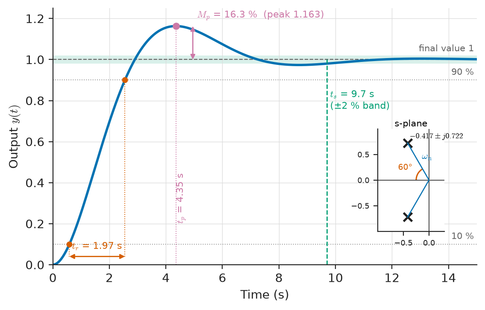
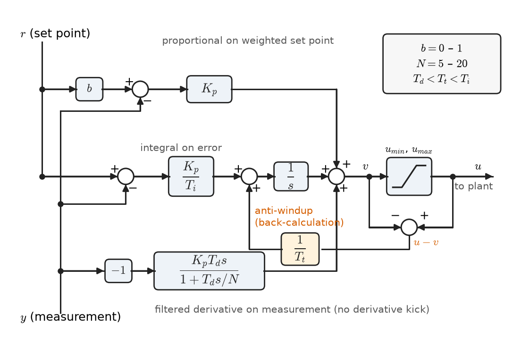
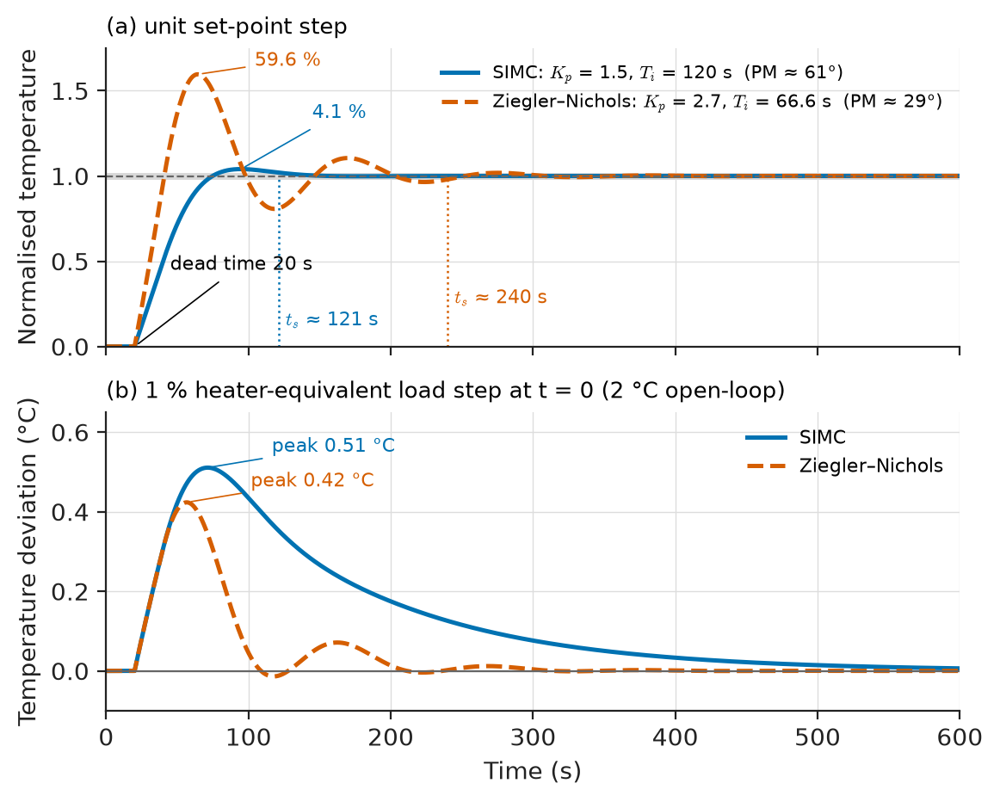
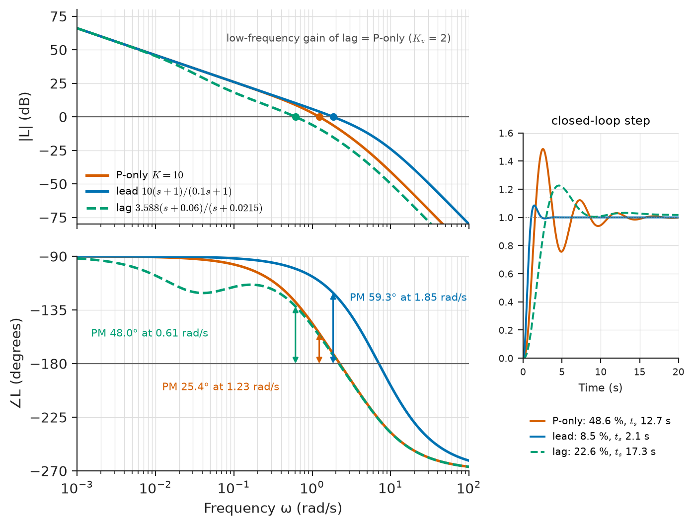
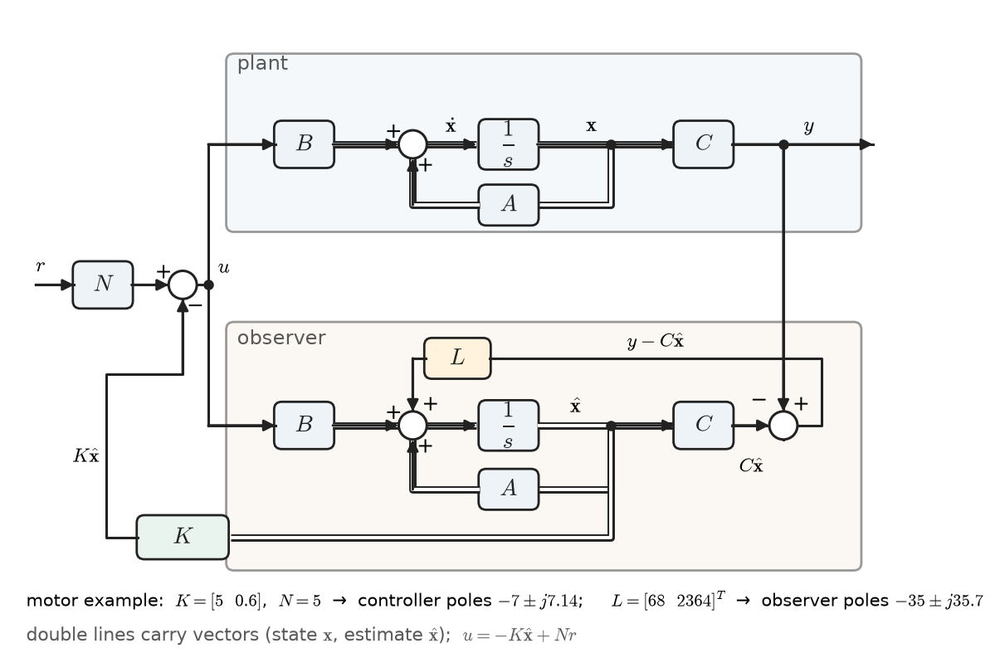
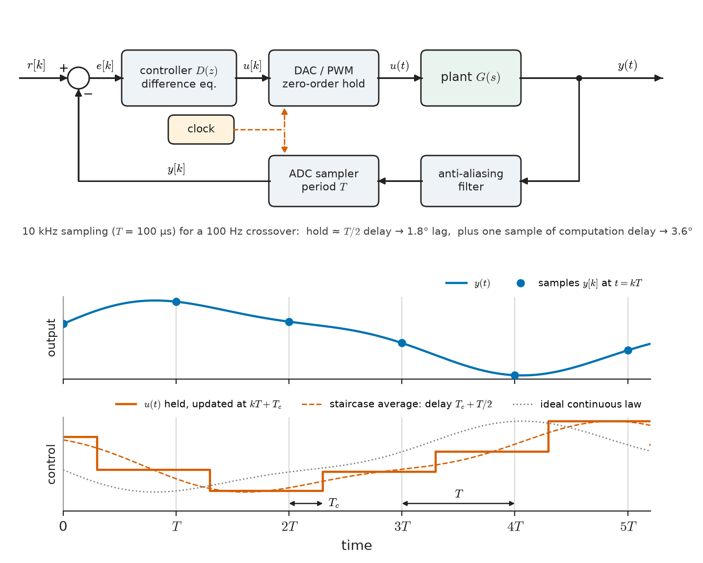

# Chapter 35 — Control Design Fundamentals

*Part VII · Control-System Fundamentals*

A commissioning engineer at a plastics plant is asked to tune the temperature controller of an extruder barrel zone. The previous settings came from a neighbouring line and produce a 12 °C overshoot on every start-up, enough to degrade the polymer. She has a choice of recipes: the 1942 Ziegler–Nichols rules printed in the controller manual, an "autotune" button that briefly relays the heater on and off, or a model-based rule that needs a step test first. Across the plant, a drives engineer is porting a well-behaved analog position loop into a microcontroller and finds that the same gains now make the axis ring; a power-electronics designer has a converter whose loop measures 25° of phase margin and must find 30° more without slowing it down. None of them is short of theory from Chapter 34: they can all tell whether a loop is stable. What they need is *design*: a specification written in numbers, a controller structure, a way to choose its parameters, and a check that the result survives the hardware it runs on.

This last chapter of the book supplies that toolkit at an introductory level. It starts from what a good response looks like, builds the PID controller and its tuning rules, uses gain and phase margins as design targets, opens the state-space view that underlies modern control, and ends with the controller as it is almost always implemented today: a program running on a sampled-data computer.

> **How are "fast", "well damped" and "accurate" turned into numbers a controller can be designed to meet?**
> **How do the PID controller, loop shaping and state feedback meet those numbers, and what changes when the controller becomes a sampled digital program?**

| Concept | Engineering destination |
|---|---|
| Transient-response specifications | Servo and drive commissioning, process start-up, power-supply transient tests |
| PID controllers | More than 90 % of industrial loops: temperature, pressure, flow, level, speed |
| Controller tuning rules | Field commissioning, autotuning in process and HVAC controllers |
| Gain and phase margins as design targets | SMPS compensation, PLL loop filters, motor drives, flight control |
| Lead and lag compensation | Adding phase where needed, raising low-frequency accuracy |
| State-space models | Multivariable plants, aircraft, power-electronic converters, estimation |
| Controllability and observability | Choosing actuators and sensors, deciding what feedback can achieve |
| Digital control | Every microcontroller, DSP and PLC loop; networked control |

**Roadmap.** Specifications (35.1) → the PID controller (35.2) and its tuning (35.3) → margins as design targets, with lead and lag compensation (35.4) → state-space models (35.5) → what an actuator can steer: controllability (35.6) → what a sensor can see: observability (35.7) → the controller as a sampled program (35.8).

---

## 35.1 Transient-response specifications

### The step response as a contract

A customer rarely writes "place the poles at $-1.8\pm j2.3$". They write "the antenna shall settle within 0.05° of a new pointing command in 3 s, with less than 10 % overshoot, and track 1°/s with a lag below 0.5°". The standard way to make such statements precise is the response to a unit step of the reference, with the measures defined in Figure 35.1:

- **Rise time** $t_r$: time to go from 10 % to 90 % of the final value (sometimes 0–100 % for underdamped responses).
- **Peak time** $t_p$: time of the first maximum.
- **Percent overshoot** $M_p$: $(y_{\max}-y_\infty)/y_\infty\times100\ \%$.
- **Settling time** $t_s$: the time after which the response stays within a band, usually $\pm2\ \%$ (sometimes $\pm5\ \%$ or $\pm1\ \%$) of the final value.
- **Steady-state error** $e_{ss}$: the remaining difference, set by the system type (Section 34.7).

<!-- FIGURE 35.1 | figures/ch35/fig-35-1-step-response-specs.png | plot | Step-response specifications: rise time, peak time, overshoot, settling band and steady-state value, drawn on a second-order response with zeta = 0.5 and natural frequency 0.833 rad/s. | Content: output versus time 0 to 15 s, y from 0 to 1.25. Curve: unit step response of wn^2/(s^2 + 2 zeta wn s + wn^2), zeta = 0.5, wn = 0.833 rad/s. Annotations: horizontal lines at 0.1 and 0.9 with rise time bracket (about 2.0 s); peak at t = 4.35 s, y = 1.163 labelled Mp = 16.3 percent; shaded band 0.98 to 1.02 with settling time about 9.6 s marked by vertical dashed line; final value 1 dashed. Small inset s-plane showing the pole pair at -0.417 plus/minus j0.722 with angle arccos(0.5) = 60 degrees, radius wn. -->

*Figure 35.1 — Step-response specifications: rise time, peak time, overshoot, settling band and steady-state value, drawn on a second-order response with zeta = 0.5 and natural frequency 0.833 rad/s.*

### The second-order template

Most specifications are translated through the standard second-order system of Chapter 7,

$$
T(s)=\frac{\omega_n^2}{s^2+2\zeta\omega_ns+\omega_n^2},\qquad s=-\zeta\omega_n\pm j\omega_n\sqrt{1-\zeta^2},
$$

for which the step-response measures have closed forms (exact for $M_p$ and $t_p$, approximate for $t_r$ and $t_s$):

$$
M_p=e^{-\pi\zeta/\sqrt{1-\zeta^2}},\qquad t_p=\frac{\pi}{\omega_n\sqrt{1-\zeta^2}},\qquad
t_s\approx\frac{4}{\zeta\omega_n}\ (2\ \%),\qquad t_r\approx\frac{1.8}{\omega_n}\ (\zeta\approx0.5).
$$

Overshoot depends only on $\zeta$, the angle of the poles; settling time depends on $\zeta\omega_n$, their distance from the imaginary axis; rise and peak time scale with $1/\omega_n$, their distance from the origin. A specification therefore defines a permitted region of the s-plane: to the left of a vertical line $\sigma=-4/t_s$ and inside a wedge of half-angle $\cos^{-1}\zeta_{\min}$.

**Table 35.1 — Second-order damping ratio and its time- and frequency-domain equivalents.** (PM is the phase margin of the unity-feedback loop $L=\omega_n^2/[s(s+2\zeta\omega_n)]$ that produces this $T$; $M_r$ is the closed-loop resonant peak.)

| $\zeta$ | Overshoot $M_p$ | Phase margin | Resonant peak $M_r$ | Typical use |
|---|---|---|---|---|
| 0.3 | 37.2 % | $33.3^\circ$ | 1.75 (4.9 dB) | Too oscillatory for most loops |
| 0.4 | 25.4 % | $43.1^\circ$ | 1.36 (2.7 dB) | Fast mechanical servos tolerating overshoot |
| 0.5 | 16.3 % | $51.8^\circ$ | 1.15 (1.2 dB) | Common general compromise |
| 0.6 | 9.5 % | $59.2^\circ$ | 1.04 (0.35 dB) | Drives, power supplies |
| 0.7 | 4.6 % | $65.2^\circ$ | 1.00 (0 dB) | Process loops, "Butterworth" response |
| 0.8 | 1.5 % | $69.9^\circ$ | none | Loops where overshoot is costly |
| 1.0 | 0 % | $76.3^\circ$ | none | Critically damped: no overshoot, slower |

The phase-margin column shows the rule of thumb already noticed in Chapter 34, $\mathrm{PM}\approx100\zeta$ degrees for $\zeta\le0.6$.

> **Status of the principle: Dominant second-order approximation**
> *Approximate.* Specifications translate exactly only for a two-pole system with no zeros; for higher-order loops they hold when the other poles are at least about five times further from the imaginary axis than the dominant pair and no zeros lie near it. Closed-loop zeros (from PI or PD action) increase overshoot beyond the formula.

**Worked example — translating a servo specification.** The antenna of Section 34.7 must meet: (i) $M_p\le10\ \%$; (ii) $t_s\le3$ s (2 %); (iii) ramp error $\le0.5^\circ$ at 1°/s, i.e. $K_v\ge2\ \mathrm{s^{-1}}$. From (i), $\zeta\ge\sqrt{(\ln0.1)^2/(\pi^2+(\ln0.1)^2)}=0.591$. From (ii), $\zeta\omega_n\ge4/3=1.33\ \mathrm{s^{-1}}$. From (iii), with the plant $G=1/[s(s+1)(s+5)]$ and a gain $K$, $K\ge10$. Chapter 34 showed that proportional control cannot meet these together: $K=10$ gives $\zeta=0.21$ and 48.6 % overshoot; the gain giving $\zeta=0.5$ gives $\zeta\omega_n=0.417\ \mathrm{s^{-1}}$ (settling about 9.6 s by the formula, 9.9 s simulated) and $K_v=0.72$. Section 35.4 meets all three with a lead compensator.

### Other specifications

Step specifications are not the whole contract. **Disturbance specifications** (the peak deviation and recovery time after a load step) matter more than set-point response in most process and power loops, where the set point rarely changes. **Integral criteria** compress a response into one number: integral of absolute error (IAE), of squared error (ISE) or of time-weighted absolute error (ITAE). **Robustness specifications** bound the peak sensitivity $M_s=\max\lvert S(j\omega)\rvert$ (Section 35.4), and **actuator specifications** bound control effort: a valve stroke rate, an inverter current limit, the voltage of a battery. A design that looks excellent on the step plot but demands a 10 kA pulse from a 50 A drive has not met its specification.

---

## 35.2 PID controllers

### Three actions on the error

The **proportional–integral–derivative (PID)** controller acts on the present error, its accumulated past and its predicted future:

$$
u(t)=K_p\left[e(t)+\frac{1}{T_i}\int_0^t e(\tau)\,d\tau+T_d\frac{de(t)}{dt}\right],
\qquad
C(s)=K_p\left(1+\frac{1}{T_is}+T_ds\right)
$$

This is the **standard (ISA, ideal) form**, with integral time $T_i$ and derivative time $T_d$. The **parallel form** $C=K_p+K_i/s+K_ds$ uses $K_i=K_p/T_i$, $K_d=K_pT_d$; the **series (interacting) form** $K_p'(1+1/T_i's)(1+T_d's)$ was natural in pneumatic and early analog hardware and survives in some industrial controllers. Tuning values must be converted when moving between forms.

**Table 35.2 — Effect of each PID action (typical, for a stable plant).**

| Action | What it reacts to | Main benefit | Main cost |
|---|---|---|---|
| Proportional $K_p$ | Present error | Speed; reduces error by factor $1+K_pG(0)$ | Steady-state error remains (type 0); too much gives oscillation |
| Integral $K_p/T_i$ | Accumulated error | Zero steady-state error to steps; disturbance rejection | Phase lag ($-90^\circ$ at low frequency); overshoot; windup |
| Derivative $K_pT_d$ | Rate of change | Phase lead near crossover; damping; anticipation | Amplifies sensor noise; "derivative kick" on set-point steps |

The frequency-domain view is the most useful one for design. PI control is a *lag* element: it adds infinite gain at DC and costs phase below the frequency $1/T_i$. PD control is a *lead* element: it adds phase (up to $+90^\circ$) above $1/T_d$ at the price of rising gain. A PID controller places the integral corner well below crossover and the derivative corner near it.

### What a practical PID contains

An ideal derivative has a gain that rises without bound, so measurement noise at high frequency is amplified enormously. Practical controllers filter it:

$$
C(s)=K_p\left(1+\frac{1}{T_is}+\frac{T_ds}{1+T_ds/N}\right),\qquad N\approx5\text{–}20,
$$

limiting the high-frequency derivative gain to $N$ times the proportional gain. Figure 35.2 shows the other standard additions.

- **Derivative on measurement.** Differentiating $-y$ instead of $e$ avoids the impulse ("derivative kick") that a set-point step would produce.
- **Set-point weighting.** Using $bR-Y$ ($0\le b\le1$) in the proportional term reduces overshoot to set-point changes without changing disturbance response.
- **Anti-windup.** When the actuator saturates (heater at 100 %, inverter at current limit, valve fully open), the loop is effectively open, but the integrator keeps integrating the error. When the error finally reverses, the large stored integral holds the actuator saturated and causes a large overshoot. Back-calculation feeds the difference between the computed and the saturated control signal back to the integrator through a gain $1/T_t$ (with $T_t$ typically between $T_d$ and $T_i$), or the integrator is simply frozen while the output is saturated (conditional integration).
- **Bumpless transfer.** Initialising the integrator when switching from manual to automatic so the output does not jump.

<!-- FIGURE 35.2 | figures/ch35/fig-35-2-practical-pid.png | block-diagram | A practical PID controller: proportional action on weighted set point, integral on error with back-calculation anti-windup, filtered derivative on measurement, and actuator saturation. | Content: inputs r (set point) and y (measurement). Proportional path: b r - y -> gain Kp. Integral path: r - y -> gain Kp/Ti -> summing junction -> integrator 1/s. Derivative path: -y -> block Kp Td s/(1 + Td s/N). The three paths sum to v -> saturation block (limits umin, umax) -> u to plant. Anti-windup: (u - v) -> gain 1/Tt -> back to integrator input summing junction. Annotations: N = 5 to 20, b = 0 to 1, Tt between Td and Ti. -->

*Figure 35.2 — A practical PID controller: proportional action on weighted set point, integral on error with back-calculation anti-windup, filtered derivative on measurement, and actuator saturation.*

> **Status of the principle: PID control as a design structure**
> *Approximate.* A PID controller can place at most three closed-loop poles or shape the loop around one crossover; it is sufficient for plants dominated by one or two time constants and a modest delay, and insufficient for lightly damped resonances, long dead times relative to the time constants, or strongly coupled multivariable plants.

### Where PID sits in hardware

PID is the dominant controller in process industry, HVAC, motor drives (where the current and speed loops of a field-oriented drive are PI controllers), power-electronic converters (type II and type III compensators are PI and PID with extra high-frequency poles), and in instrumentation (laser temperature control, oven-controlled crystal oscillators). In biomedical devices, infusion pumps and closed-loop anaesthesia systems use PID-type laws with heavy safety limits. The analog implementations with op-amps belong to *Electronics & Computing*; here the PID is a transfer function and, in Section 35.8, a difference equation.

---

## 35.3 Controller tuning

### The tuning problem

Tuning means choosing $K_p$, $T_i$ and $T_d$ for a particular plant. Three families of method are used: rules based on a measured oscillation (ultimate-cycle and relay methods), rules based on a measured step response (reaction-curve, IMC/SIMC), and model-based loop shaping (Section 35.4). The first two are fast to apply in the field and require only a few numbers.

### Ziegler–Nichols ultimate-cycle method

J. G. Ziegler and N. B. Nichols (1942) proposed: with integral and derivative action off, raise the proportional gain until the loop oscillates with constant amplitude. Record the **ultimate gain** $K_u$ and the **ultimate period** $T_u$. Then set the controller from Table 35.3.

**Table 35.3 — Classical tuning rules.** ($K$ = process gain, $\tau$ = time constant, $\theta$ = dead time of a first-order-plus-dead-time model.)

| Method | Controller | $K_p$ | $T_i$ | $T_d$ |
|---|---|---|---|---|
| Ziegler–Nichols ultimate cycle | P | $0.5K_u$ | — | — |
| | PI | $0.45K_u$ | $T_u/1.2$ | — |
| | PID | $0.6K_u$ | $T_u/2$ | $T_u/8$ |
| Ziegler–Nichols reaction curve | PI | $0.9\tau/(K\theta)$ | $3.33\theta$ | — |
| | PID | $1.2\tau/(K\theta)$ | $2\theta$ | $0.5\theta$ |
| SIMC (Skogestad), closed-loop time constant $\tau_c$ | PI | $\tau/[K(\tau_c+\theta)]$ | $\min[\tau,\ 4(\tau_c+\theta)]$ | — |

The ultimate gain and period are exactly what Routh's array delivers from a model: for the servo of Chapter 34, $K_u=30$ and $T_u=2\pi/\sqrt5=2.81$ s. The method was designed for **quarter-amplitude decay** (each overshoot a quarter of the previous one, $\zeta\approx0.2$), which is far more aggressive than most loops tolerate today.

> **Status of the principle: Ziegler–Nichols tuning rules**
> *Empirical.* The constants were fitted to simulations and plant tests of typical process loops in the 1940s; they give a workable but oscillatory starting point (phase margins near 20–35°) and should be refined, not trusted, especially on plants with long dead time or an integrator.

**Worked example — ultimate-cycle PID on a three-lag process.** A process with three equal lags (a jacketed reactor with heater, wall and contents; a cascade of three thermal masses) is modelled as $G(s)=1/(s+1)^3$ with time in minutes. The characteristic equation under P control is $s^3+3s^2+3s+1+K=0$; Routh gives the limit $9>1+K$, so $K_u=8$, and the auxiliary polynomial $3s^2+9$ gives $\omega_u=\sqrt3=1.732$ rad/min, $T_u=3.63$ min. The Ziegler–Nichols PID settings are

$$
K_p=0.6\times8=4.8,\qquad T_i=3.63/2=1.81\ \text{min},\qquad T_d=3.63/8=0.453\ \text{min}.
$$

The resulting loop has a crossover at 1.38 rad/min, a phase margin of $30.6^\circ$ and a sensitivity peak $M_s=2.13$; the step response overshoots by 40.6 % and settles (2 %) in 9.4 min. For comparison, P control at $K_p=0.5K_u=4$ gives 54 % overshoot and leaves a 20 % steady-state error ($1/(1+4)$). The PID result is usable but aggressive; practitioners commonly reduce $K_p$ by a factor of 1.5–2 or apply set-point weighting to cut the overshoot.

### Relay autotuning

Driving a plant into sustained oscillation by hand is risky. K. J. Åström and T. Hägglund (1984) replaced the proportional gain with a relay of amplitude $\pm d$: most plants then settle into a limit cycle at very nearly the ultimate frequency, with amplitude $a$. The describing-function approximation of the relay gives

$$
K_u\approx\frac{4d}{\pi a},\qquad T_u\approx\text{period of the limit cycle}.
$$

A relay of $\pm5\ \%$ heater power that produces a temperature oscillation of $\pm0.8$ °C gives $K_u\approx4\times5/(\pi\times0.8)=7.96$ % per °C. The oscillation amplitude is controlled by $d$ and stays small, which is why this is the "autotune" button on most industrial temperature controllers.

> **Status of the principle: Relay (describing-function) estimate of the ultimate point**
> *Approximate.* The describing function treats the relay as a gain acting on the fundamental of a sinusoidal input; it is accurate to a few percent when the plant filters harmonics well (several lags), and poorer for plants dominated by a single lag or dead time.

### Step-response (model-based) rules

Many process plants can be described, after an open-loop step test, by a **first-order-plus-dead-time (FOPDT)** model

$$
G(s)=\frac{K\,e^{-\theta s}}{\tau s+1}
$$

obtained by drawing the tangent of steepest slope (the reaction curve) or by fitting the 28 % and 63 % points. Table 35.4 lists representative values.

**Table 35.4 — Representative FOPDT parameters (order of magnitude; plants vary widely).**

| Process | Gain $K$ | Time constant $\tau$ | Dead time $\theta$ |
|---|---|---|---|
| Liquid flow through a control valve | 0.5–2 (flow %/valve %) | 1–5 s | 0.2–2 s |
| Small electric furnace or extruder zone | 1–5 °C per % power | 2–20 min | 0.2–2 min |
| Building zone heating | 0.1–0.5 °C per % | 0.5–3 h | 5–30 min |
| Liquid level in a tank (integrating) | — (integrator) | — | 1–30 s |
| Distillation column composition | 0.1–2 | 10–60 min | 2–20 min |

The **SIMC rule** (Skogestad's simple internal-model-control rule, 2003) derives from cancelling the plant lag with the integral term and choosing the closed-loop time constant $\tau_c$; the recommended default $\tau_c=\theta$ gives a robust loop.

> **Status of the principle: IMC/SIMC tuning**
> *Approximate.* Derived analytically from an FOPDT model by direct synthesis with a first-order Taylor approximation of the delay; the resulting margins (with $\tau_c=\theta$: GM about 3, PM about 60°, $M_s\approx1.6$) are reliable as long as the FOPDT model is a fair description of the plant.

**Worked example — tuning the extruder zone.** A step test of 10 % heater power on the extruder zone of the opening produces a 20 °C rise after a 20 s dead time, with a time constant of 120 s. The model is $K=2$ °C/%, $\tau=120$ s, $\theta=20$ s.

*SIMC PI with $\tau_c=\theta=20$ s:*

$$
K_p=\frac{120}{2\,(20+20)}=1.5\ \%/^\circ\mathrm{C},\qquad T_i=\min(120,\ 4\times40)=120\ \text{s}.
$$

*Ziegler–Nichols reaction-curve PI:*

$$
K_p=\frac{0.9\times120}{2\times20}=2.7\ \%/^\circ\mathrm{C},\qquad T_i=3.33\times20=66.6\ \text{s}.
$$

Simulation of both, with the delay modelled exactly (Figure 35.3), gives:

| Tuning | Set-point overshoot | 2 % settling | PM | GM | $M_s$ | IAE after 1 % load step |
|---|---|---|---|---|---|---|
| SIMC | 4.1 % | 121 s | $61.4^\circ$ | 3.14 (9.9 dB) | 1.59 | 80 °C·s |
| Ziegler–Nichols | 59.6 % | 240 s | $28.9^\circ$ | 1.63 (4.2 dB) | 3.08 | 25 °C·s |

The Ziegler–Nichols setting rejects a load disturbance (a cold-material surge, modelled as a 1 % step of heater-equivalent power, which would raise the temperature 2 °C open loop) three times better in IAE terms, but at the cost of 60 % set-point overshoot and a gain margin of only 1.6: a 60 % rise in process gain (a change of polymer grade) would make it oscillate. The SIMC loop is calm and robust but slow to remove disturbances, because with $\tau\gg\theta$ the integral time equals the long plant time constant. Skogestad's own refinement for such lag-dominant plants, and the common field practice, is to shorten $\tau_c$ or $T_i$ until a compromise (for example PM $\approx45^\circ$) is reached. Tuning rules are starting points; the trade-off between set-point response, disturbance rejection and robustness is the actual design.

<!-- FIGURE 35.3 | figures/ch35/fig-35-3-tuning-comparison.png | plot | Extruder-zone temperature loop (K = 2, tau = 120 s, theta = 20 s) under SIMC and Ziegler-Nichols PI tuning: set-point step (top) and 1 percent load-disturbance step (bottom). | Content: two panels sharing time axis 0 to 600 s. Top: normalised temperature response to unit set-point step, SIMC (Kp = 1.5, Ti = 120 s) solid with 4.1 percent overshoot settling about 121 s; ZN (Kp = 2.7, Ti = 66.6 s) dashed with 59.6 percent overshoot and decaying oscillation settling about 240 s; dead time 20 s visible at start. Bottom: temperature deviation in degrees C after a 1 percent heater-equivalent load step at t = 0: SIMC peak about 0.51 C with slow return; ZN peak about 0.42 C with faster oscillatory return. Annotate PM 61 and 29 degrees. -->

*Figure 35.3 — Extruder-zone temperature loop (K = 2, tau = 120 s, theta = 20 s) under SIMC and Ziegler-Nichols PI tuning: set-point step (top) and 1 percent load-disturbance step (bottom).*

### Tuning on other plants

The servo of Chapter 34 already contains an integrator (from speed to angle), so integral action is rarely needed for set-point tracking and can be harmful: the Ziegler–Nichols PI setting ($K_p=13.5$, $T_i=2.34$ s) puts its closed-loop poles at $-0.016\pm j1.50$, practically on the stability boundary, because the added integrator pushes the loop to type 2 with $-180^\circ$ of phase at low frequency. The lesson generalises: integral action belongs where the loop needs it (to reject a load torque, for instance) and with an integral time long compared with the crossover period. For integrating processes (tank level, servo position) dedicated rules exist, and for plants with resonances or long dead times model-based design is the better tool.

---

## 35.4 Gain and phase margins

### Margins as design targets

Chapter 34 defined the gain margin (GM), phase margin (PM) and peak sensitivity $M_s$ as distances from instability. In design they become targets, because they protect against what the model leaves out: gain variations of plant and actuator, unmodelled lags and delays, sampling. Table 35.5 collects typical values.

**Table 35.5 — Typical margin specifications.**

| Application | Phase margin | Gain margin | $M_s$ |
|---|---|---|---|
| General process control | 45–65° | 2–4 (6–12 dB) | 1.4–2.0 |
| Switched-mode power supply voltage loop | 45–70° | at least 6–10 dB | about 1.5 |
| Motor-drive speed and position loops | 40–60° | 6–12 dB | 1.3–2.0 |
| Phase-locked loop | 45–65° | at least 6 dB | — |
| Aircraft flight control (per loop, traditional) | at least 45° | at least 6 dB | — |

The peak sensitivity is the tightest of the three, since $1/M_s$ is the actual shortest distance from the Nyquist plot to $-1$. A loop with $M_s\le2$ is guaranteed $\mathrm{GM}\ge2$ and $\mathrm{PM}\ge29^\circ$; with $M_s\le1.4$, $\mathrm{GM}\ge3.5$ and $\mathrm{PM}\ge42^\circ$ (from $\mathrm{GM}\ge M_s/(M_s-1)$ and $\mathrm{PM}\ge2\sin^{-1}[1/(2M_s)]$).

> **Status of the principle: Margin specifications**
> *Empirical.* The numerical targets come from decades of practice relating margins to acceptable overshoot and tolerance to plant variation; the bounds linking $M_s$ to GM and PM are exact geometry, but the choice of a target value is engineering judgement.

### Frequency-domain correlations

Three approximate translations connect the margins to the time domain (for a loop with a dominant crossover and a slope near $-20$ dB/decade there):

- Damping: $\zeta\approx\mathrm{PM}/100$ (Table 35.1).
- Speed: closed-loop bandwidth $\omega_b\approx(1\text{–}2)\,\omega_c$, and rise time roughly $t_r\approx(1.5\text{–}2.5)/\omega_c$.
- Delay tolerance: $\tau_{\max}=\mathrm{PM}/\omega_c$ (Chapter 34).

### Loop shaping with lead and lag

**Loop shaping** modifies $L(j\omega)=C(j\omega)G(j\omega)$ directly on the Bode plot: high gain at low frequency for accuracy, a crossover at the desired speed with a slope of about $-20$ dB/decade and adequate phase, and low gain at high frequency for noise and robustness. Two elementary compensators do most of the work:

$$
C_{\text{lead}}(s)=K_c\frac{1+s/z}{1+s/p}\ (p>z),\qquad
C_{\text{lag}}(s)=K_c\frac{s+z}{s+p}\ (p<z).
$$

The lead network adds a phase bump with maximum

$$
\phi_{\max}=\sin^{-1}\frac{p/z-1}{p/z+1}\quad\text{at}\quad\omega_m=\sqrt{zp},
$$

(for $p/z=10$, $\phi_{\max}=54.9^\circ$), and is the frequency-domain twin of PD control. The lag network raises low-frequency gain by $z/p$ while leaving the crossover nearly untouched, and is the twin of PI control. Figure 35.4 compares them on the servo.

**Worked example — lead compensation of the antenna servo.** Specification from Section 35.1: $K_v\ge2$, $M_p\le10\ \%$, $t_s\le3$ s. Proportional control with $K=10$ meets $K_v$ but has PM $=25.4^\circ$ (Chapter 34). Place the lead zero on the plant pole at $-1$ (cancelling the slow mechanical lag) and the lead pole ten times higher:

$$
C(s)=10\,\frac{s+1}{0.1s+1},\qquad L(s)=\frac{10}{s(s+5)(0.1s+1)}=\frac{100}{s(s+5)(s+10)} .
$$

At DC the compensator gain is 10, so $K_v=10/5=2$ is unchanged. The new loop has $\omega_c=1.85$ rad/s and PM $=59.3^\circ$. The phase crossover moves to $\sqrt{50}=7.07$ rad/s (from Routh on $s^3+15s^2+50s+100k$, the limit is $k<7.5$), so GM $=7.5=17.5$ dB, and $M_s=1.45$. The closed-loop poles are $-1.81\pm j2.35$ ($\zeta=0.61$) and $-11.4$. In simulation the step response overshoots 8.5 % and settles in 2.1 s: all three specifications are met. The price is visible in the compensator: its high-frequency gain is $10\times10=100$, ten times that of the proportional controller, so encoder quantisation noise and resonances above 10 rad/s are amplified tenfold. The delay margin is $1.035/1.85=0.56$ s.

**Worked example — lag compensation, for contrast.** Keep the well-damped gain $K=3.588$ (PM $51.7^\circ$, $K_v=0.718$) and raise the low-frequency gain by $\beta=2/0.718=2.79$ with a lag whose zero sits a decade below crossover:

$$
C(s)=3.588\,\frac{s+0.06}{s+0.0215}.
$$

Now $K_v=3.588\times(0.06/0.0215)/5=2.0$, $\omega_c=0.61$ rad/s, PM $=48.0^\circ$, GM $=7.97$ (18.0 dB). The accuracy specification is met with almost the original damping, but the speed is not: overshoot is 22.6 % and the 2 % settling time 17.3 s, lengthened by a slow closed-loop pole–zero pair near $-0.06$ that leaves a long tail. Lead buys speed and phase; lag buys low-frequency gain. Lead–lag compensators, and PID, combine both.

<!-- FIGURE 35.4 | figures/ch35/fig-35-4-lead-lag-bode.png | bode | Bode plots of the antenna-servo loop with proportional (K = 10), lead and lag compensation, with crossovers and phase margins marked. | Content: frequency 0.001 to 100 rad/s log scale. Magnitude panel -80 to +80 dB: P-only K = 10 (PM 25.4 degrees at 1.23 rad/s), lead C = 10(s+1)/(0.1s+1) (PM 59.3 degrees at 1.85 rad/s), lag C = 3.588(s+0.06)/(s+0.0215) (PM 48.0 degrees at 0.61 rad/s, low-frequency gain equal to the K = 10 case). Phase panel -270 to -90 degrees with -180 line. Inset: closed-loop step responses 0 to 20 s: P-only 48.6 percent overshoot, lead 8.5 percent overshoot settling 2.1 s, lag 22.6 percent overshoot with long tail settling 17.3 s. -->

*Figure 35.4 — Bode plots of the antenna-servo loop with proportional (K = 10), lead and lag compensation, with crossovers and phase margins marked.*

### Limits no compensator removes

Some plant features cap the achievable crossover regardless of design skill. A dead time $\theta$ limits $\omega_c$ to roughly $1/\theta$ or less (it consumes $57^\circ$ of phase at $\omega=1/\theta$). A right-half-plane zero at $z$ (a boost converter's output in continuous conduction, the initial wrong-way response of a steam drum level) limits $\omega_c$ to about $z/2$. An unstable pole at $p$ requires $\omega_c$ above about $2p$. Lightly damped resonances must be kept well above or carefully inside the crossover. These limits, consequences of the Bode integral of Chapter 34, are why a sensible specification is written only after looking at the plant.

---

## 35.5 State-space introduction

### Why another description

Transfer functions describe single-input single-output (SISO) LTI systems from the outside. Three needs push beyond them: plants with several inputs and outputs (an aircraft, a multi-machine power system, a three-phase converter in $dq$ coordinates); internal behaviour that may not appear at the output (Section 35.7); and design by placing every closed-loop pole, not just a dominant pair. The **state-space** model writes an $n$th-order system as $n$ first-order differential equations:

$$
\dot{\mathbf x}=\mathbf A\mathbf x+\mathbf B\mathbf u,\qquad \mathbf y=\mathbf C\mathbf x+\mathbf D\mathbf u
$$

with state vector $\mathbf x$ ($n\times1$), input $\mathbf u$, output $\mathbf y$, and constant matrices $\mathbf A$ (dynamics), $\mathbf B$ (input), $\mathbf C$ (output) and $\mathbf D$ (direct feedthrough). In circuits the natural states are capacitor voltages and inductor currents (the energy-storing variables of Chapter 5); in mechanics, positions and velocities.

### Link to transfer functions

Taking Laplace transforms with zero initial state:

$$
\mathbf G(s)=\mathbf C(s\mathbf I-\mathbf A)^{-1}\mathbf B+\mathbf D,\qquad
\det(s\mathbf I-\mathbf A)=0\ \text{gives the poles}.
$$

The eigenvalues of $\mathbf A$ are the poles of the system (unless some cancel, Section 35.7). The time-domain solution uses the matrix exponential (a recap from the linear-algebra and ODE chapters of *The Mathematics Universe*):

$$
\mathbf x(t)=e^{\mathbf At}\mathbf x(0)+\int_0^t e^{\mathbf A(t-\tau)}\mathbf B\mathbf u(\tau)\,d\tau .
$$

The state description is not unique: any invertible change of variables $\mathbf x=\mathbf T\mathbf z$ gives $(\mathbf T^{-1}\mathbf A\mathbf T,\ \mathbf T^{-1}\mathbf B,\ \mathbf C\mathbf T,\ \mathbf D)$ with the same transfer function. Standard choices include the **controllable canonical form**, read directly from the transfer-function coefficients: $G=(b_1s+b_0)/(s^2+a_1s+a_0)$ has

$$
\mathbf A=\begin{bmatrix}0&1\\-a_0&-a_1\end{bmatrix},\quad
\mathbf B=\begin{bmatrix}0\\1\end{bmatrix},\quad
\mathbf C=\begin{bmatrix}b_0&b_1\end{bmatrix}.
$$

**Worked example — a DC servo motor in state space.** A small permanent-magnet servo motor driven by a voltage amplifier, with negligible armature inductance, has speed dynamics $\dot\omega=-\omega/\tau_m+(K_m/\tau_m)u$ with mechanical time constant $\tau_m=0.5$ s and gain $K_m=10$ rad/s per volt. With states $x_1=\theta$ (shaft angle) and $x_2=\omega$ (speed) and a position encoder as output:

$$
\mathbf A=\begin{bmatrix}0&1\\0&-2\end{bmatrix},\quad
\mathbf B=\begin{bmatrix}0\\20\end{bmatrix},\quad
\mathbf C=\begin{bmatrix}1&0\end{bmatrix},\quad \mathbf D=0 .
$$

Then $(s\mathbf I-\mathbf A)^{-1}=\dfrac{1}{s(s+2)}\begin{bmatrix}s+2&1\\0&s\end{bmatrix}$ and

$$
G(s)=\mathbf C(s\mathbf I-\mathbf A)^{-1}\mathbf B=\frac{20}{s(s+2)},
$$

with poles at the eigenvalues 0 and $-2$ of $\mathbf A$. The same motor with armature inductance included would gain a third state, the current, and the model of a buck converter has inductor current and capacitor voltage as states; state space handles all of them with the same notation.

<!-- FIGURE 35.5 | figures/ch35/fig-35-5-state-feedback-observer.png | block-diagram | State-space plant with state feedback u = -Kx + Nr and a Luenberger observer that reconstructs the state from the measured output. | Content: plant block: u -> B -> summing junction -> integrator 1/s -> x -> C -> y, with feedback through A from x to the summing junction (double-line arrows for vectors). Observer copy below: u -> B and y - C x-hat through gain L into a summing junction -> integrator -> x-hat, with A feedback; output C x-hat. Controller: x-hat -> gain K -> subtracted from N r to give u. Labels for the motor example: K = [5 0.6], N = 5, L = [68 2364]^T, controller poles -7 plus/minus j7.14, observer poles -35 plus/minus j35.7. -->

*Figure 35.5 — State-space plant with state feedback u = -Kx + Nr and a Luenberger observer that reconstructs the state from the measured output.*

> **Status of the principle: State-space representation**
> *Derived.* Any finite-dimensional linear time-invariant system described by ordinary differential equations can be written in state-space form, and its transfer function follows exactly; the model is only as good as the lumped, linear, time-invariant assumptions behind the differential equations.

---

## 35.6 Controllability

### Can the input steer every state?

A system is **controllable** if, for any initial state and any target state, there is an input that moves the state from one to the other in finite time. Controllability asks whether the actuators reach every mode of the plant. Kalman's test (1960): an $n$th-order system is controllable if and only if the **controllability matrix**

$$
\mathcal C=\begin{bmatrix}\mathbf B&\mathbf A\mathbf B&\mathbf A^2\mathbf B&\cdots&\mathbf A^{n-1}\mathbf B\end{bmatrix}
$$

has rank $n$.

> **Status of the principle: Kalman controllability rank test**
> *Derived.* Follows from the Cayley–Hamilton theorem applied to the solution $e^{\mathbf At}$; exact for LTI models, though a matrix that is full rank but nearly singular indicates a mode that can be steered only with very large inputs.

For the motor, $\mathbf A\mathbf B=[20,\ -40]^T$ and

$$
\mathcal C=\begin{bmatrix}0&20\\20&-40\end{bmatrix},\qquad\det\mathcal C=-400\ne0,
$$

so the motor is controllable from its voltage input, as intuition suggests.

**Worked example — an uncontrollable circuit.** Two RC branches, each a resistor in series with a capacitor, are connected in parallel across the same source $u$. Let both have the same time constant, $R_1C_1=R_2C_2=\tau$ (for example 10 kΩ with 100 nF and 1 kΩ with 1 µF, both $\tau=1$ ms). With the capacitor voltages as states,

$$
\mathbf A=\begin{bmatrix}-1/\tau&0\\0&-1/\tau\end{bmatrix},\quad \mathbf B=\begin{bmatrix}1/\tau\\1/\tau\end{bmatrix},\quad
\mathcal C=\frac1\tau\begin{bmatrix}1&-1/\tau\\1&-1/\tau\end{bmatrix},
$$

which has rank 1. Whatever the source does, the difference $v_1-v_2$ obeys $\frac{d}{dt}(v_1-v_2)=-(v_1-v_2)/\tau$: it decays on its own and cannot be driven. Physically, the two branches respond identically to every input, so no input can separate them. The same structure appears in a balanced bridge (the balanced condition makes the detector mode uncontrollable from the supply) and in symmetrical power networks, where the "differential" mode between identical generators on a common bus cannot be excited by a common input. If the time constants differ ($\tau_1\ne\tau_2$), the rank becomes 2 and the system is controllable, though nearly uncontrollable when $\tau_1\approx\tau_2$.

### Pole placement by state feedback

The payoff of controllability is that full **state feedback**

$$
u=-\mathbf K\mathbf x+Nr
$$

gives the closed-loop matrix $\mathbf A-\mathbf B\mathbf K$, whose eigenvalues can be placed *anywhere* (in complex-conjugate pairs) if and only if $(\mathbf A,\mathbf B)$ is controllable. Uncontrollable modes stay where they are, whatever $\mathbf K$; if such a mode is unstable, no controller can stabilise the plant (it is not **stabilisable**).

**Worked example — placing the motor poles.** Choose closed-loop poles with $\zeta=0.7$ and $\omega_n=10$ rad/s, i.e. the characteristic polynomial $s^2+14s+100$. With $\mathbf K=[k_1\ \ k_2]$,

$$
\mathbf A-\mathbf B\mathbf K=\begin{bmatrix}0&1\\-20k_1&-2-20k_2\end{bmatrix},\qquad
\det(s\mathbf I-\mathbf A+\mathbf B\mathbf K)=s^2+(2+20k_2)s+20k_1 .
$$

Matching coefficients: $20k_1=100$, $k_1=5$ V/rad; $2+20k_2=14$, $k_2=0.6$ V·s/rad. The poles are $-7\pm j7.14$. The reference gain that gives unit steady-state gain is $N=-1/[\mathbf C(\mathbf A-\mathbf B\mathbf K)^{-1}\mathbf B]=5$ (here equal to $k_1$, because the plant contains an integrator). The step response overshoots 4.6 % and settles in 0.60 s, exactly as Table 35.1 predicts for $\zeta=0.7$ with $4/(\zeta\omega_n)=0.57$ s. The controller is a PD law in disguise: a gain on angle plus a gain on speed. For higher-order plants the gains are found by Ackermann's formula or numerically; the **linear-quadratic regulator** (LQR), which chooses $\mathbf K$ to minimise a weighted sum of state error and control effort, is the systematic route taken in advanced texts.

---

## 35.7 Observability

### Can the sensors see every state?

State feedback needs every state, but sensors are expensive, noisy or impossible (rotor flux in an induction motor, the temperature inside a battery cell, the core temperature of a patient). A system is **observable** if the initial state can be determined from the output (and the known input) over a finite interval. The test is dual to controllability: the **observability matrix**

$$
\mathcal O=\begin{bmatrix}\mathbf C\\\mathbf C\mathbf A\\\vdots\\\mathbf C\mathbf A^{n-1}\end{bmatrix}
$$

must have rank $n$.

> **Status of the principle: Observability and duality**
> *Derived.* The rank test follows from expanding the output in terms of $e^{\mathbf At}\mathbf x(0)$; $(\mathbf A,\mathbf C)$ is observable exactly when $(\mathbf A^T,\mathbf C^T)$ is controllable, so every controllability result has an observability twin.

**Worked example — encoder versus tachometer.** For the motor with a position encoder, $\mathbf C=[1\ \ 0]$, $\mathbf C\mathbf A=[0\ \ 1]$, so $\mathcal O=\mathbf I$, rank 2: the speed can be reconstructed from position (by differentiation, or better by an observer). With only a tachometer, $\mathbf C=[0\ \ 1]$, $\mathbf C\mathbf A=[0\ \ -2]$, so

$$
\mathcal O=\begin{bmatrix}0&1\\0&-2\end{bmatrix},\qquad \text{rank }1 .
$$

The angle is unobservable from speed: two shafts that turn identically but started at different angles produce identical tachometer signals. Integrating the speed gives the angle only up to an unknown constant, and any offset or drift in the integration accumulates without correction. This is why inertial navigation, which integrates accelerations, needs periodic position fixes (GNSS) to stay bounded.

### Hidden modes

Controllability and observability explain an effect that transfer functions conceal. Kalman's decomposition splits any system into four parts: controllable and observable, controllable but unobservable, uncontrollable but observable, and neither. **Only the controllable-and-observable part appears in the transfer function.** A pole–zero cancellation in $G(s)$ is the visible sign of a mode that is uncontrollable, unobservable or both. Cancelling an unstable plant pole with a controller zero is therefore forbidden: the transfer function from reference to output looks stable, but an internal signal grows without bound (the loop is not *internally stable*). The lead design of Section 35.4 cancelled the *stable* pole at $-1$, which is acceptable: the hidden mode decays as $e^{-t}$, visible only in the response to a disturbance entering at the plant input.

### Observers

An **observer** (Luenberger, 1964) is a software copy of the plant driven by the same input and corrected by the measured output:

$$
\dot{\hat{\mathbf x}}=\mathbf A\hat{\mathbf x}+\mathbf B\mathbf u+\mathbf L(\mathbf y-\mathbf C\hat{\mathbf x}) .
$$

The estimation error $\mathbf e=\mathbf x-\hat{\mathbf x}$ obeys $\dot{\mathbf e}=(\mathbf A-\mathbf L\mathbf C)\mathbf e$, so its eigenvalues can be placed arbitrarily if the system is observable. For the motor with an encoder, $\mathbf A-\mathbf L\mathbf C=\begin{bmatrix}-l_1&1\\-l_2&-2\end{bmatrix}$ has characteristic polynomial $s^2+(l_1+2)s+(2l_1+l_2)$. Placing the observer poles five times faster than the controller, at $\zeta=0.7$, $\omega_n=50$ rad/s ($s^2+70s+2500$), gives $l_1=68$ and $l_2=2500-136=2364$, observer poles $-35\pm j35.7$. Figure 35.5 shows the complete structure.

The **separation principle** states that, for an LTI plant, the controller gain $\mathbf K$ and observer gain $\mathbf L$ can be designed independently: the closed loop has the controller poles plus the observer poles. When measurement and process noise are significant, the optimal choice of $\mathbf L$ is the **Kalman filter**, used in everything from GNSS receivers to battery state-of-charge estimation. Observers put an obligation on the engineer as well: the observer is only as good as its model, and a fast observer amplifies sensor noise just as derivative action does.

---

## 35.8 Digital control fundamentals

### The sampled loop

Almost every controller built today is a program. Figure 35.6 shows the structure: an anti-aliasing filter and ADC sample the measurement every $T$ seconds (Chapter 19), the processor computes $u[k]$ from current and past samples, and a DAC or PWM unit holds that value constant until the next update, the **zero-order hold** (ZOH). The plant remains continuous-time; the controller sees it only at the sampling instants.

<!-- FIGURE 35.6 | figures/ch35/fig-35-6-digital-control-loop.png | block-diagram | A digital control loop: anti-aliasing filter, ADC sampling at period T, discrete controller difference equation, zero-order hold and continuous plant, with a timing diagram showing sampling, computation delay and the staircase control signal. | Content: top: loop r[k] -> summing junction -> controller D(z) (difference equation) -> DAC/PWM with zero-order hold -> continuous plant G(s) -> y(t) -> anti-aliasing filter -> ADC (sampler, period T) -> back to summing junction. Clock block driving ADC and DAC. Bottom: timing diagram over 5 sample periods: continuous y(t) curve with sample dots at kT; staircase u(t) updated at kT + Tc (computation delay Tc), held constant; dashed smooth curve showing the equivalent average delay T/2 of the hold. Labels: sampling 10 kHz (T = 100 us) for a 100 Hz crossover gives 1.8 degrees of hold lag plus 3.6 degrees for one sample of computation delay. -->

*Figure 35.6 — A digital control loop: anti-aliasing filter, ADC sampling at period T, discrete controller difference equation, zero-order hold and continuous plant, with a timing diagram showing sampling, computation delay and the staircase control signal.*

### Sampling rate and the cost of the hold

The ZOH output is a staircase whose average lags the continuous signal by half a sample. In the frequency domain the hold behaves approximately as a delay of $T/2$, adding phase lag

$$
\Delta\phi_{\text{ZOH}}\approx\frac{\omega T}{2}\ \text{rad}
$$

at frequency $\omega$. Most implementations also compute $u[k]$ from $y[k]$ and apply it at the next sampling instant, adding one more sample of delay. With a total effective delay $\tau_d$, the phase lost at crossover is $\omega_c\tau_d$.

> **Status of the principle: Zero-order hold as a half-sample delay**
> *Approximate.* The exact hold response is $(1-e^{-sT})/s$; replacing it by $e^{-sT/2}$ is accurate for frequencies well below the Nyquist frequency $\pi/T$ (within a few percent below about a fifth of it) and fails near Nyquist, where the exact discrete-time analysis in the z-domain is required.

**Worked example — how fast must a drive loop sample?** A motor-drive speed loop is designed in continuous time for crossover at 100 Hz ($\omega_c=628$ rad/s) with PM $=55^\circ$.

- At $f_s=10$ kHz ($T=100$ µs): the hold costs $628\times50\ \mu\mathrm{s}=0.0314$ rad $=1.8^\circ$ and a one-sample computation delay a further $3.6^\circ$; total $5.4^\circ$, leaving PM $\approx49.6^\circ$. The analog design transfers almost unchanged.
- At $f_s=1$ kHz ($T=1$ ms): the hold costs $18^\circ$ and the computation delay $36^\circ$, a total of $54^\circ$, leaving about $1^\circ$ of margin. The loop will ring violently or oscillate, which is exactly what the drives engineer of the opening found.

The common rule of thumb follows: sample at 10–30 times the closed-loop bandwidth (about 20–60 times the crossover in hertz for tight loops), or redesign the controller in discrete time to account for the delay explicitly.

**Table 35.6 — Representative sampling rates in digital control.**

| Loop | Typical sampling rate |
|---|---|
| Switched-mode power supply (digital controller) | 50 kHz–1 MHz (often once per switching period) |
| Motor-drive current loop | 8–20 kHz (PWM frequency) |
| Motor-drive speed and position loops | 1–10 kHz |
| Quadcopter attitude loop | 0.5–8 kHz (IMU-rate dependent) |
| Grid-converter current control | 5–20 kHz |
| Generator AVR / power-system stabiliser (digital) | 100 Hz–2 kHz |
| Process temperature, flow, level (PLC/DCS) | 0.1–10 Hz |
| Building HVAC | 0.01–1 Hz |

### From s to z: discretising the controller and the plant

Chapter 20 introduced the z-transform and showed that a discrete system is stable when its poles lie inside the unit circle. A continuous pole at $s$ maps to a discrete pole at

$$
z=e^{sT},
$$

so the left half s-plane maps to the inside of the unit circle and the imaginary axis to the circle itself. There are two standard routes to a discrete controller.

1. **Discretise the continuous design** with a substitution. The **bilinear (Tustin)** transform
$$
s\leftarrow\frac{2}{T}\,\frac{z-1}{z+1}
$$
maps the stable region exactly onto the unit disc and preserves stability; backward Euler $s\leftarrow(1-z^{-1})/T$ is simpler and also stable but more distorting. Either works well when $T$ is small compared with the loop time constants.
2. **Discretise the plant exactly** with the ZOH equivalent and design directly in the z-domain. For a state-space plant
$$
\mathbf x[k+1]=\mathbf A_d\mathbf x[k]+\mathbf B_d u[k],\quad
\mathbf A_d=e^{\mathbf AT},\quad
\mathbf B_d=\int_0^T e^{\mathbf A\tau}\,d\tau\,\mathbf B .
$$

> **Status of the principle: Exact ZOH discretisation**
> *Derived.* Integrating the state equation over one sample with the input held constant gives $\mathbf A_d$ and $\mathbf B_d$ exactly at the sampling instants; it says nothing about intersample behaviour, which can hide ripple if the sampling is too slow.

**Worked example — the motor in discrete time.** With $T=10$ ms, the motor of Section 35.5 gives

$$
\mathbf A_d=\begin{bmatrix}1&0.009901\\0&0.98020\end{bmatrix},\qquad
\mathbf B_d=\begin{bmatrix}0.000993\\0.19801\end{bmatrix}.
$$

The pole at $s=-2$ maps to $z=e^{-0.02}=0.9802$, and the integrator pole at $s=0$ to $z=1$, on the unit circle as expected. The state-feedback design of Section 35.6 placed the poles at $s=-7\pm j7.14$; their discrete images are $z=e^{sT}=0.930\pm j0.0665$, of magnitude $0.932$, comfortably inside the unit circle. A discrete pole-placement design would target those $z$ values directly.

**Worked example — a PI controller as a difference equation.** The SIMC controller of the extruder ($K_p=1.5$, $T_i=120$ s), sampled at $T=1$ s with Tustin's rule, becomes

$$
u[k]=u[k-1]+q_0e[k]+q_1e[k-1],\qquad
q_0=K_p\left(1+\frac{T}{2T_i}\right)=1.50625,\quad
q_1=-K_p\left(1-\frac{T}{2T_i}\right)=-1.49375 .
$$

This "velocity form" computes the *change* of control, which makes anti-windup trivial (clamp $u[k]$ to the actuator range before storing it) and transfers bumplessly from manual mode. At $T=1$ s against a 20 s dead time and 120 s time constant, the sampling delay costs only a few degrees of phase at the 0.025 rad/s crossover ($0.025\times1.5=0.0375$ rad, about $2^\circ$).

### Practical issues

- **Aliasing.** A sampled controller cannot distinguish a disturbance at frequency $f$ from one at $f_s-f$ (Chapter 19). Mains pickup at 50 Hz sampled at 52 Hz appears as a 2 Hz disturbance that the loop will dutifully "correct". An analog anti-aliasing filter, or oversampling with digital filtering, is required, and its own phase lag must be counted in the margin budget.
- **Quantisation and word length.** ADC resolution sets a noise floor that derivative action amplifies; a 12-bit encoder count differentiated at 10 kHz produces large speed steps. Fixed-point controller coefficients such as $q_0$ and $q_1$ above, which differ by less than 1 %, must be represented precisely or the integral action is distorted (the finite-precision effects of Chapter 21 and Chapter 23).
- **Timing jitter and networked control.** Variable computation time or a network link makes the delay uncertain; the delay margin of Chapter 34 sets the tolerance.
- **Multi-rate structures.** Cascaded drives run current loops fast, speed loops slower and position loops slower still, exactly the separation of time scales of Table 34.1.

> **Boundary.** Microcontroller peripherals (ADCs, timers, PWM units), real-time operating systems and embedded code belong to *Electronics & Computing* and to the robotics and automation books. This section covers only the signal-and-system consequences of sampling a loop.

---

## What remains open

| Open question | Where it is answered |
|---|---|
| How are the plant models and block diagrams used here obtained from physics? | Chapter 33 (dynamic-system modeling) |
| Stability tests, root locus, steady-state error and the Nyquist criterion behind every design here | Chapter 34 (feedback and stability) |
| Second-order response, damping ratio and natural frequency of RLC circuits | Chapter 7 |
| Laplace-domain poles and zeros, Bode asymptotes | Chapters 11 and 13 |
| Sampling, aliasing, z-transform and digital-filter implementation of controllers | Chapters 19, 20, 21 and 23 |
| Kalman filtering of noisy measurements and the statistics of sensor noise | Chapter 29 (random signals); probability in *The Mathematics Universe* |
| Optimal (LQR, LQG), robust ($H_\infty$), nonlinear, adaptive and model-predictive control | Beyond this book: advanced control texts and the robotics and automation books |
| Op-amp and digital hardware that implements PID compensators | *Electronics & Computing* |
| Drives, excitation systems and governors that these loops command | *Electrical Energy & Machines* |
| Embedded controllers and real robot joints | Robotics and automation books |

**Closing.** From Ohm's law in Chapter 1 to a sampled state-feedback controller in this chapter, the book has used one body of mathematics, linear systems described by poles, zeros and frequency responses, to analyse circuits, filter signals, carry information across noisy channels and, finally, make imprecise machines behave precisely; the engineer who can move between those views is ready for every specialised discipline built on them.
